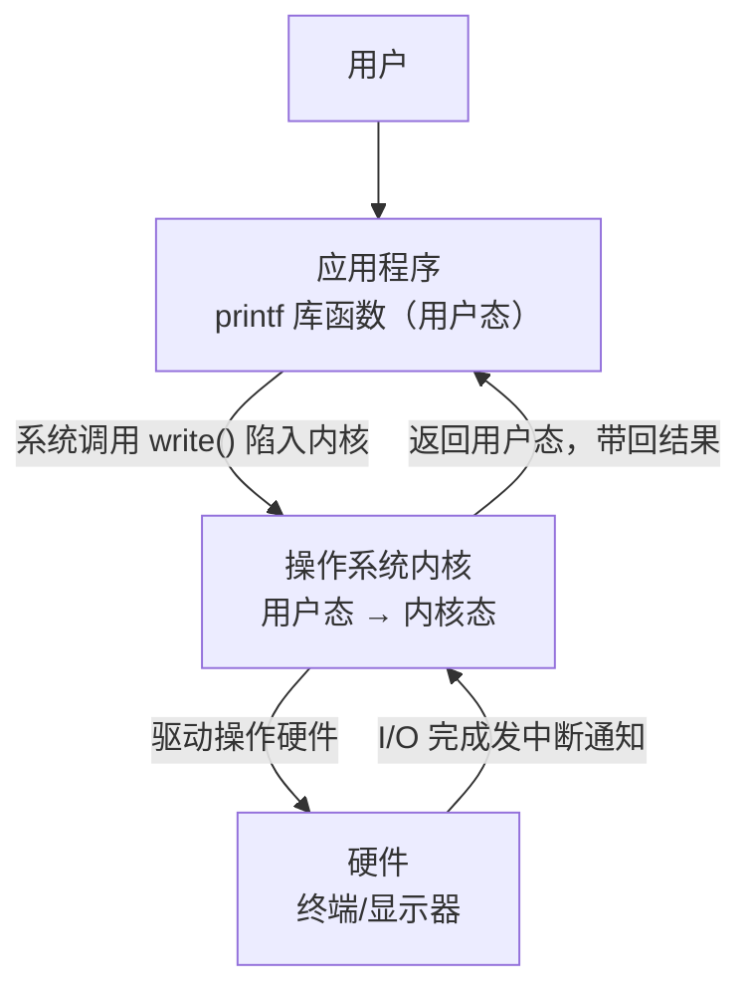
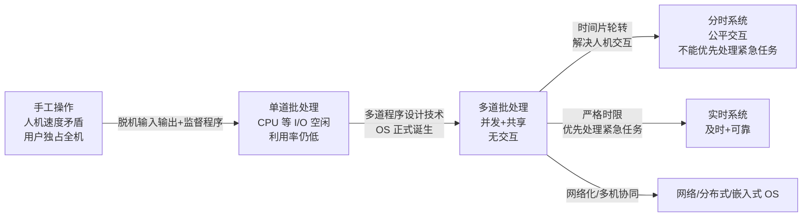

（例题见：[试题文档 ques.md](res/ques.md)相关章节）

## 1.概念

操作系统（Operating System，OS）是**控制和管理整个计算机系统的硬件和软件资源，合理地组织调度计算机的工作和资源的分配，并向用户和其他软件提供方便的接口和环境**的一类系统软件。

- 「控制和管理……资源」→ 操作系统是**资源管理者**；
- 「向用户和其他软件提供方便接口」→ 操作系统是**服务提供者**；
- 「系统软件」→ 与普通应用软件的本质区别：它是计算机系统中最基本、最核心的系统软件。

操作系统位于**硬件（裸机）之上、应用程序之下**，是整个计算机系统的"大管家"。它本身不完成具体业务功能（不计算、不排版、不打字），而是为上层应用与用户"搭台子"。学习操作系统的本质，就是理解它如何管理 CPU、内存、文件、设备这四类资源。

| 项 | 内容 |
| --- | --- |
| 操作系统定义 | **系统软件**：资源管理者 + 服务提供者 + 扩充机器 |
| 层次位置 | 硬件之上、应用程序之下，是连接二者的**唯一桥梁** |
| 四大资源 | 处理机 / 存储器 / 文件 / 设备 → 分别对应第2/3/4/5章 |
| 接口分类树 | GUI → 命令接口（联机、脱机）→ 程序接口（系统调用） |
| 联机 vs 脱机 | 联机=**逐条交互**（cmd/bash 敲一行答一行）；脱机=**成批提交**（.bat/.sh） |
| 三等价 | **程序接口 = 系统调用 = 广义指令** |
| 唯一方式 | 系统调用是应用程序请求操作系统服务的**唯一方式** |
| 使用者边界 | 普通用户**不能直接**使用程序接口，只能经程序代码间接使用 |
| 命令接口的底层 | 最终也要**落到系统调用**（`copy a b` → 文件读写系统调用） |
| 扩充机器 vs 虚拟机 | 扩充机器=OS 对裸机的**包装增强**；虚拟机=虚拟化技术（1.6 才讲） |
| 四大目标 | 方便性、**有效性**、可扩充性、开放性 |
| 有效性口径 | 提高**系统资源利用率与吞吐量**（不是单个程序速度） |


一台裸机只有 CPU、内存、磁盘等硬件，直接面对硬件的程序员要逐条操作寄存器、手工管理内存布局与 I/O，效率极低且极易出错；更危险的是，若允许每个程序直接访问硬件，任意一个 bug 或恶意程序都能破坏整个系统。

操作系统正是为解决这两大问题登场：
- 一是**封装**——把"丑陋"的硬件接口包装成文件、进程、系统调用等友好服务，即"扩充机器"；
  - 操作系统是用户/应用与硬件之间的**唯一桥梁**（应用程序不能直接操控硬件，必须经由操作系统）。
  - 所以当程序员写 `printf("hello")` 时，实际经过了 用户态库函数 → 系统调用 → 内核 → 终端设备 的完整链路。
- 二是**仲裁**——由内核统一掌管处理机、内存、文件、设备四类资源，任何访问都必须经操作系统这一"唯一桥梁"，保证安全与稳定。这也解释了为什么"用户接口分类"成为本章最高频考点：接口正是"封装"与"仲裁"两个动机落到用户侧的具体形态。




| 角度 | 含义 | 生活化例证 |
| --- | --- | --- |
| ① 系统资源的管理者 | 管理 CPU（处理机）、内存、文件、设备等软硬件资源，合理分配并处理资源冲突 | Windows 任务管理器（Ctrl+Alt+Del）可查看各进程对 CPU、内存的占用并结束进程 |
| ② 向上层提供方便易用的服务 | 把"丑陋"的硬件接口封装成友好服务，用户无需面对二进制指令与寄存器 | 用户只需点击图标、拖拽文件，而不必写机器指令访问硬盘 |
| ③ 最接近硬件的一层软件 | 对硬件机器进行扩充，把裸机改造成功能更强、更好用的"扩充机器（虚拟机）" | 覆盖了文件系统后，用户"看到"的不再是磁盘扇区，而是目录和文件 |


 ## 2.功能

有资源管理、服务提供、扩充机器三大功能。

资源管理（核心功能）——操作系统管理的四类资源：

| 资源 | 管理内容 | 对应章节 |
| --- | --- | --- |
| 处理机（CPU） | 进程调度、进程同步互斥、死锁处理 | 第2章 进程管理 |
| 存储器 | 内存分配与回收、地址变换、虚拟内存 | 第3章 内存管理 |
| 文件 | 文件逻辑/物理结构、目录、存储空间管理 | 第4章 文件管理 |
| 设备 | I/O 控制方式、SPOOLing、磁盘调度 | 第5章 I/O 管理 |


用 qq 聊天为例 ：

> 1. 逐层打开文件夹，找到 QQ.exe（可执行文件）的**存放位置** → 对应**文件管理**；
> 2. 双击打开 QQ.exe，程序相关数据被**放入内存**（补充知识：执行一个程序前必须先把该程序放入内存，才能被 CPU 处理）→ 对应**存储器管理**；
> 3. QQ 正常运行，对应的**进程被处理机（CPU）处理** → 对应**处理机管理**；
> 4. 开始视频聊天，系统把**摄像头设备**分配给进程 → 对应**设备管理**。


提供用户接口——通过命令接口与程序接口向用户提供服务：

```
用户接口
 ├── GUI：图形化用户接口（Graphical User Interface）
 │        例：Windows 桌面、鼠标拖拽删除文件、图标点击
 ├── 命令接口（允许用户直接使用）
 │    ├── 联机命令接口（交互式命令接口）
 │    │     用户说一句，系统做一句——如 cmd / PowerShell / bash 逐条敲命令
 │    └── 脱机命令接口（批处理命令接口）
 │          用户说一堆，系统做一堆——如 .bat / .sh 批处理文件一次执行多条命令
 └── 程序接口（允许用户通过程序间接使用）
      由一组系统调用（System Call）组成
      程序接口 = 系统调用 = 广义指令
```

| 接口类型 | 使用者 | 交互方式 | 底层实现 | 典型例子 |
| --- | --- | --- | --- | --- |
| GUI | 普通用户 | 点击、拖拽图形元素 | 内部仍会调用系统调用 | Windows 桌面、手机图标 |
| 联机命令接口 | 普通用户（终端前） | 逐条：说一句做一句 | 每条命令最终走系统调用 | cmd、PowerShell、bash 逐条命令 |
| 脱机命令接口 | 普通用户（离线提交） | 成批：说一堆做一堆 | 批量执行，每条仍走系统调用 | .bat、.sh 批处理文件 |
| 程序接口（系统调用） | 程序员（通过程序） | 程序代码中调用 | 就是系统调用本身 | `read()`、`fork()`、`open()` |


注意：
- **普通用户不能直接使用程序接口**，只能通过程序代码间接使用（例如 C 语言的 `printf`、`fopen` 底层都会调用系统调用）；
- **系统调用是应用程序请求操作系统服务的唯一方式**——用户程序在用户态无法直接访问硬件资源，必须通过系统调用陷入内核；
- 命令接口最终也要通过程序接口（系统调用）来实现——`copy a b` 命令底层也是调用文件读写的系统调用；
- 考卷上常见的坑：把"程序接口"和"命令接口"互换；把"联机/脱机"记反。


扩充机器（虚拟机）——通过"覆盖"技术，让用户面对更友好的逻辑机器.


## 3.特征

操作系统具有四大特征：**并发、共享、虚拟、异步**。其中
- **并发和共享**是最基本的两个特征，它们**互为存在条件**；
- 没有并发和共享，就谈不上虚拟和异步。
- 因为要**并发**地运行多道程序，才需要**共享**资源；为了在资源不足时仍能并发，才引入**虚拟**技术；并发与共享带来资源竞争，导致执行**异步**。

理解这四者的本质：
- **并发**——多道程序"同时"推进的宏观效果；
- **共享**——多个程序共同使用系统资源；
- **虚拟**——把一个物理实体变为多个逻辑对应物；
- **异步**——程序执行走走停停、不可预知。

### 3.1 并发与并行

| 概念 | 定义 | 关键点 |
| --- | --- | --- |
| 并发（Concurrency） | 两个或多个事件在**同一时间间隔内**发生，宏观同时、微观交替 | 单核 CPU 下多个程序交替执行（微观串行） |
| 并行（Parallelism） | 两个或多个事件在**同一时刻**同时发生 | 多核 CPU 下多个程序真正同时执行 |

- **操作系统的并发性**：计算机系统中"同时"运行着多个程序——注意这是宏观效果，单核下微观仍是交替的。
- 并发与并行不是非此即彼：一个 4 核 CPU 的机器上运行 10 个进程，则同一时刻有 4 个真正并行，其余交替；但总体仍是"并发"的。
- **并发是操作系统最基本的特性**：即使多核，只要并发执行的程序数超过核数，就离不开并发调度。而且多核系统也要靠操作系统来管理多个 CPU 的并发，因此并发性始终是操作系统的核心特性。
- **并发与多道程序技术同生**：操作系统就是伴随着"多道程序技术"而出现的——没有多道程序的并发需求，就不会有操作系统。课件原话："操作系统和程序并发是一起诞生的"（可作判断题）。

### 3.2 共享（资源共享）

共享指系统中的资源可供内存中**多个并发执行的进程共同使用**。分为两种方式：

**互斥共享方式**
一个时间段内**只允许一个进程**访问的资源。
- 例：摄像头同一时刻只能被 QQ 或微信之一使用；打印机同一时刻只能被一个作业使用（用 SPOOLing 假脱机技术可改善，但本质仍是互斥共享）。

**同时共享方式**
一个时间段内允许多个进程**"同时"**访问的资源。
- 例：QQ 与微信同时读硬盘上不同的文件——宏观同时，微观上是交替读取，即**分时共享**。
- 注意：这里的"同时"是宏观概念，微观上资源访问仍是串行的（单块硬盘一个时刻只能服务一次 I/O）。

| 对比维度 | 互斥共享 | 同时共享（分时共享） |
| --- | --- | --- |
| 允许的进程数 | 同一时间段内**仅一个** | 同一时间段内**多个（宏观同时）** |
| 微观访问 | — | 仍是交替串行 |
| 典型资源 | 打印机、摄像头、磁带机 | 磁盘、内存、CPU |
| 解决手段（后文关联） | SPOOLing 假脱机（第5章） | 调度算法（第2章） |
| 例子 | QQ 与微信抢摄像头 | QQ 与微信同时读硬盘不同文件 |

### 3.3 虚拟（虚拟技术）

虚拟技术是操作系统的核心技术之一，它把一个物理实体变为多个逻辑对应物，让用户"感觉"资源远大于实际。有两种复用方式：

**（1）空分复用技术 —— 虚拟存储器**
- 物理内存只有 4GB，但可同时运行 GTA5（要求 4GB）、QQ（256MB）、浏览器等——用户感觉内存远大于 4GB。
- 实现基础：请求分页/分段存储管理（第3章详解），把暂时不用的程序部分调出内存，用时再调入。

**（2）时分复用技术 —— 虚拟处理器**
- 单核 CPU 微观上交替为各进程服务，每个进程"感觉"自己独占了一个 CPU。
- 实现基础：进程调度（第2章），时间片轮转。


| 对比维度 | 空分复用 → 虚拟存储器 | 时分复用 → 虚拟处理器 |
| --- | --- | --- |
| 复用对象 | 存储**空间**（内存） | 处理器**时间** |
| 解决什么不够用 | 内存不够 | CPU 不够 |
| 每个程序"感觉" | 独占大内存 | 独占一个 CPU |
| 实现基础 | 请求分页/分段（第3章） | 时间片轮转调度（第2章） |
| 依赖的前提 | 并发性（无并发则无虚拟） | 并发性 |


### 3.4 异步

多道程序环境下，由于资源有限，进程的执行不是一贯到底的，而是**走走停停、以不可预知的速度向前推进**。

- 原因：进程在运行中可能因等待 I/O、等待资源而被阻塞，暂停运行；何时暂停、暂停多久取决于系统负载，无法预先确定。
- 只要系统有并发性，就必然导致异步性——这是并发系统的固有属性。
- 异步性要求操作系统能**随时保存和恢复进程现场**（即进程控制块 PCB + 上下文切换），否则程序会"跑乱"。


## 4.操作系统的发展与分类

操作系统的发展经历了 **手工操作 → 批处理（单道 → 多道）→ 分时 → 实时** 等主要阶段。每个新阶段的诞生都是为了解决上一阶段的主要矛盾：

| 阶段 | 要解决的主要矛盾 |
| --- | --- |
| 手工操作 | 人机速度矛盾、用户独占全机导致资源浪费 |
| 单道批处理 | 缓解人机矛盾，提高资源利用率 |
| 多道批处理 | 解决 CPU 空闲等待 I/O 的问题（资源利用率仍低） |
| 分时系统 | 解决"无人机交互、响应时间长"的问题 |
| 实时系统 | 解决"无法优先处理紧急任务"的问题 |



把四个维度（内存程序数、CPU 利用率、交互性、响应时间）横向对齐，是选择题"给现象找阶段"的快速查表：

| 对比维度 | 手工操作 | 单道批处理 | 多道批处理 | 分时系统 | 实时系统 |
| --- | --- | --- | --- | --- | --- |
| 内存中程序数 | 1（独占全机） | 1 | 多道 | 多道 | 多道 |
| 是否并发 | 否 | 否 | **是（并发+共享）** | 是 | 是 |
| CPU 利用率 | 极低（等人） | 低（等 I/O） | **高（CPU 与 I/O 并行）** | 高 | 高 |
| 交互性 | 无（控制台按键） | 无 | 无 | **强（终端逐条交互）** | 弱/按需 |
| 响应时间 | 极慢 | 慢 | 长（作业排队） | 短（时间片轮转，≈n×q） | 严格时限（ms 级） |
| 紧急任务处理 | — | — | — | 不区分、一律排队 | **优先处理** |
| 典型代表 | — | 监督程序时代 | OS 正式诞生 | UNIX 早期分时 | 导弹控制、12306 |

### 4.1 手工操作阶段（无操作系统时期）

- 用户**独占全机**：一人使用整个计算机，手工装卸纸带/卡片，通过控制台按键操作；
- 输入输出依赖**纸带机**，速度极慢；
- 主要缺点：**用户独占全机、人机速度矛盾**——CPU 大量时间在等人，资源利用率极低。


### 4.2 批处理阶段

**（1）单道批处理系统（操作系统的雏形）**

关键改进：
- 引入**脱机输入/输出技术**：使用**外围机 + 磁带**。外围机先把纸带上的数据读入磁带（脱机），主机再从磁带读入程序——磁带读写速度远快于纸带，缓解了人机速度矛盾；
- 由**监督程序（Monitor）**负责控制作业的输入、输出与自动衔接。

优缺点：
- 优点：缓解了一定程度的人机速度矛盾，资源利用率有所提升；
- 缺点：内存中**仅能有一道程序**运行，该程序运行结束才能调入下一道；而程序运行时常发生 I/O（等待输入输出），此时 **CPU 空闲等待 I/O 完成**，资源利用率依然很低。单道批处理期间 CPU 与 I/O 是"串行"的：CPU 计算一会儿 → 等 I/O → 再计算。大量时间在等。

**（2）多道批处理系统（操作系统正式诞生的标志）**

关键改进：
- **多道程序设计技术**：每次往内存中读入**多道**程序，多道程序**并发执行、共享资源**；
- 在程序 A 进行 I/O 时，CPU 转去运行程序 B——**CPU 与 I/O 并行工作**，利用率大幅提升。
- **多道批处理 = 操作系统正式诞生**。它同时开启了"并发"和"共享"这两个基本特征。

优缺点：
- 优点：资源利用率大幅提升，CPU 与其他资源更能保持"忙碌"，**系统吞吐量（单位时间处理作业数）增大**；
- 缺点：**用户响应时间长，没有人机交互功能**——用户提交自己的作业之后只能等待计算机处理完成，中间不能控制自己的作业执行（eg：无法调试程序、无法在程序运行过程中输入一些参数）。

### 4.3 分时操作系统（时间片轮转）

核心思想：计算机以**时间片**为单位**轮流**为各个用户/作业服务，用户通过终端与计算机交互。

- 时间片：把 CPU 时间切成小片，每个终端用户分到一个时间片，循环轮流使用（王道课件图示的时间片为 **50ms**）；
- 用户通过**终端**（键盘+显示器）实时与系统对话：敲命令 → 系统响应 → 再敲……

优点：
- 用户请求可被**即时响应**，解决了人机交互问题；
- 多个用户同时使用一台计算机且相互独立（互不干扰，像各自独占一样）。

缺点：
- 不能优先处理紧急任务——对每个用户**完全公平**，循环服务一个时间片，不区分任务紧急性。

每个用户获得一次 CPU 服务后，最坏要等其余 (n−1) 个用户各用一个时间片，即**最大等待时间 ≈ (n−1)×q**；若把"自身执行一个时间片"也计入，则**最坏响应周期 ≈ n×q**；

### 4.4 实时操作系统

核心思想：接收到外部信号后**及时处理**，并在**严格时限内**处理完事件。实时操作系统**能够优先响应一些紧急任务，某些紧急任务不需时间片排队**——这正是它与分时系统（一律公平排队、按时间片轮转）最直接的行为差异。

| 对比项 | 分时系统 | 实时系统 |
| --- | --- | --- |
| 目标 | 公平、交互、响应快 | 及时、可靠、时限内处理完 |
| 紧急任务处理 | 不区分紧急，一律排队 | **优先响应紧急任务** |
| 可靠性要求 | 一般 | **高**（出错后果严重） |
| 典型场景 | 多用户终端、办公 | 导弹控制、自动驾驶、工业控制、12306 |

分类：
- **硬实时系统**：必须在绝对截止时间内完成（如导弹制导、心脏起搏器），错过时限 = 系统失效；
- **软实时系统**：允许偶尔错过截止时间（如视频播放、在线游戏），错过只影响体验。


### 4.5 其他几种操作系统

| 类型 | 主要特点 | 典型例子 |
| --- | --- | --- |
| 网络操作系统 | 伴随计算机网络诞生，实现**资源共享与通信**；网络中每台计算机地位平等（对等）或受服务器管理 | Windows NT、Novell NetWare |
| 分布式操作系统 | 主要特点：**分布性 + 并行性**；各计算机地位**相同**，协同完成任务；对用户透明（像一台机器） | 分布式计算集群、Hadoop 平台 |
| 个人计算机操作系统 | 方便个人使用，兼具分时与多任务，注重易用性 | Windows XP、macOS、Linux 桌面版 |
| 嵌入式操作系统 | 运行在特定嵌入式设备上，实时性强、资源受限、可裁剪 | 手机（Android/iOS 底层）、智能家电、路由器固件 |

