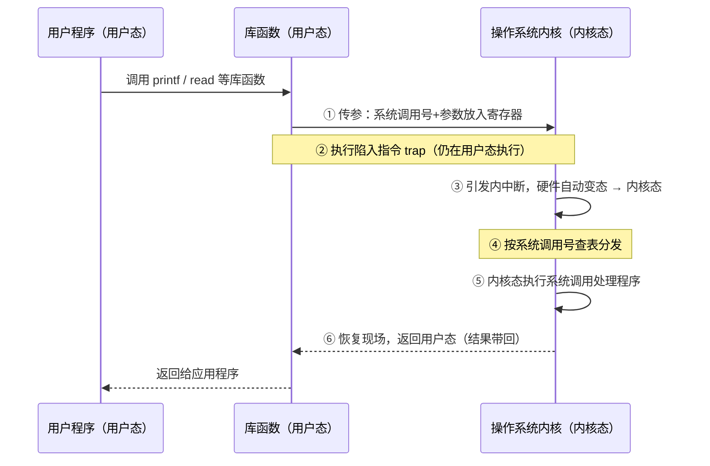

（例题见：[试题文档 ques.md](res/ques.md)相关章节）


## 1.运行机制

为了保证系统安全:
- 计算机把指令分为**特权指令**与**非特权指令**
- 把处理器状态分为**内核态（核心态/管态）**与**用户态（目态）**
- 把程序分为**内核程序**与**应用程序**。

核心规则一句话：**操作系统内核运行在内核态、可执行特权指令；应用程序只能运行在用户态、只能执行非特权指令。**

这套机制解决了根本矛盾：操作系统要"管理一切资源"，而应用程序可能（有意或无意地）执行危险操作。如果允许用户程序随便执行特权指令（如内存清零、修改 PSW），整个系统会立刻崩溃或被恶意程序篡改。因此必须从硬件层面区分状态、限制指令。

### 1.1 指令与程序

- "指令"是处理器（CPU）能识别、执行的最基本命令，即二进制**机器指令**。高级语言代码经**编译器**翻译成机器指令后由 CPU 逐条执行。
- 程序是指由指令序列组成的文件，用于执行特定任务。

| 类别 | 编写者 | 运行位置 | 例子 |
| --- | --- | --- | --- |
| 应用程序 | 普通程序员 | 用户态 | 浏览器、微信、游戏 |
| 内核程序 | 操作系统开发者 | 内核态 | 进程调度器、内存管理、设备驱动 |

- 众多内核程序组成**操作系统内核（Kernel）**，它是操作系统最重要、最核心、最接近硬件的部分。
- **一个操作系统只要有内核就够了**：课件举例——Docker 容器只需共享宿主机的 Linux 内核即可运行，并不需要完整的发行版（"Docker → 仅需 Linux 内核"）。这也反衬出：Ubuntu/CentOS 等发行版团队的主要工作其实是非内核功能。
- **注意**：操作系统的功能**未必都在内核中**——例如 GUI（图形用户界面）通常属于非内核功能，运行在用户态；Windows 中大量系统进程也运行在用户态。

| 类型 | 定义 | 例子 | 允许执行者 |
| --- | --- | --- | --- |
| 特权指令 | 影响重大、不允许用户随意执行的指令 | 内存清零、设置 PSW、中断屏蔽、I/O 指令、停机指令 | 仅操作系统内核（内核态） |
| 非特权指令 | 普通运算指令 | 加法、减法、乘法、逻辑运算、访存（一般访存） | 应用程序（用户态） |

特权指令有：

| 类别 | 典型特权指令 | 若在用户态执行会怎样 |
| --- | --- | --- |
| I/O 类 | 启动/控制外设的 in/out 指令 | 用户直接操控外设，破坏设备隔离 |
| 中断类 | 设置中断屏蔽字、开/关中断 | 屏蔽时钟中断 → 独霸 CPU 不还 |
| 状态类 | 修改 PSW、设置 CPU 状态字 | 把自己"伪装"成内核态，绕过保护 |
| 内存保护类 | 设置基址/界限寄存器 | 越权访问他人内存区域 |
| 其他 | 停机指令、加载特殊寄存器 | 整机停机或篡改硬件状态 |


### 1.2 处理器状态（管态和目态）

CPU 通过**程序状态字寄存器（PSW）**中的某标志位标识当前状态，如 **1 表示内核态，0 表示用户态**（不同体系结构实现不同，如 x86 有 4 个特权级 ring 0~3，内核用 ring 0）。
- **内核态（核心态/管态）**：运行内核程序，特权指令、非特权指令都**可执行**；
- **用户态（目态）**：运行应用程序，**只能执行非特权指令**。

| 术语对照 | 别名 |
| --- | --- |
| 内核态 | 核心态、管态、系统态 |
| 用户态 | 目态、普通态 |

两种状态的切换：


| 切换方向 | 触发方式 | 含义 |
| --- | --- | --- |
| 内核态 → 用户态 | 执行一条**特权指令**修改 PSW 标志位 | 操作系统**主动让出** CPU |
| 用户态 → 内核态 | 由**中断**引发，**硬件自动完成**变态 | 操作系统**强行夺回** CPU |

- **开机时 CPU 处于内核态**：刚开机时，操作系统内核程序先上 CPU 运行；开机完成后用户才可启动应用程序。也就是说内核程序"先到先得"CPU，之后才轮得到应用程序。
- **用户态 → 内核态的切换只能通过中断，且由硬件自动完成**——用户程序无法自己"合法地"通过普通指令变态（除非执行陷入指令故意引发内中断）。


### 1.3 内核功能

内核的功能划分各 OS 可能不同，但至少包含以下几类（**必须记全**）：

| 内核功能 | 说明 |
| --- | --- |
| 时钟管理 | 利用时钟中断实现计时、时间片轮转 |
| 中断处理 | 处理各类中断信号（中断是 OS 夺回 CPU 的唯一途径） |
| 原语 | 特殊的程序，如设备驱动、CPU 切换等，**运行具有原子性**（一气呵成，不可被中断），是最接近硬件的部分 |
| 进程管理 | 进程调度、同步互斥、通信 |
| 存储器管理 | 内存分配回收、虚拟内存 |
| 设备管理 | I/O 控制、缓冲、设备驱动 |

**非内核功能**：GUI、记事本、任务管理器等——不是操作系统必不可少的组成部分（Linux 甚至可以没有图形界面）。


## 2.中断和异常

**中断是让操作系统内核夺回 CPU 使用权的唯一途径**：中断使 CPU 由用户态变为内核态，从而运行内核程序。没有中断机制，就不可能实现操作系统，也不可能实现程序并发。

为什么这么说？操作系统在"合适的时候"主动让出 CPU（内核态→用户态），把 CPU 交给应用程序。但应用程序一旦运行起来，就可能一直占着 CPU 不还（比如死循环）。系统必须有办法**强行把 CPU 抢回来**——这个"抢"的机制就是中断：硬件在每条指令执行结束时检查中断信号，一旦有中断，CPU 自动切换内核态并执行中断处理程序。

而异常是**硬件自动完成**的，用户程序无法自己"合法地"通过普通指令变态（除非执行陷入指令故意引发内中断）。异常的处理机制与中断相同，只是异常的触发方式不同：

| 项 | 内容 |
| --- | --- |
| 内中断（异常） | CPU **内部**引发、**与当前指令有关** |
| 外中断（狭义中断） | CPU **外部**引发（时钟、I/O）、**与当前指令无关** |
| trap 陷入 | **故意**引发（系统调用）；修复后执行**下一条指令** |
| fault 故障 | **可修复**（缺页）；修复后**回原指令重新执行** |
| abort 终止 | **不可修复**（除 0、非法特权指令）；直接终止程序 |
| 时钟中断 | 每个时间片（如 **50ms**）发一次，驱动进程切换（分时/多任务基础） |
| I/O 中断 | 外设完成 I/O 后发中断，通知 CPU 处理结果 |
| NMI 不可屏蔽中断 | 系统故障、重置等紧急情况，由硬件自动触发，不能被应用程序中断 |


中断可以分为**内中断（异常）**与**外中断（狭义中断）**，区别在于触发方式不同：

| 类别 | 信号来源 | 与当前指令的关系 | 典型例子 |
| --- | --- | --- | --- |
| 内中断（异常，Exception） | CPU **内部** | **与**当前执行的指令**有关** | 除数为 0、非法使用特权指令、陷入指令（trap） |
| 外中断（狭义中断，Interrupt） | CPU **外部** | **与**当前执行的指令**无关** | 时钟中断、I/O 中断 |


```
广义的中断
 ├── 内中断（异常，Exception）—— 与当前指令有关，由 CPU 内部引发
 │    ├── 陷入（trap）：由陷入指令引发，应用程序【故意】引发
 │    │        如系统调用（int 0x80 / syscall 指令）
 │    ├── 故障（fault）：由错误条件引起，【可能被内核修复】
 │    │        修复后返回【原指令】重新执行，如缺页故障、除零(可编程处理时)
 │    └── 终止（abort）：由致命错误引起，【无法修复】
 │             直接终止应用程序，如非法使用特权指令、硬件故障
 └── 狭义的中断（外中断）—— 与当前指令无关，由 CPU 外部引发
      ├── 时钟中断（时间片到点 → 进程切换）
      └── I/O 中断（外设完成 I/O → 通知 CPU）
```

每一条指令执行结束时，CPU 都会例行检查是否有**外中断**信号；
- **时钟中断**：时钟部件每隔一个时间片（如 50ms）向 CPU 发一个时钟中断信号；CPU 收到后转入处理时钟中断的内核程序，**由操作系统内核决定接下来让哪一个应用程序上 CPU 运行**（这是分时/多任务的基础！）；
- **I/O 中断**：输入输出任务完成时由设备向 CPU 发送中断信号（如打印机打完一页、磁盘读完一块）。

不可屏蔽中断（NMI）：是一种特殊的外中断，它由硬件自动触发，不能被应用程序中断。NMI 中断用于处理紧急情况，如硬件故障、系统重置等。

## 3.系统调用

系统调用（System Call）是操作系统**提供给应用程序（程序员）使用的程序接口**，可以理解为一种可供应用程序调用的"特殊函数"。

它的诞生源于一个直接问题：**共享资源不能交给用户程序直接操作**。设想 WPS 与 Word 并发打印论文——如果两个进程都能随意操作打印机，两篇论文的内容会混在一起。解决之道是把共享资源统一交给内核掌管，用户进程只能通过系统调用向内核发出"我要打印/读文件/建进程"的请求，由内核协调、排队、隔离地完成。这样设计还带来一层安全收益：内核态是"特权门"，系统调用成为应用程序访问硬件的**唯一合法通道**，普通程序永远无法绕过内核直接碰硬件。而"陷入指令在用户态执行、处理在内核态完成"的分工，则保证了请求的发起是低成本的、控制的收口是强制的。

由于系统的各种共享资源（CPU、内存、文件、设备）由内核统一掌管，**凡是与共享资源有关的操作，都必须通过系统调用请求内核代为完成**，以保证系统的稳定性和安全性。

操作系统常将系统调用**封装成库函数**，隐藏细节、方便程序员编程。应用程序调用系统服务有**两条途径**：
- 直接进行系统调用
- 使用库函数（库函数内部可能封装系统调用细节）。
- 库函数不一定都调用系统调用；但凡是涉及硬件/共享资源的库函数，最终都要落到系统调用上：

| 类别 | 说明 | 例子 |
| --- | --- | --- |
| 不涉及系统调用的库函数 | 用户态内即可完成 | `abs()` 取绝对值、`strlen()` 求字符串长度 |
| 涉及系统调用的库函数 | 库函数内部封装了系统调用细节 | `printf()` 打印字符串、`fopen()` 打开文件、`read()` 读取文件 |

为什么系统调用是必须的？
- 共享资源（打印机、内存、文件、CPU）由内核统一管理；
- 用户进程不能直接操作共享资源（会破坏隔离与安全）；
- 用户进程只能通过系统调用请求内核代理执行。

什么功能必须用系统调用？
- 凡是**与共享资源有关的操作**、**会直接影响其他进程的操作**，都需要操作系统介入：

| 类别 | 典型系统调用（Linux） |
| --- | --- |
| 进程控制 | `fork()`、`exec()`、`exit()`、`wait()` |
| 文件管理 | `open()`、`close()`、`read()`、`write()`、`lseek()` |
| 设备管理 | `read()`/`write()`（设备当作文件）、`ioctl()` |
| 内存管理 | `mmap()`、`brk()`/`sbrk()` |
| 通信 | `socket()`、`pipe()`、`shmget()` |


完成系统调用的过程：



