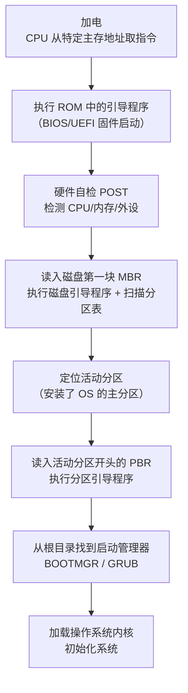

（例题见：[试题文档 ques.md](res/ques.md)相关章节）

## 1.引导（bootstrap）

操作系统引导（Boot）解决"**开机时怎么让操作系统运行起来**"的问题。系统自身无法运行程序，却要靠程序来启动自己——这个"自举"过程叫 **bootstrap（引导）**，词源为"拉自己的鞋带站起来"。

从硬件加电开始，通过 **ROM 引导程序 → 磁盘引导程序（MBR）→ 分区引导记录（PBR）→ 启动管理器** 逐级加载，最终把操作系统内核装入内存并运行。每一级引导程序都比上一级"大"且"完整"，层层接力直到内核就位。

| 概念 | 说明 |
| --- | --- |
| BIOS / UEFI | 固化在主板 ROM 中的固件。BIOS 完成开机硬件自检（POST）后读取引导程序；UEFI 更现代，直接加载 EFI 应用（.efi 文件）启动系统 |
| 主引导记录 MBR | 磁盘的**第一块（第一个扇区，512B）**，包含磁盘引导程序与分区表 |
| 活动分区（主分区） | 安装了操作系统、可引导的分区 |
| 分区引导记录 PBR | 活动分区**开头**的引导记录 |
| 启动管理器（Boot Manager） | 操作系统初始化程序，如 Windows 的 BOOTMGR、Linux 的 GRUB |

| 对比维度 | BIOS | UEFI |
| --- | --- | --- |
| 工作模式 | 16 位实模式 | 32/64 位 |
| 引导对象 | MBR 引导程序 | ESP 分区中的 .efi 文件 |
| 分区表支持 | MBR（≤4 主分区、≤2TB） | GPT（128 分区、支持大磁盘） |
| 安全启动 | 无 | Secure Boot（签名校验） |
| 启动速度 | 较慢 | 较快 |
| 可扩展性 | 差（固件固化） | 好（模块化驱动） |

## 2.虚拟机

虚拟机（Virtual Machine，VM）使用**虚拟化技术**将一台物理机器虚拟化为多台虚拟机器，每个虚拟机器都可以独立运行一个操作系统。

虚拟化的核心价值：
- **隔离**：多个 VM 互不影响，一个崩溃/被攻破不影响其他；
- **资源整合**：一台物理机跑多个 VM，提高硬件利用率；
- **可迁移**：VM 可以在物理机之间迁移（live migration）。

虚拟机本质上是对物理计算机的**仿真**：软件模拟出具有完整硬件功能的、运行在隔离环境中的完整计算机系统。每个 VM 里的"客户操作系统"（Guest OS）以为自己在独占硬件，实际上资源由 VMM 调度共享。

负责虚拟化的软件叫**虚拟机管理程序（Hypervisor / Virtual Machine Monitor，VMM）**，分为两类：
- **第一类 VMM**：直接运行在**硬件**上（裸机虚拟化），无宿主 OS；
- **第二类 VMM**：运行在**宿主操作系统**之上（宿主型虚拟化）。
- 第一类 VMM 本身就是"微型操作系统"，直接管理硬件，没有中间层，性能损耗小；
- 第二类 VMM 依赖宿主 OS 管理硬件（VM 请求 → VMM → 宿主 OS → 硬件），多一层开销；

| 类型 | 运行位置 | 特点 | 典型软件 |
| --- | --- | --- | --- |
| 第一类 VMM | 直接运行在**硬件**上 | 无宿主 OS，性能好，资源利用率高，多用于服务器/数据中心 | Xen、KVM、VMware ESXi、Microsoft Hyper-V |
| 第二类 VMM | 运行在**宿主操作系统**上 | 宿主 OS 提供硬件管理，安装方便，适合个人使用 | VirtualBox、VMware Workstation |

现代 CPU 通常分多个指令等级（Ring），如 x86 的四个特权级：
- **Ring 0**：最高权限（内核使用，可执行特权指令）；
- **Ring 1 / Ring 2**：通常未使用；
- **Ring 3**：最低权限（应用程序使用）；
- 虚拟化时，**VMM 运行在 Ring 0**，客户操作系统（Guest OS）运行在较低权限级（如 Ring 1），或依赖硬件虚拟化扩展捕获特权指令。

| 类别 | 说明 | 例子 |
| --- | --- | --- |
| 系统虚拟机（全虚拟化） | 可代替物理计算机，运行完整操作系统，提供相互隔离的多个环境 | VirtualBox、VMware、KVM、Hyper-V |
| 程序虚拟机 | 在与平台无关的环境中执行单个程序 | Java 虚拟机（JVM）、.NET CLR |
| 操作系统层虚拟化（容器） | 不提供完整 OS，**共享宿主内核**，把内核资源分配给多个隔离的"空间" | Docker、LXC |
| 半虚拟化（Para-virtualization） | 客户 OS 知道自己运行在虚拟机中，通过修改后的驱动（guest drivers）以减小虚拟化开销 | Xen（早期模式） |
| 硬件辅助虚拟化 | 利用 CPU 的虚拟化扩展（Intel VT-x / AMD SVM），特权指令由硬件直接处理，性能接近原生 | 现代 KVM、Hyper-V |

| 对比维度 | 全虚拟化 | 半虚拟化 | 硬件辅助虚拟化 |
| --- | --- | --- | --- |
| Guest OS 是否感知虚拟化 | 不感知（无需修改） | **感知，需修改**（改用虚拟化驱动） | 不感知（无需修改） |
| 特权指令处理 | 二进制翻译 / 陷入-模拟（慢） | 修改后的驱动主动让出 | **VT-x / AMD-V 硬件直接处理** |
| 性能 | 低（早期） | 中 | **接近原生** |
| 典型实现 | 早期 VirtualBox、VMware | Xen（早期模式） | 现代 KVM、Hyper-V |

