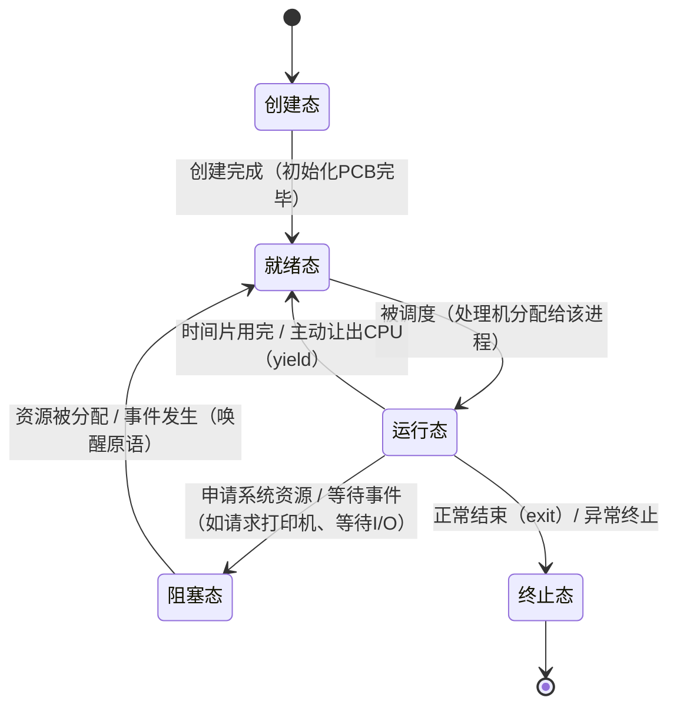
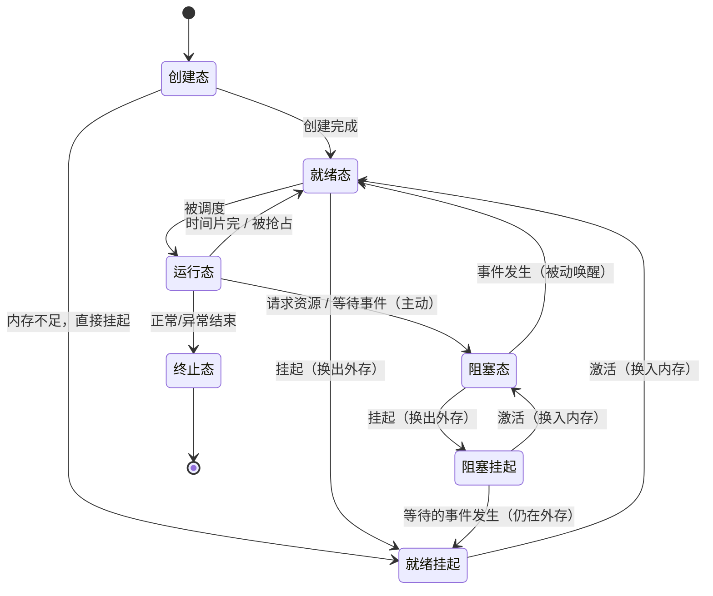
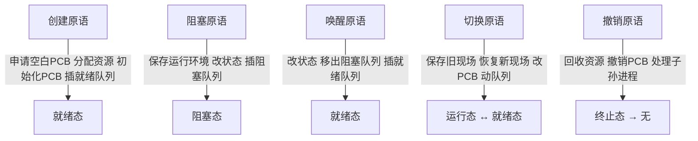

(例题见：[试题文档 ques.md](res/ques.md)相关章节)

## 1.进程（Process）

进程（Process）是**程序的一次执行过程**，是**系统进行资源分配和调度的独立单位**。

引入进程的根本目的是**描述和实现多道程序的并发执行**。同一个程序多次执行会对应多个进程，而且进程是动态的、随执行不断变化；程序则是静态的、存放在磁盘上的可执行文件。

一句话理解：程序是"菜谱"，进程是"照着菜谱做菜的过程"——同一份菜谱可以被多次执行，每次执行都是一个独立的进程。

### 1.1 进程的组成

| 维度 | 程序 | 进程 |
| ---- | ---- | ---- |
| 静态/动态 | **静态**，是存放在磁盘上的可执行文件（如 QQ.exe） | **动态**，是程序的一次执行过程 |
| 对应关系 | 一个程序可被多次执行 | 对应**多个进程**（如同时挂 3 个 QQ 号） |
| 存在性 | **长期存在**（磁盘上一直有） | 从创建到终止，**有生命周期** |
| 组成 | 指令序列（代码） | PCB + 程序段 + 数据段 |
| 是否并发 | 程序本身不能并发 | 多个进程可并发执行 |

进程实体（进程映像，Process Image）由 PCB（进程控制块）和程序段、数据段组成.
- PCB（Process Control Block，进程控制块）：操作系统管理进程所需的**所有信息**都放在 PCB 中。
- 程序段：包含程序指令（代码），**可被多个进程共享**（同一程序的进程，其程序段相同，只需在内存中保留一份）
- 数据段：包含进程运行时的**数据、堆、栈**，每个进程独有，**不可共享**。

注意：
- **进程是动态的**（一次执行过程，随执行不断变化）；**进程实体（进程映像）是静态的**，它反映的是进程在**某一时刻**的状态快照（如 `x++` 执行后数据段中 x=2）。
- 引入「进程实体」概念后，可把进程更严谨地定义为：**进程是进程实体的运行过程，是系统进行资源分配和调度的一个独立单位**。
- 同时挂三个 QQ 号会对应三个 QQ 进程：它们的 **PCB、数据段各不相同**（各进程独立），但**程序段的内容相同**（都运行着同一份 QQ 程序，内存中只需保留一份）.

### 1.2 进程的特征

| 特征 | 说明 |
| --- | --- |
| **动态性**（最基本特征） | 进程是程序的一次执行过程：由创建而产生、由调度而运行、由撤销而消亡 |
| **并发性** | 多个进程可同时存在于内存中并发执行 |
| **独立性** | 进程是能**独立运行、独立获得资源、独立接受调度**的基本单位 |
| **异步性** | 各进程按各自独立的、不可预知的速度向前推进（异步性导致并发程序执行结果的不确定性，见进程同步章节） |
| **结构性** | 进程由 PCB、程序段、数据段三部分组成 |


没有进程概念的时代，程序运行没有"身份"，操作系统无法跟踪"哪个程序在跑、用了多少资源、当前状态如何"。引入进程后：
- 操作系统可以**区分不同的执行流**（哪怕执行同一个程序）；
- 可以**分配与回收资源**（以进程为单位）；
- 可以**调度**（选择哪个进程上 CPU）；
- 可以**保护**（一个进程的地址空间与其他进程隔离）。

### 1.3 进程的生命周期(状态与转换)

进程在生命周期中不断改变状态（创建、就绪、运行、阻塞、终止），操作系统通过 PCB 中的 `state` 变量记录当前状态，并把**同状态的 PCB 组织成队列或索引表**以便统一管理。

理解状态的含义及其转换条件是分析一切进程行为（调度、同步、死锁）的基础。

我们把进程的生命周期分为五种状态：

| 状态 | 英文 | 含义 | 说明 |
| ---- | ---- | ---- | ---- |
| 创建态 | New | 进程正在被创建 | 系统为进程分配资源、初始化 PCB |
| 就绪态 | Ready | 进程已具备运行条件 | **万事俱备只欠 CPU**，等待被调度 |
| 运行态 | Running | 进程正在 CPU 上执行 | 单 CPU 同一时刻只有一个运行态进程；多核可有多个 |
| 阻塞态 | Blocked / Waiting | 进程等待某事件发生 | 如等待 I/O、等待其他进程响应；此时 CPU 空闲可供其他进程使用 |
| 终止态 | Terminated | 进程已结束，尚未被回收 | 执行 exit 系统调用后进入，OS 回收资源、撤销 PCB |



即：
- **就绪态 → 运行态**：进程**被调度**（处理机分配给该进程）——唯一途径；
- **运行态 → 就绪态**：**时间片用完**或**主动让出 CPU**（Yielding，如调用 `yield()`）；
- **运行态 → 阻塞态**：进程**申请某种系统资源**或**等待某个事件发生**（如请求打印机、等待 I/O 完成）；
- **阻塞态 → 就绪态**：**申请的资源被分配**或**等待的事件发生**（由唤醒原语完成）；
- **创建态 → 就绪态**：创建完成、初始化 PCB 完毕；
- **运行态 → 终止态**：进程正常结束（exit）或异常终止。

**两个"绝对不能"**：
- **阻塞态不能直接回到运行态**——必须先回就绪态等待调度（阻塞进程"欠事件"，事件来了只是变就绪，还要等 CPU）；
- **就绪态不能直接到阻塞态**——就绪进程不缺资源，只缺 CPU；"等 CPU"不是阻塞，阻塞必须是在运行中主动申请资源/等事件.

除五态外，为了**调节系统负载**（让进程暂时离开内存），还引入了**挂起态**：
- **就绪挂起**：进程被挂起到外存（如 swap 分区），仍具备运行条件但不在内存；
- **阻塞挂起**：进程被挂起且等待事件，事件发生后变为就绪挂起；
- 引入挂起的目的是缓解内存紧张





### 1.4 进程的组织

PCB 中用 `state` 变量表示状态（如 1=创建、2=就绪、3=运行、4=阻塞、5=终止）。

组织 PCB 的方式有两种：**链接方式**和**索引方式**。

**链接方式**——同一状态的 PCB 链接成队列：
- **执行指针**：指向当前运行态进程（单 CPU 只有一个）；
- **就绪队列指针**：指向就绪态进程队列，通常把优先级高的进程放队头；
- **阻塞队列指针**：指向阻塞态进程队列，**很多系统按阻塞原因分成多个阻塞队列**（如等待打印机队列、等待磁盘队列）。

**索引方式**——用索引表记录各状态的 PCB 位置，OS 通过"就绪表指针""阻塞表指针" + 索引表查找 PCB。


### 1.5 进程控制、原语

进程控制是对系统中所有进程实施有效管理：**创建新进程、撤销已有进程、实现进程状态转换**。进程控制由操作系统内核中的**原语（Primitive）**实现。

原语是一种具有**原子性**（一气呵成、不可中断）的特殊程序。之所以必须原子，是为了保证关键数据结构（PCB、就绪队列）在状态转换过程中始终一致——状态转换往往涉及"改状态 + 移队列"多个步骤，任一步被打断都会留下不一致的中间状态，破坏系统的管理基础。

为什么必须"一气呵成"（原子性动机）
- 假设 PCB 中 `state` 变量用 1 表示就绪、2 表示阻塞。进程 2 等待的事件发生时，内核要做两件事：
    - 把 PCB2 的 `state` 改为 1（就绪）；
    - 把 PCB2 从阻塞队列移到就绪队列。
- 若第 1 步执行后、第 2 步执行前收到中断，PCB2 就处于 **"state=1 却还在阻塞队列"** 的矛盾状态：调度器以为它是就绪进程，但队列里找不到它；或它还在阻塞队列里，却显示就绪。这种不一致会破坏操作系统的管理工作。
- 因此必须用原语把这两步**打包成一个不可分割的整体**——要么全做，要么不做，不允许中间状态存在。


如何实现原子性——关中断/开中断指令
- 正常情况下，CPU 每执行完一条指令都会**例行检查是否有中断信号**；
- 执行**关中断指令（CLI）**后，CPU 不再检查中断信号，直到执行**开中断指令（STI）**才恢复；
- 因此"关中断…开中断"之间的指令序列**不可被中断**，即实现了原子性；
- **关键点**：这两个指令是**特权指令**，只允许在内核态运行——若允许用户程序使用，用户就可以关闭中断"独占 CPU"，彻底破坏系统的控制权。
- 这里"不可被中断"指的是**不能被外部中断打断**。原语本身可能内含切换逻辑，但一旦开始执行就会执行完。现代 CPU 还可能用**自旋锁/互斥锁**等机制保护临界区，但 408 语境下"关/开中断"是最经典的实现手段。


| 原语 | 实现的状态转换 | 主要工作 |
| ---- | ---- | ---- |
| 创建原语 | 无 → 创建态 → 就绪态 | 申请空白 PCB、分配资源、初始化 PCB（含分配 PID）、插入就绪队列 |
| 撤销原语 | 运行/就绪/阻塞态 → 终止态 → 无 | 回收资源、撤销 PCB（进程间是树形关系，需处理子进程） |
| 阻塞原语 | 运行态 → 阻塞态 | 保存运行环境、修改 PCB 状态、插入相应阻塞队列 |
| 唤醒原语 | 阻塞态 → 就绪态 | 修改 PCB 状态、移出阻塞队列、插入就绪队列 |
| 切换原语 | 运行态 ↔ 就绪态 | 保存/恢复运行环境（现场）、修改 PCB、移动队列 |

注意：
- **阻塞原语和唤醒原语必须成对使用**；
- **"因何事阻塞，就应由何事唤醒"**——等打印机的进程只能由打印机空闲事件唤醒，不能由磁盘事件唤醒（这也是阻塞队列按原因分多个的原因）。

**撤销进程的触发**：
- 进程**自己正常退出**（调用 exit）；
- **异常**被 OS 强制终止（除 0、非法使用特权指令、越界访问等）；
- **用户干预**（如任务管理器/系统监视器中强制结束进程）。

CPU 内有很多寄存器——PC（程序计数器，存下一条指令地址）、IR（指令寄存器，存当前正在执行的指令）、PSW（程序状态字）、通用寄存器等。进程运行时的中间结果常放在寄存器中，所以"进程运行现场"主要就是这些寄存器的值。

**课件中的完整例子（`x++` 对应的机器指令与寄存器）**：
```
int x = 1; x++;
指令1: 往内存中某个地方写入变量 x 的值（x=1）
指令2: 把变量 x 的值放到某个寄存器中
指令3: 寄存器中的数值 +1        ← 中间结果 2 暂存在寄存器里
指令4: 把寄存器的值写回变量 x 的存放位置（x=2）
```

执行过程中 PC 依次指向下一条指令地址、IR 存放当前指令、通用寄存器保存中间结果（如 1、2）。若在**指令3 执行完**后切到别的进程，另一个进程也会使用这些寄存器（把通用寄存器改成 250 等）——这就是必须"在 PCB 中保存运行环境（必要的寄存器信息）"的原因，切回来时再从 PCB 恢复，继续从 PC 指示的指令 4 执行。

**切换的步骤**：
1. 原进程把它的寄存器等**运行环境保存到自己的 PCB**（保存现场）；
2. 新进程把自己的 PCB 中保存的现场**恢复到 CPU**（恢复现场）；
3. 之后新进程从 PC 指示的地址继续执行。

如果不保存/恢复现场，进程切回来时就会"失忆"——不知道上次执行到哪、中间结果也丢了。

**所有进程控制原语的本质——只做三类事**：
1. **更新 PCB 信息**（必改状态标志；剥夺 CPU 必保存现场；开始运行前必恢复现场）；
2. **将 PCB 插入合适的队列**；
3. **分配/回收资源**。




| 状态转换 | 原语动作侧重 | 对应原语 |
| ---- | ---- | ---- |
| 创建态 → 就绪态 | **初始化 PCB、分配系统资源**，再改 PCB 与队列 | 创建原语 |
| 就绪态 → 运行态 | **恢复运行环境**（此前保存的现场）、改 PCB 与队列 | 切换原语（调度） |
| 运行态 → 就绪态 | **保存运行环境**、改 PCB 与队列 | 切换原语 |
| 运行态 → 阻塞态 | 保存运行环境、改状态、插入阻塞队列 | 阻塞原语 |
| 阻塞态 → 就绪态 | 改状态、移队列；等资源的还需**分配资源** | 唤醒原语 |
| 运行态 → 终止态 | **回收资源、撤销 PCB** | 撤销原语 |


### 1.6 进程间通信（Inter-Process Communication，IPC）

进程间通信（Inter-Process Communication，IPC）指两个进程之间产生**数据交互**。

由于进程是资源分配单位，各进程的**地址空间相互独立**，一个进程不能直接访问另一个进程的地址空间（这是内存保护的基本要求），因此必须借助操作系统的支持才能通信。主要方式有：**共享存储、消息传递、管道通信**。

**一句话理解**：进程地址空间是"隔离的小房间"，IPC 就是在不破坏隔离的前提下给房间之间开"通道"的三种办法——共用一个房间（共享存储）、互相投递信件（消息传递）、接一根管子（管道）。

| 方式 | 原理 | 优点 | 缺点/注意 |
| ---- | ---- | ---- | ---- |
| 共享存储 | 开辟共享内存区，各进程映射到自己的地址空间 | **速度快**（无系统调用往返） | 需互斥访问（可用 P、V 操作同步）；分低级/高级两类 |
| 消息传递 | 以格式化消息为单位，用 send/receive 原语交换数据 | 灵活，不需共享空间，可用于分布式 | 需拷贝数据；消息头需指明发送/接收进程 ID；分直接/间接 |
| 管道通信 | 一个大小固定的内存缓冲区（pipe 文件） | 实现简单，Unix 经典机制 | 半双工；互斥访问；写满/读空会阻塞；数据读出即消失 |

#### 1.6.1 共享存储（Shared Memory）

**原理**：通过"**增加页表项/段表项**"把同一片共享内存区映射到多个进程的地址空间——这样各进程在自己的虚拟地址空间里都能"看到"这片区域。
- **基于数据结构的共享**：如共享空间里只能放一个长度为 10 的数组——**速度慢、限制多**，属**低级通信方式**；
- **基于存储区的共享**：OS 划出一块共享存储区，数据形式与存放位置由通信进程自己控制——**速度快**，属**高级通信方式**。
- 共享存储本身不解决同步互斥问题！多个进程同时读写共享区会产生竞争，必须**配合 P、V 操作（信号量）等同步机制**保证互斥访问。

#### 1.6.2 消息传递（Message Passing）

**机制**：以格式化的"消息（Message）"为单位，用**发送原语 send / 接收原语 receive** 交换数据。
- **消息头**：包括发送进程 ID、接收进程 ID、消息长度等格式化信息；
- 进程之间无需共享任何地址空间，消息由内核在进程间搬运（通常要两次拷贝：发送方→内核→接收方）。

**两种方式**：
- **直接通信方式**：发送原语 `send(Q, msg)`，**点名道姓**地发给指定进程 Q；接收原语 `receive(P, &msg)`。通信双方必须明确知道对方是谁。**机制细节**：消息并不是"直接跳到"对方进程——`send(Q, msg)` 把消息交给内核，内核把消息放入**接收进程 Q 的消息队列**（挂在其 PCB 下）；Q 调用 `receive(P, &msg)` 时才从自己的消息队列中取出。收发双方的 ID 写在消息头中，用于匹配；
- **间接通信方式**：以"**信箱（Mailbox）**"为中间实体，`send(A, msg)` 往信箱 A 发消息，`receive(A, &msg)` 从信箱 A 取消息；多个进程可向同一信箱发、也可从同一信箱收——实现**松耦合**，发送方和接收方不必互相知道。

#### 1.6.3 管道通信（Pipe Communication）

管道是**内存中大小固定的缓冲区**（在 Linux 中以 pipe 文件形式存在），具有以下特性：

1. **半双工**：某一时间段只能单向传输（写端写、读端读）；要双向同时通信需设**两个管道**；
2. **互斥访问**：各进程互斥地访问管道（由 OS 保证）；
3. **写满阻塞**：管道写满时写进程阻塞，直到读进程取走数据；
4. **读空阻塞**：管道读空时读进程阻塞，直到写进程写入数据；
5. **数据读出即消失**（不落盘、不可重读）。

**读写并行的精确表述** ：
- 写进程写数据时，只要管道**没满**，写进程就可以写（继续写）；
- 读进程读数据时，只要管道**没空**，读进程就可以读；
- 写满才阻塞写进程、读空才阻塞读进程——不是"写满才允许读/读空才允许写"。

## 2.线程（Thread）

传统进程只能串行执行一段程序，但有的进程（如 QQ）需要"**同时**"做很多事（视频通话、文字聊天、传文件），为此引入**线程**来提高系统并发度。

**线程（Thread）**是**程序执行流的最小单位**、**基本的 CPU 执行单元**，可理解为"**轻量级进程（Lightweight Process）**"。

引入线程后角色重新划分：
- **进程**：只作为**除 CPU 之外的系统资源分配单元**（内存、I/O 设备、文件等）；
- **线程**：作为**处理机（CPU）的分配单元**。
- 系统中并发执行的**基本单位**从进程变为**线程**；
- 进程成为"资源的容器"，线程成为"执行的基本单位"；
- **同一进程内的线程切换不涉及地址空间切换**，所以比进程切换快得多

**一句话理解**：进程是"房子"（管资源、管住址），线程是"房子里干活的人"（管跑在 CPU 上）；房子可以多个人同时干活，这就是进程内并发。


| 维度 | 进程 | 线程 |
| ---- | ---- | ---- |
| 资源分配 | **除 CPU 外的系统资源分配单元**（内存、I/O 设备、文件等） | 不独立拥有系统资源，但有自己的运行环境（栈、寄存器、PC） |
| 处理机分配 | 不直接分配（由线程分配） | **处理机分配单元 / 基本 CPU 执行单元** |
| 程序执行流 | 引入线程后不再是执行流最小单位 | **新的执行流最小单位** |
| 切换开销 | **大**（切换整个进程环境，地址空间、页表、缓存全换） | **小**（同一进程内切换不换地址空间） |
| 通信方式 | 进程间需 IPC（共享存储/消息/管道） | 同进程内线程天然共享地址空间，直接读写即可 |

关于线程的理解：
- 每个线程有**唯一的标识**（线程 ID）、**独立的程序计数器（PC）、寄存器组、栈**等运行环境（合称**线程上下文**）——所以线程才能独立推进执行流；
- **同一进程内的线程共享**：进程的地址空间（代码段、数据段、堆）、打开的文件、信号处理器、全局变量等资源；
- **独享 vs 共享**：线程独享 PC/寄存器/栈；共享地址空间/文件/全局变量——这是理解线程一切行为的钥匙（共享 → 天然适合协作，但也天然存在竞争，需要同步）。

### 2.1 线程的实现方式和多线程模型

线程有两种实现方式：
- **用户级线程（User-Level Thread，ULT）**
- **内核级线程（Kernel-Level Thread，KLT）**。


用户级线程（ULT）
- 早期操作系统（如早期 Unix）只支持进程，线程由**线程库**（应用程序层的库，如 POSIX pthreads 的用户态实现）实现；
- 从代码角度看，线程就是**一段代码逻辑**，线程库完成线程的创建、销毁、调度等管理。课件的点睛之笔：**"while 循环就是一个最弱智的'线程库'"**——手写一个循环调度几段代码轮流执行，本质上就是一个最原始的线程库，它完成了对线程的管理工作（如调度）；
- **一句话定义**：用户级线程就是"**从用户视角看能看到的线程**"（内核看不到）；内核级线程就是"**从操作系统内核视角看能看到的线程**"；
- **特点**：
  - 线程管理由**应用程序**负责（包括切换）；
  - 切换在**用户态**即可完成，**无需 OS 干预**；
  - **内核意识不到线程的存在**（内核只看到这个进程，不知道进程内部有几个线程）；
- **优点**：线程切换不需要切换到核心态（不变态），管理开销小、效率高；
- **缺点**：
  - 一个用户级线程被阻塞后，**整个进程都会被阻塞**（内核以为整个进程在等 I/O），并发度不高；
  - 多个线程**不可在多核处理机上并行运行**（内核只给进程分配 CPU，进程内线程轮流用这一个核）。

内核级线程（KLT）
- 由**操作系统支持**，大多数现代 OS（Windows、Linux）都实现了内核级线程；
- **特点**：
  - 线程管理（创建、调度、切换）由**内核**完成；
  - 切换**必须在核心态**进行（每次切换都有变态开销）；
  - 内核为每个内核级线程建立 **TCB（线程控制块）**——它是内核调度线程的依据；
- **优点**：
  - 一个线程被阻塞后，**别的线程还可继续执行**（内核知道该进程还有其他线程），并发能力强；
  - 多线程可在多核处理机上**并行**执行（每个内核级线程可分配到一个核）；
- **缺点**：一个用户进程会占用多个内核级线程，切换需进入核心态，**管理成本高、开销大**。

在支持内核级线程的系统中，根据用户级线程与内核级线程的**映射关系**，可划分为三种多线程模型：**一对一、多对一、多对多**。

| 模型 | 映射关系 | 优点 | 缺点 |
| ---- | ---- | ---- | ---- |
| 一对一模型 | 1 个用户级线程 → 1 个内核级线程（**每个用户进程有与用户级线程同数量的内核级线程**） | 并发能力强，可并行；一个阻塞不影响其他 | 一个进程占用大量内核级线程，**内核开销大** |
| 多对一模型 | 多个用户级线程 → 1 个内核级线程（**且一个进程只被分配一个内核级线程**） | 切换在用户空间完成，**开销小** | 一个线程阻塞则整个进程阻塞；**不能并行** |
| 多对多模型 | n 个用户级线程 → m 个内核级线程（n ≥ m，**每个用户进程对应 m 个内核级线程**） | 兼取两者优点：并发度高、内核级线程数量适中、开销可控 | **实现较复杂** |

**多对多模型的理解**：
- 用户级线程是"**代码逻辑**"的载体，内核级线程是"**运行机会**"的载体；
- 一段代码逻辑只有获得"运行机会"（分配到内核级线程）才能被 CPU 执行；
- 多核环境下，进程最多能同时获得的内核级线程数（m）决定了它能用的核数——m 个内核级线程最多并行在 m 个核上。
- 多对多模型下，只有**所有正在运行的内核级线程上的代码逻辑都阻塞**时，进程才会阻塞（只要还有一个内核级线程在跑，进程就不算整体阻塞）。

例子：
- **Windows**：纯一对一模型（每个用户线程对应一个内核线程）；
- **Linux**：本质也是一对一（pthread 由内核调度，NPTL 实现）；
- **早期 Solaris**：多对多模型（后来改为一对一）；
- **用户级线程的代表**：早期线程库、部分嵌入式/协程实现。

| 维度 | 一对一 | 多对一 | 多对多 |
| ---- | ---- | ---- | ---- |
| 用户线程 : 内核线程 | n : n | n : 1 | n : m（n ≥ m） |
| 一个线程阻塞 | 其他线程可继续 | **整个进程阻塞** | 部分阻塞（全阻塞才停） |
| 可否多核并行 | **可以**（并行上限=n） | **不可以**（并行上限=1） | **可以**（并行上限=m） |
| 切换是否变态 | 是（进内核） | 否（用户态切换） | 内/用户态都有 |
| 内核开销 | 最大 | 最小 | 适中 |
| 典型系统 | Windows / Linux | 早期线程库 | 早期 Solaris |


### 2.2 线程的状态与转换

线程与进程类似，在其生命周期中也有**状态及其转换**。线程状态是线程被调度和运行情况的抽象描述，由**线程控制块（TCB）**记录。

线程的**组织与控制方式**与进程的组织（队列/索引）类似：同一进程内的线程按状态组织成就绪队列、阻塞队列等；线程切换时需**保存/恢复线程的运行环境**。

**一句话理解**：线程状态是"进程五态模型的缩小版"——规则一致，只是对象从进程换成了线程。


| 状态 | 英文 | 含义 |
| ---- | ---- | ---- |
| 产生态 | Spawn | 线程刚被创建，尚未就绪 |
| 就绪态 | Ready | 线程已具备运行条件，等待被调度上处理机 |
| 运行态 | Running | 线程正在处理机上执行 |
| 阻塞态 | Blocked | 线程等待某事件（如 I/O 完成） |
| 结束态 | Finish | 线程执行完毕，等待回收 |

> 注：不同教材对线程状态的划分略有出入（有的写四态/五态），408 以王道划分为准——产生/就绪/运行/阻塞/结束五种。

```
产生态 --创建完成--> 就绪态
就绪态 --获得处理机（被调度）--> 运行态
运行态 --时间片用完 / 主动让出--> 就绪态
运行态 --等待事件（如 I/O）--> 阻塞态
阻塞态 --事件发生--> 就绪态
运行态 --执行完毕--> 结束态
```

**转换规则与进程状态的转换完全一致**：
- **阻塞态不能直接回运行态**——必须先回就绪态等待调度；
- **就绪态不能直接到阻塞态**——就绪线程只缺 CPU，不缺资源。

与进程类似，线程用 **TCB（Thread Control Block）** 记录线程的信息：

| TCB 内容 | 说明 |
| --- | --- |
| 线程标识符 | 唯一标识（线程 ID） |
| 状态 | 就绪/运行/阻塞/结束等 |
| 程序计数器（PC） | 下一条指令地址 |
| 寄存器现场 | 通用寄存器值 |
| 栈指针 | 线程栈位置 |
| 优先级 | 用于调度 |

- **同一进程内的线程**被组织成**就绪队列、阻塞队列**等；
- **线程切换**时要把线程的运行环境（寄存器、PC、栈指针等）**保存到 TCB 或从 TCB 恢复**；
- TCB 的保存/恢复位置与线程实现方式有关：
  - **用户级线程**：TCB 由线程库管理，存**用户空间**；
  - **内核级线程**：TCB 由内核管理，存**内核空间**。


