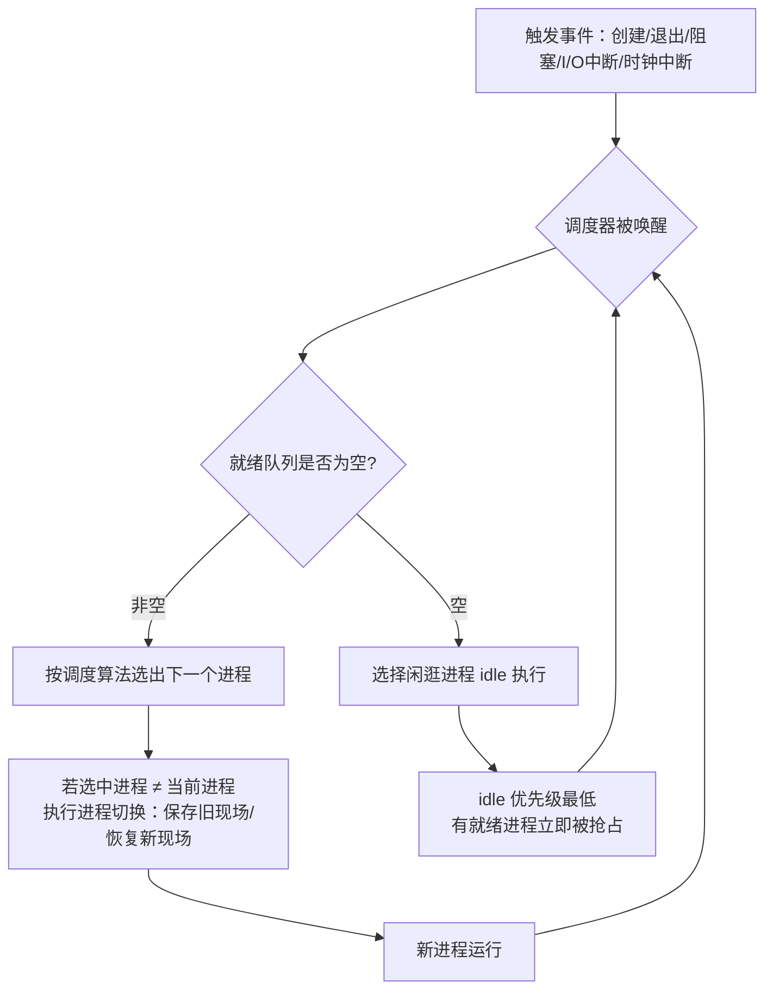

(例题见：[试题文档 ques.md](res/ques.md)相关章节)

## 1.调度的概念、层次

当有一堆任务要处理而资源（如 CPU、内存）有限时，需要确定某种**规则**来决定处理顺序，这就是"**调度（Scheduling）**"研究的问题。

按调度对象和作用范围，调度分为三个层次：
- **高级调度（作业调度）**：按作业到达时间、作业优先级等，将作业分配给内存。
- **中级调度（内存调度）**：按内存中进程的优先级、作业优先级等，将进程分配给 CPU。
- **低级调度（进程调度）**：按进程的优先级、作业优先级等，将进程分配给 CPU。由此还引出进程的**挂起态**与**七状态模型**。

关于调度的理解：
- 调度 = 在"外存→内存→CPU"的传递链上，每一站都要选"谁先走"——高级选作业进内存、中级选挂起进程回内存、低级选就绪进程上 CPU。
- **作业（Job）** = 一个具体的任务，用户提交作业 ≈ 让 OS 启动一个程序；
- 每个作业只**调入一次、调出一次**（调入建 PCB，调出撤 PCB）；
- 中级调度一个进程可能被**多次调出/调入内存**，故其频率比高级调度更高；
- **进程调度是操作系统中最基本的一种调度**，一般操作系统中都必须配置（后两者可按需配置）。
- - 内存不够时，可将某些进程的数据**调出到外存**；暂时调到外存等待的进程状态为**挂起态（Suspended）**，其 PCB 组织成挂起队列；
  - **就绪挂起**：进程映像在外存，等待被调入内存（内存空闲后可被激活回就绪态）；
  - **阻塞挂起**：进程映像在外存，且仍在等待事件（事件出现可转为就绪挂起，或被激活回阻塞态）；

## 2.调度算法研究的问题

调度算法研究的问题
- **选谁运行**？（调度算法，如 FCFS、SJF、RR 等）
- **运行多长时间**？（时间片大小）
- **什么事件触发调度**？（新进程就绪、时间片到、阻塞、终止、优先级改变等）

**课件中的直觉铺垫（银行/柜台排队）**：
- 普通客户先到先服务（=FCFS）
- VIP 客户可优先被服务（=优先级调度）
- 时间短的优先（=SJF）
- 时间相同的先排队先使用（=FCFS 的稳定性）

调度算法的核心思想都源于"排队规则"的选择，各层次调度的算法在后续小节逐一展开。

## 3.进程调度的时机、切换与过程、方式

进程调度（低级调度）就是按某种算法从就绪队列选择一个进程为其分配处理机。本节解决三个问题：
- **什么时刻**需要/不能进行调度与切换；
- 调度的两种方式：**非剥夺（非抢占）** / **剥夺（抢占）**；
- **进程切换的过程**及其代价。

调度像"换人上台干活"——什么时候能换、什么时候不能换、能不能强行换、换一次代价多大。

**需要调度与切换的情况**（当前运行进程主动或被放弃处理机）：

| 类别 | 具体场景 |
| ---- | ---- |
| 主动放弃 | 进程**正常终止**；运行中发生**异常而终止**；进程**主动请求阻塞**（如等待 I/O） |
| 被动放弃 | 分给进程的**时间片用完**；有**更紧急的事**需要处理（如 I/O 中断）；有**更高优先级的进程**进入就绪队列 |

**不能进行调度与切换的情况**（三类，重点）：
- **在处理中断的过程中**：中断处理复杂、与硬件密切相关，难以同时进行进程切换；
- 进程在**操作系统内核程序临界区**中（**2012 年联考真题**：进程处于临界区时不能进行处理机调度，精确说法是**内核程序临界区**）；
    - **临界资源**：一个时间段内只允许一个进程使用的资源，各进程需**互斥访问**；
    - **临界区**：访问临界资源的**那段代码**；
    - **内核程序临界区**：访问内核数据结构（如**就绪队列**）的临界区。若在未退出内核临界区时进行调度，调度程序**也需访问就绪队列**，而此时队列被锁住，会造成**死锁式等待**，故**内核临界区内不能调度**；
    - **普通临界区（如打印机输出）中可以进行调度与切换**：进程可一直占用打印机临界区，若不允许调度则 CPU 会一直空闲，**影响系统效率**。
- 在**原子操作过程（原语）**中：原子操作不可中断，要一气呵成。

进程调度的方式

| 方式 | 定义 | 特点 | 适用 |
| ---- | ---- | ---- | ---- |
| **非剥夺调度**（非抢占） | 只允许进程**主动放弃**处理机；即使有更紧迫任务到达，当前进程继续运行直到终止或主动阻塞 | 实现简单、系统开销小；**无法及时处理紧急任务** | 早期批处理系统 |
| **剥夺调度**（抢占） | 有更重要/紧迫进程出现时**立即暂停**当前进程，把处理机分配给它 | 能优先处理紧急进程；可配合时钟中断实现时间片轮流执行 | 分时系统、实时系统 |

进程切换与过程
- **狭义的进程调度**：仅指**从就绪队列中选中一个要运行的进程**（决策）。注意课件强调：**这个进程可以是刚刚被暂停执行的进程，也可能是另一个进程**——只有选中的是另一个进程时才需要进程切换；若选中同一进程（如它主动让出后又立即被选中），则无需切换现场；
- **进程切换（Context Switch）**：一个进程让出处理机、由另一个进程占用处理机的过程（执行）；
- **广义的进程调度** = **选择一个进程 + 进程切换**两个步骤；

**进程切换主要完成**：
- 对原来运行进程各种数据的**保存**（现场存入其 PCB）；
- 对新进程各种数据的**恢复**（程序计数器 PC、程序状态字 PSW、数据寄存器等处理机现场信息，一般保存在 PCB 中）。

**进程切换是有代价的**：
- 涉及几十个寄存器的存取、页表切换、TLB/缓存失效；
- 若调度切换过于频繁，系统大量时间花在切换上，**真正用于执行进程的时间减少**，整体效率下降（与 2.2_6 时间片大小相关）。

## 4.调度器和闲逛进程

调度器（调度程序，Scheduler）是操作系统中负责进行**调度决策**的模块，它决定"**让谁运行**"和"**运行多长时间**"。当就绪队列中没有其他进程时，调度程序会运行**闲逛进程（Idle Process）**来避免 CPU 空转，**保证 CPU 始终有进程在执行**。

**一句话理解**：调度器是"前台经理"，决定谁上台、演多久；没人上台表演时，就派"替补演员"（idle）在台上站着，让舞台（CPU）永不空场。

### 4.1 调度器的实现

**调度程序决定两件事**：
1. **让谁运行**？——由**调度算法**决定（2.2_4 ~ 2.2_7）；
2. **运行多长时间**？——由**时间片大小**决定。

**调度时机——什么事件会触发"调度程序"工作**：
| 触发事件 | 说明 |
| ---- | ---- |
| 创建新进程 | 新进程进入就绪队列，可能影响调度决策 |
| 进程退出 | 运行进程终止，需要选新进程 |
| 运行进程阻塞 | 主动让出 CPU |
| I/O 中断发生 | 可能唤醒某些阻塞进程，就绪队列发生变化 |

**调度触发频率与调度策略有关**：
- **非抢占式**调度策略：只有**运行进程阻塞或退出**时才触发调度程序（频率低）；
- **抢占式**调度策略：**每个时钟中断或每 k 个时钟中断**都会触发调度程序工作（频率高）。

### 4.2 idle 进程

闲逛进程是调度程序的"**永远的备胎**"：当系统中没有其他就绪进程时，调度程序运行闲逛进程。

**闲逛进程的特性（三大考点）**：
1. **优先级最低**：一旦有就绪进程出现，**立即被抢占**——idle 永不"赖着不走"；
2. 可以是 **0 地址指令（NOP）**：占一个完整的指令周期（在指令周期末尾例行检查中断），保证 CPU 仍在"走指令流程"；
3. **能耗低**：设计上尽量省电（现代 CPU 的 HLT/暂停指令可进入低功耗状态）。

**作用**：
- 保证 CPU **始终有进程可运行**（调度算法设计目标之一就是让 CPU 保持忙碌）；
- 把"**没有进程可调度**"这个状态**表示为一个进程**，从而简化调度器实现（调度器只需处理"队列 + 兜底进程"，无需特殊分支）。

