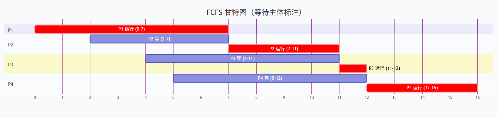
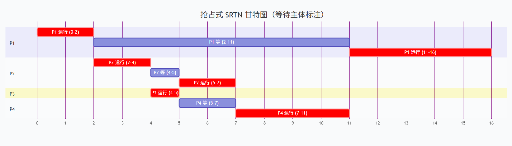
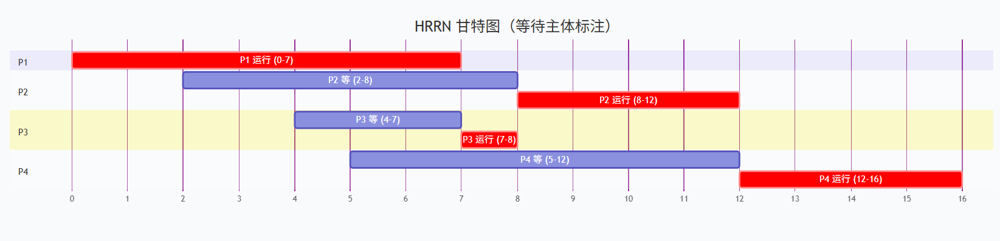
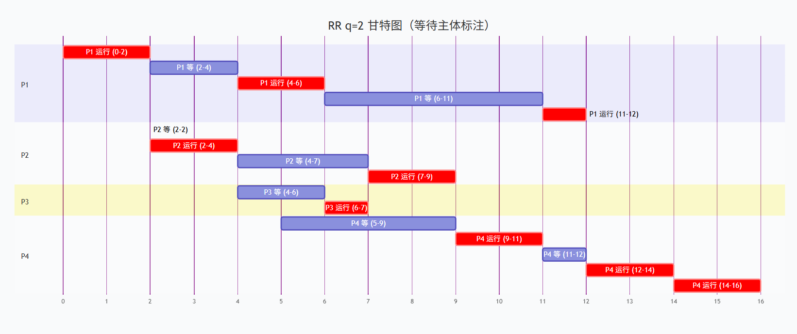
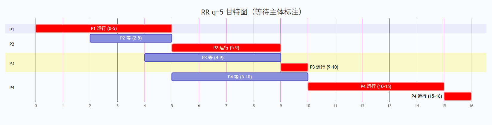
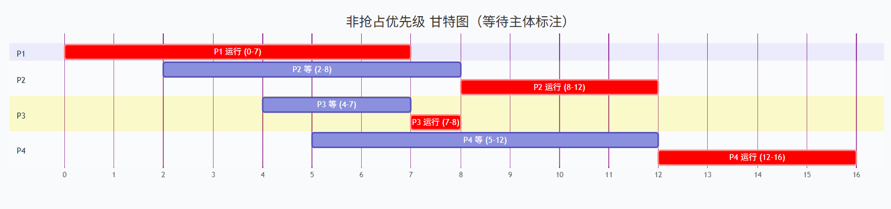
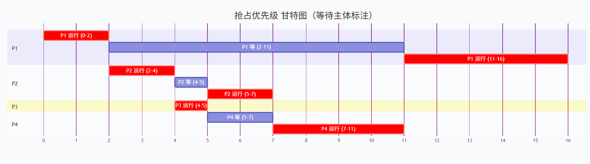
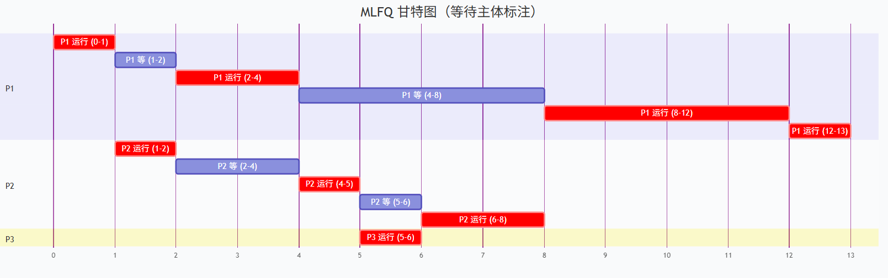

(例题见：[试题文档 ques.md](res/ques.md)相关章节)

## 1.调度算法的评价指标

评价调度算法优劣需要**量化指标**。按视角分两类：

- **系统视角**：CPU 利用率、系统吞吐量；
- **用户视角**：周转时间、带权周转时间、等待时间、响应时间。

一个作业总共需要被 CPU/I/O 服务多久一般是**确定的**，因此**调度算法只会影响等待时间**——所有调度算法的比较本质都是"谁等待更短、谁更公平"。

### 1.1 CPU利用率

```
CPU利用率 = CPU忙碌的时间 / 总时间
```

- 早期 CPU 昂贵，希望 CPU 尽可能多工作；
- 多道程序并发时常用「**甘特图（Gantt Chart）**」辅助计算（画出每段时间 CPU 归谁，数忙碌段）；
- **注意**：有的题目还会要求计算**某种设备的利用率**（打印机、磁盘等），方法与 CPU 利用率相同。

某计算机只支持单道程序，某作业刚开始需要在 CPU 上运行 5 秒，再用打印机打印输出 5 秒，之后再执行 5 秒才能结束。求此过程中 CPU 利用率与打印机利用率。
- 总时间 = 5 + 5 + 5 = **15 秒**；
- CPU 忙碌时间 = 5 + 5 = 10 秒 → CPU 利用率 = 10/15 = **66.67%**；
- 打印机忙碌时间 = 5 秒 → 打印机利用率 = 5/15 = **33.33%**。


### 1.2 系统吞吐量

```
系统吞吐量 = 总共完成的作业数 / 总耗时
```

- 例：10 道作业共花 100 秒，吞吐量 = 10/100 = **0.1 道/秒**。

### 1.3 周转时间

```
（作业）周转时间 = 作业完成时间 − 作业提交时间
平均周转时间 = 各作业周转时间之和 / 作业数
```

**周转时间包含四部分**：
1. 外存后备队列**等待作业调度**的时间；
2. 就绪队列**等待进程调度**的时间；
3. **CPU 上执行**的时间；
4. **等待 I/O 完成**的时间（后三项可能发生多次）。

- 用户关心单个作业的周转时间；操作系统关心所有作业的**平均值**。

### 1.4 带权周转时间

```
带权周转时间 = 周转时间 / 作业实际运行时间
平均带权周转时间 = 各作业带权周转时间之和 / 作业数
```

- **带权周转时间必然 ≥ 1**（周转时间 ≥ 运行时间），且与周转时间一样都是**越小越好**；
- **理解**：
  - 周转时间相同、实际运行时间长的作业，在相同时间内被服务的时间更多，**带权周转时间更小**，用户满意度更高；
  - 实际运行时间相同、周转时间短的作业，带权周转时间更小。

> 一句话：带权周转时间 = "花了多少倍于实际执行的时间才完成"，倍数越小越好。

### 1.5 等待时间


```
等待时间 = 周转时间 − 运行时间（纯计算型进程）
```

- 指进程/作业处于**等待处理机状态**的时间之和；
- 对于**进程**：等待时间 = 建立进程后等待被服务的时间之和；**等待 I/O 期间进程也算在被服务**（被 I/O 设备服务），不计入等待时间；
- 对于**作业**：还要加上在**外存后备队列**中等待的时间；
- 既有计算又有 I/O 的进程：

```
等待时间 = 周转时间 − 运行时间（CPU 时间）− I/O 操作的时间
```

### 1.6 响应时间


```
响应时间 = 用户提交请求到首次产生响应所用的时间
```

- 交互式系统中尤其重要（如键盘输入调试命令后多久能得到回应）；
- 注意：响应时间看的是**首次响应**，不是作业完成——与周转时间不同。


## 2.FCFS、SJF、HRRN

适合早期批处理系统的调度算法：
- **FCFS（First Come First Served，先来先服务）**：追求公平，但忽视运行时间；
- **SJF/SPF（Shortest Job/Process First，最短作业/进程优先）**：追求最短平均等待/周转时间，但忽视等待时间、可能导致**饥饿**；
- **HRRN（Highest Response Ratio Next，最高响应比优先）**：用**响应比**综合权衡等待时间与运行时间，避免长作业饥饿。

**一句话理解**：FCFS 论资排辈、SJF 欺软怕硬（短作业优先，长作业可能饿死）、HRRN 老少兼顾。


| 进程 | 到达时间 | 运行时间 |
| ---- | ---- | ---- |
| P1 | 0 | 7 |
| P2 | 2 | 4 |
| P3 | 4 | 1 |
| P4 | 5 | 4 |


```
周转时间 = 完成时间 − 到达时间
带权周转时间 = 周转时间 / 运行时间
等待时间 = 周转时间 − 运行时间（纯计算型进程）
```

### 2.1 FCFS算法

对于FCFS算法，进程到达顺序为：P1、P2、P3、P4。




| 进程 | 完成时间 | 周转时间 | 带权周转 | 等待时间 |
| ---- | ---- | ---- | ---- | ---- |
| P1 | 7 | 7 | 7/7=1 | 0 |
| P2 | 11 | 9 | 9/4=2.25 | 5 |
| P3 | 12 | 8 | 8/1=8 | 7 |
| P4 | 16 | 11 | 11/4=2.75 | 7 |


- 平均周转时间 = (7+9+8+11)/4 = **8.75**；
- 平均带权周转时间 = (1+2.25+8+2.75)/4 = **3.5**；
- 平均等待 = (0+5+7+7)/4 = **4.75**。

### 2.2 SJF/SPF算法

对于SJF/SPF算法，进程到达顺序为：P1→P3→P2→P4。


| 进程 | 完成时间 | 周转时间 | 带权周转 | 等待时间 |
| ---- | ---- | ---- | ---- | ---- |
| P1 | 7 | 7 | 1 | 0 |
| P3 | 8 | 4 | 4/1=4 | 3 |
| P2 | 12 | 10 | 10/4=2.5 | 6 |
| P4 | 16 | 11 | 11/4=2.75 | 7 |

- 平均周转时间 = (7+4+10+11)/4 = **8**；
- 平均带权周转时间 = (1+4+2.5+2.75)/4 = **2.56**；
- 平均等待 = (0+3+6+7)/4 = **4**。

可见比 FCFS 更优。

### 2.3 HRRN算法（抢占式）

新进程到达时若**剩余时间**更短则抢占当前进程，否则等待。



- 0 时刻 P1(剩余7)；2 时刻 P2(4) 比 P1 剩余(5) 短 → 抢占；4 时刻 P3(1) 比 P2 剩余(2) 短 → 抢占；5 时刻 P3 完成、P4 到达，P2(2) 最短；7 时刻 P2 完成，P4(4) 比 P1 剩余(5) 短；11 时刻 P4 完成，剩 P1 到 16。
- **课件给出的完整时刻表写法（大题推荐格式）**：每当有新进程到达、就绪队列改变时都要检查；记 Pn(m) 为 Pn 剩余时间 m——
  - 0 时刻（P1 到达）：P1(7)；
  - 2 时刻（P2 到达）：P1(5)、P2(4)；
  - 4 时刻（P3 到达）：P1(5)、P2(2)、P3(1)；
  - 5 时刻（P3 完成且 P4 刚好到达）：P1(5)、P2(2)、P4(4)；
  - 7 时刻（P2 完成）：P1(5)、P4(4)；
  - 11 时刻（P4 完成）：P1(5)。

| 进程 | 完成时间 | 周转时间 | 带权周转 | 等待时间 |
| ---- | ---- | ---- | ---- | ---- |
| P1 | 16 | 16 | 16/7=2.28 | 9 |
| P2 | 7 | 5 | 5/4=1.25 | 1 |
| P3 | 5 | 1 | 1/1=1 | 0 |
| P4 | 11 | 6 | 6/4=1.5 | 2 |

平均周转 = (16+5+1+6)/4 = **7**；平均带权 = (2.28+1.25+1+1.5)/4 = **1.50**；平均等待 = (9+1+0+2)/4 = **3**。三项指标进一步降低——**抢占式能进一步缩短平均等待**。


### 2.4 HRRN算法（非抢占式）

每次调度时算响应比：(等待时间 + 要求服务时间) / 要求服务时间

- 0 时刻只有 P1，上处理机到 7 时刻；
- 7 时刻：P2 响应比=(5+4)/4=**2.25**；P3=(3+1)/1=**4**；P4=(2+4)/4=**1.5** → 选 P3；
- 8 时刻：P2=(6+4)/4=**2.5**；P4=(3+4)/4=**1.75** → 选 P2；
- 12 时刻：只剩 P4。




## 3.多级反馈队列（MLFQ）、时间片轮转（Round Robin）、优先级调度（Priority）

适合交互式操作系统（分时、实时）：
- **RR（Round Robin，时间片轮转）**：保证**公平**、**响应快**；
- **优先级调度**：按任务**紧急程度**排序；
- **多级反馈队列（MLFQ）**：多种算法的**折中权衡**，兼具 FCFS 的公平、RR 的响应快、SPF 的短作业快完成等优点，UNIX 采用此类算法。

**一句话理解**：RR 轮流坐庄、优先级急事优先、MLFQ 高优先快响应 + 短作业秒杀。


### 3.1 RR算法

**规则**：
- 按进程到达顺序轮流执行一个时间片（如 100ms）；
- 未完成则**剥夺处理机**、放到就绪队列**队尾**；
- 由**时钟中断**通知时间片到。

RR 下每次选择的都是**就绪队列队头**的进程；正在运行（处于运行态）的进程**并不在就绪队列中**——所以"新进程到达但当前进程时间片未用完"时暂时不调度，新进程只插到就绪队列队尾，不会打断正在运行的进程（RR 不是按到达即抢占的算法）。

| 进程 | 到达时间 | 运行时间 |
| ---- | ---- | ---- |
| P1 | 0 | 5 |
| P2 | 2 | 4 |
| P3 | 4 | 1 |
| P4 | 5 | 6 |

甘特图（时间片=2）：


- 0 时刻只有 P1(5) → 运行 0~2；
- 2 时刻 P2 到达（**默认新到达先入队**），P1 回队尾；队头 P2 → 运行 2~4；
- 4 时刻 P3 到达插队尾，P2 回队尾；队头 P1(剩3) → 运行 4~6；
- 6 时刻 P1 用完回队尾；队头 P3(1) → 运行 6~7，**P3 主动完成**；
- 7 时刻队头 P2(剩2) → 运行 7~9 完成；9 时刻队头 P4(6) → 9~11；
- 11 时刻 P4 用完回队尾，队头 P1(剩1) → 11~12 完成；之后 P4 独占至 16。

甘特图（时间片=5）：


**时间片选择**（高频考点）：
- 时间片太大 → **退化为 FCFS**，响应时间变大；
- 时间片太小 → 切换过于频繁，系统大量时间花在切换上；
- 设计时一般让**切换开销不超过 1%**（如 10 个进程、时间片 1 秒时，某进程可能等 9 秒才被响应）。


### 3.2 优先级调度算法

**规则**：选当前已到达且**优先级最高**的进程；抢占式还需在就绪队列变化时检查是否抢占。

**适用范围**：优先级调度**既可用于作业调度，也可用于进程调度**，甚至还会用于后面学习的 **I/O 调度**（第5章磁盘调度中也有优先权思想）——概念通用性强。


**例题（优先数大 = 优先级高）**：

| 进程 | 到达 | 运行 | 优先数 |
| ---- | ---- | ---- | ---- |
| P1 | 0 | 7 | 1 |
| P2 | 2 | 4 | 2 |
| P3 | 4 | 1 | 3 |
| P4 | 5 | 4 | 2 |


对于**非抢占**：



对于**抢占**：



（2 时刻 P2 优先级高于 P1 抢占；4 时刻 P3 高于 P2 抢占；5 时刻 P3 完成，P2 比 P4 先入队先上；7 时刻 P2 完成，P4 上；11 时刻 P4 完成，P1 到 16）


### 3.3 多级反馈队列（MLFQ）

**算法规则**：
- 设置多级就绪队列，**优先级从高到低、时间片从小到大**；
- **新进程先进入第 1 级队列**，按 FCFS 排队；用完时间片未结束 → **进入下一级队列队尾**；已在最下级 → 放回本队队尾；
- 只有第 k 级队列**为空**时，才为 k+1 级队头进程分配时间片；
- **抢占式**：k 级进程运行中若更上级队列有新进程，新进程**抢占**处理机，原进程放回 **k 级队列队尾**。

MLFQ 就是"三档 VIP 通道"，想象一个食堂有三个窗口队列：

| 队列 | 俗称 | 每次最多打饭时间 | 谁进|
| ---- | ---- | ---- | ---- |
| Q1 | VIP 通道 | 1 分钟 | 所有新来的人 |
| Q2 | 普通通道 | 2 分钟 | 在 VIP 没打完、被"降级"的人 |
| Q3 | 慢速通道 | 4 分钟 | 在 Q2 还没打完、再降级的人 |

- VIP 永远优先：只要 Q1 有人，Q2、Q3 的人全部干等着。
- Q1 空了才轮到 Q2，Q2 空了才轮到 Q3。
- 时间片用完还没打完 → 往下掉一级（Q1→Q2→Q3）；已经在 Q3 的，用完再排到 Q3 队尾（不掉出地球）。
- 正在 Q2 或 Q3 打饭的人，如果此刻 Q1 来了新人，他必须立刻让出窗口，回到自己原来那一级的队尾排队——注意：是回原级队尾，不是降级！

**例题（第 1/2/3 级时间片分别为 1/2/4）**：

| 进程 | 到达 | 运行 |
| ---- | ---- | ---- |
| P1 | 0 | 8 |
| P2 | 1 | 4 |
| P3 | 5 | 1 |


时刻 0：P1 来了
- P1 是新来的 → 进 Q1。
- Q1 只有他 → 他打饭。Q1 片=1，0~1 打 1 分钟，没打完（要 8，才打了 1，剩 7）。
- 时间片用完 → 降级到 Q2 队尾。
- 此时：Q1=空，Q2=[P1]，Q3=空。P1 剩 7。

时刻 1：P2 来了（关键！）
- P2 是新来的 → 进 Q1。
- 现在 Q1 有 P2，Q2 有 P1。Q1 优先 → P2 打饭。
- 这里就是"抢占"：P1 本来在 Q2 排着，但 Q1 来了新人，窗口直接给 P2。P1 没被打扰（他本来就没在打），只是继续在 Q2 等。
- P2 用 Q1 片 1，1~2 打 1 分钟，没打完（要 4，剩 3）→ 降级到 Q2 队尾。
- 此时：Q1=空，Q2=[P1, P2]（P1 在前，因为 P1 先来的），Q3=空。

时刻 2：Q1 空了，轮到 Q2
- Q2 队头是 P1（他先入队）。
- P1 用 Q2 片=2，2~4 打 2 分钟，剩 7−2=5，没打完 → 降级到 Q3 队尾。
- 此时：Q1=空，Q2=[P2]，Q3=[P1]。P1 剩 5。

时刻 4：Q1 空、Q2 有 P2
- Q2 队头 P2 打饭。Q2 片=2，理论上 4~6 打 2 分钟。
- 但是！5 时刻 P3 要来了，所以 P2 只能打到 5。
。
时刻 5：P3 来了（第二个关键点！）
- P3 新来 → 进 Q1。
- Q1 有 P3，Q2 正在跑的 P2 必须让出窗口（抢占！）。
- P2 让出后回哪？回 Q2 队尾（不是 Q3！因为他不是时间片用完，是被 VIP 插队）。
- P2 在 4~5 已经打了 1 分钟（要 4，剩 3，现在剩 2）。
- P3 用 Q1 片 1，5~6 打 1 分钟，P3 只要 1，打完！P3 完成。
- 此时：Q1=空，Q2=[P2]（P2 回队尾，队列就他一个），Q3=[P1]。P2 剩 2，P1 剩 5。


时刻 6：P3 走了，Q1 空
- Q2 有 P2 → P2 打饭。Q2 片=2，6~8 打 2 分钟，P2 剩 2，正好打完！P2 完成。
- 此时：Q1=空，Q2=空，Q3=[P1]。P1 剩 5。

时刻 8：Q1、Q2 都空，轮到 Q3
- Q3 队头 P1。Q3 片=4，8~12 打 4 分钟，P1 剩 5−4=1，没打完 → 已在最下级，放回 Q3 队尾。
- 此时：Q3=[P1]。P1 剩 1。

时刻 12：Q3 只有 P1
- 继续打。12~13 打 1 分钟，P1 打完！P1 完成。

总序列：P1(0-1) → P2(1-2) → P1(2-4) → P2(4-5) → P3(5-6) → P2(6-8) → P1(8-12) → P1(12-13)



**优点**：
- 各类型进程相对**公平**；
- 新进程很快得到**响应**（第 1 级时间片短、优先级高）；
- **短进程只用较少时间即可完成**；
- **不必预先估计进程运行时间**（避免用户作假——SJF 需要用户报运行时间）；
- 可灵活调整偏好（如把因 I/O 阻塞的进程**放回原队列**，使 I/O 型进程保持较高优先级）。

**缺点**：可能饥饿（长进程可能长时间得不到服务），但可通过"**老化（Aging）**"提升优先级解决。


## 4.多级队列调度算法

多级队列调度算法按进程类型（如系统进程、交互式进程、批处理进程）把进程分成**多个队列**，进程创建成功后**固定插入**某个队列。

- 队列之间可采用**固定优先级**或**按时间片比例分配 CPU**；
- 各队列内部可**分别使用不同的调度算法**；
- 与多级反馈队列的关键区别：**多级队列中进程一旦入队就不会在队列间移动**。

**一句话理解**：多级队列"按类型分家，进谁家就住谁家"；多级反馈队列"按表现升降级，随时可搬家"。


**规则：**
- 系统中按进程类型设置多个队列，进程创建成功后插入对应队列；
- **队列之间的调度**有两种方式：
   - **固定优先级**：高优先级队列空时，低优先级队列中的进程才能被调度；
   - **时间片划分**：如三个队列分配时间比例 50%、40%、10%；
- **各队列内部可采用不同调度策略**：

| 队列类型 | 队内算法 |
| ---- | ---- |
| 系统进程队列 | **优先级调度** |
| 交互式队列 | **RR（时间片轮转）** |
| 批处理队列 | **FCFS** |

> 经典组合：系统进程最高优先（优先级调度）、交互式进程次之（RR 保证响应快）、批处理进程最低（FCFS 简单公平）。


