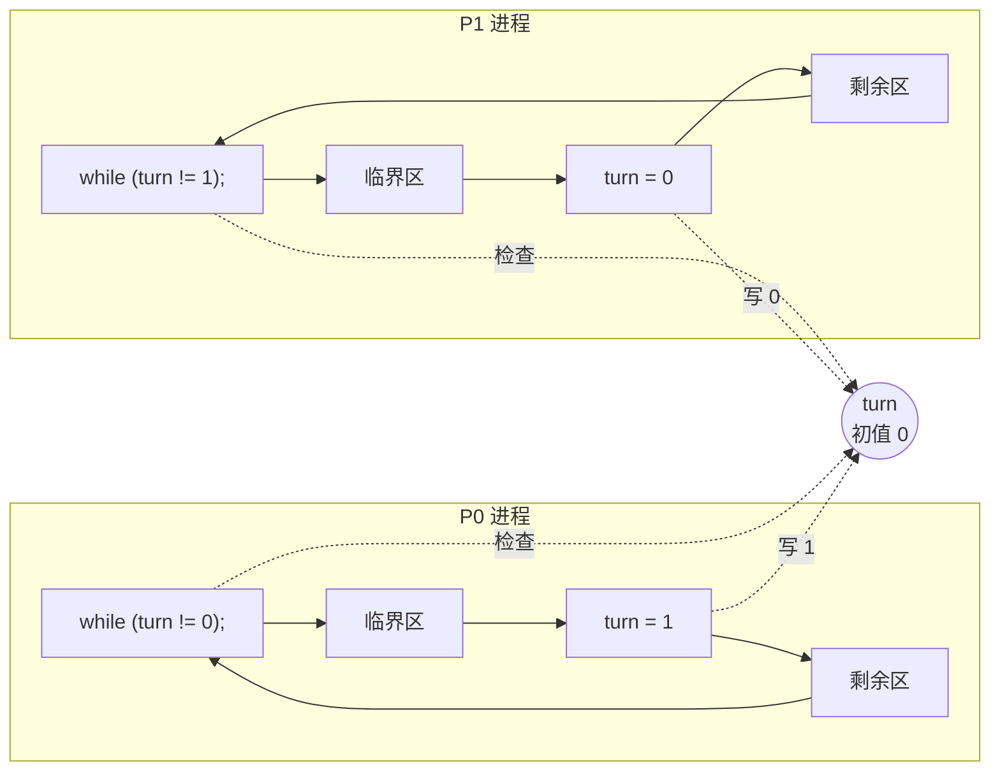
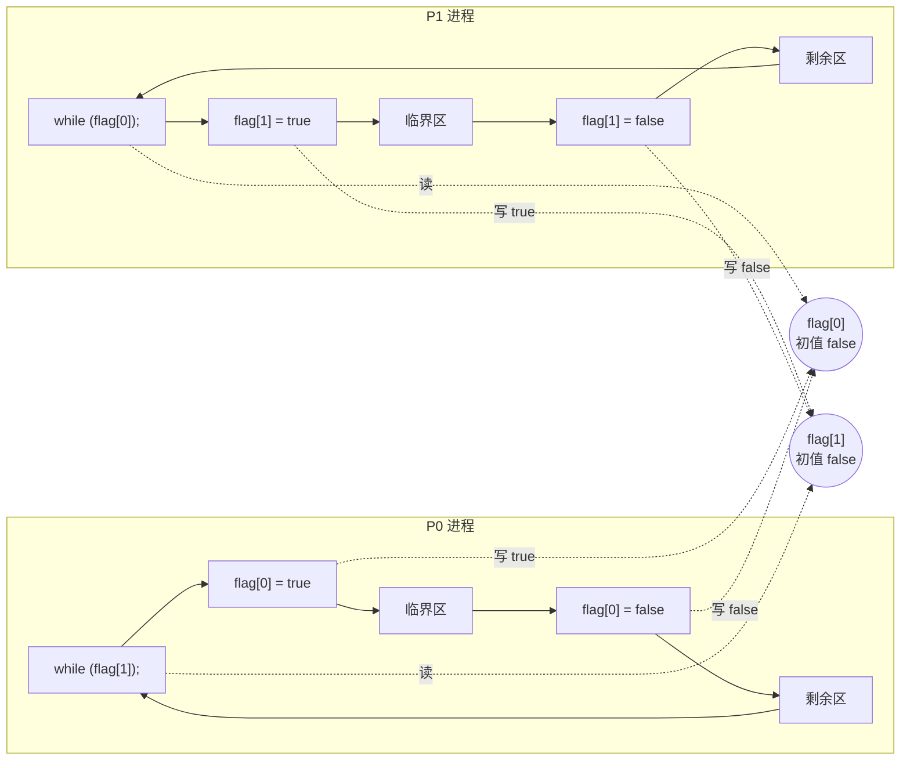
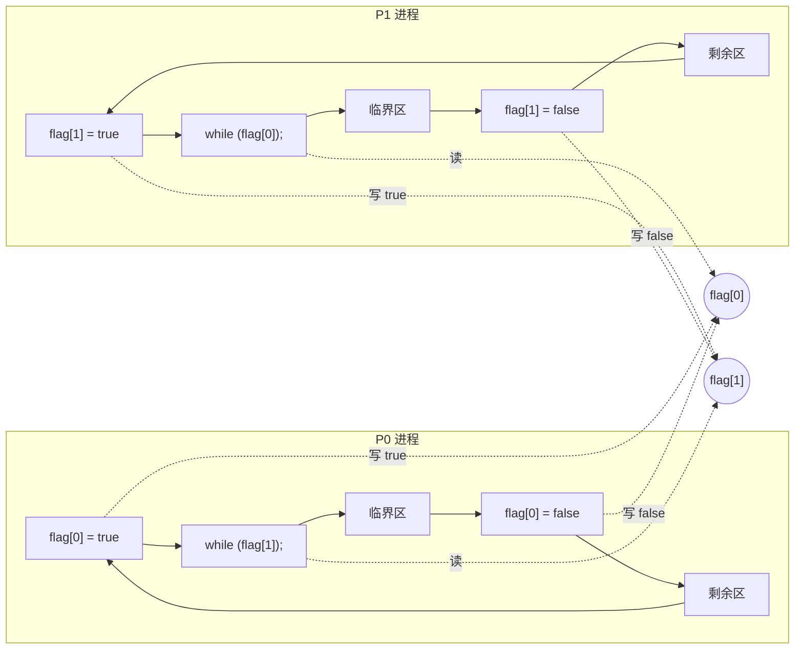
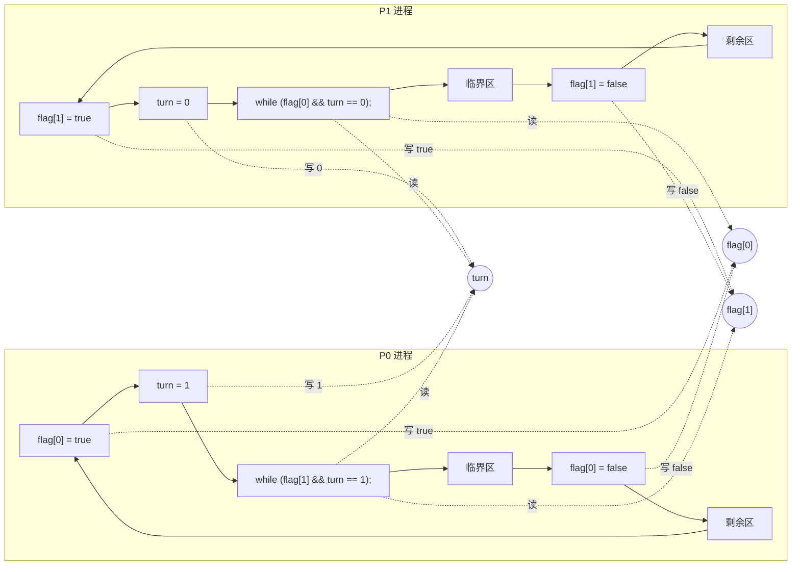

（例题见：[试题文档 ques.md](res/ques.md)相关章节）

进程具有**异步性**：各并发执行的进程以各自独立的、不可预知的速度向前推进。操作系统需要提供"**进程同步机制**"来解决异步性问题。
- **进程同步（Synchronization）**：并发进程需要**互相配合、按一定先后顺序**推进——称**直接制约关系**；
- **进程互斥（Mutual Exclusion）**：一个进程访问临界资源时，其他进程必须等待——称**间接制约关系**；
- **互斥是同步的一种特例**（互斥本质也是"制约"），二者不能混为一谈。

同步管"**顺序**"（谁先谁后），互斥管"**独占**"（同一时刻只能一个用）。

## 1.进程同步（直接制约关系）概述

指并发进程需要互相配合、按一定先后顺序推进。课件中的具体例子（共享内存缓冲区的两个进程）：

- **进程 A**：① 从缓冲区中读数据 → ② 数据预处理 → ③ 将预处理完的数据写回缓冲区 → ④ 进行其他任务；
- **进程 B**：① 进行准备工作 → ② 从缓冲区中读数据 → ③ 数据的后续处理。

B 的第②步要读的是 **A 在第③步写回的数据**，所以 **B 必须等 A 执行完③之后才能执行②**——这就是"一前一后"的同步关系（B 的②之前必须等 A 的③完成）。

**本质**：同步要解决的是"**事件的先后次序**"——前驱事件的完成是后继事件的开始条件。

## 2.进程互斥（间接制约关系）概述

- **临界资源**：一个时间段内只允许一个进程使用的资源（**打印机、摄像头、全局变量、内存缓冲区**等）；
- **进程互斥**：当一个进程访问某临界资源时，另一个想访问该资源的进程必须等待；当前进程**释放资源后**，其他进程才能访问。

**临界区的四个逻辑部分**：

| 部分 | 作用 | 示例 |
|------|------|------|
| **进入区** | 检查可否进入临界区并"**上锁**" | `if` 检查 + 设置标志 |
| **临界区** | **访问临界资源的那段代码** | 使用打印机 |
| **退出区** | 负责"**解锁**" | 清除"正在访问"标志 |
| **剩余区** | 做其他处理 | 其他代码 |

互斥访问必须遵循的四条原则（必背）

- **空闲让进**：临界区空闲时，允许一个请求进入的进程**立即进入**；
- **忙则等待**：已有进程在临界区时，其他进程**必须等待**；
- **有限等待**：保证请求进程在**有限时间内**进入临界区（**不会饥饿**）；
- **让权等待**：进程不能进入临界区时，**应立即释放处理机**，防止忙等。


## 3.进程互斥的软件实现方法

软件实现法**只用编程语言**（不加硬件特殊指令）解决进程互斥问题。共有四种方法：
1. **单标志法**
2. **双标志先检查法**
3. **双标志后检查法**
4. **Peterson 算法**

学习重点是理解各算法的"**检查—上锁**"逻辑，并对照**互斥四原则**（空闲让进、忙则等待、有限等待、让权等待）分析缺陷。

### 3.1 单标志法

用整型变量 `turn` 表示当前允许进入临界区的进程号（初值 0），每个进程访问完后把 `turn` **交给对方**。

```c
// P0 进程                      // P1 进程
while (turn != 0);  /*进入区*/    while (turn != 1);
临界区;                           临界区;
turn = 1;          /*退出区*/    turn = 0;
剩余区;                           剩余区;
```

即：



- **优点**：能保证互斥；
- **缺陷**：**违背"空闲让进"**——只能 P0→P1→P0→… **轮流**访问；若轮到 P0 而 P0 不访问临界区，临界区空闲但 P1 也不能进。

### 3.2 双标志先检查法

用布尔数组 `flag[]`，`flag[i]=true` 表示进程 i 想进入临界区，**先检查后上锁**。

```c
// P0                            // P1
while (flag[1]);  /*检查*/       while (flag[0]);
flag[0] = true;   /*上锁*/       flag[1] = true;
临界区;                          临界区;
flag[0] = false;  /*解锁*/       flag[1] = false;
```

即：



- **缺陷**：**违背"忙则等待"**——若P0 检查完、P1 检查完，双方都还没上锁，检查与上锁之间发生进程切换，**两个进程同时进入临界区**。
- **本质**：**"检查"和"上锁"不是原子操作**——中间被调度就出问题。

### 3.3 双标志后检查法


```c
// P0                            // P1
flag[0] = true;   /*上锁*/       flag[1] = true;
while (flag[1]);  /*检查*/       while (flag[0]);
临界区;                          临界区;
flag[0] = false;  /*解锁*/       flag[1] = false;
```

即：




- **缺陷**：**违背"空闲让进"和"有限等待"**——若双方都先上锁、再检查，**双方都进不了临界区**，产生饥饿。
- **本质**：都"抢着上锁"反而谁都进不去——典型的死锁式互相谦让僵局。


### 3.4 Peterson 算法

把"**表达意愿**"（flag）与"**谦让**"（turn）结合起来。**进入区三步**：主动争取、主动谦让、检查对方且最后是否是自己在谦让。

```c
// P0                            // P1
flag[0] = true;   /*意愿*/       flag[1] = true;
turn = 1;         /*谦让*/       turn = 0;
while (flag[1] && turn == 1);   while (flag[0] && turn == 0);
临界区;                          临界区;
flag[0] = false;                flag[1] = false;
```

即：



- **思想**：谁最后说了"客气话"（写 turn），谁就**失去行动的优先权**；(turn 只有一个值，最后写的人"谦让"成功，对方先进。两人不会同时满足 flag[j] && turn == j，所以必有且仅有一方进——既不死锁，也保证互斥。)
- **满足**：空闲让进、忙则等待、有限等待；
- **仍不满足"让权等待"**（进入区有忙等——while 循环空转）。

