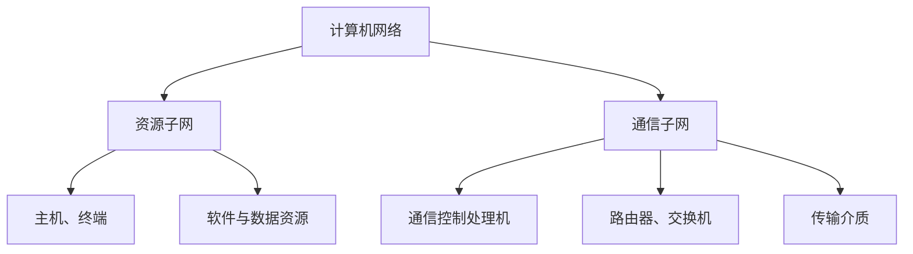
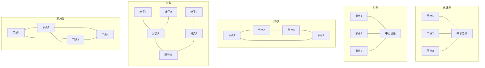
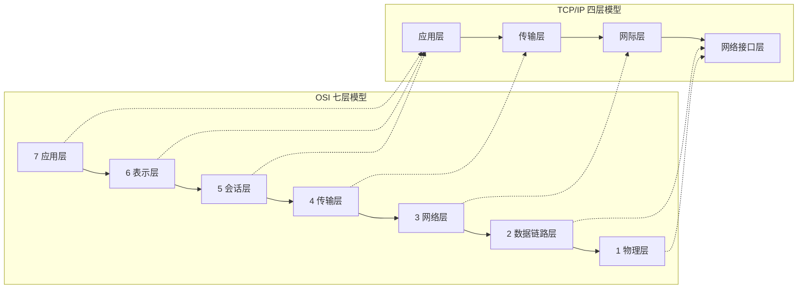
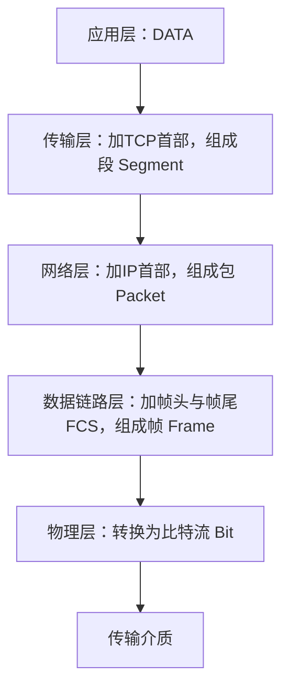

# 计算机网络基础 · 完整笔记

---

## 1.计算机网络发展

### 1.1 世界计算机网络发展

| 阶段 | 时间 | 标志性事件 |
|------|------|-----------|
| 萌芽 | 20世纪50年代以前 | 计算机技术与通信技术开始结合，出现具有通信功能的联机系统 |
| 分组交换网 | 20世纪60年代末至70年代 | 1969年美国ARPANET建成，最初连接UCLA、SRI、UCSB、犹他大学4个节点，分组交换走向实用 |
| 体系标准化 | 20世纪70年代至80年代 | 1974年Cerf与Kahn提出TCP/IP；1983年1月ARPANET全面切换为TCP/IP；ISO于1977年开始制定OSI/RM，1984年10月发布ISO 7498 |
| 互联网商用 | 20世纪90年代开始 | 1991年WWW发布；1995年NSFNET退役，Internet走向商用与全球化 |

### 1.2 我国互联网发展

| 时间 | 事件 |
|------|------|
| 1987年9月20日 | 钱天白教授通过意大利公用分组交换网ITAPAC设在北京的PAD，发出我国第一封电子邮件“越过长城，走向世界” |
| 1989年9月 | 国家计委组织建立中关村地区教育与科研示范网络（NCFC），目标是在北京大学、清华大学和中国科学院3个单位间建设高速互联网络，1992年建设完成 |
| 1994年4月20日 | NCFC工程通过美国Sprint公司连入Internet的64K国际专线开通，中国实现与Internet的全功能连接，成为国际互联网第77个成员 |
| 1994年7月 | 清华大学等六所高校建设的CERNET试验网开通，是我国第一个全国性TCP/IP互联网 |
| 1995年12月20日 | 中国教育和科研计算机网（CERNET）示范工程建成，开通128Kbps国际信道，联网高校108所 |
| 1997年6月3日 | 中国科学院网络信息中心组建中国互联网络信息中心（CNNIC） |

> 第一封邮件的日期存在两种口径：教材多记为1987年9月20日；CNNIC在2003年核对德国卡尔斯鲁厄大学档案后，确认发送时间为1987年9月14日21时07分。考试按教材记9月20日即可。

截至2025年12月（CNNIC第57次《中国互联网络发展状况统计报告》，2026年2月5日发布）：

| 指标 | 数值 |
|------|------|
| 网民规模 | 11.25亿人，较2024年12月增长1717万人 |
| 互联网普及率 | 80.1%，较2024年12月提升1.5个百分点 |
| 手机网民规模 | 11.21亿人，占网民整体的99.6% |
| 域名总数 | 3230万个，其中“.CN”域名2077万个 |
| IPv6地址数量 | 70215块/32 |
| 5G基站总数 | 483.8万个，所有乡镇及95%的行政村通5G |
| 10G PON端口数 | 3162万个，全国2/3的地市达到千兆城市标准 |
| 生成式人工智能用户 | 6.02亿人，普及率42.8% |

统计口径说明：CNNIC报告每年发布两次，分别对应上一年12月和当年6月的数据；引用时必须注明“截至某年某月”，不同期次的数据不可混用。第56次报告（截至2025年6月）的网民规模为11.23亿人、普及率79.7%，可与上表对照。

### 1.3 我国主要互联网骨干网

| 骨干网 | 全称 | 建设或主管单位 | 说明 |
|--------|------|---------------|------|
| ChinaNet | 中国公用计算机互联网 | 中国电信 | 1995年向社会开放，是最早面向公众的商用互联网 |
| ChinaGBN | 中国金桥信息网 | 吉通公司 | 1996年开通，面向社会提供接入与信息服务 |
| CERNET | 中国教育和科研计算机网 | 教育部 | 1994年试验网开通，1995年示范工程建成，覆盖高校和科研机构 |
| CSTNET | 中国科技网 | 中国科学院 | 由NCFC演进而来，服务科研单位 |
| UNINet | 中国联通公用计算机互联网 | 中国联通 | 2000年建成，面向公众提供接入 |

考试中常以“四大骨干网”指ChinaNet、ChinaGBN、CERNET、CSTNET；UNINet为后续新增的全国性骨干网，注意题干口径。

### 1.4 计算机网络的组成

| 部分 | 组成 | 作用 |
|------|------|------|
| 资源子网 | 主机、终端、软件、数据资源 | 负责数据处理与提供网络服务 |
| 通信子网 | 通信控制处理机、路由器、交换机、传输介质 | 负责数据传输、转发与交换 |

---

## 2.计算机网络定义

### 2.1 定义

计算机网络是指将地理位置不同、具有独立功能的多台计算机（或设备），通过通信线路和通信设备互连起来，并在网络协议和网络软件的管理下，实现资源共享和信息传递的系统。

定义包含三个要素：

| 要素 | 含义 |
|------|------|
| 独立自治的计算机 | 每台计算机具有独立的操作系统和处理能力，不是主从控制关系 |
| 通信线路与设备互连 | 通过双绞线、光纤、无线等介质实现物理连接 |
| 网络协议 | 通信双方必须遵循共同的规则，否则无法交换数据 |

### 2.2 网络协议的三要素

网络协议的三要素：

| 要素 | 含义 |
|------|------|
| 语法 | 数据与控制信息的结构或格式，如帧格式、字段顺序 |
| 语义 | 需要发出何种控制信息、完成何种动作以及做出何种响应 |
| 时序 | 事件实现顺序的详细说明，如握手顺序、超时重传 |

### 2.3 功能

| 功能 | 说明 |
|------|------|
| 资源共享 | 包括硬件共享、软件共享和数据（信息）共享，是网络最主要的功能 |
| 数据通信 | 实现计算机之间信息的传输与交换，是网络的基础功能 |
| 集中管理 | 对分散的资源、用户和权限进行统一管理 |
| 分布式处理 | 将大型任务分解到多台计算机上并行处理 |
| 负载均衡 | 将业务流量分摊到多台服务器或链路，提高整体处理能力 |
| 提高可靠性 | 通过冗余链路和冗余设备，在单点故障时仍可通信 |

---

## 3.计算机网络分类

### 3.1 按覆盖范围分类

| 分类 | 个域网 PAN | 局域网 LAN | 城域网 MAN | 广域网 WAN |
|------|-----------|-----------|-----------|-----------|
| 地理范围 | 一般10~20m内 | 大楼内、园区内部 | 建筑物之间，城区内 | 国内、国际 |
| 特点 | 低功耗、低传输速率、短距离 | 覆盖范围窄、用户数少、配置容易、连接速率高 | 介于局域网和广域网之间 | 距离较远，信息衰减比较严重 |
| 典型案例 | 蓝牙、家庭WiFi | 校园网、企业内部网络 | 教育城域网、运营商城域网 | 运营商骨干网 |

### 3.2 按交换技术分类

| 交换方式 | 是否建立连接 | 传输单位 | 时延 | 线路利用率 | 典型应用 |
|---------|------------|---------|------|-----------|---------|
| 电路交换 | 需要，独占物理线路 | 比特流 | 建立连接后时延小且固定 | 低 | 电话网PSTN、ISDN |
| 报文交换 | 不需要 | 整个报文 | 较大，存储转发 | 较高 | 早期电报、长报文文件传送 |
| 分组交换 | 数据报不需要，虚电路需要 | 分组（Packet） | 较小，存储转发 | 高 | Internet、X.25、帧中继、ATM |

分组交换是现代计算机网络的核心技术，其优点是线路利用率高、支持突发业务、便于差错控制和路由选择；缺点是需要存储转发，可能产生排队时延和抖动。ATM采用固定53字节的信元（5字节首部+48字节数据），可视为分组交换的一种特殊形式。

### 3.3 按拓扑结构分类

| 拓扑 | 结构特点 | 优点 | 缺点 |
|------|---------|------|------|
| 总线型 | 所有节点共享一条总线 | 布线简单、成本低 | 冲突多，故障点难以定位 |
| 星型 | 所有节点连接到中心设备 | 易于管理，单点故障易隔离 | 依赖中心节点，中心故障导致全网瘫痪 |
| 环型 | 节点首尾相连成环 | 无冲突，时延确定 | 单点故障影响全网，扩容不便 |
| 树型 | 星型的分级组合 | 层次清晰，便于扩展 | 根节点是关键点 |
| 网状型 | 节点之间有多条链路 | 可靠性高，冗余路径多 | 成本高，路由复杂 |

### 3.4 其他分类方式

| 分类维度 | 类型 |
|---------|------|
| 按传输技术 | 点对点传输网络、广播式传输网络 |
| 按采用的协议 | IP网、IPX网等 |
| 按传输介质 | 无线网、有线网（双绞线网络、同轴电缆网络、光纤网络） |
| 按用途 | 教育网络、科研网络、商业网络、企业网络 |
| 按服务模式 | 客户/服务器模式（C/S）、浏览器/服务器模式（B/S）、对等网（P2P） |
| 按传输距离和速率 | 窄带网、宽带网 |

---

## 4.计算机网络性能参数

### 4.1 速率与带宽

| 参数 | 含义 | 单位 |
|------|------|------|
| 速率（数据率） | 单位时间内传输的比特数 | bit/s，即bps |
| 带宽（模拟） | 信道能通过的信号频率范围，等于最高频率与最低频率之差 | Hz |
| 带宽（数字） | 网络中某链路所能达到的最高数据率 | bit/s |

常用换算：1kbps=10^3bps，1Mbps=10^6bps，1Gbps=10^9bps，1Tbps=10^12bps。注意存储容量换算用1024，而速率换算用1000。

### 4.2 时延

| 时延类型 | 公式或说明 |
|---------|----------|
| 发送时延（传输时延） | 数据帧长度（bit）/ 发送速率（bit/s） |
| 传播时延 | 信道长度（m）/ 电磁波在信道中的传播速率（m/s） |
| 处理时延 | 节点检查首部、查找路由、差错检测所需时间 |
| 排队时延 | 数据在节点输出队列中等待发送的时间 |

总时延 = 发送时延 + 传播时延 + 处理时延 + 排队时延。

关键常数：

| 介质 | 传播速率 |
|------|---------|
| 铜缆、光纤 | 约2×10^8 m/s，即200 m/μs、200 km/ms |
| 无线电波（真空） | 3×10^8 m/s |
| 地球同步卫星 | 地球站—卫星—地球站单跳约270ms（教材口径；单程约120ms） |

发送时延与传播时延的区别：发送时延取决于数据长度和发送速率，与链路长度无关；传播时延取决于链路长度和传播速率，与数据长度无关。

### 4.3 其他性能参数

| 参数 | 定义 | 公式或说明 |
|------|------|-----------|
| 时延带宽积 | 链路上“正在传播”的比特数，又称以比特为单位的链路长度 | 传播时延 × 带宽 |
| 往返时间RTT | 从发送方发出数据到收到对方确认所经历的时间 | 通常包含往返传播时延和中间节点处理时延 |
| 吞吐量 | 单位时间内通过某个网络或信道的数据量 | 受瓶颈链路带宽限制，≤ 最小链路带宽 |
| 信道利用率 | 信道有数据通过的时间占总时间的比例 | 有数据通过的时间 / 总时间 |

信道利用率并非越高越好：利用率接近100%时，排队时延会急剧增大。

---

## 5.OSI/RM 七层模型

### 5.1 为什么要分层

- 通信的双方需要“讲”相同的语言，即遵循相同的协议。
- 网络通信过程复杂，分层可以降低复杂性，使各层相对独立。
- 分层便于标准化，任一层的变化不影响其他层的实现。
- 1977年ISO开始制定开放系统互连参考模型，1984年10月发布ISO 7498（即OSI/RM）。

### 5.2 OSI七层模型结构

| 层号 | 名称 | 英文 | 数据单位 |
|------|------|------|---------|
| 7 | 应用层 | Application Layer | 报文（Message），OSI称APDU |
| 6 | 表示层 | Presentation Layer | 报文，OSI称PPDU |
| 5 | 会话层 | Session Layer | 报文，OSI称SPDU |
| 4 | 传输层 | Transport Layer | 报文段（Segment），OSI称TPDU |
| 3 | 网络层 | Network Layer | 分组/包（Packet） |
| 2 | 数据链路层 | Data Link Layer | 帧（Frame） |
| 1 | 物理层 | Physical Layer | 比特（Bit） |

记忆口诀：应表会传网数物（从上到下）。

### 5.3 各层功能详解

| 层 | 功能 | 典型协议或设备 |
|---|------|---------------|
| 应用层 | 为应用程序提供访问网络的接口，直接面向用户业务 | HTTP、FTP、SMTP、DNS、DHCP |
| 表示层 | 进行数据格式转换、加密解密、压缩解压缩，确保一个系统生成的数据能被另一个系统识别 | JPEG、ASCII、SSL/TLS（部分教材归入表示层） |
| 会话层 | 在通信双方之间建立、管理和终止会话，提供同步点 | RPC、NetBIOS |
| 传输层 | 建立、维护和取消端到端的数据传输；进行流量控制、差错控制、分段与重组 | TCP、UDP |
| 网络层 | 定义逻辑地址，进行路由选择，实现数据从源到目的地的转发 | IP、ICMP、IGMP、ARP、路由器 |
| 数据链路层 | 将分组封装成帧；实现点到点或点到多点的直接通信；差错检测与流量控制 | Ethernet、PPP、HDLC、交换机 |
| 物理层 | 在媒介上传输比特流；提供机械、电气、功能和规程特性 | RJ45、光纤、集线器、中继器 |

### 5.4 类比记忆

| 层 | 类比角色 | 职责 |
|---|---------|------|
| 应用层、表示层、会话层 | 领导A | 提出通信需求，决定“说什么” |
| 传输层 | 秘书A | 负责端到端的可靠交付，相当于“门到门” |
| 网络层、数据链路层 | 邮递员A | 负责选择路径并逐站转发，相当于“站到站” |
| 物理层 | 邮政车 | 负责在介质上实际运送比特 |

---

## 6.TCP/IP 参考模型

### 6.1 概述

TCP/IP协议簇是现代Internet的核心协议，是事实上的工业标准。TCP/IP标准模型为4层，教学中也常用5层（对等模型）。

### 6.2 三种模型对比

核心对应关系：

| TCP/IP模型 | 对应OSI模型 | 主要功能 |
|-----------|------------|---------|
| 应用层 | 应用层 + 表示层 + 会话层 | 面向具体应用，处理数据表示与会话 |
| 传输层 | 传输层 | 端到端的数据传输与控制 |
| 网际层（Internet层） | 网络层 | 逻辑寻址、路由选择、分组转发 |
| 网络接口层 | 数据链路层 + 物理层 | 介质访问、成帧、比特传输 |

TCP/IP五层模型就是把网络接口层拆成数据链路层和物理层，其余与四层模型相同。

---

## 7.TCP/IP 常见协议与端口

### 7.1 协议栈总览

| 层次 | 主要协议 |
|------|---------|
| 应用层 | HTTP、HTTPS、FTP、TFTP、SMTP、POP3、IMAP4、Telnet、SSH、DNS、DHCP、SNMP、NTP、BGP、RIP、NFS |
| 传输层 | TCP、UDP |
| 网际层 | IP、ICMP、IGMP、ARP、RARP、OSPF |
| 网络接口层 | Ethernet（CSMA/CD）、PPP、HDLC、Frame Relay、ATM |

说明：BGP使用TCP、RIP使用UDP，二者属于应用层协议；OSPF直接封装在IP中（IP协议号89），通常归入网络层。它们的作用都是为网络层提供路由信息。

### 7.2 常用协议与端口号

| 协议 | 端口号 | 传输层 | 说明 |
|------|-------|--------|------|
| FTP | 21（控制）、20（数据） | TCP | 文件传输协议，主动模式下20端口传数据 |
| SSH | 22 | TCP | 安全远程登录 |
| Telnet | 23 | TCP | 远程登录，明文传输 |
| SMTP | 25 | TCP | 简单邮件传输协议，发送邮件 |
| DNS | 53 | UDP（查询）、TCP（区域传送） | 域名解析 |
| DHCP | 67（服务器）、68（客户端） | UDP | 动态主机配置协议 |
| TFTP | 69 | UDP | 简单文件传输协议 |
| HTTP | 80 | TCP | 超文本传输协议 |
| POP3 | 110 | TCP | 邮局协议第3版，接收邮件 |
| IMAP4 | 143 | TCP | 互联网消息访问协议 |
| NTP | 123 | UDP | 网络时间协议 |
| SNMP | 161（查询）、162（Trap） | UDP | 简单网络管理协议 |
| HTTPS | 443 | TCP | HTTP over TLS |
| RDP | 3389 | TCP | Windows远程桌面 |
| LDAP | 389 | TCP | 轻量目录访问协议 |
| SMB | 445 | TCP | Windows文件共享 |
| Syslog | 514 | UDP | 日志传输 |
| MySQL | 3306 | TCP | 数据库服务 |
| Redis | 6379 | TCP | 内存数据库 |
| BGP | 179 | TCP | 边界网关协议 |
| RIP | 520（RIPv1/v2） | UDP | 路由信息协议 |
| OSPF | 无端口，IP协议号89 | 直接封装于IP | 开放最短路径优先 |
| ICMP | 无端口，IP协议号1 | 直接封装于IP | 网际控制报文协议 |
| IGMP | 无端口，IP协议号2 | 直接封装于IP | 网际组管理协议 |
| ARP | 无端口，以太网类型0x0806 | 网际层（链路层封装） | 地址解析协议 |

### 7.3 各层协议速查表

| 层次 | 协议 | 说明 |
|------|------|------|
| 应用层 | HTTP/HTTPS | 超文本传输协议，网页浏览 |
| | FTP | 文件传输协议 |
| | TFTP | 简单文件传输协议，基于UDP |
| | SMTP | 简单邮件传输协议，发送邮件 |
| | POP3 | 邮局协议第3版，接收邮件 |
| | Telnet | 远程登录协议，明文 |
| | SSH | 安全外壳协议，加密远程登录 |
| | DNS | 域名系统 |
| | DHCP | 动态主机配置协议，自动分配IP地址 |
| | SNMP | 简单网络管理协议 |
| | NTP | 网络时间协议 |
| | BGP | 边界网关协议，AS之间 |
| | RIP | 路由信息协议，基于距离矢量 |
| | NFS | 网络文件系统 |
| 传输层 | TCP | 面向连接、可靠、字节流 |
| | UDP | 无连接、不可靠、开销小 |
| 网际层 | IP | 网际协议，无连接的数据报服务 |
| | ICMP | 网际控制报文协议，ping、traceroute |
| | IGMP | 网际组管理协议，组播成员管理 |
| | ARP | 地址解析协议，IP地址转MAC地址 |
| | RARP | 反向地址解析协议，MAC地址转IP地址 |
| | OSPF | 开放最短路径优先，AS内部，直接封装于IP，协议号89 |
| 网络接口层 | CSMA/CD | 载波监听多路访问/冲突检测 |
| | PPP | 点对点协议 |
| | HDLC | 高级数据链路控制 |

### 7.4 重要RFC

| 协议 | RFC编号 | 说明 |
|------|---------|------|
| IP | RFC 791 | IPv4协议 |
| ICMP | RFC 792 | 差错与控制报文 |
| UDP | RFC 768 | 用户数据报协议 |
| TCP | RFC 793、RFC 9293 | 传输控制协议；RFC 9293（2022年）已取代RFC 793 |
| ARP | RFC 826 | 以太网地址解析 |
| FTP | RFC 959 | 文件传输协议 |
| DNS | RFC 1034、RFC 1035 | 域名系统概念与实现 |
| DHCP | RFC 2131 | 动态主机配置协议 |
| SNMP | RFC 1157 | 简单网络管理协议v1 |
| SMTP | RFC 5321 | 简单邮件传输协议 |
| POP3 | RFC 1939 | 邮局协议第3版 |
| HTTP | RFC 9110 | HTTP语义（取代RFC 7230系列） |
| HTTP/2 | RFC 9113 | HTTP第2版 |
| HTTP/3 | RFC 9114 | 基于QUIC的HTTP第3版 |
| QUIC | RFC 9000 | 基于UDP的可靠传输协议 |
| TLS 1.3 | RFC 8446 | 传输层安全协议 |
| IPv6 | RFC 8200 | IPv6协议 |
| BGP-4 | RFC 4271 | 边界网关协议第4版 |
| OSPFv2 | RFC 2328 | OSPF第2版 |
| RIPv2 | RFC 2453 | RIP第2版 |

---

## 8.发送方数据封装过程

### 8.1 封装与解封装流程

封装顺序（从上到下）：数据 → 段 → 包 → 帧 → 比特。

解封装顺序（从下到上）：比特 → 帧 → 包 → 段 → 数据。

### 8.2 各层首部与数据单位

| 层次 | 增加的首部 | 首部长度 | 主要字段 | 数据单位 |
|------|-----------|---------|---------|---------|
| 传输层 | TCP首部 | 20字节起，最长60字节 | 源端口、目的端口、序号、确认号、标志位、窗口、校验和 | 报文段（Segment） |
| 传输层 | UDP首部 | 8字节 | 源端口、目的端口、长度、校验和 | 用户数据报 |
| 网络层 | IPv4首部 | 20字节起，最长60字节 | 版本、首部长度、总长度、标识、标志、片偏移、TTL、协议、校验和、源IP、目的IP | 分组（Packet） |
| 数据链路层 | 帧头 + 帧尾 | 以太网14字节帧头 + 4字节FCS | 目的MAC、源MAC、类型、FCS | 帧（Frame） |
| 物理层 | 无首部 | — | 前导码、SFD、比特流编码 | 比特（Bit） |

### 8.3 以太网Ⅱ帧格式

| 字段 | 长度 | 作用 |
|------|------|------|
| 前导码 | 7字节 | 收发双方时钟同步，属于物理层 |
| 帧起始定界符SFD | 1字节 | 取值10101011，标志帧的开始 |
| 目的MAC地址 | 6字节 | 接收方硬件地址 |
| 源MAC地址 | 6字节 | 发送方硬件地址 |
| 类型/长度 | 2字节 | 大于0x0600表示上层协议类型，如0x0800为IPv4、0x0806为ARP、0x86DD为IPv6 |
| 数据 | 46~1500字节 | 上层数据；不足46字节时填充 |
| 帧检验序列FCS | 4字节 | CRC-32校验，属于帧尾 |

最小帧长为64字节（不含前导码与SFD），最大为1518字节；插入802.1Q标签后最大为1522字节。

### 8.4 IPv4首部字段

| 字段 | 长度 | 说明 |
|------|------|------|
| 版本 | 4位 | 取值4表示IPv4 |
| 首部长度 | 4位 | 以4字节为单位，最小5即20字节 |
| 区分服务 | 8位 | 服务类型/区分服务，用于QoS |
| 总长度 | 16位 | 首部加数据的总长度，最大65535字节 |
| 标识 | 16位 | 分片时用于识别同一数据报 |
| 标志 | 3位 | DF禁止分片、MF还有分片 |
| 片偏移 | 13位 | 以8字节为单位，指明分片在原数据报中的位置 |
| 生存时间TTL | 8位 | 每经过一个路由器减1，为0时丢弃 |
| 协议 | 8位 | 上层协议号：ICMP为1、IGMP为2、TCP为6、UDP为17、OSPF为89 |
| 首部校验和 | 16位 | 只校验首部，不校验数据 |
| 源IP地址 | 32位 | 发送方地址 |
| 目的IP地址 | 32位 | 接收方地址 |
| 选项与填充 | 可变 | 用于记录路由、时间戳等，填充保证首部为4字节整数倍 |

### 8.5 TCP首部字段

| 字段 | 长度 | 说明 |
|------|------|------|
| 源端口 | 16位 | 发送方端口号 |
| 目的端口 | 16位 | 接收方端口号 |
| 序号 | 32位 | 本报文段数据第一个字节的编号 |
| 确认号 | 32位 | 期望收到的下一个字节编号 |
| 数据偏移 | 4位 | 以4字节为单位，最小5即20字节 |
| 保留 | 4位 | 保留待用，置0 |
| 标志位 | 8位 | CWR、ECE、URG、ACK、PSH、RST、SYN、FIN |
| 窗口 | 16位 | 接收窗口大小，用于流量控制 |
| 校验和 | 16位 | 覆盖首部、数据和伪首部 |
| 紧急指针 | 16位 | URG置1时有效 |
| 选项与填充 | 可变 | MSS、窗口扩大、时间戳、SACK等 |

### 8.6 UDP首部字段

| 字段 | 长度 | 说明 |
|------|------|------|
| 源端口 | 16位 | 发送方端口号 |
| 目的端口 | 16位 | 接收方端口号 |
| 长度 | 16位 | 首部加数据的总长度，最小8字节 |
| 校验和 | 16位 | 覆盖首部、数据和伪首部，IPv4中可置0表示不校验 |

---

## 9.标准化组织与常见标准

### 9.1 主要标准化组织

| 组织 | 全称 | 负责范围 | 典型标准 |
|------|------|---------|---------|
| ISO | 国际标准化组织 | 广泛的国际标准 | ISO 7498（OSI/RM）、ISO/IEC 11801（综合布线） |
| ITU-T | 国际电信联盟电信标准化部门 | 电信与通信 | G.703、G.704、G.707、X.200 |
| IEEE | 电气与电子工程师协会 | 局域网、无线网 | IEEE 802.3、802.11、802.15 |
| IETF | 互联网工程任务组 | Internet协议 | RFC 791、RFC 9293、RFC 768 |
| TIA/EIA | 电信工业协会/电子工业协会 | 综合布线 | TIA/EIA-568、TIA/EIA-569 |

### 9.2 IEEE 802 系列标准

| 标准 | 内容 |
|------|------|
| 802.1 | 桥接、网络互连、VLAN（802.1Q）、生成树（802.1D/w/s）、认证（802.1X） |
| 802.2 | 逻辑链路控制（LLC） |
| 802.3 | CSMA/CD以太网，含802.3af/at/bt（PoE）、802.3ad（链路聚合）、802.3bz（2.5G/5G以太网） |
| 802.4 | 令牌总线 |
| 802.5 | 令牌环 |
| 802.11 | 无线局域网（WiFi），含802.11ax（Wi-Fi 6/6E）、802.11be（Wi-Fi 7） |
| 802.15.1 | 无线个域网，蓝牙 |
| 802.15.4 | 低速无线个域网，ZigBee基础 |
| 802.16 | 宽带无线接入（WiMAX） |

### 9.3 Wi-Fi标准演进

| 标准 | 商用名称 | 频段 | 理论最高速率 | 关键技术 |
|------|---------|------|-------------|---------|
| 802.11 | — | 2.4GHz | 2Mbps | 跳频/直接序列 |
| 802.11b | — | 2.4GHz | 11Mbps | CCK |
| 802.11a | — | 5GHz | 54Mbps | OFDM |
| 802.11g | — | 2.4GHz | 54Mbps | OFDM |
| 802.11n | Wi-Fi 4 | 2.4/5GHz | 600Mbps | MIMO、40MHz信道 |
| 802.11ac | Wi-Fi 5 | 5GHz | 6.9Gbps | 80/160MHz、MU-MIMO |
| 802.11ax | Wi-Fi 6/6E | 2.4/5/6GHz | 9.6Gbps | OFDMA、1024-QAM |
| 802.11be | Wi-Fi 7 | 2.4/5/6GHz | 46Gbps | 320MHz、4096-QAM、MLO |

注：表中速率为标准理论峰值，实际速率受频宽、天线数、距离和干扰影响。

### 9.4 以太网主要标准

| 标准 | 速率 | 介质 | 最大距离 |
|------|------|------|---------|
| 10BASE-T | 10Mbps | 双绞线 | 100m |
| 100BASE-TX | 100Mbps | 双绞线 | 100m |
| 100BASE-FX | 100Mbps | 多模光纤 | 2km |
| 1000BASE-T | 1Gbps | 双绞线 | 100m |
| 1000BASE-SX | 1Gbps | 多模光纤 | 550m |
| 1000BASE-LX | 1Gbps | 单模/多模光纤 | 5km（单模）、550m（多模） |
| 2.5GBASE-T | 2.5Gbps | 双绞线（CAT5e及以上） | 100m |
| 5GBASE-T | 5Gbps | 双绞线（CAT6及以上） | 100m |
| 10GBASE-T | 10Gbps | 双绞线（CAT6A） | 100m |
| 10GBASE-SR | 10Gbps | 多模光纤（OM3/OM4） | 300m/400m |
| 10GBASE-LR | 10Gbps | 单模光纤 | 10km |
| 40GBASE-SR4 | 40Gbps | 多模光纤 | 100m（OM3）、150m（OM4） |

---

## 10.课堂习题巩固

### 10.1 习题1

无线个域网的蓝牙技术采用802.15.1标准。与无线宽带网络相比，无线个域网具有：低功耗、低传输速率和短距离的特点。

### 10.2 习题2

网络应用需要考虑实时性，以下网络服务中实时性要求最高的是（B）

- A. 基于SNMP协议的网管服务
- B. 视频点播服务 [正确]
- C. 邮件服务
- D. Web服务

解析：视频点播对时延和抖动敏感，需要连续传输；邮件、网管、Web对实时性要求较低。

### 10.3 习题3

在地面上相距1000公里的两地之间通过电缆传输电磁信号，其延迟时间是（C）

- A. 5μs
- B. 10μs
- C. 5ms [正确]
- D. 10ms

计算：传播时延 = 1000km ÷ 200km/ms = 5ms。

### 10.4 习题4

下面的选项中，属于OSI传输层功能的是（A）

- A. 通过流量控制发送数据 [正确]
- B. 提供传输数据的最佳路径（网络层功能）
- C. 提供网络寻址功能（网络层功能）
- D. 允许网络分层

### 10.5 习题5

在OSI参考模型中，（B）在物理线路上提供可靠的数据传输服务。

- A. 物理层
- B. 数据链路层 [正确]
- C. 网络层
- D. 传输层

解析：数据链路层通过帧同步、差错检测和重传，在相邻节点之间提供可靠传输；传输层提供的是端到端的可靠传输。

### 10.6 习题6

在OSI参考模型中，传输层处理的数据单位是（D）

- A. 比特
- B. 帧
- C. 分组
- D. 报文 [正确]

解析：传输层的数据单位在OSI中称报文段（Segment），部分教材统称报文；本题选项中只有“报文”符合。

### 10.7 习题7

TCP/IP协议中传输层的协议有（A），数据从上到下封装的格式为（B）。

- （1）A. TCP [正确]（FTP是应用层，ICMP、IGMP是网际层）
- （2）B. 数据 → 段 → 包 → 帧 → 比特 [正确]

---

## 11.本章小结

| 知识点 | 核心内容 |
|--------|---------|
| 1. 计算机网络发展 | ARPANET 1969年建成；1983年全面采用TCP/IP；OSI/RM 1984年发布；中国1994年4月20日全功能接入Internet |
| 我国主要骨干网 | ChinaNet、ChinaGBN、CERNET、CSTNET、UNINet |
| 2. 定义与组成 | 独立自治的计算机、通信线路互连、网络协议；资源子网与通信子网 |
| 3. 计算机网络分类 | 按覆盖范围（PAN/LAN/MAN/WAN）、按交换方式、按拓扑结构 |
| 4. 性能参数 | 速率、带宽、时延、时延带宽积、RTT、吞吐量、信道利用率 |
| 5. OSI七层模型 | 应用层、表示层、会话层、传输层、网络层、数据链路层、物理层 |
| 6. TCP/IP模型 | 应用层、传输层、网际层、网络接口层；与OSI的对应关系 |
| 7. 协议与端口 | 常用协议的层次、端口号、RFC编号 |
| 8. 数据封装与解封 | 数据 → 段 → 包 → 帧 → 比特；以太网帧、IPv4首部、TCP首部字段 |
| 9. 标准化组织 | ISO、ITU-T、IEEE、IETF；IEEE 802.x系列；Wi-Fi 4/5/6/7对应标准 |

考试重点：

1. OSI七层模型的名称、功能、数据单位与典型协议
2. TCP/IP四层（五层）模型与OSI模型的对应关系
3. 常见协议所在的层次及默认端口号
4. 数据封装顺序及各层数据单位
5. 传播时延、发送时延的计算（铜缆与光纤按200km/ms）
6. 电路交换、报文交换、分组交换的特点对比
7. IEEE 802系列标准与以太网标准的对应（802.3、802.11、802.15.1）
8. 五种拓扑结构的优缺点与适用场景
9. 我国主要骨干网及CNNIC统计数据的统计时点
10. 以太网帧、IPv4首部、TCP首部的字段长度与作用
