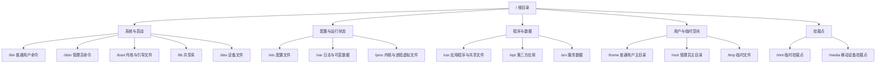
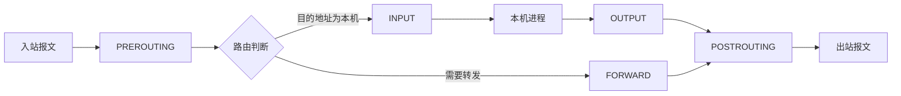

# Windows Server 与 UOS Linux 操作系统 · 完整笔记

---

## 1.本章知识框架

本章属于“网络操作系统与应用服务器”板块，第 6 版教材对该部分做了大幅压缩：Windows Server 由 2008 R2 改为 2016，且仅作简要介绍；新增“国产操作系统简介”；Linux 部分明确为“统信 UOS Linux 服务器操作系统的基本配置”，并新增防火墙配置。

### 1.1 六大知识块

| 序号 | 知识块 | 主要考点 |
| ---- | ------ | -------- |
| 1 | Windows Server 操作系统 | Windows Server 2016 的特点（版本、内存、发行版本、64 位） |
| 2 | 国产操作系统 | 国产 Linux 发行版名称、国产 CPU 名称、华为鸿蒙与欧拉、信创生态 |
| 3 | UOS 的网络配置 | 配置文件（ifcfg、hostname、hosts、host.conf、resolv.conf）与命令（nmcli、ifconfig、route、ip、netstat） |
| 4 | Linux 文件组织与结构 | 经典目录名、文件类型与访问权限、文件和目录操作命令 |
| 5 | Linux 用户和组管理 | 用户类型、配置文件、管理命令 |
| 6 | UOS Linux 防火墙配置 | iptables、nftables、firewalld |

说明：本章知识结构中的“应用服务配置”分支（Apache、Nginx 等）属于后续章节内容，本讲未展开。Windows Server 分支侧重个人电脑与图形交互场景，UOS/Linux 分支侧重服务、应用、办公与国产化场景。

### 1.2 Windows 与 Linux 的定位差异

| 比较项 | Windows | Linux（UOS 等） |
| ------ | ------- | --------------- |
| 主要阵地 | 个人电脑：台式机、笔记本，单位采购的整机基本预装 Windows | 服务器：需支持多用户、多应用程序、多进程并发 |
| 界面形态 | 图形化界面，交互体验好，对非专业用户友好 | 以命令行界面为主，可操作性与专业性更强 |
| 后续演进 | 逐步进入服务器市场，凭借图形化交互与新应用适配，方便管理员管理操作 | 也推出图形化界面升级，但视觉效果的改进相对有限 |

判断依据：个人使用看重交互体验，服务器看重多用户、多进程的支撑能力与专业可操作性。

### 1.3 国产化替代与学习边界

- 传统 Linux 学习以国外发行版为主，常见有 Ubuntu、CentOS、Kali、Red Hat 等。
- 第 6 版教材将 Red Hat 替换为统信 UOS，体现国产操作系统的发展与地位。国产操作系统不仅在网络工程师科目中考查，在信息处理技术员、软件工程师、通信等科目中也曾出现。
- 国产系统与国外开源发行版**同源**：均基于早期 Linux 开源版本进行研发、升级与改进，并做特色化调整，底层逻辑没有本质变化。
- 因此考试只考底层逻辑与基础概念，不考国产系统“不一样”的地方。网络配置、文件组织结构、用户组、防火墙的命令与配置文件，与原版差别不大。
- 差异化内容需要进阶学习：面向外企就业，应深入学习专业 Linux 的操作、运维与管理；面向国企或政府领域，应深入学习国产操作系统的界面与生态。

---

## 2.Windows Server 操作系统

### 2.1 版本演进与考试定位

Windows Server 早期教材使用 **Windows Server 2008 R2**，在描述过程中会讲解各类服务的配置，例如 **DHCP、DNS** 等，并做界面展示。

考试形式随版本演进而变化：

| 阶段 | 考查形式 |
| ---- | -------- |
| 早期（2008 R2） | 会考案例题，涉及各类服务的部署与配置 |
| 后续版本 | 案例题全面删除，不再侧重配置操作，只考选择题 |
| 当前（2016） | 内容基本删除，仅需了解 Windows Server 2016 的特点，简单过一遍 |

若考试中反向考查 Windows Server 的服务部署类选择题，可参考历年真题建立印象；此类题目与往年真题差异不大，不会出现根本性变化。

### 2.2 Windows Server 2016 的特点

Windows Server 2016 主要引入了新技术，并引入更灵活的硬件、软件配合方式，具体特点如下：

| 序号 | 特点 |
| ---- | ---- |
| 1 | 引入了新的**安全层**保护用户数据和控制访问权限 |
| 2 | 增强了**弹性计算能力**，降低了存储成本（属于云计算相关概念） |
| 3 | 提供了新的方式进行打包、配置、部署、运行、测试和保护应用程序 |
| 4 | 提升了**虚拟化、安全性、软件定义**的数据（计算、网络技术、存储）方面的支持能力 |
| 5 | 单台服务器最大内存支持提升至 **24 TB**；分为基础版 **Essentials**、标准版 **Standard**、数据中心版 **Datacenter** 三个发行版本；是一款**仅支持 64 位**的操作系统 |

要点：

- 第 2、4 条是“云”概念的体现，即在云计算方向上的良好搭载。
- 第 5 条是数字型考点，**24 TB、三个发行版本、仅 64 位**三项信息需要记住。
- 该部分“了解即可”，大量信息不需要掌握。
- 24 TB 是 Standard 与 Datacenter 版的内存上限；Essentials 版最多 2 颗 CPU、64 GB 内存、25 个用户，定位小型企业。

### 2.3 版本与安装形态（教材补充）

**说明**：以下 2.3 至 2.7 为教材与微软官方文档补充内容。课件对本部分仅要求了解 2016 的特点，补充内容用于对照真题中的服务部署类选项。

Windows Server 主要版本演进：

| 版本 | 说明 |
| ---- | ---- |
| Windows Server 2003 / 2003 R2 | 早期版本 |
| Windows Server 2008 / 2008 R2 | 旧版教材主要讲解对象，服务配置界面化 |
| Windows Server 2012 / 2012 R2 | 引入 Server Core 推广、Hyper-V 增强 |
| Windows Server 2016 | 本讲对象，最大内存 24 TB |
| Windows Server 2019 / 2022 / 2025 | 后续版本，考纲未涉及 |

安装形态：

| 形态 | 特点 |
| ---- | ---- |
| Server Core | 无图形界面，仅命令行与有限管理工具，攻击面小、资源占用低 |
| Server with Desktop Experience | 带完整图形桌面，管理直观 |
| Nano Server | 2016 引入的极简无界面部署，后续版本定位调整 |

### 2.4 工作组与域、AD 域控（教材补充）

| 比较项 | 工作组（Workgroup） | 域（Domain） |
| ------ | ------------------- | ------------ |
| 网络模型 | 对等网络，各计算机地位平等 | 客户机/服务器模型，由域控制器集中管理 |
| 账号存储 | 各计算机本地安全账号数据库（SAM） | 域控制器上的 Active Directory 数据库 |
| 登录方式 | 登录本机 | 域账号统一认证，可在任意加入域的计算机登录 |
| 管理方式 | 逐台管理 | 集中管理用户、计算机、组与策略 |
| 规模 | 小型网络，通常不超过约 20 台 | 可容纳数千台，支持跨网段 |
| 策略下发 | 仅本地策略 | 组策略（GPO）统一下发并覆盖本地设置 |

**Active Directory 域服务（AD DS）**：

- AD DS 是目录服务，以分层、结构化的数据库存储用户、计算机、组等对象，兼容 LDAP。
- 逻辑结构为**林（Forest）→ 域（Domain）→ 组织单位（OU）**；站点（Site）对应物理网络拓扑。
- 安装 AD DS 角色并将服务器提升为**域控制器（DC）**，即创建第一个域（林根域）。
- 域内认证采用 **Kerberos**（兼容 NTLM），每个安全主体由 **SID** 唯一标识。
- 部署 AD DS 时通常同时安装 **DNS 服务器**角色，因为域成员依靠 DNS 定位域控制器（SRV 记录）。

### 2.5 常见服务器角色：DNS、DHCP、IIS（教材补充）

| 角色 | 作用 | 关键概念 |
| ---- | ---- | -------- |
| DNS 服务器 | 域名与 IP 地址的映射解析 | 正向/反向查找区域、资源记录（A、AAAA、CNAME、MX、NS、PTR、SOA）、递归查询与迭代查询、转发器 |
| DHCP 服务器 | 自动分配 IP 地址及网络参数 | 作用域、地址池、排除范围、保留、租约、选项（网关、DNS、WINS） |
| IIS | Windows 的 Web 服务器 | 网站、应用程序池、绑定（IP:端口:主机头）、虚拟目录、默认文档、HTTPS 证书 |
| 文件与存储服务 | 文件共享与存储管理 | 共享权限、NTFS 权限、磁盘配额、DFS |
| Hyper-V | 虚拟化平台 | 虚拟机、虚拟交换机、检查点 |
| 远程访问（RRAS） | 路由与远程接入 | VPN、NAT、静态路由 |
| 网络策略服务器（NPS） | 集中认证、授权、计费 | RADIUS |

DHCP 地址分配四个报文：

| 报文 | 方向 | 含义 |
| ---- | ---- | ---- |
| DHCP DISCOVER | 客户端 → 广播 | 寻找可用 DHCP 服务器 |
| DHCP OFFER | 服务器 → 客户端 | 提供可分配的地址 |
| DHCP REQUEST | 客户端 → 广播 | 请求使用该地址 |
| DHCP ACK | 服务器 → 客户端 | 确认分配并下发参数 |

### 2.6 NTFS 权限（教材补充）

NTFS 标准权限（文件夹）：

| 权限 | 说明 |
| ---- | ---- |
| 完全控制 | 包含修改权限、取得所有权等全部操作 |
| 修改 | 读取、写入、执行、删除 |
| 读取和执行 | 读取与执行，不含写入与删除 |
| 列出文件夹内容 | 仅可查看文件夹内的对象列表 |
| 读取 | 查看文件内容与属性 |
| 写入 | 写入数据与属性 |

NTFS 标准权限（文件）：完全控制、修改、读取和执行、读取、写入（文件无“列出文件夹内容”）。

NTFS 特殊权限：遍历文件夹/执行文件、列出文件夹/读取数据、读取属性、读取扩展属性、创建文件/写入数据、创建文件夹/追加数据、写入属性、写入扩展属性、删除子文件夹及文件、删除、读取权限、更改权限、取得所有权、同步。

核心规则：

- **权限继承**：子对象默认继承父容器的可继承权限；可中断继承并转换为显式权限。
- **累计有效权限**：用户所属多个组授予的允许权限累加。
- **拒绝优先**：显式“拒绝”优先于任何“允许”。
- **共享权限与 NTFS 权限**：通过网络访问时，最终有效权限取两者中**更严格**的一个。
- **移动与复制**：同一 NTFS 分区内移动文件保留原权限；跨分区移动或复制到其他分区时继承目标文件夹权限。
- **取得所有权**：管理员可接管文件所有权，取得后原有限制不再自动适用，需重新授权。
- 常用命令：`icacls 路径 /grant 用户:(权限)`、`icacls 路径 /remove 用户`。

### 2.7 组策略（教材补充）

| 项目 | 说明 |
| ---- | ---- |
| 本地组策略 | `gpedit.msc`，仅作用于本机 |
| 域组策略管理 | `gpmc.msc`（组策略管理控制台），可创建、链接、继承、强制 GPO |
| 作用范围 | 站点、域、组织单位（OU） |
| 配置分支 | 计算机配置、用户配置 |
| 处理顺序 | 本地 → 站点 → 域 → OU（LSDOU），后应用者覆盖先应用者；标记“强制”的 GPO 不被覆盖 |
| 刷新命令 | `gpupdate /force`，查看结果 `gpresult /r` |

---

## 3.国产操作系统与信创生态

### 3.1 国产 Linux 操作系统

国产 Linux 操作系统同样分为**桌面版**和**服务器版**：

- 桌面版代表：深度 Deepin、统信 UOS、银河麒麟等。
- 服务器版代表：银河麒麟、中标麒麟、统信 UOS、中科方德、红旗 Asianux 等。

教材归纳的经典代表为三个：

| 操作系统类型 | 说明 |
| ------------ | ---- |
| 麒麟（KylinOS） | 包括服务器操作系统、桌面操作系统、嵌入式操作系统、麒麟云等产品；能够同时支持**飞腾、龙芯、申威、兆芯、海光、鲲鹏**等国产 CPU |
| 统信 UOS | 由统信软件技术有限公司研发，有**家庭版、专业版和服务器版**三个发行版本，支持高可用集群、负载均衡集群、容器云平台等应用场景 |
| 红旗 Linux | 具备满足用户基本需求的软件生态，支持多种 CPU 指令集架构，支持多款国产自主 CPU 品牌 |

背景与特色：

- 银河麒麟与中标麒麟于 **2019 年**整合为麒麟软件有限公司。
- 红旗 Linux 与红帽（Red Hat）是竞争时间最久的国产发行版。
- 国产操作系统的共同特色是尽可能贴合自主创新的软件、硬件、技术指标，并配合高可用集群、云平台等新技术场景。
- 国产操作系统不仅在网络工程师科目中考查，早期在信息处理技术员、软件工程师、通信等科目中也出现过，属于“技术创新、技术发展理念”类试题，需要建立名词认知。

### 3.2 国产 CPU 与移动、服务器操作系统

国产 CPU 品牌（防超纲名词题）：

| 品牌 | 所属 | 主要方向 |
| ---- | ---- | -------- |
| 鲲鹏（Kunpeng） | 华为 | ARM 架构服务器 CPU |
| 昇腾（Ascend） | 华为 | AI 加速芯片（NPU） |
| 飞腾（Phytium） | 中国电子 | ARM 架构桌面与服务器 CPU |
| 龙芯（Loongson） | 龙芯中科 | 自主 LoongArch 指令集 |
| 申威（Sunway） | 江南计算所 | 高性能计算 |
| 兆芯（Zhaoxin） | 上海兆芯 | x86 兼容 |
| 海光（Hygon） | 海光信息 | x86 兼容 |

华为的两条操作系统路线：

| 系统 | 定位与应用场景 |
| ---- | -------------- |
| 鸿蒙（HarmonyOS） | 面向万物互联的智能终端操作系统，在手机、车载移动设备、穿戴设备上体现明显 |
| 欧拉（openEuler） | 面向数字基础设施的开源操作系统，可部署于服务器、云计算、边缘计算、嵌入式等场景，覆盖 IT、CT、OT |

openEuler 于 2021 年 11 月由华为联合社区捐赠给**开放原子开源基金会**，从企业主导的开源项目演进为产业共建、社区自治。

### 3.3 课堂习题

**例题1**：下列（ ）不属于我国信创生态。

- A、昇腾
- B、OpenStack
- C、UOS
- D、Easystack

**答案：B**

解答：

| 选项 | 判定 | 理由 |
| ---- | ---- | ---- |
| A 昇腾 | 属于 | 华为自研 AI 芯片，是信创硬件生态代表 |
| B OpenStack | 不属于 | 开源云计算管理平台项目，并非我国自主的信创生态组成 |
| C UOS | 属于 | 统信国产操作系统，信创基础软件核心 |
| D Easystack | 属于 | 北京易捷思达科技发展有限公司旗下的云计算平台产品，属国产云平台厂商 |

要点：信创即“信息技术应用创新”，覆盖芯片、整机、操作系统、数据库、中间件、应用软件等全栈。题目常把“开源项目名”与“国产厂商产品名”并列，需要区分**项目**与**公司产品**。

**例题2**：（ ）是国产化操作系统。

- A、UOS
- B、红帽 Linux
- C、AIX
- D、CentOS

**答案：A**

解答：UOS 为统信国产操作系统；红帽 Linux、CentOS 属国外开源发行版，AIX 为 IBM 的商用 UNIX。此类题目考得非常直白，只需对名词有认知；不常见的名称一律归为国外闭源或开源代表。

---

## 4.UOS 的网络配置

网络配置主要指 IP 地址、DNS 服务器、DHCP 功能等参数的设置，目的是使主机能够正常接入网络、网络连接顺畅。UOS 的网络配置有**文件**与**命令**两条路径，二者关系类似于 Windows 中“打开网络适配器属性逐项设置”与“用命令直接修改”。

### 4.1 网络配置文件

网络配置信息文件路径：

```
/etc/sysconfig/network-scripts/ifcfg-ensx
```

> NetworkManager 也支持 keyfile 格式，连接配置存放在 `/etc/NetworkManager/system-connections/`；UOS 服务器版沿用 ifcfg 风格，两种格式由 NetworkManager 统一读取。

常见主要参数含义：

| 参数 | 含义 |
| ---- | ---- |
| `TYPE=Ethernet` | 网络接口类型为以太网 |
| `BOOTPROTO=static` | 使用静态地址（设为 `dhcp` 则为动态获取） |
| `DEFROUTE=yes` | 是否将该接口设置为默认路由 |
| `IPV4_FAILURE_FATAL=no` | IPv4 配置失败时是否视为致命错误 |
| `IPV6INIT=yes` | 是否支持 IPv6 |
| `IPV6_AUTOCONF=yes` | 是否启用 IPv6 自动配置 |
| `IPV6_DEFROUTE=yes` | 是否将该接口设为 IPv6 默认路由 |
| `IPV6_FAILURE_FATAL=no` | IPv6 配置失败时是否视为致命错误 |
| `NAME=ens32` | 网卡名称，不同版本的 Linux 网卡命名略有不同 |
| `ONBOOT=yes` | 开机时是否启用该网卡 |
| `IPADDR=10.0.10.20` | IP 地址 |
| `PREFIX=24` | 子网掩码长度 |
| `GATEWAY=10.0.10.254` | 网关 |
| `DNS1=61.134.1.4` | DNS 地址 |

**配置完成后必须重载并激活连接**，否则修改不会生效：

| 方式 | 命令 | 说明 |
| ---- | ---- | ---- |
| 重载配置（推荐） | `nmcli connection reload` | 重新读取连接配置文件，只刷新内存中的配置 |
| 激活连接（推荐） | `nmcli connection up ens32` | 让修改后的配置真正生效；也可用 `nmcli device reapply ens32` |
| 手动安装方式 | `systemctl restart network` | 需先手动安装 `network.service` 服务，再重启 |

可以把两条 nmcli 命令理解为“先读配置、再启用配置”：只执行 `reload` 不会让新地址生效，必须再执行 `connection up`；`network.service` 则相当于额外安装的服务包。UOS 默认由 **NetworkManager** 管理网络。

### 4.2 主机名与 DNS 配置文件

| 文件 | 作用 |
| ---- | ---- |
| `/etc/hostname` | 系统主机名文件 |
| `/etc/hosts` | 包含 IP 地址与主机名之间的映射，还包含主机别名 |
| `/etc/host.conf` | 指定客户机域名解析顺序 |
| `/etc/resolv.conf` | 指定客户机域名搜索顺序和 DNS 服务器地址 |

`/etc/hosts` 示例：

```
192.168.0.14    PC1    zongyuan
192.168.2.1     www
```

`/etc/host.conf` 示例：

```
order hosts, bind
multi on            # 启用多重解析，利于负载均衡
```

- `order hosts, bind`：先查 `hosts` 文件（本地解析），再查 `bind`（即 DNS 区域文件）。
- `multi on`：允许一个主机名对应多个 IP 地址，实现多重解析。

> `host.conf` 的 `order` 属于传统写法；现代 glibc 的解析顺序由 `/etc/nsswitch.conf` 中的 `hosts: files dns` 决定，`host.conf` 仍被保留以兼容旧配置。

`/etc/resolv.conf` 示例：

```
search test.edu.cn
nameserver 114.114.114.114    # 首选 DNS 服务器
nameserver 8.8.8.8            # 备用 DNS 服务器
```

> 由 NetworkManager 接管网络时，`resolv.conf` 可能被自动重写；需要持久生效的 DNS 应写入连接配置（`ipv4.dns`）或 `ifcfg` 文件的 `DNS1`、`DNS2`。

**DNS 解析过程回顾**：

1. 先查本地 `hosts` 文件。
2. 本地找不到，再向本地 DNS 服务器查询；本地 DNS 服务器先查自己的区域文件或缓存。
3. 仍无结果时，由本地 DNS 服务器代为查询。

| 查询方式 | 特点 |
| -------- | ---- |
| 递归查询 | 由服务器代为完成全部查询，直接返回最终结果 |
| 迭代查询 | 服务器返回下一跳应查询的服务器地址，由客户端反复查询 |

**资源记录类型回顾**：

| 记录 | 含义 |
| ---- | ---- |
| A | IPv4 地址与主机名的映射 |
| AAAA | IPv6 地址与主机名的映射 |
| CNAME | 别名记录 |
| MX | 邮件交换记录 |
| NS | 授权域名服务器记录 |
| PTR | 反向解析记录 |
| SRV | 服务定位记录，域控制器以此注册 LDAP、Kerberos 等服务 |
| TXT | 文本记录，常用于 SPF、DKIM 等域名验证 |

**多重解析与负载均衡**：同一个 IP 可以对应不同主机名，同一个主机名也可以对应不同 IP，从而在多台设备之间分发流量，实现负载均衡。实现方式是修改区域文件、配置相应命令；该内容早期在 DNS 服务配置中介绍，现在考查很少。

### 4.3 nmcli 命令

`nmcli` 是 **NetworkManager** 服务的命令行管理工具，也是 UOS 较有特色的网络配置命令。

名称含义：**nmcli** = NetworkManager Command Line Interface，即 NetworkManager 的命令行界面。

基本格式：

```
nmcli [OPTIONS...] { help | general | networking | radio | connection | device |
                    agent | monitor } [COMMAND] [ARGUMENTS...]
```

| 对象 | 作用 |
| ---- | ---- |
| `help` | 帮助，列出可用参数（实际操作时无须背诵，用 help 查询即可） |
| `general` | 常规状态与操作 |
| `networking` | 整体网络控制 |
| `radio` | 无线网络（不是“多媒体”） |
| `connection` | 网络连接的配置，IP 地址、DNS、DHCP 均在此 |
| `device` | 设备管理 |
| `agent` | 代理 |
| `monitor` | 监控 |

`connection` 常用配置命令：

| 命令 | 说明 |
| ---- | ---- |
| `nmcli connection show` | 显示网络连接信息（物理地址、IP 地址、IPv6、网卡信息等） |
| `nmcli connection up/down ens32` | 激活或停用 ens32 接口的网络连接 |
| `nmcli connection modify ens32 ipv4.addresses 10.0.10.10/24` | 设置 IP 地址与掩码 |
| `nmcli connection modify ens32 ipv4.gateway 10.0.10.254` | 设置网关 |
| `nmcli connection modify ens32 ipv4.dns 8.8.8.8` | 设置 DNS 地址 |
| `nmcli connection modify ens32 ipv4.method manual` | 指定为静态地址（`auto` 为 DHCP） |
| `nmcli connection up ens32` | 激活连接，使上述命令配置生效 |

要点：

- `modify` 之后**必须激活**（`connection up`）才能生效。
- `nmcli connection modify` 会把参数写入连接配置文件，属于**永久配置**；`ifconfig`、`ip addr add` 才是临时配置，重启网络服务或主机后失效。
- 参数名使用点号分隔：`ipv4.addresses`、`ipv4.gateway`、`ipv4.dns`。

### 4.4 ifconfig 命令

`ifconfig` 用于网络接口参数的配置，是非常经典的基础命令；但其功能在后续版本中已被拆分和裁剪，由 `ip` 命令替代。

基本格式：

```
ifconfig interface-name ip-address netmask Nm up | down
```

输出示例：

```
[root@uos ~]# ifconfig
ens32: flags=4163<UP,BROADCAST,RUNNING,MULTICAST>  mtu 1500
        inet 10.0.10.20  netmask 255.255.255.0  broadcast 10.0.10.255
        inet6 fe80::250:56ff:feb4:2955  prefixlen 64  scopeid 0x20<link>
        ether 00:50:56:b4:29:55  txqueuelen 1000  (Ethernet)
        RX packets 4100  bytes 272869 (266.4 KiB)
        RX errors 0  dropped 61  overruns 0  frame 0
        TX packets 1969  bytes 444521 (434.1 KiB)
        TX errors 0  dropped 0 overruns 0  carrier 0  collisions 0
```

| 字段 | 含义 |
| ---- | ---- |
| `flags=4163<UP,BROADCAST,RUNNING,MULTICAST>` | 接口标志：已启用、支持广播、正在运行、支持组播 |
| `mtu 1500` | 最大传输单元 |
| `inet 10.0.10.20` | IPv4 地址 |
| `netmask 255.255.255.0` | 子网掩码 |
| `broadcast 10.0.10.255` | 广播地址 |
| `inet6 fe80::...` | IPv6 链路本地地址 |
| `ether 00:50:56:b4:29:55` | MAC 地址 |
| `RX / TX packets` | 接收/发送的报文数与字节数 |
| `RX / TX errors、dropped、overruns` | 接收/发送的错误、丢弃、溢出统计 |

配置示例：

```
[root@uos ~]# ifconfig ens32 10.0.10.30 netmask 255.255.255.0 up
```

含义：将网络接口 ens32 的 IP 地址设置为 `10.0.10.30`，子网掩码为 `255.255.255.0`，并启动该接口或将其初始化。

**注意**：用 `ifconfig` 配置的网络参数仅是**临时配置**。在执行 `systemctl restart network` 重启网络服务或主机重启后，网络参数将恢复至修改前。

**易混点**：

| 命令 | 所属系统 | 用途 |
| ---- | -------- | ---- |
| `ifconfig` | Linux | 配置网络接口参数 |
| `ipconfig` | Windows | 查看/配置 Windows 网络参数（如 `ipconfig /all`、`ipconfig /release`） |

二者极容易放在同一道题的选项中出现，是常见陷阱。

### 4.5 route 命令

`route` 用于路由的查看和配置，与原生 Linux 差别不大。

基本格式：

```
route [add | del] [-net | -host] target [netmask Nm] [gw GW] [dev]
```

输出示例：

```
[root@uos ~]# route

Kernel IP routing table
Destination   Gateway       Genmask        Flags   Metric  Ref   Use   Iface
default       _gateway      0.0.0.0        UG      100     0     0     ens32
10.0.10.0     0.0.0.0       255.255.255.0  U       100     0     0     ens32
```

| 字段 | 含义 |
| ---- | ---- |
| Destination | 目的网段或目的主机 |
| Gateway | 网关（下一跳） |
| Genmask | 子网掩码 |
| Flags | 路由标志 |
| Metric | 度量值（花费值） |
| Ref | 引用次数 |
| Use | 使用计数 |
| Iface | 出接口 |

路由标志（flag）：

| 标志 | 含义 |
| ---- | ---- |
| U | 路由处于活动状态（Up） |
| H | 目标是一台主机（Host），掩码为 32 位 |
| G | 使用网关（Gateway） |
| D | 由动态路由协议产生 |
| M | 已被修改过 |

要点：

- 主机路由与网段路由的区分看掩码：**掩码 32 位为主机路由**，其余为网段路由。
- 与路由器路由表相比，主机路由表用 **Metric** 代替 Cost，含义更灵活（Metric 早期在 Cisco 的 IGRP/EIGRP 混合路由中使用）。
- 关键信息（目的、下一跳、出接口）与路由器路由表基本一致，只是 flag 的表达形式略有差异。

配置示例：

```
route add -net 10.0.20.0 netmask 255.255.255.0 dev ens32
```

含义：添加一条到 `10.0.20.0` 网段的路由，在 ens32 接口上发出，由该接口转发。可理解为指定“下一跳的出接口”。

### 4.6 ip 命令

`ip` 命令用于显示或设置网络设备、路由和隧道的配置，是 UOS 中**替代 ifconfig** 的命令（ifconfig 的功能被拆分到多个工具中）。

基本格式：

```
ip (选项) (参数)
```

| 操作 | 命令 |
| ---- | ---- |
| 显示网卡信息 | `ip addr show` |
| 启用/停用接口 | `ip link set ens32 up` / `ip link set ens32 down` |
| 配置 IP 地址 | `ip addr add 10.0.10.30/24 dev ens32` |
| 查看路由信息 | `ip route show` |
| 添加静态路由 | `ip route add 10.0.20.0/24 via 10.0.10.20 dev ens32` |

要点：`ip route show` 展示的同样是那张路由表，与 `route` 命令概念一致；`ip route add` 用 `via` 指定下一跳、`dev` 指定出接口。

### 4.7 netstat 命令

`netstat` 是网络查询命令，与 Windows 中的 `netstat` 用法一致，只是输出内容略有差别。

常用参数：

| 参数 | 含义 |
| ---- | ---- |
| `-a` | 显示所有连接的信息，包括正在侦听的 |
| `-i` | 显示已配置网络设备的统计信息 |
| `-c` | 持续更新网络状态（每秒一次），直到被人中止 |
| `-r` | 显示内核路由表 |
| `-n` | 以数字格式而不是已解析的名称显示远程和本地地址 |

示例：

```
[root@uos ~]# netstat -nr
Kernel IP routing table
Destination     Gateway         Genmask         Flags   MSS Window  irtt Iface
0.0.0.0         10.0.10.254     0.0.0.0         UG        0 0          0 ens32
10.0.10.0       0.0.0.0         255.255.255.0   U         0 0          0 ens32
```

用途：

- 展示各类连接信息，包括 TCP 连接、UDP 连接、接口状态等。
- 可判断服务处于三次握手阶段、数据传输阶段还是连接关闭阶段。
- 也可展示路由表，但比 `route` 命令的输出更精简（只保留目的、网关、flag、出接口等）。

### 4.8 课堂习题

**例题**：在 Linux 系统中，**不能**为网卡 eth0 添加 IP `192.168.0.2` 的命令是（ ）。

- A、`ifconfig eth0 192.168.0.2 netmask 255.255.255.0 up`
- B、`ifconfig eth0 192.168.0.2/24 up`
- C、`ip addr add 192.168.0.2/24 dev eth0`
- D、`ipconfig eth0 192.168.0.2/24 up`

**答案：D**

解答：

| 选项 | 判定 | 理由 |
| ---- | ---- | ---- |
| A | 可以 | `ifconfig` 配合 `netmask`、`up` 是标准写法 |
| B | 可以 | `ifconfig` 支持“地址/掩码长度”的简写形式 |
| C | 可以 | `ip addr add` 是 iproute2 的标准写法 |
| D | 不可以 | `ipconfig` 是 **Windows** 的命令，Linux 无此命令 |

要点：此类题只有两种考法，一是**命令功能判断**（给一条命令问含义，或给一个需求问用哪条命令），二是**执行结果判读**（给命令输出，判断 IP 地址、IPv6 地址、连接状态等信息）。

---

## 5.Linux 文件组织与结构

### 5.1 文件组织

- Linux 系统中的每个分区都是一个文件系统，都有自己的目录层次结构。
- Linux 文件系统使用**索引节点（inode）**记录文件信息。inode 是一个数据结构，保存文件的**类型、大小、权限、属主与属组、时间戳、链接数、数据块位置**等控制信息；**文件名不在 inode 中**，而是由目录项（dentry）建立“文件名—inode 号”的对应关系。
- 采用多级**目录树型层次结构**，最上层是**根目录**，用 `/` 表示。

根目录表示法的差异：

| 系统 | 表示方式 | 示例 |
| ---- | -------- | ---- |
| Linux | 只有一个根目录，用斜杠 `/` | `/etc/host` |
| Windows | 以盘符区分，用反斜杠 `\` | `E:\test\` |

要点：书写目录时务必看清斜杠方向，这是常见的“目录辨别”类题目陷阱。

### 5.2 经典目录名

Linux 只有一个根目录 `/`，所有目录都从根目录向下展开，形成单根的树形结构：



| 目录 | 目录说明 | 目录 | 目录说明 |
| ---- | -------- | ---- | -------- |
| `/bin` | 二进制文件目录，一般存放可执行的二进制文件 | `/tmp` | 存放临时文件 |
| `/sbin` | 存放管理员使用的二进制系统程序文件 | `/home` | 所有普通账户的主目录 |
| `/boot` | 存放系统启动文件，如系统内核、引导配置文件等 | `/root` | 管理员 root 账户的主目录 |
| `/dev` | 存放外部设备文件的目录 | `/usr` | 存放用户相关的应用程序和文件 |
| `/etc` | 存放系统配置、管理文件 | `/lib` | 存放系统共用的库文件 |
| `/var` | 存放一些经常发生变化的文件，比如日志文件 | `/mnt` | 存放用户临时挂载的其他文件系统 |
| `/proc` | 虚拟文件的目录 | `/opt` | 存放系统应用程序的目录 |

记忆要点与易混点：

| 目录 | 记忆线索 | 易混提醒 |
| ---- | -------- | -------- |
| `/bin` | binary，二进制可执行文件 | 与 `/sbin` 的区别在于后者面向管理员 |
| `/sbin` | super/administrator binary，管理员程序 | — |
| `/boot` | 启动文件，类似 BIOS 的基本输入输出与引导配置 | 系统无法启动时可从此处排查 |
| `/dev` | device，外部设备文件 | 外部设备统一作为文件管理，考频高 |
| `/etc` | 配置文件集中地，各类网络与服务配置均在此 | 与 `/etc/passwd`、`/etc/hosts` 等呼应 |
| `/var` | variable，经常变化的文件，如日志 | 日志文件默认在 `/var/log` |
| `/proc` | 虚拟文件系统，反映内核与进程状态 | 不占实际磁盘空间 |
| `/home` | 普通用户主目录，新建用户默认在此生成同名目录 | **不要与 `/usr` 混淆** |
| `/root` | 管理员 root 的主目录 | 不在 `/home` 下 |
| `/usr` | Unix Software Resource（亦作 Unix System Resources）的缩写，不是 user | 对标 Windows 的 `Program Files`，存放应用程序与文件 |
| `/lib` | 共用库文件 | 类似 Windows 的 DLL |
| `/mnt` | 临时挂载点 | 与 `/media` 分工不同 |
| `/opt` | 额外安装的应用程序 | — |

> 现代发行版普遍采用 usr-merge：`/bin`、`/sbin`、`/lib` 是指向 `/usr/bin`、`/usr/sbin`、`/usr/lib` 的符号链接，考试仍按传统目录功能记忆。

UOS 在保留传统 Linux 目录之外，还有所改进与新增：

| 目录 | 说明 |
| ---- | ---- |
| `/media` | 移动多媒体设备（如 U 盘）的临时挂载目录 |
| `/srv` | 服务数据存放目录 |
| `/system` | 系统设备与信息目录（较新的目录） |
| `/run` | 运行时数据目录，存放系统运行中的临时状态信息 |

要点：`/bin`、`/sbin`、`/boot` 可归为“系统底层与启动”；`/tmp`、`/home`、`/root` 可归为“用户与临时空间”；`/dev`、`/etc`、`/var` 是勾选重点，必须认识。

### 5.3 文件挂载

**挂载**：即将一个文件系统的顶层目录挂到另一个文件系统的子目录上，使它们成为一个整体。

注意：

1. 挂载点必须是一个**目录**，而不能是一个文件。
2. 一个分区挂载在一个已知的目录节点上，这个目录可以不为空；**挂载后该目录以前的内容不可用**。

示例：

```
mount /dev/sda1 /mnt      # 将 /dev/sda1 设备挂载到 /mnt 目录
```

- 永久挂载需写入 `/etc/fstab`（设备、挂载点、文件系统类型、选项、dump、fsck 顺序），修改后用 `mount -a` 验证，避免开机进入紧急模式。
- 卸载使用 `umount 挂载点`，卸载前应退出该目录，否则会提示设备忙。

理解方式：应用程序原本安装在 C 盘，若想改由 D 盘承载，可将其挂载到 D 盘下运行、执行、调取；U 盘中的文件也可通过挂载或复制的方式纳入本地目录树。

### 5.4 文件类型与访问权限

使用 `ls -l` 显示文件的详细信息：

```
# ls -l sample.txt
-rw-r--r--  1  test  test  26194  Dec 17 10:42  sample.txt
```

| 字段 | 示例 | 含义 |
| ---- | ---- | ---- |
| 文件类型与权限 | `-rw-r--r--` | 第 1 位为类型，后 9 位为权限 |
| 链接数 | `1` | 普通文件通常为 1；目录的链接数 = 2 + 直接子目录数（`.` 与父目录各占 1） |
| 所有者 | `test` | 文件的创建者（owner） |
| 所属组 | `test` | 所有者所属的用户组（group） |
| 大小 | `26194` | 文件内容的字节数，约 24 KiB（不含 inode 等元数据） |
| 修改时间 | `Dec 17 10:42` | 最后修改的日期与时间，国产系统可显示中文 |
| 文件名 | `sample.txt` | 文件名称 |

**权限位的三段结构**：

```
-  rwx  rwx  rwx
│   │    │    └── Other Users（其他用户）
│   │    └─────── Group（所属组）
│   └──────────── Owner（所有者）
└──────────────── File Type（文件类型）
```

文件权限：

| 字符 | 含义 |
| ---- | ---- |
| `r` | 可读（read） |
| `w` | 可写（write） |
| `x` | 可执行（execute） |
| `-` | 无该权限 |

文件类型（Linux 共 7 种，考试常见 `d`、`-`、`l`；设备文件又分字符设备与块设备）：

| 字符 | 类型 | 说明 |
| ---- | ---- | ---- |
| `d` | 目录文件 | directory |
| `-` | 普通文件 | regular file |
| `l` | 链接文件 | 软链接（symbolic link） |
| `c` | 字符设备文件 | 以字节为单位输入输出的设备 |
| `b` | 块设备文件 | 以物理块为单位输入输出的设备 |
| `p` | 管道文件 | pipe |
| `s` | 套接字文件 | socket，用于进程间通信 |

要点：

- 常见的只有**目录文件**与**普通文件**，其余类型考查力度很轻，只需认识 `d` 与 `-`。
- 之所以有三组完全相同的 `rwx`，是因为 Linux 是多用户、多进程系统，同一文件需要针对**所有者、所属组、其他用户**三种角色分别授权。
- 其他用户一般只给只读权限，很少授予写或执行权限。

### 5.5 数字表示法与 chmod

权限 `rw- r-- r--` 也可以写成数字形式 **644**。

| 权限项 | 读 | 写 | 执行 | 读 | 写 | 执行 | 读 | 写 | 执行 |
| ------ | -- | -- | ---- | -- | -- | ---- | -- | -- | ---- |
| 字符表示 | (r) | (w) | (x) | (r) | (w) | (x) | (r) | (w) | (x) |
| 数字表示 | 4 | 2 | 1 | 4 | 2 | 1 | 4 | 2 | 1 |
| 权限分配 | 文件所有者 | | | 文件所属组用户 | | | 其他用户 | | |

原理：三位分别对应 `2²`、`2¹`、`2⁰`，即 4、2、1。某位为 1 表示有权限，为 0 表示无权限，相加即得该组的数值。

| 二进制 | 权限 | 数值 |
| ------ | ---- | ---- |
| 111 | rwx | 7 |
| 110 | rw- | 6 |
| 101 | r-x | 5 |
| 100 | r-- | 4 |
| 010 | -w- | 2 |
| 001 | --x | 1 |
| 000 | --- | 0 |

修改权限的命令是 `chmod`，三种等价写法：

```
# chmod g+w sample.txt       # 为所属组增加写权限
# chmod 644 sample.txt       # 直接按数字设置整体权限
# chmod g=rw- sample.txt     # 直接赋值：所属组为读写、不可执行
```

### 5.6 文件和目录操作命令

**（1）chmod 命令**：用于更改文件对于某类用户的操作权限。

一般格式：

```
chmod [-选项] mode fileName...
```

`mode` 的结构：

```
[[ugoa...] [+-=] [rwx] ...]
```

| 部分 | 含义 |
| ---- | ---- |
| `u` `g` `o` `a` | 设置权限的对象：所有者（user）、所属组（group）、其他人（other）、所有人（all） |
| `+` `-` `=` | 属性操作符：`+` 增加权限，`-` 减少权限，`=` 设置为指定权限 |
| `r` `w` `x` | 权限内容，可组合 |

**（2）ls 命令**：

- 对于每个目录，`ls` 将列出其中的所有子目录与文件。
- 对于每个文件，`ls` 将列出其文件名以及根据命令参数所要求的其他信息。
- 一般格式：`ls [-选项] fileName | directory`

| 选项 | 含义 |
| ---- | ---- |
| `-a` | 显示指定目录下所有子目录与文件，包括隐藏文件 |
| `-c` | 按 inode 状态变更时间（ctime）排序，配合 `-l` 显示 ctime |
| `-d` | 如果参数是目录，只显示其名称而不显示其下的各文件 |
| `-i` | 在输出的第一列显示文件的 i 节点号 |
| `-l` | 以长格式显示文件详细信息 |

**（3）其他基本命令**：

| 命令 | 命令说明 |
| ---- | -------- |
| `cd` | 改变当前工作目录 |
| `pwd` | 显示当前所在目录 |
| `mkdir` / `rmdir` | 建立/删除目录，参数选项 `-p`，一次可以建立/删除多个目录 |
| `rm` | **永久删除**文件和目录，参数选项 `-i`，交互式删除，避免误删（不进入回收站，无法找回） |
| `mv` | 移动文件和目录或重命名，例：`mv file1 file2` |
| `cp` | 复制文件和目录，参数选项 `-i`：覆盖文件之前提示用户确认；`-f` 则相反，不提示、直接执行 |
| `cat` | 显示文本文件内容，合并文件 |
| `more` | 分屏显示文本文件内容，**空格下翻**，只能从前往后翻，不能回翻 |
| `less` | 按页显示文件，可上下、前后翻页 |

命令可分为两大类：

| 类别 | 命令 | 说明 |
| ---- | ---- | ---- |
| 对文件和目录的操作 | `cd`、`pwd`、`mkdir`、`rmdir`、`rm`、`mv`、`cp` | 相当于图形界面中的跳转、新建、删除、复制粘贴、剪切 |
| 对文件内容的查看与编辑 | `cat`、`more`、`less` | 相当于打开文件阅读 |

补充：`head -n 3 文件名` 查看文件头部若干行，`tail -n 3 文件名` 查看末尾若干行；`mv` 若源与目标在同一目录，等同于重命名。文件查找与文本过滤（`find`、`grep`）在早期 Linux 教学中会涉及，课件未展开，参见第 8 章。

### 5.7 课堂习题

**例题1**：在 Linux 系统中，将所有的外部设备均作为文件统一进行管理，其文件目录是（ ）。

- A、/etc
- B、/lib
- C、/dev
- D、/bin

**答案：C**

解答：`/dev` 是 device 的缩写，存放外部设备文件；`/etc` 存放配置，`/lib` 存放库文件，`/bin` 存放二进制可执行文件。

**例题2**：在 Linux 系统中，鼠标、键盘等以字节为单位进行输入输出的设备属于（ ）。

- A、虚拟设备
- B、网络设备
- C、字符设备
- D、块设备

**答案：C**

解答：以**字节**为单位逐字符输入输出的设备为字符设备（如键盘、鼠标、串口）；以**物理块**为单位成块存取的是块设备（如硬盘）；以数据流为单位的是网络设备。

**例题3**：`chmod -R xxx /home/abc` 将目录权限设置为可读、可写、可执行，则 xxx 应为（ ）。

- A、777
- B、555
- C、444
- D、222

**答案：A**

解答：可读 = 4，可写 = 2，可执行 = 1，三者相加为 7；所有者、所属组、其他用户均为读写执行，故为 `777`。

题型归纳：

| 题型 | 考查方式 |
| ---- | -------- |
| 目录辨别 | 给出功能描述，判断对应哪个经典目录 |
| 命令功能判断 | 给出命令，判断其作用 |
| 命令选择 | 给出需求场景，选择可实现该需求的命令 |
| 权限计算 | 由字符权限换算数字，或由数字反推权限 |

---

## 6.Linux 用户和组管理

Linux 是多用户、多进程、多任务的系统，一台设备上不会只有一个用户，且不同用户能看到的界面与可使用的文件应当不同。身份的区分依靠**登录认证**：最基本的认证方式是**用户名 + 密码（口令）**；更安全的做法是采用**双因子认证**，配合生物识别、IC 卡等方式加强管理。

### 6.1 用户类型

| 用户类型 | 标识 | 说明 |
| -------- | ---- | ---- |
| 根用户（root） | UID = 0 | 超级管理员，权限最高 |
| 系统用户（虚拟用户） | UID 1～499（现代发行版多为 1～999） | 运行服务与守护进程，通常不能登录 |
| 普通用户 | UID 从 500 起（现代发行版多为 1000 起） | 由管理员创建，默认在 `/home` 下拥有同名主目录 |

为了便于管理，还会对用户划分**组（group）**，并以 **GID** 标识。将用户归组后，可以以组为单位配置文件权限，管理更高效。按 UID 划分，Linux 用户分为根用户、系统用户与普通用户三类；Windows 的用户分类更细（系统组、访客、普通用户等）。

### 6.2 用户管理配置文件

| 文件 | 说明 |
| ---- | ---- |
| `/etc/passwd` | 用户账号文件，**所有用户都可读**；登录名、UID、GID、主目录、登录 Shell 等在此，密码字段以 `x` 占位 |
| `/etc/shadow` | 用户口令文件，**只有超级用户 root 能读**；存放加密后的口令及口令老化策略 |
| `/etc/group` | 管理用户组文件；包含组名、加密口令、GID、组成员列表 |

设计意图：`passwd` 中若保存明文口令不安全，因此将口令移至 `shadow` 并以密文保存，同时对 `shadow` 施加严格的读权限，形成更可靠的安全保护。强调：**明文账号信息在 `passwd`，密文口令与加密方式在 `shadow`**。

### 6.3 用户和组管理命令

| 命令 | 作用 |
| ---- | ---- |
| `useradd` / `userdel` | 添加/删除用户账号 |
| `groupadd` / `groupdel` / `groupmod` | 添加/删除/修改组账号 |
| `usermod` | 修改用户属性，`-aG 组` 追加附加组，`-L`/`-U` 锁定/解锁 |
| `passwd` | 设置或修改口令，`-l`/`-u` 锁定/解锁 |
| `id` / `groups` | 查看用户的 UID、GID 与所属组 |

配置示例：

```
[root@uos ~]# useradd zy
[root@uos ~]# tail -1 /etc/passwd        # 用户账号文件
[root@uos ~]# tail -1 /etc/shadow        # 用户口令文件
[root@uos ~]# groupadd -g 1000 market
[root@uos ~]# tail -1 /etc/group
market:x:1000:
```

要点：

- `useradd` 创建用户后，会在 `/home` 下自动生成同名子目录（普通用户默认位置），相关信息写入 `passwd` 与 `shadow`。
- 可用 `-d` 参数指定创建的用户主目录位置，后接目录路径。
- `groupadd` 创建组时通常带 `-g` 指定组号（GID）。上例创建 GID 为 1000、组名为 `market` 的组，组文件中该行为 `market:x:1000:`，末段为空表示暂无成员。
- 若要添加组成员，可直接编辑 `/etc/group` 文件，在成员字段写入用户名。
- `userdel`、`groupdel` 用于删除；**删除组前必须先清空组内对象**，否则可能引发问题。

### 6.4 临时禁止用户

有时需要临时禁止一个用户账号的使用，而不是删除它。可采用以下两种方法：

1. 把用户的记录从 `/etc/passwd` 文件中**注释掉**，保留其主目录和其他文件不变。
2. 在 `/etc/passwd` 文件（或 `/etc/shadow`）中关于该用户的 **passwd 域的第一个字符前面加上一个 `*` 号**。

要点：不直接删除，是因为数据可能仍有参考价值、后续可能需要恢复；注释或加 `*` 相当于“拉黑”，需要恢复时删去注释符号或 `*` 即可。

更规范的做法是 `usermod -L 用户名` 锁定账号、`usermod -U 用户名` 解锁（等价于 `passwd -l` / `passwd -u`），其原理是在 `/etc/shadow` 的口令字段前加或去掉 `!`。直接注释 `/etc/passwd` 行只适合临时处理，容易与 `useradd`、`passwd` 等工具的行为冲突。

---

## 7.UOS Linux 防火墙配置

### 7.1 内核框架与用户空间工具

防火墙配置的本质是**访问控制列表**：明确“从哪里来、到哪里去、涉及哪些服务或端口、执行什么动作（允许或拒绝）”，与基础 ACL 的思路一致。

UOS 当前版本支持 2 种框架：

| 框架 | 说明 |
| ---- | ---- |
| Netfilter | Linux 内核中的网络数据包处理框架 |
| nf_tables | 新一代 Linux 内核数据包过滤框架 |

> 严格说，Netfilter 是内核中的包过滤框架，nf_tables 是其中的新一代子系统（legacy 实现为 x_tables）；iptables 与 nftables 分别是两代用户空间工具。

用户空间工具：

| 工具 | 说明 |
| ---- | ---- |
| iptables | 传统的防火墙配置工具，与 netfilter 交互 |
| nftables | 新一代防火墙配置工具，与 nf_tables 框架交互 |
| ufw | Ubuntu 防火墙，iptables 的前端工具（Uncomplicated Firewall） |
| firewalld | 动态防火墙管理器，主要用于 RHEL/CentOS 系统 |

考查重点：

- 概念层面：**iptables、nftables、firewalld** 三个命令考查频率较高，ufw 因功能单一考查较少。
- 不要求默写命令，而是给出一条命令，判断防火墙具备什么功能、拒绝了哪些服务、允许了哪些服务。

### 7.2 iptables 的组成

iptables 允许用户定义规则来过滤、修改或转发网络数据包，基本组成为**表、链、规则**（常概括为“四表五链一规则”）。

**表（Tables）**：

| 表 | 作用 |
| -- | ---- |
| filter 表 | **默认表**，数据转发/包过滤规则表，决定从哪里来、到哪里去、哪些服务能否通过 |
| nat 表 | 地址转换，修改数据包中的源/目的 IP 地址及端口 |
| mangle 表 | 设置标记，修改数据包的一些属性 |
| raw 表 | 在连接跟踪之前处理报文，常用于 `NOTRACK` 免除跟踪；状态跟踪本身由 conntrack 完成 |
| security 表 | 强制访问控制（在上述四个基础表之外） |

课件按“四表”概括基础表项，即 **filter、nat、mangle、raw**，security 表单列说明。

表有固定的优先级顺序：**raw → mangle → nat → filter**，`security` 表用于强制访问控制（如 SELinux），在 filter 之后处理。

**链（Chains）**：

| 链 | 作用 |
| -- | ---- |
| INPUT | 入站数据 |
| OUTPUT | 出站数据 |
| FORWARD | 转发的数据 |
| PREROUTING | 路由决策**之前**进行检查 |
| POSTROUTING | 路由决策**之后**进行处理 |

要点：INPUT、OUTPUT、FORWARD 三条最常用，已能囊括基础场景；PREROUTING 与 POSTROUTING 使用很少，注意不要与“路由表”混淆。

并不是每条链都属于所有表，常见对应关系如下：

| 表 | 可用的链 |
| -- | -------- |
| raw | PREROUTING、OUTPUT |
| mangle | 五条链均可 |
| nat | PREROUTING、OUTPUT、POSTROUTING |
| filter | INPUT、FORWARD、OUTPUT |



**规则（Rules）**：

| 组成 | 说明 |
| ---- | ---- |
| 匹配条件 | 如源/目标 IP、端口、协议等（五元组：源 IP、目的 IP、源端口、目的端口、协议） |
| 目标动作 | ACCEPT（允许通过）、DROP（直接丢弃）、REJECT（以 ICMP 回应拒绝） |

DROP 与 REJECT 的差异：**DROP 直接丢弃、不告知对方；REJECT 会回应 ICMP，明确告知“这边不让过”**。

### 7.3 iptables 配置语法

要使用 iptables 工具，需先通过 `yum install iptables-services` 命令安装。安装后 iptables 的规则保存在 `/etc/sysconfig/iptables` 配置文件中，可以直接修改配置文件，也可以通过以下命令配置规则：

```
iptables [-t table] COMMAND [chain] CRITERIA -j ACTION
```

| 部分 | 含义 |
| ---- | ---- |
| `-t table` | 指定要操作的表（默认 filter 表） |
| `COMMAND` | 命令，如添加 `-A`、删除 `-D`、修改等 |
| `[chain]` | 指定链，如 INPUT、OUTPUT、FORWARD |
| `CRITERIA` | 匹配条件（来源、目的、协议、端口、网卡等） |
| `-j ACTION` | 动作，固定以 `-j` 引出，如 ACCEPT、DROP、REJECT |

通用参数：

| 参数 | 含义 |
| ---- | ---- |
| `-s` | 匹配来源地址 IP/MASK，加叹号 `!` 表示“除这个 IP 外” |
| `-d` | 匹配目标地址 |
| `-i` | 网卡名称，匹配从这块网卡流入的数据 |
| `-p` | 匹配协议，如 TCP、UDP、ICMP |
| `--dport num` | 匹配目标端口号 |
| `--sport num` | 匹配来源端口号 |

动作：

| 动作 | 含义 |
| ---- | ---- |
| `ACCEPT` | 允许通过 |
| `DROP` | 直接丢弃 |
| `REJECT` | 以 ICMP 回应，拒绝 |

记忆方法：一条规则就是一句话——“我要对某张表、某条链，针对来源为某地址、去往某服务的数据，执行拒绝/允许的操作”，只是不断替换其中的参数。

### 7.4 iptables 配置示例

**设置链默认规则**：

```
iptables -P INPUT (DROP|ACCEPT)
```

`-P` 用于设置链的默认策略：当所有匹配项都未命中时，按默认策略处理（丢弃或允许）。

**添加一条规则**：

```
iptables -t filter -A INPUT -s 192.168.184.20 -p tcp --dport 22 -j DROP
iptables -A INPUT -s 192.168.1.0/24 -i eth0 -j DROP
iptables -A INPUT -p tcp --dport 80 -j ACCEPT
```

逐条解读：

| 命令 | 含义 |
| ---- | ---- |
| `-t filter -A INPUT -s 192.168.184.20 -p tcp --dport 22 -j DROP` | 在 filter 表的 INPUT 链追加规则：丢弃来自 192.168.184.20、目标端口 22（SSH）的 TCP 报文 |
| `-A INPUT -s 192.168.1.0/24 -i eth0 -j DROP` | 丢弃从 eth0 流入、源地址属于 192.168.1.0/24 网段的所有报文 |
| `-A INPUT -p tcp --dport 80 -j ACCEPT` | 允许目标端口 80（HTTP）的 TCP 报文入站 |

**配置保存生效**：

```
service iptables save
```

也可用 `iptables-save > /etc/sysconfig/iptables` 保存、`iptables-restore < /etc/sysconfig/iptables` 恢复；若系统已改用 firewalld/nftables，不应再用这种方式持久化。

要点：

- 省略 `-t` 时默认操作 `filter` 表，考题中绝大多数情况都是 filter 表。
- 端口与服务对应：22 = SSH，80 = HTTP，443 = HTTPS，3389 = RDP。
- `-P` 是默认策略（大写 P），`-A` 是追加规则；二者不要混淆。

### 7.5 nftables

nftables 是新一代数据包过滤工具，内核侧使用 `nf_tables` 框架（仍属 netfilter 体系），用来替代 `iptables` 命令，提供更统一的语法、更好的性能和更强大的功能。

组成特点：

- 与 iptables 一样，由**表（table）、链（chain）和规则（rule）**组成。
- 与 iptables 不同的是，nftables **没有内置表和链**，表的数量和名称由用户决定。
- 命令行工具为 `nft`，命令格式与 iptables 不同：`nft [options] [cmds...]`

理解方式：iptables 相当于把所有信息放在一张固定的表里增删改，数据量一大就不灵活；nftables 允许按需建表、按需分类，类似按不同习惯建立多张表格分别管理。

**（1）查看表**：

| 命令 | 说明 |
| ---- | ---- |
| `nft list tables` | 查看所有表 |
| `nft list table ip filter` | 查看 ip 簇（ip family）filter 表的所有规则 |
| `nft list chain filter INPUT` | 查看 filter 表 INPUT 链的规则，默认为 ip 簇 |
| `nft list ruleset` | 查看所有规则 |

**（2）表操作**：

```
nft add table ip filter        # 创建 ip 簇的 filter 表
nft add table ipv6 filter      # 创建 ipv6 簇的 filter 表
```

**（3）链操作**：

```
nft add chain ip filter test { type filter hook input priority 0\ ; }
```

含义：在 filter 表中添加一条名为 `test` 的规则链，链的类型为 filter，优先级为 0，附加到 input 钩子。执行后效果：

```
table ip filter {
    chain test {
        type filter hook input priority filter; policy accept;
    }
}
```

要点：`priority 0` 是数值写法，回显为预定义名称 `filter`，也可以直接写 `priority filter`；数值越小越先执行。

**（4）规则配置**：

```
nft add rule filter test tcp dport 22 accept
```

含义：向 filter 表 `test` 链增加规则，开放 TCP 22 端口。执行后效果：

```
table ip filter {
    chain test {
        type filter hook input priority filter; policy accept;

        tcp dport 22 accept
    }
}
```

要点：`rule`、`tcp`、`dport`、`accept` 等关键词与 iptables 含义一致，只是**语法结构不同**；nftables 替代 iptables，更灵活、更多变。

### 7.6 firewalld

firewalld 是一个**动态防火墙管理器**，提供了一个支持网络区域的防火墙管理系统。

特点：

- 动态规则更新，**无需重启服务**即可生效。
- 支持网络区域（zone）、富规则（rich rule）。
- 提供命令行与图形化两种配置工具。
- 是 UOS 默认的防火墙配置管理工具，基于 CLI 的配置命令为 `firewall-cmd`。

常用配置示例：

| 命令 | 说明 |
| ---- | ---- |
| `firewall-cmd --list-all` | 显示当前区域已开放的端口、服务与富规则 |
| `firewall-cmd --permanent --add-port=443/tcp` | 配置本机开放 TCP 443 端口，`--permanent` 表示永久生效 |
| `firewall-cmd --permanent --add-rich-rule='rule family="ipv4" source address="10.0.30.5" port port="3389" protocol="tcp" accept'` | 配置允许源地址 10.0.30.5 访问本机的 TCP 3389 端口 |
| `firewall-cmd --reload` | 重载配置使其生效 |

### 7.7 课堂习题

**例题1**：下列选项中属于 Linux 防火墙工具的是（1），使用（2）配置，可以实现禁止 `10.0.1.1` 网段使用 SSH 登录该服务器，且不做响应。

（1）

- A、umount
- B、iptables
- C、router
- D、acl

（2）

- A、`-A INPUT -s 10.0.1.1/24 -p tcp -m tcp --dport 22 -j DROP`
- B、`-A INPUT -s 10.0.1.1/32 -p tcp -m tcp --dport 22 -j DROP`
- C、`-A INPUT -s 10.0.1.1/32 -p tcp -m tcp --dport 22 -j REJECT`
- D、`-A INPUT -s 10.0.1.1/24 -p tcp -m tcp --dport 22 -j REJECT`

**答案：（1）B；（2）A**

解答：

- （1）`umount` 是卸载文件系统，`router` 不是 Linux 防火墙工具，`acl` 是访问控制列表概念，只有 `iptables` 属于防火墙工具。
- （2）题干要求“**网段**”，故掩码应为 `/24`，排除 B、C；题干要求“**不做响应**”，应使用 `DROP`，排除 D。故选 A。
- 补充：SSH 基于 TCP，默认端口 22。

**例题2**：某主机防火墙访问控制配置如下所示，下列说法中正确的是（ ）。

```
-A INPUT -p tcp -m tcp --dport 443 -j ACCEPT
-A INPUT -s 192.168.1.254/32 -p icmp -m icmp --icmp-type 8 -j ACCEPT
-A INPUT -s 192.168.2.0/24 -j DROP
-A INPUT -s 192.168.3.0/24 -p tcp -m tcp --dport 22 -j ACCEPT
-A INPUT -i lo -j ACCEPT
-A INPUT -j DROP
-A OUTPUT -p icmp -m icmp --icmp-type 0 -j ACCEPT
```

- A、仅允许该主机 ping 192.168.1.254 主机
- B、允许所有主机访问该主机的 SSH 服务
- C、允许所有主机 ping 该主机
- D、允许所有主机使用 https 协议访问该主机的 Web 服务

**答案：D**

逐条解读：

| 规则 | 含义 |
| ---- | ---- |
| `-A INPUT -p tcp --dport 443 -j ACCEPT` | 允许所有主机访问本机 TCP 443（HTTPS） |
| `-A INPUT -s 192.168.1.254/32 -p icmp --icmp-type 8 -j ACCEPT` | 允许来自 192.168.1.254 的 ICMP 回显请求（Type 8，即 ping 请求） |
| `-A INPUT -s 192.168.2.0/24 -j DROP` | 丢弃来自 192.168.2.0/24 网段的全部入站报文 |
| `-A INPUT -s 192.168.3.0/24 -p tcp --dport 22 -j ACCEPT` | 仅允许 192.168.3.0/24 网段访问本机 SSH（22） |
| `-A INPUT -i lo -j ACCEPT` | 允许回环接口（lo）的流量 |
| `-A INPUT -j DROP` | 默认策略：以上均未匹配的入站报文一律丢弃 |
| `-A OUTPUT -p icmp --icmp-type 0 -j ACCEPT` | 允许 ICMP 回显应答（Type 0）出站，即 ping 的回应可以发出 |

选项判断：

| 选项 | 判定 | 理由 |
| ---- | ---- | ---- |
| A | [错误] | 规则并未限制“仅允许”，且 OUTPUT 允许 Type 0 回应，其他主机也可 ping 通 |
| B | [错误] | SSH 仅对 192.168.3.0/24 开放，并非所有主机 |
| C | [错误] | 入站规则中未对 ICMP Type 8 普遍放行，末尾 `INPUT -j DROP` 会丢弃未被匹配的 ping 请求；只有 192.168.1.254 被单独允许 |
| D | [正确] | 第一条规则对 443 端口无源地址限制，所有主机均可通过 HTTPS 访问本机 Web 服务 |

要点：防火墙规则**按顺序匹配**，命中即执行动作并停止；末尾的默认 DROP 决定了“未明确允许的一律拒绝”。判断时先看协议与端口，再看源地址范围（`/24` 为网段、`/32` 为主机），最后看动作（`ACCEPT` 允许、`DROP` 静默丢弃、`REJECT` 回应拒绝）。

---

## 8.常用命令与软件包管理（教材补充）

**说明**：本节为课件口述中提及但未展开、以及考纲要求掌握的基础命令补充，用于补齐命令速查。课件明确表示考试不会过细考查命令细节，重点在“看到命令知道大概含义”。

### 8.1 权限与属主

| 命令 | 作用 | 常用示例 |
| ---- | ---- | -------- |
| `chmod` | 修改文件或目录权限 | `chmod 755 file`、`chmod u+x file`、`chmod -R 644 dir` |
| `chown` | 修改文件所有者及所属组 | `chown user file`、`chown user:group file`、`chown -R user:group dir` |
| `chgrp` | 仅修改所属组 | `chgrp group file` |
| `umask` | 设置新建文件的默认权限掩码 | `umask 022`（目录 755、文件 644） |

要点：`chmod` 改权限，`chown` 改归属，二者不要混淆；`-R` 表示递归。

### 8.2 进程与系统状态

| 命令 | 作用 | 常用示例 |
| ---- | ---- | -------- |
| `ps` | 查看进程快照 | `ps aux`、`ps -ef` |
| `top` | 实时查看进程与系统资源占用 | `top`，按 `q` 退出 |
| `kill` | 向进程发送信号 | `kill -9 PID`（强制终止） |
| `free` | 查看内存使用 | `free -h` |
| `uptime` | 查看系统运行时间与负载 | `uptime` |

### 8.3 网络查看与排障

| 命令 | 作用 | 常用示例 |
| ---- | ---- | -------- |
| `ip` | 查看/配置地址、链路、路由 | `ip addr`、`ip link`、`ip route` |
| `ss` | 查看套接字与连接状态，netstat 的现代替代 | `ss -lntp`、`ss -an` |
| `netstat` | 查看连接、接口统计、路由表 | `netstat -an`、`netstat -nr` |
| `ping` | 测试连通性（ICMP） | `ping -c 4 目标` |
| `traceroute` | 跟踪路径 | `traceroute 目标` |
| `nmcli` | NetworkManager 命令行管理 | `nmcli connection show` |

### 8.4 磁盘、文件与归档

| 命令 | 作用 | 常用示例 |
| ---- | ---- | -------- |
| `df` | 查看文件系统磁盘空间占用 | `df -h`、`df -T`（显示文件系统类型） |
| `du` | 统计目录或文件占用空间 | `du -sh /var` |
| `mount` / `umount` | 挂载/卸载文件系统 | `mount /dev/sda1 /mnt`、`umount /mnt` |
| `tar` | 打包与解包 | `tar -czvf a.tar.gz dir`、`tar -xzvf a.tar.gz` |
| `ln` | 创建链接 | `ln -s 目标 链接名`（软链接） |
| `find` | 按条件查找文件 | `find /etc -name "*.conf"` |
| `grep` | 按模式过滤文本 | `grep -n "root" /etc/passwd` |
| `head` / `tail` | 查看文件头/尾若干行 | `head -n 5 file`、`tail -f /var/log/messages` |

### 8.5 服务与软件包管理

服务管理统一使用 `systemctl`：

| 命令 | 作用 |
| ---- | ---- |
| `systemctl start 服务名` | 启动服务 |
| `systemctl stop 服务名` | 停止服务 |
| `systemctl restart 服务名` | 重启服务 |
| `systemctl status 服务名` | 查看服务状态 |
| `systemctl enable 服务名` | 设置开机自启 |
| `systemctl disable 服务名` | 取消开机自启 |
| `systemctl daemon-reload` | 修改 unit 文件后重新加载 |
| `systemctl is-enabled 服务名` | 查看是否开机自启 |
| `systemctl list-units --type=service` | 列出正在运行的服务 |

软件包管理因发行版技术路线而异：

| 技术路线 | 包格式 | 安装/查询工具 | 仓库管理工具 | 典型系统 |
| -------- | ------ | ------------- | ------------ | -------- |
| Red Hat 系 | `.rpm` | `rpm -ivh`、`rpm -qa` | `yum` / `dnf` | RHEL、CentOS、openEuler、统信 UOS 服务器版（a/c/e 版） |
| Debian 系 | `.deb` | `dpkg -i`、`dpkg -l` | `apt` | Debian、Ubuntu、统信 UOS 桌面版与服务器版 d 版 |

要点：统信 UOS 不同版本采用不同技术路线，因此同一个“UOS”可能既有 `yum` 也有 `apt`。课件中出现的 `yum install iptables-services` 属于 Red Hat 系写法，与该课程所用 UOS 版本的底层路线一致。

常用包管理命令对照：

| 操作 | Red Hat 系（yum/dnf） | Debian 系（apt） |
| ---- | --------------------- | ---------------- |
| 更新元数据 | `yum makecache` | `apt update` |
| 安装 | `yum install 包名` | `apt install 包名` |
| 卸载 | `yum remove 包名` | `apt remove 包名` |
| 查询已安装 | `rpm -qa \| grep 包名` | `dpkg -l \| grep 包名` |
| 搜索 | `yum search 关键字` | `apt search 关键字` |

软件源配置分别位于 `/etc/yum.repos.d/` 与 `/etc/apt/sources.list`（及 `sources.list.d/`）。

---

## 9.本章小结

| 知识点 | 核心内容 |
| ------ | -------- |
| 1. Windows Server 定位 | 早期 2008 R2 讲服务配置并考案例题；后续案例题删除，只考选择；当前仅需了解 2016 特点 |
| 2. Windows Server 2016 | 新安全层、弹性计算、新的应用打包部署方式、虚拟化与软件定义增强；最大内存 24 TB；Essentials/Standard/Datacenter 三版本；仅 64 位 |
| 3. 国产操作系统 | 三个经典代表：麒麟（银河麒麟、中标麒麟，2019 年合并为麒麟软件）、统信 UOS、红旗 Linux |
| 4. 国产芯片与华为 | 飞腾、龙芯、申威、兆芯、海光、鲲鹏、昇腾；鸿蒙面向智能终端，欧拉面向数字基础设施并捐赠给开放原子开源基金会 |
| 5. UOS 网络配置 | 配置文件 `/etc/sysconfig/network-scripts/ifcfg-ensx`；DNS 相关 `hostname`、`hosts`、`host.conf`、`resolv.conf` |
| 6. 网络配置命令 | `nmcli`（NetworkManager 命令行工具）、`ifconfig`（临时配置）、`route`（路由表）、`ip`（替代 ifconfig）、`netstat`（连接与路由查询） |
| 7. Linux 文件结构 | 树形目录、单一根目录 `/`、索引节点 inode；`/bin`、`/sbin`、`/boot`、`/dev`、`/etc`、`/var`、`/proc`、`/tmp`、`/home`、`/root`、`/usr`、`/lib`、`/mnt`、`/opt` |
| 8. 文件类型与权限 | 类型：`d` 目录、`-` 普通文件、`l` 链接、`c` 字符设备、`b` 块设备、`p` 管道；权限：`rwx` 三组九位，对应所有者、所属组、其他用户 |
| 9. 权限数字表示 | r=4、w=2、x=1；`rw-r--r--` = 644；`chmod` 支持角色+操作符+权限、数字、赋值三种写法 |
| 10. 用户和组 | root 的 UID=0，普通用户从 500（现代为 1000）起；`passwd` 存账号、`shadow` 存密文口令、`group` 存组信息 |
| 11. 防火墙框架 | Netfilter 与 nf_tables 两种内核框架；iptables、nftables、ufw、firewalld 四种用户空间工具 |
| 12. iptables | 四表（filter 默认、nat、mangle、raw，另有 security）五链（INPUT、OUTPUT、FORWARD、PREROUTING、POSTROUTING）；匹配条件 + 动作（ACCEPT/DROP/REJECT） |
| 13. nftables | 新一代框架，无内置表链，由用户自定义；命令为 `nft` |
| 14. firewalld | 动态防火墙管理器，支持网络区域与富规则，无需重启；命令 `firewall-cmd`，`--permanent` 永久生效 |
| 15. NTFS 与组策略 | NTFS 权限继承、累计、拒绝优先，共享权限取严；GPO 按本地→站点→域→OU 处理，`gpupdate /force` 刷新 |
| 16. 服务与软件包 | `systemctl` 管理服务；RPM 系用 yum/dnf，Debian 系用 apt/dpkg |
| 17. 细节易错点 | inode 不含文件名；`/bin` 等已 usr-merge；`nmcli` 修改为永久配置，`ifconfig` 为临时配置 |

考试重点：

1. **Windows Server 2016 的三个数字**：24 TB、三个发行版本、仅 64 位。
2. **国产化名词辨析**：麒麟、统信 UOS、红旗属国产操作系统；昇腾、鲲鹏等属国产芯片；OpenStack、CentOS、红帽、AIX 属国外项目或产品。
3. **命令归属辨析**：`ifconfig` 属 Linux，`ipconfig` 属 Windows；`ip addr` 替代 `ifconfig`，`ss` 替代 `netstat`。
4. **临时与永久**：`ifconfig`、`nmcli connection modify` 均为临时生效，永久配置必须修改配置文件；修改 ifcfg 文件后须重启网络服务。
5. **目录对应关系**：设备在 `/dev`、配置在 `/etc`、日志在 `/var`、普通用户主目录在 `/home`、应用程序在 `/usr` 或 `/opt`。
6. **权限计算**：先按 r=4、w=2、x=1 分组求和，再按“所有者-所属组-其他用户”顺序拼成三位数。
7. **防火墙规则判读**：按顺序匹配、默认策略兜底；`/24` 为网段、`/32` 为主机；`DROP` 不响应、`REJECT` 回应拒绝；22=SSH、80=HTTP、443=HTTPS、3389=RDP。
