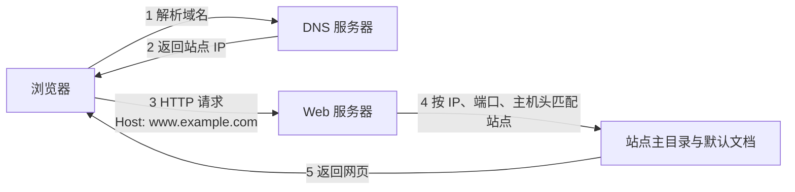

# 应用服务配置与章节梳理 · 完整笔记

> 来源：软考中级网络工程师速成教程 p55【软考入门-54】应用服务配置（网工-老林，时长 11:15）、p56【软考入门-55】知识脉络梳理（时长 08:40）
> 说明：本笔记合并整理上述两节内容。原文口语化表达已转写为书面语；标有「补充」的段落为视频未展开、但属应用服务配置常见考点，已联网核实后列出，供理解与辨析使用。

---

## 1.应用服务配置概述

应用服务配置是「网络操作系统与应用服务器」的最后一个板块。该板块在教程修订中做了**大量删除**，考查比重明显下降，学习要求以「认识、能判断」为主，不要求完整背诵配置。

学习本节之前，必须先回顾 **DNS 与 DHCP** 的相关内容，并与第 5 章的知识关联复盘。原因在于：应用服务能否被访问，取决于地址分配（DHCP）、域名解析（DNS）与端口放行（防火墙）三者能否协同工作，孤立记忆配置命令没有意义。

本节只介绍两个经典的 Web 应用代表：**Apache** 与 **Nginx**。二者的名称、默认配置文件位置与主要特点必须能够识别，考试频度不高，但属于「见到了不能不认识」的基础项。

### 1.1 课程思维导图

| 一级分支 | 二级节点 | 三级节点 |
| -------- | -------- | -------- |
| Windows Server 操作系统 | Windows Server 2016 特点 | —— |
| UOS Linux 操作系统 | 国产操作系统 | —— |
| UOS Linux 操作系统 | UOS 的网络配置 | 文件、命令 |
| UOS Linux 操作系统 | Linux 文件组织与结构 | 经典文件目录名、文件类型与访问权限、文件和目录操作命令 |
| UOS Linux 操作系统 | Linux 用户和组管理 | 用户类型、配置文件与命令 |
| UOS Linux 操作系统 | UOS Linux 防火墙配置 | iptables、nftables、firewalld |

「网络操作系统与应用服务器」为根节点，应用服务配置处于该分支的末端，属于整章的收尾内容。

### 1.2 与前置章节的关联

| 前置知识 | 所属章节 | 在应用服务配置中的作用 |
| -------- | -------- | ---------------------- |
| DNS 域名解析 | 第 5 章 网页访问服务 | 把站点域名解析为服务器 IP，是「用域名访问网站」的前提；邮件服务依赖 MX 记录定位收件服务器 |
| DHCP 动态地址分配 | 第 5 章 DHCP 协议 | 为客户端自动下发 IP 地址、默认网关、DNS 服务器地址 |
| 传输层端口号 | 第 6 章 | 区分同一 IP 上的不同服务：HTTP 80、HTTPS 443、DNS 53、DHCP 67/68、FTP 20/21、SMTP 25、POP3 110、IMAP 143 |
| 防火墙与访问控制 | 第 5 章、网络安全章节 | 服务部署完成后必须放行对应端口，否则「配置正确但访问不通」 |

---

## 2.Web 服务与站点绑定

Web 服务采用**浏览器/服务器（B/S）模型**：客户端使用浏览器发起 HTTP/HTTPS 请求，服务器端的 Web 服务软件找到对应的网页文件并返回。提供该功能的软件称为 Web 服务器软件，常见三类：

| 产品 | 主要运行平台 | 默认配置文件 | 主要特点 |
| ---- | ------------ | ------------ | -------- |
| IIS（Internet Information Services） | Windows Server | 以图形界面管理为主，配置集中于 `%windir%\System32\inetsrv\config\applicationHost.config` | 与 Windows 系统深度集成，支持 ASP.NET，图形化操作 |
| Apache HTTP Server | Windows、UNIX、Linux、macOS | RHEL 系：`/etc/httpd/conf/httpd.conf`；Debian 系：`/etc/apache2/apache2.conf` | 开源、模块化、生态成熟，是最经典的 Web 服务软件 |
| Nginx | 大部分 UNIX、Linux、Windows | `/etc/nginx/nginx.conf` | 反向代理、负载均衡、缓存加速，内存占用少、并发能力强 |

### 2.1 站点的三要素

浏览器访问一个站点，IIS 的处理顺序为：**IP 地址 → 端口 → 主机头 → 站点主目录 → 默认文档**。因此站点的唯一标识由三部分组成：

| 要素 | 作用 | 常见取值 |
| ---- | ---- | -------- |
| IP 地址 | 站点监听的本地地址 | 指定网卡地址；「全部未分配」表示监听本机所有地址（`*`） |
| 端口 | 区分同一 IP 上的不同服务 | HTTP 默认 **80**，HTTPS 默认 **443**，也可改为 8080 等 |
| 主机头（主机名） | 依据 HTTP 请求头中的 Host 字段匹配站点 | 域名，如 `www.example.com`；默认站点通常留空 |

修改端口后，访问时必须显式写出端口，例如 `http://www.example.com:8080`。

下图给出一次完整访问中各环节的先后关系，可用于判断「配置正确但访问不到」时问题出在哪一环：



### 2.2 虚拟主机的三种实现方式

虚拟主机指**在一台物理服务器上运行多个网站**，对外表现为多台独立主机。

| 方式 | 区分依据 | 典型配置 | 适用场景 |
| ---- | -------- | -------- | -------- |
| 基于 IP 地址 | 每个站点使用不同 IP | IIS 绑定指定 IP；Apache `<VirtualHost 192.168.1.10:80>` | 服务器拥有多个 IP 地址 |
| 基于端口 | 同一 IP、不同端口 | `Listen 8080`；IIS 绑定端口 8080 | 内网测试、少量站点 |
| 基于域名（主机头） | HTTP Host 字段 / `ServerName` | IIS 填写主机名；Apache `ServerName`；Nginx `server_name` | 最常用，多个域名共用同一 IP 与 80 端口 |

基于域名的虚拟主机要求 DNS 中已存在对应记录并指向该服务器 IP；仅修改 Web 服务器配置而不添加 DNS 记录，外部客户端无法访问。

### 2.3 站点绑定的配置要点

| 产品 | 绑定配置位置 | 关键点 |
| ---- | ------------ | ------ |
| IIS | 站点「绑定」对话框，绑定信息为 `IP:端口:主机名`，结果写入 `applicationHost.config` 的 `<bindings>` 节 | 同一 `IP:端口` 上只能有一个不设主机名的站点（默认站点）；HTTPS 需为绑定选择证书，多站点共用 443 时可使用 SNI |
| Apache | 全局 `Listen` 指令 + `<VirtualHost>` 容器 | 容器内至少配置 `ServerName` 与 `DocumentRoot`；第一个匹配的虚拟主机充当默认站点 |
| Nginx | `server` 块中的 `listen` 与 `server_name` | 一个 `http` 块可包含多个 `server` 块，按 `server_name` 分流 |

---

## 3.Apache 的安装与配置

### 3.1 Apache 简介

Apache HTTP Server 是 Apache 软件基金会的一个**开源的网页服务器软件**，支持 Windows、UNIX、Linux、macOS 等多个操作系统平台，因其简单、速度快、性能稳定而得到广泛应用。它是学习 Linux 服务器搭建时最先接触的服务软件之一，提供的就是 HTTP 服务。

### 3.2 安装、验证与启停

| 命令 | 作用 |
| ---- | ---- |
| `yum -y install httpd` | 使用 yum 安装 Apache 服务，`httpd` 即其软件包名 |
| `rpm -qa httpd` | 安装完成后验证，输出示例：`httpd-2.4.37-47.module+uelc20+724+c3a76df7.2.x86_64` |
| `systemctl start httpd` | 启动 Apache 服务 |
| `systemctl stop httpd` | 停止 Apache 服务 |
| `systemctl status httpd` | 查看 Apache 服务状态 |

补充常用操作：`systemctl restart httpd` 重启服务，`systemctl enable httpd` 设置开机自启，`systemctl reload httpd` 仅重载配置而不中断连接。服务启动后可用 `ss -lntp | grep 80` 确认 80 端口处于监听状态。

### 3.3 主配置文件与关键指令

Apache 的配置文件为 **`/etc/httpd/conf/httpd.conf`**（RHEL、CentOS 等 Red Hat 系发行版采用 `/etc/httpd` 目录结构；Debian、Ubuntu 为 `/etc/apache2/apache2.conf`）。考试常以「给出配置片段，判断其含义」的方式命题，因此需要掌握下列指令。

| 指令 | 示例值 | 含义 |
| ---- | ------ | ---- |
| `ServerRoot` | `"/etc/httpd"` | 配置 Apache 安装主目录 |
| `Listen` | `80` | 配置服务监听端口；HTTP 不带 s，默认 80，可修改 |
| `User` | `apache` | 配置运行 Apache 的用户 |
| `Group` | `apache` | 配置运行 Apache 的用户组 |
| `ServerName` | `localhost:80` | 配置网站绑定的域名和端口，也可以配置 IP 或 localhost |
| `DocumentRoot` | `"/var/www/html"` | 配置**网站根目录**，网页文件默认存放位置 |
| `<IfModule dir_module>` | `DirectoryIndex index.html` | 配置请求根目录时默认提供的文件 |
| `ErrorLog` | `"logs/error_log"` | 配置错误日志文件 |
| `LogLevel` | `warn` | 配置日志级别 |
| `<IfModule log_config_module>` | —— | 定义日志格式 |
| `ErrorDocument` | `500 "The server made a boo boo."` | 服务器内部错误时的响应页面 |
| `ErrorDocument` | `404 /missing.html` | 请求资源不存在时的响应页面 |

说明：幻灯片最后两行被字幕遮挡，按可辨识内容整理，页面内容可按需自行编辑。

**判断要点**：

1. 默认监听端口是 **80**，且 HTTP 的端口号不带 s（HTTPS 为 443）。
2. 默认网站根目录是 **`/var/www/html`**，网页文件放在该目录下。
3. 常见错误码：**500** 表示服务器内部错误，**404** 表示请求的资源不存在（missing）。
4. 配置文件位于 **`/etc`** 目录下，属于「配置」类文件；日志位于 **`/var/log`** 下，属于「变动」类文件。

### 3.4 Linux 目录约定

| 目录 | 用途 |
| ---- | ---- |
| `/etc` | 配置文件目录，系统与软件的配置集中于此，如 `/etc/httpd/conf/httpd.conf` |
| `/var` | 经常变动的文件，如日志、缓存、邮件队列 |
| `/var/log` | 日志文件，如 `/var/log/httpd/` |
| `/var/www/html` | Apache 默认网站根目录 |
| `/home` | 普通用户的主目录，新建用户后默认在此生成同名目录 |
| `/dev` | 设备文件目录 |
| `/bin`、`/sbin` | 普通用户与管理员使用的基本命令 |

### 3.5 虚拟主机配置（补充）

基于域名的虚拟主机是考试与工程中最常见的形式，其结构如下：

```apache
Listen 80

<VirtualHost *:80>
    ServerName www.example.com
    ServerAlias example.com
    DocumentRoot "/var/www/example"
    DirectoryIndex index.html
    ErrorLog "logs/example-error_log"
    CustomLog "logs/example-access_log" combined
</VirtualHost>

<VirtualHost *:80>
    ServerName www.example.org
    DocumentRoot "/var/www/example-org"
    ErrorLog "logs/example-org-error_log"
    CustomLog "logs/example-org-access_log" combined
</VirtualHost>
```

配置完成后先执行 `httpd -t` 检查语法，再执行 `systemctl reload httpd` 使配置生效。Debian 系通常把每个站点单独放在 `/etc/apache2/sites-available/` 下，再用 `a2ensite` 建立启用链接。

---

## 4.Nginx 的安装与配置

### 4.1 Nginx 简介

Nginx 是一款**高性能的 HTTP 和反向代理 Web 服务软件**，可以在大部分的 UNIX、Linux、Windows 系统运行，一般与其他 Web 中间件配合使用，实现**反向代理、负载均衡和缓存**功能。由于其内存占用少、启动极快、高并发能力强、支持热部署，在互联网项目中被广泛应用。

其名称读作「engine x」，即「引擎 X」，命名取自「像引擎一样驱动网站的高性能运行」。

### 4.2 反向代理的作用

反向代理位于客户端与后端服务器之间，客户端只与代理通信，由代理转发请求：

| 能力 | 说明 | 效果 |
| ---- | ---- | ---- |
| 流量分发（负载均衡） | 将不同客户端请求分发到多个后端服务器 | 提升整体处理性能，避免单台服务器过载 |
| 缓存加速 | 代理缓存后端响应，重复请求直接返回 | 减少后端服务器压力，缩短响应时间 |
| 安全增强 | 隐藏后端服务器的地址与内部结构 | 客户端只能看到代理，无法直接获知内部服务器信息 |

「代理」即中介角色，与 DHCP 代理、ARP 代理属于同一类概念：由中间方代替一方完成交互。相对于 Apache，Nginx 多了一层中间环节，因此在负载均衡、缓存与安全隔离方面更强。

关于负载均衡的实现，课程给出的对比是：Apache 的负载均衡需要配合 DNS 服务完成（DNS 轮询分担请求），而 Nginx 自身通过 `server` 块与 `upstream` 即可实现。补充说明：Apache 2.2 以后也提供 `mod_proxy_balancer` 模块实现反向代理型负载均衡，课程表述侧重早期 DNS 轮询方案，理解其差异即可，不必据此否定 Apache 的能力。

### 4.3 安装与服务状态检查

| 命令 | 作用 |
| ---- | ---- |
| `yum install nginx` | 使用 yum 安装 Nginx 服务 |
| `systemctl start nginx` | 启动服务 |
| `systemctl stop nginx` | 停止服务 |
| `systemctl status nginx` | 查看服务状态，判断是否为 `active (running)` |

状态输出文字较多，判断服务是否正常运行只需关注两个关键词：**active** 与 **running**。二者同时出现即表示服务正常运行。

### 4.4 配置文件结构与三大块

Nginx 的默认配置文件为 **`/etc/nginx/nginx.conf`**，主要包含 `http` 块、`server` 块和 `location` 块。RHEL 系常在 `http` 块内用 `include /etc/nginx/conf.d/*.conf;` 引入站点配置，Debian 系则为 `include /etc/nginx/sites-enabled/*;`，因此实际站点配置不一定全部写在同一文件里。

| 块 | 功能 |
| -- | ---- |
| `http` 块 | 配置代理、缓存、日志等内容；一个 `http` 块可包含多个 `server` 块 |
| `server` 块 | 配置虚拟主机的相关参数，可基于一个 IP 提供不同服务，也可基于一个网站配置多个 IP，从而配合实现负载均衡 |
| `location` 块 | 配置路由，实现各种页面的跳转处理 |

与 Apache 使用一个统一的主配置文件、在其中逐条书写指令不同，Nginx 采用**分块嵌套**的结构：全局行为写在 `http` 块，站点写在 `server` 块，路径匹配写在 `location` 块。这是两者配置文件最显著的差异。

修改 `nginx.conf` 后，可执行 `nginx -s reload` 重载配置，**不需要重启服务**，已建立的连接不会中断，这也是其支持热部署的体现。重载前建议执行 `nginx -t` 检查语法。

### 4.5 反向代理与负载均衡配置（补充）

```nginx
http {
    upstream web_backend {
        server 192.168.1.11:80;
        server 192.168.1.12:80;
    }

    server {
        listen 80;
        server_name www.example.com;

        location / {
            proxy_pass http://web_backend;
            proxy_set_header Host $host;
            proxy_set_header X-Real-IP $remote_addr;
        }
    }
}
```

`upstream` 定义后端服务器组，默认按轮询方式分发；`proxy_pass` 指定转发目标；`proxy_set_header` 把真实客户端信息传递给后端，便于后端记录访问日志。

---

## 5.典型例题

### 5.1 例题1：Apache 默认站点目录

在 Linux 中，使用 Apache 发布 Web 服务时默认 Web 站点的目录为（ ）。

- A、`/etc/httpd`
- B、`/var/log/httpd`
- C、`/var/www/html`
- D、`/var/home`

**答案：C**

**解答**：Apache 的 `DocumentRoot` 默认为 `/var/www/html`，即网页文件（HTML 文件）的存放位置。各选项辨析如下：

| 选项 | 实际用途 | 判断 |
| ---- | -------- | ---- |
| A、`/etc/httpd` | Apache 的配置目录，存放 `httpd.conf` 等配置文件 | [错误] |
| B、`/var/log/httpd` | Apache 的日志目录，存放访问日志与错误日志 | [错误] |
| C、`/var/www/html` | 默认网站根目录，存放网页文件 | [正确] |
| D、`/var/home` | 位于用户主目录区域，不是 Apache 的默认站点目录 | [错误] |

**要点**：题干中的「默认」是关键词。站点目录可以在 `DocumentRoot` 中修改，因此若题目给出配置片段，应以配置片段为准；未给出配置时，取默认值 `/var/www/html`。同时应能区分 `/etc`（配置）、`/var/log`（日志）、`/var`（变动文件）、`/home`（用户主目录）四类目录的职责。

---

## 6.DNS 服务配置（补充）

DNS 服务把域名解析为 IP 地址，是 Web、邮件、FTP 等所有应用服务能够「用名字访问」的基础。本节内容与第 5 章 DNS 协议相互印证，此处侧重**服务器端配置**。

### 6.1 查询方式与端口

| 项目 | 内容 |
| ---- | ---- |
| 服务端口 | **53**，同时使用 UDP（常规查询）与 TCP（区域传送、响应报文过大时） |
| 递归查询 | 客户端要求 DNS 服务器给出最终结果，由服务器代为逐级查询 |
| 迭代查询 | 服务器返回「下一步应询问的服务器」的 referral，由查询方继续追问 |
| 缓存 | 服务器按 TTL 缓存解析结果；客户端可用 `ipconfig /flushdns` 清除本地缓存 |

### 6.2 正向查找区域与反向查找区域

| 区域类型 | 作用 | 区域名称示例 |
| -------- | ---- | ------------ |
| 正向查找区域 | 域名 → IP 地址 | `example.com` |
| 反向查找区域 | IP 地址 → 域名，用于反向解析与日志审计 | `1.168.192.in-addr.arpa`（对应 192.168.1.0/24 网段） |

反向区域的名称由**网络号倒序**加 `.in-addr.arpa` 构成；IPv6 则使用 `ip6.arpa`。没有反向区域就无法创建 PTR 记录。

### 6.3 资源记录类型

| 记录类型 | 名称 | 作用 |
| -------- | ---- | ---- |
| A | 主机记录 | 把域名映射到 IPv4 地址 |
| AAAA | 主机记录（IPv6） | 把域名映射到 IPv6 地址 |
| CNAME | 别名记录 | 把一个域名指向另一个规范域名，实现多个名称对应同一主机 |
| MX | 邮件交换记录 | 指定接收该域邮件的邮件服务器；存在多条时按优先级数值**由小到大**尝试 |
| PTR | 指针记录 | 把 IP 地址反向映射为域名，必须建在反向区域中 |
| NS | 名称服务器记录 | 指定该区域的权威 DNS 服务器 |
| SOA | 起始授权记录 | 区域的第一条记录，包含序列号、刷新、重试、过期、最小 TTL 等参数 |
| SRV | 服务位置记录 | 指明某服务的主机与端口，Active Directory 依赖该记录定位域控制器 |
| TXT | 文本记录 | 发布文本信息，常用于域名所有权验证与 SPF 反垃圾 |

### 6.4 转发器

转发器（Forwarder）用于把本服务器无法解析的外部域名查询，转发给上游 DNS 服务器。适用于内网 DNS 服务器不直接向根服务器递归查询的场景。

| 类型 | 说明 |
| ---- | ---- |
| 全局转发器 | 所有外部查询都转发给指定的上游服务器 |
| 条件转发器 | 仅把特定域名（如 `partner.com`）的查询转发给指定服务器 |
| 根提示 | 未配置转发器时，服务器依据根提示自行迭代查询 |

配置了转发器后，服务器先使用转发器；转发器无响应时才回退到根提示继续查询（`forward only` 可禁止回退）。

### 6.5 BIND 配置示例

主配置文件 `/etc/named.conf`：

```bind
options {
    directory "/var/named";
    forwarders { 202.96.128.86; 202.96.128.166; };
};

zone "example.com" IN {
    type master;
    file "example.com.zone";
};

zone "1.168.192.in-addr.arpa" IN {
    type master;
    file "192.168.1.rev";
};
```

正向区域文件 `example.com.zone`：

```bind
$TTL 86400
@   IN  SOA ns1.example.com. hostmaster.example.com. (
        2026010101 ; serial
        3600       ; refresh
        900        ; retry
        604800     ; expire
        86400 )    ; minimum
    IN  NS  ns1.example.com.
    IN  MX  10 mail.example.com.
ns1     IN  A     192.168.1.10
mail    IN  A     192.168.1.20
www     IN  A     192.168.1.30
ftp     IN  CNAME www.example.com.
```

反向区域文件 `192.168.1.rev`：

```bind
$TTL 86400
@   IN  SOA ns1.example.com. hostmaster.example.com. (
        2026010101 ; serial
        3600
        900
        604800
        86400 )
    IN  NS  ns1.example.com.
10  IN  PTR ns1.example.com.
20  IN  PTR mail.example.com.
30  IN  PTR www.example.com.
```

SOA 中的 serial（序列号）每次修改区域文件后都应递增，从服务器据此判断是否需要同步；refresh、retry、expire、minimum 分别控制刷新间隔、重试间隔、过期时间和否定缓存 TTL。修改后执行 `systemctl restart named`（Debian 系为 `bind9`），并用 `named-checkconf`、`named-checkzone` 检查语法。

### 6.6 Windows Server DNS 配置步骤

| 步骤 | 操作 | 说明 |
| ---- | ---- | ---- |
| 1 | 在「服务器管理器」中添加 DNS 服务器角色 | 安装完成后通过 `dnsmgmt.msc` 打开 DNS 管理器 |
| 2 | 新建正向查找区域 | 选择「主要区域」，输入区域名称（如 `example.com`） |
| 3 | 新建主机（A 或 AAAA）记录 | 输入主机名与 IP 地址，如 `www` → `192.168.1.30` |
| 4 | 新建别名（CNAME）记录 | 指定别名与其指向的规范域名 |
| 5 | 新建邮件交换器（MX）记录 | 指定邮件服务器 FQDN 与优先级 |
| 6 | 新建反向查找区域并创建指针（PTR） | 输入网络 ID（如 `192.168.1`），再为各主机建立 PTR |
| 7 | 配置转发器 | 在服务器属性「转发器」选项卡中填写上游 DNS 地址 |
| 8 | 客户端验证 | 客户端首选 DNS 指向该服务器，使用 `nslookup` 测试 |

### 6.7 验证命令

| 命令 | 作用 |
| ---- | ---- |
| `nslookup www.example.com` | 查询 A 记录 |
| `nslookup` 后执行 `set type=mx` | 切换查询类型为 MX |
| `nslookup 192.168.1.30` | 反向查询 PTR 记录 |
| `dig @192.168.1.10 www.example.com` | 指定 DNS 服务器查询，并显示完整应答 |
| `ipconfig /flushdns` | 清除 Windows 客户端 DNS 缓存 |

---

## 7.DHCP 服务配置（补充）

DHCP 为客户端自动分配 IP 地址、子网掩码、默认网关与 DNS 服务器地址，是「应用服务可被访问」的第一环。

### 7.1 工作过程与端口

| 报文 | 方向 | 作用 |
| ---- | ---- | ---- |
| DHCP DISCOVER | 客户端 → 服务器（广播） | 寻找可用的 DHCP 服务器 |
| DHCP OFFER | 服务器 → 客户端 | 提供候选 IP 地址与参数 |
| DHCP REQUEST | 客户端 → 服务器（首次请求为广播，续租为单播） | 请求使用某一地址 |
| DHCP ACK | 服务器 → 客户端 | 确认租约生效 |
| DHCP NAK | 服务器 → 客户端 | 拒绝请求，如地址已被占用或租约已失效 |
| DHCP DECLINE | 客户端 → 服务器 | 声明服务器提供的地址已被占用 |
| DHCP RELEASE | 客户端 → 服务器 | 主动释放地址租约 |
| DHCP INFORM | 客户端 → 服务器 | 已有 IP 地址，仅请求 DNS 等配置参数 |

服务器使用 **UDP 67**，客户端使用 **UDP 68**。考试常以「四报文交互」概括 DISCOVER、OFFER、REQUEST、ACK，但 NAK、DECLINE、RELEASE、INFORM 同样是标准报文，出现时不应误判为错误选项。

### 7.2 作用域与常用选项

作用域（Scope）是 DHCP 服务器可分配的地址范围及其配置参数，包含地址范围、子网掩码、租约期限、作用域选项、排除范围与保留。

| 选项号 | 名称 | 作用 |
| ------ | ---- | ---- |
| 003 | 路由器（Router） | 下发默认网关 |
| 006 | DNS 服务器 | 下发 DNS 服务器地址 |
| 015 | DNS 域名 | 下发客户端 DNS 后缀 |
| 051 | 租约时间 | 指定地址租用时长 |

| 概念 | 含义 |
| ---- | ---- |
| 排除范围 | 作用域内不允许分配给客户端的连续地址，用于服务器、路由器、打印机等静态地址设备 |
| 保留 | 依据客户端 MAC 地址固定分配某一 IP，使该设备每次都获得相同地址 |
| 超级作用域 | 把多个作用域组合为一个管理实体，用于同一物理网络存在多个子网的场景 |

### 7.3 Linux dhcpd.conf 配置

```conf
option domain-name "example.com";
option domain-name-servers 192.168.1.10, 192.168.1.11;
default-lease-time 600;
max-lease-time 7200;

subnet 192.168.1.0 netmask 255.255.255.0 {
    range 192.168.1.100 192.168.1.200;
    option subnet-mask 255.255.255.0;
    option routers 192.168.1.1;
    option broadcast-address 192.168.1.255;
    option domain-name-servers 192.168.1.10;
}

host printer {
    hardware ethernet 00:11:22:33:44:55;
    fixed-address 192.168.1.50;
}
```

配置文件位于 `/etc/dhcp/dhcpd.conf`，修改后执行 `systemctl restart dhcpd`；注意 `dhcpd` 只会在配置了固定 IP 的接口上提供服务。

### 7.4 Windows Server DHCP 配置

| 步骤 | 操作 |
| ---- | ---- |
| 1 | 安装 DHCP 服务器角色，在 Active Directory 环境中需完成授权 |
| 2 | 新建作用域，输入名称、地址范围、子网掩码与租约期限 |
| 3 | 配置排除范围与保留 |
| 4 | 配置作用域选项：003 路由器、006 DNS 服务器、015 DNS 域名 |
| 5 | 激活作用域，客户端设置为「自动获得 IP 地址」 |
| 6 | 客户端用 `ipconfig /all` 验证地址、网关与 DNS |

### 7.5 DHCP 中继

DHCP 请求默认是广播，路由器不会转发广播。当客户端与 DHCP 服务器不在同一广播域时，需要在网关设备上配置 **DHCP 中继（DHCP Relay）**，把广播报文转换为单播转发给服务器。华为设备在客户端所在的三层接口上执行 `dhcp select relay` 并指定服务器地址，思科设备使用接口下的 `ip helper-address`，Linux 可使用 `dhcrelay`。

```vrp
[Huawei] dhcp enable
[Huawei] interface vlanif 10
[Huawei-Vlanif10] dhcp select relay
[Huawei-Vlanif10] dhcp relay server-ip 192.168.1.10
```

注意：中继接口必须已配置 IP 地址；DHCP 服务器上仍需存在与客户端网段匹配的作用域，否则服务器收到中继报文也无地址可分配。

### 7.6 与 DNS 的协同

DHCP 服务器可在分配租约时自动更新 DNS 记录（动态 DNS），使客户端主机名与获得的 IP 地址保持对应。配置时应保证 006 选项指向的 DNS 服务器允许该动态更新，否则会出现「能上网但解析不到内网主机名」的现象。

---

## 8.FTP 服务配置（补充）

### 8.1 两个连接与两种工作模式

FTP 使用两条 TCP 连接：**控制连接**传输命令，**数据连接**传输文件。

| 项目 | 主动模式（PORT） | 被动模式（PASV） |
| ---- | ---------------- | ---------------- |
| 控制连接端口 | 服务器 21 | 服务器 21 |
| 数据连接发起方 | 服务器主动连接客户端 | 客户端主动连接服务器 |
| 数据连接端口 | 服务器 20 → 客户端随机端口 | 客户端随机端口 → 服务器指定端口段 |
| 适用场景 | 客户端无防火墙限制 | 客户端位于 NAT/防火墙之后，实际应用更常用 |

### 8.2 vsftpd 配置要点

配置文件为 `/etc/vsftpd/vsftpd.conf`（Debian 系为 `/etc/vsftpd.conf`）。

| 配置项 | 默认值 | 作用 |
| ------ | ------ | ---- |
| `anonymous_enable` | YES | 是否允许匿名用户（`anonymous`、`ftp`）登录 |
| `local_enable` | NO | 是否允许本地系统用户登录 |
| `write_enable` | NO | 是否允许写操作（上传、删除、改名、建目录） |
| `local_umask` | 022 | 本地用户上传文件的权限掩码 |
| `chroot_local_user` | NO | 是否把本地用户限制在其主目录内 |
| `chroot_list_enable` | NO | 是否启用例外名单 |
| `listen_port` | 21 | 控制连接监听端口 |
| `connect_from_port_20` | NO | 主动模式是否使用 20 端口发起数据连接 |
| `pasv_enable` | YES | 是否启用被动模式 |
| `pasv_min_port` / `pasv_max_port` | —— | 被动模式的数据端口范围，需在防火墙中放行 |
| `anon_root` | 无 | 匿名用户登录后的根目录，通常为 `/var/ftp` |

配置修改后执行 `systemctl restart vsftpd`，并用 `ss -lntp | grep 21` 确认监听状态。

### 8.3 IIS FTP 站点

在 IIS 管理器中新建 FTP 站点，绑定 IP 与端口 21（显式 FTP）或 990（隐式 FTPS），指定物理路径与授权规则（读取、写入），并可配置「隔离用户」使每个用户只能访问自己的目录。被动模式下需在「FTP 防火墙支持」中设定数据端口范围，并在防火墙放行。

### 8.4 客户端验证

| 命令 | 作用 |
| ---- | ---- |
| `ftp 192.168.1.30` | 连接 FTP 服务器 |
| `get file.txt` / `put file.txt` | 下载 / 上传单个文件 |
| `mget *.txt` | 批量下载 |
| `binary` / `ascii` | 切换二进制 / 文本传输模式 |
| `bye` | 断开连接 |

---

## 9.邮件服务配置（补充）

### 9.1 系统组成与协议

电子邮件系统由用户代理（MUA）、邮件传输代理（MTA）、邮件投递代理（MDA）组成，邮件地址格式为「用户名@邮件域名」。

| 协议 | 默认端口 | 加密端口 | 作用 |
| ---- | -------- | -------- | ---- |
| SMTP | 25 | 465（SMTPS）、587（提交） | 发送邮件、服务器之间转发邮件 |
| POP3 | 110 | 995（POP3S） | 接收邮件，下载到本地，默认不在服务器保留副本 |
| IMAP | 143 | 993（IMAPS） | 接收邮件，客户端与服务器保持同步，适合多设备 |

### 9.2 邮件收发流程

1. 发件人使用 MUA 通过 SMTP 把邮件提交给自己的邮件服务器。
2. 发件服务器向 DNS 查询收件域名的 **MX 记录**，获得收件邮件服务器地址。
3. 发件服务器通过 SMTP 把邮件传输给收件服务器；存在多条 MX 记录时按优先级由小到大尝试。
4. 收件服务器把邮件存入用户邮箱。
5. 收件人使用 MUA 通过 POP3 或 IMAP 从服务器读取邮件。

### 9.3 Postfix 配置要点

| 参数 | 作用 |
| ---- | ---- |
| `myhostname` | 本机邮件服务器的主机名 |
| `mydomain` | 本机所在的邮件域名 |
| `myorigin` | 本地发出邮件时补全的域名 |
| `inet_interfaces` | 监听的网络接口，常用 `all` |
| `mydestination` | 本机负责接收的域名列表 |
| `relayhost` | 中继服务器地址，用于把外发邮件交给上游 |
| `home_mailbox` | 邮箱存储路径，如 `Maildir/` |

配置文件为 `/etc/postfix/main.cf`，修改后执行 `systemctl reload postfix`；传统方案则使用 Sendmail（`/etc/mail/sendmail.cf`），Windows 环境常用 Exchange。

### 9.4 与 DNS 的配合

邮件能否正确投递，取决于 MX 记录是否指向真实的邮件服务器，且该服务器主机名必须存在对应的 A 记录。此外，SPF（TXT 记录）、DKIM、DMARC 用于声明合法发信源并降低被判为垃圾邮件的概率，属于工程实践内容，了解其作用即可。

---

## 10.网络操作系统与应用服务器章节小结

### 10.1 版本与考查变化

| 项目 | 变化 |
| ---- | ---- |
| Windows Server | 由 Windows Server 2008 变为 **Windows Server 2016** |
| Linux 发行版 | 由 Red Hat 变为 **UOS**，需关注各类国产操作系统的名称，避免不认识 |
| 整体内容 | 做了大量删除，侧重点降低，但保留的经典内容仍是高频考点 |

### 10.2 八个总结要点

| 序号 | 要点 |
| ---- | ---- |
| 1 | Windows Server 2008，变为 2016 版本 |
| 2 | Linux UOS 取代红帽，注意关注各类国产操作系统 |
| 3 | Linux 的网络配置命令：`nmcli`、`ifconfig`、`route`、`ip`、`netstat` 等 |
| 4 | Linux 的经典目录类型：`/dev`、`/etc`、`/var` 等 |
| 5 | Linux 的基本操作命令：`cd`、`pwd`、`mkdir`、`rmdir`、`mv`、`cp`、`ls`、`chmod` 等 |
| 6 | Linux 的文件权限与用户/组 |
| 7 | Linux 的防火墙配置：iptables |
| 8 | Linux 的 Web 应用 Apache 配置文件 `/etc/httpd/conf/httpd.conf` |

### 10.3 文件权限的表示

权限字符串共 10 位，第 1 位表示文件类型，其后每 3 位为一组，依次为属主（Owner）、属组（Group）、其他用户（Other Users）的权限：

| 位序 | 含义 |
| ---- | ---- |
| 第 1 位 | 文件类型：`-` 普通文件，`d` 目录文件 |
| 第 2 至 4 位 | 属主权限：`r` 读、`w` 写、`x` 执行 |
| 第 5 至 7 位 | 属组权限：`r`、`w`、`x` |
| 第 8 至 10 位 | 其他用户权限：`r`、`w`、`x` |

权限既可用字母表示，也可用数字表示，对应关系为：**r = 4，w = 2，x = 1**。

| 数字 | 权限组合 | 含义 |
| ---- | -------- | ---- |
| 7 | `rwx` | 读、写、执行 |
| 6 | `rw-` | 读、写 |
| 5 | `r-x` | 读、执行 |
| 4 | `r--` | 只读 |
| 0 | `---` | 无权限 |

例如 `755` 表示属主可读写执行、属组与其他用户可读可执行；`644` 表示属主可读写、其他用户只读。用户分为 **root 超级管理员** 与**普通用户**两大类，其对应的主目录与可执行的操作范围不同。

### 10.4 防火墙与 Web 应用的考查要求

| 知识点 | 要求 |
| ------ | ---- |
| iptables | 掌握基本概念即可，考试不会要求默写完整命令，而是给出规则让考生判断：数据包从哪来到哪去、能否通过、能否访问某项服务 |
| 与第 5 章结合 | 判断规则时必须结合端口、协议、源/目的地址等传输层与网络层知识，否则无法辨别 |
| Apache 与 Nginx | 能区分二者配置文件的结构差异；Nginx 支持反向代理、负载均衡，效率更高 |

---

## 11.组网技术知识脉络梳理

### 11.1 教材目录与版本变更

第 6 版官方教程第八章「组网技术」的目录为：

| 小节 | 内容 |
| ---- | ---- |
| 8.1 | 交换机和路由器 |
| 8.2 | 交换机的配置 |
| 8.3 | 路由器的配置 |
| 8.4 | IPSec 的配置 |

版本变更要点：

| 变更项 | 具体内容 |
| ------ | -------- |
| 命令体系 | 将思科命令全部替换为**华为命令**，这是本章最主要的变更 |
| 删除内容 | 删除 IPv6 过渡技术与广域网技术的配置 |
| 简化优化 | 对部分内容做了删除与简化 |
| 命题来源 | 案例可能取自**华为配置手册**，并会考察新出现的技术 |

课程同时强调「基本没变」，但「思科换华为」是关键变化。由于配置文件与命令体系改变，答题时必须使用课程给出的华为命令写法。

### 11.2 命题特点与备考方向

本章变动大、灵活度高，备考需从两个方向着手：

| 方向 | 内容 | 策略 |
| ---- | ---- | ---- |
| 第一方向：课堂知识点 | 交换机 VLAN 配置、路由器 OSPF 与 BGP、Telnet 虚拟终端登录等常规考点 | 属于「送分题」，必须全部拿下，不能丢基本分 |
| 第二方向：扩展知识 | 教材未描述、因教材版本更替而新增的内容，以及未见过的「新题、难题」 | 先了解知识本身，再掌握此类题型的破解思路，尽量拿分 |

近年的考试中，2026 年 5 月的题目较为明确、简单，考查了交换机 VLAN 配置、路由器 OSPF 与 BGP，以及长期未考、突然出现的 **Telnet 虚拟终端登录**。这提示：不能因为教材删除就自行删减基础内容，基础服务的登录方式仍需了解。

### 11.3 配置命令的答题要求

组网技术的配置命令**不会要求从头写到尾**，只需写出实现该功能的关键指令。要求：

1. 抓住关键指令，做到**一比一还原**，不要擅自改写。
2. 实际配置中灵活度很高，但考试为保答案准确，应尽量与课程给出的写法保持一致。
3. 命令的关键字、视图层级、参数顺序都属于得分点。

### 11.4 知识脉络（思维导图）

| 模块 | 子项 | 备注 |
| ---- | ---- | ---- |
| 基础配置 | 基础组网设备、交换机与路由器对比、设备启动过程和配置文件、设备管理方式、网络设备的基础视图与命令 | 「交换机与路由器对比」「设备管理方式」以红框标出 |
| 交换机相关配置 | VLAN 的相关配置、堆叠与链路聚合、交换机安全相关配置、STP 配置 | —— |
| 路由器相关配置 | 多臂路由、DHCP 服务配置、静态路由配置、动态路由协议配置、VRRP 配置 | 「动态路由协议配置」以红框标出 |
| ACL 概念及其配置 | ACL 基本概念、经典 ACL 的基础配置命令、ACL 的应用 | 后两项以红框标出 |
| NAT 概念及其配置 | NAT 的基本概念、NAT 的实现方式、防火墙上配置 NAT | 「NAT 的实现方式」以红框标出 |
| IPsec VPN 配置 | IPsec VPN 的配置步骤、GRE over IPSec VPN、扩展知识：多协议标签交换 MPLS、扩展知识：IPv4 到 IPv6 的过渡技术相关配置 | 前两项以红框标出 |

### 11.5 各模块的学习要点

| 模块 | 要点 |
| ---- | ---- |
| 基础配置 | 网络设备同样具备操作系统与配置文件；管理方式包括 Web 页面、网络管理软件、Console 命令行与 Telnet 远程登录 |
| 交换机 | 核心是 VLAN：创建 VLAN、分割广播域、VLAN 的管理与发展；安全配置涉及认证与端口管理，需与网络安全章节对应 |
| 路由器 | 实现网络互通，需配置路由协议与上网参数；关注路由环路的产生、路由过滤与路由黑洞、VRRP 冗余、ACL 过滤、NAT 地址转换 |
| ACL | 用于流量过滤与安全管理，常与防火墙、路由器配合使用，重点在「应用」而非仅记概念 |
| NAT | 解决内网与外网互通，需掌握实现方式与特点，并能在防火墙上配置 |
| IPsec VPN | 掌握配置步骤与 GRE over IPSec；扩展的 MPLS VPN 曾在 2024 年考查，题目上下文提示充分，本质是「按提示作答」；IPv6 过渡技术虽被删除，仍需保留基本认识，因为 IPv6 地址划分仍会涉及 |

### 11.6 与前置章节的关联

| 本章内容 | 前置章节 | 关联点 |
| -------- | -------- | ------ |
| 交换机、路由器的基本概念 | 局域网技术、第 5 章网络互联 | 设备角色、转发原理、广播域与冲突域 |
| VLAN、STP | 局域网章节 | 广播域分割、环路防止 |
| OSPF、BGP、静态路由 | 路由技术章节 | 路由协议原理、路由表生成 |
| IPSec VPN | 网络安全章节 | 加密、认证、安全联盟 |
| ACL、NAT | 网络安全、网络互联 | 访问控制、地址转换 |
| Telnet 登录 | 远程登录协议 | 虚拟终端、认证方式 |

下午案例题往往跨章节综合，若前置概念不清，即使记住命令也无法判断题意，因此必须做知识的关联与复盘。

### 11.7 学习建议

本章内容多、配置命令密集，需要注意时间分配：先保证基础配置与两大设备（交换机、路由器）的常规命令熟练，再攻克 ACL、NAT、IPsec VPN 等综合应用，最后补充 MPLS、IPv6 过渡等扩展知识。

---

## 12.本章小结

| 知识点 | 核心内容 |
| ------ | -------- |
| 1. 应用服务配置定位 | 网络操作系统章节的收尾板块，内容大量删减，以认识 Apache、Nginx 为主，考试频度不高 |
| 2. Web 服务与站点绑定 | 站点由 IP、端口、主机头三要素唯一确定；虚拟主机可基于 IP、端口或域名实现 |
| 3. Apache | 开源 Web 服务软件；配置文件 `/etc/httpd/conf/httpd.conf`；默认端口 80；网站根目录 `/var/www/html`；错误码 500、404 |
| 4. Nginx | 高性能 HTTP 与反向代理软件；配置文件 `/etc/nginx/nginx.conf`；分为 http、server、location 三块；支持反向代理、负载均衡、缓存与热部署 |
| 5. DNS 服务 | 正向区域解析域名到 IP，反向区域实现 PTR；记录类型 A、AAAA、CNAME、MX、PTR、NS、SOA；转发器负责外部查询 |
| 6. DHCP 服务 | 作用域、排除、保留；常用选项 003 路由器、006 DNS、015 域名；跨网段需配置中继 |
| 7. FTP 服务 | 控制连接 21、数据连接 20；主动模式与被动模式；vsftpd 的匿名、本地用户与写权限开关 |
| 8. 邮件服务 | SMTP 25 发信、POP3 110 与 IMAP 143 收信，加密端口分别为 465/587、995、993；MX 记录定位收件服务器 |
| 9. 操作系统章节小结 | Windows Server 2016、UOS 国产系统、经典目录、基本命令、权限与用户组、iptables、Apache 配置文件 |
| 10. 组网技术脉络 | 思科命令换华为；删除 IPv6 过渡与广域网配置；基础配置、交换机、路由器、ACL、NAT、IPsec VPN 六大模块 |
| 11. 备考策略 | 课堂知识点必须拿分；扩展知识按题型思路破解；关键命令一比一还原；与前置章节关联复盘 |

考试重点：

1. 站点三要素与虚拟主机的三种实现方式，能判断某一绑定配置对应哪种虚拟主机。
2. Apache 默认端口 80、默认网站根目录 `/var/www/html`、配置文件 `/etc/httpd/conf/httpd.conf`。
3. Nginx 配置文件三大块的功能划分，`server` 块对应虚拟主机，`location` 块对应路由，`nginx -s reload` 实现热重载。
4. 反向代理的作用：流量分发、缓存加速、隐藏后端服务器。
5. DNS 正向/反向区域与 A、CNAME、MX、PTR 记录的对应关系，转发器的作用。
6. DHCP 常用选项 003、006、015 与中继的使用场景。
7. FTP 的 20/21 端口与主动、被动模式的区别；邮件服务各协议端口。
8. 组网技术以华为命令为准，答题抓关键指令并保持与课程写法一致。
