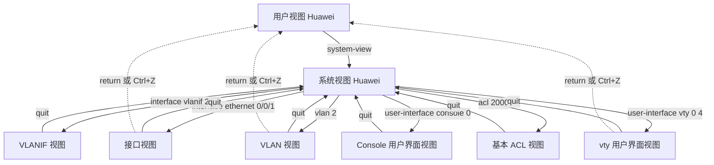
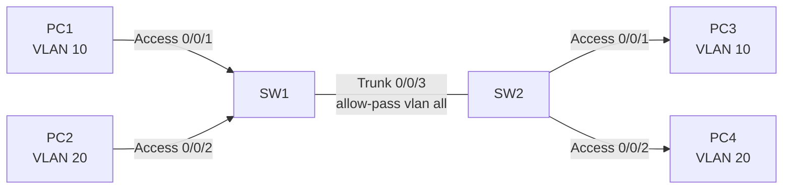
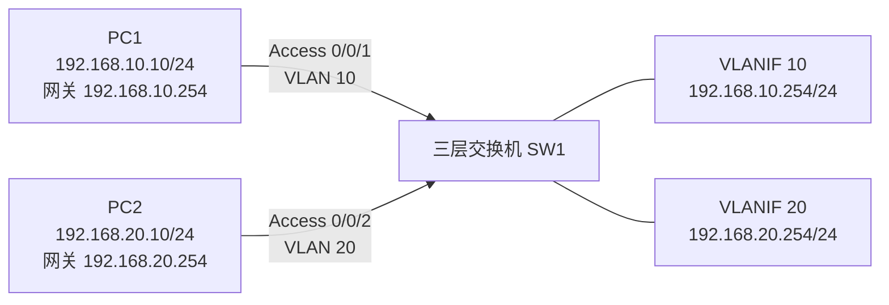

# 设备基础配置与VLAN配置 · 完整笔记

---

## 1.基础组网设备

典型企业网络按三层结构组网，后续配置的背景大多基于这一结构：

| 层次 | 职责 | 常见设备 |
| ---- | ---- | -------- |
| 核心层 | 高速数据转发，作为全网出口与路由中心 | 三层交换机或路由器，通常两台做集群/堆叠 |
| 汇聚层 | VLAN 划分、认证、流量汇聚等管理性动作 | 三层交换机为主，也可用二层交换机 |
| 接入层 | 接口扩充、终端简单接入，可就近做认证与安全防护 | 二层交换机 |

小型网络可取消汇聚层，把汇聚功能并入核心层，形成「核心 + 接入」的二层结构。可靠性依靠设备冗余（两台互备或虚拟成一台）与链路冗余（网状连接）实现，但冗余链路会带来环路，需要 STP 或链路聚合解决。

网络拓扑图是网络工程领域用于描述网络的物理或逻辑结构的重要工具，读图时要能区分设备角色、链路类型与冗余关系。

### 1.1 按工作层次划分的设备

| 层次 | 设备 |
| ---- | ---- |
| 物理层 | 中继器（Repeater）、集线器（Hub） |
| 数据链路层 | 网桥（Bridge）、交换机（Switch） |
| 网络层 | 三层交换机、路由器（Router） |
| 网络层及以上 | 网关（Gateway）、防火墙（Firewall） |

历史演进与淘汰过程：

- 总线型网络时代：中继器（Repeater）、集线器（Hub，中继器的升级改进，端口更多、传输更远），本质仍是一条总线，需用 CSMA/CD 解决抢占冲突，现已淘汰。
- 网桥是交换机的前身：STP 中大量使用"网桥"术语（桥 ID、网桥优先级）即源于此。
- 交换机（Switch）：当前主流，隔离冲突域，全双工工作。
- 路由器（Router）：分割广播域，每个广播域即一个网段，实现不同网段间通信；但端口数量少、交换能力弱。
- 三层交换机：具备路由功能，又具备交换机的高速转发能力，适合 VLAN 间通信。
- 防火墙、网关系统、上网行为管理等安全设备：工作在网络层及以上。

### 1.2 交换机与路由器对比

| 对比项 | 二层交换机 | 三层交换机 | 路由器 |
| ------ | ---------- | ---------- | ------ |
| 工作层次 | 数据链路层 | 网络层 | 网络层 |
| 功能 | 二层交换功能，依据 MAC 地址转发 | 二层 + 三层功能，三层需配置 VLANIF 接口 | 三层路由功能，一个物理接口对应一个 IP 地址（属一个网段） |
| 接口类型 | RJ45 电口、光口（GBIC/SFP/SFP+/QSFP+/SFP28）、扩展插槽，接口数量丰富 | 同交换机 | 广域网 WAN 端口（Serial 串口，一般一个）、局域网 LAN 端口（RJ45、光口），接口种类丰富，另有 Console、MiniUSB 等管理接口，以及 3G/4G/5G 接入口 |

要点：

- 二层交换依靠 MAC 地址；三层进行路由寻址，必须有接口 IP。三层交换机通常不直接给物理接口配 IP，而是通过 VLANIF（VLAN 的逻辑三层接口）配 IP；若确需在物理接口上配 IP，可用 `undo portswitch` 将接口切换为三层模式。路由器则是一个物理接口一个 IP，另可通过子接口（如单臂路由）实现接口与 IP 的复用，但单臂路由实现麻烦、速度慢，实际 VLAN 间通信多由三层交换机完成。
- 路由器用于异构网络互联，端口重在**种类**多；交换机端口重在**数量**多。

---

## 2.设备的管理方式

| 管理方式 | 登录形式 | 说明 |
| -------- | -------- | ---- |
| CLI 命令行 | Console | 通过 console 线缆与 PC 的 COM 口相连，通过超级终端软件本地登录设备 |
| CLI 命令行 | MiniUSB | 使用 MiniUSB 线缆连接，本地管理 |
| CLI 命令行 | Telnet | 适合有 IP 地址的设备，并确保 PC 与网络设备的连通性；远程管理、多会话，但明文传输，不安全 |
| CLI 命令行 | SSH | 远程管理、多会话、高安全 |
| Web 图形化 | HTTP / HTTPS | 图形化界面更直观，适合有 IP 地址且内置 WEB 页面的设备（如家用路由器的网页配置界面） |
| 网管系统 | SNMP / Netconf | 批量下发配置、初始配置比较容易，适合有大量设备管理的环境（详见网络管理章节） |

要点：

- 远程登录（Telnet/SSH）与本地登录（Console/MiniUSB）的核心差异：远程登录**必须有 IP 地址**，且要保证网络连通性。
- 管理员最常使用、最灵活、功能最强大的是 CLI 命令行。

---

## 3.设备的启动过程与配置文件

- 操作系统：设备需要加载运行的系统软件，命令行界面（网络设备配置常用）或图形化界面（家用路由器网页界面）。华为 VRP 常用 VRP5 和 VRP8 两个版本。
- 启动流程：BootROM 引导 → 初始化程序 → VRP 操作系统平台 → 读取启动配置文件 → 进入命令行界面（CLI）。开机自检时按 **Ctrl+B**（部分早期版本为 Ctrl+Break）可进入 BootROM 菜单，进行软件升级、手工引导或口令恢复。
- 启动配置文件：保存已完成的配置。关机重启后按启动配置文件恢复配置；**若修改后未执行 save 保存，重启后所做配置丢失**（类似 Word 不保存就关闭）。配置文件保存在非易失性存储器中。

---

## 4.华为命令行基础

### 4.1 命令视图

| 视图 | 提示符 | 进入方式 | 用途 |
| ---- | ------ | -------- | ---- |
| 用户视图 | `<Huawei>` | 登录后默认 | 只能执行简单命令，主要是 display 等查看类命令 |
| 系统视图（全局） | `[Huawei]` | `system-view` | 配置的起点，大部分配置都从此进入其他视图 |
| 以太网接口视图 | `[Huawei-Ethernet0/0/1]` | `interface ethernet 0/0/1` | 接口相关配置（IP、链路类型、ACL 等） |
| VLAN 视图 | `[Huawei-vlan2]` | `vlan 2` | VLAN 配置、批量加入端口 |
| VLANIF 视图 | `[Huawei-Vlanif2]` | `interface vlanif 2` | VLAN 的三层逻辑接口，配置管理 IP/网关 |
| vty 用户界面视图 | `[Huawei-ui-vty0-4]` | `user-interface vty 0 4` | 远程登录配置 |
| Console 用户界面视图 | `[Huawei-ui-console0]` | `user-interface console 0` | Console 登录配置 |
| RIP/OSPF 协议视图 | `[Huawei-rip-1]` 等 | `rip`、`ospf`（带进程号） | 路由协议配置 |
| 基本/高级 ACL 视图 | `[Huawei-acl-basic-2000]` 等 | `acl 2000`（基本 ACL 编号 2000~2999）、`acl 3000`（高级 ACL 编号 3000~3999） | ACL 配置 |

视图切换关系可以概括为「以系统视图为中转、向下逐级进入、向上逐级退出」：



返回命令：

| 命令 | 作用 |
| ---- | ---- |
| `quit` | 返回上一级视图 |
| `return` 或 `Ctrl+Z` | 从任意视图直接返回用户视图 |
| `quit`（用户视图下） | 断开与设备的连接 |

不同视图下提示符不同、可执行的命令不同，做题时依据提示符判断当前所处视图是基础得分点。

### 4.2 基础命令示例

```
<HUAWEI> system-view                            //进入系统视图
[HUAWEI] interface gigabitethernet 0/0/1        //进入端口视图
[HUAWEI-GigabitEthernet0/0/1] undo negotiation auto   //关闭端口速率自协商功能
[HUAWEI-GigabitEthernet0/0/1] speed 1000        //配置端口速率为1000Mbps
[HUAWEI-GigabitEthernet0/0/1] duplex full       //配置双工模式为全双工（1000M 不支持半双工）
[HUAWEI-GigabitEthernet0/0/1] undo portswitch   //二层口切换为三层口后才能直接配 IP
[HUAWEI-GigabitEthernet0/0/1] ip address 192.168.1.1 24   //配置端口IP（子网掩码可用掩码长度简写）
[HUAWEI-GigabitEthernet0/0/1] quit              //退回到系统视图
[HUAWEI] vlan 2                                 //进入（创建）VLAN2视图
[HUAWEI-vlan2] return                           //直接返回用户视图
<HUAWEI> quit                                   //断开与设备的连接
```

上例中 `undo portswitch` 只对支持三层功能的接口有效；二层交换机即使执行该命令也不能配置 IP，考试中若见到「二层交换机物理口配 IP」即为错误。

### 4.3 常用系统命令

- `sysname`：设置设备主机名，便于区分管理多台设备。缺省主机名为 HUAWEI。
- `clock datetime`（用户视图）：设置系统日期时间，格式为 `HH:MM:SS YYYY-MM-DD`，如 `clock datetime 00:00:00 2020-01-01`。
- `clock timezone`（用户视图）：设置本地时区，如 `clock timezone BJ add 08:00:00`；`undo clock timezone` 恢复为 UTC。
- `save`（用户视图）：将当前配置保存到配置文件，重启后不丢失。
- `reset saved-configuration`（用户视图）：清除已保存的启动配置，重启后设备以空配置启动。
- `undo`：删除/关闭某项配置的通用前缀（如 `undo negotiation auto`、`undo vlan`）。

### 4.4 常见 display 命令汇总

华为的查看类命令统一以 `display` 开头（思科对应 `show`），命令中加 `brief` 表示只看简要信息。

| 命令 | 作用 |
| ---- | ---- |
| `display current-configuration` | 查看系统当前配置信息（重启后丢失，对应 RAM 中的运行配置） |
| `display saved-configuration` | 查看系统保存的配置信息（保存在存储器中，重启后仍保留） |
| `display patch-information` | 查看补丁信息 |
| `display trapbuffer` | 查看告警信息（trap 告警缓冲区，网络管理中会涉及） |
| `display version` | 查看版本信息 |
| `display interface` | 查看接口信息（可带接口类型与编号查看指定接口） |
| `display interface brief` | 查看接口状态和配置的简要信息 |
| `display eth-trunk 1` | 查看指定 Eth-Trunk（链路聚合）的成员与状态 |
| `display vlan` | 查看 VLAN 信息 |
| `display stp` | 查看 STP 的状态和统计信息 |
| `display gvrp statistics` | 查看各端口的 GVRP 统计信息 |

说明：华为查看接口的命令是 `display interface`（可简写为 `display int`），没有 `display interfaces` 这种复数形式；查看链路聚合使用 `display eth-trunk [ trunk-id ]`，而不是 `display interface eth-trunk`。

ACL 与路由相关的常用查看命令：

| 命令 | 作用 |
| ---- | ---- |
| `display acl` | 查看 ACL 的配置信息 |
| `display ip routing-table` | 查看路由表 |
| `display rip route` | 查看 RIP 路由 |
| `display ospf lsdb` | 查看 OSPF 的链路状态数据库信息 |
| `display ospf peer` | 查看 OSPF 的邻居 |
| `display bgp peer` | 查看 BGP 对等体 |
| `display bgp routing-table` | 查看 BGP 路由表 |

---

## 5.设备登录配置

### 5.1 Console 本地登录配置

通过 Console 线缆连接 PC 的串口与设备的 Console 口，用终端软件登录后即处于用户视图。为防止未授权人员插线即改配置，应为 Console 口配置认证。

```
<Huawei> system-view                       //进入系统视图
[Huawei] sysname R1                        //设备命名为R1，便于区分和管理
[R1] user-interface console 0              //进入console用户界面视图
[R1-ui-console0] authentication-mode { aaa | password | none }   //认证模式选择
[R1-ui-console0] set authentication password [cipher password]
//采用本地验证（password）时需要配置密码；不使用cipher参数则交互式输入明文密码，指定cipher则输入密文密码
Please configure the login password (maximum length 16): zongyuan
```

- 认证模式三种：`aaa`（到 AAA 服务器认证）、`password`（简单密码认证，常用）、`none`（不认证，不安全）。
- 密码最大长度为 16 位。
- 效果类似给操作系统设置登录密码：Console 登录时需输入密码。

### 5.2 远程登录（虚拟终端）配置

Telnet 远程登录要求设备已配置管理 IP，且客户端与设备三层可达。配置核心是三步：启用 Telnet 服务、配置 vty 线路的协议与认证方式、创建 AAA 本地账号并授权。

```
[HUAWEI] telnet server enable                    //使能telnet服务功能
[HUAWEI] user-interface vty 0 4                  //开启vty线路模式，允许用户数量0~4远程登录控制
[HUAWEI-ui-vty0-4] protocol inbound telnet       //配置vty支持telnet协议
[HUAWEI-ui-vty0-4] authentication-mode { aaa | password | none }   //认证模式选择
[HUAWEI-ui-vty0-4] quit                          //退回到上一级视图
[HUAWEI] aaa                                     //进入aaa视图
[HUAWEI-aaa] local-user zy password irreversible-cipher Aq12#$   //配置用户名和密码（密文）
[HUAWEI-aaa] local-user zy privilege level 3     //配置账号的权限级别为3
[HUAWEI-aaa] return                              //直接返回到用户视图
<HUAWEI> save                                    //保存配置
```

要点：

- vty 是虚拟终端：以虚拟状态远程访问，无需实际一对一连接。`vty 0 4` 中的 0～4 是允许同时接入的用户编号，第 6 个用户将被拒绝（提示系统繁忙），除非有人释放连接。
- 很多服务启用都使用 `enable` 关键字（如 `telnet server enable`）。
- `local-user ... password irreversible-cipher ...`：密码以不可逆密文方式存储。
- `privilege level 3`：设置该账号的命令操作权限级别。

### 5.3 用户级别与命令级别

登录后只能执行**等于或低于自身级别**的命令。

| 用户级别（level） | 可用命令级别 | 说明 |
| ----------------- | ------------ | ---- |
| 0（参观级） | 0 | 网络诊断类命令（ping、tracert），从本设备访问其他设备的命令（Telnet）等 |
| 1（监控级） | 0、1 | 系统维护命令，比如大部分的 display 等命令 |
| 2（配置级） | 0、1、2 | 业务配置命令 |
| 3（管理级） | 0、1、2、3 | 涉及系统基本运行的命令、故障诊断命令 debugging，以及部分 display 命令：display current-configuration 和 display saved-configuration |

- 命令级别分 0～3 四级；用户级别编号为 0～15，其中 0～3 为基础级别，4～15 保留用于级别提升和自定义。

---

## 6.VLAN 的基础配置

VLAN 的作用：交换机本身无法分割广播域，路由器分割广播域又不经济，因此用 VLAN（虚拟局域网）在交换机上实现广播域的分割。

### 6.1 VLAN 的创建

```
[HUAWEI] vlan vlan-id                     //创建并进入VLAN视图
[HUAWEI-vlan2] name vlan-name             //为VLAN命名；字符串区分大小写，不支持空格，长度1~31
[HUAWEI] vlan vlan-name vlan-name         //按名称进入已命名的VLAN视图
[HUAWEI] undo vlan { vlan-id | vlan-name vlan-name }   //删除VLAN
[HUAWEI] vlan batch vlan-id1 [ to vlan-id2 ]
//批量创建VLAN，注意有to无to的区别：有to表示范围VLAN，无to表示单个VLAN
示例：[HUAWEI] vlan batch 2 to 4           //批量创建VLAN2到4，共3个VLAN
[HUAWEI] vlan 2
[HUAWEI-vlan2] port gigabitethernet 0/0/1 to 0/0/5   //在VLAN视图下批量将接口加入
```

注意：VLAN 视图下的 `port` 命令只适用于 Access 接口；Trunk/Hybrid 接口必须进入接口视图，用 `port trunk allow-pass` 或 `port hybrid ... vlan` 指定 VLAN。

VLAN ID（VID）规则：

- VID 与 802.1Q tag 的 12 位字段对应，取值 0～4095；**0 和 4095 保留**，可用范围为 1～4094。
- VLAN 1 为默认 VLAN，未分配端口的默认归属；手工划分一般从 VLAN 2 开始。

### 6.2 接口类型与 Tag 处理原理

VLAN Tag 的打标与剥离由交换机完成，用户终端无感知：数据包从终端进入交换机时按端口规则打上 tag，从终端端口发出前剥离 tag（类比进出检票）。端口角色由接口类型决定，共有三种：

```
<HUAWEI> system-view                       //进入系统视图
[HUAWEI] interface Ethernet0/1             //进入端口视图
[HUAWEI-Ethernet0/1] port link-type { access | trunk | hybrid }   //配置端口类型
[HUAWEI-Ethernet0/1] port default vlan vlan-id       //把access端口加入到一个指定VLAN
[HUAWEI-Ethernet0/1] port trunk allow-pass vlan [ vlan-id1 to vlan-id2 | all ]
                                                     //配置trunk中允许通过的VLAN
[HUAWEI-Ethernet0/1] port hybrid { tagged | untagged } vlan vlan-id
                                                     //指定hybrid端口以tagged/untagged方式加入VLAN
```

| 接口类型 | 特点 | 应用场景 |
| -------- | ---- | -------- |
| access | 接收普通报文打上 PVID 的 tag，发送时剥离 tag；一次只能属于一个 VLAN | 直接连终端 |
| trunk | 业务 VLAN 携带 tag 转发；通过"允许通过列表"检查报文 VLAN 是否放行，可允许多个 VLAN 通过 | 交换机与交换机之间的链路 |
| hybrid | 华为默认端口类型；可灵活指定某 VLAN 的报文以 tagged（带标签）或 untagged（剥离标签）方式通过 | 应用最广泛、最灵活，实际运维常用；考试理论中 access 和 trunk 出现更多 |

另外可用端口组批量配置：

```
[HUAWEI] port-group pg1
[HUAWEI-port-group-pg1] group-member ethernet0/0/1 to ethernet0/0/5
[HUAWEI-port-group-pg1] port link-type access
[HUAWEI-port-group-pg1] port default vlan 2
```

### 6.3 PVID 与 VID 的区别

- **PVID（Port VLAN ID）**：端口的缺省 VLAN ID，决定 access/hybrid 端口对 untagged 报文打什么 tag。配置命令：access 口用 `port default vlan vlan-id`，trunk 口用 `port trunk pvid vlan vlan-id`，hybrid 口用 `port hybrid pvid vlan vlan-id`。
- **VID**：报文 802.1Q tag 中携带的 VLAN 编号；把端口划分到某个 VLAN 时配置的是 VID。
- 二者的对比关系在 hybrid 端口的 tagged/untagged 处理中体现得最明显。

### 6.4 三种接口的收发处理流程

access 端口接收处理：收到报文 → 是否带有 Tag？无 Tag → 接收并打上 PVID；有 Tag → 比较 VID 与 PVID 是否相同，相同则接收，不同则丢弃。发送时剥离 PVID 的 tag（对用户还原为普通以太网帧）。

trunk 端口接收处理：接口维护一张「允许通过列表」（由 `port trunk allow-pass vlan` 指定）。收到带 Tag 的报文，VID 在列表内则接收，否则丢弃；收到无 Tag 的报文，打上 PVID 后接收。发送时业务 VLAN 的报文保持 Tag，PVID 对应的报文缺省剥离 Tag（PVID 缺省为 VLAN 1，可用 `port trunk pvid vlan` 修改）。

hybrid 发送处理：准备发送报文 → 该 VLAN 是否配置为发送时携带 Tag（tagged）？是 → 保持原有 Tag 发送；否（untagged）→ 剥离 Tag 后发送。接收阶段处理与 trunk 相同（允许多个 VLAN、无 tag 打 PVID）。

hybrid 的意义：剥离 tag 后报文在链路上传输时无标签，下一台设备需要再次按其 PVID/hybrid 规则重新打 tag，因此可以在同一链路上灵活设定"哪些 VLAN 带标签、哪些剥离"，用于同一 VLAN 内互通、不同 VLAN 间隔离等流量管理场景，比 access/trunk 更灵活。

### 6.5 基于端口的 VLAN 划分（配置示例）

两台交换机通过 Trunk 互联、下挂终端按 Access 接入的典型拓扑如下：



同 VLAN 的 PC1 与 PC3 要互通，除两端 Access 口正确外，中间 Trunk 还必须允许 VLAN 10 通过；跨交换机通信失败时，先查 Trunk 的允许列表，再查 Access 口的 PVID。

配置 SW1 主机端口所属 VLAN（access 模式）。注意 `vlan batch 10 20` 无 to，只创建 VLAN 10 和 VLAN 20 两个。

```
<HUAWEI>system-view
[HUAWEI]sysname SW1
[SW1] vlan batch 10 20
[SW1] interface ethernet 0/0/1
[SW1-ethernet0/0/1] port link-type access
[SW1-ethernet0/0/1] port default vlan 10
[SW1-ethernet0/0/1] quit
[SW1] interface ethernet 0/0/2
[SW1-ethernet0/0/2] port link-type access
[SW1-ethernet0/0/2] port default vlan 20
```

交换机之间的互联端口配置为 Trunk，并允许所有 VLAN 通过；SW2 的配置与 SW1 类似。

```
[SW1] interface ethernet 0/0/3
[SW1-ethernet0/0/3] port link-type trunk
[SW1-ethernet0/0/3] port trunk allow-pass vlan all
```

### 6.6 基于 MAC 地址的 VLAN 划分

- 不需要关注终端用户的物理位置，提高了终端用户的安全性和接入的灵活性。
- 只处理 Untagged 报文；对于 Tagged 报文的处理方式和基于接口的 VLAN 一样。
- 接口收到 Untagged 报文时，以报文的源 MAC 地址匹配 MAC-VLAN 表项：匹配成功则按匹配到的 VLAN ID 和优先级转发；匹配失败则丢弃。
- MAC 地址为 48 位，通常以 6 组十六进制数表示。

```
//创建VLAN10，并将用户主机的MAC地址与VLAN进行关联
[HUAWEI] vlan 10
[HUAWEI-vlan10] mac-vlan mac-address H-H-H
//其中H为1至4位的十六进制数，完整格式为三段，如 00e0-fc12-3456
```

MAC VLAN 只处理 Untagged 报文，因此接口要配置为 hybrid 并以 untagged 方式加入该 VLAN，再在接口上使能 `mac-vlan`。

```
//配置接口加入VLAN10，并在接口上使能基于MAC地址划分VLAN
[HUAWEI] interface 100ge 1/0/3
[HUAWEI-100GE1/0/3] port link-type hybrid
[HUAWEI-100GE1/0/3] port hybrid untagged vlan 10
[HUAWEI-100GE1/0/3] mac-vlan enable
```

### 6.7 基于子网地址的 VLAN 划分

- 可减少手工配置 VLAN 的工作量，保证用户自由地增加、移动和修改。
- 适用于对安全需求不高、对移动性和简易管理需求较高的场景。
- 基于 IP 子网的 VLAN 只处理 Untagged 报文，Tagged 报文处理方式与基于接口的 VLAN 一样；接口收到 Untagged 报文时，设备根据报文的源 IP 地址或指定网段确定报文所属 VLAN，自动划分到指定 VLAN 中传输。

配置分两步：在 VLAN 视图把子网与 VLAN 关联，再在接口上使能基于子网划分 VLAN。

```
//创建VLAN，并关联IP子网和VLAN
[HUAWEI] vlan batch 10 20
[HUAWEI] vlan 10
[HUAWEI-vlan10] ip-subnet-vlan 1 ip 192.168.1.0 24 priority 2
//配置接口类型，并使能基于子网划分VLAN的功能
[HUAWEI] interface ge 1/0/2
[HUAWEI-GE1/0/2] port link-type hybrid
[HUAWEI-GE1/0/2] port hybrid untagged vlan 10 20
[HUAWEI-GE1/0/2] ip-subnet-vlan enable
```

`ip-subnet-vlan` 后的 `1` 是索引编号（第一条规则），`priority 2` 是可选优先级（0～7，缺省 0）；`ip` 后应写**子网地址与掩码**，因此上例为 `192.168.1.0 24`，写成某一台主机的地址（如 `192.168.1.2`）不符合该命令的本意。

小结：基于 MAC 的划分关键词为 `mac-vlan`，基于子网的划分关键词为 `ip-subnet-vlan`；两者端口角色都是 hybrid untagged，且都要在接口上 enable。

### 6.8 三层交换机与 VLANIF

- VLAN 间通信需要三层路由寻址。用路由器（单臂路由/子接口）实现麻烦且速度慢，所以采用三层交换机。
- 关键命令 `undo portswitch`：将以太网接口从二层模式切换到三层模式（启用路由功能，此后物理接口可直接配 IP）；`portswitch` 则将接口切回二层模式。

```
<HUAWEI> system-view
[HUAWEI] interface ethernet 0/0/2
[HUAWEI-Ethernet0/0/2] undo portswitch        //将以太网接口从二层模式切换到三层模式
[HUAWEI-Ethernet0/0/2] ip address 192.168.1.2 255.255.255.0
//配置交换机管理IP地址和子网掩码
[HUAWEI] interface vlanif 1
[HUAWEI-vlanif1] ip address 192.168.0.1 255.255.255.0
```

一般给 VLAN 配置管理 IP：进入 `interface vlanif X`（X 与 VLAN ID 对应），配 `ip address`。VLANIF 是逻辑接口，其 IP 为逻辑地址；物理接口的 IP 则属于该物理接口本身。

两台 PC 分属 VLAN 10、VLAN 20，在同一台三层交换机上通过 VLANIF 完成互通：



```
[SW1] vlan batch 10 20
[SW1] interface GigabitEthernet 0/0/1
[SW1-GigabitEthernet0/0/1] port link-type access
[SW1-GigabitEthernet0/0/1] port default vlan 10
[SW1] interface GigabitEthernet 0/0/2
[SW1-GigabitEthernet0/0/2] port link-type access
[SW1-GigabitEthernet0/0/2] port default vlan 20

[SW1] interface Vlanif 10
[SW1-Vlanif10] ip address 192.168.10.254 24
[SW1] interface Vlanif 20
[SW1-Vlanif20] ip address 192.168.20.254 24
```

注意：二层交换机不能给物理端口配 IP，只做基于 MAC 的二层接入；VLANIF 的 IP 只用于本 VLAN 的三层网关，不能把 VLANIF 当作 Access 口使用。

---

## 7.GVRP 配置

### 7.1 GVRP 的基本概念

- GVRP 是 GARP（通用属性注册协议）的其中一个应用分支；GARP 还有另一个应用 GMRP（组播注册协议，用于组播属性的动态分发）。
- 手工方式下，VLAN 需要在每台交换机上分别创建；网络规模大时工作量大且易出错。GVRP 让相连接的设备之间**自主、动态地同步 VLAN 的创建、注册与注销**：在一台交换机上新增/删除 VLAN，消息会动态传播到其他交换机。
- GVRP 只同步 VLAN 的创建、注册与注销动作；**端口划分、端口角色仍需管理员手动配置**。
- 支持的 VLAN ID 范围为 1～4094（0 和 4095 保留）。
- 手工创建的 VLAN 称为静态 VLAN，通过 GVRP 学习到的称为动态 VLAN。
- GVRP 报文需要一条链路承载多个 VLAN，因此接口类型不能是 access；华为设备只在 **Trunk** 接口上支持使能 GVRP，且该 Trunk 必须允许相应 VLAN 通过。

### 7.2 GVRP 的注册模式

| 模式 | 行为 |
| ---- | ---- |
| Normal（缺省，最常用） | 允许端口动态注册、注销 VLAN，传播动态 VLAN 和静态 VLAN 的信息 |
| Fixed | 禁止端口动态注册、注销 VLAN；只传播本实体的静态 VLAN 信息，不传播、不学习动态 VLAN 信息 |
| Forbidden | 禁止端口动态注册、注销 VLAN；不传播除 VLAN 1 以外的任何 VLAN 信息 |

注：端口划分到 VLAN 中仍需管理员手动配置。

（华为官方命令：`gvrp registration { fixed | forbidden | normal }`，缺省为 normal；且接口需先全局使能 GVRP 并配置为 trunk。）

### 7.3 GVRP 配置示例

```
[SW1] vlan batch 2 3
[SW1] gvrp                                  //全局使能GVRP
[SW1] interface gigabitethernet 0/0/1
[SW1-GigabitEthernet0/0/1] port link-type trunk
[SW1-GigabitEthernet0/0/1] port trunk allow-pass vlan all
[SW1-GigabitEthernet0/0/1] gvrp             //使能此接口的GVRP功能
[SW1-GigabitEthernet0/0/1] gvrp registration normal    //GVRP注册模式为normal
//交换机SW2配置同SW1类似
<SW1> display gvrp statistics               //查看gvrp的统计信息
```

配置要点记忆：全局使能 GVRP（`gvrp`）+ trunk 链路 + 接口使能 GVRP 并设置注册模式（`gvrp registration normal`），最后用 `display gvrp statistics` 检查。

### 7.4 GVRP 的四种定时器

- 定时器长度关系：LeaveAll 最长 > Leave > Join > Hold 最短。
- 缺省值（华为官方，单位厘秒）：Hold 10、Join 20、Leave 60、LeaveAll 1000（即 10 秒）；缺省值最小的是 Hold 定时器。
- 相关命令：`garp timer { hold | join | leave } timer-value`、`garp timer leaveall timer-value`、`display garp timer`。

---

## 8.VLAN 的发展和应用

VLAN ID 范围有限（1～4094），资源有限；随着应用场景变化，VLAN 技术衍生出多种改进方案。这类内容一般以"解决方案"形式出现在案例题中：题干给出组网背景与优化需求，需要识别应采用的技术及其关键内容。

VLAN 的发展与应用主要包括：端口隔离、Super VLAN（VLAN 聚合）、MUX VLAN、VXLAN。

### 8.1 端口隔离

- 应用场景：同一设备（交换机或路由器）下的个别终端需要互相隔离；若仅为隔离少数终端而分别划分 VLAN，会造成 VLAN 资源浪费（一个 VLAN 可容纳大量主机），此时只需将端口加入隔离组即可。也可用于将不安全终端与安全终端分隔。
- 特征：同一 VLAN 内也能隔离；**属于同一隔离组的端口之间不能通信**（放到同一组就是互相隔离，这一点容易因逻辑顺序误判）；不同隔离组的端口之间不隔离。
- 关键词：`port-isolate`——只要出现该关键词即归类为端口隔离技术。
- 隔离除了上述形态外，还可基于安全考量将不安全终端与安全终端分隔；端口隔离既可在交换机上实现，也可在路由器上实现。

```
#配置全局端口隔离模式为二层隔离
[SW2] port-isolate mode l2            //l2表示二层隔离；all表示二层和三层均隔离
[SW2] interface GE 0/0/1
[SW2-GE0/0/1] port link-type access
[SW2-GE0/0/1] port default vlan 2
#使能端口隔离功能，并将端口加入到隔离组
[SW2-GE0/0/1] port-isolate enable group 2
#另一个接口（如 GE0/0/2，仍为 VLAN 2）做类似配置，加入相同的隔离组；两端也可分属不同 VLAN，隔离效果与 VLAN 划分无关
#属于同一隔离组的端口之间不可互相通信；两接口配置在不同的组则可互通
```

### 8.2 Super VLAN（VLAN 聚合）

- 定义：在一个物理网络内，用多个 VLAN（称为 Sub-VLAN）隔离广播域，并将这些 Sub-VLAN 聚合成一个逻辑 VLAN（称为 Super-VLAN）；这些 Sub-VLAN 使用同一个 IP 子网和缺省网关，进而达到**节约 IP 地址资源**的目的。
- 类比超网（super net）：多个子网汇聚成一个逻辑网络。
- 适用场景：各部门只划分为不同子网段、出外网走同一路径、没有互相单独通信的需求。
- Sub-VLAN 分属不同 VLAN（不同广播域），跨 Sub-VLAN 通信时无法通过广播获取对方 MAC，因此必须开启 **ARP 代理（Proxy ARP）** 功能。

```
#在SW1上配置Super-VLAN 4，并将VLAN2、VLAN3加入到Super-VLAN 4，作为其Sub-VLAN
[SW1] vlan 4
[SW1-vlan4] aggregate-vlan              //配置VLAN4为Super VLAN（聚合VLAN）
[SW1-vlan4] access-vlan 2 to 3          //将VLAN2~3加入为Sub-VLAN
[SW1-vlan4] quit
[SW1] interface vlanif 4
[SW1-Vlanif4] ip address 10.1.1.1 255.255.255.0
#在SW1的Super-VLAN 4下配置Proxy ARP
[SW1-Vlanif4] arp-proxy inter-sub-vlan-proxy enable
```

考试要求：一般不需默写完整配置，但要能识别该配置属于 Super VLAN（VLAN 聚合）功能，并说明其作用（节约 IP 地址 + ARP 代理实现 Sub-VLAN 间互通）。

补充要点：Sub-VLAN 不能再配置自己的 VLANIF，所有 Sub-VLAN 共用 Super VLAN 的 VLANIF 地址作为网关；VLAN 1 不能作为 Super VLAN 或 Sub-VLAN；Super VLAN 与 MUX VLAN 解决的是不同问题，应按题干关键词区分，不要混用两类命令。

### 8.3 MUX VLAN

| MUX VLAN 角色 | VLAN 类型 | 所属接口 | 通信权限 |
| ------------- | --------- | -------- | -------- |
| Principal VLAN（主 VLAN） | – | Principal port | 可与 MUX VLAN 内的所有接口通信 |
| Subordinate VLAN（从 VLAN） | Separate VLAN（隔离型 VLAN） | Separate port | 只能与 Principal port 通信，与其他类型接口完全隔离 |
| Subordinate VLAN（从 VLAN） | Group VLAN（互通型 VLAN） | Group port | 可与 Principal port 通信；同一组内的接口也可互相通信，但不能与其他组接口或 Separate port 通信 |

- 应用场景：企业内所有员工均可访问服务器（主 VLAN），部分员工之间可互访（互通型从 VLAN），部分员工之间隔离（隔离型从 VLAN）。角色多样性使单一 VLAN 划分难以实现的需求得以满足。
- 解题要点：题干出现"多角色/主从 VLAN"及不同 VLAN 类型（隔离型/互通型）配置时，即为 MUX VLAN。

```
#配置MUX VLAN中的Group VLAN和Separate VLAN
[SW1] vlan 4
[SW1-vlan4] mux-vlan                    //配置VLAN4为主VLAN
[SW1-vlan4] subordinate group 2         //VLAN2为互通型从VLAN
[SW1-vlan4] subordinate separate 3      //VLAN3为隔离型从VLAN
#配置接口加入VLAN并使能MUX VLAN功能
[SW1] interface ge 0/0/1
[SW1-GE0/0/1] port link-type access
[SW1-GE0/0/1] port default vlan 4
[SW1-GE0/0/1] port mux-vlan enable vlan 4
```

### 8.4 VXLAN

服务器虚拟化后 VM 数量远超物理机，传统 VLAN 存在以下问题：

1. 网络隔离能力受限；
2. Tag 只有 12 bit，对于大型虚拟化云计算服务场景，租户数目远大于 VLAN 可用个数；
3. 传统二层网络中的 VLAN 无法满足网络动态调整（虚拟机调度、迁移）的需求。

解决方案：

1. 简化拓扑结构：交换机堆叠、集群技术，将多台设备逻辑成一台设备（配合链路聚合），简化网络拓扑。
2. VXLAN 技术：一种更现代的网络虚拟化技术，通过在 **UDP 数据包中封装二层以太网帧**，创建虚拟的二层网络。承担封装与解封装的是 **VTEP（VXLAN Tunnel End Point）**，隧道两端 VTEP 之间建立 VXLAN 隧道；VXLAN 使用 **24 位的 VNI（VXLAN 网络标识符）**，理论上支持多达 **1600 万**个虚拟网络，能够在任意路由可达的三层网络之上叠加二层网络，适合大型云数据中心和多租户环境。
3. 相关过渡技术：QinQ 通过内外两层 12 位 tag 扩展标识空间（运营商外层 tag + 内网内层 tag），但受两层 VLAN 规划限制，仍不能满足大规模多租户需求，故进一步采用 24 位 VNI 的 VXLAN；IPv4 地址不足用 IPv6（32 位扩展到 128 位）扩展的思想类似。

### 8.5 Voice VLAN（语音 VLAN）

本课程未展开，作为 VLAN 应用技术的发展技术补充（已按华为官方资料核实）：

- Voice VLAN 是为语音报文（如 IP 电话）专设的 VLAN：设备根据报文源 MAC 匹配语音设备 OUI，或依据报文优先级识别语音流量，将其划入 Voice VLAN 并提升优先级，保障通话质量。
- 核心命令（了解即可）：`voice-vlan 10 enable`（接口视图，指定 VLAN 10 为 Voice VLAN 并使能）、`voice-vlan mode { auto | manual }`（识别模式，缺省 auto）、`voice-vlan mac-address <mac> mask <mask>`（配置语音设备 OUI）、`voice-vlan security enable`（安全模式，只允许匹配 OUI 的报文进入 Voice VLAN）。
- 注意：VLAN 1 不能被指定为 Voice VLAN；同一时刻一个接口只能有一个 VLAN 被设置为 Voice VLAN。

---

## 9.典型例题

### 9.1 例题1：接口视图提示符

配置路由器以太网接口的提示符是（D）。

- A. `<router>`
- B. `[router]`
- C. `[router-ui-vty1]`
- D. `[router-GigabitEthernet0/0/1]` [正确]

解答：A 为用户视图，B 为系统视图，C 为 vty（虚拟终端）用户界面视图，只有 D 是以太网接口视图的提示符。华为提示符中接口类型与编号之间**没有空格**，写成 `GigabitEthernet 0/0/1` 是常见干扰项。

### 9.2 例题2：查看告警信息的命令

在华为交换机的故障诊断命令中，查看告警信息的命令是（B）。

- A. dis patch
- B. dis trap [正确]
- C. dis int br
- D. dis cu

解答：告警对应 trap 关键字（`display trapbuffer`）；命令在设备能识别时可简写，但**笔试/案例题补充命令时建议写全**，以防阅卷误判扣分。

### 9.3 例题3：配置代码补充（案例题）

请根据描述，将下面配置代码补充完整：

```
<Huawei> system-view
[Huawei] (1) R1                              //答案：sysname
[R1] user-interface (2)                      //答案：console 0（进入console用户界面视图）
[R1-ui-console0] authentication-mode (3)     //答案：password（提示设置登录密码）
Please configure the login password (maximum length 16): huawei
[R1] interface GigabitEthernet 0/0/0
[R1-GigabitEthernet0/0/0] ip address 192.168.100.242 255.255.255.252
[R1-GigabitEthernet0/0/0] (4)
<R1>
```

解答：(4) 处配置完成后提示符直接从接口视图变为用户视图 `<R1>`，跨级返回，故应填 `return`（若填 `quit` 则只退到上一级系统视图 `[R1]`）。早期常考此类命令补充题，现在考得更综合（交换机配置、OSPF 配置等）。

### 9.4 例题4：VLAN 划分方法辨析

配置 VLAN 有多种方法，下面哪一条不是配置 VLAN 的方法（C）。

- A. 把交换机端口指定给某个 VLAN
- B. 把 MAC 地址指定给某个 VLAN
- C. 由 DHCP 服务器动态地为计算机分配 VLAN [正确]
- D. 根据上层协议来划分 VLAN

解答：VLAN 划分方式包括基于端口、基于 MAC 地址、基于子网（网络层/协议）、基于策略及用户自定义等；DHCP 只负责分配 IP 地址、子网掩码、网关、DNS、租约等上网必备信息，不分配 VLAN。

### 9.5 例题5：vlan batch 数量计算

使用命令 `vlan batch 10 15 to 19 25 28 to 30` 创建了（B）个 VLAN。

- A. 6　　B. 10 [正确]　　C. 5　　D. 9

解答：带 to 表示连续范围，不带 to 表示单个：10（1 个）+ 15～19（5 个）+ 25（1 个）+ 28～30（3 个）= 10 个。

### 9.6 例题6：VLAN 划分综合案例

【案例题】公司管理员对各业务使用的 VLAN 作如下规划：

| 业务类型 | VLAN | IP 地址段 | 网关地址 | 服务器地址段 |
| -------- | ---- | --------- | -------- | ------------ |
| Internet | 10 | 192.168.1.0 | 192.168.1.1 | 192.168.1.250~192.168.1.254 |
| IPTV | 20 | 192.168.2.0 | 192.168.2.1 | 192.168.2.250~192.168.2.254 |
| VoIP | 30 | 192.168.3.0 | 192.168.3.1 | 192.168.3.250~192.168.3.254 |

公司有多种业务（Internet、IPTV、VoIP 等），不同业务使用不同的 IP 地址段。为了便于管理，需要根据业务类型对用户进行管理，以便于路由器 R1 能通过不同的 VLAN 分流不同的业务。

VLAN 划分可基于（1）、子网、（2）、协议和策略等多种方法，本例可采用基于（3）的方法划分 VLAN。

解答：（1）端口（接口）；（2）MAC 地址；（3）子网（本例不同业务使用不同 IP 地址段，基于子网划分最合适）。答题时一定要结合题干给出的参数（如是否给出 IP 地址段、终端是否固定）来确定最优划分方法；若背景改为移动笔记本办公，则应转向基于 MAC/子网等动态划分方式，并结合远程登录安全认证（如改用 SSH/AAA）做优化。

### 9.7 例题7：GVRP 概念辨析

GVRP 是跨交换机进行 VLAN 动态注册和删除的协议，关于其描述不准确的是（C）。（2021、2022 年重复考查）

- A. GVRP 是 GARP 的一种应用，由 IEEE 制定
- B. 交换机之间的协议报文交互必须在 VLAN Trunk 链路上进行
- C. GVRP 协议所支持的 VLAN ID 范围为 1-1001 [正确]
- D. GVRP 配置时需要在每一台交换机上建立 VLAN

解答：GVRP 支持 VLAN ID 范围为 1～4094（0 和 4095 保留），C [错误]。D 项表述不严谨：GVRP 只需在每台交换机上**启用 GVRP 功能**，并在其中一台（或少数几台）上静态创建 VLAN，即可动态注册到其他交换机，并非每台都要手工建立全部 VLAN；A、B [正确]。

### 9.8 例题8：GVRP 定时器

GVRP 定义的四种定时器中缺省值最小的是（A）。

- A. Hold 定时器 [正确]
- B. Join 定时器
- C. Leave 定时器
- D. LeaveAll 定时器

解答：缺省值 Hold（10 厘秒）< Join（20 厘秒）< Leave（60 厘秒）< LeaveAll（1000 厘秒）。四个定时器分别控制等待、加入（注册）、删除（注销）、删除所有报文的发送周期，本质是 GARP 注册协议的周期倒计时。

---

## 10.本章小结

| 知识点 | 核心内容 |
| ------ | -------- |
| 1. 组网设备 | 二层交换机（数据链路层）、三层交换机与路由器（网络层）、防火墙/网关（网络层及以上）；交换机接口数量丰富，路由器接口种类丰富 |
| 2. 管理方式 | CLI（Console/MiniUSB/Telnet/SSH）、Web（HTTP/HTTPS）、网管系统（SNMP/Netconf）；远程登录必须有 IP 且保证连通性 |
| 3. 视图 | 用户视图 `<Huawei>` → `system-view` → 系统视图 `[Huawei]` → 各功能视图；`quit` 退一级，`return`/Ctrl+Z 直回用户视图 |
| 4. 关键命令 | `sysname`、`clock datetime`、`clock timezone`、`save`、`undo`、`display` 系列（display trapbuffer 查告警、display interface brief 看简要接口信息） |
| 5. VLAN 创建与划分 | `vlan` / `vlan batch`（有 to 是范围、无 to 是单个）；划分方式：端口（access/trunk/hybrid）、MAC（mac-vlan）、子网（ip-subnet-vlan）、协议、策略 |
| 6. 接口类型 | access（打/剥 PVID tag，属一个 VLAN）、trunk（带 tag，allow-pass 列表放行多个 VLAN）、hybrid（华为默认，tagged/untagged 灵活指定）；PVID 是端口缺省 VLAN，VID 是报文 tag 中的 VLAN 编号 |
| 7. 三层交换机 | `undo portswitch` 切三层模式，物理口可配 IP；VLANIF 逻辑接口做各 VLAN 网关，实现 VLAN 间路由 |
| 8. GVRP | GARP 的应用，跨交换机动态注册/注销 VLAN（支持 1~4094）；只能在 Trunk 链路上使能；注册模式 Normal/Fixed/Forbidden；定时器 Hold<Join<Leave<LeaveAll |
| 9. VLAN 发展技术 | 端口隔离（port-isolate，同组隔离）、Super VLAN（VLAN 聚合省 IP + Proxy ARP）、MUX VLAN（主 VLAN/隔离型与互通型从 VLAN）、VXLAN（UDP 封装二层帧，24 位 VNI，约 1600 万虚拟网络）、Voice VLAN |

考试重点：

1. 依据命令提示符判断当前视图；`return` 与 `quit` 的区别是案例题命令补充的常考点。
2. `vlan batch` 数量计算：有 to 算范围、无 to 算单个。
3. 三种接口类型对 tag 的处理规则及 PVID/VID 的区别。
4. GVRP：动态注册的目的是批量同步 VLAN；VLAN ID 范围 1～4094；三种注册模式的区别；Hold 定时器缺省值最小。
5. VLAN 发展技术按"场景 + 技术关键词"对应记忆：端口隔离 → port-isolate；Super VLAN → aggregate-vlan + arp-proxy；MUX VLAN → mux-vlan/subordinate；VXLAN → UDP 封装 + 24 位 VNI。
6. 案例题中 VLAN 划分方式的选择要结合题干参数（业务是否按 IP 段划分、终端是否移动）确定，并注意与安全认证等知识串联。
