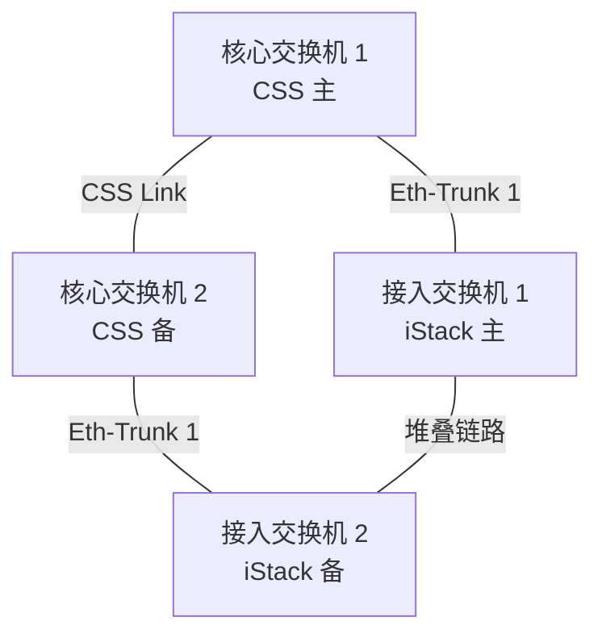
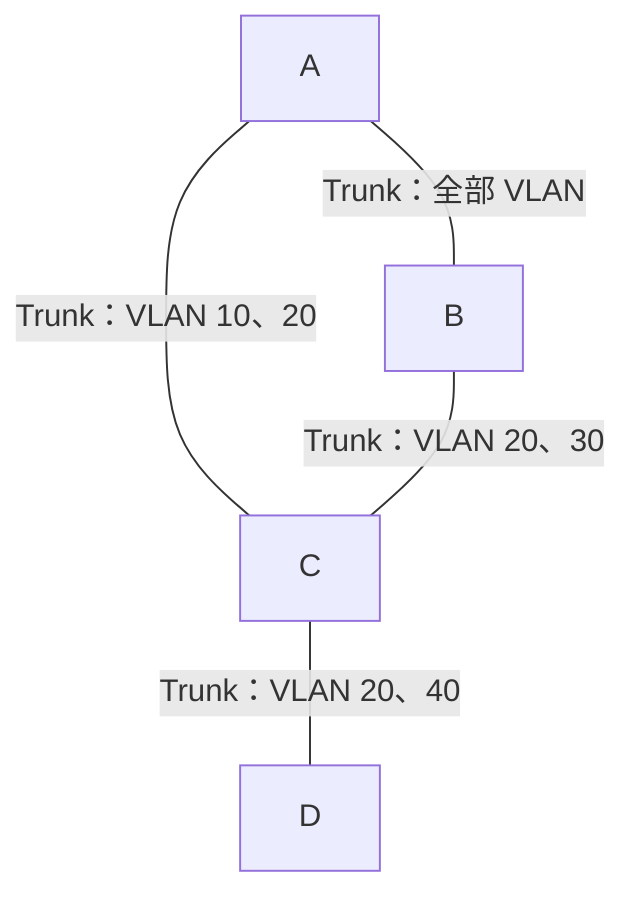

# 链路聚合、交换机安全与STP配置 · 完整笔记

> 内容来源：B站《2026新版软考-中级网络工程师》第61～63集（堆叠与链路聚合、交换机安全相关配置、STP配置），以华为 VRP 命令体系为准整理，关键命令与缺省值已对照华为官方命令参考核实。

---

## 1.堆叠与集群技术

### 1.1 堆叠/集群的作用与部署位置

典型的高可靠组网中，核心层两台交换机通过 CSS Link 组成集群，汇聚层与接入层的盒式交换机通过 iStack 堆叠，逻辑设备之间再用 Eth-Trunk 互联：



这样既保留设备与链路冗余，又把多台设备、多条链路分别虚拟成一台设备和一条逻辑链路，避免环路。

堆叠（iStack，Intelligent Stack）与集群（CSS，Cluster Switch System）的共同目标：**把多台独立的物理交换机虚拟化成一台逻辑交换机**。

| 作用 | 说明 |
| ---- | ---- |
| 简化组网 | 多台设备对外表现为一台，管理平面与转发平面统一，降低组网复杂度 |
| 提高可靠性 | 成员设备互为备份，单台故障不影响整体业务 |
| 提升性能 | 多台设备协同工作，性能上呈"一加一大于二"的效果，而非简单的端口容量叠加 |
| 配合链路聚合 | 逻辑交换机之间使用 Eth-Trunk 互联，无需部署 STP、VRRP 即可实现高可靠，且所有链路可同时传输流量，链路利用率提升 |

部署位置：

| 层次 | 采用技术 | 原因 |
| ---- | -------- | ---- |
| 核心层 | 集群 CSS（CSS Link） | 对设备要求更高，并非所有设备都支持；传统为两台核心设备做集群，CSS2 可扩展到四台，必须部署在最重要的核心位置 |
| 汇聚层、接入层 | 堆叠 iStack | 普通盒式交换机即可支持，用于提升性能与端口密度 |

冗余组网的背景：为安全、可靠需要设备冗余与链路冗余，设备数量增多会带来环路与组网复杂度上升；采用"多台设备虚拟成一台 + 多链路打包成一条"的方式，既保留冗余，又避免环路。全互联（网状）连接容易产生环路，用 Eth-Trunk 打包比用 STP 阻塞一条端口更优。

### 1.2 堆叠与集群的实现方式

| 技术 | 实现方式 | 说明 |
| ---- | -------- | ---- |
| 堆叠 | 堆叠卡堆叠 | 使用专用的堆叠插卡，或交换机自身集成的堆叠插卡，配合专用堆叠线缆进行堆叠 |
| 堆叠 | 业务口堆叠 | 交换机之间使用逻辑堆叠接口（stack-port）相连，可使用普通网线、光纤或专用堆叠线缆连接物理成员端口 |
| 集群 | 传统 CSS | 使用主控板上的集群卡建立集群连接，或使用业务口建立集群连接 |
| 集群 | CSS2 | 第二代集群交换机系统，专指使用交换网板上的集群卡建立集群连接的交换网硬件集群；在原有集群技术基础上增加了集群主控 1+N 备份等技术 |

要点：

- 专用堆叠卡、专用堆叠线缆、专用机架是传统堆叠的典型特征，但**并非唯一方式**，业务口堆叠可用普通线缆。
- CSS2 在可靠性（主控 1+N 备份）与集群规模（最多四台）上优于传统 CSS，但仍不能支持更多成员。

### 1.3 堆叠交换机的角色与选举

| 角色 | 数量 | 职责 |
| ---- | ---- | ---- |
| 主交换机（Master） | 1 台 | 负责管理整个堆叠系统，承担控制层面功能 |
| 备交换机（Standby，部分题目写作 Backup） | 1 台 | 作为主交换机的备份，主故障时接替 |
| 从交换机（Slave） | 可多台 | 用于业务转发；从交换机数量越多，堆叠系统性能越强 |

传统 CSS 为两台设备，通常只区分主、备两种角色，没有从角色；CSS2 虽可扩展到四台，核心仍是主控 1+N 备份，考试按主、备表述即可。

角色选举原则：

1. 堆叠优先级高的交换机优先竞争为主交换机；
2. 堆叠优先级相同时，MAC 地址小的交换机优先竞争为主交换机。

补充核实：华为文档中堆叠优先级取值范围为 **1～255，缺省值为 100**，通过 `stack slot slot-id priority priority` 修改；完整选举还会先比较运行状态（已处于运行状态的设备优先），再比较优先级与 MAC 地址。选举思路与 STP 的桥 ID 比较（先优先级、后 MAC）类似。

主交换机故障后，由**备交换机**接替，而不是在从交换机（Slave）中重新选举优先级最大者。

### 1.4 堆叠/集群的组网连接方式

| 连接方式 | 特点与适用场景 |
| -------- | -------------- |
| 链形（线形） | 设备间距较远、线缆较长，难以构成闭环时采用；可靠性低于环形 |
| 环形 | 堆叠设备距离近、线缆短时采用，是最经典、最常见的结构；单条堆叠链路故障不会造成通信中断，**一般建议采用环形** |

### 1.5 级联与堆叠的区别

| 对比项 | 级联 | 堆叠 |
| ------ | ---- | ---- |
| 主要目的 | 扩充端口容量 | 同时提升带宽与性能，实现"一加一大于二" |
| 线缆与接口 | 普通线缆与普通接口即可 | 专用堆叠卡/堆叠线缆，或业务口 + 逻辑堆叠接口 |
| 厂商要求 | 对同厂商无要求 | 要求同厂商设备 |
| 管理形态 | 各设备独立管理 | 多台虚拟成一台逻辑设备，统一管理 |
| 可靠性 | 无设备级备份 | 主、备、从角色互为备份 |

---

## 2.Eth-Trunk 链路聚合

### 2.1 基本原理与作用

链路聚合（Eth-Trunk，又称端口聚合）：将多条以太网物理链路捆绑在一起，成为一条逻辑链路。

| 作用 | 说明 |
| ---- | ---- |
| 提高链路带宽 | 多条物理链路带宽叠加，突破单链路带宽上限；注意负载分担按流进行，单条流量仍只走一条成员链路，多流并发时才能接近总带宽 |
| 提高链路可靠性 | 成员链路互为备份，具备容错功能 |
| 负载均衡 | 流量在多条成员链路间分担 |
| 节约成本 | 用多条低速链路聚合替代单条高速链路，无需硬件升级 |

与 STP 阻塞备用链路的方案相比：STP 会把冗余链路置为阻塞状态，利用率低；Eth-Trunk 让所有（活动）链路同时转发，既扩容又保留冗余。

### 2.2 链路聚合规则

1. Eth-Trunk 链路两端相连的物理接口的**数量、速率、双工方式、流控配置必须一致**，成员接口必须是同类型、同速率的以太网接口；
2. 如果本端设备的接口加入了 Eth-Trunk，与该接口直连的对端接口也必须加入 Eth-Trunk，两端才能正常通信；
3. 两台设备对接时，必须保证两端设备上的**链路聚合模式一致**，且允许通过的 VLAN 列表一致；
4. 设备聚合组进行负载分担计算时，**不支持将带宽速率作为计算权重**。

注意：成员接口速率必须一致，速率不同的端口不能加入同一个 Eth-Trunk，因此不存在「按较低速率向下兼容」的做法；聚合后的总带宽可以按成员口速率相加，但实际吞吐还受负载分担算法与流量分布影响。

### 2.3 手工模式（Normal）配置

```
# 在SW1上创建Eth-Trunk接口并加入成员接口
[SW1] interface eth-trunk 1
[SW1-Eth-Trunk1] trunkport gigabitethernet 0/0/1 to 0/0/3

# 配置Eth-Trunk1接口允许VLAN2和VLAN3通过
[SW1-Eth-Trunk1] port link-type trunk
[SW1-Eth-Trunk1] port trunk allow-pass vlan 2 3

# 配置Eth-Trunk1的负载分担方式
[SW1] interface eth-trunk 1
[SW1-Eth-Trunk1] load-balance src-dst-mac
```

在任意视图下执行 `display eth-trunk 1`，检查 Eth-Trunk 是否创建成功、成员接口是否已正确加入。

回显要点：

| 字段 | 含义 |
| ---- | ---- |
| Working Mode: NORMAL | 手工模式（静态绑定），无 LACP 协商 |
| Port Name / Status / Weight | 成员口名称、状态（up）、权重 |

配置要点：

- Eth-Trunk 是**逻辑接口**，VLAN、Trunk 等二层属性直接在 Eth-Trunk 视图下配置，成员口继承逻辑口的配置；
- 成员口加入后不再单独配置业务，只为逻辑口服务；
- 对端 SW2 必须做完全相同的配置（模式、成员口、允许 VLAN 一致）；
- 手工模式没有协商与备份机制，所有成员口都处于转发状态。

### 2.4 LACP 模式配置

LACP（Link Aggregation Control Protocol，链路聚合控制协议）原由 **IEEE 802.3ad** 定义，现由 **IEEE 802.1AX** 维护，通过 LACPDU 报文协商聚合关系。

```
# 在SW1上创建Eth-Trunk接口并配置LACP模式
[SW1] interface eth-trunk 1
[SW1-Eth-Trunk1] mode lacp-static

# 将GE0/0/1接口加入Eth-Trunk1中，0/0/2、0/0/3接口做同样配置（略）
[SW1] interface gigabitethernet 0/0/1
[SW1-GigabitEthernet0/0/1] eth-trunk 1

# 在SW1上配置系统优先级为100，使其成为LACP主动端
[SW1] lacp priority 100

# 在SW1上配置活动接口上限阈值为2
[SW1-Eth-Trunk1] max active-linknumber 2

# 配置接口优先级确定活动链路，GE0/0/2做同样配置（略）
[SW1] interface ge 0/0/1
[SW1-GE0/0/1] lacp priority 100
```

命令说明：

| 命令 | 视图 | 作用 |
| ---- | ---- | ---- |
| `mode lacp-static` | Eth-Trunk 视图 | 聚合模式设为静态 LACP；部分旧版本写作 `mode lacp`，二者含义相同 |
| `eth-trunk 1` | 接口视图 | 将物理接口加入指定 Eth-Trunk |
| `lacp priority 100` | 系统视图 | 配置 LACP 系统优先级，数值小者成为主动端（取值 0～65535，缺省 32768） |
| `max active-linknumber 2` | Eth-Trunk 视图 | 活动接口数上限阈值，超出上限的成员口作为备份 |
| `lacp priority 100` | 接口视图 | 配置接口优先级，用于在同一主动端内选择活动链路（取值 0～65535，缺省 32768，数值小者优先） |

补充：LACP 主动端的选举先比较系统优先级（小者优先），相同再比较系统 MAC（小者优先）；选出主动端后，由主动端按接口优先级选择活动链路，接口优先级相同则比较接口编号。`max active-linknumber` 只在 LACP 模式下生效，手工模式没有活动/非活动链路之分。

### 2.5 手工模式与 LACP 模式的对比

| 对比项 | 手工模式（Normal） | LACP 模式 |
| ------ | ------------------ | --------- |
| 聚合方式 | 静态手工绑定，无协议协商 | 通过 LACPDU 动态协商，遵循 IEEE 802.1AX（原 802.3ad） |
| 成员口状态 | 全部启用、全部转发 | 分为活动链路（Selected）与非活动链路（Unselect） |
| 备份能力 | 无备份概念，链路故障即少一条带宽 | M:N 模式，M 条活动链路 + N 条备份链路 |
| 故障切换 | 不支持动态切换，流量挤到剩余链路，易拥塞 | 活动链路故障时备份链路自动切换为活动，流量范围基本不变 |
| 可靠性 | 较低 | 较高 |
| 适用场景 | 小型网络，或一端/两端设备不支持 LACP | 对可靠性、可控性要求较高的组网 |

备份链路的意义（道路类比）：三条车道全部开放，其中一条维修时，剩余两条要承接三条车道的流量，必然拥塞；若平时只开放两条、保留一条备用，维修时启用备用道，仍是两条车道，流量分布与拥塞概率基本不变。因此 LACP 通过"活动链路 + 备份链路"提高了可控性与灵活性。

考试判读方法：看回显中的 **Working Mode**——`NORMAL` 为手工模式，`LACP` 为动态协商模式；出现 `Selected` / `Unselect` 即说明存在活动链路与备份链路，支持备份链路的动态切换。

### 2.6 负载分担

- 手工模式示例中 `load-balance src-dst-mac` 为**缺省**负载分担方式，即依据源 MAC 与目的 MAC 的一致情况进行流量分配：多条链路去往同一目的地时，流量可分散到各成员链路。
- 负载分担方式可以修改；权重也可以修改，权重占比更高的成员口会承担更大比例的流量。
- 聚合组的负载分担计算**不以端口带宽速率作为权重**。

---

## 3.交换机安全相关配置

### 3.1 安全威胁与配置框架

交换机面临的主要安全风险与对应措施：

| 风险 | 措施 |
| ---- | ---- |
| 非法用户接入网络、冒用接入端口 | IEEE 802.1X 端口接入认证（用户名 + 密码，配合 RADIUS） |
| 非法用户登录设备、执行配置命令 | 设备登录认证（Console 密码、Telnet/SSH + AAA 本地或服务器认证） |
| MAC 地址表不稳定、被篡改 | MAC 地址表安全（静态绑定、黑洞、老化、禁止学习、数量限制） |
| 需要旁挂 IDS 进行流量检测 | 端口镜像（镜像端口 + 观察端口） |
| 同一 VLAN 内用户互访、横向扩散 | 端口隔离（前序章节已讲） |

### 3.2 IEEE 802.1X 认证

802.1X 是端口级接入认证：客户端（Supplicant）与交换机（Authenticator）交互，交换机把认证信息交给 RADIUS 服务器（Authentication Server）校验，认证通过后才允许该端口转发业务流量。配置时全局与接口都要使能 `dot1x`。

```
<HUAWEI> system-view
[HUAWEI] dot1x enable                                  //全局使能IEEE802.1X功能
[HUAWEI] interface gigabitethernet 1/0/1
[HUAWEI-GigabitEthernet1/0/1] dot1x enable             //接口使能IEEE802.1X功能
[HUAWEI-GigabitEthernet1/0/1] dot1x port-method port
//配置基于端口的认证方式；缺省情况下，802.1X认证接入控制方式是基于MAC控制
```

要点：

- 802.1X 采用"用户名 + 密码"的认证形式，属于端口级接入认证；
- 认证控制方式有两种：基于 MAC（缺省）与基于端口；基于端口时，端口下第一个用户认证成功后，该端口所有用户均可访问；
- 未通过认证的用户无法正常使用网络。

### 3.3 端口镜像与观察端口

作用：将镜像端口（源端口）流经的报文复制一份，发送到观察端口（目的端口），供 IDS、协议分析仪等监控设备检测。IDS 发现问题后联动防火墙进行阻断。

华为设备把端口分为两种角色：

| 角色 | 含义 |
| ---- | ---- |
| 镜像端口 | 被监控的端口，业务流量流经的端口 |
| 观察端口（转发端口） | 连接监控设备的端口，接收复制出来的流量 |

与思科的术语差异：思科 SPAN 区分源端口（被监控）与目的端口（接监控设备），华为则分别称为镜像端口与观察端口，两者绑定后生效。判断题目所问的是哪一类端口，要看它是「被复制流量的业务口」还是「接 IDS 的监控口」。

```
[HUAWEI] observe-port 1 interface gigabitethernet 0/0/1
[HUAWEI] interface ge 0/0/2
[HUAWEI-GE0/0/2] port-mirroring to observe-port 1 inbound
```

- `observe-port` 用于定义观察端口，前面的数字为索引值，未指定时索引依次递增（1、2、3……），便于查找与排序；
- `port-mirroring to observe-port 1 inbound` 表示把本端口**入方向**的流量镜像到观察端口 1；方向也可为 outbound 或 both。

### 3.4 MAC 地址表安全

交换机的基本转发原理是"基于源 MAC 学习、基于目的 MAC 转发"，因此 MAC 地址表的安全是交换机安全的基础。

#### 3.4.1 静态 MAC 地址表

静态表项把 MAC 地址、接口、VLAN 三者绑定：

```
[HUAWEI] mac-address static 0005-0005-0005 ge 0/0/1 vlan 2
<HUAWEI> display mac-address static
```

- 把 MAC 地址、接口、所属 VLAN 三者绑定，表项不会随意变更，可防止 MAC 欺骗；
- 与 ARP 静态绑定（IP 与 MAC 绑定）的思路类似，二者常配合使用。

#### 3.4.2 黑洞 MAC 地址表

把非信任用户的 MAC 配置为黑洞表项：

```
[HUAWEI] mac-address blackhole 0005-0005-0005
```

- 将非信任用户的 MAC 地址配置为黑洞 MAC，收到源或目的为该 MAC 的报文直接丢弃；
- 相当于给该 MAC 打上"黑名单"标记，用于防止黑客利用 MAC 地址攻击用户设备或网络。

#### 3.4.3 动态 MAC 地址老化时间

修改动态表项在 MAC 地址表中的存活时间：

```
[HUAWEI] mac-address aging-time 500
```

- 缺省老化时间为 **300 秒**；
- 修改后动态表项在指定时间内未被刷新即被删除，可加快拓扑变化后的表项收敛。

#### 3.4.4 禁止 MAC 地址学习

可在接口视图或 VLAN 视图下关闭 MAC 地址学习：

```
[HUAWEI-GE0/1] mac-address learning disable [ action { discard | forward } ]
[HUAWEI-VLAN2] mac-address learning disable
```

- 可在**接口视图**或 **VLAN 视图**下禁止 MAC 地址学习；
- `action` 指定禁止学习后对报文的动作：`discard`（丢弃）或 `forward`（转发）；
- 缺省情况下，接口与 VLAN 的 MAC 地址学习功能都是开启的；
- 两种配置同时存在时，**基于 VLAN 的优先级更高**，即先看 VLAN 的配置，再看端口的配置。

#### 3.4.5 限制 MAC 地址学习数量

限制端口或 VLAN 下可学习的 MAC 数量，并指定超限动作：

```
[HUAWEI-GE0/1] mac-limit maximum 2
[HUAWEI-GE0/1] mac-limit action { discard | forward }
//配置当MAC地址数达到限制后，对报文应采取的动作，默认丢弃
[HUAWEI-GE0/1] mac-limit alarm { disable | enable }
//配置当MAC地址数达到限制后是否进行告警
[HUAWEI-VLAN2] mac-limit maximum 4
```

- 达到最大数量后不再学习新的 MAC 地址，只保留已学习的表项；
- 超限动作缺省为 `discard`；
- 告警功能用于在超限时提示管理员；
- 可在接口或 VLAN 视图下应用，按实际需求选择配置位置。

MAC 地址表安全配置汇总：

| 配置项 | 关键命令 | 作用 |
| ------ | -------- | ---- |
| 静态 MAC 地址表 | `mac-address static ... vlan ...` | MAC、接口、VLAN 绑定，防止篡改 |
| 黑洞 MAC 地址表 | `mac-address blackhole ...` | 丢弃指定 MAC 的报文 |
| 动态老化时间 | `mac-address aging-time 500` | 修改动态表项存活时间（缺省 300 s） |
| 禁止 MAC 学习 | `mac-address learning disable [ action ... ]` | 接口/VLAN 停止学习，VLAN 优先 |
| 限制学习数量 | `mac-limit maximum` / `action` / `alarm` | 控制可学习的 MAC 数量 |

### 3.5 端口安全（port-security）

应用场景：企业外来人员私自接入设备，或内部员工私自更换设备接入位置。端口安全把「允许接入的 MAC」与端口绑定，限制端口下可学习的 MAC 数量，并对超限行为采取保护动作。

```
[HUAWEI-GE0/1] port-security enable
[HUAWEI-GE0/1] port-security max-mac-num 4
[HUAWEI-GE0/1] port-security mac-address mac-address vlan vlan-id
[HUAWEI-GE0/1] port-security protect-action { protect | restrict | shutdown }
```

| 命令 | 作用 |
| ---- | ---- |
| `port-security enable` | 使能端口安全功能 |
| `port-security max-mac-num 4` | 限制端口下动态安全 MAC 地址的学习数量 |
| `port-security mac-address ... vlan ...` | 手工配置安全静态 MAC 地址表项（接口视图下无需再写接口号） |
| `port-security protect-action ...` | 配置端口安全的保护动作 |

三种保护动作：

| 动作 | 行为 | 特点 |
| ---- | ---- | ---- |
| protect | 丢弃非法流量，不告警、不关闭端口 | 最"安静"，仅丢弃 |
| restrict | 丢弃非法流量，同时上报告警 | 缺省动作，推荐使用；既阻断又可感知 |
| shutdown | 直接关闭端口（error-down） | 阻断最彻底，需手动恢复（可配合自动恢复） |

要点：

- 端口安全通常**配合 MAC 地址表安全配置**一起实现；
- 端口安全限制的是"端口下可接入的 MAC 数量/具体 MAC"，防止未授权设备接入；
- shutdown 动作会使端口进入 error-down 状态，须人工 `shutdown`/`undo shutdown` 恢复，或配置自动恢复。

### 3.6 MAC 地址漂移

定义：MAC 地址漂移是指交换机上一个 VLAN 内有两个端口学习到同一个 MAC 地址，**后学习到的 MAC 地址表项覆盖原 MAC 地址表项**的现象。

发生原因与解决方案：

| 原因 | 解决思路 |
| ---- | -------- |
| 网络中存在环路 | 首先检测到漂移，其次部署防环技术（如 STP） |
| 存在网络攻击行为（伪造 MAC 频繁迁移） | 配置接口 MAC 地址学习优先级；配置不允许相同优先级接口 MAC 地址漂移；配合 MAC 地址表安全（限制学习数量、禁止学习等） |

防漂移原理：

- 接口可配置 MAC 地址学习优先级（取值 0～7，缺省 0，数值越大越优先），**优先级高的接口学习的表项不会被低优先级接口覆盖**；
- 例如 GE0/0/1 配置 `mac-learning priority 5`（安全网络 PC1），GE0/0/2 为 `mac-learning priority 0`（攻击者伪造同一 MAC），高优先级端口胜出，攻击者的覆盖被抑制；
- `undo mac-learning priority 0 allow-flapping` 表示不允许相同优先级的接口之间发生 MAC 地址漂移，进一步收紧覆盖条件。

检测机制：

| 检测方式 | 检测范围 | 漂移后的动作 |
| -------- | -------- | ------------ |
| 基于 VLAN 的检测 | 指定 VLAN 下的所有 MAC 地址 | 可配置告警、阻断接口或阻断 MAC 地址 |
| 全局检测 | 设备上所有 MAC 地址 | 上报告警到网管系统；也可指定关闭接口或退出 VLAN 等动作 |

配置示例：

```
# 1、在SW1的接口GE0/0/1上配置MAC地址防漂移功能，防止被非法用户攻击
[SW1] interface GigabitEthernet 0/0/1
[SW1-GigabitEthernet 0/0/1] mac-learning priority 3

# 2、在SW2上配置MAC地址漂移检测功能，判断网络中存在的环路，排除故障
[SW2] mac-address flapping detection
[SW2] mac-address flapping aging-time 500
[SW2-GE0/0/1] mac-address flapping trigger error-down
[SW2-GE0/0/2] mac-address flapping trigger error-down
[SW2] error-down auto-recovery cause mac-address-flapping interval 300
```

要点：

- `mac-address flapping detection` 使能漂移检测，`aging-time` 设置漂移表项老化时间（缺省 300 秒）；
- `mac-address flapping trigger error-down` 表示检测到漂移后将接口置为 error-down，直接切断可疑链路；
- `error-down auto-recovery cause mac-address-flapping interval 300` 使被关闭的接口在 300 秒后自动恢复，避免永久断网；
- 可用 `display` 类命令查看 MAC 地址漂移的相关配置与表项；
- 考试重点在**漂移的定义、发生原因与解决手段**，命令能读懂关键词即可，考查频率不会特别高。

### 3.7 流量抑制（风暴抑制）

背景：二层以太网会泛洪广播、未知组播、未知单播报文（目的 MAC 未学习到，交换机向所有端口转发）。这类流量占比过高会挤占正常业务带宽，因此需要限制其比例。

```
//在系统视图下设置流量抑制模式，再进入接口配置具体阈值
[Switch] suppression mode by-packets

//配置未知单播流量抑制，按百分比抑制，百分比值为80%
[Switch-GigabitEthernet0/0/1] unicast-suppression 80

//配置未知组播流量抑制，按百分比抑制，百分比值为70%
[Switch-GigabitEthernet0/0/1] multicast-suppression 70

//配置广播流量抑制，按百分比抑制，百分比值为60%
[Switch-GigabitEthernet0/0/1] broadcast-suppression 60
```

| 命令/关键词 | 说明 |
| ----------- | ---- |
| `suppression mode by-packets` | 全局配置流量抑制模式，按报文数抑制；另有 `by-bits`（按比特，粒度更细、更精确） |
| `unicast-suppression` | 未知单播抑制（unicast 即单播） |
| `multicast-suppression` | 未知组播抑制（multicast 即组播） |
| `broadcast-suppression` | 广播抑制（broadcast 即广播） |

要点：

- 命令后的数值为**百分比阈值**，一般不带百分号，直接写数字；
- 阈值的含义是"允许通过的流量占比上限"，数值越低限制越严；设为 100% 等于基本不限制；
- 流量抑制本质是**分配可用带宽占比**，而不是把流量全部丢弃。

### 3.8 补充：端口隔离、DHCP Snooping 与 IP Source Guard

以下三项在本课中仅提及或未展开，按华为 VRP 命令补充，作为同一知识块的完整化。

| 技术 | 关键命令 | 作用 |
| ---- | -------- | ---- |
| 端口隔离 | `[HUAWEI-GE0/0/1] port-isolate enable group 1` | 同一隔离组内的端口二层流量互相隔离，但都可与上行口通信；用于同一 VLAN 内用户隔离 |
| DHCP Snooping | `[HUAWEI] dhcp enable`、`[HUAWEI] dhcp snooping enable`、上行口 `dhcp snooping trusted` | 监听 DHCP 报文建立绑定表，只允许信任端口上的 DHCP 服务器分配地址，防止私设 DHCP 服务器与地址欺骗 |
| IP Source Guard | `[HUAWEI-GE0/0/2] ip source check user-bind enable` | 依据 DHCP Snooping 绑定表（或静态绑定表）检查报文的源 IP、源 MAC、接口，不符则丢弃，防止 IP/MAC 欺骗 |

要点：IPSG 依赖绑定表，因此通常与 DHCP Snooping 配合部署；若使用静态地址，需要手工配置静态绑定表项。

---

## 4.STP/RSTP/MSTP 配置

生成树协议经历了三个阶段：STP（IEEE 802.1D）→ RSTP（IEEE 802.1w，快速生成树）→ MSTP（IEEE 802.1s，多生成树）。配置命令与选举参数一一对应：凡能影响桥 ID、端口 ID、路径开销的命令，都能改变最终的树结构。

### 4.1 STP 基础配置

STP 的基础配置命令分布在系统视图与接口视图，作用都是影响根桥、根端口与指定端口的选举结果：

| 命令 | 作用 |
| ---- | ---- |
| `[HUAWEI] stp { enable \| disable }` | 使能、关闭 STP 功能 |
| `[HUAWEI] stp mode { stp \| rstp \| mstp }` | 配置生成树协议的工作模式 |
| `[HUAWEI] stp root { primary \| secondary }` | 设置为根桥或备份根桥 |
| `[HUAWEI] stp priority priority` | 设置网桥优先级 |
| `[HUAWEI-GE0/0/1] stp cost cost` | 设置端口开销 |
| `[HUAWEI-GE0/0/1] stp port priority priority` | 设置端口优先级 |

关键缺省值与取值：

| 参数 | 取值 | 缺省值 | 说明 |
| ---- | ---- | ------ | ---- |
| 工作模式 | stp / rstp / mstp | **mstp** | 不指定时即为 MSTP |
| 网桥优先级 | 0～61440，步长 4096 | **32768** | 数值越小越优先成为根桥 |
| `stp root primary` | 优先级置为 0 | — | 直接指定为根桥 |
| `stp root secondary` | 优先级置为 4096 | — | 指定为备份根桥，优先级不可再改 |
| 端口优先级 | 0～240，步长 16 | **128** | 数值越小越优先 |
| 端口开销 | 依计算标准而定 | 自动计算 | 修改后影响根端口、指定端口选举 |

选举流程回顾：先选根桥（桥 ID 最小：优先级 + MAC），再在每个非根桥上选根端口（到根桥开销最小，开销相同比上游桥 ID、端口 ID），然后每条链路上选指定端口，剩下的端口被阻塞（MSTP 中为替代端口/备份端口）。

配置思路：先用 `display stp` 查看默认选举结果，若与预期不符，再通过改优先级、改开销、改端口优先级等手段调整。

### 4.2 STP 安全配置

STP 的安全配置用于防止边缘端口误接交换机、伪造 BPDU、根桥被抢占、单向链路成环与 TC 报文攻击：

| 命令 | 视图 | 作用 |
| ---- | ---- | ---- |
| `[HUAWEI-GE0/0/2] stp edged-port enable` | 接口 | 配置端口为边缘端口 |
| `[HUAWEI-GE0/0/2] stp bpdu-filter enable` | 接口 | 启用端口 BPDU 报文过滤功能 |
| `[HUAWEI] stp bpdu-protection` | 系统 | 配置 BPDU 保护功能 |
| `[HUAWEI-GE0/0/3] stp root-protection` | 接口 | 配置 BPDU 根保护功能 |
| `[HUAWEI-GE0/0/3] stp loop-protection` | 接口 | 配置 BPDU 环路保护功能 |
| `[HUAWEI] stp tc-protection interval interval-value` | 系统 | 配置 TC 保护的统计时间间隔 |
| `[HUAWEI] stp tc-protection threshold threshold` | 系统 | 配置单位时间内处理 TC 类型 BPDU 报文并立即刷新转发表项的阈值 |

各项保护的作用与区别：

| 保护 | 防范的问题 | 行为 |
| ---- | ---------- | ---- |
| 边缘端口 | 接终端设备的端口参与生成树运算，导致接入等待与拓扑震荡 | 不参与生成树计算，链路一 Up 即转发，优化 PC 接入速度；配置后仍需防环 |
| BPDU 过滤 | 边缘端口收到/发送 BPDU 干扰生成树 | 对端口上的 BPDU 报文进行过滤，使其不参与生成树 |
| BPDU 保护 | 人为伪造 BPDU 攻击，或边缘端口误接交换机 | 边缘端口收到 BPDU 后将端口置为 error-down，防止环路 |
| 根保护 | 非法设备发送优先级更优的 BPDU 抢占根桥 | 在指定端口生效，收到更优 BPDU 时端口进入 Discarding 状态，拓扑稳定后自动恢复 |
| 环路保护 | 链路单向故障、阻塞端口收不到 BPDU 而误转为转发，形成环路 | 在根端口/替代端口生效，收不到 BPDU 时保持阻塞，避免环路 |
| TC 保护 | 攻击者大量发送 TCN BPDU，导致设备频繁刷新 MAC/ARP 表项 | 单位时间内只处理阈值数量的 TC 报文，超出部分丢弃，保护设备性能 |

要点：

- 边缘端口一般配置在**连接终端设备**的端口上；
- BPDU 保护只对**手工配置的边缘端口**生效；
- `stp tc-protection threshold` 的说明为"配置单位时间内，处理 TC 类型 BPDU 报文并立即刷新转发表项的值"，缺省阈值为 1，统计间隔缺省 2 秒；
- 这些命令的关键词（edged-port、bpdu-filter、bpdu-protection、root-protection、loop-protection、tc-protection）是考试判读的重点。

### 4.3 MSTP 原理与多实例负载分担

MSTP（Multiple Spanning Tree Protocol）由 **IEEE 802.1s** 定义，兼容 STP 与 RSTP。

| 特点 | 说明 |
| ---- | ---- |
| 快速收敛 | 继承 RSTP 的快速收敛机制 |
| 多冗余路径 | 数据转发过程中提供多个冗余路径 |
| VLAN 负载均衡 | 将一个或多个 VLAN 映射到一个 Instance（实例），基于 Instance 计算生成树；映射到同一实例的 VLAN 共享同一棵树 |

负载分担示例：

- 实例 1 映射 VLAN1、2、3……10，根桥为 SW1，流量走 SW1 一侧的路径；
- 实例 2 映射 VLAN11、12……20，根桥为 SW2，流量走 SW2 一侧的路径；
- 不同实例的阻塞端口不同，因此不同 VLAN 的流量可以同时利用不同链路，避免全部流量挤在一棵树上。

之所以需要 MSTP：VLAN 技术的提出晚于 STP，VLAN 划分后网络拓扑被逻辑分割，单一生成树无法兼顾所有 VLAN 的转发与负载分担。

### 4.4 MSTP 配置案例

拓扑与 VLAN 规划：

| 设备 | 创建的 VLAN |
| ---- | ----------- |
| A | VLAN10、VLAN20、VLAN30 |
| B | VLAN10、VLAN20、VLAN30 |
| C | VLAN10、VLAN20、VLAN40 |
| D | VLAN20、VLAN30、VLAN40 |



各链路均配置为 Trunk，按上图的允许列表放通 VLAN。期望形成四棵生成树，VLAN10 以 A 为根、VLAN30 以 B 为根、VLAN40 以 C 为根；VLAN20 使用默认选举结果，不做额外指定。

| 实例 | 映射的 VLAN | 根桥 |
| ---- | ----------- | ---- |
| MSTI 0（CIST） | VLAN 20 及其他未显式映射的 VLAN | 默认选举结果 |
| MSTI 1 | VLAN 10 | A |
| MSTI 3 | VLAN 30 | B |
| MSTI 4 | VLAN 40 | C |

实例编号跳过 2，是为了让实例号与 VLAN 号便于对应；MSTI 0 是默认实例，所有未映射的 VLAN 都归入其中，因此 VLAN20 不需要单独建实例。

#### 4.4.1 配置 MSTP 域

```
[A] stp mode mstp
[A] stp region-configuration                  //进入MST域视图
[A-mst-region] region-name example            //配置MST域的域名
[A-mst-region] revision-level 0               //配置MST域的修订级别（默认就是0）

//创建实例并映射VLAN
[A-mst-region] instance 1 vlan 10
[A-mst-region] instance 3 vlan 30
[A-mst-region] instance 4 vlan 40
[A-mst-region] active region-configuration    //激活MST域的配置
```

要点：

- 同一 MST 域内的所有设备必须具有相同的**域名、修订级别、VLAN 与实例的映射关系**，否则会属于不同域，无法形成统一的生成树；
- 案例中 VLAN20 使用默认映射（不创建实例），因此实例编号跳过 2，直接使用 1、3、4，使实例号与 VLAN 号便于对应；
- `active region-configuration` **必须配置**，未激活的域配置不生效。

#### 4.4.2 为实例指定根桥

```
[A] stp instance 1 root primary        //配置本设备为MSTI 1的根桥
[A] stp enable                         //全局使能MSTP协议

[Switch] interface GigabitEthernet0/0/3
[Switch-GigabitEthernet0/0/3] stp edged-port enable   //启用边缘端口以优化PC接入速度

[Switch] display stp brief
//查看生成树状态，确保实例间的端口角色和状态符合预期，例如阻塞端口和转发端口的分布
```

- 其他设备配置类似，只是根桥角色不同（B 上执行 `stp instance 3 root primary`，C 上执行 `stp instance 4 root primary`）；
- 若希望某实例走指定的树，最好显式指定根桥或备份根桥/根桥优先级，否则按默认选举结果生成，可能不符合规划；
- 结果不符合预期时，可通过修改网桥优先级、端口开销、端口优先级来调整；
- 端口下还可启用 BPDU 保护、根保护、环路保护等安全功能。

### 4.5 MSTP 配置命令总结

| 操作 | 命令 | 说明 |
| ---- | ---- | ---- |
| 进入系统视图 | `system-view` | — |
| 使能 STP 功能 | `stp enable` | — |
| 配置 STP 工作模式 | `stp mode { stp \| rstp \| mstp }` | 可选；缺省情况下工作模式为 MSTP |
| 配置当前设备为指定 MSTI 的根桥 | `stp [ instance instance-id ] root primary` | 可选；按规划指定，缺省情况下设备不是任何 MSTI 的根桥 |
| 配置设备的优先级 | `stp [ instance instance-id ] priority priority` | 可选；缺省情况下设备优先级为 32768 |

| 操作 | 命令 | 说明 |
| ---- | ---- | ---- |
| 进入 MST 域视图 | `stp region-configuration` | — |
| 配置 MST 域的域名 | `region-name name` | 可选；缺省情况下域名为设备的 MAC 地址 |
| 配置 VLAN 映射表 | `instance instance-id vlan vlan-list`<br>`vlan-mapping modulo modulo` | 二者可选其一；缺省所有 VLAN 映射到 MSTI 0；自动分配机制难以满足实际的实例与 VLAN 映射关系，一般建议用 `instance` 手工映射 |
| 激活 MST 域的配置 | `active region-configuration` | 必选 |

| 操作 | 命令 | 说明 |
| ---- | ---- | ---- |
| 进入端口视图 | `interface interface-number` | — |
| 配置端口的路径开销 | `stp [ instance instance-id ] cost cost` | 可选；缺省按相应标准自动计算各 MSTI 上的路径开销 |
| 配置端口的优先级 | `stp [ instance instance-id ] port priority priority` | 可选；缺省端口优先级为 128 |

命令记忆线索：**全局改设备（模式、根桥、优先级）→ 域内改映射（域名、实例、激活）→ 端口改选举（开销、端口优先级）**，所有参数最终都作用于根桥、根端口、指定端口的选举结果。

---

## 5.典型例题

### 5.1 例题1：交换机堆叠的说法判断

下列关于交换机堆叠的说法正确的是（ C ）。

- A. Master 交换机故障后，Slave 交换机中优先级值最大的会被选举为 Master 交换机，承担控制层面功能
- B. 堆叠就是将多台交换机相互级联
- C. Master 交换机和 Backup、Slave 交换机共同承担数据转发
- D. 必须使用专用堆叠卡和堆叠线缆

解答：

- A [错误]：Master 故障后由**备交换机（Backup）**接替，而不是在从交换机中按优先级重新选举；
- B [错误]：级联只是用普通线缆扩充端口容量，堆叠是把多台设备虚拟成一台逻辑设备，二者不是同一概念；
- C [正确]：堆叠系统作为一台逻辑设备工作，主、备、从共同参与数据转发（主负责管理，备作为备份，从承担业务转发）；
- D [错误]：除堆叠卡堆叠外，还支持业务口堆叠，可使用普通网线、光纤连接物理成员端口。

### 5.2 例题2：VXLAN 与 QinQ 的对比

VXLAN 与 QinQ 相比，说法错误的是（ B ）。

- A. 通过 MAC-in-UDP 封装数据包
- B. 增加 VLAN ID 数量
- C. 其工作层具有更高的可扩展性，适应云计算要求
- D. 技术更昂贵，更复杂，不是所有交换机支持

解答：

- A [正确]：VXLAN 的关键技术是将二层帧封装在 UDP 报文中传输（MAC-in-UDP）；
- B [错误]：VXLAN 引入的是 **24 位的 VNI**（VXLAN Network Identifier）这一全新标识符，并非增加原有 VLAN ID 的数量；增加 VLAN 数量的是 QinQ——在原有 Tag 外再套一层 Tag（QinQ），运营商一个 Tag、内部一个 Tag；
- C [正确]：VXLAN 具有更高的扩展性，适应云计算与数据中心网络；
- D [正确]：VXLAN 技术更昂贵、更复杂，并非所有交换机都支持，属于较新的技术。

### 5.3 例题3：不支持 LACP 时的链路聚合

【案例题一】当需要在两个直连设备之间提供一个较大的链路带宽，而其中一端或两端设备都不支持 LACP 协议时，可以配置（1），通过它不仅可以实现更高带宽，还可以实现（2）和（3）。

解答：

- （1）**手工模式（Normal 模式）的 Eth-Trunk 链路聚合**；
- （2）**负载分担（负载均衡）**；
- （3）**提高可靠性（链路冗余备份）**。

要点：LACP 是动态协商模式，设备不支持时退化为手工静态绑定；手工模式同样具备带宽叠加、负载分担与可靠性提升的作用，但没有活动/非活动链路的备份切换能力。

### 5.4 例题4：命令片段判读

1. 下列命令片段的含义是（ A ）。

```
<HUAWEI> system-view
[HUAWEI] observe-port 1 interface gigabitethernet 0/0/1
[HUAWEI] interface ge 0/0/2
[HUAWEI-GE0/0/2] port-mirroring to observe-port 1 inbound
```

- A. 配置端口镜像
- B. 配置链路聚合
- C. 配置逻辑接口
- D. 配置访问控制策略

解答：关键词 `observe-port`（观察端口）与 `port-mirroring`（端口镜像）直接指向端口镜像功能，答案 A。

2. 某网络管理员在网络检测时，执行了 `undo mac-address blackhole` 命令。该命令的作用是（ D ）。

- A. 禁止用户接口透传 VLAN
- B. 关闭接口的 MAC 学习功能
- C. 为用户接口配置了端口安全
- D. 删除配置的黑洞 MAC

解答：`undo` 为取消/删除配置，`mac-address blackhole` 为黑洞 MAC 地址表项，故该命令删除已配置的黑洞 MAC，答案 D。

### 5.5 例题5：流量抑制配置失效的原因

某公司办公区域网络拓扑如下图所示，网络管理员在接入交换机 Switch A 上配置流量抑制功能，限制二层网络转发的广播、未知组播等报文产生的广播风暴。配置完成后，仍会出现广播风暴引起的网络中断。阅读以下关于 Switch A 的流量抑制配置信息，可能产生故障的原因是（ C ）。


- A. 流量抑制功能应该配置在 Core 的 GE0/0/1 接口
- B. 流量抑制功能应该配置在 Switch A 的 GE0/0/1 接口
- C. 流量抑制阈值配置太高，影响正常网络流量
- D. broadcast 广播流量抑制采用了交换机默认配置

配置回显：

| storm type | rate mode | set rate value |
| ---------- | --------- | -------------- |
| unknown-unicast | percent | percent:85% |
| multicast | percent | percent:85% |
| broadcast | percent | percent:100% |

解答：

- 流量抑制应配置在**接入侧**（Switch A 的下行用户口 GE0/0/2），A、B 的位置判断均不成立；
- 回显中广播抑制阈值为 **100%**，即允许全部广播报文通过，等于未做限制；未知单播、组播也高达 85%，阈值整体偏高，起不到抑制广播风暴的作用；
- 阈值过高使抑制形同虚设，广播风暴仍会占满接入链路带宽并导致网络中断，答案 C。

要点：抑制阈值的百分比表示"允许通过的流量上限"，数值越大限制越松，100% 等于不限制。广播风暴频发时应降低广播抑制的百分比，而不是保持默认的 100%。

### 5.6 例题6：MSTP 综合案例

【案例题】在如下拓扑中，四台交换机均启用了 MSTP 生成树模式，请依据展示的配置命令回答相关问题。

| 设备/终端 | 连接关系与角色 |
| --------- | -------------- |
| A | 上层交换机，实例 1 的根桥 |
| B | 上层交换机，实例 2 的根桥 |
| C | 下层交换机，GE0/1 上联 A，GE0/2 上联 B |
| D | 下层交换机，上联 B，GE0/2 连接 PC5 |
| PC1 | 接在 C 上，属于 VLAN2 |
| PC5 | 接在 D 上，属于 VLAN2 |

1. 请问 instance 2 的生成树的根交换机是哪一台？
2. 就 instance 1 而言，交换机 C 的根端口是哪个端口？为什么？
3. 请指出 PC1 发给 PC5 的数据包经过的设备路径。

配置命令：

```
[A] stp region-configuration
[A-mst-region] region-name RG1
[A-mst-region] instance 1 vlan 3
[A-mst-region] instance 1 vlan 5
[A-mst-region] instance 2 vlan 2
[A-mst-region] instance 2 vlan 4
[A-mst-region] active region-configuration
[A-mst-region] quit
[A] stp instance 1 root primary

[B] stp region-configuration
[B-mst-region] region-name RG1
[B-mst-region] instance 1 vlan 3
[B-mst-region] instance 1 vlan 5
[B-mst-region] instance 2 vlan 2
[B-mst-region] instance 2 vlan 4
[B-mst-region] active region-configuration
[B-mst-region] quit
[B] stp instance 2 root primary
```

解答：

（1）instance 2 的根交换机是 **B**。B 上执行了 `stp instance 2 root primary`，其优先级被置为 0，成为实例 2 的根桥。

（2）就 instance 1 而言，交换机 C 的根端口是 **GE0/1**（连接 A 的端口）。理由：实例 1 的根桥是 A；C 到 A 有两条路径——经 GE0/1 直连 A，开销最小；经 GE0/2 到 B 再绕行到 A，开销更大。根端口是到根桥开销最小的端口，故为 GE0/1。若两条路径开销相同，则比较上游设备的桥 ID（优先级 + MAC），取更优者。

（3）PC1 发给 PC5 的数据包属于 **VLAN2**，VLAN2 映射到 instance 2，其根桥为 B。路径为：

```
PC1 → 交换机C → C的GE0/2 → 交换机B（根桥） → 交换机D → D的GE0/2 → PC5
```

即 **PC1—C—B—D—PC5**。

要点：这类题不要求补全命令，而是**从配置命令中读出实例与 VLAN 的映射关系、各实例的根桥**，再结合 STP 选举规则（根桥 → 根端口 → 指定端口 → 阻塞端口）推导端口角色与转发路径。

---

## 6.本章小结

| 知识块 | 核心内容 |
| ------ | -------- |
| 1. 堆叠与集群 | 多台交换机虚拟成一台逻辑设备；核心层用 CSS（CSS2 最多四台，主控 1+N 备份），汇聚/接入层用 iStack；堆叠分堆叠卡堆叠与业务口堆叠；一般建议环形连接 |
| 2. 堆叠角色 | 主（1 台，管理）、备（1 台，备份）、从（多台，转发）；优先级高者为主，相同时 MAC 小者为主；主故障由备接替；堆叠优先级缺省 100 |
| 3. 级联与堆叠 | 级联扩端口、无厂商限制；堆叠提性能、要求同厂商、逻辑统一管理 |
| 4. Eth-Trunk 原理 | 多条物理链路捆绑为一条逻辑链路；提高带宽、可靠性、负载分担、节约成本 |
| 5. 聚合规则 | 两端成员口数量、速率、双工、流控一致；本端加入则对端也须加入；两端模式一致；负载分担不以带宽速率为权重 |
| 6. 手工模式 | `mode` 缺省为 NORMAL；`trunkport` 加入成员；`load-balance src-dst-mac`；全部成员口转发，无备份切换 |
| 7. LACP 模式 | `mode lacp-static`；`lacp priority` 选主动端；`max active-linknumber` 设活动口上限；Selected 为活动链路、Unselect 为备份链路，支持动态切换（M:N） |
| 8. 802.1X | `dot1x enable`（全局 + 接口）；`dot1x port-method port`；缺省基于 MAC 控制 |
| 9. 端口镜像 | 华为分镜像端口与观察端口；`observe-port` + `port-mirroring to observe-port ... inbound`；用于 IDS 旁挂 |
| 10. MAC 表安全 | 静态绑定 `mac-address static`；黑洞 `mac-address blackhole`；老化 `aging-time`（缺省 300 s）；禁止学习 `learning disable`（VLAN 优先于端口）；数量限制 `mac-limit` |
| 11. 端口安全 | `port-security enable`、`max-mac-num`、安全静态 MAC、`protect-action { protect \| restrict \| shutdown }`；缺省 restrict |
| 12. MAC 漂移 | 同 VLAN 两个端口学到同一 MAC，后学习覆盖原表项；原因：环路、攻击；对策：检测 + 防环、接口学习优先级、禁止同优先级漂移、error-down 与自动恢复 |
| 13. 流量抑制 | `suppression mode by-packets`；`unicast-suppression` / `multicast-suppression` / `broadcast-suppression` 按百分比限制；阈值越高限制越松，100% 等于不限制 |
| 14. STP 基础配置 | `stp enable`、`stp mode { stp \| rstp \| mstp }`（缺省 mstp）、`stp root { primary \| secondary }`、`stp priority`（缺省 32768）、`stp cost`、`stp port priority`（缺省 128） |
| 15. STP 安全 | 边缘端口、BPDU 过滤、BPDU 保护、根保护、环路保护、TC 保护，分别对应接入优化、BPDU 过滤、伪造 BPDU 攻击、根桥抢占、单向链路环路、TC 报文攻击 |
| 16. MSTP | IEEE 802.1s，兼容 STP/RSTP；VLAN 映射到实例，按实例计算生成树，实现 VLAN 负载均衡；域内域名、修订级别、映射必须一致；`active region-configuration` 必须激活 |

考试重点：

1. **堆叠角色的选举与主备切换**：优先级高者为主、相同时 MAC 小者为主；主故障由备接替，不在从交换机中选举。
2. **级联与堆叠的区别**：目的、线缆、厂商要求、管理形态四个维度。
3. **Eth-Trunk 的两种模式判读**：看 `Working Mode` 是 NORMAL 还是 LACP；LACP 才有 Selected/Unselect 与备份链路动态切换。
4. **聚合规则四条**：数量/双工/流控一致、两端同时加入、模式一致、负载分担不看带宽速率。
5. **MAC 地址表安全关键词**：`mac-address static`、`mac-address blackhole`、`aging-time`（300 s）、`learning disable`、`mac-limit`。
6. **端口安全三个保护动作**：protect 只丢不告警、restrict 丢弃并告警（缺省）、shutdown 关闭端口。
7. **MAC 漂移的定义、原因与对策**：环路与攻击两类原因；检测、防环、学习优先级、禁止同优先级漂移。
8. **流量抑制的百分比含义**：数值为允许通过的上限，越高越松，100% 等于未限制。
9. **STP 参数缺省值**：模式 MSTP、网桥优先级 32768、端口优先级 128；`root primary` 优先级 0、`root secondary` 优先级 4096。
10. **STP 各保护的针对性**：边缘端口接终端、BPDU 保护防伪造 BPDU、根保护防抢根、环路保护防单向链路、TC 保护防 TC 攻击。
11. **MSTP 配置流程**：建域（域名、修订级别）→ 建实例并映射 VLAN → 激活 → 为实例指定根桥 → 端口调优 → `display stp brief` 验证。
12. **MSTP 案例题的解法**：从命令读出实例与 VLAN 映射及根桥，再按选举规则推导根端口与转发路径；根端口选择"到根桥开销最小"，开销相同比上游桥 ID。
