# 多臂路由、DHCP与路由配置 · 完整笔记

> 内容来源：B站《2026新版软考-中级网络工程师》第64～68集（多臂路由、DHCP服务配置、静态路由应用、动态路由协议配置、VRRP配置），以华为 VRP 命令体系为准整理。关键命令、缺省值与取值已对照华为官方命令参考核实，课件口述与官方文档不一致处已在正文或“存疑点”中标注。

---

## 1.路由器配置总览

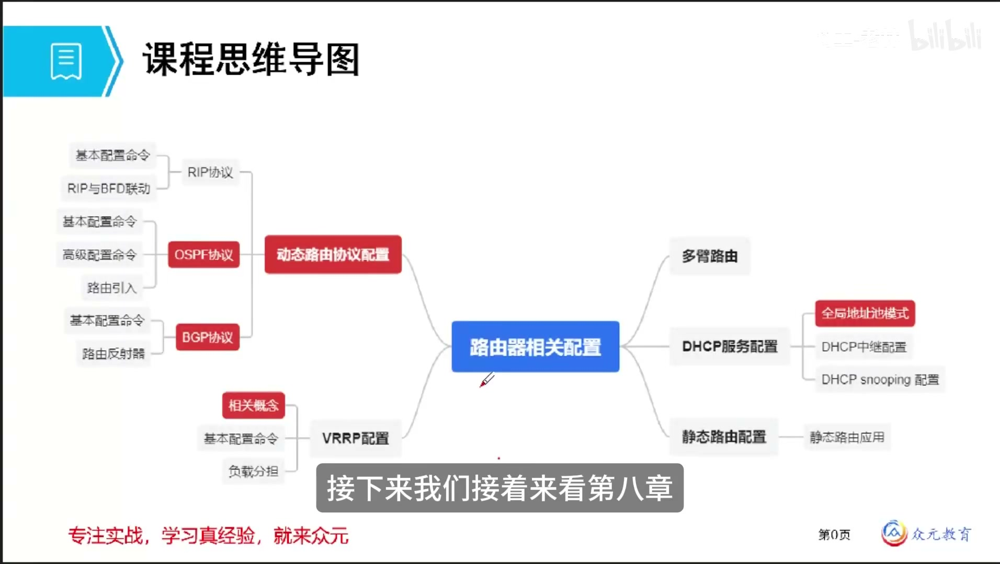

图注：本章思维导图。中心为“路由器相关配置”，右侧为多臂路由、DHCP服务配置（全局地址池、DHCP中继、DHCP Snooping）、静态路由配置（静态路由应用）；左侧为动态路由协议配置（RIP、OSPF、BGP）与VRRP配置（相关概念、基本配置命令、负载分担）。

### 1.1 路由器的两个核心能力

路由器是提供**异构网络互联**机制、把数据包转发到正确目的地并在转发过程中**选择最佳路径**的设备。其本质可拆成两点：

| 核心能力 | 含义 | 对应配置主线 |
| -------- | ---- | ------------ |
| 异构网络互联 | 连接种类、协议、端口类型不同的网络；路由器接口**种类多、数量少** | 多臂路由、子接口、VLAN 间通信 |
| 寻址转发 | 依据**路由表**选择一条最优路径，逐跳转发 | 直连路由、静态路由、动态路由协议 |

由此引出两条必须掌握的主线：

1. **终端如何入网**：IP 地址、子网掩码、默认网关、DNS 等“上网必备信息”如何分配，不同网段之间如何通信——对应多臂路由与 DHCP。
2. **路由表如何形成**：直连路由由接口状态自动产生；静态路由由管理员手工配置；动态路由由协议自动生成并维护——对应静态路由、RIP、OSPF、BGP。

### 1.2 本章知识结构

| 知识块 | 解决的问题 | 关键技术 | 考试形式 |
| ------ | ---------- | -------- | -------- |
| 多臂路由 | 只有路由器、没有三层交换机时，如何实现不同 VLAN 互通 | 子接口、802.1Q 终结、ARP 广播 | 概念判断、命令补全 |
| DHCP | 终端如何自动获得 IP、网关、DNS、启动文件 | 全局地址池、接口地址池、中继、Option 模板、Snooping | 下午案例填空高频 |
| 静态路由 | 路由表如何手工建立，缺省路由、黑洞路由如何用 | `ip route-static`、preference | 命令判读、路由表分析 |
| 动态路由 | 路由表如何自动建立与维护 | RIP、OSPF、BGP、BFD 联动 | 选择题与案例题并重 |
| VRRP | 网关设备单点故障如何消除 | 虚拟 IP、虚拟 MAC、优先级、抢占、track | 概念、命令判读、故障分析 |

补充趋势：动态路由协议的考查比重逐年上升，尤其是 **OSPF 与 BGP 配合**——早期只关注企业内部网络，现在常把内部网络与运营商网络一起考查。同时要注意 IPv4 与 IPv6 版本的对应关系：OSPF 的 IPv6 版本为 **OSPFv3**，BGP 的 IPv6 版本为 **BGP4+**。

---

## 2.多臂路由与单臂路由

### 2.1 多臂路由的概念

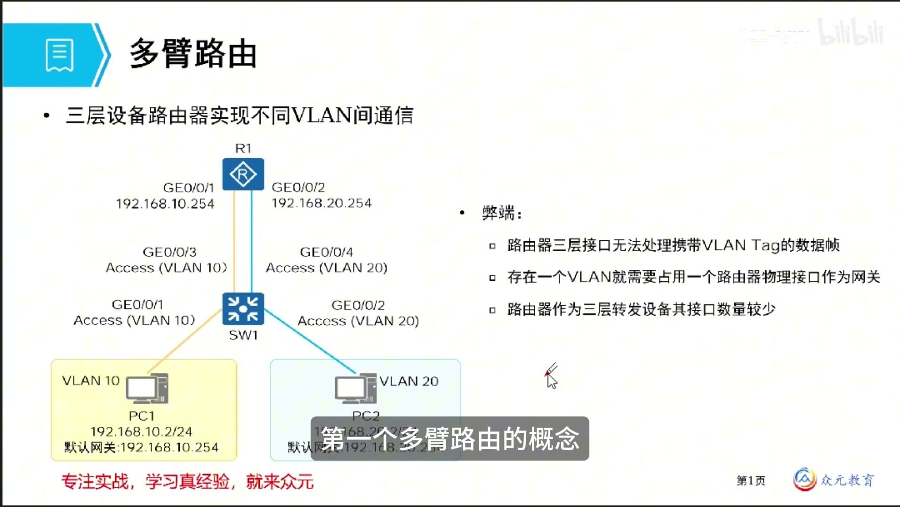

图注：多臂路由拓扑。R1 用两个物理接口 GE0/0/1、GE0/0/2 分别连接 SW1 的 GE0/0/3（Access VLAN10）与 GE0/0/4（Access VLAN20），接口地址分别为 192.168.10.254/24 与 192.168.20.254/24；PC1、PC2 的网关分别指向这两个地址。

二层交换机**分割冲突域，但不分割广播域**：同一交换机上的所有端口默认处于同一广播域，主机之间通过 MAC 地址完成单播、广播与泛洪。

要实现广播域隔离，早期做法是用路由器的不同物理接口分别连接不同网段：

- 每个 VLAN 对应一个**广播域**，也对应一个 **IP 网段**；
- 不同网段之间必须经过**三层 IP 寻址转发**，不能只靠 MAC 地址；
- 二层交换机的端口不能配置 IP 地址来完成跨网段转发，因此需要具备路由功能的设备。

所谓**多臂路由**，就是三层设备（路由器）用**多个物理接口**分别作为不同 VLAN 的网关，实现 VLAN 间通信。拓扑中各角色的地址规划如下：

| 设备/接口 | 所属 VLAN | 地址 | 说明 |
| --------- | --------- | ---- | ---- |
| R1 GE0/0/1 | VLAN10 | 192.168.10.254/24 | VLAN10 网关 |
| R1 GE0/0/2 | VLAN20 | 192.168.20.254/24 | VLAN20 网关 |
| SW1 GE0/0/3 | VLAN10（Access） | — | 连接 R1 |
| SW1 GE0/0/4 | VLAN20（Access） | — | 连接 R1 |
| PC1 | VLAN10 | 192.168.10.2/24，网关 192.168.10.254 | 终端 |
| PC2 | VLAN20 | 192.168.20.2/24，网关 192.168.20.254 | 终端 |

要点：**网关地址必须与主机地址处于同一网段**，否则主机无法与网关通信，表现为 ping 不通。

### 2.2 多臂路由的三个弊端

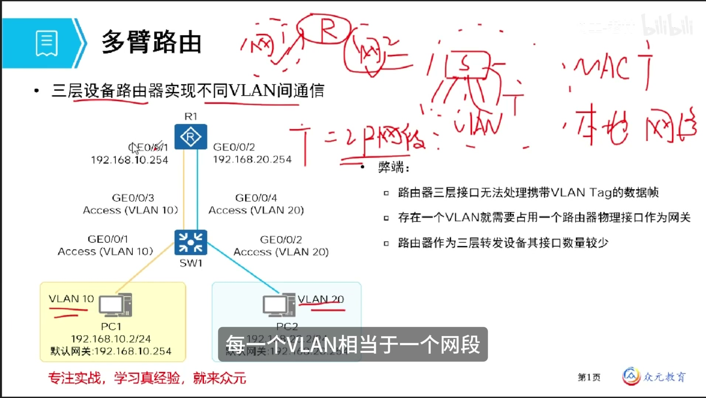

图注：多臂路由弊端：路由器三层接口无法处理携带 VLAN Tag 的数据帧；每存在一个 VLAN 就要占用一个路由器物理接口作为网关；路由器作为三层转发设备接口数量较少。

| 弊端 | 原因 | 后果 |
| ---- | ---- | ---- |
| 三层接口无法处理携带 VLAN Tag 的帧 | Tag 的封装与剥离由交换机端口完成，路由器以太网接口默认不认识 802.1Q Tag | 路由器无法直接接在 Trunk 链路上为多个 VLAN 作网关 |
| 一个 VLAN 占用一个物理接口 | 每个 VLAN 都要一个接口地址作为网关 | VLAN 数量稍多即无法支撑 |
| 路由器接口数量少 | 路由器以接口种类丰富为目标，单机接口密度远低于交换机 | 成本高、扩展性差，不适合作为接入网关 |

因此多臂路由只是原理性方案，实际部署需要“**一个物理接口承载多个 VLAN 网关**”的方案——子接口。

### 2.3 子接口与单臂路由

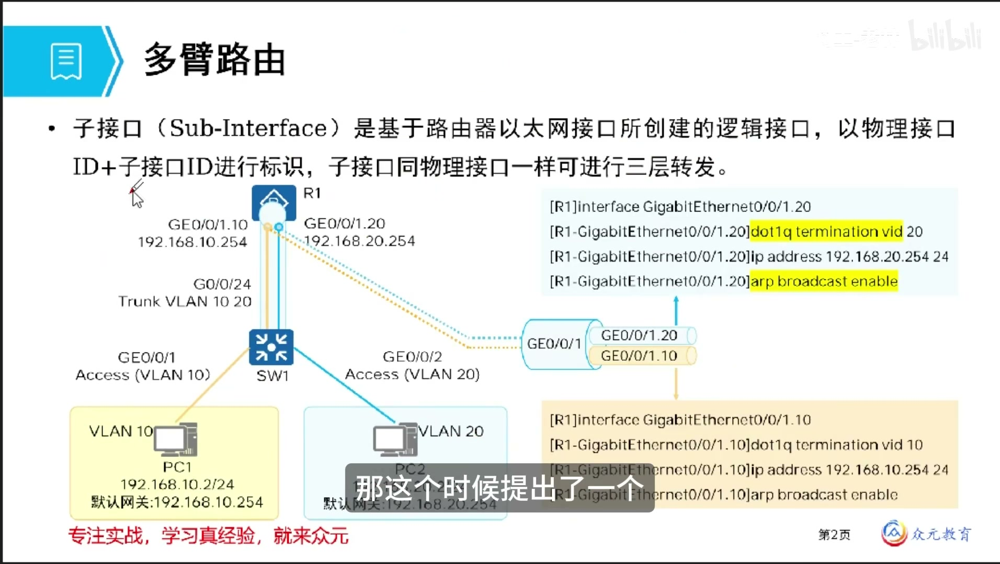

图注：单臂路由组网。R1 的物理接口 GE0/0/1 通过 Trunk（允许 VLAN10、VLAN20）连接 SW1 的 GE0/0/24；在 GE0/0/1 上创建子接口 .10 与 .20，分别终结 VLAN10、VLAN20 的 Tag，并配置两个网段的网关地址。

**子接口（Sub-Interface）**：基于路由器以太网接口创建的逻辑接口，以“物理接口 ID + 子接口 ID”标识，子接口与物理接口一样可以进行三层转发。

- 子接口编号由管理员自行指定，不要求与 VLAN ID 相同，但工程上通常写成 `.10`、`.20` 以便对应；
- 一个物理接口可创建多个子接口，从而用一个物理接口承载多个 VLAN 的网关，故称“**单臂路由**”（router-on-a-stick）；
- 该方案是多臂路由的优化与过渡方案，在三层交换机普及前广泛使用。

配置示例（以 VLAN20 子接口为例，VLAN10 同理）：

```
[R1] interface GigabitEthernet0/0/1.20
[R1-GigabitEthernet0/0/1.20] dot1q termination vid 20
[R1-GigabitEthernet0/0/1.20] ip address 192.168.20.254 24
[R1-GigabitEthernet0/0/1.20] arp broadcast enable
```

```
[R1] interface GigabitEthernet0/0/1.10
[R1-GigabitEthernet0/0/1.10] dot1q termination vid 10
[R1-GigabitEthernet0/0/1.10] ip address 192.168.10.254 24
[R1-GigabitEthernet0/0/1.10] arp broadcast enable
```

交换机侧必须把连接路由器的端口配置为 Trunk，并放行对应 VLAN：

```
[SW1] interface GigabitEthernet0/0/24
[SW1-GigabitEthernet0/0/24] port link-type trunk
[SW1-GigabitEthernet0/0/24] port trunk allow-pass vlan 10 20
```

命令作用：

| 命令 | 视图 | 作用 |
| ---- | ---- | ---- |
| `interface GigabitEthernet0/0/1.20` | 系统视图 | 创建并进入子接口视图，`.20` 为子接口编号 |
| `dot1q termination vid 20` | 子接口视图 | 终结 802.1Q Tag，指定该子接口处理的 VLAN ID 为 20；收到带 Tag20 的帧时剥掉 Tag 交给三层处理，发送时重新封装 Tag20 |
| `ip address 192.168.20.254 24` | 子接口视图 | 配置子接口 IP 地址，作为该 VLAN 的网关 |
| `arp broadcast enable` | 子接口视图 | 使能子接口的 ARP 广播功能；子接口默认不处理广播报文，不开启则无法发送/接收 ARP 广播，网关与主机无法解析 MAC |

转发过程：

1. PC1 发送数据帧，目的 MAC 为网关，帧不打 Tag（Access 口）；
2. SW1 从 Trunk 口转发时打上 VLAN10 的 Tag；
3. R1 的 GE0/0/1.10 子接口识别并剥离 Tag10，交给三层查路由；
4. 路由指向 192.168.20.0/24，出接口为 GE0/0/1.20；
5. 子接口重新封装 VLAN20 的 Tag，经 Trunk 送到 SW1，再由 Access 口去掉 Tag 送给 PC2。

关键点：

- 子接口编号与 `vid` **不要求一致**，但 `vid` 必须与交换机侧该 VLAN 的 ID 一致；
- `arp broadcast enable` 是单臂路由的**必配项**，也是考试常挖的空；
- 一个子接口对应一个 VLAN，子接口 IP 即该 VLAN 的网关；
- 交换机连接路由器的端口用 **Trunk**（设备与设备之间），连接终端的端口用 **Access**；Hybrid 也可实现，但需要正确配置 Tag 的放行方式。

### 2.4 单臂路由与三层交换的对比

| 对比项 | 单臂路由 | 三层交换机（VLANIF） |
| ------ | -------- | -------------------- |
| 网关实现 | 路由器子接口 | 交换机上的 VLANIF 逻辑接口 |
| 转发方式 | 一个物理接口“进出同一根线”，流量都压在一条链路上 | 硬件线速转发，VLAN 间流量在设备内部完成 |
| 带宽 | 受单条上行链路限制，易成瓶颈 | 背板带宽高，不受单链路限制 |
| 接口成本 | 节省路由器物理接口 | 无需额外路由器接口 |
| 适用场景 | 小型网络、临时过渡、只有路由器没有三层交换机 | 园区网汇聚/核心，主流方案 |

结论：单臂路由解决了“接口数量不足”的问题，但没有解决“单链路带宽瓶颈”；三层交换用 VLANIF 作为网关，是更优方案。

---

## 3.DHCP 服务配置

### 3.1 DHCP 的作用与两种部署模式

DHCP（Dynamic Host Configuration Protocol，动态主机配置协议）用于**动态下发主机上网所必需的参数**：

| 参数 | 说明 |
| ---- | ---- |
| IP 地址、子网掩码 | 主机身份与网段归属 |
| 默认网关 | 跨网段通信的出口 |
| DNS 服务器地址 | 域名解析 |
| DNS 域名后缀（domain-name） | 配合 DNS 做域名补全 |
| 租期（lease） | 地址可用时长，到期需续租 |
| 启动文件名、文件服务器地址 | 供 IP 电话、无盘工作站等特定终端使用 |

按“DHCP 服务器与客户端是否在同一网段”，分为两种部署模式：

| 模式 | 服务器与客户端位置 | 关键配置 | 适用场景 |
| ---- | ------------------ | -------- | -------- |
| 全局地址池模式 | 可跨网段，需 DHCP 中继配合 | `ip pool` + `dhcp select global`（或 relay） | 大型网络、集中部署 DHCP 服务器 |
| 接口地址池模式 | 同一网段，服务器就是网关设备 | `dhcp select interface` + `dhcp server ...` | 小型网络、分支站点 |

DHCP 交互报文（UDP 67/68）：

| 报文 | 方向 | 作用 |
| ---- | ---- | ---- |
| DHCP Discover | 客户端 → 服务器（广播） | 寻找可用的 DHCP 服务器 |
| DHCP Offer | 服务器 → 客户端 | 提供可用地址及参数 |
| DHCP Request | 客户端 → 服务器（广播） | 正式请求使用该地址 |
| DHCP ACK | 服务器 → 客户端 | 确认分配，客户端开始使用 |
| DHCP NAK | 服务器 → 客户端 | 拒绝请求，客户端重新申请 |
| DHCP Release | 客户端 → 服务器 | 主动释放地址 |

### 3.2 全局地址池模式

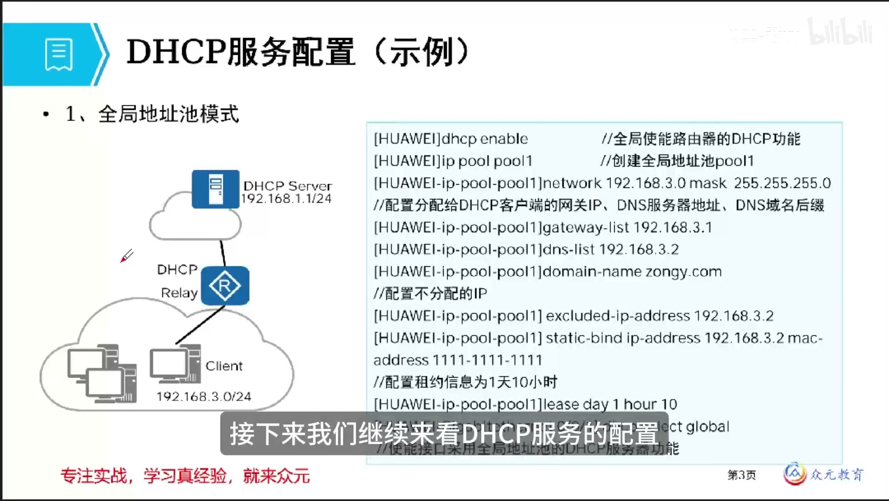

图注：全局地址池配置示例。DHCP 服务器 192.168.1.1/24 跨网段为 192.168.3.0/24 的客户端分配地址，中间由 DHCP Relay 转发；右侧为 `dhcp enable`、`ip pool pool1` 等完整命令。

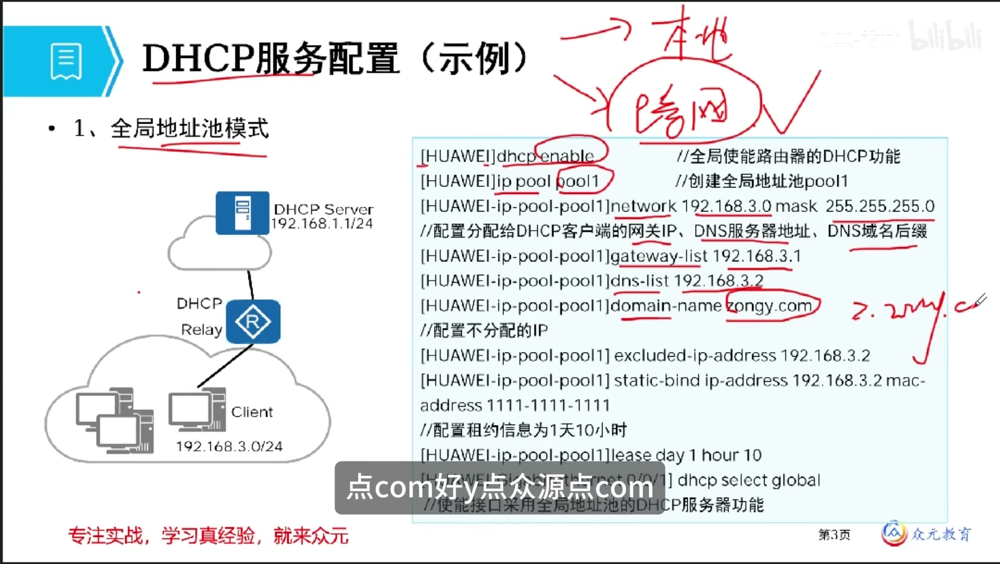

图注：同一配置的重点标注：`dhcp enable` 全局使能、`ip pool` 创建地址池、`network` 指定地址块、`gateway-list`/`dns-list`/`domain-name` 下发参数、`excluded-ip-address` 与 `static-bind` 限制地址、`lease` 设置租期。

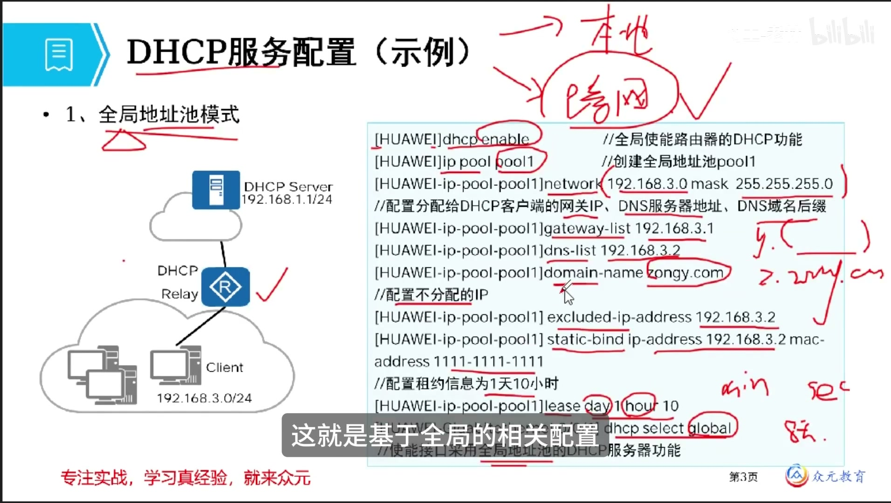

图注：全局地址池配置的再次标注：网关、DNS、域名后缀、排除地址、静态绑定、租期与 `dhcp select global` 的对应关系；图中同时标出“本地/跨网”两种使用场景。

```
[HUAWEI] dhcp enable
[HUAWEI] ip pool pool1
[HUAWEI-ip-pool-pool1] network 192.168.3.0 mask 255.255.255.0
[HUAWEI-ip-pool-pool1] gateway-list 192.168.3.1
[HUAWEI-ip-pool-pool1] dns-list 192.168.3.2
[HUAWEI-ip-pool-pool1] domain-name zongy.com
[HUAWEI-ip-pool-pool1] excluded-ip-address 192.168.3.2
[HUAWEI-ip-pool-pool1] static-bind ip-address 192.168.3.2 mac-address 1111-1111-1111
[HUAWEI-ip-pool-pool1] lease day 1 hour 10
[HUAWEI-ip-pool-pool1] quit
[HUAWEI] interface GigabitEthernet0/0/1
[HUAWEI-GigabitEthernet0/0/1] dhcp select global
```

命令说明：

| 命令 | 视图 | 作用 |
| ---- | ---- | ---- |
| `dhcp enable` | 系统视图 | 全局使能 DHCP 功能，所有 DHCP 相关配置的前提 |
| `ip pool pool1` | 系统视图 | 创建全局地址池并进入地址池视图，名称可自定义 |
| `network 192.168.3.0 mask 255.255.255.0` | 地址池视图 | 指定可分配的地址块（网段 + 掩码） |
| `gateway-list 192.168.3.1` | 地址池视图 | 下发默认网关地址 |
| `dns-list 192.168.3.2` | 地址池视图 | 下发 DNS 服务器地址，可配置多个 |
| `domain-name zongy.com` | 地址池视图 | 下发 DNS 域名后缀 |
| `excluded-ip-address ...` | 地址池视图 | 指定不参与动态分配的地址，可写单个地址或地址范围 |
| `static-bind ip-address ... mac-address ...` | 地址池视图 | 静态绑定：固定 IP 与 MAC 的对应关系，供服务器、IP 电话等使用 |
| `lease day 1 hour 10` | 地址池视图 | 配置租期，单位可用 day/hour/minute；`lease unlimited` 表示永不过期 |
| `dhcp select global` | **接口视图** | 指定该接口下的客户端使用全局地址池获取地址 |

要点：

- **全局地址池不绑定接口**，地址池与接口通过 `dhcp select global` 关联；一个地址池可服务多个接口；
- `excluded-ip-address` 只影响动态分配，被排除的地址仍可通过 `static-bind` 固定分配；
- 租期缺省为 **1 天**（华为 VRP 地址池缺省租期），可按 `day/hour/minute` 组合修改；`unlimited` 表示无限期；
- 全局地址池要跨网段使用，必须部署 DHCP 中继，否则路由器收不到客户端的广播 Discover 报文。

### 3.3 DHCP 中继

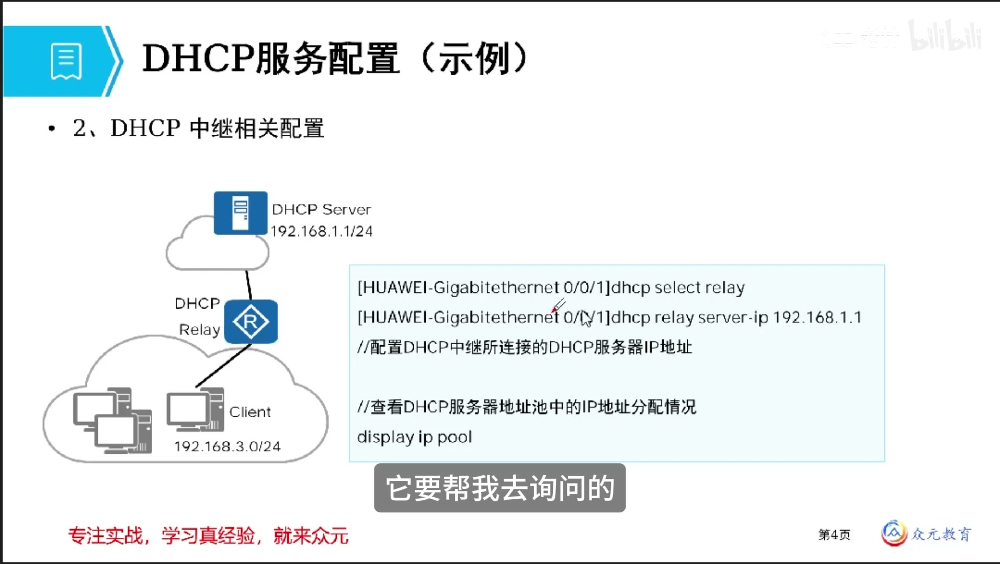

图注：DHCP 中继配置：在连接客户端的接口上执行 `dhcp select relay`，并用 `dhcp relay server-ip` 指定 DHCP 服务器地址；最后用 `display ip pool` 查看地址分配情况。

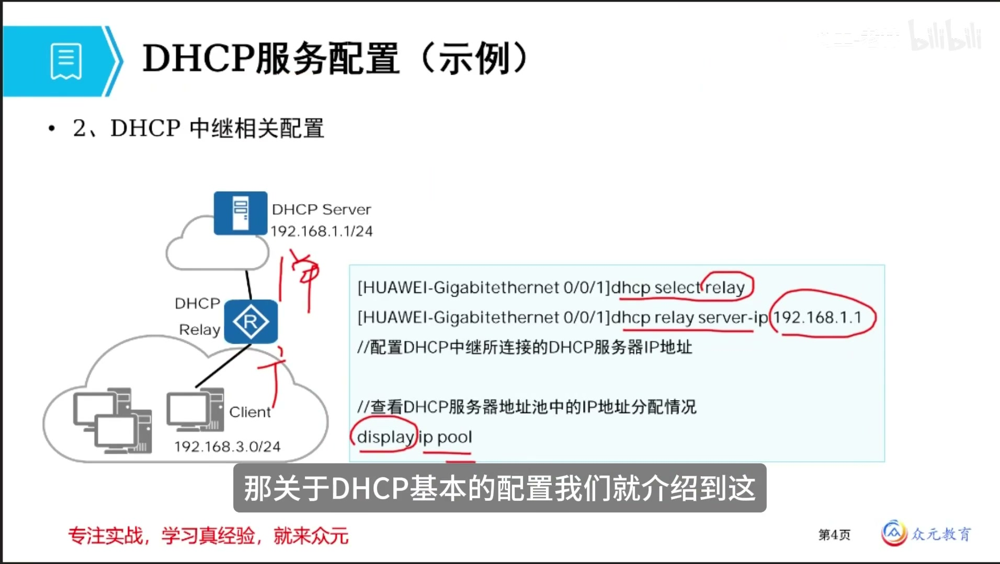

图注：中继配置的逐条标注：`relay` 为接口的地址分配方式，`server-ip` 指向 DHCP 服务器；图中以 1、2、3 标出“服务器—中继—客户端”的报文路径。

```
[HUAWEI] interface GigabitEthernet0/0/1
[HUAWEI-GigabitEthernet0/0/1] dhcp select relay
[HUAWEI-GigabitEthernet0/0/1] dhcp relay server-ip 192.168.1.1
[HUAWEI] display ip pool
```

| 命令 | 作用 |
| ---- | ---- |
| `dhcp select relay` | 指定接口工作在 DHCP 中继模式 |
| `dhcp relay server-ip 192.168.1.1` | 指定中继所连接的 DHCP 服务器地址；可配置多个服务器 |
| `display ip pool` | 查看地址池的地址分配情况（总数、已用、空闲、冲突等） |

中继的工作过程：

1. 客户端在本网段广播 DHCP Discover；
2. 中继设备（网关）收到广播后，把报文的源地址改为自己的接口地址，**单播**转发给 DHCP 服务器；
3. 服务器根据 `giaddr` 字段选择对应网段的地址池，回应 Offer；
4. 中继把 Offer 转发回客户端，后续 Request/ACK 同理。

要点：

- 中继接口必须有 IP 地址，且到 DHCP 服务器**路由可达**；
- 客户端侧是广播，中继到服务器侧是单播，这是中继的核心动作；
- 全局地址池 + 中继是“服务器集中部署、多网段统一分配”的标准组合；
- 若 DHCP 服务器与客户端同网段，则不需要中继，直接使用全局地址池或接口地址池即可。

### 3.4 接口地址池模式

接口地址池把地址池“挂在接口上”，服务器通常就是该网段的网关设备，适用于小型网络。课件仅作口头说明，以下按华为 VRP 命令补齐：

```
[HUAWEI] dhcp enable
[HUAWEI] interface GigabitEthernet0/0/1
[HUAWEI-GigabitEthernet0/0/1] ip address 192.168.1.1 24
[HUAWEI-GigabitEthernet0/0/1] dhcp select interface
[HUAWEI-GigabitEthernet0/0/1] dhcp server gateway-list 192.168.1.1
[HUAWEI-GigabitEthernet0/0/1] dhcp server dns-list 192.168.1.2
[HUAWEI-GigabitEthernet0/0/1] dhcp server domain-name zongy.com
[HUAWEI-GigabitEthernet0/0/1] dhcp server excluded-ip-address 192.168.1.2
[HUAWEI-GigabitEthernet0/0/1] dhcp server static-bind ip-address 192.168.1.10 mac-address 1111-1111-1111
[HUAWEI-GigabitEthernet0/0/1] dhcp server lease day 1
```

接口地址池命令与全局地址池命令的对应关系：

| 功能 | 全局地址池 | 接口地址池 |
| ---- | ---------- | ---------- |
| 选择模式 | `dhcp select global` | `dhcp select interface` |
| 地址块 | `network ... mask ...` | 由接口 IP 与掩码自动确定 |
| 网关 | `gateway-list` | `dhcp server gateway-list` |
| DNS | `dns-list` | `dhcp server dns-list` |
| 域名后缀 | `domain-name` | `dhcp server domain-name` |
| 排除地址 | `excluded-ip-address` | `dhcp server excluded-ip-address` |
| 静态绑定 | `static-bind` | `dhcp server static-bind` |
| 租期 | `lease` | `dhcp server lease` |

两种模式的对比：

| 对比项 | 全局地址池 | 接口地址池 |
| ------ | ---------- | ---------- |
| 地址块来源 | 手工 `network` 指定 | 接口地址与掩码自动推导 |
| 是否跨网段 | 可跨网段（配合中继） | 仅本网段 |
| 命令前缀 | 地址池视图下直接配置 | 接口视图下带 `dhcp server` 前缀 |
| 适用规模 | 中大型网络、集中管理 | 小型网络、单网关场景 |
| 考试判读 | 看 `ip pool`、`dhcp select global` | 看 `dhcp select interface`、`dhcp server ...` |

判读技巧：题目问“应用的是全局还是接口”，**只看关键单词**——出现 `ip pool`、`global` 即全局；出现 `dhcp select interface`、`dhcp server` 即接口。

### 3.5 DHCP Option 模板

Option 模板用于给**特定类型的终端**下发统一参数，典型场景是 IP 电话：除 IP、网关、DNS 外，还需要知道启动配置文件名和文件服务器地址。

```
[HUAWEI] dhcp option template template1
[HUAWEI-dhcp-option-template-template1] gateway-list 192.168.3.1
[HUAWEI-dhcp-option-template-template1] bootfile configuration.ini
[HUAWEI-dhcp-option-template-template1] next-server 10.10.10.1
[HUAWEI-dhcp-option-template-template1] quit
```

在地址池中引用模板：

```
[HUAWEI] ip pool pool3
[HUAWEI-ip-pool-pool3] option-template template1
```

| 命令 | 作用 |
| ---- | ---- |
| `dhcp option template template1` | 创建 DHCP Option 模板并进入模板视图 |
| `gateway-list` | 模板内下发的网关地址 |
| `bootfile configuration.ini` | 下发的启动配置文件名 |
| `next-server 10.10.10.1` | 获取启动配置文件的服务器地址（TFTP/FTP） |
| `option-template template1` | 在地址池视图下引用模板，使该地址池的客户端获得模板参数 |

### 3.6 DHCP Snooping

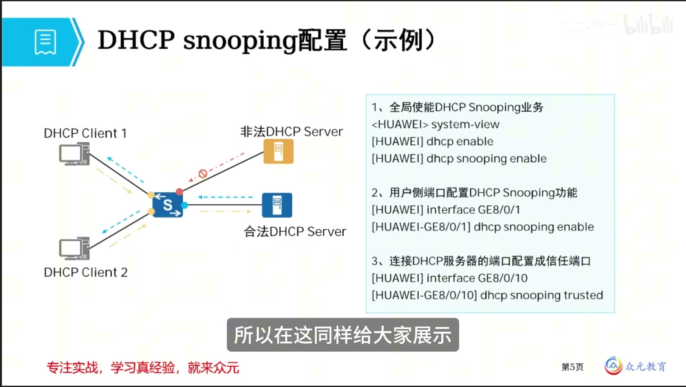

图注：DHCP Snooping 组网：交换机连接合法 DHCP 服务器与两台客户端，非法 DHCP 服务器所在链路被阻断；右侧为全局使能、用户侧端口使能、服务器侧端口设为信任端口三步命令。

作用：DHCP Snooping 是 DHCP 的**二层安全特性**。交换机监听 DHCP 报文并建立“IP—MAC—接口—VLAN”绑定表，只允许**信任端口**转发 DHCP 服务器报文，从而防止私设 DHCP 服务器、地址欺骗与中间人攻击。

```
<HUAWEI> system-view
[HUAWEI] dhcp enable
[HUAWEI] dhcp snooping enable
[HUAWEI] interface GigabitEthernet0/0/1
[HUAWEI-GigabitEthernet0/0/1] dhcp snooping enable
[HUAWEI] interface GigabitEthernet0/0/10
[HUAWEI-GigabitEthernet0/0/10] dhcp snooping trusted
```

| 步骤 | 命令 | 说明 |
| ---- | ---- | ---- |
| 全局使能 | `dhcp enable`、`dhcp snooping enable` | 先使能 DHCP，再使能 Snooping |
| 用户侧端口 | `dhcp snooping enable` | 接入终端的端口使能 Snooping，默认不信任 |
| 服务器侧端口 | `dhcp snooping trusted` | 连接合法 DHCP 服务器的端口设为信任端口 |

要点：

- 信任端口与非信任端口的区别在于**是否允许 DHCP 服务器方向的报文**通过；
- 非信任端口收到 DHCP Offer/ACK 等服务器报文时丢弃，从而屏蔽非法服务器；
- 绑定表可被 **IP Source Guard** 引用，用于校验报文的源 IP、源 MAC 与接口是否匹配；
- 考试只需记住三个关键词：`dhcp snooping enable`、接口使能、`dhcp snooping trusted`。

---

## 4.静态路由配置

### 4.1 静态路由的应用位置

静态路由是由管理员**手工指定**的路由，相当于在路口手工立指示牌：去往某个目的网段，下一跳交给谁。它配置简单、不占用链路带宽，适合拓扑稳定、出口单一的场景。

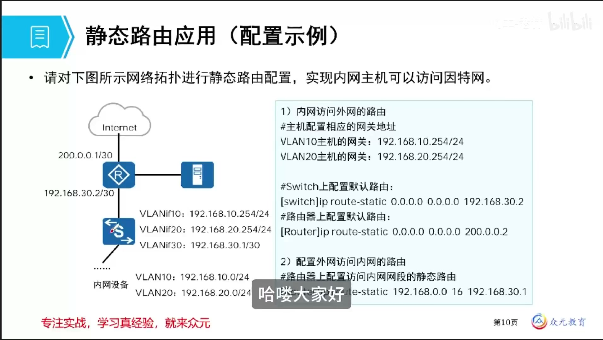

图注：静态路由配置示例。Internet 经 200.0.0.1/30 连接路由器 R，R 经 192.168.30.2/30 连接三层交换机 S；S 的 VLANIF10 为 192.168.10.254/24、VLANIF20 为 192.168.20.254/24、VLANIF30 为 192.168.30.1/30，下挂 VLAN10、VLAN20 的内网设备。

拓扑地址规划：

| 设备/接口 | 地址 | 说明 |
| --------- | ---- | ---- |
| Internet 侧链路 | 200.0.0.1/30 | 路由器上行接口地址，对端 ISP 为 200.0.0.2 |
| R 下行接口 | 192.168.30.2/30 | 连接交换机 |
| S VLANIF30 | 192.168.30.1/30 | 连接路由器 |
| S VLANIF10 | 192.168.10.254/24 | VLAN10 网关 |
| S VLANIF20 | 192.168.20.254/24 | VLAN20 网关 |
| VLAN10 网段 | 192.168.10.0/24 | 内网主机 |
| VLAN20 网段 | 192.168.20.0/24 | 内网主机 |

静态路由常见的四类应用位置：

| 位置 | 作用 | 典型配置 |
| ---- | ---- | -------- |
| 内网主机 | 指定默认网关，凡是不在本网段的目的地都交给网关 | 主机手工设置或 DHCP 下发 |
| 三层交换机 | 配置默认路由，把所有未知流量推向出口路由器 | `ip route-static 0.0.0.0 0.0.0.0 192.168.30.2` |
| 出口路由器 | 配置默认路由指向 Internet，简化路由表 | `ip route-static 0.0.0.0 0.0.0.0 200.0.0.2` |
| 出口路由器（回程） | 配置指向内网网段的静态路由或汇聚路由，保证“有来有回” | `ip route-static 192.168.0.0 255.255.0.0 192.168.30.1` |

### 4.2 配置示例

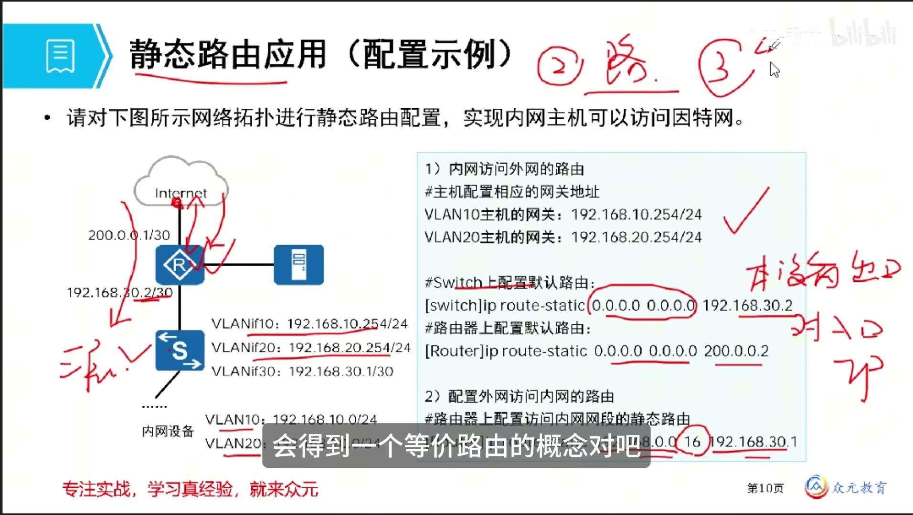

图注：内网访问外网的路由配置：主机网关指向 VLANIF 地址；三层交换机配置默认路由指向路由器；路由器配置默认路由指向 Internet。右侧为“下一跳”与“出接口”的标注。

```
# 主机配置相应的网关地址
# VLAN10 主机的网关：192.168.10.254/24
# VLAN20 主机的网关：192.168.20.254/24

# Switch 上配置默认路由
[Switch] ip route-static 0.0.0.0 0.0.0.0 192.168.30.2

# 路由器上配置默认路由
[Router] ip route-static 0.0.0.0 0.0.0.0 200.0.0.2
```

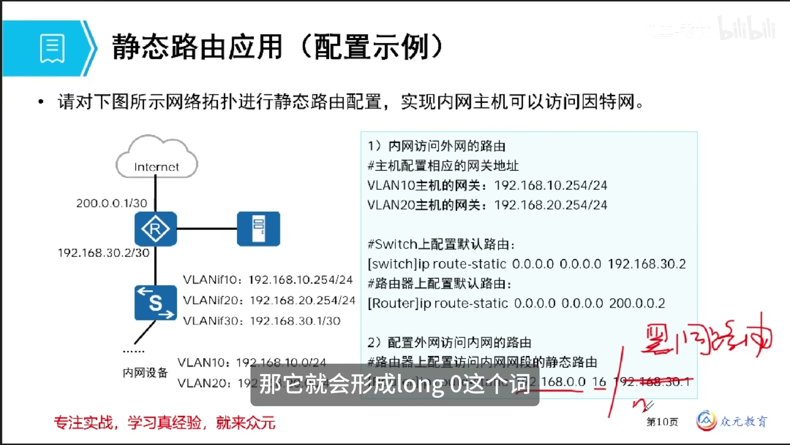

图注：外网访问内网的路由配置：在路由器上配置指向内网网段的静态路由，目的地址 192.168.0.0/16，下一跳为交换机 VLANIF30 的地址 192.168.30.1。

```
# 路由器上配置访问内网网段的静态路由（路由汇聚）
[Router] ip route-static 192.168.0.0 255.255.0.0 192.168.30.1
```

要点：

- **有来有回**：只配置去程路由，回程没有路由，通信仍然失败；
- 内网有多个连续网段时，用一条汇聚路由（如 192.168.0.0/16）替代逐条配置，简化路由表；
- 默认路由的本质是“目的地址 0.0.0.0、掩码 0.0.0.0”，匹配所有目的地，优先级最低（最长匹配中最短）；
- 下一跳与出接口的区别：

| 写法 | 含义 | 适用场景 |
| ---- | ---- | -------- |
| `ip route-static 目的网段 掩码 下一跳IP` | 下一跳是**对端**接口的 IP 地址 | 以太网等多路访问网络，推荐写法 |
| `ip route-static 目的网段 掩码 出接口` | 出接口是**本设备**的接口 | 点到点链路（如 PPP/串口） |
| `ip route-static 目的网段 掩码 出接口 下一跳IP` | 同时指定出接口与下一跳 | 需要明确出接口的以太网场景 |

记忆：**下一跳是对端的入口，出接口是本机的出口**。

### 4.3 路由表字段与选路原则

路由表是转发的依据，必须会读以下字段：

| 字段 | 含义 | 判读要点 |
| ---- | ---- | -------- |
| Destination/Mask | 目的网段与掩码 | 最长匹配优先 |
| Proto（Protocol） | 路由来源 | Direct、Static、RIP、OSPF、IS-IS、BGP |
| Pre（Preference） | 路由优先级 | 数值越小越优先 |
| Cost（Metric） | 开销/度量值 | 同协议内比较，越小越优 |
| Flags | 路由状态标志 | R（relay）、D（download to FIB）等 |
| NextHop | 下一跳地址 | 报文交给谁 |
| Interface | 出接口 | 从本机哪个接口发出 |

选路顺序（必须按顺序比较）：

1. **最长匹配**：掩码最长、最具体的那条路由优先；
2. **优先级（Preference）**：最长匹配相同的情况下，优先级数值小者优先；
3. **开销（Cost）**：优先级相同的情况下，开销小者优先；
4. **等价路由**：三者都相同，则形成等价路由（ECMP），进行负载分担。

华为 VRP 缺省优先级：

| 路由类型 | 缺省优先级 | 备注 |
| -------- | ---------- | ---- |
| 直连路由 Direct | 0 | 接口 Up 且配置 IP 后自动产生 |
| 组播静态路由 | 1 | — |
| OSPF 内部路由 | 10 | 域内路由 |
| IS-IS 路由 | 15 | — |
| 单播静态路由 | 60 | 可用 `preference` 修改 |
| RIP | 100 | — |
| OSPF ASE / NSSA | 150 | 引入的外部路由（5 类/7 类 LSA） |
| BGP | 255 | 来自不可信源端的路由 |

由优先级可直接得出：**OSPF 域内路由优先于静态路由，静态路由优先于 RIP**。这也是路由引入时产生次优路径与环路的原因之一。

两类特殊路由：

| 类型 | 含义 | 作用 |
| ---- | ---- | ---- |
| 等价路由 | 目的网段、优先级、开销都相同的多条路由 | 同时写入转发表，按流或按包分担流量，提高带宽利用率 |
| 浮动路由 | 为主路由配置一条优先级更低（数值更大）的备份静态路由 | 主路由失效时备份路由浮现，实现备份；主路由正常时备份不生效 |

### 4.4 默认路由与黑洞路由

**默认路由**：目的地址 0.0.0.0、掩码 0.0.0.0 的路由，匹配任意目的地，用于“出口唯一”的场景。

```
[Router] ip route-static 0.0.0.0 0.0.0.0 200.0.0.2
```

**黑洞路由**：把目的网段指向 **NULL0** 接口，报文到达后被直接丢弃，不再继续转发。

```
[Router] ip route-static 192.168.16.0 255.255.255.0 NULL0
```

作用：

| 作用 | 说明 |
| ---- | ---- |
| 避免无效转发 | 目的网段不存在时，报文不再在网络中反复查找、占用带宽与设备资源 |
| 流量过滤 | 不希望某网段被访问时，用黑洞路由把流量引向 NULL0，实现简单的访问控制 |
| 配合汇聚 | 汇总路由覆盖了不存在的子网时，用更具体的黑洞路由防止流量打转 |

细分示例：

```
# 只把 192.168.20.0/24 丢弃
[Router] ip route-static 192.168.20.0 255.255.255.0 NULL0

# 192.168.10.0/24 仍然正常转发，下一跳 30.0.0.1
[Router] ip route-static 192.168.10.0 255.255.255.0 30.0.0.1
```

要点：黑洞路由的掩码通常比汇总路由更具体，依靠**最长匹配**生效；若黑洞路由的掩码更短，则会被正常路由覆盖，起不到丢弃作用。

### 4.5 命令格式与验证

```
ip route-static 目的网络地址 { 掩码 | 掩码长度 } { 下一跳地址 | 出接口 [ 下一跳地址 ] } [ preference preference ]
```

| 参数 | 说明 |
| ---- | ---- |
| 目的网络地址 + 掩码 | 必须写全，掩码可写点分十进制或长度 |
| 下一跳地址 | 对端接口 IP，推荐用于以太网 |
| 出接口 | 本机接口，点到点链路可用 |
| `preference preference` | 修改静态路由优先级，缺省 60；数值越大优先级越低 |

验证命令：

```
[Router] display ip routing-table
[Router] display ip routing-table protocol static
```

配置思路：先保证直连网段可达，再配置去程与回程路由，最后用 `ping`/`tracert` 与路由表确认下一跳与出接口是否符合规划。

---

## 5.动态路由协议配置

### 5.1 动态路由协议的分类与优先级

动态路由协议让路由器之间自动交换路由信息、生成并维护路由表，把管理员从逐条手工配置中解放出来，管理员只做策略干预。

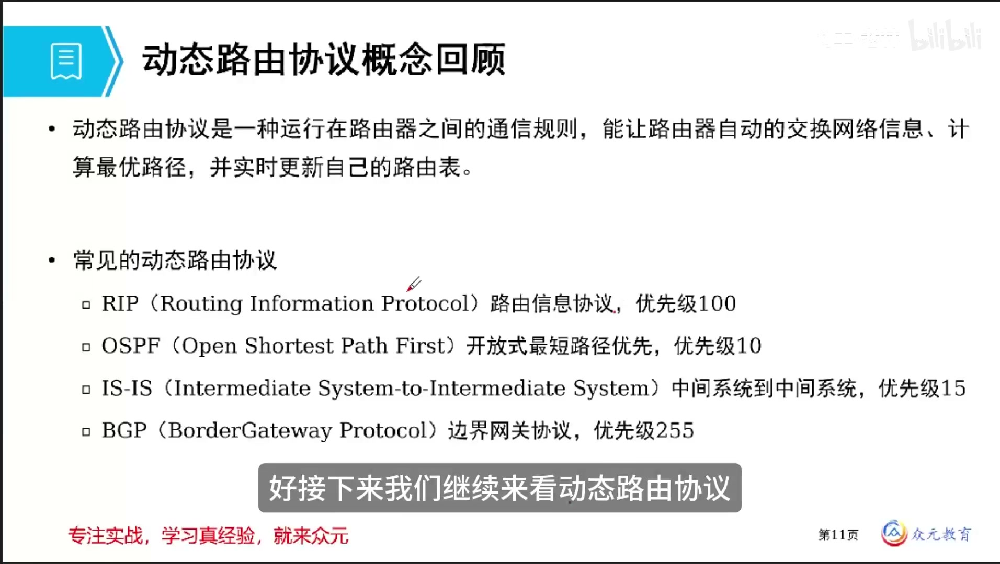

图注：动态路由协议的两类划分：按自治系统边界分为 IGP（RIP、OSPF、IS-IS）与 EGP（BGP）；按算法分为距离矢量（RIP）、链路状态（OSPF、IS-IS）与路径矢量（BGP）。

| 划分方式 | 类别 | 代表协议 | 特点 |
| -------- | ---- | -------- | ---- |
| 按作用范围 | IGP（内部网关协议） | RIP、OSPF、IS-IS | 同一自治系统内部使用 |
| 按作用范围 | EGP（外部网关协议） | BGP | 不同自治系统之间使用 |
| 按算法 | 距离矢量 | RIP | 依据邻居通告的距离向量，逐跳收敛 |
| 按算法 | 链路状态 | OSPF、IS-IS | 泛洪 LSA、建立链路状态数据库、运行 SPF 算法 |
| 按算法 | 路径矢量 | BGP | 依据 AS 路径选择路由，天然避免域间环路 |

IS-IS 主要应用于运营商网络，考试中只需掌握它与 OSPF 的主要差异：**OSPF 按接口划分区域**，一台路由器的不同接口可以属于不同区域；**IS-IS 按路由器划分区域**，一台路由器整体属于一个区域（Level 1），骨干为 Level 2，二者的层次结构不同。

优先级回顾（数值越小越优先）：

```
直连 0 < OSPF 10 < IS-IS 15 < 静态 60 < RIP 100 < OSPF ASE/NSSA 150 < BGP 255
```

路由表寻址依次比较：**最长匹配 → 优先级 → Cost**。优先级是判断路由来源可信度、分析路由环路的关键指标。

### 5.2 RIP 协议配置

#### 5.2.1 RIP 的特点与版本差异

RIP（Routing Information Protocol）是基于**距离矢量**的内部网关协议，以**跳数**为度量值：

| 特点 | 说明 |
| ---- | ---- |
| 度量值 | 跳数，最大 15 跳，16 跳视为不可达 |
| 更新方式 | 周期性（缺省 30 秒）向邻居发送整张路由表 |
| 传输层 | UDP 520 |
| 收敛速度 | 慢，且存在环路风险（水平分割、毒性逆转、触发更新等机制缓解） |
| 适用规模 | 小型网络；大规模网络不友好 |

RIPv1 与 RIPv2 的差异：

| 对比项 | RIPv1 | RIPv2 |
| ------ | ----- | ----- |
| 地址类别 | 有类路由，不支持子网掩码 | 无类路由，支持 VLSM/CIDR |
| 发送方式 | 广播（255.255.255.255） | 组播（224.0.0.9） |
| 认证 | 不支持 | 支持 MD5 认证与加密 |
| 路由标记 | 不支持 | 支持 Route Tag |
| 下一跳 | 不支持 | 支持 Next Hop 字段 |

#### 5.2.2 基本配置命令

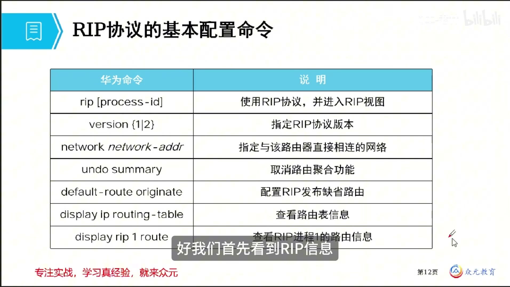

图注：RIP 基本配置命令表：`rip [process-id]`、`version {1|2}`、`network network-addr`、`undo summary`、`default-route originate`、`display ip routing-table`、`display rip 1 route`。

| 命令 | 说明 |
| ---- | ---- |
| `rip [process-id]` | 启动 RIP 并进入 RIP 视图，进程号缺省为 1 |
| `version {1 \| 2}` | 指定 RIP 版本 |
| `network network-addr` | 宣告与本路由器**直连**的网段，注意**不带掩码** |
| `undo summary` | 取消路由自动聚合，改为宣告明细网段 |
| `default-route originate` | 配置 RIP 发布缺省路由 |
| `display ip routing-table` | 查看路由表 |
| `display rip 1 route` | 查看 RIP 进程 1 的路由信息 |

#### 5.2.3 配置示例

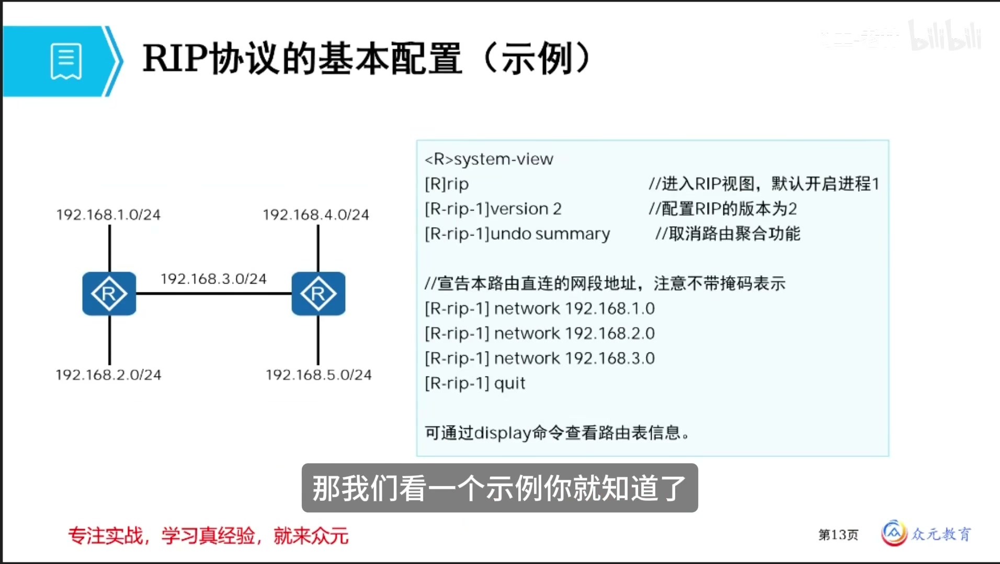

图注：RIP 配置示例。左侧路由器直连 192.168.1.0/24、192.168.2.0/24，与右侧路由器之间为 192.168.3.0/24；右侧路由器直连 192.168.4.0/24、192.168.5.0/24。配置仅需启动进程、指定版本、宣告直连网段。

```
<R> system-view
[R] rip
[R-rip-1] version 2
[R-rip-1] undo summary
[R-rip-1] network 192.168.1.0
[R-rip-1] network 192.168.2.0
[R-rip-1] network 192.168.3.0
[R-rip-1] quit
[R] display ip routing-table
```

要点：

- `network` 只宣告**本机直连**的网段，不要宣告远端网段；远端网段由邻居学习而来；
- `network` 后**不带掩码**；RIPv1 无论是否带掩码都按主类网络处理，RIPv2 才能识别子网；
- 例如宣告 `172.16.24.0`，RIPv1 形成的仍是 `172.16.0.0` 主类网段，这正是 v1 不支持 VLSM 的表现；
- 版本必须两端一致，否则无法建立邻居；
- 配置完成后用 `display ip routing-table` 与 `display rip 1 route` 验证。

### 5.3 RIP 与 BFD 联动

#### 5.3.1 BFD 的作用

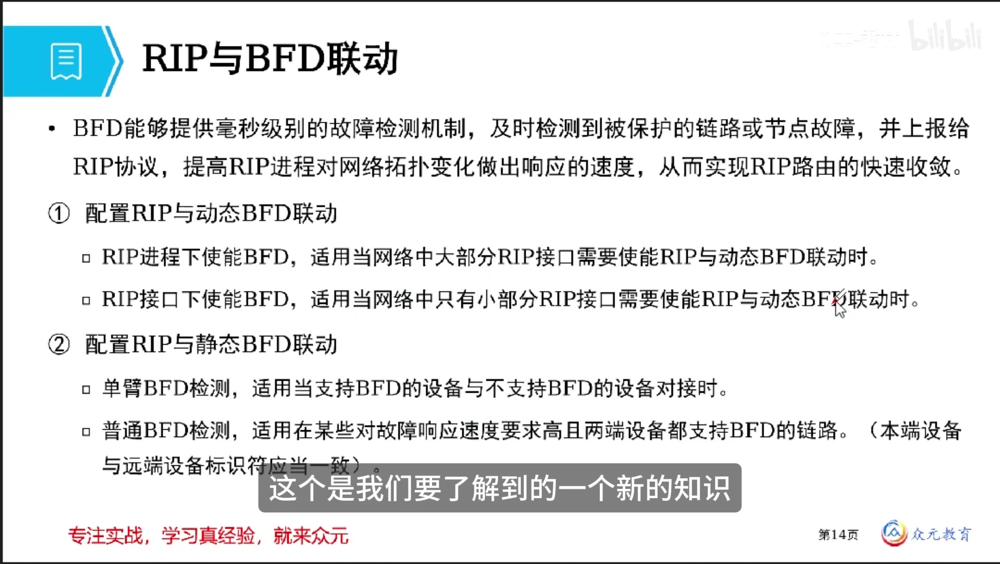

图注：BFD 能为 RIP 提供毫秒级故障检测，并将故障上报给 RIP，提高 RIP 对拓扑变化的响应速度，实现路由快速收敛；联动分为动态 BFD 与静态 BFD 两类。

BFD（Bidirectional Forwarding Detection，双向转发检测）是一种**通用的快速故障检测机制**：

- 提供**毫秒级**的链路/节点故障检测，检测到故障后及时通知上层应用；
- 可与 RIP、OSPF、BGP、静态路由等多种协议联动，实现路由快速收敛，减少拓扑变化导致的流量丢失；
- BFD 本身只负责“检测”，不负责选路；邻居发现依赖上层协议（动态 BFD）或手工指定（静态 BFD）。

| 联动方式 | 邻居如何建立 | 适用场景 |
| -------- | ------------ | -------- |
| 动态 BFD | 由上层路由协议的邻居发现机制建立 | 大部分接口都需要 BFD 时，在进程下统一使能 |
| 静态 BFD | 手工指定对端地址、本端地址等参数 | 只有少量链路需要 BFD，或对端不支持动态协商 |
| 单臂 BFD（静态） | 一端支持 BFD、另一端不支持，由支持端主动发 Echo 报文 | 与不支持 BFD 的设备对接 |
| 普通 BFD（静态） | 两端都支持 BFD，双方交互 | 对故障响应要求高且两端都支持 BFD |

#### 5.3.2 基于进程使能（动态 BFD）

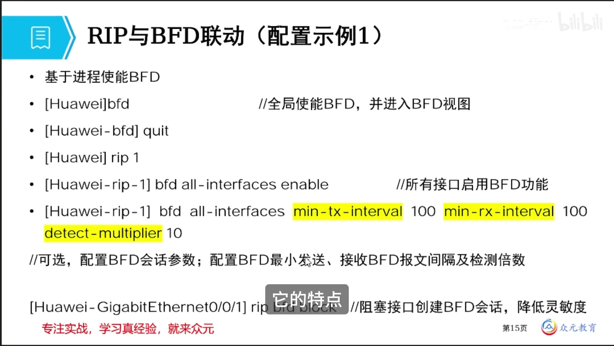

图注：动态 BFD 配置：先全局 `bfd`，再在 RIP 进程下 `bfd all-interfaces enable`，可选配置最小发送/接收间隔与检测倍数；若个别接口不需要 BFD，可在接口下阻塞。

```
[Huawei] bfd
[Huawei-bfd] quit
[Huawei] rip 1
[Huawei-rip-1] bfd all-interfaces enable
[Huawei-rip-1] bfd all-interfaces min-tx-interval 100 min-rx-interval 100 detect-multiplier 10
[Huawei-GigabitEthernet0/0/1] rip bfd block
```

| 命令 | 作用 |
| ---- | ---- |
| `bfd` | 全局使能 BFD 并进入 BFD 视图 |
| `bfd all-interfaces enable` | RIP 进程下所有接口使能 BFD |
| `bfd all-interfaces min-tx-interval 100 min-rx-interval 100 detect-multiplier 10` | 可选，配置 BFD 最小发送间隔、最小接收间隔与检测倍数 |
| `rip bfd block` | 在接口下阻塞 BFD 会话，降低该接口的检测灵敏度 |

BFD 会话参数的含义可用“会话”来理解：双方建立会话后，按约定间隔互发检测报文；`detect-multiplier` 为允许连续丢失的报文个数，丢失数达到倍数即判定故障。间隔越短、倍数越小，检测越灵敏，但报文开销越大。

#### 5.3.3 基于接口使能（静态 BFD）

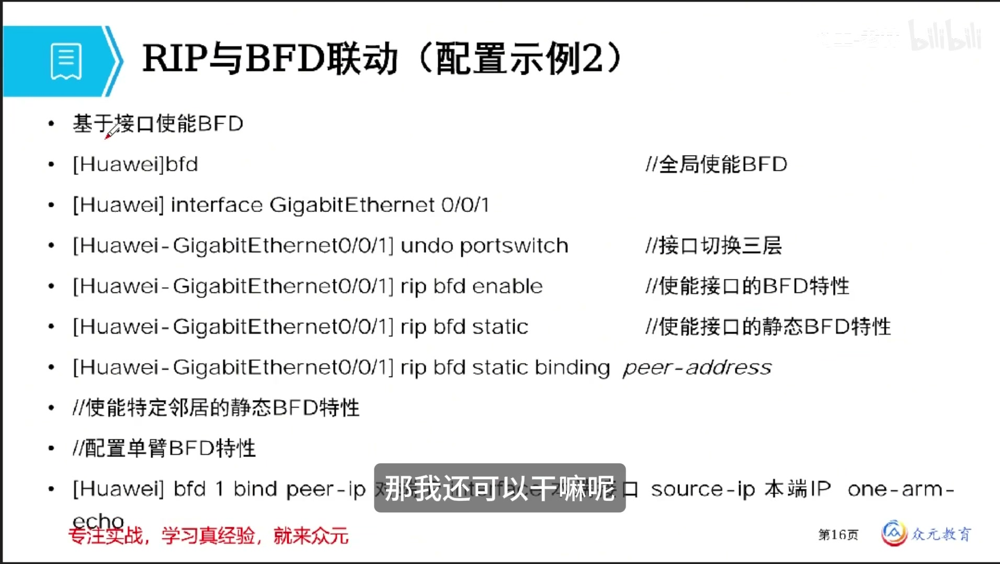

图注：基于接口的静态 BFD 配置：全局 `bfd` 后进入接口，先 `undo portswitch` 切换为三层接口，再 `rip bfd enable`、`rip bfd static`，最后手工绑定对端地址；单臂场景使用 `one-arm-echo`。

```
[Huawei] bfd
[Huawei] interface GigabitEthernet0/0/1
[Huawei-GigabitEthernet0/0/1] undo portswitch
[Huawei-GigabitEthernet0/0/1] rip bfd enable
[Huawei-GigabitEthernet0/0/1] rip bfd static
[Huawei] bfd 1 bind peer-ip 2.2.2.2 source-ip 1.1.1.1 one-arm-echo
```

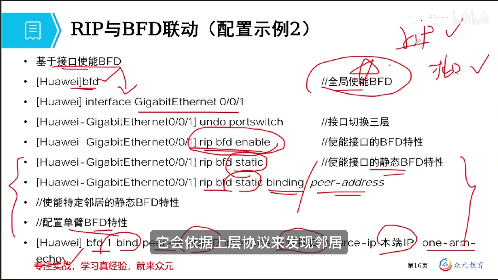

图注：静态 BFD 命令的重点标注：`undo portswitch` 切换三层、`rip bfd enable` 使能接口 BFD、`rip bfd static` 使能静态 BFD、`bind peer-ip ... source-ip ... one-arm-echo` 指定对端与本端并启用单臂回声。

| 命令 | 作用 |
| ---- | ---- |
| `undo portswitch` | 把交换机形态的以太网接口切换为三层接口（仅部分设备需要） |
| `rip bfd enable` | 接口下使能 RIP 的 BFD 特性 |
| `rip bfd static` | 接口下使能静态 BFD，需手工绑定对端 |
| `bfd 1 bind peer-ip 2.2.2.2 source-ip 1.1.1.1 one-arm-echo` | 创建 BFD 会话，绑定对端与本源 IP，`one-arm-echo` 表示单臂回声 |
| `display bfd session all` | 查看 BFD 会话状态（Up/Down） |

考试要点：

1. 必须**先全局使能 BFD**，再在 RIP 进程或接口下使能；
2. 进程下使能适合“大部分接口都要 BFD”，接口下使能适合“只有个别接口要 BFD”；
3. 动态 BFD 依赖上层协议发现邻居，静态 BFD 必须手工指定对端；
4. 提到“毫秒级故障检测/快速收敛”，答案优先考虑 **BFD**。

### 5.4 OSPF 协议基本配置

#### 5.4.1 基本原理与关键概念

OSPF（Open Shortest Path First）是基于**链路状态**的内部网关协议：

| 概念 | 含义 |
| ---- | ---- |
| LSA | 链路状态通告，描述路由器的接口、邻居、开销等信息 |
| LSDB | 链路状态数据库，存放收到的 LSA |
| Area | 区域，Area 0 为骨干区域，其他区域必须与骨干区域相连 |
| ABR | 区域边界路由器，连接骨干区域与非骨干区域 |
| ASBR | 自治系统边界路由器，负责引入外部路由 |
| DR/BDR | 广播网络中的指定路由器/备份指定路由器，减少邻居关系数量 |
| Cost | 接口开销，缺省按带宽参考值计算，可用 `ospf cost` 修改 |

Router ID 的选举规则（优先级从高到低）：

1. 手工配置的 Router ID（`router id` 或 OSPF 视图下 `router-id`）；
2. 所有 Loopback 接口中**数值最大**的 IP 地址；
3. 所有物理接口中**数值最大**的 IP 地址。

工程建议：先配置 Loopback 地址与 Router ID，再使能 OSPF，避免因接口地址变化导致 Router ID 重新选举；Router ID 一旦确定，修改后通常需要重启 OSPF 进程才生效。

#### 5.4.2 基本配置命令

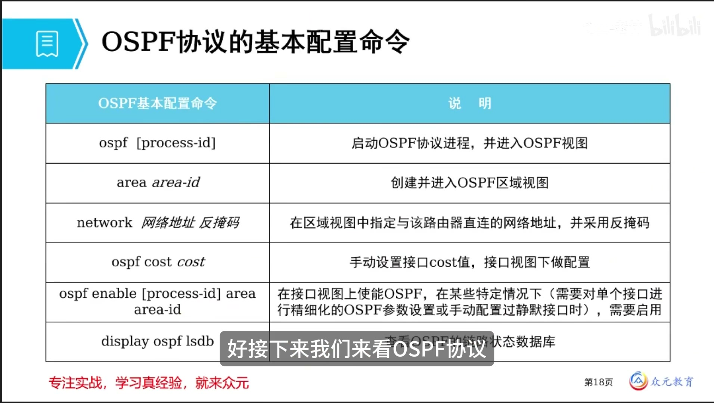

图注：OSPF 基本配置命令表：`ospf [process-id]`、`area area-id`、`network 网络地址 反掩码`、`ospf cost cost`、`ospf enable [process-id] area area-id`、`display ospf lsdb`。

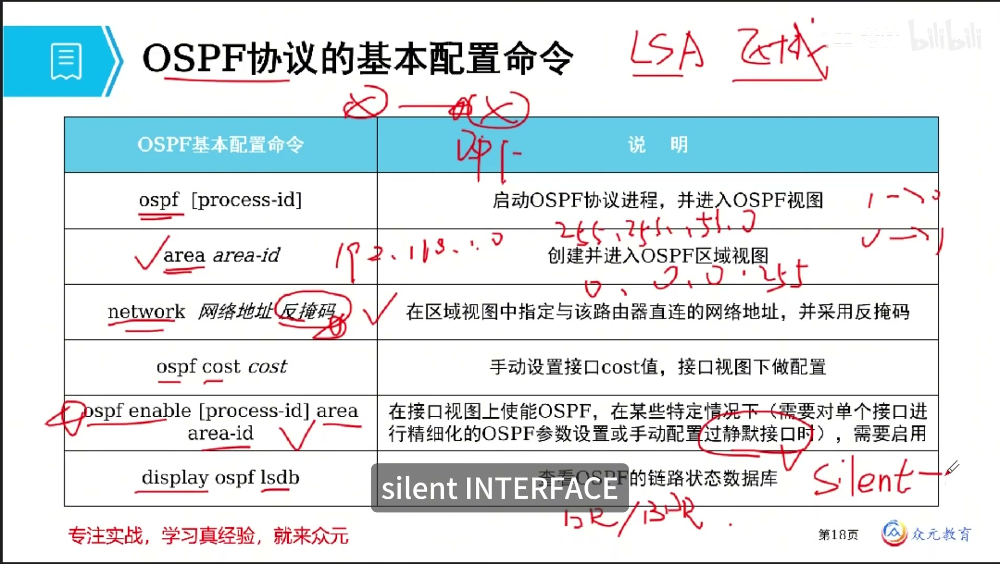

图注：OSPF 基本配置命令的重点标注：`ospf` 启动进程、`area` 进入区域、`network` 使用反掩码、`ospf enable` 在接口下使能、`display ospf lsdb` 查看链路状态数据库。

| 命令 | 说明 |
| ---- | ---- |
| `ospf [process-id]` | 启动 OSPF 进程并进入 OSPF 视图，进程号本地有效 |
| `area area-id` | 创建并进入 OSPF 区域视图 |
| `network 网络地址 反掩码` | 在区域视图下宣告直连网段，使用**反掩码** |
| `ospf cost cost` | 接口视图下手动设置 cost 值 |
| `ospf enable [process-id] area area-id` | 接口视图下使能 OSPF，用于单接口精细化配置或静默接口场景 |
| `display ospf lsdb` | 查看链路状态数据库 |

反掩码（wildcard mask）计算：

```
反掩码 = 255.255.255.255 − 子网掩码
```

| 掩码 | 反掩码 | 含义 |
| ---- | ------ | ---- |
| 255.255.255.0（/24） | 0.0.0.255 | 匹配一个 C 类网段 |
| 255.255.255.252（/30） | 0.0.0.3 | 匹配一个 /30 网段 |
| 255.255.255.255（/32） | 0.0.0.0 | 只匹配一个主机地址 |

要点：反掩码中为 **0** 的位表示“必须匹配”，为 **1** 的位表示“不关心”。

#### 5.4.3 配置示例

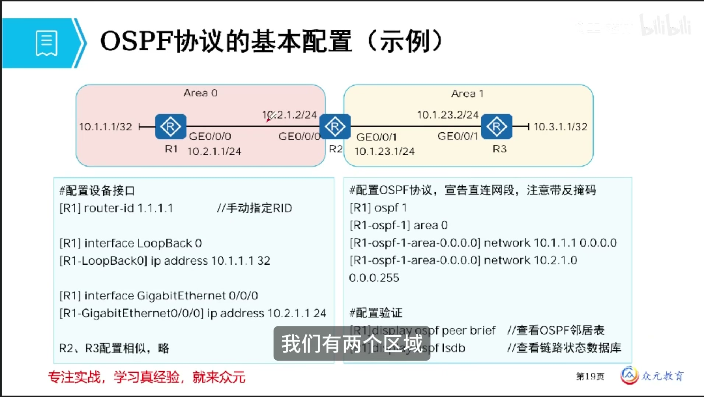

图注：OSPF 多区域示例。R1 位于 Area 0，R2 为 ABR，同时连接 Area 0 与 Area 1，R3 位于 Area 1；R1 的 Loopback0 为 10.1.1.1/32，R1—R2 链路为 10.2.1.0/24，R2—R3 链路为 10.1.23.0/24，R3 的 Loopback0 为 10.3.1.1/32。

```
# 配置设备接口
[R1] router id 1.1.1.1
[R1] interface LoopBack 0
[R1-LoopBack0] ip address 10.1.1.1 32
[R1] interface GigabitEthernet0/0/0
[R1-GigabitEthernet0/0/0] ip address 10.2.1.1 24
# R2、R3 配置相似，略
```

```
# 配置OSPF协议，宣告直连网段，注意带反掩码
[R1] ospf 1
[R1-ospf-1] area 0
[R1-ospf-1-area-0.0.0.0] network 10.1.1.1 0.0.0.0
[R1-ospf-1-area-0.0.0.0] network 10.2.1.0 0.0.0.255
[R1-ospf-1-area-0.0.0.0] quit
[R1-ospf-1] quit

# 配置验证
[R1] display ospf peer brief
[R1] display ospf lsdb
```

要点：

- `network 10.1.1.1 0.0.0.0` 中反掩码全 0，表示精确匹配 10.1.1.1/32 这个 Loopback 地址；
- `network 10.2.1.0 0.0.0.255` 表示宣告 10.2.1.0/24 网段；
- 接口地址必须落在 `network` 覆盖的范围内，否则该接口不参与 OSPF，邻居无法建立；
- 同一区域内的路由器必须使用相同的区域号，否则邻居关系停留在 Init/ExStart 等状态；
- 进程号不同不直接导致邻居建立失败（进程号本地有效），但工程上通常保持一致，便于管理。

### 5.5 OSPF 高级配置

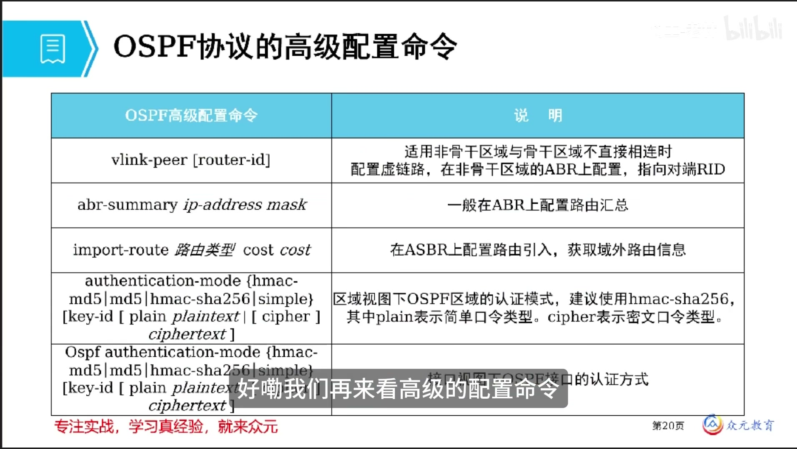

图注：OSPF 高级配置命令表：虚链路 `vlink-peer`、区域汇总 `abr-summary`、路由引入 `import-route`、区域认证与接口认证 `authentication-mode`。

| 命令 | 视图 | 说明 |
| ---- | ---- | ---- |
| `vlink-peer [router-id]` | 区域视图 | 非骨干区域与骨干区域不直接相连时配置虚链路，在**非骨干区域的 ABR** 上配置，指向对端 Router ID |
| `abr-summary ip-address mask` | 区域视图 | 在 ABR 上配置路由汇总，mask 为**正掩码** |
| `import-route 路由类型 cost cost` | OSPF 视图 | 在 ASBR 上配置路由引入，获取域外路由 |
| `authentication-mode { hmac-md5 \| md5 \| hmac-sha256 \| simple } [ key-id { plain 明文 \| cipher 密文 } ]` | 区域视图 | 区域认证，建议使用 `hmac-sha256` |
| `ospf authentication-mode { ... }` | 接口视图 | 接口认证，命令前多一个 `ospf` 前缀 |

#### 5.5.1 虚链路（vlink）

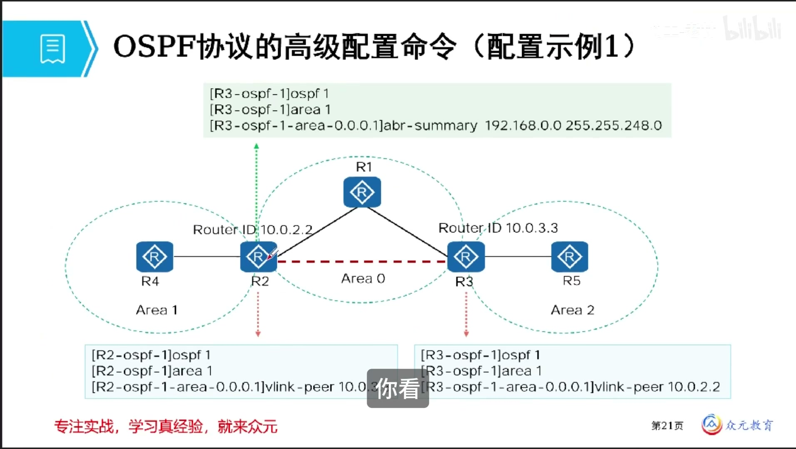

图注：虚链路场景：Area 1、Area 2 分别通过 R2、R3 连接骨干区域，若某个非骨干区域（如图中的 Area 3）没有直接连接到 Area 0，则需要在穿越区域两端的 ABR 上建立虚链路。

适用场景：非骨干区域与骨干区域**没有直接相连**的物理链路时，通过一个**传输区域（Transit Area）**建立逻辑连接。

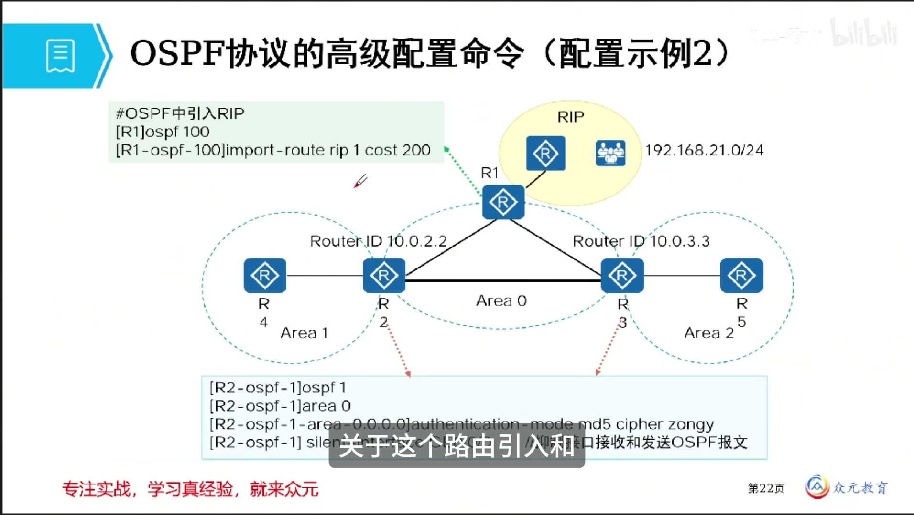

图注：虚链路与路由引入、认证的综合示例：R1 上执行 `ospf 100` 并 `import-route rip 1 cost 200` 引入 RIP 路由；R2 上配置区域认证 `authentication-mode md5 cipher zongy`，并用 `silent-interface` 抑制不需要建立邻居的接口。

```
[R2] ospf 1
[R2-ospf-1] area 1
[R2-ospf-1-area-0.0.0.1] vlink-peer 10.0.3.3
```

要点：

- `vlink-peer` 后面跟的是**对端 ABR 的 Router ID**，不是接口地址；
- 虚链路的两端都要配置，且必须穿越一个**传输区域**；
- 虚链路只是逻辑上的骨干连接，不改变物理拓扑，配置后仍需保证传输区域内路由可达；
- 考试常问“Area X 无法与 Area 0 通信，如何解决”，答案即 **vlink-peer**。

#### 5.5.2 区域汇总

```
[R2-ospf-1] area 1
[R2-ospf-1-area-0.0.0.1] abr-summary 192.168.0.0 255.255.248.0
```

- 在 **ABR** 上把区域内多个连续网段汇总为一条 LSA 3 通告给其他区域；
- 汇总使用**正掩码**，与 `network` 的反掩码相反；
- 作用：减小路由表规模、降低 SPF 计算与 LSA 泛洪开销、屏蔽区域内的拓扑变化。

#### 5.5.3 路由引入

```
[R1] ospf 100
[R1-ospf-100] import-route rip 1 cost 200
```

- 在 **ASBR** 上把其他协议（RIP、IS-IS、BGP、直连、静态）的路由引入 OSPF；
- 引入后以 **5 类 LSA** 泛洪（NSSA 区域为 7 类），优先级缺省为 **150**；
- `cost` 可指定引入路由的种子度量值，未指定时缺省为 1；
- 可配合 `route-policy`、`tag`、`type` 做过滤与属性调整。

#### 5.5.4 认证

```
# 区域认证：对本区域所有接口的 OSPF 报文认证
[R2-ospf-1] area 0
[R2-ospf-1-area-0.0.0.0] authentication-mode md5 cipher zongy

# 接口认证：只对指定接口认证
[R2] interface GigabitEthernet0/0/1
[R2-GigabitEthernet0/0/1] ospf authentication-mode hmac-sha256 key-id 1 cipher zongy
```

| 认证方式 | 特点 | 建议 |
| -------- | ---- | ---- |
| `simple` | 简单口令，明文/密文可选 | 安全性低，仅实验环境 |
| `md5` | MD5 摘要认证 | 兼容性好，常用 |
| `hmac-md5` | 带密钥的 MD5 | 比纯 MD5 更安全 |
| `hmac-sha256` | SHA-256 摘要 | **推荐**，安全性最高 |

要点：`plain` 表示配置明文口令，`cipher` 表示配置密文口令；区域认证对本区域所有接口生效，接口认证只对单个接口生效。题目若说“对本区域所有接口认证”，应选**区域认证**。

#### 5.5.5 静默接口

```
[R2-ospf-1] silent-interface GigabitEthernet0/0/2
[R2-ospf-1] silent-interface all
```

- 静默接口**不发送、不接收 OSPF Hello 报文**，不参与邻居关系建立；
- 用于连接终端、服务器等不需要运行 OSPF 的接口，减少协议报文、提高安全性；
- 静默接口所在的直连网段仍可通过 `network` 宣告进 OSPF（该网段仍会被通告），只是接口上不建立邻居；
- `undo silent-interface` 可恢复。

#### 5.5.6 特殊区域与缺省路由

| 区域类型 | 特点 | 适用场景 |
| -------- | ---- | -------- |
| 标准区域 | 接收所有类型的 LSA | 常规区域 |
| Stub 区域 | 不接收 4、5 类 LSA，由 ABR 下发 3 类缺省路由 | 末梢区域，设备性能有限 |
| Totally Stub 区域 | 进一步过滤 3 类 LSA，只保留一条缺省路由 | 进一步降低路由表规模 |
| NSSA 区域 | 不接收 5 类 LSA，但允许引入外部路由（以 7 类 LSA 存在） | 需要保留引入外部路由能力，又要降低开销 |
| Totally NSSA | 过滤 3 类 LSA，同时允许 7 类 LSA | 分支机构的典型选择 |

OSPF 发布缺省路由：

```
[R1-ospf-1] default-route-advertise
```

- 在 ASBR 上配置，向 OSPF 域内发布一条缺省路由；
- 产生的仍是 **5 类 LSA**（NSSA 内为 7 类），优先级 150；
- RIP 中对应的命令是 `default-route originate`，两者作用相同、命令不同，注意区分。

### 5.6 路由引入与环路、次优路径

#### 5.6.1 路由引入的作用与类型

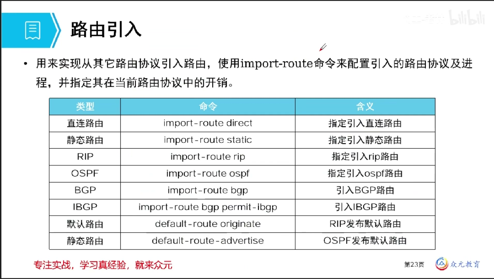

图注：路由引入用于把其他路由协议的路由引入当前协议，使用 `import-route` 指定引入的协议及进程，并指定其在本协议中的开销。

不同协议之间“语言不通”，需要 ASBR 做“翻译”，把一种协议学习到的路由引入另一种协议。

| 引入类型 | 命令 | 含义 |
| -------- | ---- | ---- |
| 直连路由 | `import-route direct` | 引入直连路由 |
| 静态路由 | `import-route static` | 引入静态路由 |
| RIP | `import-route rip` | 引入 RIP 路由 |
| OSPF | `import-route ospf` | 引入 OSPF 路由 |
| BGP | `import-route bgp` | 引入 BGP 路由 |
| IBGP | `import-route bgp permit-ibgp` | 引入 IBGP 路由 |
| 默认路由（RIP） | `default-route originate` | RIP 发布缺省路由 |
| 默认路由（OSPF） | `default-route-advertise` | OSPF 发布缺省路由 |

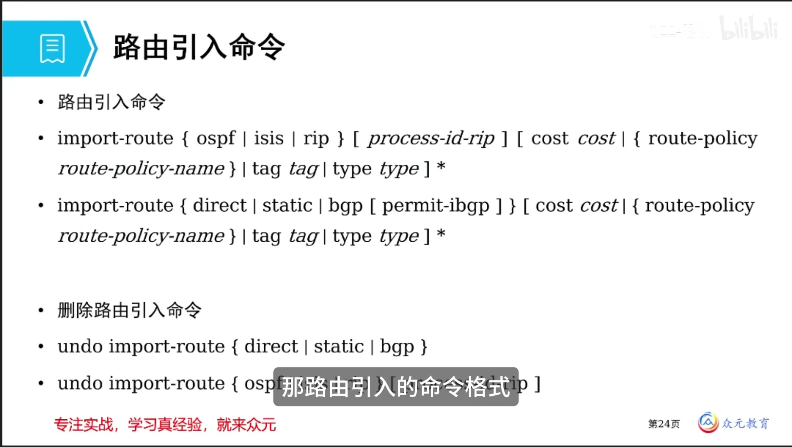

图注：路由引入命令格式：`import-route { ospf | isis | rip } [ process-id ] [ cost cost | route-policy ... | tag tag | type type ]*`，以及直连/静态/BGP 的对应形式；删除时在命令前加 `undo`。

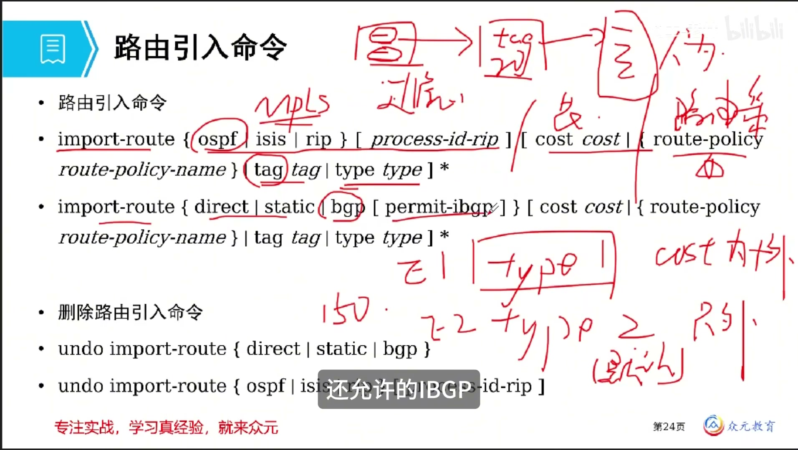

图注：引入 BGP 路由的完整形式 `import-route bgp [permit-ibgp]`，以及删除引入的 `undo import-route` 命令；同样支持 cost、route-policy、tag、type 等参数。

```
import-route { ospf | isis | rip } [ process-id ] [ cost cost | route-policy route-policy-name | tag tag | type type ]*
import-route { direct | static | bgp [ permit-ibgp ] } [ cost cost | route-policy route-policy-name | tag tag | type type ]*
```

| 参数 | 作用 |
| ---- | ---- |
| `cost cost` | 指定引入路由的种子开销 |
| `route-policy name` | 引用路由策略，做选择性引入与属性修改 |
| `tag tag` | 为引入路由打标签，便于后续过滤与策略匹配 |
| `type type` | OSPF 引入外部路由的类型（Type 1 或 Type 2） |

#### 5.6.2 tag 与路由策略

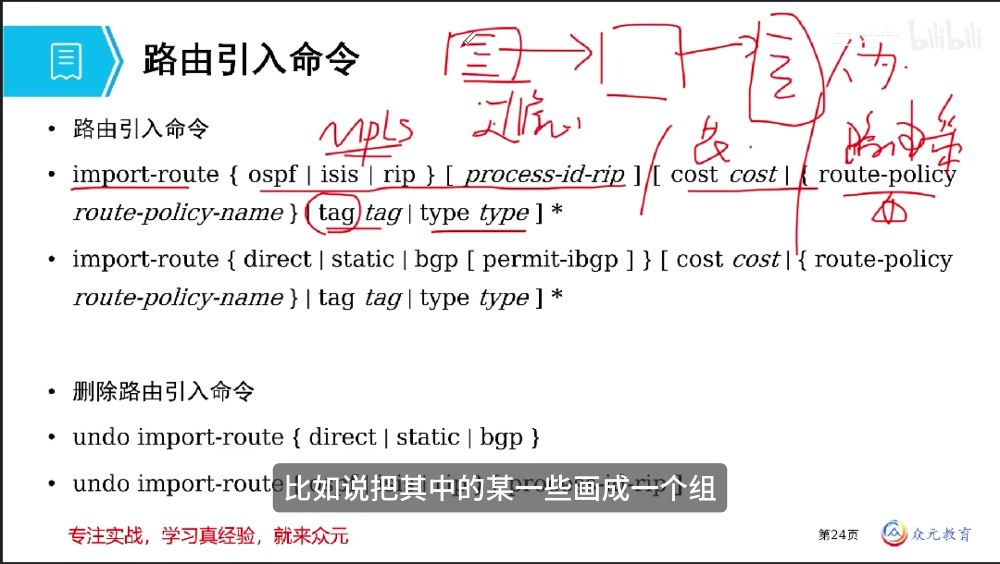

图注：tag 的作用示意：把若干条路由统一打上 tag 20，后续只需匹配 tag 20 即可一次性引用这些路由，无需逐条匹配 IP 前缀。

- **路由策略**（route-policy）用于“选择性引入”：只引入需要的路由，或修改引入路由的属性；
- **tag** 相当于给一批路由贴统一标签，提高匹配与转发效率，也便于在另一端按标签过滤；
- tag 与 VLAN Tag 不是同一概念：前者用于路由策略匹配，后者用于二层帧的 VLAN 标识。

#### 5.6.3 引入参数：Type 1 与 Type 2

OSPF 引入外部路由时，外部路由的度量值计算方式有两种：

| 类型 | 度量值计算 | 可信度 | 缺省 |
| ---- | ---------- | ------ | ---- |
| Type 1 | 外部开销 + OSPF 域内开销 | 更可信，综合考虑内部路径 | 否 |
| Type 2 | 只计算外部开销 | 可信度较低 | **是** |

- 两者缺省优先级都是 **150**；
- 题目要求“除外部开销外还要考虑域内开销”时，`type` 必须指定为 **1**；
- `type` 参数只在 OSPF 引入时有效。

#### 5.6.4 双向引入导致的环路

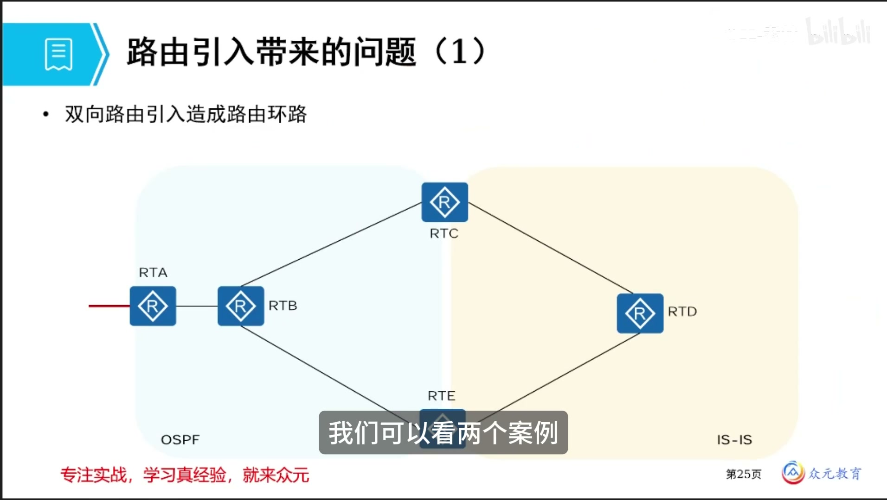

图注：双向引入环路示例。OSPF 与 IS-IS 边界路由器把直连路由以 cost 2 引入 OSPF，其他路由器以 5 类 LSA、优先级 150 学习；另一台边界路由器又把 OSPF 路由引入 IS-IS，优先级变为 15；若反向再次引入，路由可能在两个域之间来回传播，形成环路。

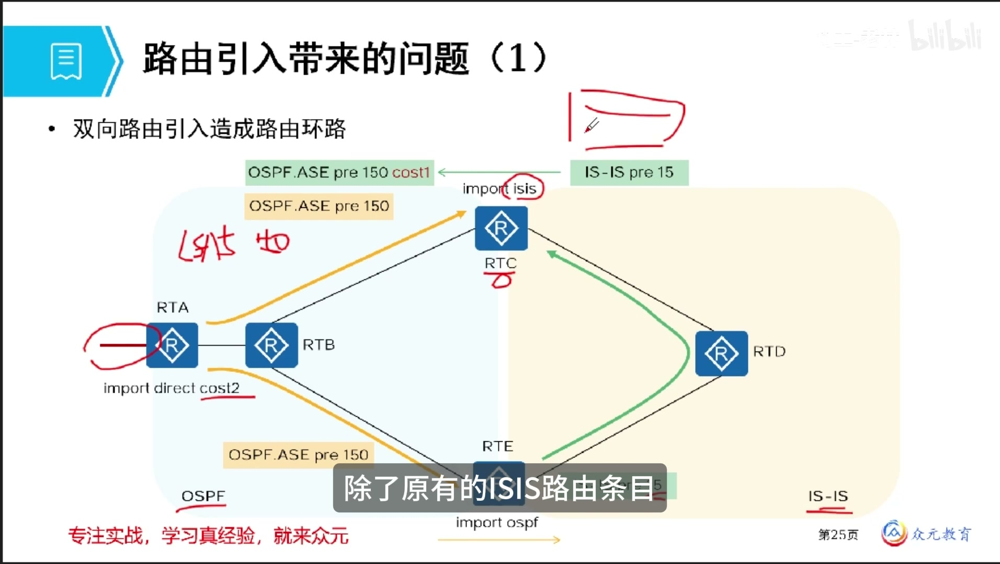

图注：环路形成的关键：两个方向都做了引入，且引入后的优先级/开销使对方域学习到的路由更“优”，报文在两个边界之间来回转发。

形成过程（以 OSPF 与 IS-IS 双向引入为例）：

1. RTA 把直连路由引入 OSPF，指定 cost 2；
2. OSPF 域内路由器以 5 类 LSA 学习，优先级 150，类型 2；
3. RTB 把 OSPF 路由引入 IS-IS，IS-IS 优先级为 15，宣告到 IS-IS 域；
4. 若 RTA 又把 IS-IS 路由引入 OSPF，OSPF 域内会重新学习到这条“绕回来”的路由；
5. 由于优先级与开销的差异，去往某目的网段的最优路径可能指向对方域，报文在两个边界之间反复转发，形成环路。

#### 5.6.5 次优路径

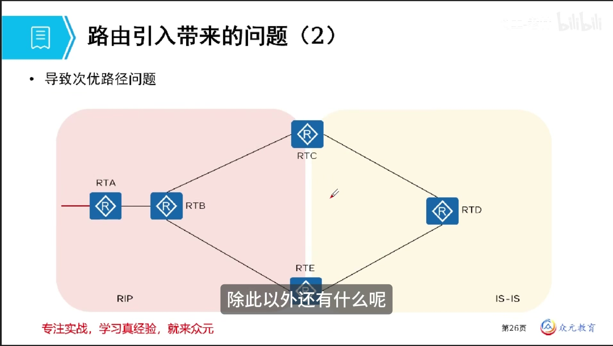

图注：次优路径示例。RIP 与 IS-IS 边界处，RIP 路由优先级 100，引入 IS-IS 后优先级变为 15；路由器上同时存在优先级 15 与 100 的两条表项，按优先级选择 15 的路由，可能绕行而非走直连最优路径。

原因：引入改变了路由的**优先级**与**度量值**，路由表按“最长匹配 → 优先级 → Cost”选路，原本直连的最优路径可能被一条绕行的、优先级更优的路由取代。

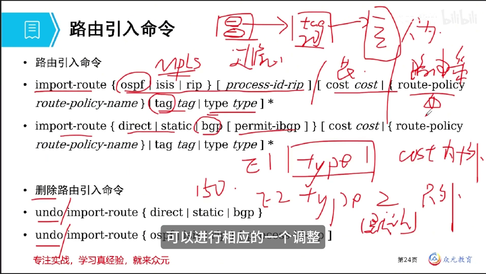

图注：通过修改优先级、开销或配置路由过滤来消除次优路径；这也是 `import-route` 命令存在众多可选参数的原因。

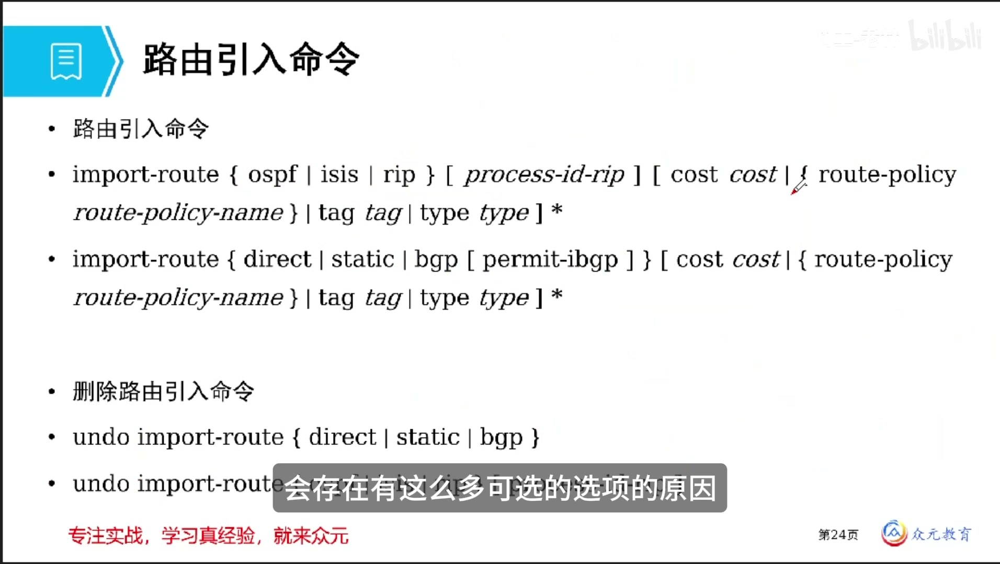

图注：路由引入可选参数汇总：cost、route-policy、tag、type，用于人为干预引入结果，避免环路与次优路径。

解决思路：

| 手段 | 做法 |
| ---- | ---- |
| 路由过滤 | 用 `route-policy` + ACL/前缀列表，禁止某方向的路由被引入 |
| 调整优先级 | 修改引入路由的优先级，使其不再成为最优 |
| 调整开销 | 增大引入路由的 cost，使其劣于域内路由 |
| 打标签过滤 | 引入时打 `tag`，在另一端按 tag 拒绝 |
| 单向引入 | 只在一个方向引入，避免双向互引 |

结论：动态路由协议自身具备防环机制，但**人为的路由引入**可能破坏这些机制，产生环路或次优路径；引入时必须配合过滤与属性调整。

### 5.7 BGP 协议配置

#### 5.7.1 BGP 的基本概念

BGP（Border Gateway Protocol）是**外部网关协议**，用于不同自治系统（AS）之间交换路由信息。

| 概念 | 含义 |
| ---- | ---- |
| AS（自治系统） | 由同一管理机构管理、使用统一路由策略的网络集合，用 AS 号标识 |
| IBGP | 同一 AS 内部建立的 BGP 邻居关系 |
| EBGP | 不同 AS 之间建立的 BGP 邻居关系 |
| Peer（对等体） | BGP 邻居，因距离较远，通常不称“邻居”而称“对等体” |
| Router ID | BGP 设备的标识，建议使用 Loopback 地址 |
| 水平分割 | IBGP 从 IBGP 学到的路由不再通告给其他 IBGP 邻居，防止环路 |

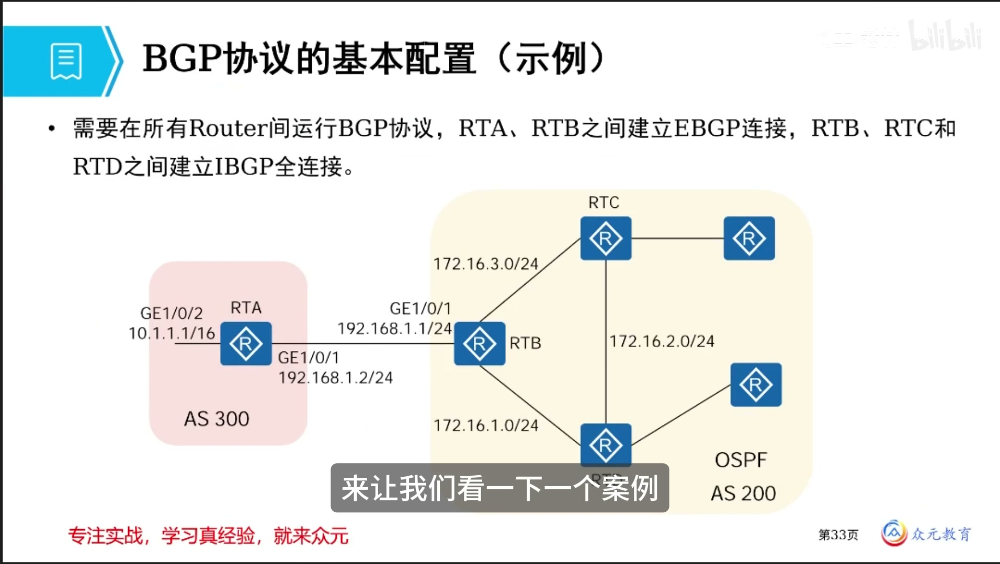

图注：BGP 组网：AS 300 的 RTA 与 AS 200 的 RTB 建立 EBGP 连接；AS 200 内部 RTB、RTC、RTD 建立 IBGP 全连接，内部同时运行 OSPF。

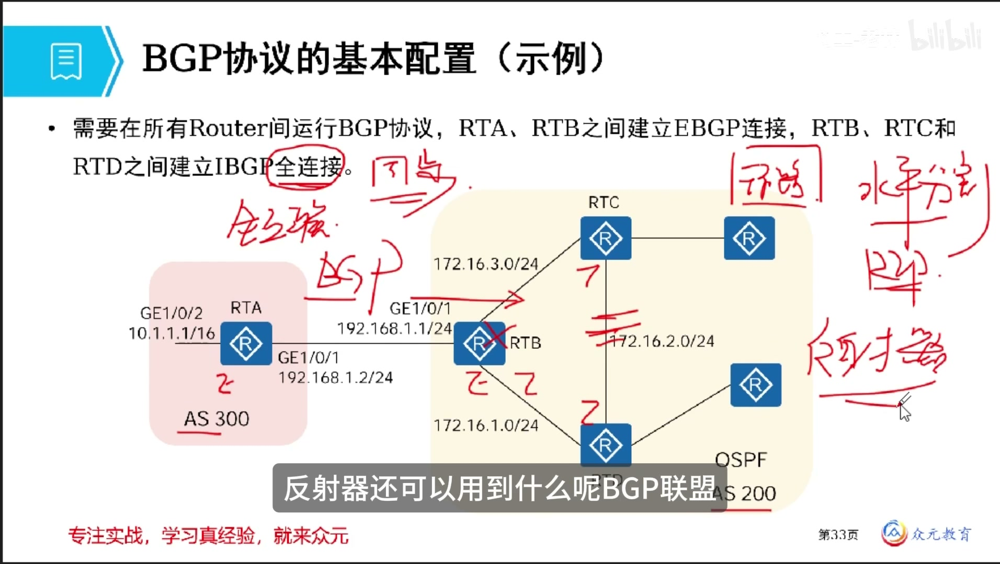

图注：IBGP 要求全连接，否则会出现路由黑洞与信息同步问题；全连接又会带来配置复杂与水平分割导致的同步问题，解决手段是路由反射器与 BGP 联盟。

为什么需要 IBGP 全连接：AS 内部若只让一台边界路由器承载所有外部信息，负载过重且存在单点故障；全连接可以让每台路由器都获得完整的外部路由。但全连接会带来两个问题：

- **路由黑洞**：中间设备没有运行 BGP，转发时找不到出口；
- **水平分割**：IBGP 路由不再传给其他 IBGP 邻居，导致部分设备学不到路由。

解决手段：

| 手段 | 作用 |
| ---- | ---- |
| 路由反射器（Route Reflector，RR） | 指定一台设备为反射器，客户机只需与 RR 建立 IBGP；RR 把从客户机学到的路由反射给其他客户机，打破水平分割 |
| BGP 联盟（Confederation） | 把一个 AS 划分为多个子 AS，子 AS 内部使用 IBGP 全连接，子 AS 之间使用类似 EBGP 的方式，降低全连接规模 |

#### 5.7.2 基本配置命令

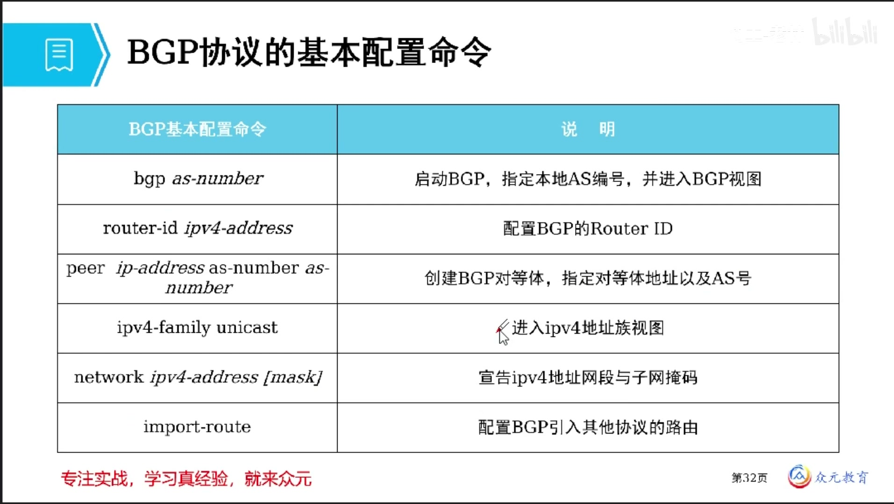

图注：BGP 基本配置命令表：`bgp as-number`、`router-id ipv4-address`、`peer ip-address as-number as-number`、`ipv4-family unicast`、`network ipv4-address [mask]`、`import-route`。

| 命令 | 说明 |
| ---- | ---- |
| `bgp as-number` | 启动 BGP，指定本地 AS 号并进入 BGP 视图 |
| `router-id ipv4-address` | 配置 BGP 的 Router ID |
| `peer ip-address as-number as-number` | 创建 BGP 对等体，指定对等体地址与 AS 号 |
| `ipv4-family unicast` | 进入 IPv4 单播地址族视图 |
| `network ipv4-address [mask]` | 宣告 IPv4 网段与掩码 |
| `import-route` | 引入其他协议的路由 |

#### 5.7.3 配置示例

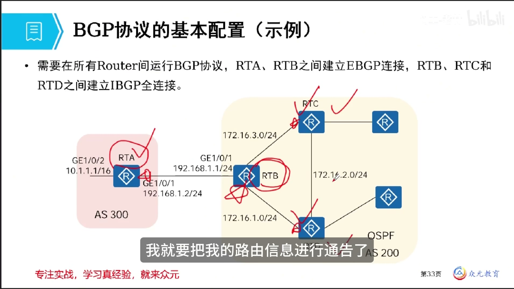

图注：BGP 配置示例拓扑：RTA 属于 AS 300，RTB、RTC、RTD 属于 AS 200；RTA 与 RTB 之间为 EBGP，RTB、RTC、RTD 之间为 IBGP 全连接，AS 200 内部运行 OSPF。

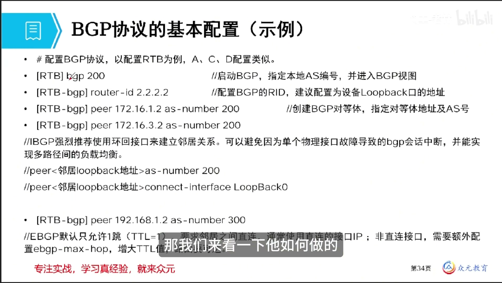

图注：以 RTB 为例配置 BGP：启动 AS 200、指定 Router ID、分别与 IBGP 邻居和 EBGP 邻居建立对等体；IBGP 建议使用 Loopback 地址建立邻居。

```
# 配置BGP协议，以配置RTB为例，A、C、D配置类似
[RTB] bgp 200
[RTB-bgp] router-id 2.2.2.2
[RTB-bgp] peer 172.16.1.2 as-number 200
[RTB-bgp] peer 172.16.3.2 as-number 200
[RTB-bgp] peer 192.168.1.2 as-number 300
```

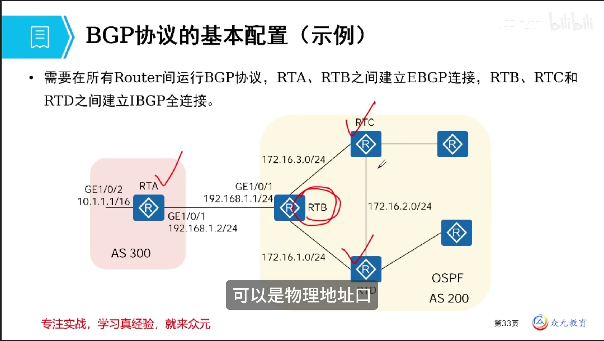

图注：对等体地址可以使用物理接口地址、对端 Router ID 或 Loopback 地址；IBGP 推荐使用 Loopback 地址。

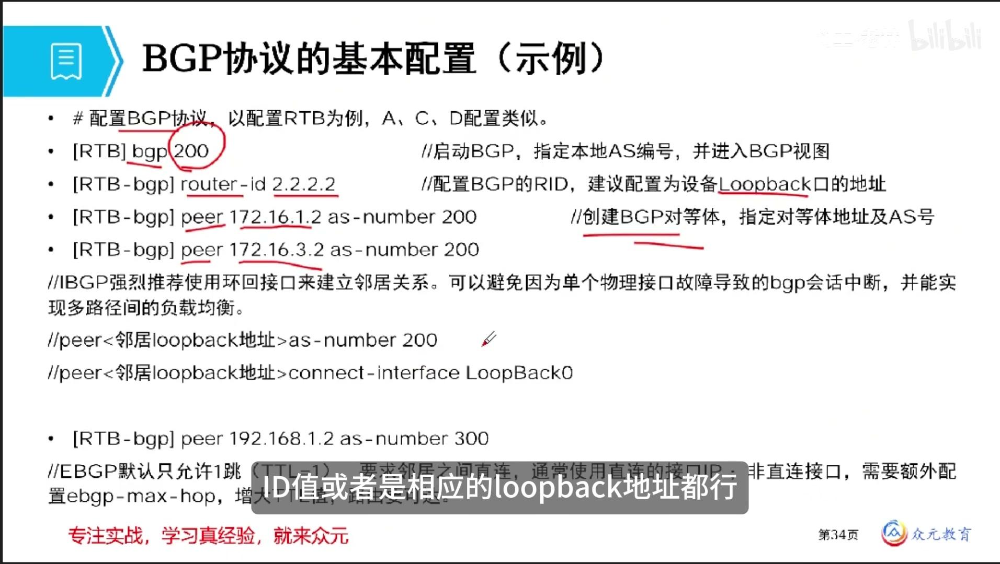

图注：使用 Loopback 建立 IBGP 邻居的两条命令：`peer <邻居Loopback地址> as-number 200` 与 `peer <邻居Loopback地址> connect-interface LoopBack0`。

```
# IBGP 使用 Loopback 建立邻居
[RTB-bgp] peer 2.2.2.2 as-number 200
[RTB-bgp] peer 2.2.2.2 connect-interface LoopBack0
```

IBGP 使用 Loopback 的原因：

- 物理接口故障不会导致 BGP 会话中断，稳定性更高；
- 可以同时利用多条路径，实现负载均衡；
- Loopback 地址不会因接口变化而改变，便于统一规划。

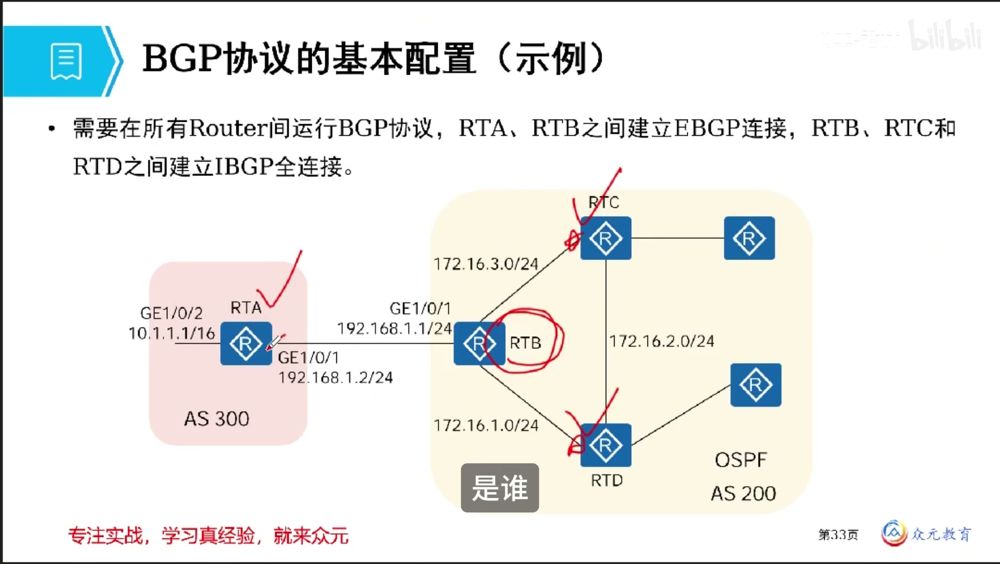

图注：EBGP 默认只允许 1 跳（TTL=1），要求邻居之间直连，通常使用直连接口 IP 建立对等体。

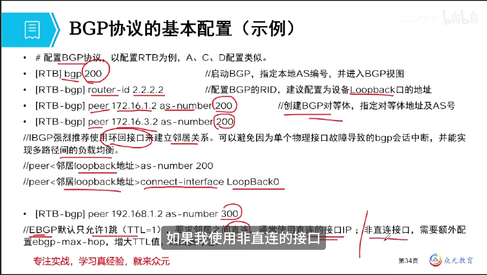

图注：EBGP 非直连时，必须保证路由可达，并用 `ebgp-max-hop` 增大 TTL 值。

```
[RTB-bgp] peer 192.168.1.2 as-number 300
[RTB-bgp] peer 192.168.1.2 ebgp-max-hop 2
```

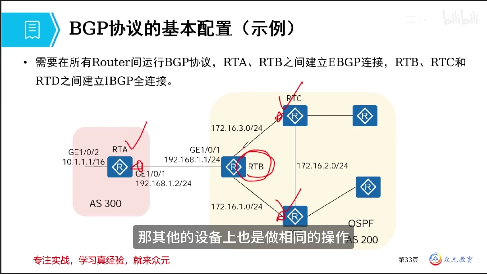

图注：其他设备的配置思路相同：RTA 与 RTB 建立 EBGP，RTC、RTD 与 RTB 建立 IBGP；差别只在 AS 号与对等体地址。

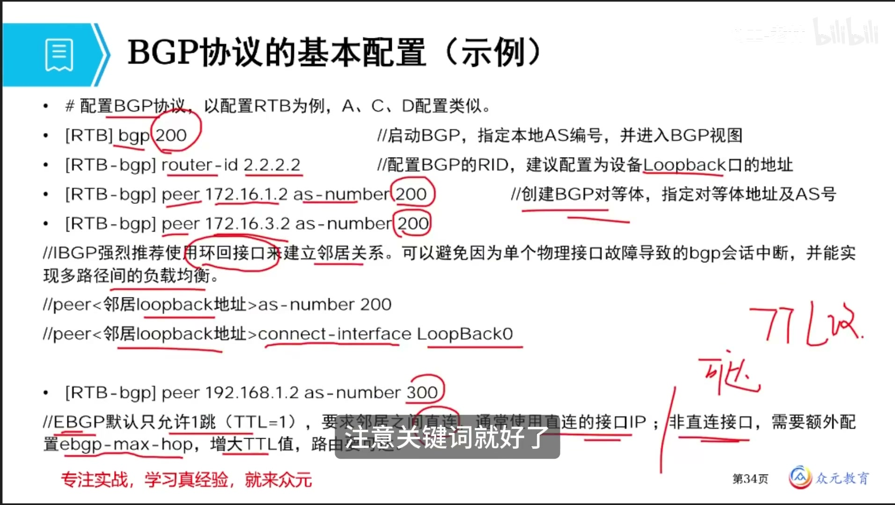

图注：BGP 配置命令的重点标注：`bgp 200` 指定本地 AS、`router-id` 建议用 Loopback、`peer ... as-number` 创建对等体、`ebgp-max-hop` 解决非直连问题。

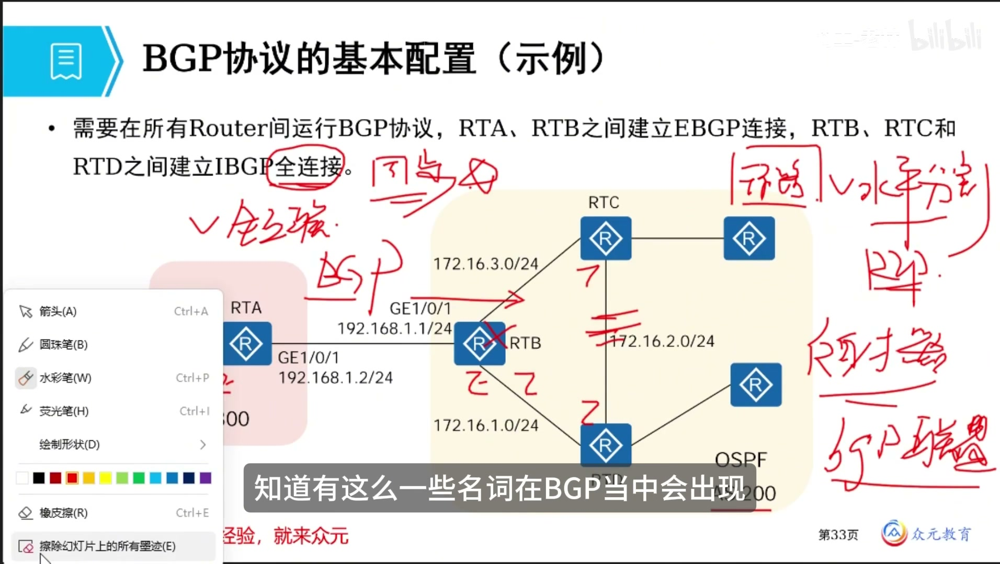

图注：BGP 常见名词汇总：AS、IBGP、EBGP、对等体、路由反射器、联盟、水平分割、路由黑洞等，答题时按这些角度展开。

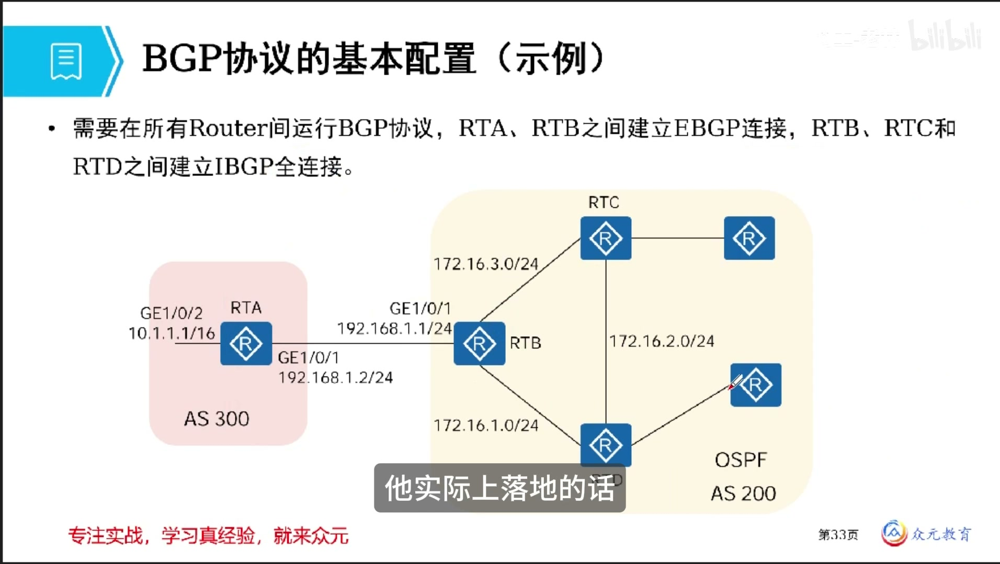

图注：BGP 配置的整体比例示意：以一台设备为主配置对等体，其他设备做相同操作；BGP 本身不发现路由，必须通过 `network` 或 `import-route` 把路由引入 BGP 表后通告。

#### 5.7.4 路由通告：network 与 import-route

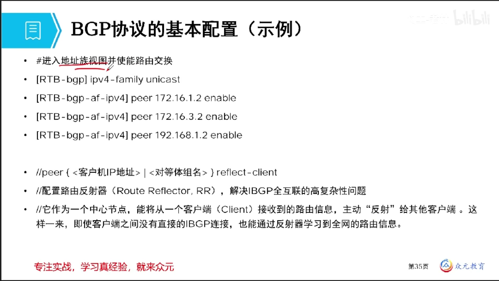

图注：BGP 在 IPv4 地址族视图下通告路由：进入 `ipv4-family unicast`，用 `peer ... enable` 激活对等体，再用 `network` 或 `import-route` 发布路由。

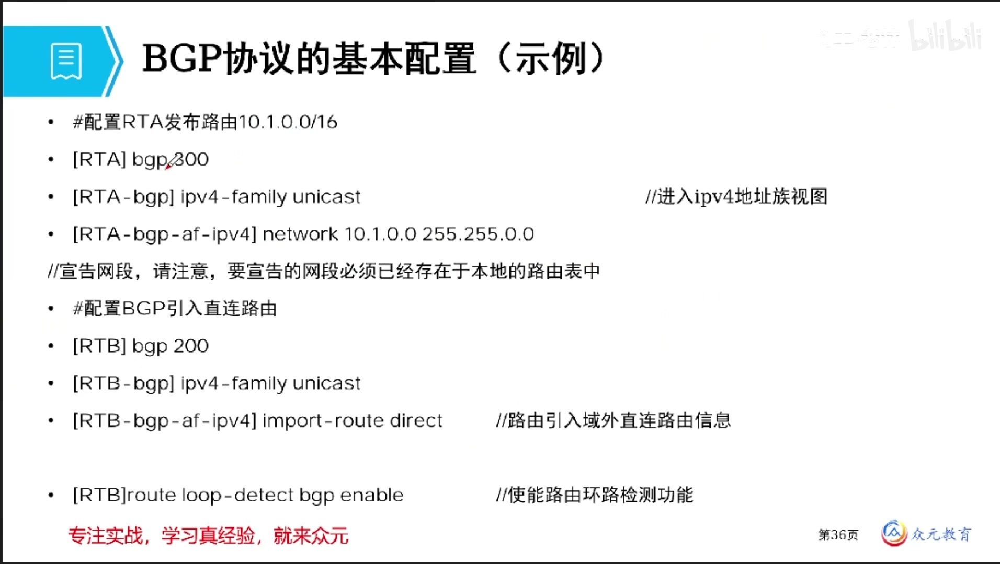

图注：RTA 在 IPv4 地址族视图下用 `network 10.1.0.0 255.255.0.0` 精确宣告网段；RTB 用 `import-route direct` 引入直连路由；最后用 `route loop-detect bgp enable` 使能 BGP 路由环路检测。

```
# 配置RTA发布路由 10.1.0.0/16
[RTA] bgp 300
[RTA-bgp] ipv4-family unicast
[RTA-bgp-af-ipv4] network 10.1.0.0 255.255.0.0

# 配置RTB引入直连路由
[RTB] bgp 200
[RTB-bgp] ipv4-family unicast
[RTB-bgp-af-ipv4] import-route direct

# 使能BGP路由环路检测
[RTB] route loop-detect bgp enable
```

| 对比项 | `network` | `import-route` |
| ------ | --------- | -------------- |
| 通告范围 | 逐条精确宣告指定网段 | 按协议类型批量引入 |
| 前提 | 该网段必须已存在于本地路由表 | 该协议已学习到路由 |
| 精确度 | 高，可控制掩码 | 低，整类路由一起引入 |
| 优先级 | 更高，优先匹配 | 较低 |
| 适用 | 自身直连网段、需要精确控制的路由 | 引入其他协议的大批路由 |

要点：

- BGP **本身不发现路由**，必须把路由表中的路由通过 `network` 或 `import-route` 放进 BGP 表，才能向对等体通告；
- `network` 宣告的网段必须已在本地路由表中存在，否则不会生效；
- 进入地址族视图后，需要用 `peer ... enable` 激活对等体，否则对等体不生效；
- IPv6 场景把 `ipv4-family unicast` 换成 `ipv6-family unicast`，命令结构一致。

#### 5.7.5 路由反射器与环路检测

```
# 在反射器上指定客户机
[RR-bgp] ipv4-family unicast
[RR-bgp-af-ipv4] peer 10.1.1.2 reflect-client
[RR-bgp-af-ipv4] peer 10.1.1.3 reflect-client
```

- 客户机不需要任何反射器配置，只需与 RR 建立 IBGP；
- RR 把从客户机学到的路由反射给其他客户机，从非客户机学到的路由反射给所有客户机；
- 反射器解决了 IBGP 全连接与水平分割带来的信息同步问题。

环路检测：

```
[RTB] route loop-detect bgp enable
```

- 使能 BGP 路由环路检测，检测到环路后上报告警；
- OSPF 也可开启类似的环路检测；
- 检测到环路后通常需要人工干预，处理完成后重新启用；
- 路由引入场景下，也可通过设置很大的链路开销、调整优先级来避免环路，但会带来新的次优路径问题，需要综合权衡。

---

## 6.VRRP 配置

### 6.1 VRRP 的作用与基本概念


图注：VRRP 应用场景。左图为单路由器组网，R1 故障则全网断网；右图把 R1、R2 组成一台逻辑虚拟路由器，对外提供虚拟 IP 与虚拟 MAC，任一台存活即可出入外网。

路由部署同样存在**单点单链路故障**问题：终端只配置一个默认网关，网关路由器一旦故障，所有跨网段流量中断。

VRRP（Virtual Router Redundancy Protocol，虚拟路由冗余协议）把多台路由器组成一台**逻辑虚拟路由器**：

- 对外表现为一台设备，使用**虚拟 IP** 作为终端网关，使用**虚拟 MAC** 作为网关 MAC；
- 多台物理设备中一台为 Master，其余为 Backup；
- Master 故障时 Backup 自动接管，终端无感知；
- 避免了“双网关 + 主机切换”带来的复杂配置。


图注：VRRP 关键概念：VRID 标识备份组；优先级 0～255，越大越优，缺省 100；IP 地址拥有者通常为 Master；抢占模式保证优先级最高者始终为 Master；主机网关为虚拟 IP；虚拟 MAC 格式为 00-00-5E-00-01-{VRID}。


图注：同一页概念的重点标注：VRID 标识 VRRP 组、优先级“越大越优”、IP 地址拥有者、抢占模式、虚拟 IP 与虚拟 MAC。

| 概念 | 含义 |
| ---- | ---- |
| VRID | 虚拟路由器 ID，用于标识一个 VRRP 备份组；同一组内所有设备的 VRID 必须相同 |
| 虚拟 IP | 终端配置的网关地址，由 VRRP 组对外提供 |
| 虚拟 MAC | 由 VRID 生成的 MAC，格式 `00-00-5E-00-01-{VRID}`，一个虚拟路由器对应一个虚拟 MAC |
| 优先级 | 0～255，数值越大越优先，缺省 100 |
| IP 地址拥有者 | 把虚拟 IP 配置为真实接口地址的设备，优先级为 255，通常为 Master |
| 抢占模式 | 优先级更高的设备恢复后重新成为 Master，保证优先级最高者始终为 Master |
| 通告报文 | Master 周期性发送 VRRP 通告，缺省间隔 1 秒 |
| Master/Backup | 主设备负责转发，备设备监听通告、随时接管 |

Master 选举规则：

1. 优先级高者优先；
2. 优先级相同时，接口 IP 地址大者优先；
3. 若某设备是 IP 地址拥有者，其优先级为 255，通常直接成为 Master。

要点：

- 生产环境建议使用**虚拟 IP**，不要把某台设备的物理接口地址直接作为网关；
- 使用物理地址作为虚拟 IP 时，该设备成为 IP 地址拥有者，优先级 255，一旦故障切换逻辑与普通场景不同，容易出问题；
- 同一 VRRP 组内，VRID、虚拟 IP、认证参数必须一致。

### 6.2 VRRP 基本配置


图注：VRRP 基本配置。R1 与 R2 组成备份组，R1 为 Master、R2 为 Backup；R1 优先级 120、抢占延时 10 秒、监视上行接口 GE0/0/1，接口故障时优先级降低 30；虚拟 IP 为 192.168.1.254。

```
[R1] interface GigabitEthernet0/0/0
[R1-GigabitEthernet0/0/0] ip address 192.168.1.253 24
[R1-GigabitEthernet0/0/0] vrrp vrid 1 virtual-ip 192.168.1.254
[R1-GigabitEthernet0/0/0] vrrp vrid 1 priority 120
[R1-GigabitEthernet0/0/0] vrrp vrid 1 preempt-mode timer delay 10
[R1-GigabitEthernet0/0/0] vrrp vrid 1 track interface GigabitEthernet0/0/1 reduce 30
[R1] display vrrp verbose
```

```
[R2] interface GigabitEthernet0/0/1
[R2-GigabitEthernet0/0/1] ip address 192.168.1.252 24
[R2-GigabitEthernet0/0/1] vrrp vrid 1 virtual-ip 192.168.1.254
```

| 命令 | 视图 | 作用 |
| ---- | ---- | ---- |
| `vrrp vrid 1 virtual-ip 192.168.1.254` | 接口视图 | 创建 VRRP 备份组 1 并指定虚拟 IP；同一组内必须一致 |
| `vrrp vrid 1 priority 120` | 接口视图 | 配置优先级，缺省 100，数值越大越优先 |
| `vrrp vrid 1 preempt-mode timer delay 10` | 接口视图 | 配置抢占模式及抢占延时 10 秒 |
| `vrrp vrid 1 track interface GigabitEthernet0/0/1 reduce 30` | 接口视图 | 监视上行接口，接口 Down 时优先级降低 30 |
| `display vrrp verbose` | 任意视图 | 查看 VRRP 备份组的状态与配置参数 |

配置分析：

- R1 优先级 120 > R2 缺省 100，因此 R1 为 Master；
- 上行接口 GE0/0/1 故障时，R1 优先级降为 120 − 30 = 90，低于 R2 的 100，R2 抢占成为 Master；
- 抢占延时 10 秒用于避免链路抖动导致主备频繁切换；
- R2 只需配置相同的 VRID 与虚拟 IP，优先级保持缺省即可作为 Backup。

要点：

- `track` 监视的是**上行接口**，不是 VRRP 所在接口；上行链路断了，即使 VRRP 接口正常，主机也无法出网，因此要主动降优先级让位；
- `reduce` 的缺省值为 10，可按需设置；降低后的优先级必须低于 Backup，才能触发切换；
- 课件中写作 `reduced 30`，华为官方命令为 **`reduce`**，考试作答以官方命令为准。

### 6.3 主备切换与双主问题


图注：VRRP 主备切换与双主的分析：Master 无法收发通告时 Backup 等待超时后接管；track 接口故障时优先级自动降低，Backup 立即接管；双主可能由链路中断、报文被过滤、配置错误引起。


图注：扩展思考的重点标注：主备切换的触发条件、双主的四类原因，其中“设备故障或软件 Bug”被划掉，说明它不是双主的典型原因。

引起主备切换的情况：

| 情况 | 机制 | 切换速度 |
| ---- | ---- | -------- |
| Master 故障或无法收发 VRRP 通告 | Backup 等待 **Master_Down_Interval** 超时后接管 | 秒级，取决于通告间隔与超时时间 |
| Master 上行接口故障（配置 track） | 优先级自动降低，Backup 比较后抢占 | 快，track 立即触发优先级变化 |
| Master 从故障中恢复（配置抢占） | 恢复后优先级更高，等待抢占延时后夺回 Master | 抢占延时后 |
| 优先级被人为修改 | 优先级变化触发重新选举 | 立即 |

关键区别：**Master 整机故障/通告丢失**要等超时；**track 监视的接口故障**会立即降低优先级，切换更及时。

双主（两台设备同时为 Master）的常见原因：

| 原因 | 说明 |
| ---- | ---- |
| 链路中断导致通信隔离 | 两台设备互相收不到通告，都认为对方故障，各自成为 Master |
| VRRP 通告被防火墙/ACL 过滤 | 人为阻断了协议报文，效果等同于链路中断 |
| VRRP 配置错误 | VRID 不一致、优先级配置相同且未正确抢占、认证参数不一致等 |
| 设备故障或软件缺陷 | 非典型原因，课件中已排除，答题时优先答前三类 |

双主的后果：两台设备都使用虚拟 MAC 响应 ARP，终端 ARP 表频繁刷新，流量时通时断，甚至丢包。

### 6.4 VRRP 负载分担


图注：VRRP 主备模式的缺点：Backup 设备长期空闲，链路与设备资源被浪费，与 STP 阻塞冗余链路的问题类似。


图注：VRRP 负载分担：创建多个虚拟路由器（多个 VRID），R1 在组 1 中为 Master、在组 2 中为 Backup；R2 相反。两个虚拟 IP 分别作为不同内网网段的网关，流量分担到两台设备。

```
# R1：组1 Master，组2 Backup
[R1-GigabitEthernet0/0/0] vrrp vrid 1 virtual-ip 192.168.1.254
[R1-GigabitEthernet0/0/0] vrrp vrid 1 priority 200
[R1-GigabitEthernet0/0/0] vrrp vrid 2 virtual-ip 192.168.1.251
[R1-GigabitEthernet0/0/0] vrrp vrid 2 priority 100

# R2：组1 Backup，组2 Master
[R2-GigabitEthernet0/0/1] vrrp vrid 1 virtual-ip 192.168.1.254
[R2-GigabitEthernet0/0/1] vrrp vrid 1 priority 100
[R2-GigabitEthernet0/0/1] vrrp vrid 2 virtual-ip 192.168.1.251
[R2-GigabitEthernet0/0/1] vrrp vrid 2 priority 200
```

| 设备 | 组 1（VIP .254） | 组 2（VIP .251） |
| ---- | ---------------- | ---------------- |
| R1 | Master，优先级 200 | Backup，优先级 100 |
| R2 | Backup，优先级 100 | Master，优先级 200 |

要点：不同网段的终端配置不同的虚拟 IP 作为网关，即可把流量分散到两台设备，同时保留互为备份的能力；这是 VRRP 版的“负载分担 + 冗余”。

### 6.5 心跳线


图注：VRRP 双机通过专用心跳线直连，心跳线专门传递 VRRP 通告报文，避免因中间链路不稳定导致主备频繁切换。

案例题拓扑中，Switch A 为 Master、Switch B 为 Backup，两者通过 Interface1、Interface2 互联，这条连接即心跳线；下方交换机连接终端。

作用：

- 在两台 VRRP 设备之间提供一条**专用、稳定**的直连链路，专门传递 VRRP 通告报文；
- 避免通告报文经过中间网络时因拥塞、抖动、链路故障而丢失，导致误切换或双主；
- 心跳线与业务链路分离，提高主备协商的可靠性。

注意：心跳线传递的是 VRRP 协议报文，不是业务流量；业务流量仍走正常的上行/下行链路。

---

## 7.典型例题

### 7.1 DHCP 综合配置填空（2020 年下半年网络工程师案例分析）


图注：案例题题干与 VLAN 规划表：Internet（VLAN10，192.168.1.0）、IPTV（VLAN20，192.168.2.0）、VoIP（VLAN30，192.168.3.0），服务器地址段均为 .250～.254，网关均为 .1。


图注：DHCP Option 模板题面：在设备上创建 DHCP 配置模板，为客户端分配上网参数。


图注：地址规划表的标注：VoIP 业务对应 VLAN30、192.168.3.0/24，是本题地址池的规划依据。

【案例题】为了便于统一管理，避免手工配置，管理员希望各种终端均能够自动获取 IP 地址，语音终端根据其 MAC 地址为其分配固定的 IP 地址，同时还需要到 FTP 服务器 10.10.10.1 上动态获取启动配置文件 configuration.ini，公司 DNS 服务器地址为 10.10.10.2，所有地址段均路由可达。

公司管理员对各业务使用的 VLAN 作如下规划：

| 业务类型 | VLAN | IP 地址段 | 网关地址 | 服务器地址段 |
| -------- | ---- | --------- | -------- | ------------ |
| Internet | 10 | 192.168.1.0 | 192.168.1.1 | 192.168.1.250～192.168.1.254 |
| IPTV | 20 | 192.168.2.0 | 192.168.2.1 | 192.168.2.250～192.168.2.254 |
| VoIP | 30 | 192.168.3.0 | 192.168.3.1 | 192.168.3.250～192.168.3.254 |

#### 7.1.1 创建 DHCP Option 模板


图注：DHCP Option 模板配置填空：进入系统视图、创建模板、配置网关、启动文件与文件服务器地址，共 5 个空。

题目：下面是在设备上创建 DHCP Option 模板，并在 DHCP Option 模板视图下配置，需要为语音客户端 IP Phone 分配启动配置文件和获取启动配置文件的文件服务器地址，请将配置代码或注释补充完整。

```
<HUAWEI> （1）
[HUAWEI] sysname SW1
[SW1] （2） option template template1
[SW1-dhcp-option-template-template1] gateway-list （3）    //配置网关地址
[SW1-dhcp-option-template-template1] bootfile （4）        //获取配置文件
[SW1-dhcp-option-template-template1] next-server （5）     //配置获取配置文件地址
[SW1-dhcp-option-template-template1] quit
```


图注：模板配置的逐步讲解（一）：从地址规划表中定位 VoIP 的网关地址 192.168.3.1。


图注：模板配置的逐步讲解（二）：确认 `gateway-list` 填写 192.168.3.1。


图注：模板配置的逐步讲解（三）：启动配置文件来自 FTP 服务器，需要定位 FTP 服务器地址。


图注：模板配置的逐步讲解（四）：`next-server` 用于指定获取配置文件的服务器地址。


图注：模板配置的逐步讲解（五）：`bootfile` 填写题干给出的配置文件名 configuration.ini。


图注：模板配置的逐步讲解（六）：`next-server` 填写 FTP 服务器地址 10.10.10.1。


图注：模板部分完成后的题目页，下一问转入地址池配置。

答案：

| 空号 | 答案 | 依据 |
| ---- | ---- | ---- |
| （1） | `system-view` | 从 `<HUAWEI>` 用户视图进入 `[HUAWEI]` 系统视图 |
| （2） | `dhcp` | 创建 DHCP Option 模板的命令为 `dhcp option template template1` |
| （3） | `192.168.3.1` | VoIP 业务（VLAN30）的网关地址 |
| （4） | `configuration.ini` | 题干指定的启动配置文件名 |
| （5） | `10.10.10.1` | 题干指定的 FTP 服务器地址 |

#### 7.1.2 创建地址池并静态绑定 IP Phone


图注：地址池配置填空：创建 pool3，配置 network、dns-list、gateway-list、排除地址、租约、静态绑定与 Option 模板引用；本段共 4 个空，后面的 VLANIF 配置还有 2 个空。

题目：下面创建地址池，同时为 IP Phone 分配固定 IP 地址以及配置信息。请将配置代码补充完整。

```
[SW1] ip pool pool3
[SW1-ip-pool-pool3] network （6） mask 255.255.255.0
[SW1-ip-pool-pool3] dns-list （7）
[SW1-ip-pool-pool3] （8） 192.168.3.1
[SW1-ip-pool-pool3] excluded-ip-address （9） 192.168.3.254
[SW1-ip-pool-pool3] lease unlimited
[SW1-ip-pool-pool3] static-bind ip-address 192.168.3.2 mac-address dcd2-fa98-e439
[SW1-ip-pool-pool3] option-template template1
```


图注：地址池配置的逐步讲解（一）：DNS 地址需要回到题干中查找，公司 DNS 为 10.10.10.2。


图注：地址池配置的逐步讲解（二）：确认 `dns-list` 为 10.10.10.2，`gateway-list` 为 192.168.3.1。


图注：地址池配置的逐步讲解（三）：命令提示与上下文对照。


图注：地址池配置的逐步讲解（四）：忘记命令时回到题目前后文寻找提示。


图注：服务器地址段标注：VoIP 的服务器地址段为 192.168.3.250～192.168.3.254，需要从动态分配范围中排除。


图注：排除地址与租约配置：`excluded-ip-address 192.168.3.250 192.168.3.254` 排除整个服务器地址段；`lease unlimited` 表示租约无限；`static-bind` 固定绑定 IP Phone 的 MAC。


图注：在 VLANIF30 接口下执行 `dhcp select global`，使该 VLAN 的客户端使用全局地址池获取地址。

题目：在对应 VLAN 上使能 DHCP。

```
[SW1-ip-pool-pool3] quit
[SW1] interface vlanif （10）
[SW1-Vlanif30] （11） select global
[SW1-Vlanif30] quit
```

答案：

| 空号 | 答案 | 依据 |
| ---- | ---- | ---- |
| （6） | `192.168.3.0` | VoIP 的 IP 地址段，掩码由 `mask 255.255.255.0` 给出 |
| （7） | `10.10.10.2` | 题干给出的公司 DNS 服务器地址 |
| （8） | `gateway-list` | 后面跟 192.168.3.1，为网关地址配置命令 |
| （9） | `192.168.3.250` | 服务器地址段起点，与后面的 192.168.3.254 构成排除范围 |
| （10） | `30` | IP Phone 属于 VoIP，VLAN30 |
| （11） | `dhcp` | 接口下使能全局地址池的命令为 `dhcp select global` |

解析：

- 题干“自动获取 IP 地址”即 DHCP；“根据 MAC 地址分配固定 IP”即 `static-bind`；
- 题干“到 FTP 服务器动态获取启动配置文件”对应 Option 模板的 `bootfile` 与 `next-server`；
- 地址池中的 `network` 只写网络地址，掩码单独由 `mask` 指定；
- `excluded-ip-address` 排除服务器地址段，避免动态分配给普通终端；
- `interface vlanif 30` 下执行 `dhcp select global`，表示该 VLAN 使用全局地址池；由于 DHCP 服务器与客户端可能不在同一网段，实际部署还需配置 DHCP 中继。


图注：命令补充是下午案例题中常见的考查形式。


图注：现在题型合并到综合题中考查，需要在综合案例里识别 DHCP 相关配置。


图注：DHCP 服务配置的关键点到此结束。

### 7.2 RIP 命令与 BFD 快速检测


图注：课堂习题：RIP 使能接口的命令选择，以及 BFD 快速检测的填空。

1. 在路由器上指定相关接口使能 RIP 协议的命令为（ C ）。

- A. `[RTA] network 192.168.0.0`
- B. `[RTA] network 192.168.0.0 0.0.0.255`
- C. `[RTA-rip-1] network 192.168.0.0`
- D. `[RTA-rip-1] network 192.168.0.0 0.0.0.255`

解答：RIP 的 `network` 命令必须在 **RIP 视图**下执行，且**不带掩码**。A、B 在系统视图下执行，错误；D 带了反掩码，是 OSPF 的写法，错误；C 正确。

2. 【案例题一】在网络配置中，我们通常会使用（1）功能快速检测链路故障，实现毫秒级链路故障感知，此时我们必须在（2）视图下执行此命令，全局使能此功能。

答案：（1）**BFD**；（2）**系统视图**（华为 VRP 中全局配置视图的标准名称，思科称“全局配置模式”）。

要点：BFD 的关键词是“毫秒级”“快速检测”“双向转发检测”；全局使能命令 `bfd` 在系统视图下执行。

### 7.3 OSPF 命令与邻居建立失败分析


图注：课堂习题：显示 OSPF 链路状态数据库的命令，以及 R1、R2 邻居关系无法建立的原因分析；R1 配置为 `network 12.1.1.0 0.0.0.0`，R2 配置为 `network 12.1.1.2 0.0.0.0`。

1. 使用（ B ）命令可以显示 OSPF 的链路状态数据库。

- A. `display ospf error`
- B. `display ospf lsdb`
- C. `display ospf brief`
- D. `display ospf interface`

解答：LSDB 即 Link State Database（链路状态数据库），对应命令 `display ospf lsdb`。`display ospf error` 查看错误统计，`display ospf brief` 查看 OSPF 简要信息，`display ospf interface` 查看接口信息。

2. 路由器 R1 和 R2 配置 OSPF 动态路由，拓扑如图 1 所示，其中接口 IP 已正确配置，OSPF 配置详见图 2。配置完成后，OSPF 邻居关系无法建立，可能的原因是（ A ）。

- A. 接口地址不在 network 命令指定的网络范围内
- B. OSPF 进程 ID 冲突
- C. network 命令指定的网络范围过大
- D. 未指定 Router-id

解答：

- R1 的 `network 12.1.1.0 0.0.0.0` 中反掩码全 0，表示只匹配 **12.1.1.0/32** 这一个地址，而 R1 的接口地址是 12.1.1.1/24，不在匹配范围内，该接口不会使能 OSPF，因此无法建立邻居，A 正确；
- 进程 ID 本地有效，不同进程号不直接导致邻居建立失败，B 错误；
- 网络范围过大通常不会导致邻居无法建立，C 错误；
- 未指定 Router ID 时会自动选举，仍可建立邻居，D 错误。

要点：OSPF 的 `network` 必须保证**接口地址落在“网络地址 + 反掩码”确定的范围内**；反掩码全 0 表示精确匹配单个主机地址，不能用来宣告整个网段。

### 7.4 OSPF 综合案例


图注：OSPF 综合案例拓扑：总部 Core-1 与分部 Core-2 通过专线互联，Router-1 与 Router-2 通过 Internet 建立 VPN 通道作为备用；Router-1、Core-1、Router-2、Core-2 运行 OSPF 单区域 Area 0；NGFW1、NGFW2 以透明模式部署。


图注：案例问题：BFD 联动、OSPF 引入缺省路由产生的 LSA 类型、接口安全（静默接口）与区域认证。

在网络中配置 OSPF 时，网络管理员进行了优化操作，请回答以下问题：

1. 为提高链路状态变化时 OSPF 的收敛速度，可在 Router-1、Router-2、Core-1、Core-2 上配置（1）与 OSPF 联动，可以快速检测链路状态，使得故障检测时间可以达到毫秒级。

答案：**BFD**。

2. 管理员规划在 Router-1、Router-2 上为 OSPF 引入缺省路由，由 OSPF 将缺省路由通告全网，在 Router-1、Router-2 采用手动配置命令方式，配置完成后路由器将产生一个（2）LSA，并通告到全网，达到全网缺省路由学习的目的。

答案：**5 类（Type 5）LSA**。域外路由（包括引入的缺省路由）以 5 类 LSA 泛洪；NSSA 区域内为 7 类。

3. 为提高 OSPF 的安全性，当用户接口启用 OSPF 时，可在用户接口上配置（3），防止非法设备接入用户网络与现网设备建立邻居关系，这也是防止路由环路的一种方法；同时启用 OSPF 的（4）认证，对本区域所有接口上的 OSPF 报文进行认证，防止非法设备与网络设备建立邻居关系。

答案：（3）**静默接口（silent-interface）**；（4）**区域**认证。


图注：综合案例的需求描述：总公司与分公司 A、B 通信正常但无法与办事处 C 通信；分公司 A 设备性能较低；办事处 C 外来人员多，需要安全认证。


图注：案例拓扑：Area 0 为总部，Area 1 为分公司 A，Area 2 为分公司 B，Area 3 为办事处 C；Area 3 未与 Area 0 直接相连。


图注：办事处 C 无法通信的原因是 Area 3 与骨干区域没有直接连接，需在两端 ABR 上配置虚链路 `vlink-peer`。


图注：分公司 A 的性能与扩展需求：降低路由计算与存储压力，同时保留引入外部路由的能力，对应配置为 NSSA 区域（非完全末梢区域）。


图注：办事处 C 的安全需求：外来人员多，需要保证路由交互安全，对应区域认证/接口认证与静默接口。


图注：RTA 引入外部路由时既要考虑外部开销，也要考虑 OSPF 域内开销，因此引入类型必须指定为 Type 1。


图注：综合题的分析方法：先读需求关键词，再把它映射到具体技术（BFD、vlink、NSSA、认证、静默、Type 1），最后落到命令。

案例需求与技术方案的对应关系：

| 需求关键词 | 技术方案 | 关键命令 |
| ---------- | -------- | -------- |
| 毫秒级故障检测、快速收敛 | BFD 与 OSPF 联动 | `bfd`、`ospf bfd enable` |
| 区域无法与骨干区域通信 | 虚链路 | `vlink-peer` |
| 降低路由表规模、保留外部路由 | NSSA / Totally NSSA | `nssa` |
| 防止非法设备建立邻居 | 静默接口 | `silent-interface` |
| 区域级报文认证 | 区域认证 | `authentication-mode` |
| 引入路由需同时计算内外开销 | Type 1 外部路由 | `import-route ... type 1` |
| 减小路由表、屏蔽区域变化 | 区域汇总 | `abr-summary` |


图注：OSPF 的经典考察方式：给拓扑、给配置、挖空补命令，再结合需求做优化分析。

### 7.5 VRRP 状态告警分析


图注：课堂习题：Core A 出现 “The state of VRRP changed from master to other state” 告警，判断不可能的原因。

某数据中心配备 2 台核心交换机 Core A 和 Core B，并部署 VRRP 协议实现冗余。网络管理员例行巡查时，在 Core A 上发现内容为 “The state of VRRP changed from master to other state” 的告警日志。经过分析，下列选项中**不可能**造成该告警的原因是（ C ）。

- A. Core A 和 Core B 的 VRRP 优先级发生变化
- B. Core A 发生故障
- C. Core B 发生故障
- D. Core B 从故障中恢复

解答：

- Core A 从 Master 变为其他状态，说明 Core A 失去了 Master 身份；
- A 可能：优先级被修改，Core B 的优先级相对更高，触发重新选举；
- B 可能：Core A 整机故障或接口故障，自然失去 Master；
- C 不可能：Core B 故障只会让 Core A 继续或更加稳固地担任 Master，不会使 Core A 从 Master 变为 Backup；
- D 可能：Core B 从故障中恢复，且配置了抢占，优先级更高时夺回 Master，Core A 变为 Backup。

答案 C。要点：判断状态变化时，先明确“谁的状态变了”，再分析“谁故障/谁恢复/谁的优先级变了”。

### 7.6 VRRP 命令与回显判读


图注：课堂习题：查看 VRRP 备份组信息的命令，以及回显中 State 字段的含义；回显包含 VRID、Admin Status、Config Pri、Run Pri、Preempt Mode、State 等字段。

1. 在交换机上通过（ C ）查看到下图所示信息，其中 State 字段的含义是（ D ）。

- A. `display vrrp statistics`
- B. `display ospf peer`
- C. `display vrrp verbose`
- D. `display ospf neighbor`

- （2）A. 抢占模式　B. 认证类型　C. 配置的优先级　D. 交换机在当前备份组的状态

解答：

- `display vrrp verbose` 用于查看 VRRP 备份组的**状态信息与配置参数**；`display vrrp statistics` 查看的是 VRRP 报文统计信息，不是配置状态，故（1）选 C；
- 回显中 `State: Master` 表示本设备在当前备份组中的角色状态，故（2）选 D；
- 其余字段对应关系：`Preempt Mode: YES` 对应抢占模式，`AuthType: NONE` 对应认证类型，`Config Pri: 100` 对应配置优先级，`Run Pri: 100` 对应运行优先级。

要点：题目选项 C 写作 `display vrrp verboses`，属于排版笔误，正确命令为 **`display vrrp verbose`**。

### 7.7 VRRP 案例：心跳线与始终 Master


图注：案例题一：Switch A 为 Master、Switch B 为 Backup，通过 Interface1、Interface2 互联；要求保证终端访问 Internet 的可靠性。

【案例题一】

1. 下图中，为了确保终端连接因特网的可靠性，可以在交换机 A 和 B 上部署（1）实现，交换机 A 与交换机 B 之间的连接线称为（2）线，其作用是（3）。

2. 另外为了确保交换机 A 始终能成为 Master，需要做一些什么配置？

答案：

（1）**VRRP（虚拟路由冗余协议）**；

（2）**心跳线**；

（3）在两台设备之间传递 VRRP 通告报文，提供专用、稳定的协商通道，避免因中间链路拥塞、抖动或故障导致主备频繁切换或双主。

第 2 问：

| 措施 | 说明 |
| ---- | ---- |
| 提高优先级 | 把 Switch A 的 VRRP 优先级配置为高于 Switch B（大于 100），使其在选举中胜出 |
| 配置为 IP 地址拥有者 | 把虚拟 IP 直接配置为 Switch A 的接口地址，优先级为 255，通常始终为 Master |
| 配置抢占模式与抢占延时 | 故障恢复后能够重新夺回 Master；延时避免频繁切换 |
| 监视上行接口 | 配置 `track`，上行链路故障时主动降低优先级，让位于更健康的设备（与“始终 Master”目标需权衡） |

要点：若要求“始终为 Master”，优先级必须**高于其他组成员**；若使用 IP 地址拥有者方案，优先级固定为 255，但虚拟 IP 与物理接口地址重合，故障切换逻辑较特殊，生产环境仍建议使用独立虚拟 IP + 高优先级 + 抢占。

---

## 8.本章小结


图注：路由器相关配置（多臂路由、DHCP、静态路由、动态路由、VRRP）到此结束。

| 知识块 | 核心内容 |
| ------ | -------- |
| 1. 路由器的作用 | 异构网络互联 + 依据路由表选路转发；接口种类多、数量少 |
| 2. 多臂路由 | 路由器多个物理接口分别作为不同 VLAN 网关；弊端是接口不够、无法处理 Tag 帧 |
| 3. 单臂路由 | 一个物理接口创建多个子接口；`dot1q termination vid` 终结 Tag、`ip address` 配网关、`arp broadcast enable` 开启 ARP 广播；交换机侧配 Trunk |
| 4. DHCP 全局地址池 | `dhcp enable`、`ip pool`、`network`、`gateway-list`、`dns-list`、`domain-name`、`excluded-ip-address`、`static-bind`、`lease`；接口下 `dhcp select global` |
| 5. DHCP 中继 | 跨网段时使用；`dhcp select relay` + `dhcp relay server-ip`；客户端广播、中继到服务器单播 |
| 6. DHCP 接口地址池 | `dhcp select interface` + `dhcp server gateway-list/dns-list/excluded-ip-address/static-bind/lease`；仅本网段 |
| 7. DHCP 其他特性 | Option 模板下发启动文件与服务器地址；Snooping 通过信任端口防止私设服务器 |
| 8. 静态路由 | `ip route-static`；默认路由 0.0.0.0/0；黑洞路由指向 NULL0；下一跳为对端、出接口为本机 |
| 9. 路由表与选路 | 字段：Destination/Mask、Proto、Pre、Cost、NextHop、Interface；顺序：最长匹配 → 优先级 → Cost → 等价 |
| 10. 优先级 | 直连 0、OSPF 10、IS-IS 15、静态 60、RIP 100、OSPF ASE/NSSA 150、BGP 255 |
| 11. RIP | 距离矢量、跳数度量、最大 15 跳、30 秒周期更新、UDP 520；v1 有类广播、v2 无类组播 224.0.0.9 并支持 MD5 |
| 12. BFD | 毫秒级故障检测；先全局 `bfd`，再进程或接口使能；动态依赖上层协议发现邻居，静态需手工绑定；单臂用 `one-arm-echo` |
| 13. OSPF 基本 | `ospf`、`area`、`network 网络地址 反掩码`、`ospf cost`、`ospf enable`；Router ID 选举：手工 > Loopback 最大 > 物理接口最大 |
| 14. OSPF 高级 | `vlink-peer` 虚链路、`abr-summary` 汇总、`import-route` 引入、`authentication-mode` 认证、`silent-interface` 静默、`default-route-advertise` 缺省路由 |
| 15. 路由引入 | 直连/静态/RIP/OSPF/BGP/IBGP；参数 cost、route-policy、tag、type；Type 1 计内外开销、Type 2 只计外部开销（缺省）；双向引入易致环路与次优路径 |
| 16. BGP | AS、IBGP/EBGP、peer、Router ID；IBGP 用 Loopback 更稳定；EBGP 默认 1 跳，非直连用 `ebgp-max-hop`；`network` 精确、`import-route` 批量；反射器解决全连接与水平分割 |
| 17. VRRP | 虚拟 IP + 虚拟 MAC（00-00-5E-00-01-{VRID}）；优先级 0～255 缺省 100，IP 拥有者 255；`vrid`、`virtual-ip`、`priority`、`preempt-mode timer delay`、`track ... reduce` |
| 18. VRRP 切换与双主 | 超时切换与 track 立即切换；双主原因：链路中断、报文被过滤、配置错误；心跳线提供专用协商通道 |
| 19. VRRP 负载分担 | 多个 VRID，两台设备在不同组中互为 Master/Backup，不同虚拟 IP 作为不同网段网关 |

考试重点：

1. **单臂路由三要素**：子接口编号、`dot1q termination vid` 与 VLAN 对应、`arp broadcast enable` 必配；交换机侧为 Trunk。
2. **DHCP 全局与接口模式的判读**：看 `ip pool`/`global` 还是 `dhcp select interface`/`dhcp server`；跨网段必须中继。
3. **DHCP 地址池参数**：`network`、`gateway-list`、`dns-list`、`excluded-ip-address`、`static-bind`、`lease`；租期缺省 1 天。
4. **静态路由写法**：目的网段 + 掩码 + 下一跳；默认路由 0.0.0.0/0；黑洞路由指向 NULL0；`preference` 缺省 60。
5. **选路顺序**：最长匹配 → 优先级 → Cost → 等价路由；优先级数值越小越优。
6. **RIP 命令**：`rip`、`version 2`、`network` 宣告直连网段且不带掩码、`undo summary`。
7. **BFD 关键词**：毫秒级、快速检测、与路由协议联动；全局 `bfd` 在系统视图执行。
8. **OSPF 反掩码**：`network` 用反掩码，汇总 `abr-summary` 用正掩码；接口地址必须落在 network 范围内。
9. **OSPF 故障与优化**：邻居不通先查区域号、network 范围、认证；区域不通查 vlink；性能不足查 NSSA/汇总；安全查认证与静默接口。
10. **路由引入**：Type 1 与 Type 2 的区别、缺省优先级 150、双向引入导致环路、次优路径的解决手段。
11. **BGP 邻居**：IBGP 用 Loopback、EBGP 默认 1 跳、`ebgp-max-hop` 改 TTL、`network` 与 `import-route` 的区别。
12. **VRRP 参数**：优先级缺省 100、IP 拥有者 255、虚拟 MAC 格式、`track ... reduce` 降优先级、`preempt-mode timer delay` 防抖动。
13. **VRRP 故障分析**：状态从 Master 变为其他，只可能是本机故障/优先级变化/对端恢复抢占，不可能是对端故障；双主优先答链路中断、报文被过滤、配置错误。

存疑点与口径说明：

1. 课件口述“华为设备 DHCP 缺省租约为 8 天”，与华为官方命令参考不一致。华为 VRP 地址池缺省租期为 **1 天**，8 天是 Windows 客户端侧的常见缺省值，本笔记按官方口径记为 1 天。
2. 课件将 `dhcp select global` 写在地址池视图的代码框内，实际该命令应在**接口视图**下执行；本笔记已按正确视图给出。
3. 课件写作 `vrrp vrid 1 track interface ... reduced 30`，华为官方命令为 **`reduce`**（`increase` 为增加优先级），本笔记按官方命令书写。
4. 课件示例中 `excluded-ip-address 192.168.3.2` 与 `static-bind ip-address 192.168.3.2` 使用同一地址，静态绑定地址可不受排除范围影响，但工程上应避免歧义；案例题中排除范围应为 192.168.3.250～192.168.3.254，网关 192.168.3.1 也建议一并排除。
5. 课件口述 OSPF Router ID“先配置的先选举”，与官方规则不符。官方规则为：手工配置 > Loopback 接口最大 IP > 物理接口最大 IP；本笔记按官方规则记录。
6. 课件写作 `[R1] router-id 1.1.1.1`，华为系统视图下配置设备 Router ID 的命令为 **`router id`**（无连字符）；OSPF 视图下才是 `router-id`。
7. 课件静态 BFD 部分写作 `rip bfd static binding peer-address`，华为官方配置为接口下 `rip bfd static`，再由 `bfd ... bind peer-ip ... one-arm-echo` 手工创建会话；本笔记按官方结构说明。
8. 案例题 VRRP 第 1 题选项 C 的 `display vrrp verboses` 为排版笔误，正确命令为 `display vrrp verbose`。
