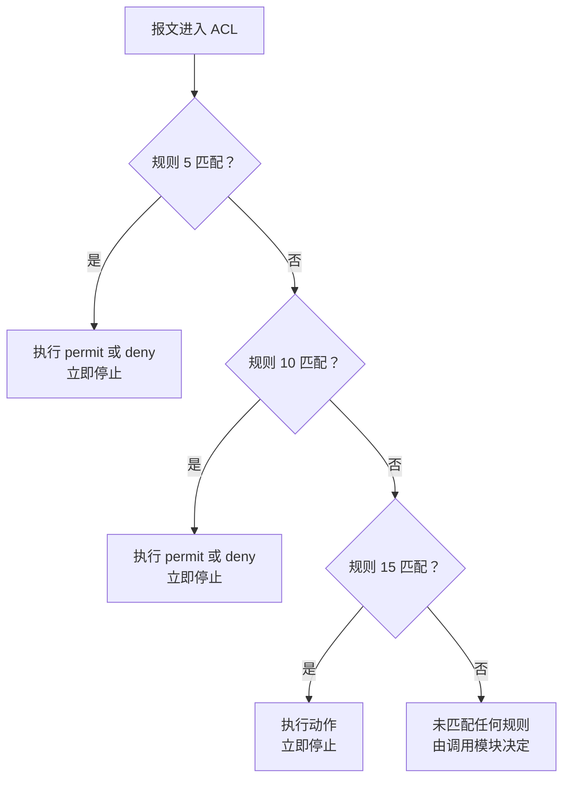
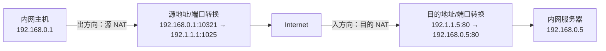
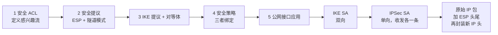

# ACL、NAT 与 IPSec VPN 配置 · 完整笔记

---

## 1.章节定位与知识地图

### 1.1 本节的考查定位

本节对应课程第八章“组网技术”的最后五个小节，内容由“流量控制”逐步过渡到“地址转换”与“安全隧道”，是路由交换知识向网络安全与工程配置延伸的衔接部分。

| 小节 | 主题 | 核心问题 |
| ---- | ---- | -------- |
| p69 | ACL 基本概念与基础配置 | ACL 是什么、如何分类、规则如何匹配、如何编写 |
| p70 | ACL 的应用 | ACL 配置完成后如何被接口、流策略、策略路由、路由策略调用 |
| p71 | NAT 概念及其配置 | 私网与公网地址如何转换，静态、动态、NAPT、Easy IP、NAT Server 如何落地 |
| p72 | IPSec VPN 配置 | AH、ESP、IKE 如何协同，传输模式与隧道模式如何选择，五步配置如何组织 |
| p73 | 扩展内容讲解 | MPLS 基本概念与静态 LSP 配置，IPv4 到 IPv6 的隧道过渡技术 |

考试中，本节既有**概念判断题**，也有**命令填空题**和**案例分析题**。ACL 部分重在读懂规则并判断匹配结果；NAT 部分重在区分类型并识别关键命令；IPSec 部分重在协议组成、封装模式、默认参数与配置步骤；p73 的扩展内容多以“题干给足提示、要求现场推导”的形式出现。

### 1.2 知识地图

| 一级模块 | 二级内容 | 关键输出 |
| -------- | -------- | -------- |
| ACL | 定义、分类、通配符掩码、匹配顺序、默认动作、应用方向 | 能根据 ACL 命令判断允许或拒绝的行为 |
| ACL 应用 | 接口过滤、流策略、策略路由、路由策略、过滤策略 | 能区分五种调用方式的适用场景与命令结构 |
| NAT | 静态 NAT、动态 NAT、NAPT、Easy IP、NAT Server、NAT ALG、双向 NAT | 能根据需求选择 NAT 类型并补全命令 |
| IPSec VPN | AH、ESP、IKE、传输模式、隧道模式、SA | 能说明协议分工、模式差异与五步配置 |
| 扩展 | MPLS、静态 LSP、6to4、ISATAP、GRE、NAT64/DNS64 | 能利用题干上下文完成概念填空与命令填空 |

### 1.3 学习主线

1. 先建立“**ACL 是一张规则表，只有被调用才生效**”的基本认识。
2. 再理解“**匹配顺序决定结果，默认动作由调用者决定**”，这是 ACL 判断题的核心。
3. 在此基础上学习 ACL 的五种典型调用方式：接口过滤、流策略、策略路由、路由策略、过滤策略。
4. 进入 NAT：先分清“源 NAT”与“目的 NAT”，再按“是否有地址池、是否使用端口、公网地址是否固定”区分具体类型。
5. 进入 IPSec：先记三个协议的分工，再记两种封装模式，最后把 ACL、提议、对等体、安全策略、接口应用五步串起来。
6. 最后补充 MPLS 与 IPv6 过渡技术，重点掌握题干阅读与地址格式推导。

---

## 2.ACL 基本概念

### 2.1 ACL 的定义与作用

ACL（Access Control List，访问控制列表）是由一条或多条规则组成的集合，是一种基于报文过滤的规则集合。它根据报文中可提取的字段对流量进行分类，再对匹配成功的报文执行“允许”或“拒绝”动作。

ACL 本身只是一个**匹配工具**，配置完成后并不会自动生效。它必须被某个业务模块调用，例如接口报文过滤、流策略、策略路由、路由策略、NAT 地址选择等，才会对报文或路由产生影响。

ACL 的典型作用包括：

| 作用 | 说明 |
| ---- | ---- |
| 安全访问控制 | 限制特定用户访问特定服务器或网络服务，避免内部资源被随意访问或机密信息泄露 |
| 攻击防范 | 封堵高危端口，过滤异常流量，降低外网攻击内网的风险 |
| 流量分类与智能选路 | 识别不同业务流量，使其走不同的出口链路，提高带宽利用率 |
| 地址转换范围控制 | 在 NAT 中指定哪些内部地址允许被转换 |
| 路由过滤 | 在路由策略中匹配路由条目，控制路由的发布、接收与引入 |

### 2.2 ACL 的匹配对象

ACL 最基本的匹配对象是五元组：

| 字段 | 含义 |
| ---- | ---- |
| 源 IP 地址 | 报文发送方的网络层地址 |
| 目的 IP 地址 | 报文接收方的网络层地址 |
| 源端口号 | 传输层发送方端口 |
| 目的端口号 | 传输层接收方端口 |
| 协议类型 | TCP、UDP、ICMP、IP 等 |

在此基础上，不同种类的 ACL 还可以匹配更多字段：

- 分片信息；
- 生效时间段；
- ICMP 类型；
- TCP 标志位；
- 以太网帧头中的源 MAC、目的 MAC、以太网帧类型；
- VLAN 信息；
- 用户或用户组信息。

### 2.3 ACL 的分类与编号

华为 VRP 按规则功能将 ACL 分为基本 ACL、高级 ACL、二层 ACL、用户自定义 ACL 和用户 ACL。编号范围是区分类型的第一依据，考试中经常直接考查。

| 类型 | 编号范围 | 主要匹配字段 | 特点 |
| ---- | -------- | ------------ | ---- |
| 基本 ACL | 2000 至 2999 | 源 IP 地址、分片信息、生效时间段 | 匹配简单，只能判断“来自哪里” |
| 高级 ACL | 3000 至 3999 | 源/目的 IP、协议类型、ICMP 类型、TCP/UDP 源/目的端口、生效时间段 | 匹配精细，可精确到业务 |
| 二层 ACL | 4000 至 4999 | 源 MAC、目的 MAC、以太网帧类型等 | 根据以太网帧头定义规则 |
| 用户自定义 ACL | 5000 至 5999 | 报文偏移位置的任意字段 | 灵活度高，可实现特殊匹配 |
| 用户 ACL | 6000 至 9999 | 用户、用户组等 | 面向用户身份的访问控制 |

课程重点考查基本 ACL 与高级 ACL。二者的区别首先体现在编号上：

- 看到编号 **2000 至 2999**，应判断为基本 ACL；
- 看到编号 **3000 至 3999**，应判断为高级 ACL；
- 看到 `acl-adv` 或 `advance` 提示，应判断为高级 ACL（`advanced` 是笔误，设备不识别）。

### 2.4 通配符掩码

ACL 中源地址、目的地址后面的掩码不是普通的子网掩码，而是**通配符掩码**，也称反掩码。

通配符掩码的规则是：

| 位值 | 含义 |
| ---- | ---- |
| 0 | 该位必须与配置地址一致，参与匹配 |
| 1 | 该位不关心，不参与匹配 |

因此，对于连续的地址段，通配符掩码等于“255.255.255.255 减去子网掩码”。

| 要匹配的范围 | 子网掩码 | 通配符掩码 | 说明 |
| ------------ | -------- | ---------- | ---- |
| 192.168.1.0/24 | 255.255.255.0 | 0.0.0.255 | 匹配 192.168.1.0 至 192.168.1.255 |
| 192.168.0.0/16 | 255.255.0.0 | 0.0.255.255 | 匹配 192.168.0.0 至 192.168.255.255 |
| 10.1.1.0/24 | 255.255.255.0 | 0.0.0.255 | 匹配 10.1.1.0 至 10.1.1.255 |
| 单台主机 192.168.1.1 | 255.255.255.255 | 0.0.0.0 | 只匹配该主机 |
| 任意地址 | 0.0.0.0 | 255.255.255.255 | 等价于 `any` |
| 10.0.35.0/30 | 255.255.255.252 | 0.0.0.3 | 只有 .1 与 .2 两个可用主机地址 |

要点：

- 基本 ACL 和高级 ACL 都使用反掩码，不是正掩码。
- 反掩码不仅用于 ACL，也用于 OSPF 的 `network` 命令，是考试中常见的“挖坑点”。
- 对于不连续的掩码，不能简单相减，应按“0 匹配、1 不关心”的二进制含义逐位计算。
- `source any` 与 `source 0.0.0.0 255.255.255.255` 等价。
- 主机地址既可以写成 `source 192.168.1.1 0`，也可以写成 `source 192.168.1.1 0.0.0.0`。

### 2.5 规则的匹配顺序

ACL 中的规则按规则编号排列，报文从第一条规则开始逐条向下匹配。**一旦某条规则匹配成功，就立即执行该规则的动作，不再继续向下匹配。**

华为 VRP 支持两种匹配顺序：

| 匹配顺序 | 关键字 | 含义 |
| -------- | ------ | ---- |
| 配置顺序 | `config` | 按规则编号从小到大匹配，缺省方式 |
| 自动排序 | `auto` | 按“深度优先”原则自动排序，条件更精确的规则优先 |

配置顺序是默认方式。使用配置顺序时，规则编号决定匹配先后，因此规则的**书写顺序非常重要**。具有严格限制条件的规则应尽量靠前，范围较宽的规则应靠后，否则宽规则会提前匹配，使后面的精确规则失效。

规则编号可以手动指定，也可以由设备自动分配。自动分配时，相邻规则编号之间有一个步长，缺省步长为 5，即 5、10、15、20 依次递增，便于后续在两条规则之间插入新规则。步长可以在 ACL 视图下通过 `step` 命令修改。

例如，已有规则 5、10、15，若需要在 5 与 10 之间插入一条规则，可以使用规则编号 7 或 8。若步长设置为 10，则编号变为 10、20、30，插入空间更大。



### 2.6 默认动作与匹配结果

ACL 本身不定义“最后一条规则”，报文未匹配任何规则时的处理结果由**调用 ACL 的业务模块**决定。这一点是概念题的高频考点。

| 调用场景 | 未匹配任何规则时的缺省行为 |
| -------- | -------------------------- |
| 接口报文过滤 `traffic-filter` | 允许报文通过 |
| 流策略中的 ACL 匹配 | ACL 的 `permit` 表示“匹配成功”，`deny` 表示“不匹配”，最终动作由流行为决定 |
| 路由策略中的 ACL 匹配 | 未匹配时继续检查下一个节点 |
| 防火墙安全策略 | 缺省拒绝 |
| VTY/Telnet 登录（`acl ... inbound`） | 拒绝；ACL 有规则但登录报文未匹配时，用户不能登录（只有匹配 permit 规则的源可登录） |
| NAT 中的 ACL | 只有匹配 `permit` 的流量才进入 NAT 转换 |

课程中的结论可以概括为：

- **路由器上的 ACL 主要用于指路和路由过滤，未匹配时通常是隐含允许**（VTY 登录是例外，未匹配即拒绝）；
- **防火墙上的 ACL 服务于安全策略，未匹配时通常是隐含拒绝**；
- 不同厂商的默认规则并不相同，思科设备的默认条件更多、更复杂；考试以华为 VRP 的行为为准；
- 若希望实现“白名单”效果，接口 `traffic-filter` 场景必须在 ACL 末尾显式添加 `rule deny`，不能依赖默认动作；VTY 登录场景未匹配即拒绝，可不加。

同时需要注意：ACL 只对**经过设备的转发流量**生效，不能过滤设备自身产生的流量。设备本地产生的报文不经过接口的入方向或出方向处理，因此不受接口 ACL 控制。

### 2.7 ACL 的部署位置与应用方向

ACL 在接口上应用时必须指定方向：

| 方向 | 含义 | 检查时机 |
| ---- | ---- | -------- |
| `inbound` | 入方向 | 报文从该接口进入设备时检查 |
| `outbound` | 出方向 | 报文从该接口离开设备时检查 |

方向的判断应以“报文相对于接口的流向”为准，而不是以“内网到外网”或“外网到内网”这种业务方向为准。

部署位置遵循以下原则：

| ACL 类型 | 推荐部署位置 | 原因 |
| -------- | ------------ | ---- |
| 基本 ACL | 尽量靠近目的端 | 基本 ACL 只根据源地址判断，若靠近源端，可能把该源访问其他合法目标时的流量一并拒绝 |
| 高级 ACL | 尽量靠近源端 | 高级 ACL 匹配精细，靠近源端可尽早丢弃非法流量，节省带宽和后续设备处理资源 |

例如，某源主机允许访问目的 A，但拒绝访问目的 B。若在源端用基本 ACL 拒绝该源，则访问目的 A 的流量也会被误杀；把基本 ACL 放在目的 B 侧，才能只影响目的 B 的访问。反之，高级 ACL 已经能够精确到目的地址和端口，放在源端不会误伤其他业务，还能尽早过滤。

---

## 3.ACL 的基础配置

### 3.1 基本 ACL 的配置命令

基本 ACL 的编号范围为 2000 至 2999，只能使用源 IP 地址、分片信息和生效时间段定义规则。

**按编号创建：**

```
[HUAWEI] acl number 2000
[HUAWEI-acl-basic-2000] rule 5 permit source 192.168.1.0 0.0.0.255
[HUAWEI-acl-basic-2000] rule 10 deny source 192.168.2.0 0.0.0.255
[HUAWEI-acl-basic-2000] quit
```

**按名称创建：**

```
[HUAWEI] acl name filter basic
[HUAWEI-acl-basic-filter] rule 5 permit source 192.168.1.0 0.0.0.255
[HUAWEI-acl-basic-filter] quit
```

命令说明：

| 命令片段 | 含义 |
| -------- | ---- |
| `acl number 2000` | 创建编号为 2000 的基本 ACL |
| `acl name filter basic` | 创建名为 filter 的基本 ACL |
| `match-order auto` | 设置为自动排序；缺省为 `config` |
| `rule 5` | 规则编号为 5，省略时由设备按步长自动分配 |
| `permit` | 允许匹配的报文通过 |
| `deny` | 拒绝匹配的报文通过 |
| `source 192.168.1.0 0.0.0.255` | 匹配源地址属于 192.168.1.0/24 的报文 |
| `time-range mytime` | 仅在指定时间段内生效 |
| `fragment` | 仅匹配分片报文 |

基本 ACL 的规则也可以只写 `rule permit` 或 `rule deny`，表示匹配任意源地址。

### 3.2 高级 ACL 的配置命令

高级 ACL 的编号范围为 3000 至 3999，可以使用源/目的 IP 地址、IP 协议类型、ICMP 类型、TCP/UDP 源/目的端口号、生效时间段等定义规则。

**按编号创建：**

```
[HUAWEI] acl number 3000
[HUAWEI-acl-adv-3000] rule 5 permit tcp source 202.110.10.0 0.0.0.255 destination 179.100.17.8 0 destination-port eq 80
[HUAWEI-acl-adv-3000] rule 10 deny ip
[HUAWEI-acl-adv-3000] quit
```

**按名称创建：**

```
[HUAWEI] acl name adv advance
[HUAWEI-acl-adv-adv] rule 5 permit tcp source 202.110.10.0 0.0.0.255 destination 179.100.17.8 0 destination-port eq 80
[HUAWEI-acl-adv-adv] quit
```

命令说明：

| 命令片段 | 含义 |
| -------- | ---- |
| `acl name adv advance` | 创建名为 adv 的高级 ACL，关键字是 `advance`，不是 `advanced` |
| `rule 5 permit tcp` | 匹配 TCP 协议报文 |
| `source ... destination ...` | 同时指定源地址与目的地址 |
| `destination-port eq 80` | 目的端口等于 80，即 HTTP 服务 |
| `source-port` | 源端口，省略时表示任意源端口 |
| `icmp-type` | 匹配特定 ICMP 类型 |
| `time-range` | 指定规则生效时间段 |
| `fragment` | 仅匹配分片报文 |

高级 ACL 的匹配能力明显强于基本 ACL。例如，拒绝目的端口 80 只阻断 HTTP，不会阻断 HTTPS；HTTPS 使用 443 端口，需要另外配置规则。

### 3.3 端口匹配与比较关键字

高级 ACL 的端口字段支持以下比较关键字：

| 关键字 | 含义 | 示例 |
| ------ | ---- | ---- |
| `eq` | 等于 | `destination-port eq 80` |
| `gt` | 大于 | `destination-port gt 1024` |
| `lt` | 小于 | `destination-port lt 1024` |
| `neq` | 不支持（华为 VRP 规则无此关键字） | 需要“不等于”时用 permit/deny 组合 |
| `range` | 指定范围 | `destination-port range 80 443` |

端口号既可以直接写数字，也可以写协议对应的知名服务名：

| 服务 | 端口 | 服务名写法 |
| ---- | ---- | ---------- |
| FTP 控制连接 | 21 | `ftp` |
| Telnet | 23 | `telnet` |
| SMTP | 25 | `smtp` |
| DNS | 53 | `domain` |
| HTTP | 80 | `www` |
| HTTPS | 443 | `https` |

需要注意的是，`eq 80` 与 `eq www` 等价，但只匹配 HTTP。若题目要求同时阻断 HTTP 与 HTTPS，必须分别写 80 与 443，或使用 `range` 覆盖相应范围。

### 3.4 生效时间段的配置

生效时间段通过 `time-range` 定义，然后在 ACL 规则中引用。

```
[HUAWEI] time-range mytime 09:00 to 12:00 working-day
[HUAWEI] time-range mytime 14:00 to 17:00 working-day
[HUAWEI] acl 2000
[HUAWEI-acl-basic-2000] rule permit source 192.168.20.1 0 time-range mytime
[HUAWEI-acl-basic-2000] quit
```

常用时间格式：

| 格式 | 含义 |
| ---- | ---- |
| `HH:MM to HH:MM` | 指定每天的时间段 |
| `HH:MM to HH:MM working-day` | 工作日生效，通常指周一至周五 |
| `HH:MM to HH:MM off-day` | 休息日生效，通常指周六、周日 |
| `HH:MM to HH:MM daily` | 每天生效 |
| `HH:MM to HH:MM all-day` | 全天生效 |
| `from HH:MM YYYY/MM/DD to HH:MM YYYY/MM/DD` | 绝对时间段，指定起止日期与时刻 |
| `Monday`、`Tuesday` 等 | 指定星期几 |

同一个 `time-range` 名称下可以配置多条时间语句。不同版本对“周期时间段与绝对时间段”的组合关系表述略有差异：

- 经典 VRP 文档多表述为：同类型的多个周期时间段之间取并集，同类型的多个绝对时间段之间取并集，周期时间段与绝对时间段之间取交集；
- 部分版本文档表述为：周期时间段与绝对时间段之间取并集。

考试中应以题干所给版本的语义为准；若题目只要求判断“某个具体时刻是否在时间段内”，可以直接把该时刻分别代入各条语句，再按“与”或“或”的题意判断。无论采用交集还是并集，只要该时刻落在至少一条有效语句内，规则就可能生效。

### 3.5 配置示例一：按源网段过滤

**示例 1：允许源 IP 为 202.110.10.0/24 的报文通过，拒绝源 IP 为 192.110.10.0/24 的报文通过。**

```
[HUAWEI] acl number 2002
[HUAWEI-acl-basic-2002] rule permit source 202.110.10.0 0.0.0.255
[HUAWEI-acl-basic-2002] rule deny source 192.110.10.0 0.0.0.255
[HUAWEI-acl-basic-2002] quit
```

分析：

| 报文源地址 | 匹配结果 | 最终动作 |
| ---------- | -------- | -------- |
| 202.110.10.0/24 | 第一条规则 | 允许 |
| 192.110.10.0/24 | 第二条规则 | 拒绝 |
| 其他地址 | 未匹配任何规则 | 由调用模块决定，`traffic-filter` 下缺省允许 |

因此，若题目要求“只允许 202.110.10.0/24，其他全部拒绝”，必须在末尾补充：

```
[HUAWEI-acl-basic-2002] rule 20 deny source any
```

**示例 2：允许源 IP 为 202.110.10.0/24、目的 IP 为 179.100.17.8 的 HTTP 报文通过。**

```
[HUAWEI] acl number 3000
[HUAWEI-acl-adv-3000] rule permit tcp source 202.110.10.0 0.0.0.255 destination 179.100.17.8 0 destination-port eq 80
[HUAWEI-acl-adv-3000] quit
```

分析：

- 编号 3000 说明这是高级 ACL；
- `tcp` 限定协议；
- `source` 与 `destination` 同时限定源和目的；
- `destination-port eq 80` 限定 HTTP；
- 该规则只允许 HTTP，HTTPS 使用 443 端口，不会匹配此规则。

### 3.6 配置示例二：基于时间的访问控制

```
[HUAWEI] time-range mytime 09:00 to 12:00 working-day
[HUAWEI] time-range mytime 14:00 to 17:00 working-day
[HUAWEI] acl 2000
[HUAWEI-acl-basic-2000] rule permit source 192.168.10.0 0.0.0.255
[HUAWEI-acl-basic-2000] rule permit source 192.168.20.1 0 time-range mytime
[HUAWEI-acl-basic-2000] rule deny source any
[HUAWEI-acl-basic-2000] quit
```

分析：

| 源地址 | 生效条件 | 结果 |
| ------ | -------- | ---- |
| 192.168.10.0/24 | 任意时间 | 允许 |
| 192.168.20.1 | 工作日 09:00 至 12:00 或 14:00 至 17:00 | 允许 |
| 192.168.20.1 | 上述时间段之外 | 不匹配第二条，最终被 `deny any` 拒绝 |
| 其他地址 | 任意时间 | 被 `deny any` 拒绝 |

要点：

- `time-range` 只约束引用它的那一条规则，不会约束整个 ACL。
- 第一条规则没有引用时间段，因此 192.168.10.0/24 始终允许。
- 最后一条 `rule deny source any` 使未匹配的流量被拒绝，形成白名单效果。
- 若没有最后一条拒绝规则，未匹配流量在 `traffic-filter` 下会被默认允许。

### 3.7 课堂习题一：ACL 基本概念

**题目：以下关于访问控制列表的论述中，错误的是（ ）。**

A、访问控制列表要在路由器全局模式下配置

B、具有严格限制条件的语句应放在访问控制列表的最后

C、每一个有效的访问控制列表至少应包含一条允许语句

D、访问控制列表不能过滤由路由器自己产生的数据

**答案：B**

**解析：**

| 选项 | 判断 | 理由 |
| ---- | ---- | ---- |
| A | [正确] | ACL 通常在系统视图（全局模式）下创建，再进入 ACL 视图配置规则 |
| B | [错误] | ACL 按顺序匹配，严格限制条件的语句应放在前面；放在最后可能永远匹配不到 |
| C | [正确] | 课程按“至少一条允许语句”作为有效 ACL 的基本要求；若全部为拒绝，需明确业务意图 |
| D | [正确] | ACL 只过滤经过设备的转发流量，不过滤设备自身产生的本地流量 |

本题的核心是匹配顺序：**范围窄、条件严格的规则在前，范围宽的规则在后，默认规则在最后**。

### 3.8 课堂习题二：FTP 访问权限分析

**题目：使用基本 ACL 限制 FTP 访问权限，从给出的 Switch 配置文件判断可以实现的策略是（ ）。**

① PC1 在任何时间都可以访问 FTP

② PC2 在 2018 年的周一不能访问 FTP

③ PC2 在 2018 年的周六下午 3 点可以访问 FTP

④ PC3 在任何时间不能访问 FTP

A、①②③④

B、①②④

C、②③

D、①③④

**Switch 主要配置：**

```
sysname Sw3
FTP server enable
ftp acl 2001
time-range ftp-access 14:00 to 18:00 all-day
time-range ftp-access from 00:00 2018/1/1 to 23:59 2018/12/31
acl number 2001
 rule 5 permit ip source 172.16.105.0 0.0.0.255
 rule 10 deny ip source 172.16.107.0 0.0.0.255 time-range ftp-access
 rule 15 deny
quit
```

配置文件后半部分为 AAA 本地用户配置（`local-user huawei ...`，包括密码、级别、FTP 目录与服务类型），用于 FTP 登录认证，与本题 ACL 权限判断无关，故不展开。

**拓扑地址：**

| 主机 | 地址 |
| ---- | ---- |
| PC1 | 172.16.105.111/24 |
| PC2 | 172.16.107.111/24 |
| PC3 | 10.10.10.1/24 |
| Switch | 172.16.111.104/24 |

**答案：B（①②④）**

**逐项分析：**

| 语句 | 判断 | 理由 |
| ---- | ---- | ---- |
| ① | [正确] | PC1 属于 172.16.105.0/24，匹配 rule 5，任意时间允许 |
| ② | [正确] | PC2 属于 172.16.107.0/24，rule 10 在 ftp-access 时间段内拒绝；2018 年全年都在绝对时间段内，周一自然被拒绝 |
| ③ | [错误] | 2018 年周六 15:00 落在 14:00 至 18:00 的周期时间段内，同时落在 2018 年绝对时间段内，rule 10 生效，PC2 被拒绝，不能访问 |
| ④ | [正确] | PC3 不属于前两个网段，未匹配 rule 5 与 rule 10，最终匹配 rule 15 的拒绝规则 |

本题的易错点在于把“时间段生效”误解为“允许访问”。实际上，`time-range` 只是让 `deny` 规则在指定时间内生效，落在时间段内意味着**拒绝**，而不是允许。

---

## 4.ACL 的调用方式

ACL 配置完成后只是一张规则表，必须被具体业务调用才会生效。常见调用方式包括：

| 调用方式 | 作用层次 | 典型用途 |
| -------- | -------- | -------- |
| 接口报文过滤 `traffic-filter` | 转发平面 | 在接口入/出方向直接允许或拒绝报文 |
| 流策略 `traffic-policy` | 转发平面 | 基于 MQC 进行过滤、重标记、限速、重定向等 |
| 策略路由 `policy-based-route` | 转发平面 | 按策略指定报文的下一跳或出接口 |
| 路由策略 `route-policy` | 控制平面 | 过滤或修改路由条目 |
| 过滤策略 `filter-policy` | 控制平面 | 对接收或发布的路由进行过滤 |

### 4.1 接口报文过滤 traffic-filter

接口报文过滤是最简单的调用方式，直接在接口视图下引用 ACL，并指定方向。

```
[HUAWEI] interface GigabitEthernet0/0/1
[HUAWEI-GigabitEthernet0/0/1] traffic-filter inbound acl 3000
[HUAWEI-GigabitEthernet0/0/1] quit
```

| 命令片段 | 含义 |
| -------- | ---- |
| `traffic-filter` | 启用接口报文过滤 |
| `inbound` | 检查从该接口进入设备的报文 |
| `outbound` | 检查从该接口离开设备的报文 |
| `acl 3000` | 引用编号为 3000 的 ACL |

特点：

- 直接作用于报文，配置简单；
- 只对经过接口的转发流量生效，不过滤设备自身产生的流量；
- 方向必须与流量实际流向一致，否则规则不生效；
- 未匹配任何规则时，缺省允许报文通过。

### 4.2 流策略 traffic-policy

流策略基于 MQC（Modular QoS Command-Line，模块化 QoS 命令行）架构，把“分类、行为、策略”拆成三个部分：

| 组成部分 | 作用 | 关键命令 |
| -------- | ---- | -------- |
| 流分类 `traffic classifier` | 定义“匹配谁” | `if-match acl` 等 |
| 流行为 `traffic behavior` | 定义“匹配后做什么” | `permit`、`deny`、`redirect`、`remark` 等 |
| 流策略 `traffic policy` | 把流分类与流行为绑定 | `classifier ... behavior ...` |

流策略比接口过滤更灵活：它不仅能允许或拒绝报文，还可以执行重标记、重定向、限速、流量整形、优先级调整等动作。

**配置示例：**

```
[HUAWEI] acl 2001
[HUAWEI-acl-basic-2001] rule deny ip source 192.168.1.0 0.0.0.255
[HUAWEI-acl-basic-2001] quit

[HUAWEI] traffic classifier c_zy
[HUAWEI-classifier-c_zy] if-match acl 2001
[HUAWEI-classifier-c_zy] quit

[HUAWEI] traffic behavior b_zy
[HUAWEI-behavior-b_zy] deny
[HUAWEI-behavior-b_zy] quit

[HUAWEI] traffic policy p_zy
[HUAWEI-trafficpolicy-p_zy] classifier c_zy behavior b_zy
[HUAWEI-trafficpolicy-p_zy] quit

[HUAWEI] interface Ethernet0/0/1
[HUAWEI-Ethernet0/0/1] traffic-policy p_zy inbound
[HUAWEI-Ethernet0/0/1] quit
```

说明：

- 课件示例中 ACL 编号为 2001，而流分类写成 `if-match acl 3000`，前后不一致，应修正为 `if-match acl 2001`。
- 在 MQC 中，ACL 的 `permit` 表示“匹配成功”，`deny` 表示“不匹配”；最终是允许还是拒绝，由流行为的动作决定。
- 流策略必须应用到接口的某个方向才会生效。

### 4.3 策略路由 PBR

策略路由（Policy-Based Routing，PBR）是一种**转发平面**策略。设备收到报文后，先查找策略路由表；若匹配成功，按策略指定的下一跳或出接口转发；若匹配失败，再查找普通路由表。

策略路由的特点：

| 特点 | 说明 |
| ---- | ---- |
| 不影响路由表 | 只额外生成一张策略表，不改变原有路由表项 |
| 匹配灵活 | 可基于源地址、目的地址、协议类型、报文大小等制定策略 |
| 需逐跳配置 | 需要在路径上的设备手工配置，才能保证报文按策略转发 |
| 优先级高于普通路由 | 先查策略路由，再查路由表 |

**基本命令：**

```
[HUAWEI] policy-based-route zy permit node 10
[HUAWEI-policy-based-route-zy-10] if-match acl 3000
[HUAWEI-policy-based-route-zy-10] apply ip-address next-hop 202.1.2.3
[HUAWEI-policy-based-route-zy-10] quit
```

也可以指定出接口：

```
[HUAWEI-policy-based-route-zy-10] apply output-interface GigabitEthernet0/0/1
```

最后在接口上调用：

```
[HUAWEI] interface GigabitEthernet0/0/0
[HUAWEI-GigabitEthernet0/0/0] ip policy-based-route zy
[HUAWEI-GigabitEthernet0/0/0] quit
```

命令说明：

| 命令 | 含义 |
| ---- | ---- |
| `policy-based-route zy permit node 10` | 创建名为 zy 的策略路由，节点 10 的动作是 permit |
| `if-match acl 3000` | 匹配 ACL 3000 定义的流量 |
| `apply ip-address next-hop` | 指定下一跳地址 |
| `apply output-interface` | 指定出接口 |
| `ip policy-based-route zy` | 在接口上应用策略路由 |

### 4.4 基于 PBR 的出站智能选路

**场景：** 内网有两个网段：

- 网段 1：10.1.1.0/24；
- 网段 2：10.1.2.0/24。

要求网段 1 访问 Internet 走 ISP1，网段 2 访问 Internet 走 ISP2；同时 RTA 旁挂一台服务器 10.1.3.254，策略路由不能影响内网用户访问该服务器。

**配置思路：**

1. 用 ACL 匹配“需要走策略路由的流量”；
2. 对访问服务器的流量执行 `deny`，使其不进入策略路由，回落到普通路由表；
3. 对访问 Internet 的流量执行 `permit`，使其进入策略路由；
4. 创建 PBR 节点，分别指定 ISP1 与 ISP2 的下一跳；
5. 在接口上应用 PBR。

**ACL 配置：**

```
[RTA] acl number 3000
[RTA-acl-adv-3000] rule 1 deny ip source 10.1.1.0 0.0.0.255 destination 10.1.3.254 0
[RTA-acl-adv-3000] rule 2 permit ip source 10.1.1.0 0.0.0.255 destination 0.0.0.0 255.255.255.255
[RTA-acl-adv-3000] quit

[RTA] acl number 3001
[RTA-acl-adv-3001] rule 1 deny ip source 10.1.2.0 0.0.0.255 destination 10.1.3.254 0
[RTA-acl-adv-3001] rule 2 permit ip source 10.1.2.0 0.0.0.255 destination 0.0.0.0 255.255.255.255
[RTA-acl-adv-3001] quit
```

这里的 `deny` 不是“丢弃报文”，而是“**不匹配该 ACL**”，使访问服务器的流量不进入对应的 PBR 节点，从而按普通路由表转发。

**PBR 配置：**

```
[RTA] policy-based-route zy permit node 10
[RTA-policy-based-route-zy-10] if-match acl 3000
[RTA-policy-based-route-zy-10] apply ip-address next-hop 202.1.2.3
[RTA-policy-based-route-zy-10] quit

[RTA] policy-based-route zy permit node 20
[RTA-policy-based-route-zy-20] if-match acl 3001
[RTA-policy-based-route-zy-20] apply ip-address next-hop 154.1.2.3
[RTA-policy-based-route-zy-20] quit

[RTA] interface GigabitEthernet0/0/0
[RTA-GigabitEthernet0/0/0] ip policy-based-route zy
[RTA-GigabitEthernet0/0/0] quit
```

**效果：**

| 流量 | 匹配结果 | 转发路径 |
| ---- | -------- | -------- |
| 网段 1 访问服务器 10.1.3.254 | ACL 3000 的 rule 1 命中 `deny`，不进入 PBR | 按普通路由表转发 |
| 网段 1 访问 Internet | ACL 3000 的 rule 2 命中 `permit`，进入 PBR 节点 10 | 下一跳 202.1.2.3，走 ISP1 |
| 网段 2 访问服务器 10.1.3.254 | ACL 3001 的 rule 1 命中 `deny`，不进入 PBR | 按普通路由表转发 |
| 网段 2 访问 Internet | ACL 3001 的 rule 2 命中 `permit`，进入 PBR 节点 20 | 下一跳 154.1.2.3，走 ISP2 |

除 PBR 外，智能选路还可以通过静态路由的等价路由、缺省路由、链路权重、链路优先级等方式实现。静态路由配置简单，但无法根据源地址灵活分流；PBR 则可以根据源地址、目的地址、协议等条件精细控制。

### 4.5 路由策略的基本概念

路由策略（Routing Policy）作用于**控制平面**，在路由协议发布、接收或引入路由信息时实施策略，对路由进行过滤或修改路由属性。

典型用途：

- 避免双向路由引入造成路由环路；
- 控制某些路由不被发布或接收；
- 修改路由的 cost、preference、tag 等属性；
- 实现路由的分层与可控引入。

常用工具：

| 工具 | 作用 | 是否修改路由属性 |
| ---- | ---- | ---------------- |
| `filter-policy` | 对接收或发布的路由进行过滤 | 否，只过滤 |
| `route-policy` | 过滤路由并修改路由属性 | 是，可通过 `apply` 修改 |
| `ip-prefix` | 精确匹配路由的网络号与前缀长度 | 否，只匹配 |

### 4.6 过滤策略 Filter-Policy

`filter-policy` 按方向分为 `import` 与 `export`，但并非所有协议都支持两个方向：

| 协议 | `import` | `export` |
| ---- | -------- | -------- |
| OSPF | 支持，过滤计算出的路由是否加入本地路由表 | 不支持，OSPF 靠 LSA 泛洪发布路由，不按路由表发布 |
| BGP | 支持，过滤从对等体收到的路由 | 支持，控制向对等体发布的路由 |

通用命令形式如下，`import` 与 `export` 是否可用取决于协议：

```
filter-policy { acl-number | ip-prefix ip-prefix-name } import
filter-policy { acl-number | ip-prefix ip-prefix-name } export
```

| 方向 | 含义 |
| ---- | ---- |
| `import` | 对协议接收的路由进行过滤 |
| `export` | 对协议发布的路由进行过滤 |

**配置示例：利用路由过滤避免路由环路**

拓扑中 OSPF 与 IS-IS 双向引入路由。为避免从 IS-IS 引入的 2.0.0.0/8 路由再次被引入 OSPF 形成环路，可在 OSPF 进程中过滤该路由：

```
acl 2001
 rule 0 deny source 2.0.0.0 0.255.255.255
 rule 1 permit
quit

ospf 1
 filter-policy 2001 import
quit
```

分析：

- `rule 0 deny source 2.0.0.0 0.255.255.255` 拒绝 2.0.0.0/8；
- `rule 1 permit` 允许其他所有路由；
- `filter-policy 2001 import` 在 OSPF 接收路由时应用该过滤策略；
- 结果是 2.0.0.0/8 不进入本机 OSPF 路由表，其他路由正常接收；但该路由的 LSA 仍会继续泛洪，其他路由器不一定受此过滤影响。

对于 OSPF，只能使用 `import` 方向过滤，且要理解它的作用边界：`filter-policy import` 只决定“算出来的路由要不要装进本机路由表”，**不会阻止 LSA 继续泛洪**，其他路由器仍可能学到该路由。若要真正阻止路由传播，应使用区域汇总、特殊区域（Stub/NSSA）或在 ABR/ASBR 上控制 LSA 的产生。

### 4.7 地址前缀列表 ip-prefix

ACL 在匹配路由时存在精度不足的问题。例如，路由表中有两条静态路由：

- 192.168.0.0/16；
- 192.168.0.0/24。

若只想把 192.168.0.0/16 重发布到 OSPF，使用基本 ACL：

```
acl 2001
 rule permit source 192.168.0.0 0.0.255.255
quit
```

该规则会同时匹配 192.168.0.0/16 与 192.168.0.0/24，因为 ACL 只比较地址范围，不比较掩码长度。此时无论怎样调整地址范围，都难以精确区分“包含关系”的两条路由。

地址前缀列表 `ip-prefix` 同时匹配**网络号**与**前缀长度**，可以精确区分：

```
[R2] ip ip-prefix zongy index 10 permit 192.168.0.0 16
[R2] filter-policy ip-prefix zongy import
```

| 命令片段 | 含义 |
| -------- | ---- |
| `ip ip-prefix zongy` | 创建名为 zongy 的地址前缀列表 |
| `index 10` | 索引号为 10，缺省步长为 10 |
| `permit 192.168.0.0 16` | 只允许 192.168.0.0/16 |
| `filter-policy ip-prefix zongy import` | 在 OSPF 接收方向应用前缀列表 |

`ip-prefix` 还支持范围匹配：

```
ip ip-prefix zongy index 10 permit 192.168.0.0 16 greater-equal 16 less-equal 24
```

表示匹配 192.168.0.0/16 至 192.168.0.0/24 的前缀长度范围。未匹配任何前缀列表条目的路由，缺省被拒绝。

### 4.8 路由策略 Route-Policy

`route-policy` 是比 `filter-policy` 更复杂的策略工具，由多个节点（node）组成，每个节点包含 `if-match` 条件与 `apply` 动作。

```
[HUAWEI] route-policy RP1 permit node 10
[HUAWEI-route-policy] if-match ip-prefix huawei
[HUAWEI-route-policy] apply tag 200
[HUAWEI-route-policy] quit
```

**if-match 常用条件：**

| 条件 | 含义 |
| ---- | ---- |
| `if-match acl` | 匹配 ACL |
| `if-match ip-prefix` | 匹配地址前缀列表 |
| `if-match cost` | 匹配路由开销 |
| `if-match interface` | 匹配出接口 |
| `if-match tag` | 匹配路由标记 |

**apply 常用动作：**

| 动作 | 含义 |
| ---- | ---- |
| `apply cost` | 修改路由开销 |
| `apply cost-type`（type-1 或 type-2） | 修改 OSPF 外部路由开销类型 |
| `apply ip-address next-hop` | 修改下一跳 |
| `apply preference` | 修改路由优先级 |
| `apply tag` | 设置路由标记 |

### 4.9 Route-Policy 的匹配规则

Route-Policy 的匹配过程可以理解为“逐节点、逐条件”的两级判断：

1. 按节点号从小到大逐个检查；
2. 先检查该节点的全部 `if-match` 条件，没有 `if-match` 的节点视为匹配所有路由；
3. 同一节点内的多个 `if-match` 条件是“与”的关系，必须全部满足才算匹配该节点；
4. 条件满足时再看节点动作：`permit` 执行 `apply` 并放行，`deny` 直接拒绝；
5. 条件不满足时进入下一个节点，既不拒绝也不放行；
6. 所有节点都不匹配，缺省拒绝。

可以概括为：

| 节点动作 | if-match 结果 | 最终结果 |
| -------- | ------------- | -------- |
| `permit` | 全部满足 | 允许，并执行 `apply` |
| `permit` | 任一不满足 | 进入下一节点 |
| `deny` | 全部满足 | 拒绝 |
| `deny` | 任一不满足 | 进入下一节点 |
| 无节点匹配 | — | 缺省拒绝 |

课程中用“两道门”作比喻：第一道门是该节点的 `if-match` 条件，第二道门才是节点动作。条件不满足时只是“换下一个节点再试”，并不等于拒绝；只有条件满足且动作为 `deny` 时才被拒绝，条件满足且动作为 `permit` 时才执行 `apply` 放行。

### 4.10 路由策略与策略路由的对比

| 比较项 | 路由策略 | 策略路由 |
| ------ | -------- | -------- |
| 作用平面 | 控制平面 | 转发平面 |
| 是否影响路由表 | 会，过滤或修改路由表项 | 不会，只额外生成策略表 |
| 匹配依据 | 主要基于目的地址、路由属性 | 可基于源地址、目的地址、协议类型、报文大小等 |
| 与路由协议的关系 | 与路由协议结合使用 | 需手工逐跳配置 |
| 典型工具 | Route-Policy、Filter-Policy、ip-prefix | Policy-Based-Route |
| 典型用途 | 路由过滤、路由引入、避免环路、修改属性 | 智能选路、分流、指定下一跳或出接口 |

核心区别只有一句话：**路由策略影响“路由表怎么生成”，策略路由影响“报文怎么转发”，后者不改变路由表。**

### 4.11 配置实例：Route-Policy 控制路由引入

**场景：** 在 IS-IS 引入 OSPF 路由时，使用 Route-Policy 过滤特定路由，避免双向引入造成环路。

```
acl 2001
 rule 10 deny source 10.1.0.0 0.0.255.255
 rule 20 permit
quit

route-policy RP1 permit node 10
 if-match acl 2001
quit

isis 1
 import-route ospf 1 route-policy RP1
quit
```

分析：

- ACL 2001 拒绝 10.1.0.0/16，允许其他路由；
- Route-Policy RP1 的节点 10 动作为 `permit`，条件为匹配 ACL 2001；
- `import-route ospf 1 route-policy RP1` 表示在引入 OSPF 路由时参考 RP1；
- 只有通过 RP1 的路由才会被引入 IS-IS。

使用 `tag` 可以进一步简化策略。例如，在路由产生时打上标记，引入时直接匹配标记，无需逐条匹配 IP 地址，既提高效率，也降低配置出错概率。

---

## 5.NAT 基本概念

### 5.1 NAT 的产生背景

IPv4 地址空间有限。为缓解地址不足，网络中引入了私有地址：

| 私有地址范围 | 掩码 | 地址数量级 |
| ------------ | ---- | ---------- |
| 10.0.0.0 至 10.255.255.255 | 10.0.0.0/8 | 约 1677 万 |
| 172.16.0.0 至 172.31.255.255 | 172.16.0.0/12 | 约 104 万 |
| 192.168.0.0 至 192.168.255.255 | 192.168.0.0/16 | 约 6.5 万 |

私有地址不能直接在 Internet 上路由，必须经过 NAT 转换为公有地址后才能访问外网。

典型项目背景中，只要出现“园区或家庭内部使用私有地址”“出口设备”“地址转换”“公网访问”等描述，就应考虑 NAT。

### 5.2 NAT 的基本功能

| 功能 | 说明 |
| ---- | ---- |
| 地址转换 | 在私有地址与公有地址之间进行转换，使内网可以访问外网 |
| 节省公网地址 | 多个私有地址可以共享少量公网地址，NAPT 甚至可以共享一个公网地址 |
| 隐藏内网结构 | 外网只能看到转换后的公网地址，无法直接获知内网主机的真实地址 |
| 发布内部服务 | 通过 NAT Server 将内部服务器的服务映射到公网地址，供外部用户访问 |

NAT 的转换方向分为两类：

- **源 NAT**：转换报文的源地址，通常用于内网访问外网；
- **目的 NAT**：转换报文的目的地址，通常用于外网访问内网服务器。



### 5.3 NAT 的分类

| 类型 | 地址关系 | 是否使用端口 | 公网地址是否固定 | 典型场景 |
| ---- | -------- | ------------ | ---------------- | -------- |
| 静态 NAT | 一对一固定映射 | 否 | 固定 | 服务器、关键设备长期对外提供服务 |
| 动态 NAT（Basic NAT） | 多对多，地址池分配 | 否 | 固定地址池 | 内网主机数量不多于公网地址数量 |
| NAPT | 多对一或多对多，端口复用 | 是 | 固定地址池 | 大量内网主机共享少量公网地址 |
| Easy IP | 多对一，直接使用出接口地址 | 是 | 不固定 | 家庭拨号、DHCP 获取公网地址 |
| NAT Server | 一对一目的映射 | 是 | 固定 | 外网访问内网服务器 |
| 双向 NAT | 源 NAT 与目的 NAT 组合 | 是 | 视场景而定 | 内网用户通过公网地址访问内网服务器 |
| NAT ALG | 对应用层载荷中的地址/端口进行转换 | 是 | 视场景而定 | FTP、SIP、DNS 等多通道协议 |

### 5.4 NAT 的地址角色与转换方向

| 术语 | 含义 |
| ---- | ---- |
| `inside` | 内部地址，通常是私有地址 |
| `outside` | 外部地址，通常是公网地址 |
| `global` | 全局地址，即转换后的公网地址 |
| `local` | 本地地址，即转换前的私网地址 |
| `outbound` | 出方向，内网到外网 |
| `inbound` | 入方向，外网到内网 |

静态 NAT 的命令结构体现了这种角色关系：

```
nat static global 192.1.1.1 inside 192.168.0.1
```

其中 `global` 是公网地址，`inside` 是内网地址。NAT Server 则把方向反过来，把公网地址与端口映射到内网服务器地址与端口。

---

## 6.NAT 的配置

### 6.1 静态 NAT

静态 NAT 建立固定的一对一映射，适合服务器、关键设备等需要长期稳定访问的对象。

**地址映射表：**

| 私有地址 | 公有地址 |
| -------- | -------- |
| 192.168.0.1 | 192.1.1.1 |
| 192.168.0.2 | 192.1.1.2 |
| 192.168.0.3 | 192.1.1.3 |

**配置命令：**

```
[R1] interface GigabitEthernet0/0/1
[R1-GigabitEthernet0/0/1] ip address 192.1.1.4 24
[R1-GigabitEthernet0/0/1] nat static enable
[R1-GigabitEthernet0/0/1] nat static global 192.1.1.1 inside 192.168.0.1
[R1-GigabitEthernet0/0/1] nat static global 192.1.1.2 inside 192.168.0.2
[R1-GigabitEthernet0/0/1] nat static global 192.1.1.3 inside 192.168.0.3
[R1-GigabitEthernet0/0/1] quit
```

要点：

- `nat static enable` 的适用方式：在接口视图直接配置 `nat static global ... inside ...` 时无需再执行；若在系统视图配置映射，则必须在接口下执行 `nat static enable`，否则不生效（配置方式差异，详见 18.3 §3.3）；
- `global` 后为公网地址，`inside` 后为私网地址；
- 静态 NAT 不节省公网地址，但映射关系稳定，适合服务器；
- 静态 NAT 可以双向转换，外网也可以通过公网地址访问对应的内网主机。

### 6.2 动态 NAT（Basic NAT）

动态 NAT 使用地址池，从池中动态分配公网地址，建立一对一的临时映射。它不使用端口，因此同时上网的主机数量不能超过地址池中的公网地址数量。

**配置命令：**

```
[R1] nat address-group 1 192.1.1.1 192.1.1.3
[R1] acl 2000
[R1-acl-basic-2000] rule 5 permit source 192.168.0.0 0.0.0.255
[R1-acl-basic-2000] quit

[R1] interface GigabitEthernet0/0/1
[R1-GigabitEthernet0/0/1] nat outbound 2000 address-group 1 no-pat
[R1-GigabitEthernet0/0/1] quit
```

命令说明：

| 命令片段 | 含义 |
| -------- | ---- |
| `nat address-group 1 192.1.1.1 192.1.1.3` | 创建地址池 1，范围为 192.1.1.1 至 192.1.1.3，中间不加 `to` |
| `acl 2000` | 匹配允许转换的内网源地址 |
| `nat outbound 2000 address-group 1 no-pat` | 出方向 NAT，使用地址池 1，`no-pat` 表示不进行端口转换 |

特点：

- 地址池中的地址数量有限，若同时上网的主机数超过公网地址数，部分主机将无法建立连接；
- 不使用端口，因此无法实现“一个公网地址承载多个内网主机”；
- 适合内网主机数量较少、公网地址数量充足的场景。

### 6.3 NAPT

NAPT（Network Address Port Translation，网络地址端口转换）在动态 NAT 的基础上引入端口号，使多个内网地址可以共享同一个公网地址。

**地址映射表：**

| 私有地址:端口 | 公有地址:端口 |
| ------------- | ------------- |
| 192.168.0.1:10321 | 192.1.1.1:1025 |
| 192.168.0.2:17087 | 192.1.1.1:1026 |
| 192.168.0.3:10678 | 192.1.1.1:1027 |

**配置命令：**

```
[R1] nat address-group 1 192.1.1.1 192.1.1.1
[R1] acl 2000
[R1-acl-basic-2000] rule 5 permit source 192.168.0.0 0.0.0.255
[R1-acl-basic-2000] quit

[R1] interface GigabitEthernet0/0/1
[R1-GigabitEthernet0/0/1] nat outbound 2000 address-group 1
[R1-GigabitEthernet0/0/1] quit
```

与动态 NAT 的唯一区别是**去掉 `no-pat`**。缺省情况下，`nat outbound` 使用 PAT，即 NAPT。

特点：

- 通过端口号区分不同内网主机，一个公网地址可以承载大量内网连接；
- 显著节省公网地址；
- 是最常用的 NAT 形式。

### 6.4 Easy IP

Easy IP 是 NAPT 的一种特例：不创建地址池，直接把内网地址转换为**出接口的公网地址**，并配合不同端口号区分连接。

**适用场景：**

- 家庭宽带拨号上网；
- 通过 DHCP 或 PPPoE 动态获取公网地址；
- 公网地址不固定，无法预先配置地址池。

**配置命令：**

```
[R1] acl 2000
[R1-acl-basic-2000] rule 5 permit source 192.168.0.0 0.0.0.255
[R1-acl-basic-2000] quit

[R1] interface GigabitEthernet0/0/1
[R1-GigabitEthernet0/0/1] ip address 192.1.1.4 24
[R1-GigabitEthernet0/0/1] nat outbound 2000
[R1-GigabitEthernet0/0/1] quit
```

与 NAPT 的区别：

| 比较项 | NAPT | Easy IP |
| ------ | ---- | ------- |
| 是否创建地址池 | 是 | 否 |
| 转换后的地址 | 地址池中的地址 | 出接口的地址 |
| 公网地址是否固定 | 固定 | 可以不固定 |
| 命令特征 | `nat outbound ... address-group ...` | `nat outbound ...` 后不带地址池 |

### 6.5 NAT Server

NAT Server 用于**目的 NAT**：把公网地址与端口映射到内网服务器的私网地址与端口，使外部用户可以访问内部服务。

**场景：** 内网 Web 服务器 192.168.0.5:80，公网地址 192.1.1.5:80，仅允许公网地址 172.15.1.2 的用户访问。

**配置命令：**

```
<Huawei> system-view
[Huawei] acl 2001
[Huawei-acl-basic-2001] rule 5 permit source 172.15.1.2 0
[Huawei-acl-basic-2001] quit

[Huawei] interface GigabitEthernet1/0/0
[Huawei-GigabitEthernet1/0/0] nat server protocol tcp global 192.1.1.5 80 inside 192.168.0.5 80 acl 2001
[Huawei-GigabitEthernet1/0/0] quit
```

命令说明：

| 命令片段 | 含义 |
| -------- | ---- |
| `nat server` | 定义内部服务器映射 |
| `protocol tcp` | 指定服务协议 |
| `global 192.1.1.5 80` | 公网地址与公网端口 |
| `inside 192.168.0.5 80` | 私网服务器地址与私网端口 |
| `acl 2001` | 只允许 ACL 2001 匹配的源地址访问；省略时表示任意源地址 |

补充用法：

- 若公网地址使用出接口地址，可写 `global current-interface 80`；
- 端口可以写服务名，例如 `www` 表示 80；
- 公网端口与私网端口可以不同，例如 `global 192.1.1.5 8080 inside 192.168.0.5 80`；
- 配置成功后，设备会生成 Server-Map 表项，保存公网地址与私网地址的固定映射关系；
- Server-Map 表项永久有效，除非删除 `nat server` 配置；
- 首个报文到达时建立会话表，后续报文按会话表转发，不再重复做地址转换。

NAT Server 与静态 NAT 的区别：

| 比较项 | 静态 NAT | NAT Server |
| ------ | -------- | ---------- |
| 转换方向 | 源 NAT 与目的 NAT 均可 | 主要是目的 NAT |
| 是否指定端口 | 否 | 是 |
| 典型用途 | 内网主机使用固定公网地址出网 | 外网用户访问内网服务器 |
| 映射关系 | 地址到地址 | 地址加端口到地址加端口 |

### 6.6 NAT ALG

NAT ALG（Application Layer Gateway，应用层网关）是对传统 NAT 的应用层增强。传统 NAT 只修改 IP 报文头中的地址和端口，不解析应用层载荷；而 FTP、SIP、DNS、PPTP、RTSP 等协议的载荷中可能携带 IP 地址或端口信息，若不做转换，后续连接会失败。

| 协议 | 载荷中的地址/端口问题 | ALG 的作用 |
| ---- | --------------------- | ---------- |
| FTP | PORT/PASV 命令携带数据连接的地址与端口 | 修改载荷中的地址与端口，保证数据连接建立 |
| SIP | SDP 中携带媒体流的地址与端口 | 转换 SDP 中的地址与端口 |
| DNS | A 记录或 PTR 记录中携带地址 | 按需转换 DNS 响应中的地址 |
| PPTP | 控制连接中携带呼叫相关地址 | 配合 GRE 完成地址转换 |
| RTSP | 媒体描述中携带地址与端口 | 转换媒体流地址 |

要点：

- NAT ALG 解决的是“**报文头转换了，但载荷里还是旧地址**”的问题；
- 不是所有协议都需要 ALG，只有载荷中嵌套地址/端口的协议才需要；
- ALG 可能与服务器自身的 NAT 穿越功能冲突，例如 FTP 服务器启用了 PASV 地址修正，防火墙再开启 FTP ALG 可能导致数据连接异常；
- 华为 AR V200R010 的 `nat alg` 可配置协议为 DNS、FTP、SIP、PPTP、RTSP（`all` 即这五种，缺省均未使能），不含 ICMP；部分云化 NAT 平台另有缺省使能的 ICMP ALG，属平台/版本差异。考试按 AR 口径答五种。

### 6.7 双向 NAT

**场景：** 内网用户使用内网服务器的**公网地址**访问该服务器。

数据路径如下：

1. 内网主机发出报文，源地址为内网地址，目的地址为服务器的公网地址；
2. 报文到达出口设备，若只配置了源 NAT，源地址被转换为公网地址；
3. 目的地址仍是公网地址，设备需要将其转换为服务器私网地址；
4. 服务器收到报文后回复，若回复路径与请求路径不一致，可能被丢弃。

因此，仅配置源 NAT 不够，还需要目的 NAT，使报文能够正确进入内网服务器并返回。常见解决方案：

| 方案 | 说明 |
| -------- | ---- |
| 双向 NAT | 源 NAT 与目的 NAT 同时生效；内网用户经公网地址访问内网服务器时，源 NAT 也要配在内网侧接口 |
| 域内 NAT | 在内部域内同时做源 NAT 与目的 NAT，适用于内网用户通过公网地址访问内网服务器 |
| NAT Server + 源 NAT | 用 NAT Server 发布服务器，同时为内网用户配置源 NAT |

课程案例中的配置思路：

```
# 上行接口配置 Easy IP，使内网可以访问 Internet
[Router] acl 3000
[Router-acl-adv-3000] rule 5 permit ip source 192.168.1.0 0.0.0.255
[Router-acl-adv-3000] quit
[Router] interface GigabitEthernet0/0/1
[Router-GigabitEthernet0/0/1] nat outbound 3000
[Router-GigabitEthernet0/0/1] quit

# 下行接口配置目的 NAT 或 NAT Server，使内网用户可以通过公网地址回到服务器
[Router] interface GigabitEthernet0/0/0
[Router-GigabitEthernet0/0/0] nat server protocol tcp global 11.11.11.11 80 inside 192.168.1.100 80
[Router-GigabitEthernet0/0/0] quit
```

> 上例是“外网访问内网服务器”的常规配法：目的 NAT 在下行接口、源 NAT 在上行接口。若场景是**内网主机用公网地址访问同一内网的服务器**（报文从内网口进、又从内网口出），上行接口的 `nat outbound` 不会命中，必须把源 NAT 改配到内网侧接口，并让 ACL 匹配“源为内网网段、目的为服务器私网地址”；详见 18.3 §10.3。

实际考试中，只要看到“内网用户使用公网 IP 访问内网服务器”“请求与回应路径不一致”“需要双向转换”等描述，就应想到双向 NAT。

### 6.8 防火墙上的 NAT 策略

当出口设备是防火墙时，NAT 通常通过 `nat-policy` 配置，而不是路由器上的 `nat outbound`。

**基本命令：**

```
[HUAWEI] nat-policy
[HUAWEI-policy-nat] rule name abc
[HUAWEI-policy-nat-rule-abc] source-zone trust
[HUAWEI-policy-nat-rule-abc] destination-zone untrust
[HUAWEI-policy-nat-rule-abc] action source-nat address-group addressgroup1
[HUAWEI-policy-nat-rule-abc] quit
```

`action` 的常见取值：

| 动作 | 含义 |
| ---- | ---- |
| `source-nat easy-ip` | 使用出接口地址做源 NAT |
| `source-nat address-group 名称` | 使用地址池做源 NAT |
| `no-nat` | 不做 NAT 转换 |

防火墙上的 NAT 策略只负责“是否转换、如何转换”。报文能否通过防火墙，仍由**安全策略**决定，两者必须分别配置。

**安全策略示例：**

```
[USG6600E] security-policy
[USG6600E-policy-security] rule name policy1
[USG6600E-policy-security-rule-policy1] source-zone trust
[USG6600E-policy-security-rule-policy1] destination-zone untrust
[USG6600E-policy-security-rule-policy1] source-address 192.168.0.0 mask 255.255.0.0
[USG6600E-policy-security-rule-policy1] action permit
[USG6600E-policy-security-rule-policy1] quit
[USG6600E-policy-security] quit
```

防火墙的安全区域通常包括：

| 区域 | 含义 |
| ---- | ---- |
| `trust` | 信任区域，通常连接内网 |
| `untrust` | 非信任区域，通常连接 Internet |
| `dmz` | 非军事化区域，通常放置对外服务器 |
| `local` | 设备本地区域，代表防火墙自身 |

接口必须加入相应区域，区域间的安全策略才能生效。

**PAT 地址池配置：**

```
[USG6600E] nat address-group addressgroup1
[USG6600E-address-group-addressgroup1] mode pat
[USG6600E-address-group-addressgroup1] route enable
[USG6600E-address-group-addressgroup1] section 0 203.0.113.2 203.0.113.2
[USG6600E-address-group-addressgroup1] quit
```

| 命令 | 含义 |
| ---- | ---- |
| `mode pat` | 地址池使用 PAT 模式，即端口转换 |
| `route enable` | 开启 NAT 地址池的路由下发功能 |
| `section 0 起始地址 结束地址` | 指定地址池范围 |

### 6.9 NAT 策略中的路由下发与黑洞路由

`route enable` 用于开启 NAT 地址池中地址的 OPR 路由下发功能。其背景是：

1. 公网用户主动访问 NAT 地址池中的某个地址；
2. 防火墙收到报文后，无法匹配到已有会话表；
3. 防火墙根据缺省路由把报文转发给上游路由器；
4. 上游路由器查找路由表，又把报文转发回防火墙；
5. 报文在两台设备之间反复转发，形成环路，浪费资源。

为避免这种情况，需要配置指向地址池的黑洞路由。若地址池为单个地址 203.0.113.2，可配置：

```
[USG6600E] ip route-static 203.0.113.2 32 NULL0
```

若地址池是一段连续地址，则黑洞路由应覆盖整个地址池范围。例如地址池为 203.0.113.128/25 时，可配置：

```
[USG6600E] ip route-static 203.0.113.128 25 NULL0
```

黑洞路由的作用是：当报文找不到具体目的时，直接丢弃，避免在设备之间循环。

配置原则：

| 场景 | 是否必须配置黑洞路由 |
| ---- | -------------------- |
| 源 NAT 地址池与防火墙不在同一网段 | 必须配置 |
| 源 NAT 地址池与防火墙在同一网段 | 建议配置 |

### 6.10 源进源出

**场景：** 企业通过两个 ISP 接入 Internet，内网 FTP 服务器只申请了 ISP1 的一个公网地址 1.1.1.10。ISP1 与 ISP2 的用户都通过该公网地址访问服务器。运行一段时间后，用户反映访问速度慢。抓包发现，部分请求报文与回应报文经过的不是同一个 ISP 接口。

**原因：** 请求从 ISP1 进入，回应却按路由表从 ISP2 出去，形成非对称路径。路径变长会增加时延，甚至导致丢包。

**解决方法：** 配置源进源出功能和默认网关，使回应报文从请求进入的接口返回。

```
[Huawei] interface 10GE0/0/1
[Huawei-10GE0/0/1] redirect-reverse next-hop 1.1.1.254
[Huawei-10GE0/0/1] gateway 1.1.1.254
[Huawei-10GE0/0/1] quit

[Huawei] interface 10GE0/0/7
[Huawei-10GE0/0/7] redirect-reverse next-hop 2.2.2.254
[Huawei-10GE0/0/7] gateway 2.2.2.254
[Huawei-10GE0/0/7] quit
```

要点：

- 需要为每条 ISP 路径分别配置，因此通常有两条源进源出命令；
- `redirect-reverse next-hop` 指定反向流量（回应报文）的下一跳；
- `gateway` 指定该接口的默认网关；
- 源进源出解决的是“请求与回应路径不一致”的问题，不改变 NAT 映射本身。

### 6.11 课堂习题一：地址伪装

**题目：有一种 NAT 技术叫做地址伪装，下面关于地址伪装描述中正确的一项是（ ）。**

A、多个内部地址转换为一个外部地址的多个端口

**答案：A**

**解析：** 地址伪装即 NAPT/PAT，它把多个内部私有地址转换为同一个公网地址的不同端口，从而让大量内网主机共享少量公网地址。选项 A 描述了“多对一加端口复用”的本质。其余选项在课堂记录中未完整保留，但只要能识别“地址伪装 = NAPT”，本题即可作答。

### 6.12 课堂习题二：外网访问内网服务器

**题目：某信息系统内网 IP 为 10.0.10.2，域名解析的公网 IP 为 113.201.123.14，现需要在出口防火墙配置 NAT，使得外部用户能正常访问该系统。其中：NAT 模式应配置为（1），源地址应配置为（2）。**

（1）

A、源 NAT

B、一对一源 NAT

C、一对一目的 NAT

D、不做转换

（2）

A、任意

B、10.0.10.2

C、192.168.0.1

D、113.201.123.14

**答案：（1）C；（2）A**

**解析：**

- 外部用户访问内部服务器，方向是“外到内”，需要把公网地址 113.201.123.14 转换为内网地址 10.0.10.2，属于**目的 NAT**；
- 公网地址与内网地址是一对一映射，因此是“一对一目的 NAT”，即 NAT Server；
- 题目没有指定外部用户的源地址，表示允许任意外部用户访问，源地址应配置为“任意”；
- 若题目明确“仅允许某外部网段访问”，则源地址应填写该网段。

---

## 7.IPSec VPN 基本概念

### 7.1 IPSec 的定位

IPSec（IP Security）是 IETF 制定的网络安全框架协议，工作在网络层，用于保护 IP 数据包的机密性、完整性和真实性。它既可用于网关之间的站点到站点 VPN，也可用于主机之间的安全通信。

VPN 按工作层次可以大致分为三类：

| 类型 | 工作层次 | 典型技术 |
| ---- | -------- | -------- |
| 二层 VPN | 数据链路层 | L2TP、PPTP、L2VPN |
| 三层 VPN | 网络层 | IPSec VPN、GRE over IPSec |
| 应用层 VPN | 应用层 | SSL VPN |

IPSec VPN 属于三层 VPN，直接对 IP 报文进行保护，是本章的重点。

IPSec VPN 的典型应用场景：

- 企业总部与分支机构通过 Internet 建立安全隧道；
- 远程用户通过 VPN 客户端访问企业内网；
- 合作伙伴之间通过专线或 Internet 建立受保护的数据通道。

### 7.2 IPSec 的三个协议

IPSec 主要由 AH、ESP 和 IKE 三个协议组成。

| 协议 | 全称 | 主要功能 | 是否加密 | 协议号/端口 |
| ---- | ---- | -------- | -------- | ----------- |
| AH | Authentication Header，认证头 | 数据完整性、数据源认证、防重放 | 否 | IP 协议号 51 |
| ESP | Encapsulating Security Payload，封装安全载荷 | 机密性、完整性、数据源认证、防重放 | 是 | IP 协议号 50 |
| IKE | Internet Key Exchange，互联网密钥交换 | 协商安全参数、认证对端、安全分发密钥 | 本身不直接加密数据 | UDP 500，NAT 穿越时 UDP 4500 |

三者的分工可以概括为：

- **AH 负责“证明数据没有被改过、确实来自对方”，但不保密**；
- **ESP 负责“把数据加密，同时证明数据没有被改过”**；
- **IKE 负责“双方如何安全地谈妥算法和密钥”**。

考试中常见的错误是把 AH 当成加密协议。AH 只提供完整性与真实性保护，不提供机密性；需要加密时必须使用 ESP。

### 7.3 AH 与 ESP 的封装范围

| 比较项 | AH | ESP |
| ------ | -- | --- |
| 保护 IP 头 | 是，除可变字段外 | 否，外层 IP 头不被认证 |
| 保护传输层数据 | 是 | 是 |
| 加密载荷 | 否 | 是 |
| 认证范围 | IP 头、AH 头、载荷 | ESP 头、载荷、ESP 尾 |
| 是否受 NAT 影响 | 受 NAT 影响较大，因为 IP 头被认证 | 地址可被 NAT 转换，但端口信息在加密载荷内，需要 NAT-T |

在隧道模式下，AH 或 ESP 外面会再加一个新的 IP 头；在传输模式下，不增加新的 IP 头，只对原 IP 载荷进行保护。

### 7.4 传输模式与隧道模式

| 比较项 | 传输模式 | 隧道模式 |
| ------ | -------- | -------- |
| 封装对象 | 主要保护传输层数据，保留原 IP 头 | 保护整个原始 IP 数据包，新增外层 IP 头 |
| 是否新增 IP 头 | 否 | 是 |
| 典型部署位置 | 主机到主机 | 网关到网关 |
| 安全性 | 较弱，原始 IP 地址暴露 | 较强，隐藏内部 IP 地址、协议类型与端口 |
| 开销 | 较小 | 较大，因额外 IP 头占用带宽 |
| 典型场景 | 端到端安全通信 | 站点到站点 VPN |

课程中的结论：

- **隧道模式安全性较强**，因为它对完整的原始 IP 数据包进行验证和加密，并隐藏内部地址；
- **传输模式安全性较弱**，但开销较小、效率较高；
- IPSec VPN 的缺省封装模式是隧道模式；
- 若题目问“网关之间建立 VPN 应选择哪种模式”，答案通常是隧道模式；
- 若题目问“哪种模式会增加额外 IP 头、占用更多带宽”，答案也是隧道模式。

### 7.5 IKE 的两个阶段

IKE 通过两个阶段建立 IPSec 安全联盟。

| 阶段 | 名称 | 主要任务 | 协商结果 |
| ---- | ---- | -------- | -------- |
| 第一阶段 | IKE SA 阶段 | 协商加密算法、哈希算法、DH 组、认证方式；认证对端身份；生成密钥 | IKE SA（ISAKMP SA） |
| 第二阶段 | IPSec SA 阶段 | 在 IKE SA 的保护下，协商 IPSec 协议、封装模式、加密/认证算法、SA 生命周期 | 一对或多对 IPSec SA |

第一阶段有两种交换模式：

| 模式 | 报文数 | 特点 |
| ---- | ------ | ---- |
| 主模式 Main Mode | 6 条 | 身份保护较好，协商过程较完整 |
| 野蛮模式 Aggressive Mode | 3 条 | 速度快，但身份保护较弱 |

第二阶段使用快速模式 Quick Mode，在已建立的 IKE SA 保护下协商 IPSec SA。第二阶段可以协商出多条 IPSec SA，分别保护不同的数据流。

两阶段设计的意义：

- 第一阶段建立一条安全的“管理通道”，后续协商都在其保护下进行；
- 第二阶段可以频繁更新数据通道的密钥，而不必重新进行身份认证；
- 密钥交换与数据保护分离，既提高安全性，也提高效率。

### 7.6 安全联盟 SA

SA（Security Association，安全联盟）是 IPSec 的基本组成单元，是通信双方对安全参数达成的一致约定。

| 比较项 | IKE SA | IPSec SA |
| ------ | ------ | -------- |
| 作用 | 保护 IKE 协商过程 | 保护实际数据流量 |
| 方向 | 双向 | 单向，每个方向一条 |
| 标识 | Cookie 等 | SPI、目的 IP、安全协议 |
| 内容 | 加密算法、哈希算法、DH 组、认证方式 | 协议、封装模式、加密算法、认证算法、密钥、生命周期 |

要点：

- IPSec SA 是**单向**的，通信双方各自维护发送和接收两个方向的 SA；
- SA 由 SPI（Security Parameter Index，安全参数索引）、目的 IP 地址和安全协议三元组唯一标识；
- SA 有生命周期，到期后需要重新协商；
- 题目问“IKE 协商策略由什么定义”时，答案通常是 **SA（安全联盟）**；
- 考试口径按 SA 作答，设备上这些参数写在 IKE 提议（`ike proposal`）中：提议是配置载体，SA 是协商结果。

---

## 8.IPSec VPN 的配置

### 8.1 配置步骤总览

IPSec VPN 的配置可以概括为五步：

| 步骤 | 任务 | 关键命令 |
| ---- | ---- | -------- |
| 1 | 通过 ACL 定义需要保护的数据流 | `acl`、`rule permit ip source ... destination ...` |
| 2 | 配置 IPSec 安全提议 | `ipsec proposal`、`encapsulation-mode`、`transform`、`esp encryption-algorithm`、`esp authentication-algorithm` |
| 3 | 配置 IKE 提议与 IKE 对等体 | `ike proposal`、`ike peer`、`pre-shared-key`、`remote-address` |
| 4 | 配置 IPSec 安全策略并关联前三步 | `ipsec policy`、`security acl`、`proposal`、`ike-peer` |
| 5 | 在接口上应用 IPSec 安全策略 | `ipsec policy` |

说明：

- 步骤 1 至 3 的顺序可以互换，只要最终在安全策略中正确关联即可；
- 安全策略是“总装”环节，把 ACL、IPSec 提议、IKE 对等体组合在一起；
- 接口应用是最后一步，未应用的策略不会生效。



### 8.2 定义感兴趣流

ACL 在 IPSec 中的作用不是“过滤并丢弃”，而是**定义哪些流量需要进入 IPSec 隧道**。这类流量称为“感兴趣流”。

```
[R1] acl number 3000
[R1-acl-adv-3000] rule permit ip source 10.10.10.0 0.0.0.255 destination 20.20.20.0 0.0.0.255
[R1-acl-adv-3000] quit
```

要点：

- 使用高级 ACL，匹配源网段与目的网段；
- `permit` 表示“该流量需要被保护”，不是“允许该流量通过”；
- R2 的配置与 R1 类似，只是源地址与目的地址互换；
- 两端 ACL 必须互为镜像，否则协商出的感兴趣流不一致，隧道可能建立不起来；
- ACL 的匹配范围应与实际业务网段一致，避免把不需要保护的流量引入隧道。

### 8.3 配置 IPSec 安全提议

IPSec 安全提议定义封装模式、安全协议、加密算法和认证算法。

```
[R1] ipsec proposal tran1
[R1-ipsec-proposal-tran1] encapsulation-mode tunnel
[R1-ipsec-proposal-tran1] transform esp
[R1-ipsec-proposal-tran1] esp encryption-algorithm aes-256
[R1-ipsec-proposal-tran1] esp authentication-algorithm sha2-256
[R1-ipsec-proposal-tran1] quit
```

| 命令 | 含义 | 缺省值 |
| ---- | ---- | ------ |
| `encapsulation-mode tunnel` | 封装模式为隧道模式 | 隧道模式 |
| `transform esp` | 安全协议为 ESP | ESP |
| `esp encryption-algorithm aes-256` | ESP 加密算法为 AES-256 | AES-256 |
| `esp authentication-algorithm sha2-256` | ESP 认证算法为 SHA2-256 | SHA2-256 |
| `sa duration 3600` | IPSec SA 生命周期，单位秒 | 3600 秒 |

补充：

- `transform ah` 表示使用 AH，只认证不加密；
- `transform ah-esp` 表示同时使用 AH 与 ESP；
- 加密算法还可选 DES、3DES、AES-128、AES-192、AES-256、SM4 等；
- 认证算法还可选 MD5、SHA1、SHA2-256、SHA2-384、SHA2-512、SM3 等；
- AES 是对称加密算法，加解密速度快，适合加密大量数据；
- RSA 等非对称算法主要用于密钥分发与身份认证，不用于大量数据加密。

常用认证（哈希）算法的摘要长度：

| 算法 | 摘要长度 |
| ---- | -------- |
| MD5 | 128 位 |
| SHA-1 | 160 位 |
| SHA2-256 | 256 位 |
| SHA2-384 | 384 位 |
| SHA2-512 | 512 位 |
| SM3 | 256 位 |

### 8.4 配置 IKE 提议

IKE 提议定义第一阶段协商所使用的加密算法、认证方式、认证算法、DH 组和 SA 生命周期。

```
[Router] ike proposal 10
[Router-ike-proposal-10] encryption-algorithm aes-256
[Router-ike-proposal-10] authentication-method pre-share
[Router-ike-proposal-10] authentication-algorithm sha2-256
[Router-ike-proposal-10] dh group14
[Router-ike-proposal-10] sa duration 86400
[Router-ike-proposal-10] quit
```

| 命令 | 含义 | 缺省值 |
| ---- | ---- | ------ |
| `ike proposal 10` | 创建编号为 10 的 IKE 提议，数值越小优先级越高 | 无 |
| `encryption-algorithm aes-256` | 加密算法为 AES-256 | AES-256 |
| `authentication-method pre-share` | 认证方式为预共享密钥 | 预共享密钥 |
| `authentication-algorithm sha2-256` | 认证算法为 SHA2-256 | SHA2-256 |
| `dh group14` | DH 组为 group14 | group14 |
| `sa duration 86400` | SA 生命周期为 86400 秒 | 86400 秒 |

补充：

- `authentication-method rsa-signature` 表示使用 RSA 数字签名认证；
- 加密算法可选 DES、3DES、AES-128、AES-192、AES-256、SM4；
- 认证算法可选 MD5、SHA1、SHA2-256、SHA2-384、SHA2-512、SM3；
- DH 组可选 group1、group2、group5、group14 等，数字越大安全性越高，但计算开销越大；
- IKE 提议编号越小，优先级越高；双方应配置相匹配的提议。

### 8.5 配置 IKE 对等体

IKE 对等体定义“和谁协商、用什么密钥协商”。

```
[R1] ike peer peer1
[R1-ike-peer-peer1] pre-shared-key simple Huawei
[R1-ike-peer-peer1] remote-address 40.40.40.1
[R1-ike-peer-peer1] quit
```

| 命令 | 含义 |
| ---- | ---- |
| `ike peer peer1` | 创建名为 peer1 的 IKE 对等体 |
| `pre-shared-key simple Huawei` | 预共享密钥为 Huawei，`simple` 表示明文存储 |
| `pre-shared-key cipher ...` | 预共享密钥以密文形式存储 |
| `remote-address 40.40.40.1` | 指定对端公网 IP 地址 |
| `ike-proposal 10` | 可选，指定引用的 IKE 提议 |

要点：

- 预共享密钥必须两端一致；
- `simple` 与 `cipher` 只是存储形式不同，密钥本身必须相同；
- `remote-address` 必须指向对端的公网接口地址，而不是内网地址；
- 若使用域名或动态地址，可配合其他身份标识方式，考试中以静态 IP 为主。

### 8.6 配置 IPSec 安全策略

IPSec 安全策略把 ACL、IPSec 提议、IKE 对等体关联起来。

```
[R1] ipsec policy zymap 1 isakmp
[R1-ipsec-policy-isakmp-zymap-1] proposal tran1
[R1-ipsec-policy-isakmp-zymap-1] security acl 3000
[R1-ipsec-policy-isakmp-zymap-1] ike-peer peer1
[R1-ipsec-policy-isakmp-zymap-1] quit
```

| 命令 | 含义 |
| ---- | ---- |
| `ipsec policy zymap 1 isakmp` | 创建名为 zymap 的 IPSec 策略，序号为 1，使用 IKE 协商 |
| `proposal tran1` | 引用 IPSec 安全提议 tran1 |
| `security acl 3000` | 引用 ACL 3000 定义的感兴趣流 |
| `ike-peer peer1` | 引用 IKE 对等体 peer1 |

说明：

- 一个安全策略可以包含多个序号，每个序号对应一组 ACL、提议和对等体；
- `isakmp` 表示通过 IKE 自动协商 SA；若使用手工方式，关键字不同；
- 策略名称与序号共同标识一条策略；
- 两端策略的名称可以不同，但参数必须匹配。

### 8.7 在接口上应用安全策略

```
[R1] interface Serial0/0
[R1-Serial0/0] ipsec policy zymap
[R1-Serial0/0] quit
```

要点：

- 策略必须应用在**公网接口**上，通常是连接 Internet 的物理接口；
- 应用后，从该接口发出或进入的感兴趣流才会进入 IPSec 隧道；
- 若接口方向与流量方向不一致，隧道可能无法建立；
- 应用策略不会影响非感兴趣流，它们仍按普通路由转发。

### 8.8 GRE over IPSec VPN

**为什么需要 GRE over IPSec：**

| 技术 | 优点 | 缺点 |
| ---- | ---- | ---- |
| GRE | 通用性强，可封装多种协议，可传输组播、广播、非 IP 报文 | 本身不加密，安全性不足 |
| IPSec | 提供加密、认证、完整性保护 | 主要针对 IP 单播，对组播和非 IP 协议支持有限 |
| GRE over IPSec | 兼具 GRE 的通用性与 IPSec 的安全性 | 配置较复杂，封装开销较大 |

GRE over IPSec 的封装结构是“两层隧道”：

1. 内层：原始报文被 GRE 封装，形成 GRE 报文；
2. 外层：GRE 报文再被 IPSec 封装，形成受保护的 IP 报文。

**配置步骤：**

**第一步：配置物理接口与 Tunnel 接口。**

```
[RA] interface GE0/0/2
[RA-GE0/0/2] ip address 10.1.1.1 24
[RA-GE0/0/2] quit

[RA] interface GE0/0/1
[RA-GE0/0/1] ip address 1.1.3.1 24
[RA-GE0/0/1] quit

[RA] interface Tunnel1
[RA-Tunnel1] tunnel-protocol gre
[RA-Tunnel1] ip address 2.1.1.1 24
[RA-Tunnel1] source 1.1.3.1
[RA-Tunnel1] destination 1.1.5.1
[RA-Tunnel1] quit
```

| 命令 | 含义 |
| ---- | ---- |
| `tunnel-protocol gre` | 隧道协议为 GRE |
| `ip address 2.1.1.1 24` | Tunnel 接口地址，可任意规划，但不能与其他地址冲突 |
| `source 1.1.3.1` | 隧道源地址，通常是本端公网接口地址 |
| `destination 1.1.5.1` | 隧道目的地址，通常是对端公网接口地址 |

**第二步：配置静态路由，保证两端网络可达。**

```
[RA] ip route-static 10.1.2.0 255.255.255.0 Tunnel1
[RA] ip route-static 1.1.5.0 255.255.255.0 1.1.3.2
```

- 第一条路由把去往网络 B 的流量引入 Tunnel1；
- 第二条路由保证 RA 能够到达 RB 的公网地址 1.1.5.1；
- 若底层网络通过 OSPF 等协议已经可达，第二条路由可以省略。

**第三步：配置 IPSec，保护 GRE 报文。**

```
[RA] acl 3000
[RA-acl-adv-3000] rule 5 permit ip source 1.1.3.1 0 destination 1.1.5.1 0
[RA-acl-adv-3000] quit

[RA] ipsec proposal tran1
[RA-ipsec-proposal-tran1] encapsulation-mode tunnel
[RA-ipsec-proposal-tran1] transform esp
[RA-ipsec-proposal-tran1] esp encryption-algorithm aes-256
[RA-ipsec-proposal-tran1] esp authentication-algorithm sha2-256
[RA-ipsec-proposal-tran1] quit

[RA] ike proposal 10
[RA-ike-proposal-10] authentication-method pre-share
[RA-ike-proposal-10] quit

[RA] ike peer b
[RA-ike-peer-b] ike-proposal 10
[RA-ike-peer-b] remote-address 1.1.5.1
[RA-ike-peer-b] pre-shared-key zongyuan2026
[RA-ike-peer-b] quit

[RA] ipsec policy ZY 10 isakmp
[RA-ipsec-policy-isakmp-ZY-10] security acl 3000
[RA-ipsec-policy-isakmp-ZY-10] proposal tran1
[RA-ipsec-policy-isakmp-ZY-10] ike-peer b
[RA-ipsec-policy-isakmp-ZY-10] sa trigger-mode auto
[RA-ipsec-policy-isakmp-ZY-10] quit

[RA] interface GE0/0/1
[RA-GE0/0/1] ipsec policy ZY
[RA-GE0/0/1] quit
```

**关键点：ACL 匹配的是 GRE 外层地址，不是 Tunnel 接口地址。**

GRE over IPSec 中，IPSec 保护的是“RA 与 RB 之间的 GRE 报文”。GRE 报文的源地址和目的地址是两端公网接口地址，即 1.1.3.1 与 1.1.5.1；Tunnel 接口地址 2.1.1.1 与 2.1.1.2 是 GRE 隧道内部的地址，用于路由，不是 IPSec 感兴趣流的外层地址。考试中若给出地址规划表，应选择两端 Internet 接口地址，而不是 Tunnel 接口地址。

### 8.9 课堂习题一：IPSec 第二阶段协商参数

**题目：** A 公司为保障数据安全，同总部建立 IPSec VPN 隧道，定期通过 A 公司备份服务器向公司总部备份数据，仅允许 A 公司的备份服务器、业务服务器和公司总部的备份服务器通讯。A 公司防火墙创建 VPN 隧道第二阶段的协商配置如下，请完善配置。其中：

本地子网：（1）

本地掩码：（2）

对方子网：（3）

对方掩码：（4）

**已知地址：**

| 对象 | 地址 |
| ---- | ---- |
| A 公司办公区 DHCP 网段 | 10.0.36.0/24 |
| A 公司业务服务器 | 10.0.35.1 |
| A 公司备份服务器 | 10.0.35.2 |
| 总部备份服务器 | 10.0.86.200 |

**答案：**

| 空 | 答案 |
| -- | ---- |
| （1） | 10.0.35.0 |
| （2） | 255.255.255.252 |
| （3） | 10.0.86.200 |
| （4） | 255.255.255.255 |

**解析：**

- 题目关键词是“仅允许”，因此本地子网不能写成 10.0.35.0/24，否则会把 10.0.35.3 至 10.0.35.255 等未使用地址也纳入保护范围；
- 业务服务器 10.0.35.1 与备份服务器 10.0.35.2 恰好落在 10.0.35.0/30 内，/30 的可用主机地址为 .1 与 .2，正好覆盖这两台服务器；
- /30 的掩码为 255.255.255.252；
- 对方只有总部备份服务器 10.0.86.200 一台主机，因此使用主机掩码 255.255.255.255，即 /32；
- 办公区 10.0.36.0/24 不参与备份，不应写入本地子网。

### 8.10 课堂习题二：IPSec 概念填空

**题目：** 企业分支机构与总部之间采用 IPSec VPN 技术互连，IPSec（IP Security）是 IETF 为保证在 Internet 上传送数据的安全保密性而制定的框架协议，该协议用在（5）层，用于保证和认证用户 IP 数据包。

IPSec VPN 可使用的模式有两种，其中（6）模式的安全性较强，（7）模式的安全性较弱。IPSec 主要由 AH、ESP 和 IKE 组成，在使用 IKE 协议时，需要定义 IKE 协商策略，该策略由（8）进行定义。

**答案：**

| 空 | 答案 |
| -- | ---- |
| （5） | 网络层 |
| （6） | 隧道模式 |
| （7） | 传输模式 |
| （8） | SA（安全联盟） |

**解析：**

- IPSec 工作在网络层，保护 IP 数据包；
- 隧道模式封装整个原始 IP 包，隐藏内部地址，安全性较强；
- 传输模式只保护传输层数据，保留原 IP 头，开销较小但安全性较弱；
- IKE 协商策略由 SA 定义，SA 中保存协议、算法、密钥、生命周期等参数。

需要说明：课件手写答案把（6）写成“传输”、（7）写成“隧道”，与“隧道模式安全性较强”的结论相反，应以概念结论为准，即（6）隧道、（7）传输。

### 8.11 课堂习题三：GRE over IPSec 方案分析

**题目：** 某企业总部 Core-1 与分部 Core-2 之间租用专线链路互联，作为主通信线路；总部 Router-1 与分部 Router-2 之间通过 Internet 构建 VPN 通道，作为备用通信线路。总部 Router-1、Core-1 与分部 Router-2、Core-2 之间运行 OSPF，配置为单区域 Area 0。NGFW-1、NGFW-2 以透明模式部署。

VPN 通道起点和终点分别为总部 Router-1、分部 Router-2 的 Internet 接口。通过 VPN 通道传输的数据应进行加密保护，同时尽可能提升传输效率。可选技术有 GRE VPN 与 IPSec VPN。

**问题：**

1. 小 A 进行了 GRE 与 IPSec 的优劣势分析，发现二者优缺点互补，将二者同时启用的 VPN 技术是（1）。
2. 小 A 规划 IPSec 的封装模式选择（2），对传输的 IP 报文进行保护的安全协议选择（3）。
3. 在此场景下，IPSec 通过 ACL 定义需要保护的数据流，参照地址规划表，则总部 Router-1 上配置 ACL 匹配报文的源地址为（4），目的地址为（5）。

**答案：**

| 空 | 答案 |
| -- | ---- |
| （1） | GRE over IPSec |
| （2） | 隧道模式 |
| （3） | ESP |
| （4） | 总部 Router-1 的 Internet 接口地址 |
| （5） | 分部 Router-2 的 Internet 接口地址 |

**解析：**

- GRE 支持组播、广播、非 IP 协议，适合承载 OSPF 等协议报文，但不加密；IPSec 提供加密与认证，但对组播和非 IP 协议支持有限。二者结合为 GRE over IPSec；
- 网关之间建立 VPN，使用隧道模式；
- ESP 同时提供加密与认证，满足“加密保护”的要求；AH 不加密，不能单独满足机密性要求；
- ACL 匹配的是 GRE 外层地址，即两端 Internet 接口地址，不是 Tunnel 接口地址；
- 若地址规划表中给出了具体的 Router-1、Router-2 Internet 接口地址，直接填入即可；题目未给出完整地址表时，应按“两端公网接口地址”这一原则作答。

---

## 9.扩展内容：MPLS 与 IPv4/IPv6 过渡

### 9.1 MPLS 的产生背景

20 世纪 90 年代中期，IP 网络迅速发展，IP 报文流量急剧增长。传统 IP 转发需要逐跳查找路由表，按照最长匹配原则比较目的地址与掩码，计算量大，转发效率受硬件性能限制。

MPLS（Multiprotocol Label Switching，多协议标签交换）最初的目的就是**提升 IP 网络中路由设备的转发效率**：在入口处为报文打上标签，中间设备只根据标签转发，不再逐包解析 IP 头并做最长匹配。

随着专用集成电路（ASIC）的发展，传统 IP 路由查找速度大幅提升，MPLS 在“提高转发速度”方面的优势不再明显。但它在流量工程、QoS、VPN 等领域仍然有重要价值，因此并没有被淘汰，而是转向了新的应用场景。

### 9.2 MPLS 的转发思想

传统 IP 转发与 MPLS 转发的对比如下：

| 比较项 | 传统 IP 转发 | MPLS 转发 |
| ------ | ------------ | --------- |
| 查找依据 | 目的 IP 地址与路由表 | 标签 |
| 查找方式 | 最长前缀匹配 | 精确标签匹配 |
| 每跳处理 | 解析 IP 头、查找路由表 | 查标签转发表，交换标签 |
| 转发效率 | 受路由表规模和硬件性能影响 | 标签匹配简单，转发快 |
| 路径控制 | 主要依赖路由协议 | 可显式指定 LSP，便于流量工程 |

MPLS 的基本过程：

1. IP 报文进入 MPLS 域时，入口设备分析报文内容，为其添加合适的标签；
2. MPLS 域内的 LSR 根据标签转发数据；
3. 报文离开 MPLS 域时，出口设备弹出标签，恢复为普通 IP 报文。

### 9.3 MPLS 的关键术语

| 术语 | 全称 | 含义 |
| ---- | ---- | ---- |
| MPLS 域 | MPLS Domain | 由连续运行 MPLS 的设备组成的网络区域 |
| LSR | Label Switching Router，标签交换路由器 | 能够进行标签交换和报文转发的网络设备 |
| LER | Label Edge Router，标签边缘路由器 | 位于 MPLS 域边缘、连接其他网络的 LSR |
| Ingress | 入节点 | LSP 的入口 LER，负责压入标签 |
| Transit | 中间节点 | LSP 中间的 LSR，负责交换标签 |
| Egress | 出节点 | LSP 的出口 LER，负责弹出标签 |
| LSP | Label Switched Path，标签交换路径 | IP 报文在 MPLS 网络中经过的路径 |
| FEC | Forwarding Equivalence Class，转发等价类 | 具有相同转发处理方式的数据分组集合 |
| 标签 | Label | 短的固定长度标识，用于指导转发 |

要点：

- 一条 LSP 是**单向路径**，与数据流方向一致；
- 一条 LSP 可以有 0 个、1 个或多个中间节点，但有且只有一个入节点和一个出节点；
- 所有运行 MPLS 的设备都可以称为 LSR，但根据位置不同又分为边缘 LSR 与核心 LSR；
- FEC 是“分类”的概念：把具有相同转发处理方式的分组归为一类，打上相同标签；
- FEC 可以基于源地址、目的地址、端口号、协议或业务类型等任意组合划分。

### 9.4 标签与标签栈

MPLS 标签是固定长度的短标识，封装在二层帧头与 IP 头之间。一个标签通常为 32 位，结构如下：

| 字段 | 长度 | 含义 |
| ---- | ---- | ---- |
| Label | 20 位 | 标签值 |
| EXP | 3 位 | 实验位，常用于 QoS 优先级；新标准中改称 TC（Traffic Class，流量类别） |
| S | 1 位 | 栈底标志，1 表示最底层标签 |
| TTL | 8 位 | 生存时间 |

MPLS 支持标签栈：一个报文可以携带多个标签，形成“标签栈”。栈顶标签用于当前设备的转发，栈底标签用于标识更内层的信息。标签栈的结构类似“层层叠加”，栈顶标签先被处理，出栈时从外到内依次弹出。

### 9.5 标签动作与路由器角色

| 动作 | 含义 | 执行位置 |
| ---- | ---- | -------- |
| Push | 压入标签 | 入节点 Ingress |
| Swap | 交换标签 | 中间节点 Transit |
| Pop | 弹出标签 | 出节点 Egress |

| 角色 | 主要任务 |
| ---- | -------- |
| 入节点 Ingress | 分析 IP 报文，压入标签，决定转发路径 |
| 中间节点 Transit | 根据入标签查找转发表，交换为出标签，继续转发 |
| 出节点 Egress | 弹出标签，恢复 IP 报文，转发到 MPLS 域外 |

### 9.6 LSP 的建立方式

| 方式 | 建立过程 | 适用场景 | 典型协议 |
| ---- | -------- | -------- | -------- |
| 静态 LSP | 手工为各条 LSP 分配标签 | 简单、稳定的小型网络 | 无 |
| 动态 LSP | 通过协议自动分配标签、建立路径 | 大型网络，拓扑变化频繁 | LDP、RSVP-TE、MP-BGP |

静态 LSP 的关键原则：

- 上游节点的出标签必须等于下游节点的入标签；
- 否则下游设备无法识别该标签，转发会中断；
- 静态配置适合网络结构稳定、规模较小的场景；网络规模扩大后，手工维护成本高，应使用动态 LSP。

动态 LSP 的典型协议：

| 协议 | 特点 |
| ---- | ---- |
| LDP | 标签分发协议，最常用的动态 LSP 建立协议 |
| RSVP-TE | 资源预留协议流量工程扩展，可预留带宽、指定路径 |
| MP-BGP | 多协议边界网关协议，常用于 MPLS VPN 的标签分发 |

### 9.7 静态 LSP 的配置

**题目背景：** 骨干网络中已完成路由协议配置，各节点之间可以互通。下面是为该网络配置静态 MPLS 的代码，请补充完整。

**使能 LSR-1 及各接口的 MPLS 功能：**

```
[LSR-1] mpls lsr-id 1.1.1.9
[LSR-1] mpls
[LSR-1-mpls] quit
[LSR-1] interface Vlanif100
[LSR-1-Vlanif100] mpls
[LSR-1-Vlanif100] quit
```

| 空 | 答案 | 说明 |
| -- | ---- | ---- |
| （7） | `lsr-id` | 配置本节点的 LSR ID |
| （8） | `mpls` | 进入 MPLS 视图并全局使能 MPLS |
| （9） | `vlanif` | 进入 VLANIF 接口视图 |

**创建从 LSR-1 到 LSR-3 的静态 LSP：**

```
[LSR-1] static-lsp ingress LSP1 destination 3.3.3.9 32 nexthop 172.16.1.2 out-label 20
[LSR-2] static-lsp transit LSP1 incoming-interface vlanif 100 in-label 20 nexthop 172.16.2.2 out-label 40
[LSR-3] static-lsp egress LSP1 incoming-interface vlanif 200 in-label 40
```

| 空 | 答案 |
| -- | ---- |
| （10） | `out-label` |
| （11） | 20 |
| （12） | 40 |
| （13） | `in-label` |

**创建从 LSR-3 到 LSR-1 的静态 LSP：**

```
[LSR-3] static-lsp ingress LSP2 destination 1.1.1.9 32 nexthop 172.16.1.1 out-label 30
[LSR-2] static-lsp transit LSP2 incoming-interface vlanif 200 in-label 30 nexthop 172.16.1.1 out-label 60
[LSR-1] static-lsp egress LSP2 incoming-interface vlanif 100 in-label 60
```

| 空 | 答案 |
| -- | ---- |
| （14） | 30 |
| （15） | 60 |

**推导方法：**

- 入节点的命令需要指定目的地址、下一跳和出标签；
- 中间节点需要指定入接口、入标签、下一跳和出标签；
- 出节点需要指定入接口和入标签；
- 上游出标签必须等于下游入标签：LSR-1 出标签 20，LSR-2 入标签 20；LSR-2 出标签 40，LSR-3 入标签 40；
- 反向 LSP 同理：LSR-3 出标签 30，LSR-2 入标签 30；LSR-2 出标签 60，LSR-1 入标签 60。

### 9.8 MPLS VPN 的三种角色

| 角色 | 全称 | 位置与作用 |
| ---- | ---- | ---------- |
| CE | Customer Edge，用户网络边缘设备 | 用户侧设备，直接与运营商网络相连 |
| PE | Provider Edge，服务提供商边缘设备 | 运营商侧边缘设备，连接 CE，维护 VPN 路由 |
| P | Provider，服务提供商骨干设备 | 运营商骨干网内部设备，只负责标签转发 |

MPLS 可用于部署 L2VPN 或 L3VPN 业务：L2VPN 在二层提供虚拟专用链路，L3VPN 在三层提供虚拟专用路由网络。

典型组网：

- CE 与 PE 相连；
- PE 与 PE 之间通过 P 设备组成的骨干网相连；
- P 设备不感知客户 VPN 路由，只根据标签转发；
- VPN 的路由隔离与转发由 PE 负责。

### 9.9 IPv4 到 IPv6 的过渡技术

IPv4 到 IPv6 的过渡技术主要分为三类：

| 类型 | 思路 | 典型技术 |
| ---- | ---- | -------- |
| 双协议栈 | 设备同时运行 IPv4 与 IPv6 | 双栈主机、双栈路由器 |
| 隧道技术 | 将一种协议的报文封装在另一种协议的报文中传输 | 6to4、ISATAP、GRE、手动隧道 |
| 翻译技术 | 在 IPv4 与 IPv6 之间转换报文格式 | NAT64、DNS64 |

本节重点介绍 6to4、ISATAP 和 IPv6 over IPv4 GRE 三种隧道。

### 9.10 6to4 隧道

6to4 是一种自动隧道技术，借助 IPv4 骨干网络实现 IPv6 网络之间的连通。

6to4 地址的固定格式为：

```
2002:IPv4地址的十六进制表示:子网ID:接口ID
```

其中 `2002::/16` 是 6to4 的专用前缀。

**地址转换示例：**

| 步骤 | 值 |
| ---- | -- |
| IPv4 地址 | 192.168.100.1 |
| 十六进制 | c0.a8.64.01 |
| 6to4 前缀 | 2002:c0a8:6401 |
| Tunnel 接口地址 | 2002:c0a8:6401:1::1/64 |

十六进制转换方法：

- `c0` = 192；
- `a8` = 168；
- `64` = 100；
- `01` = 1；
- 每个十六进制位对应 4 位二进制，例如 `c` = 1100，`a` = 1010，`8` = 1000。

**R1 配置示例：**

```
[R1] interface Ethernet0
[R1-Ethernet0] ip address 192.168.100.1 24
[R1-Ethernet0] quit

[R1] interface Ethernet1
[R1-Ethernet1] ipv6 address 2002:c0a8:6401:2::1 64
[R1-Ethernet1] quit

[R1] interface Tunnel0
[R1-Tunnel0] ipv6 address 2002:c0a8:6401:1::1 64
[R1-Tunnel0] source Ethernet0
[R1-Tunnel0] tunnel-protocol ipv6-ipv4 6to4
[R1-Tunnel0] quit

[R1] ipv6 route-static 2002:: 16 Tunnel0
```

要点：

- `tunnel-protocol ipv6-ipv4 6to4` 指定隧道类型为 6to4；
- `source Ethernet0` 指定隧道源接口，其 IPv4 地址会嵌入 6to4 地址；
- 静态路由 `2002::/16` 指向 Tunnel0，使所有 6to4 流量进入隧道；
- 6to4 地址中的 IPv4 部分必须与隧道源接口地址一致。

### 9.11 ISATAP 隧道

ISATAP（Intra-Site Automatic Tunnel Addressing Protocol，站点内自动隧道寻址协议）是一种自动隧道技术，用于让 IPv6 主机通过 IPv4 网络与 IPv6 网络通信。

ISATAP 地址的固定格式为：

```
IPv6前缀:0:5EFE:IPv4地址
```

其中：

- 前 64 位是向 ISATAP 路由器请求得到的前缀；
- 后 64 位中，前 32 位固定为 `0:5EFE`；
- 后 32 位是 IPv4 单播地址。

**隧道建立过程：**

1. ISATAP 主机使用 ISATAP 格式的链路本地地址，向 ISATAP 路由器发送路由设备请求消息（RS），该消息被封装在 IPv4 报文中；
2. ISATAP 路由器响应路由设备通告消息（RA），消息中包含 ISATAP 前缀；
3. 主机将 ISATAP 前缀与 `0:5EFE:IPv4地址` 组合，得到自己的 IPv6 地址，并用该地址访问 IPv6 网络。

**路由器配置示例：**

```
[Router] interface Tunnel0/0/2
[Router-Tunnel0/0/2] tunnel-protocol ipv6-ipv4 isatap
[Router-Tunnel0/0/2] ipv6 enable
[Router-Tunnel0/0/2] ipv6 address 2001::/64 eui-64
[Router-Tunnel0/0/2] source GigabitEthernet2/0/0
[Router-Tunnel0/0/2] undo ipv6 nd ra halt
[Router-Tunnel0/0/2] quit
```

| 命令 | 含义 |
| ---- | ---- |
| `tunnel-protocol ipv6-ipv4 isatap` | 指定隧道类型为 ISATAP |
| `ipv6 enable` | 使能接口的 IPv6 功能 |
| `ipv6 address 2001::/64 eui-64` | 配置 EUI-64 格式的全球单播地址 |
| `source GigabitEthernet2/0/0` | 指定隧道源接口 |
| `undo ipv6 nd ra halt` | 开启 RA 消息发布功能；缺省情况下 RA 发布是关闭的，因此需要 `undo` |

**主机配置示例（Windows 7）：**

```
C:\> netsh interface ipv6 isatap set router 2.1.1.1
```

该命令让主机向 ISATAP 路由器请求前缀并自动形成 IPv6 地址。

要点：

- ISATAP 是无状态自动配置，依赖邻居发现协议（ND）与 ICMPv6 的 RS/RA 报文；
- 地址中的 `5EFE` 是固定标识，不能写错；
- 后 32 位必须是 IPv4 **单播地址**，不能是广播地址或组播地址；
- `undo ipv6 nd ra halt` 是“删除关闭状态”，效果是开启 RA 发布，不是删除配置。

### 9.12 IPv6 over IPv4 GRE 隧道

IPv6 over IPv4 GRE 隧道使用 GRE 封装 IPv6 报文，使其可以穿越 IPv4 网络。

**R1 配置示例：**

```
[R1] interface Ethernet0
[R1-Ethernet0] ip address 192.168.100.1 24
[R1-Ethernet0] quit

[R1] interface Tunnel0
[R1-Tunnel0] ipv6 enable
[R1-Tunnel0] ipv6 address 3001::1 64
[R1-Tunnel0] source Ethernet0
[R1-Tunnel0] destination 192.168.50.1
[R1-Tunnel0] tunnel-protocol gre
[R1-Tunnel0] quit

[R1] ipv6 route-static 3003::1 64 Tunnel0
```

要点：

- `tunnel-protocol gre` 直接指定 GRE，不需要再写 `ipv6-ipv4`；
- `source` 与 `destination` 指定隧道两端的 IPv4 地址；
- Tunnel 接口配置 IPv6 地址，承载 IPv6 流量；
- 静态路由把去往对端 IPv6 网络的流量引入 Tunnel0；
- GRE 本身不加密，若需要安全保护，应叠加 IPSec，即 GRE over IPSec。

### 9.13 翻译技术

| 技术 | 作用 |
| ---- | ---- |
| NAT64 | 在 IPv6 与 IPv4 之间转换地址与端口，使 IPv6 主机可以访问 IPv4 资源 |
| DNS64 | 将 DNS 查询得到的 IPv4 地址合成为 IPv6 地址，配合 NAT64 使用 |

翻译技术与隧道技术的区别：

- 隧道技术是“把一种报文封装在另一种报文中”，两端仍使用原协议；
- 翻译技术是“把一种协议的报文转换为另一种协议的报文”，需要修改报文头甚至载荷；
- NAT64/DNS64 适用于 IPv6 单栈网络访问 IPv4 资源的场景。

### 9.14 课堂习题一：MPLS 概念填空

**题目：** MPLS 基于（1）进行转发，进行 MPLS 标签交换和报文转发的网络设备称为（2），构成 MPLS 域。位于 MPLS 域边缘、连接其他网络的 LSR 称为（3），区域内部的 LSR 称为核心 LSR。

IP 报文进入 MPLS 网络时，MPLS 入口设备分析 IP 报文的内容并为其添加合适的标签，所有 MPLS 网络中的 LSR 根据标签转发数据。当该 IP 报文离开 MPLS 网络时，标签由出口 LER 弹出。

IP 报文在 MPLS 网络中经过的路径称为（4）。LSP 是一个单向路径，与数据流的方向一致。LSP 的入口 LER 称为（5）；位于 LSP 中间的 LSR 称为中间节点（Transit）；LSP 的出口 LER 称为（6）。一条 LSP 可以有 0 个、1 个或多个中间节点，但有且只有一个入节点和一个出节点。

**答案：**

| 空 | 答案 |
| -- | ---- |
| （1） | 标签 |
| （2） | 标签交换路由器 LSR |
| （3） | 标签边缘路由器 LER |
| （4） | 标签交换路径 LSP |
| （5） | 入节点 Ingress |
| （6） | 出节点 Egress |

**解析：**

- MPLS 的核心是标签转发，不是目的 IP 最长匹配；
- LSR 是所有标签交换路由器的统称；
- LER 是位于 MPLS 域边缘的 LSR；
- LSP 是报文在 MPLS 域中经过的单向路径；
- 入口 LER 为 Ingress，出口 LER 为 Egress。

### 9.15 课堂习题二：静态 LSP 配置填空

题目与答案见 9.7 节。此处补充解题思路：

1. 先看题干给出的拓扑与地址，确认 LSR-1、LSR-2、LSR-3 的接口与标签；
2. 入节点命令必须包含 `destination`、`nexthop`、`out-label`；
3. 中间节点命令必须包含 `incoming-interface`、`in-label`、`nexthop`、`out-label`；
4. 出节点命令必须包含 `incoming-interface`、`in-label`；
5. 利用“上游出标签等于下游入标签”检查答案是否自洽；
6. 反向 LSP 的标签值通常不同，不能直接照抄正向 LSP。

### 9.16 课堂习题三：ISATAP 地址填空

**题目：** 双栈主机使用 ISATAP 隧道时，IPv6 报文的目的地址和隧道接口的 IPv6 地址都要采用特殊的 ISATAP 地址。在 ISATAP 地址中，前 64 位是向 ISATAP 路由器发送请求得到的前缀，后 64 位由两部分构成，其中前 32 位是（1），后 32 位是（2）。

（1）

A、0:5EFE

B、5EFE:0

C、FFFF:FFFF

D、0:0

（2）

A、IPv4 广播地址

B、IPv4 组播地址

C、IPv4 单播地址

**答案：（1）A；（2）C**

**解析：**

- ISATAP 地址的后 64 位格式为 `0:5EFE:IPv4地址`；
- 前 32 位固定为 `0:5EFE`；
- 后 32 位是主机的 IPv4 单播地址，不能使用广播地址或组播地址；
- 例如 IPv4 地址 2.1.1.2 对应的 ISATAP 链路本地地址为 `FE80::5EFE:0201:0102`。

---

## 10.易错点与存疑说明

### 10.1 易错点

| 易错点 | 正确认识 |
| ------ | -------- |
| 把通配符掩码当成子网掩码 | ACL 使用反掩码，0 表示匹配，1 表示不关心 |
| 认为 ACL 最后一定隐含拒绝 | ACL 本身不定义默认动作，由调用模块决定；`traffic-filter` 缺省允许 |
| 把严格规则放在 ACL 最后 | 应按顺序匹配，严格规则应靠前 |
| 认为基本 ACL 应靠近源端 | 基本 ACL 只匹配源，靠近源端容易误杀，应靠近目的端 |
| 认为高级 ACL 应靠近目的端 | 高级 ACL 匹配精细，应靠近源端尽早过滤 |
| 认为 ACL 能过滤本机流量 | ACL 只过滤转发流量，不过滤设备自身产生的流量 |
| 混淆策略路由与路由策略 | 策略路由影响报文转发，不影响路由表；路由策略影响路由表生成 |
| 把 PBR ACL 中的 deny 当成丢包 | 在 PBR 的 `if-match acl` 中，deny 通常表示“不匹配该策略”，报文回落到普通路由表 |
| 混淆静态 NAT 与 NAT Server | 静态 NAT 是地址到地址；NAT Server 是地址加端口的目的映射 |
| 认为 Easy IP 需要地址池 | Easy IP 不创建地址池，直接使用出接口地址 |
| 认为 NAPT 需要 `no-pat` | NAPT 是默认 PAT，去掉 `no-pat` 才是 NAPT |
| 认为 NAT Server 的 ACL 必填 | ACL 可选，省略时表示任意源地址 |
| 认为 AH 能加密 | AH 只做完整性与真实性认证，不加密；ESP 才加密 |
| 认为传输模式更安全 | 隧道模式封装整个 IP 包，安全性更强；传输模式开销更小 |
| 混淆 IKE 一阶段与二阶段 | 一阶段建立 IKE SA，二阶段建立 IPSec SA |
| 认为 IPSec ACL 是过滤规则 | IPSec 中的 ACL 用于定义感兴趣流，permit 表示“需要保护” |
| 认为 GRE 自带加密 | GRE 不加密，需要叠加 IPSec |
| 认为 LSP 是双向的 | LSP 是单向路径，每个方向单独建立 |
| 混淆 6to4 与 ISATAP 地址格式 | 6to4 使用 `2002:IPv4十六进制`；ISATAP 使用 `0:5EFE:IPv4` |

### 10.2 存疑与校正

| 位置 | 问题 | 处理 |
| ---- | ---- | ---- |
| p70 流策略示例 | ACL 编号为 2001，但 `if-match acl 3000` | 按上下文修正为 `if-match acl 2001`，否则策略无法匹配 |
| p69 FTP 习题 | 转写稿称答案为 A（①②③④） | 根据时间段与拒绝规则，③ 不成立，正确答案为 B（①②④） |
| p72 IPSec 概念题 | 课件手写把（6）写成传输、（7）写成隧道 | 按“隧道模式安全性较强”的结论，正确答案为（6）隧道、（7）传输 |
| p69 基本 ACL 示例 | 注释称“拒绝其他报文”，但配置中没有最后的 `deny any` | 若需拒绝其他，应补充 `rule deny source any`；否则未匹配流量按调用模块缺省处理 |
| p69 时间段语义 | 不同版本文档对周期时间段与绝对时间段的组合有“交集”和“并集”两种表述 | 考试按题干版本判断；FTP 习题中无论交集还是并集，③ 均为错误 |
| p71 NAT Server | 命令末尾的 `acl 2001` 为可选参数 | 省略时表示任意源地址；题目指定源地址时才需要配置 |
| p72 GRE over IPSec 案例 | 地址规划表未在转写稿中完整保留 | 按“ACL 匹配两端 Internet 接口地址，不匹配 Tunnel 接口地址”的原则作答 |
| p73 6to4 配置 | 课件简写为 `tunnel-protocol 6to4` | 华为 VRP 完整命令为 `tunnel-protocol ipv6-ipv4 6to4` |
| p73 MPLS 选择题 | 选项文字在原记录中可能不完整 | 按术语作答：标签、LSR、LER、LSP、Ingress、Egress |
| p72 GRE over IPSec 配置 | 课件写作 `sa triggermode auto`，华为 VRP 命令为 `sa trigger-mode auto` | 笔记按 VRP 正确命令书写 |
| p71 黑洞路由示例 | 课件地址池为 203.0.113.2/32，黑洞路由却写成 203.0.113.128/25 | 按地址池实际范围配置，单地址用 /32，地址段用覆盖该段的汇总路由 |
| p73 静态 LSP 示例 | LSR-2 的 transit 命令中 nexthop 写成本机地址 172.16.1.2 | 按拓扑改为 LSR-3 的接口地址 172.16.2.2，下一跳必须指向下游设备 |
| p70 filter-policy 方向 | 课件称 import 与 export 都可用于 OSPF | 华为 VRP 的 OSPF 只支持 `filter-policy import`，export 方向用于 BGP 等协议 |

---

## 11.本章小结

### 11.1 知识主线

| 模块 | 核心内容 | 必须掌握 |
| ---- | -------- | -------- |
| ACL 基础 | 定义、分类、编号、通配符掩码、匹配顺序、默认动作 | 能根据编号判断类型，能根据规则顺序判断结果 |
| ACL 配置 | 基本 ACL、高级 ACL、时间段、端口匹配 | 能补全 `acl`、`rule`、`source`、`destination`、`destination-port` |
| ACL 应用 | traffic-filter、traffic-policy、PBR、filter-policy、route-policy | 能区分五种调用方式的层次与作用 |
| NAT 基础 | 私有/公有地址、源 NAT/目的 NAT、NAT 分类 | 能根据场景选择静态、动态、NAPT、Easy IP、NAT Server |
| NAT 配置 | 地址池、`no-pat`、`nat outbound`、`nat server`、`nat-policy` | 能识别关键命令与参数差异 |
| NAT 进阶 | 双向 NAT、NAT ALG、黑洞路由、源进源出 | 能分析内网访问内网服务器的路径问题 |
| IPSec 基础 | AH、ESP、IKE、传输/隧道模式、SA | 能说明三者分工与两种模式差异 |
| IPSec 配置 | ACL、提议、IKE 对等体、安全策略、接口应用 | 能按五步组织配置，能补全默认参数 |
| GRE over IPSec | GRE 封装 + IPSec 加密 | 能说明为什么结合，ACL 匹配外层地址 |
| MPLS | 标签、LSR/LER、LSP、FEC、静态 LSP | 能读懂标签动作与静态 LSP 命令 |
| IPv6 过渡 | 6to4、ISATAP、GRE、NAT64/DNS64 | 能识别地址格式与关键命令 |

### 11.2 考试重点

1. **ACL 编号与类型**：2000 至 2999 基本，3000 至 3999 高级，4000 至 4999 二层，5000 至 5999 用户自定义，6000 至 9999 用户。
2. **通配符掩码**：0 匹配、1 不关心；`0.0.0.255` 对应 /24，`0.0.0.3` 对应 /30。
3. **匹配顺序**：缺省按配置顺序，编号从小到大，第一条匹配即生效；严格规则靠前。
4. **默认动作**：ACL 本身不定义默认动作；`traffic-filter` 缺省允许，防火墙安全策略缺省拒绝。
5. **应用方向**：`inbound` 检查进入接口的报文，`outbound` 检查离开接口的报文；基本 ACL 靠近目的，高级 ACL 靠近源。
6. **五种调用**：接口过滤、流策略、策略路由、路由策略、过滤策略；策略路由不影响路由表，路由策略影响路由表。
7. **NAT 类型判断**：固定一对一为静态 NAT；地址池不带端口为动态 NAT；带端口为 NAPT；使用接口地址为 Easy IP；外网访问内网服务器为 NAT Server。
8. **NAT 命令差异**：`no-pat` 表示不做端口转换；`nat outbound` 后不带地址池表示 Easy IP；`nat server` 是目的 NAT。
9. **IPSec 三协议**：AH 不加密，ESP 加密并认证，IKE 负责密钥协商与对端认证。
10. **两种模式**：隧道模式安全性强、开销大、适合网关；传输模式开销小、适合主机。
11. **IKE 两阶段**：一阶段建立 IKE SA，二阶段建立 IPSec SA；SA 是单向的。
12. **IPSec 配置五步**：ACL 感兴趣流、IPSec 提议、IKE 提议与对等体、安全策略、接口应用。
13. **GRE over IPSec**：GRE 提供通用封装，IPSec 提供加密认证；ACL 匹配两端公网接口地址。
14. **MPLS 转发**：基于标签，入节点 push、中间节点 swap、出节点 pop；LSP 单向。
15. **IPv6 过渡**：6to4 地址 `2002:IPv4十六进制`；ISATAP 地址 `0:5EFE:IPv4`；GRE 直接承载 IPv6。
16. **过滤方向**：OSPF 只支持 `filter-policy import`，BGP 支持 import 与 export；import 只影响本机路由表，不阻止 LSA 泛洪。

### 11.3 复习清单

- [ ] 能默写 ACL 五类编号范围。
- [ ] 能把子网掩码转换为通配符掩码。
- [ ] 能根据 ACL 规则顺序判断某个报文被允许还是拒绝。
- [ ] 能说明基本 ACL 与高级 ACL 的部署位置差异。
- [ ] 能写出基本 ACL、高级 ACL、时间段 ACL 的完整配置。
- [ ] 能区分 traffic-filter、traffic-policy、PBR、filter-policy、route-policy。
- [ ] 能画出 NAT 的源 NAT 与目的 NAT 方向。
- [ ] 能默写静态 NAT、动态 NAT、NAPT、Easy IP、NAT Server 的关键命令。
- [ ] 能解释 NAT Server 的 Server-Map 表项与永久映射。
- [ ] 能说明双向 NAT 的适用场景。
- [ ] 能说明防火墙 NAT 策略与安全策略的分工。
- [ ] 能解释黑洞路由与 `route enable` 的作用。
- [ ] 能说明源进源出的适用场景与配置命令。
- [ ] 能默写 AH、ESP、IKE 的功能与协议号。
- [ ] 能比较传输模式与隧道模式。
- [ ] 能说明 IKE 一阶段与二阶段的任务。
- [ ] 能按五步写出 IPSec VPN 配置。
- [ ] 能说明 GRE over IPSec 的封装结构与 ACL 匹配对象。
- [ ] 能默写 MPLS 的关键术语与标签动作。
- [ ] 能根据上下游标签关系补全静态 LSP 配置。
- [ ] 能识别 6to4、ISATAP、GRE 三种隧道的地址格式与关键命令。
