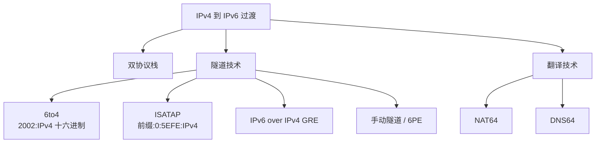

# 章节小结与考点梳理 · 完整笔记

---

## 1.本章学习要求与答题原则

本章（第八章：网络设备配置）内容较多、知识块庞大，故单独设置章节小结。

1. **结合前面所学的相关理论知识进行巩固学习**，再进一步记忆对应的**关键配置命令**。课程中的配置示例不是完整的，只展示了考查判读的关键词。
2. **答题原则：命令关键词尽可能与标准写法一一匹配，不要缩写、不要变更。** 变更写法的可操作性太广，阅卷老师"愿意给分就给分，不愿意给分就有理由扣分"。作答要尽可能答全、答完整，不要因为简写而丢分；案例分析题一定要动手把所有命令按要求完整写一写、画一画，加深印象。
3. 有条件的同学建议从**华为认证的课程、配置实验、项目**等角度更深更广地挖掘相关知识内容，课程中的讲解相对笼统、简单。
4. 案例题**一定会考察**本章内容，必须认真过一遍全部知识点。

---

## 2.重点知识回顾总览

### 2.1 认识经典组网设备（小结第 1 项）

- 认识经典组网设备——交换机、路由器，以及它们的前身（网桥、中继器、三层交换机等），要知道各自的具体作用与大概部署位置。
- 掌握设备的**启用和管理控制方法**：Console、Telnet、Web（网页访问）方式，都需要认识。偶尔会考察（许久未考的设备管理方式可能在考试中突然出现，如二〇二六年五月即考过）。
- 设备界面的显示情况（基础视图和命令）要有印象。

### 2.2 交换机相关配置（小结第 2 项）

**VLAN 基础配置（重点、必考项）**

- 创建 VLAN、批量创建 VLAN。
- 配置接口类型（Access、Trunk、Hybrid）。
- 划分 VLAN 的方式：基于接口、基于 MAC 地址、基于 IP 子网，都要有印象，并与理论知识关联。

**VLAN 技术扩展与应用**

| 技术 | 核心目的 |
| ---- | -------- |
| Super VLAN（super-vlan） | 节约 IP 地址 |
| Mux VLAN（mux-vlan） | 解决复杂情况的 VLAN 分类，VLAN 内可出现更多不同角色 |
| VXLAN（vxlan） | 新技术，采用新的编号（VNI），用于更广网络的部署与规划，一般配合 SDN（软件定义网络）与基于以太网的 BGP（EVPN）实现大数据中心网络部署；基于 UDP 报文重新封装 |
| QinQ | 与 VXLAN 做区分，主要针对 VLAN 数量做优化 |

对比记忆：VLAN 数量不足时，一条路是直接扩容 VLAN 编号 ID 的新方案（VXLAN 新增概念标识），另一条是采用过渡技术，类比 IPv4 与 IPv6 的过渡关系。

**交换机组网**

- iStack 堆叠：堆叠特点；集群 CSS（CSS Link），一般由核心设备使用。
- Eth-Trunk 链路聚合：提高可靠性。
- 组网要点：网络扁平化、冗余度、简化网络结构等，要有印象。

**三层交换机与 GVRP**

- 三层交换机：具有路由功能，除配置物理接口 IP 外，还可配置 **Vlanif** 接口做网关等管理性动作。
- GVRP：能够批量完成不同设备上的 VLAN 管理，关键词 `gvrp registration normal`。

### 2.3 交换机安全相关配置

| 配置项 | 关键词 | 要点 |
| ------ | ------ | ---- |
| 端口隔离 | port-isolate | 看到该关键词即想到端口隔离；不一定在交换机上，路由器上也会出现 |
| 认证 | dot1x | 安全相关认证配置 |
| 镜像端口 | port-mirroring / observe-port | 观察端口转发，一定要认识 |
| MAC 地址表安全 | mac-address | — |
| 端口安全 | port security | 一定要认识英文单词 |
| MAC 地址表漂移 | mac-address flapping | 关键词出现时要想到该安全功能的作用与特色 |

### 2.4 STP（MSTP）配置

- 当前生成树主要讲 **MSTP**，第一个关键词是**实例（instance）**与 VLAN 的映射关系，即多生成树协议。
- 生成树关键词：**根桥、根端口、指定端口、替代端口**。
- 更改参数的命令：`root primary`（根桥）、`priority`（优先级）、`cost`（开销）、端口相关参数，与端口优先级、端口 ID、开销等理论知识联合记忆。
- 保护措施：BPDU 保护等。
- **MSTP 配置必须 `active region-configuration` 激活后才能使用**，这是必须存在的命令，缺一不可。

### 2.5 路由器相关配置（小结第 3 项）

路由器主要实现网络互通，核心是路由表的建设：动态路由、静态路由，以及防环路策略的应用。

**DHCP 配置**

- 关键词：网关（gateway-list）、地址池（ip pool）、DNS（dns-list）、排除地址（excluded-ip-address）、静态绑定（static-bind ip-address）等。`dhcp enable` 才是全局使能 DHCP；接口下的 `dhcp select global` 只表示“该接口的客户端从全局地址池取地址”，本身不使能 DHCP。
- 应用方式的区别：**global（全局地址池）与 interface（接口地址池）**，这是 DHCP 的特色考点。
- 上网必备信息（理论部分讲过）：IP 地址、子网掩码（子网号）、网关、DNS 地址、DHCP 租约，这些都是 DHCP 需要下发的参数。

**单臂路由**

- 提到**子接口**的概念，要认识其作用。
- 配置方法：在原物理接口号后加"点"配置子接口号（如 G0/0/1.10）。
- 子接口上要终结 802.1Q 标签（`dot1q termination vid`），并开启 ARP 广播（`arp broadcast enable`），两条命令缺一不可。

**静态路由与默认路由**

- 命令 `ip route-static`。
- 默认路由：配置应用最为广泛，必经之路上一定会带有它；要认识**黑洞路由**。

**动态路由与路由引入**

- RIP、OSPF、BGP：进入相应视图、宣告网段 `network`。
- 路由引入：`import-route`，要认识其区别和注意事项。
- **双向路由引入会造成次优路径或路由环路问题**，必须配合**路由策略（Route-Policy）**进行引入操作——这是常考项，尤其是 OSPF 与 BGP 的配合，非常常见。

**BFD**

- 毫秒级别的故障检测机制，实现快速收敛。
- 关键词"毫秒级故障检测/快速收敛"一出现就要联想到 BFD；它会与各种各样的路由协议打配合。

**VRRP**

- 虚拟路由器冗余协议，用于提高路由器组网环境中的可靠性与冗余性。
- 要掌握如何搭建、有什么特点（配置部分回看 VRRP 配置章节）。

### 2.6 ACL 概念、配置与应用（小结第 4、5 项）

**ACL 分类**

| 类型 | 编号/关键词 |
| ---- | ----------- |
| 基本 ACL | basic 2000~2999，只匹配源地址 |
| 高级 ACL | advanced 3000~3999，可匹配源/目的、协议、端口 |
| 二层 ACL | 4000~4999，匹配源/目的 MAC、帧类型 |
| 用户自定义 ACL | 5000~5999，按报文偏移匹配任意字段 |
| 用户 ACL | 6000~9999，按用户/用户组匹配 |
| 基于时间的 ACL | time-range，作为规则的可选生效条件 |

**ACL 的应用（多种角度，要会区分）**

| 应用方式 | 关键词 | 说明 |
| -------- | ------ | ---- |
| 简单过滤 | traffic-filter | 应用在接口上做过滤 |
| 流策略 | traffic-policy | 由**流分类（classifier）、流行为（behavior）、流策略（policy）**三个组合构成，各自代表的含义要清楚 |
| 策略路由 | Policy-Based Routing（PBR） | 使用**新的一张表**：先过策略路由，不符合再去原路由表做转发 |
| 路由策略 | Route-Policy | **改变路由表本身**，对路由表进行人为编辑、管控，用于防环路 |
| 过滤策略 | filter-policy | 非常简单的过滤方案，注意 **import（入方向）/ export（出方向）**方向关键词，这是非常经典的代表 |

ACL 判读三件事：编号定类型；反掩码 0 表示必须匹配、1 表示不关心；规则按编号从小到大匹配，命中即停，未命中时由调用者决定（`traffic-filter` 缺省允许，防火墙安全策略缺省拒绝）。

策略路由与路由策略的区别是核心考点：**策略路由先查策略、改变报文转发路径；路由策略改变路由表本身**（尤其是环路问题、路由表的编辑与人为管控）。

### 2.7 NAT 地址转换（小结第 6 项）

**什么情况下要配 NAT**

1. 出口路由器或防火墙上：内部与外部地址不一样的情况（私有地址、公有地址概念要配对）。
2. 需要隐藏内部 IP 信息时。

**NAT 的各种类型（要会看）**

| 类型 | 命令/关键词 | 说明 |
| ---- | ----------- | ---- |
| 静态转换 | nat static | 一对一固定映射 |
| 动态转换（Basic NAT） | 动态转换 | 多对多地址转换 |
| 端口多路复用 | PAT | 端口复用 |
| Easy IP | 基于出接口公网地址 | 复用出接口地址做转换 |
| NAT Server | 用公网 IP 访问内网服务器 | 基于目的的转换 |
| 双向 NAT | 源 NAT + 目的 NAT | 内网用户用公网地址访问内网服务器 |
| NAT ALG | 应用层网关 | FTP、SIP、DNS 等载荷中携带地址/端口的协议 |
| 防火墙上配置 NAT | nat-policy | 防火墙上的关键配置点 |

### 2.8 IPSec VPN（小结第 7 项）

**配置步骤（五步）**

1. 配置安全 ACL。
2. 配置安全提议（IPSec proposal，形成 IPSec SA）。
3. 配置 IKE（IKE 提议与对等体，形成 IKE SA）。
4. 配置安全策略（把 ACL、安全提议、IKE 三者结合起来形成策略）。
5. 在接口应用安全策略。

**基本概念**

- AH、ESP、IKE 协议各自的作用要有印象（手写批注：IPSec SA、IKE SA）。
- 传输方式两种：**传输模式**与**隧道模式**，**常用为隧道模式**——因为安全性更高；代价是多封装一个 IP 头，效率不如传输模式。
- IKE 分两个阶段：一阶段协商出 **IKE SA**（双向），二阶段在 IKE SA 保护下协商出 **IPSec SA**（单向，收发各一条）；SA 由 SPI、目的 IP、安全协议三元组标识。

### 2.9 GRE over IPSec VPN 与扩展内容（小结第 8、9 项）

- GRE over IPSec VPN：两种技术的结合，隧道口通过 `tunnel-protocol gre` 指定协议（手写批注：通过 tunnel 的 protocol 就能确定隧道的作用类型，不同取值对应不同类别，这是关键信息）。
- MPLS（多协议标签交换）：早期用于提升路由转发效率，后面主要应用在隧道模式下。
- IPv6 过渡技术：主要介绍隧道技术配置，与 tunnel 的 protocol（GRE）做比较，二者类似。

---

## 3.扩展内容：MPLS 多协议标签交换

以下内容出自扩展讲解（p73），考查频度低但可能"突袭"出新题、旧概念，按"题干给提示、会推导"的思路掌握。

### 3.1 MPLS 的产生背景与作用

- MPLS 最早提出于二十世纪九十年代中期：IP 包流量急速增长，传统 IP 转发要在路由器上查路由表、按掩码做最长匹配运算，计算量庞大、转发性能低。
- MPLS 最初目的：**提升 IP 网络中路由设备的转发效率**——入口打标签、中间只看标签快速转发，不再拆包计算。
- 随着专用集成电路（ASIC）发展，路由表查找速度明显提高，MPLS 在"提高转发速率"上不再有明显优势，转而充当**公网隧道**，应用于**流量工程、QoS（服务区分）、VPN** 等领域。
- 某公司计划在骨干网络上建立**静态 MPLS**，便于部署 **L2VPN 或 L3VPN** 业务。

### 3.2 MPLS 基本概念

| 概念 | 全称 | 说明 |
| ---- | ---- | ---- |
| 标签 | Label | 报文可叠加多个标签，形成**标签栈**（顶标签、末尾标签） |
| 标签动作 | — | push（压入/打标签）、swap（交换）、pop（弹出/拆除）；次末跳弹出（PHP）由倒数第二跳承担，减轻出节点负担 |
| LSR | Label Switching Router，标签交换路由器 | 进行 MPLS 标签交换和报文转发的设备；位于域边缘的称边缘 LSR（LER），区域内部称核心 LSR（Core LSR） |
| LSP | Label Switched Path，标签交换路径 | **单向路径**，与数据流方向一致；入口 LER 称入节点（Ingress），中间 LSR 称中间节点（Transit），出口 LER 称出节点（Egress）；一条 LSP 可有 0 个、1 个或多个中间节点，但有且只有一个入节点和一个出节点 |
| FEC | Forwarding Equivalence Class，转发等价类 | 分类转发技术：把具有相同转发处理方式的数据分组归为一类；可基于源、目的地址、端口号、协议或业务类型任意组合 |

标签值字段共 20 位，0～15 为特殊用途保留，16～1048575 可供分配；因此标签是“短而定长”的本地标识，只在本跳有意义，下一跳会换成新的标签。

LSP 的两种建立方式：

| 方式 | 说明 | 适用场景 |
| ---- | ---- | -------- |
| 静态 LSP | 手动为各分类流量分配标签；核心原则：**上一跳的出标签值 = 下一跳的入标签值** | 简单且稳定的小型网络 |
| 动态 LSP | 通过协议自动交互打标签：LDP（标签分发协议，经典代表）、RSVP（资源预留协议）、MP-BGP（多协议边界网关协议） | 组网配置简单，支持大容量网络，广泛用于 VPN 服务 |


MPLS VPN 的三种角色：

| 角色 | 名称 | 位置 |
| ---- | ---- | ---- |
| CE | 用户网络边缘设备 | 用户侧，接口直接与 ISP（服务提供商）相连 |
| PE | 服务提供商边缘设备 | ISP 侧，连接用户 |
| P | 骨干设备 | 运营商骨干网络内部 |

### 3.3 例题：MPLS 概念填空

【问题1】MPLS 基于（1）进行转发，进行 MPLS 标签交换和报文转发的网络设备称为（2），构成 MPLS 域（MPLS Domain）。位于 MPLS 域边缘、连接其他网络的 LSR 称为（3），区域内部的 LSR 称为核心 LSR（Core LSR）。IP 报文进入 MPLS 网络时，MPLS 入口设备分析 IP 报文的内容并为其添加合适的标签，所有 MPLS 网络中的 LSR 根据标签转发数据。当该 IP 报文离开 MPLS 网络时，标签由出口 LER 弹出。

IP 报文在 MPLS 网络中经过的路径称为（4）。LSP 是一个单向路径，与数据流的方向一致。LSP 的入口 LER 称为（5）；位于 LSP 中间的 LSR 称为中间节点（Transit）；LSP 的出口 LER 称为（6）。一条 LSP 可以有 0 个、1 个或多个中间节点，但有且只有一个入节点和一个出节点。

（1）-（6）备选答案：

- A. 标签交换路由器 LSR（Label Switching Router）
- B. 标签交换路径 LSP（Label Switched Path）
- C. 标签
- D. 入节点（Ingress）
- E. 边缘路由器 LER（Label Edge Router）
- F. 出节点（Egress）

解答：题干已给足提示——"标签交换"对应（1）选 **C. 标签**；（2）选 **A**；（3）"位于边缘、连接其他网络"选 **E. 边缘路由器 LER**；（4）"通过的路径"选 **B**；（5）（6）"入口/出口"分别选 **D、F**。六空与六个选项一一对应，基本不重复，属于送分题。

要点：遇到陌生的纯概念题不要放弃，结合上下文阅读理解推导，选项往往能与空格一一对应。

### 3.4 例题：静态 MPLS 配置补全

【说明】某公司计划在骨干网络上建立静态 MPLS 以便部署 L2VPN 或者 L3VPN 业务。其网络拓扑与地址规划如下：LSR-1（LSR ID 1.1.1.9，GE0/0/1 属 VLANIF 100，172.16.1.1/24）、LSR-2（LSR ID 2.2.2.9，GE0/0/1 属 VLANIF 100 为 172.16.1.2/24，GE0/0/2 属 VLANIF 200 为 172.16.2.1/24）、LSR-3（LSR ID 3.3.3.9，GE0/0/1 属 VLANIF 200 为 172.16.2.2/24），两端各接一个 VPN Site。骨干网络中已完成路由协议配置，各个节点之间可以互通。

```text
# 使能 LSR-1 及各接口的 MPLS 功能。
[LSR-1] mpls (7) 1.1.1.9
[LSR-1] (8)
[LSR-1-mpls] quit
[LSR-1] interface (9) 100
[LSR-1-Vlanif100] mpls
[LSR-1-Vlanif100] quit
```

```text
# 创建从 LSR-1 到 LSR-3 的静态 LSP。
[LSR-1] static-lsp ingress LSP1 destination 3.3.3.9 32 nexthop 172.16.1.2 (10) 20
[LSR-2] static-lsp transit LSP1 incoming-interface vlanif 100 in-label (11) nexthop 172.16.2.2 out-label (12)
[LSR-3] static-lsp egress LSP1 incoming-interface vlanif 200 (13) 40

# 创建从 LSR-3 到 LSR-1 的静态 LSP。
[LSR-3] static-lsp ingress LSP2 destination 1.1.1.9 32 nexthop 172.16.2.1 out-label 30
[LSR-2] static-lsp transit LSP2 incoming-interface vlanif 200 in-label (14) nexthop 172.16.1.1 out-label (15)
[LSR-1] static-lsp egress LSP2 incoming-interface vlanif 100 in-label 60
```

解答（按上下文一一对应推导）：

| 空 | 答案 | 推导依据 |
| -- | ---- | -------- |
| (7) | lsr-id | 1.1.1.9 没有配 ip address，相当于身份标识（类比 OSPF 的 Router ID），故为 `mpls lsr-id 1.1.1.9` |
| (8) | mpls | 进入 MPLS 视图（`[LSR-1-mpls]` 提示视图名），等于启用 MPLS 功能，类似 vlan 进入 VLAN 视图 |
| (9) | vlanif | 后文提示符为 `[LSR-1-Vlanif100]`，属于全部送分 |
| (10) | out-label | 入节点配置：目的地、下一跳之后带出标签值 20（对照 LSP2 结构 `out-label 30`） |
| (11) | 20 | transit 的入标签必须等于上一跳（LSR-1）的出标签 20 |
| (12) | 40 | transit 的出标签必须等于下游 egress（LSR-3）的入标签，题干已给 LSR-3 入标签 40，故为 40；原记录中该命令的 nexthop 172.16.1.2 是本机地址，已按拓扑更正为 172.16.2.2 |
| (13) | in-label | 出节点 egress 配置：incoming-interface 之后带入标签值 40，即 `in-label 40` |
| (14) | 30 | transit LSP2 的入标签 = LSR-3 的出标签 30 |
| (15) | 60 | transit LSP2 的出标签 = LSR-1 的入标签 60 |

要点：

- 命令结构靠**上下文对照**补全：同一命令在另一方向必然重复出现，参数一一对应（in-label、out-label、nexthop）。
- 静态 LSP 的核心原则：**上一跳出标签值 = 本跳入标签值**；egress 用 in-label，ingress 用 out-label。
- 若某数值无任何提示（如没有可用参考值），一般会在前后文中出现，取对应即可；若出题人不给任何提示，该题所有人拿不到分，不会出现这种情况。

---

## 4.扩展内容：IPv4 到 IPv6 的过渡技术配置

过渡技术三大类：

1. **双协议栈**。
2. **隧道技术**：
   - 6 to 4 隧道：`2002:WWXX:YYZZ:[SLA ID]:[Interface ID]`
   - ISATAP 隧道：`[64bit-prefix]:0:5EFE:w.x.y.z`
   - IPv6 over IPv4 GRE 隧道
   - IPv6 over IPv4 手动隧道
   - 6PE 隧道（MPLS）
3. **翻译技术**：NAT64 和 DNS64 技术，主要做地址转换（IPv4 报文与 IPv6 报文互转），有服务器上的转换与地址转换，按前缀长度不同有匹配原则，不是简单的一对一转换；目前考察较少，认识名词即可。



### 4.1 6 to 4 隧道（配置示例）

特色：借助 IPv4 骨干网络实现 IPv6 与 IPv6 网络的连通。两个关键点：

1. **隧道建立**：与 GRE 隧道建立大同小异——配置接口 IP、tunnel 口 source、指定 tunnel-protocol（6 to 4 隧道写 `ipv6-ipv4 6to4`，GRE 隧道写 `gre`，本质是协议选择）。
2. **地址结构**：6 to 4 地址为固定结构 `2002:` + **IPv4 地址的十六进制表达**（32 位，如 192.168.100.1 转为 c0a8:6401）+ 子网 ID + 接口 ID。例如 c0=1100 0000=192，a8=1010 1000=168（十六进制一位对应四位二进制，按 8421 展开），64=0110 0100=100，01=0000 0001=1。

```text
R1 上的配置：
interface ethernet 0
ip address 192.168.100.1 24
interface ethernet 1
ipv6 address 2002:c0a8:6401:2::1 64
interface tunnel 0
ipv6 address 2002:c0a8:6401:1::1 64
source ethernet 0
tunnel-protocol ipv6-ipv4 6to4
ipv6 route-static 2002:: 16 Tunnel 0
```

### 4.2 ISATAP 隧道（配置示例）

ISATAP 实质是一种**自动地址配置方式**：为原本只有 IPv4 地址的主机分配 IPv6 地址，使其以 IPv6 与 IPv6 网络通讯。基于**邻居发现协议（ND）**与**链路本地地址**（FE80:: 开头）、ICMPv6 报文配合实现，属于 IPv6 动态地址分配中的**无状态地址自动配置**（有状态即 DHCPv6）。

ISATAP 地址格式：`[64bit 前缀]:0:5EFE:IPv4 地址（十六进制）`。

隧道建立过程：

1. ISATAP PC 发送路由设备请求消息（RS）：使用 ISATAP 格式的链路本地地址（如 FE80::5EFE:0201:0102）向 ISATAP 路由设备发送，该请求消息被封装在 IPv4 报文中。
2. ISATAP 路由设备响应请求（RA）：路由设备通告消息中包含 ISATAP 前缀（在路由设备上通过人工配置），响应 PC 的路由设备请求。
3. PC 得到自己的 IPv6 地址：将 ISATAP 前缀与 0:5EFE:IPv4-Address 组合得到自己的 IPv6 地址。例如前缀为 2001:db8:1:2::/64、IPv4 地址为 2.1.1.2 时，组合结果为 `2001:db8:1:2:0:5EFE:201:102`（可简写为 `2001:db8:1:2::5EFE:201:102`），并用此地址访问 IPv6 网络。

**路由器配置**

```text
# 使能 IPv4/IPv6 双协议栈，配置各接口地址。
[Router] ipv6
[Router] interface gigabitethernet 1/0/0
[Router-GigabitEthernet1/0/0] ipv6 enable
[Router-GigabitEthernet1/0/0] ipv6 address fc01::1/64
[Router-GigabitEthernet1/0/0] quit
[Router] interface gigabitethernet 2/0/0
[Router-GigabitEthernet2/0/0] ip address 2.1.1.1 255.0.0.0
[Router-GigabitEthernet2/0/0] quit
```

```text
# 配置 ISATAP 隧道。
[Router] interface tunnel 0/0/2
[Router-Tunnel0/0/2] tunnel-protocol ipv6-ipv4 isatap
// 配置 tunnel 接口的隧道协议为 ipv6-ipv4 并使用 isatap 隧道
[Router-Tunnel0/0/2] ipv6 enable
// 使能接口的 IPv6 功能
[Router-Tunnel0/0/2] ipv6 address 2001::/64 eui-64
// 配置接口的 EUI-64 格式的全球单播地址（用 48 位 MAC 转换为 64 位接口标识）
[Router-Tunnel0/0/2] source gigabitethernet 2/0/0
// 配置 Tunnel 的源接口
[Router-Tunnel0/0/2] undo ipv6 nd ra halt
// 开启 RA 消息发布功能
[Router-Tunnel0/0/2] quit
```

注意：`undo` 在此处不是删除功能，而是**开启 RA 消息发布**——默认情况下 RA 发布是关闭的，undo 掉关闭状态即等于开启。RA 消息即 ICMPv6 的 RS/RA 请求响应，用于邻居发现协议中路由器的信息下发与地址分配。

```text
# 配置 ISATAP 主机（与主机操作系统有关，以 Windows 7 为例）。
# 添加一条到边界路由器的静态路由（Windows 7 中 IPv6 协议默认已安装，XP 系统需要输入 ipv6 install 命令）。
C:\> netsh interface ipv6 isatap set router 2.1.1.1
```

### 4.3 IPv6 over IPv4 GRE 隧道（配置示例）

IPv6 over IPv4 GRE 隧道配置比 6 to 4、ISATAP 简单很多：tunnel 口上直接启用 `tunnel-protocol gre`（不再使用 6to4 或 isatap），是**应用度最广**的代表。作用仍是通用路由封装，以 IPv4 为主干网实现两个 IPv6 孤岛之间的通讯。

```text
R1 上的配置：
interface ethernet 0
ip address 192.168.100.1 24
interface tunnel 0            // 创建 Tunnel 接口
ipv6 enable                   // 使能接口的 IPv6 功能
ipv6 address 3001::1 64       // 设置 Tunnel 接口的 IPv6 地址
source ethernet 0
destination 192.168.50.1
tunnel-protocol gre
ipv6 route-static 3003::1 64 Tunnel 0
// 创建静态路由（去往某 IPv6 网络下一跳往 tunnel 口转发）
```

### 4.4 例题：ISATAP 地址结构

【案例题一】双栈主机使用 ISATAP 隧道时，IPv6 报文的目的地址和隧道接口的 IPv6 地址都要采用特殊的 ISATAP 地址。在 ISATAP 地址中，前 64 位是向 ISATAP 路由器发送请求得到的，后 64 位中由两部分构成，其中前 32 位是（1），后 32 位是（2）。

（1）备选答案：A、0:5EFE　B、5EFE:0　C、FFFF:FFFF　D、0:0
（2）备选答案：A、IPv4 广播地址　B、IPv4 组播地址　C、IPv4 单播地址

解答：（1）选 **A、0:5EFE**（固定部分，注意顺序在中间 32 位）；（2）选 **C、IPv4 单播地址**——末尾 32 位是主机自己的 IPv4 单播地址转换成十六进制形式表示。

要点：ISATAP 地址类型的固定结构（前缀 + 0:5EFE + IPv4 单播地址）是常考挖空点。

---

## 5.全章配置命令速查表

以下按设备配置模块整理整章配置命令关键词与排错/注意事项（命令为华为 VRP 风格，课程只展示考查判读的关键词，作答时务必写全、不缩写、不变更）。

### 5.1 设备基础管理

| 项目 | 命令/关键词 | 说明 |
| ---- | ----------- | ---- |
| 管理方式 | Console、Telnet、Web | 设备启用与管理的控制方法，偶尔考察 |
| 视图切换 | system-view、interface、quit | 用户视图、系统视图、接口视图等基础视图要能对应提示符 |
| 接口 IP | ip address | — |

### 5.2 VLAN 与链路聚合

| 项目 | 命令 | 说明 |
| ---- | ---- | ---- |
| 创建 VLAN | `vlan vlan-id` / `vlan batch {vlan-id1 [to vlan-id2]}` | 批量创建；VLAN ID 范围 1~4094 |
| 接口类型 | `port link-type {access\|trunk\|hybrid}` | 默认 hybrid |
| Access 划分 | `port default vlan vlan-id` | 基于接口划分 VLAN |
| Trunk 放行 | `port trunk allow-pass vlan {vlan-id [to vlan-id2]\|all}` | 一般用于设备间互联，保留 Tag 转发 |
| Hybrid | `port hybrid pvid vlan` / `port hybrid tagged vlan` / `port hybrid untagged vlan` | 可同时连接主机与设备，收发带 Tag 与不带 Tag 的报文 |
| VLANIF 网关 | `interface vlanif vlan-id` + `ip address` | 三层交换机的路由接口 |
| 链路聚合 | `interface eth-trunk trunk-id` → `mode lacp-static` → `trunkport` | 静态 LACP 模式需两端一致；成员接口保持默认链路类型；提高可靠性 |
| GVRP | `gvrp`（全局/接口）、`gvrp registration normal` | 批量同步不同设备间的 VLAN |

排错要点：Trunk 两端放行 VLAN 列表不一致导致跨交换机 VLAN 不通；Hybrid 对 untagged/tagged 的处理决定终端能否互通；Eth-Trunk 两端模式不一致（manual 与 lacp）无法 Up；成员口必须先恢复默认链路类型再加入聚合组。

### 5.3 VLAN 扩展技术

| 技术 | 关键词 | 目的 |
| ---- | ------ | ---- |
| Super VLAN | super-vlan / aggregate-vlan | 节约 IP 地址（多个 Sub-VLAN 共用一个三层网关） |
| Mux VLAN | mux-vlan | 主 VLAN 与从 VLAN（隔离型/互通型）的灵活访问控制 |
| VXLAN | vxlan、VNI | 新编号标识，配合 SDN、EVPN 做数据中心大二层 |
| QinQ | dot1q-tunnel | VLAN 数量优化的另一思路，与 VXLAN 做区分 |

### 5.4 交换机安全

| 项目 | 命令/关键词 | 说明 |
| ---- | ----------- | ---- |
| 端口隔离 | `port-isolate enable` | 同组端口二层隔离；路由器上也会出现 |
| 802.1X 认证 | dot1x | 接入认证 |
| 端口镜像 | `observe-port`、`port-mirroring to observe-port` | 观察端口转发流量 |
| MAC 地址表安全 | mac-address（静态 MAC、限制学习数量） | — |
| 端口安全 | port security | — |
| MAC 漂移 | mac-address flapping | 同一 MAC 在不同端口间反复迁移的告警与处理 |

### 5.5 STP（MSTP）

| 项目 | 命令 | 说明 |
| ---- | ---- | ---- |
| 进入 MST 域视图 | `stp region-configuration` | — |
| 域名 | `region-name name` | 同域三要素：域名、VLAN 与实例映射、修订级别 |
| 实例映射 | `instance instance-id vlan {vlan-id1 [to vlan-id2]}` | 一个 VLAN 只能映射到一个实例 |
| **激活域配置** | `active region-configuration` | **必须激活才能生效，缺一不可** |
| 根桥/备份根 | `stp instance id root primary` / `root secondary` | 也可用 priority 改优先级 |
| 优先级 | `stp priority value` | 值越小越优 |
| 开销 | `stp cost cost` | 控制端口角色选举 |
| 关键角色 | 根桥、根端口、指定端口、替代端口 | 与理论选举规则联动记忆 |
| 保护措施 | BPDU 保护等 | — |

排错要点：域配置不激活不生效；同域设备域名/映射/修订级别不一致则不在同一域；instance 与 VLAN 映射错位导致流量绕行。

### 5.6 路由与 DHCP

| 项目 | 命令 | 说明 |
| ---- | ---- | ---- |
| 静态/默认路由 | `ip route-static 目的网段 掩码 下一跳/出接口` | 默认路由 0.0.0.0 0；黑洞路由指向 NULL0 |
| RIP | `rip` → `network 网段` | 视图内宣告 |
| OSPF | `ospf [process-id]` → `area` → `network` | — |
| BGP | `bgp as-number` → `network` / `peer` | — |
| 路由引入 | `import-route 协议` | 双向引入会次优/环路，需配 Route-Policy |
| 路由策略 | route-policy | 改变路由表本身 |
| BFD | bfd | 毫秒级故障检测、快速收敛，与各路由协议联动 |
| VRRP | vrrp vrid | 虚拟路由冗余，提高网关可靠性 |
| DHCP 全局 | `dhcp enable` → `ip pool` → `gateway-list`、`network`、`dns-list`、`excluded-ip-address`、`static-bind ip-address` → 接口 `dhcp select global` | 全局地址池方式 |
| DHCP 接口 | 接口视图 `dhcp select interface` | 接口地址池方式，与 global 的区别是常考点 |
| 单臂路由 | `interface g0/0/1.10` → `dot1q termination vid 10` → `ip address` → `arp broadcast enable` | 子接口 + 802.1Q 标签 |

### 5.7 ACL 及应用

| 项目 | 命令/关键词 | 说明 |
| ---- | ----------- | ---- |
| 基本 ACL | `acl 2000~2999` | 只匹配源地址 |
| 高级 ACL | `acl 3000~3999` | 匹配源/目的/协议/端口 |
| 时间 ACL | `time-range` + ACL 规则 | — |
| 接口过滤 | `traffic-filter {inbound\|outbound} acl` | 应用在接口上 |
| 流策略 | `traffic classifier` + `traffic behavior` + `traffic policy`，接口 `traffic-policy` | 三件套组合 |
| 策略路由 | Policy-Based Routing | 先查策略路由表，不匹配再查原路由表 |
| 路由策略 | Route-Policy | 配合 import-route 使用 |
| 过滤策略 | `filter-policy {import\|export}` | 注意入/出方向关键词 |

### 5.8 NAT

| 项目 | 命令/关键词 | 说明 |
| ---- | ----------- | ---- |
| 静态转换 | `nat static` | 一对一 |
| 动态转换 | Basic NAT（地址池） | 多对多 |
| 端口复用 | PAT | — |
| Easy IP | `nat outbound`（基于出接口公网地址） | 无需地址池 |
| NAT Server | `nat server` | 公网 IP 访问内网服务器（基于目的） |
| 防火墙 NAT | nat-policy | 防火墙上的配置关键点 |

### 5.9 VPN 与隧道

| 项目 | 命令/关键词 | 说明 |
| ---- | ----------- | ---- |
| IPSec 步骤 | 安全 ACL → 安全提议（ipsec proposal）→ IKE（ike proposal / ike peer）→ 安全策略（ipsec policy）→ 接口应用 | 五步缺一不可 |
| IPSec 协议 | AH、ESP、IKE | 作用要有印象；SA 分 IPSec SA 与 IKE SA |
| 传输/隧道模式 | 常用**隧道模式** | 更安全，多一个 IP 头故效率略低 |
| GRE over IPSec | tunnel 口 `tunnel-protocol gre`，再套 IPSec | 两种技术结合 |
| MPLS | `mpls lsr-id x.x.x.x` → `mpls` → 接口 `mpls`；`static-lsp ingress/transit/egress` | 静态 LSP 标签前后对齐；动态用 LDP/RSVP/MP-BGP |
| 6to4 隧道 | `tunnel-protocol ipv6-ipv4 6to4`，地址 2002:WWXX:YYZZ:子网:接口 | IPv4 地址转十六进制嵌入 |
| ISATAP | `tunnel-protocol ipv6-ipv4 isatap`，地址 前缀:0:5EFE:IPv4 | `undo ipv6 nd ra halt` 开启 RA |
| IPv6 over IPv4 GRE | `tunnel-protocol gre` | 应用度最广，配置最简单 |
| IPv6 过渡翻译 | NAT64、DNS64 | 认识即可 |

排错与易错要点汇总：

1. tunnel-protocol 取值决定隧道类型（gre / 6to4 / isatap），挖空常考。
2. IPSec 五步顺序与"策略三合一（ACL+提议+IKE）"的描述常考填空。
3. ISATAP 地址中间 32 位固定为 0:5EFE，末 32 位为 IPv4 单播地址。
4. `undo ipv6 nd ra halt` 中的 undo 是开启而非删除，易误解。
5. 静态 LSP 中 ingress 配 out-label、egress 配 in-label、transit 两者都配，且前后标签值必须相等。

---

## 6.常见考题形式与易错点

### 6.1 常见考题形式

| 题型 | 形式 | 典型内容 |
| ---- | ---- | -------- |
| 案例配置补全 | 给拓扑与部分配置，挖空命令关键词或参数 | VLAN/链路聚合/STP/路由/DHCP/ACL/NAT/IPSec/MPLS 命令补全 |
| 纯概念填空（新概念） | 题干大段描述陌生概念并给足提示，选项与空一一对应 | MPLS 的 LSR/LSP/FEC/入出节点等 |
| 命令判读 | 给命令行解释其作用 | tunnel-protocol 取值、dhcp select global/interface、undo 类命令 |
| 参数推导 | 依据上下文与协议原则推数值 | 静态 LSP 前后标签一致、6to4 地址换算 |
| 设备管理常识 | Console/Telnet/Web 管理方式、视图提示符 | 偶尔突袭（如 2026 年 5 月考过） |

### 6.2 易错点与避坑提示

1. **命令不要缩写、不要变更**：变更写法阅卷弹性太大，容易被扣分；按标准结构答全、答完整。
2. **MSTP 忘写 `active region-configuration`**：域配置不激活不生效，该命令"缺一不可"。
3. **DHCP 的 global 与 interface 混淆**：全局地址池配 `ip pool` 与 `gateway-list` 等，接口下 `dhcp select global`；接口地址池直接 `dhcp select interface`。
4. **策略路由与路由策略混淆**：策略路由（PBR）用新表先匹配，不符合再走原路由表；路由策略（Route-Policy）改变路由表本身。
5. **双向路由引入忘记配路由策略**：导致次优路径或路由环路，OSPF 与 BGP 互引是高频考法。
6. **BFD 关键词反应**：看到"毫秒级故障检测、快速收敛"必须联想到 BFD 及其与路由协议联动。
7. **NAT 类型对号入座**：Easy IP 基于出接口公网地址；NAT Server 用公网 IP 访问内网服务器；防火墙上用 nat-policy。
8. **IPSec 配置顺序**：ACL → 安全提议 → IKE → 安全策略 → 接口应用，三者（ACL、提议、IKE）结合成策略。
9. **隧道协议关键字**：通过 tunnel 的 protocol 确定隧道作用类型，gre / 6to4 / isatap 取值是关键信息。
10. **6to4 地址换算**：2002 后嵌入 IPv4 地址的十六进制（一位十六进制 = 四位二进制，按 8421 展开），要做进制转换。
11. **ISATAP 地址结构**：前 64 位为请求所得前缀，后 64 位 = 0:5EFE（前 32 位）+ IPv4 单播地址（后 32 位）。
12. **遇到陌生概念不放弃**：题干一定有大量描述与提示，结合上下文推导；选项通常与空一一对应。
13. **案例题必考本章**：所有命令按要求完整书写练习，不要考前只练简化版。

---

## 7.存疑点与口径说明

| 位置 | 问题 | 处理 |
| ---- | ---- | ---- |
| 3.4 静态 LSP 例题 | LSR-2 两条 transit 命令的 nexthop 分别写成本机 VLANIF 地址 172.16.1.2 与 172.16.2.2 | 下一跳必须指向下游设备：LSP1 为 172.16.2.2，LSP2 为 172.16.1.1，已按拓扑更正 |
| 3.4 静态 LSP 例题 | 参考答案把第 (12) 空写作 30 | 与题干“LSR-3 入标签 40”矛盾，按“上游出标签 = 下游入标签”应为 40 |
| 4.2 ISATAP 示例 | 原文写作 2001:5EFE:0201:0102，只有 4 组，不是完整的 128 位地址 | 按“64 位前缀 + 0:5EFE + IPv4”重新给出完整示例 |
| 4.1 6to4 配置 | 课件为通用写法 `interface ethernet 0`、`source ethernet 0` | 华为 VRP 实际接口名为 `Ethernet0/0/0` 一类，考试按题干给出的接口名书写 |
| 2.6 ACL 编号 | 原文只列基本、高级与 time-range 三类 | 华为 VRP 共五类 ACL，已补全二层、用户自定义、用户 ACL 的编号范围 |

---

## 8.本章小结

| 序号 | 知识块 | 核心要点 |
| ---- | ------ | -------- |
| 1 | 认识组网设备 | 交换机、路由器及其前身；Console/Telnet/Web 管理方式；基础视图与命令 |
| 2 | 交换机配置 | VLAN 基础（创建、接口类型、划分方式）；super-vlan、mux-vlan、vxlan、iStack、CSS Link、Eth-Trunk；vlanif；gvrp registration normal；端口隔离、dot1x、镜像、端口安全、MAC 漂移；MSTP（instance、root primary、priority、cost、active region-configuration） |
| 3 | 路由器配置 | ip pool/gateway-list/dns-list/excluded-ip-address/static-bind 与 dhcp select global；单臂路由子接口与 dot1q；ip route-static 与默认路由、黑洞路由；RIP/OSPF/BGP 视图与 network 宣告；import-route 双向引入需配 Route-Policy；BFD 毫秒级检测；VRRP 冗余 |
| 4 | ACL 概念与配置 | basic 2000~2999、advanced 3000~3999、二层 4000~4999、用户自定义 5000~5999、用户 6000~9999、time-range |
| 5 | ACL 应用 | traffic-filter、traffic-policy（classifier+behavior）、策略路由 PBR、路由策略 Route-Policy、filter-policy（import/export） |
| 6 | NAT | nat static、Basic NAT/PAT、Easy IP（出接口公网地址）、NAT Server（公网访问内网服务器）、双向 NAT、NAT ALG、防火墙 nat-policy |
| 7 | IPSec VPN | 安全 ACL → 安全提议 → IKE → 安全策略 → 接口应用；AH/ESP/IKE；常用隧道模式 |
| 8 | GRE over IPSec | tunnel-protocol gre |
| 9 | MPLS 与 IPv6 过渡 | LSR/LSP/FEC/入出节点与标签动作；静态 LSP 标签前后一致；动态 LSP（LDP/RSVP/MP-BGP）；CE/PE/P 角色；6to4、ISATAP、GRE 隧道配置；NAT64/DNS64 翻译技术 |

考试重点：

1. **命令写全不缩写**：`dot1q termination vid`、`arp broadcast enable`、`dhcp select global`、`active region-configuration` 等关键词按标准写法作答。
2. **DHCP 两种模式判读**：出现 `ip pool`/`gateway-list`/`dhcp select global` 为全局地址池；出现 `dhcp select interface`/`dhcp server ...` 为接口地址池。
3. **单臂路由三要素**：子接口编号、`dot1q termination vid` 与 VLAN 对应、`arp broadcast enable`；交换机侧为 Trunk 并放行对应 VLAN。
4. **ACL 判读**：编号定类型、反掩码 0/1 的含义、按编号匹配命中即停、未命中由调用模块决定；基本 ACL 靠近目的、高级 ACL 靠近源。
5. **ACL 五种调用**：`traffic-filter`、`traffic-policy`（classifier + behavior + policy）、PBR、route-policy、`filter-policy`（import/export）。
6. **NAT 类型对号**：静态 NAT 一对一；动态 NAT 用地址池且 `no-pat`；NAPT 带端口；Easy IP 用出接口地址；NAT Server 是目的 NAT。
7. **IPSec 五步与两阶段**：ACL → 提议 → IKE → 策略 → 接口；一阶段 IKE SA、二阶段 IPSec SA；隧道模式更安全。
8. **GRE over IPSec**：ACL 匹配两端公网接口地址，而不是 Tunnel 接口地址。
9. **MPLS 标签**：ingress 配 out-label、transit 两者都配、egress 配 in-label，上游出标签必须等于下游入标签；LSP 单向。
10. **IPv6 过渡地址**：6to4 为 `2002:IPv4十六进制`，ISATAP 为 `前缀:0:5EFE:IPv4`，GRE 隧道直接用 `tunnel-protocol gre`。

备考行动清单：

1. 结合理论巩固，把上表九个知识块的命令逐条完整默写一遍。
2. 重点盯案例题高频块：VLAN/Eth-Trunk/MSTP/DHCP/OSPF 与 BGP 引入/ACL 应用/NAT/IPSec/MPLS。
3. 扩展内容（MPLS 概念、IPv6 过渡隧道）按"会读题干、会推导"的深度掌握，不必深钻。
4. 答题口径：关键词一一匹配、不缩写、不变更、答全答完整。
