# 存储基本概念与RAID技术 · 完整笔记

---

## 1.存储系统层次结构

本章属于网络管理技术中的网络存储技术板块，近年主要以选择题形式考查（早期曾考查案例题，如存储方案与技术选型），重点关注常考字段的含义即可。

### 1.1 三级存储结构

计算机的存储系统一般由**高速缓存（Cache）、内存（主存）和外存（辅存）**三级构成。

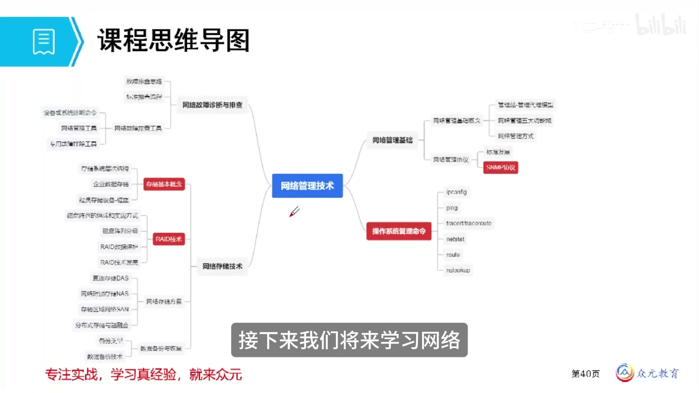

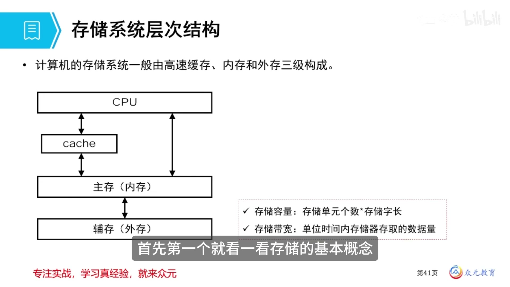

存储系统衡量三大指标：**容量、成本、速度（访问效率）**，三者相互冲突：

- 容量大、材料好，成本必然上升
- 存储内容越多，查找目标数据的速度越慢

为找到最佳平衡点，采用多级存储结构，各层分工组合：部分负责容量问题，部分负责速度问题，达成性价比的平衡。

[手写批注] 容量、成本、速度（效率）三者"冲突、平衡"。

### 1.2 各级存储的作用

| 层级 | 作用 | 说明 |
| ---- | ---- | ---- |
| Cache（高速缓冲存储器） | 解决 CPU 与内存速度不匹配的问题 | 位于 CPU 与主存之间；存放经常读取的内存数据；地址替换由稳定且高速的硬件完成；按内容存取；本身也可分为多级（L1、L2、L3），有的贴近 CPU，有的贴近内存，有的是独立模块 |
| 主存（内存） | CPU 直接访问 | CPU 与内存直接访问、直接沟通 |
| 辅存（外存） | 解决容量不足的问题 | 作为资料库长期保存大量数据 |

### 1.3 虚拟存储

内存与外存做结合，形成**虚拟存储**。该概念连续多年考查，包括最新一次考卷（2026年5月）：题目形式为"解决内存空间不足的问题的是哪一个"，答案为虚拟存储（虚拟存储体系），即**主存和辅存（内存与外存）**两级。虚拟存储比直接更换内存条成本更优，性能可能更好。

### 1.4 存储容量与存储带宽

```
存储容量 = 存储单元个数 × 存储字长
存储带宽 = 单位时间内存储器存取的数据量
```

- 存储单元个数与**地址编码**有关：地址编码采用二进制，地址线为 n 位时，单元个数为 2ⁿ（注意与 IP 地址中主机数 2ⁿ−2 不同，存储单元不用减 2）
- 存储字长：一个存储单元中存放的数据位数（如 8 位、16 位）
- 单位换算：1 字节 = 8 位
- 此处计算在本科目中较少见，有基本认识即可；更深入的编号、寻址、芯片排版计算属于计算机系统基础知识

---

## 2.企业数据存储选择（分层存储）

### 2.1 分层存储管理策略

为提高投资的利用率、减少对存储的整体投入，企业通常采用**分层存储**的管理策略，即**按照数据价值对数据进行分级管理和存储**，不同数据采取不同的存储方案。

数据按重要程度分为：**关键数据、重要数据、敏感数据、不重要数据**；也可按访问频度分为**热数据、温数据、冷数据**（热数据被访问频度很高，温数据访问频率中等，冷数据基本不被访问）。

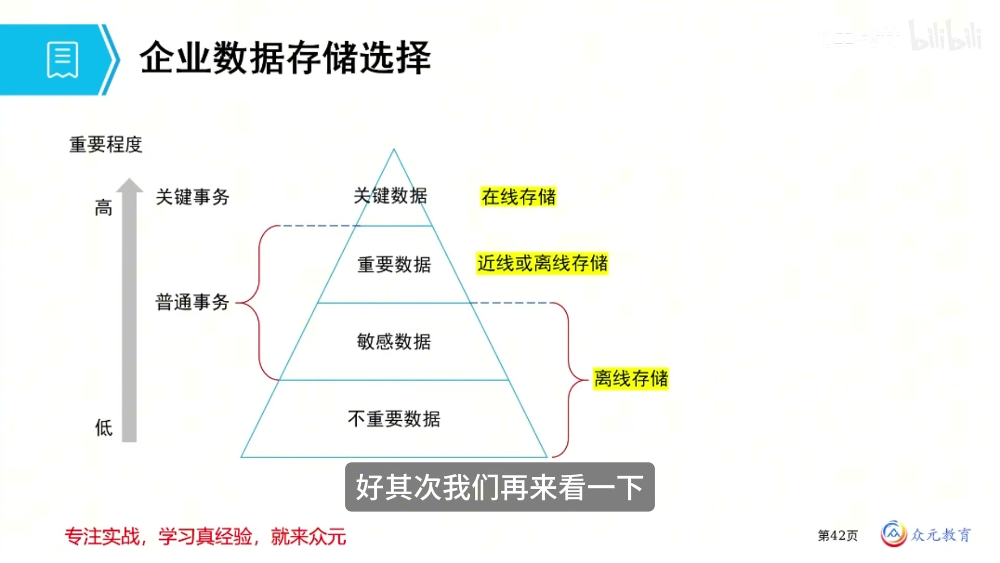

### 2.2 在线、近线与离线存储

| 存储方式 | 别名 | 适用数据 | 特点 | 常用介质 |
| -------- | ---- | -------- | ---- | -------- |
| 在线存储 | 联机存储、工作级存储 | 热数据、关键数据（访问频度高，要求实时读取、随时快速随机访问） | 价格相对较贵，性能要求高 | 磁盘、磁盘阵列 |
| 近线存储 | —— | 温数据（访问频率中等） | 磁盘与磁带/光盘之间的折中方案：常用数据存磁盘，不常用数据存磁带或光盘 | 磁盘、磁带、光盘 |
| 离线存储 | 脱机存储、备份级存储 | 冷数据（访问频度极低） | 价格便宜、容量大、易于长期保存、成本低 | 磁带、光盘 |

考查方式：根据数据重要程度与访问频度，分配合适的存储设备与方案。

---

## 3.经典存储设备——磁盘（硬盘）

### 3.1 机械硬盘（HDD）

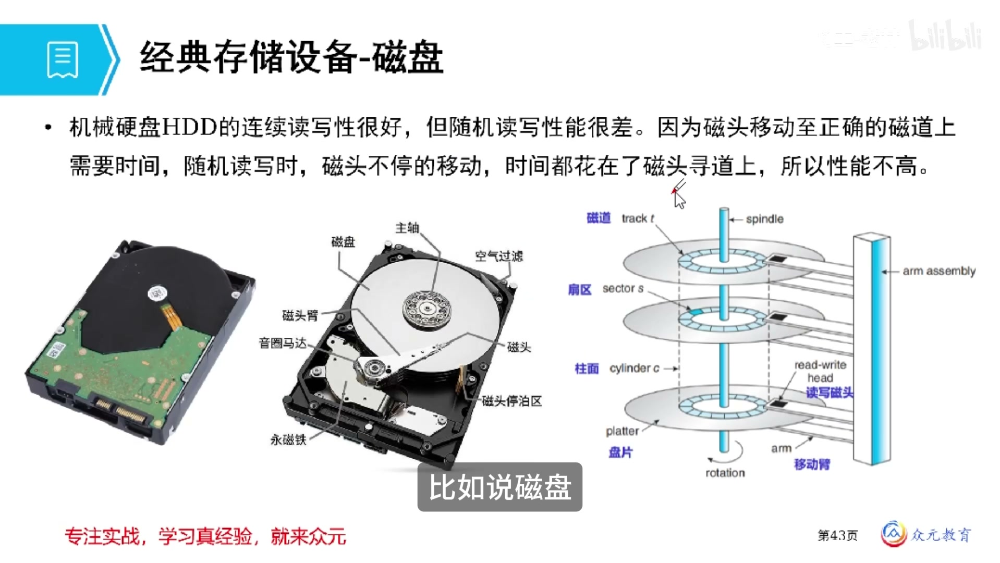

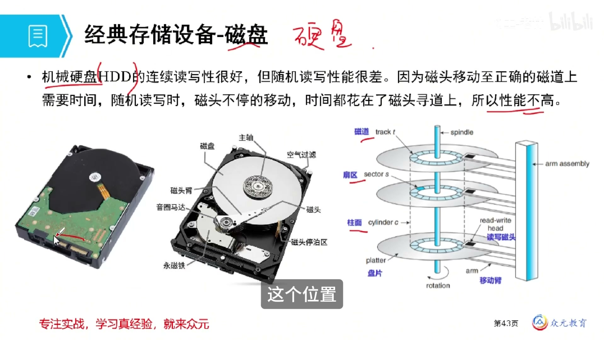

- 机械硬盘 HDD 的**连续读写性很好，但随机读写性能很差**。因为磁头移动至正确的磁道上需要时间，随机读写时磁头不停地移动，时间都花在磁头寻道上，所以性能不高
- 数据按顺序存放在各磁道和扇区上
- 存储位置由**磁道（track）、扇区（sector）、柱面（cylinder）**三个信息唯一确定；由磁臂、磁头进行寻道：先旋转定位，再下移读取
- 结构相对单一，价格与容量上有优势；性能低主要在于读写方式（需要时间寻找对应磁道、扇区、柱面）
- 随固态硬盘发展，机械硬盘占比逐渐降低，但不会被完全取代，仍有自身独立特点

### 3.2 固态硬盘（SSD）

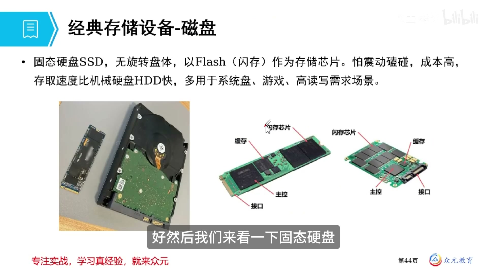

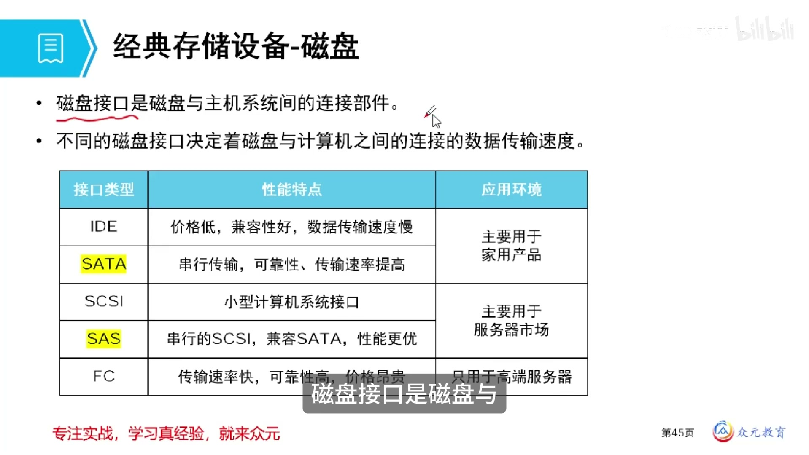

- 固态硬盘 SSD **无旋转盘体**，以 **Flash（闪存）** 作为存储芯片
- 存取速度比机械硬盘 HDD 快很多
- 缺点：成本高（随着发展逐渐下降）、怕震动磕碰、有闪存擦写寿命，高强度的反复写入会加速老化
- 结构组成：主控、缓存、闪存芯片、接口，置于电路板上

### 3.3 HDD 与 SSD 对比（常考）

| 对比项 | 机械硬盘 HDD | 固态硬盘 SSD |
| ------ | ------------ | ------------ |
| 存储介质 | 磁盘盘片（磁道、扇区、柱面） | Flash 闪存芯片 |
| 是否有旋转盘体 | 有 | 无 |
| 读写性能 | 连续读写好，随机读写差 | 存取速度快很多 |
| 容量 | 大 | 较小 |
| 成本 | 低 | 高 |
| 其他约束 | 怕震动（机械结构脆弱） | 怕震动磕碰；有闪存擦写寿命 |
| 适用场景 | 监控存储、冷数据备份、大容量文件存放 | 系统盘、游戏、高读写需求场景 |

---

## 4.磁盘接口

磁盘接口是**磁盘与主机系统间的连接部件**，用来传输数据。不同的磁盘接口决定着磁盘与计算机之间连接的数据传输速度，接口优劣直接影响程序运行快慢和系统性能好坏。

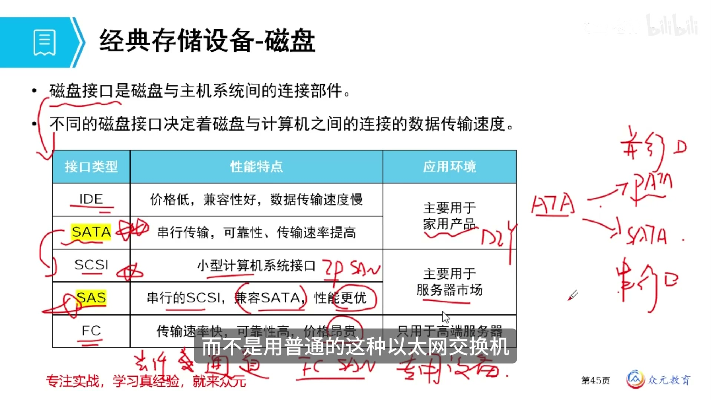

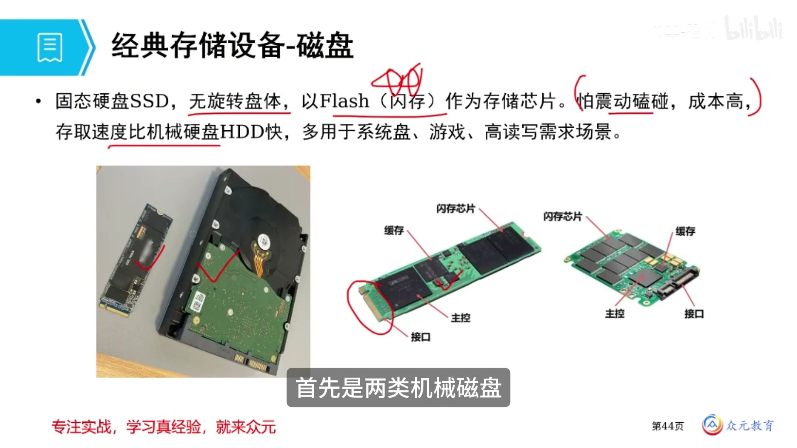

| 接口类型 | 性能特点 | 应用环境 |
| -------- | -------- | -------- |
| IDE | 价格低，兼容性好，数据传输速度慢；已被淘汰（线缆长度过短、连接设备数少） | 家用产品（早期） |
| SATA | 串行传输，可靠性、传输速率提高；串行接口纠错能力更强、结构更好、支持热拔插 | 主要用于家用产品（DIY 市场），占据主导地位 |
| SCSI | 小型计算机系统接口，企业级服务器接口协议，适用于大负载输入输出系统，多任务、CPU 占用率低 | 主要用于服务器市场 |
| SAS | 串行的 SCSI，兼容 SATA，性能更优；支持更强的连接距离、提高抗干扰能力 | 主要用于服务器市场，占据主导地位 |
| FC | 光纤通道，传输速率快，可靠性高，价格昂贵；需专用光纤交换机（而非普通以太网交换机） | 只用于高端服务器（数据中心等） |

要点：

- IDE 之后出现 ATA（电子集成驱动器）分支，ATA 分为 **PATA（并行接口，20 世纪 80 年代主流，线路复用易干扰，已被淘汰）** 和 **SATA（串行接口）** 两个分支
- 家用市场由 **SATA** 主导，服务器市场由 **SAS** 主导；SCSI 与 **IP SAN** 的发展有关
- 三者（SATA、SAS、FC）占据优势地位并沿用至今；FC 因专用设备价格贵，在不极端追求性能的场景下逐渐被廉价的 IP SAN 取代

### 4.1 固态硬盘的接口

前面介绍的接口倾向于机械硬盘；固态硬盘除 SATA 外，还有 **M.2、U.2、PCIe** 等类型：家用级固态以 **M.2** 接口应用最广，企业级固态一般用 **U.2**。

---

## 5.课堂习题（存储基本概念）

### 例题1：虚拟存储体系

存储体系里面的虚拟存储由哪两级存储器构成？（A）

- A、主存-辅存 [正确]
- B、寄存器-Cache
- C、寄存器-主存
- D、Cache-主存

解答：虚拟存储由主存和辅存（内存与外存）构成，连续多年考查。2026年5月的变式问法："解决内存空间不足的问题的是哪一个"，答案为虚拟内存（虚拟存储体系）。

### 例题2：固态硬盘的存储介质

固态硬盘的存储介质是（B）

- A、光盘
- B、闪存 [正确]
- C、软盘
- D、磁盘

解答：固态硬盘以 Flash（闪存）作为存储芯片，U 盘中也使用 Flash。

### 例题3：不属于硬盘接口协议的 I/O 接口

下列 I/O 接口协议中，不属于硬盘接口协议的是（C）

- A、IDE
- B、SATA
- C、SPI [正确]
- D、SCSI

解答：SPI 指串行外设接口，多用于传感器、闪存、单片机外设，一般不属于硬盘接口。

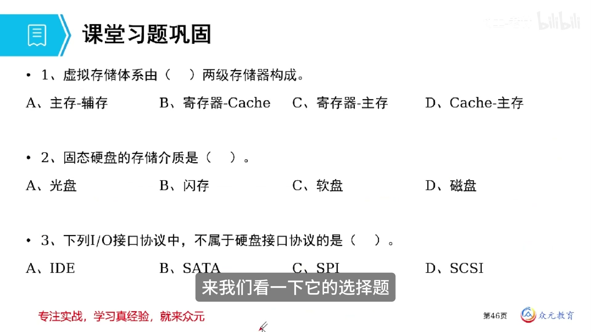

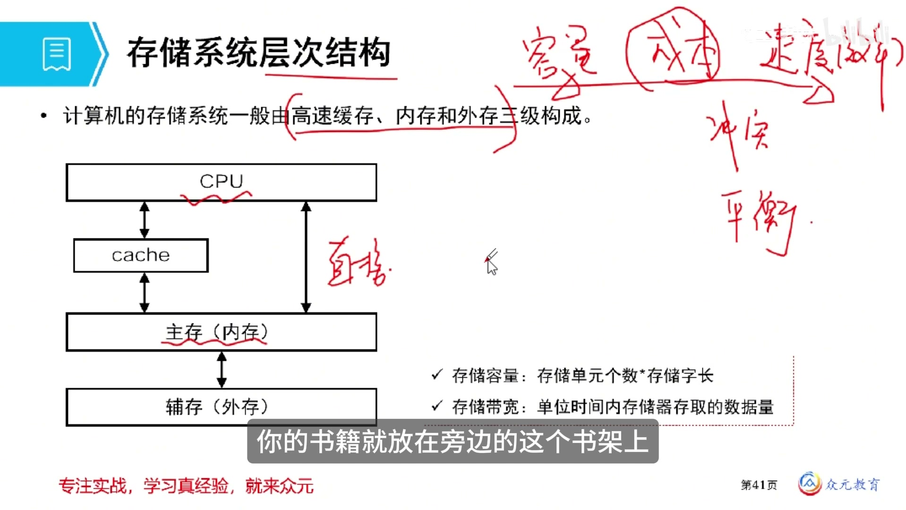

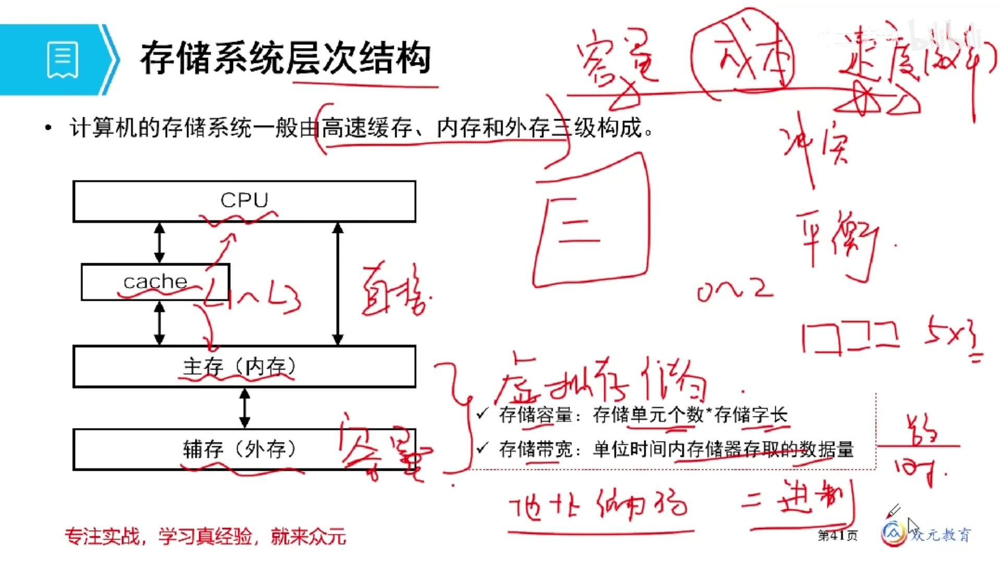

---

## 6.磁盘阵列（RAID）的组成和实现方式

RAID（Redundant Array of Independent Disks，独立磁盘冗余阵列）指不依赖单个磁盘，而以多个磁盘配合的形式完成更高性能、更可靠的数据存储。1987 年由美国加州大学伯克利分校提出。基本思想：把多个独立的物理硬盘通过相关算法组合成一个虚拟的逻辑硬盘，从而提供更大容量、更高性能或更高的数据容错能力。

RAID 做了两件事：

1. 利用**数据条带化**提高性能
2. 利用**数据冗余**提高可靠性

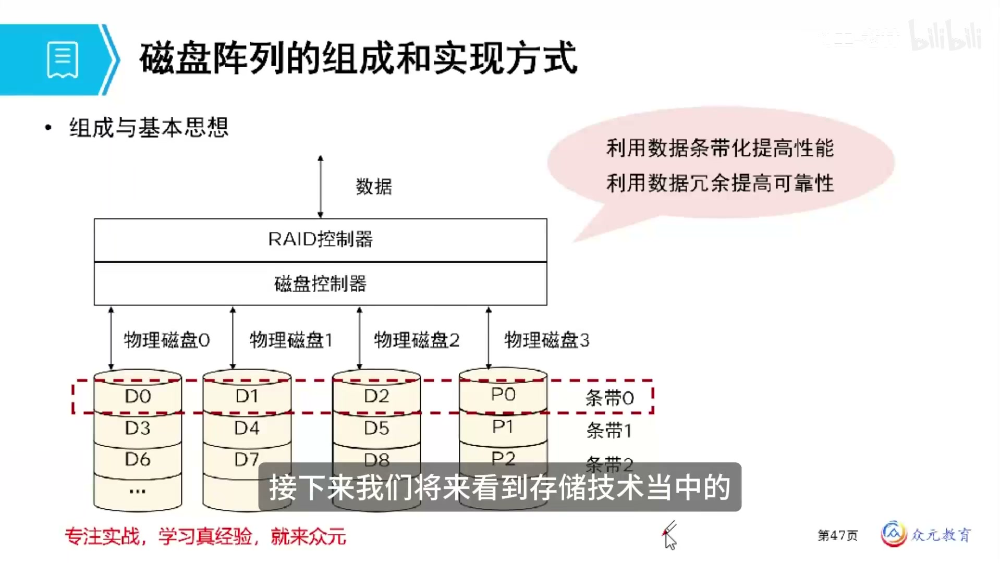

组成：**RAID 控制器、磁盘控制器、物理磁盘**三部分。把连续的数据分别放入若干个模块（条带），读取时可同时读取，用以提高读取效率。

RAID 级别共 **0 到 7** 八个级别，其中部分级别不常用。

### 6.1 RAID 0

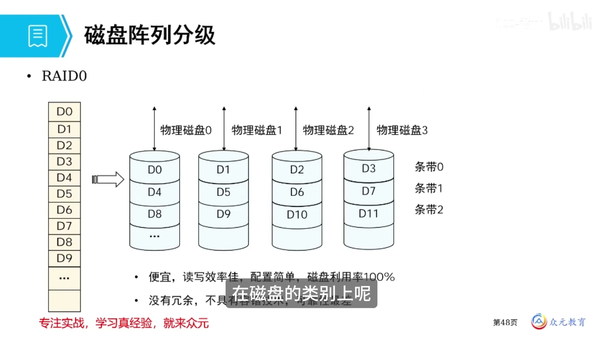

- 利用**条带化**技术，主要解决读写效率（性能）问题
- **磁盘利用率 100%**；没有冗余，不具备容错技术，**可靠性最差**
- 所需磁盘：至少 2 块及以上才能形成条带
- 不存在校验，不会占用太多 CPU 资源，配置和使用简单
- 适合需要大传输带宽的操作，如视频生成编辑、图像编辑

### 6.2 RAID 1

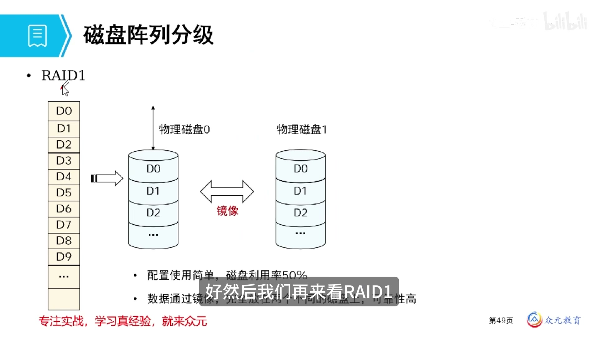

- 通过**镜像（Mirror）**实现，主要解决可靠性问题，可靠性极高
- 没有考虑性能提升
- 所需磁盘：**2 的倍数（≥2N）**——有一个数据盘就必须有一个镜像盘，不能是 3 块
- 磁盘利用率 **50%**
- 适合财务、金融等需要高可用、高安全的数据存储环境

### 6.3 RAID 3 与 RAID 5

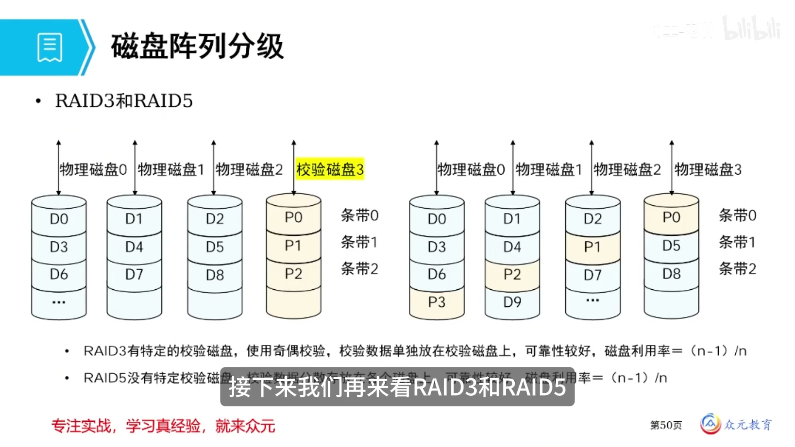

- **RAID 3**：有专用校验磁盘，使用**奇偶校验**，校验数据单独放在校验磁盘上，可靠性较好，磁盘利用率 = (n−1)/n
  - 校验盘每次读写都要被访问（类似班主任频繁被叫），容易产生**输入输出瓶颈效应**
  - 校验盘始终忙于读写，且**同一时刻仅允许一块盘失效**（两块盘失效无法复原）
- **RAID 5**：为解决 RAID 3 的瓶颈，**无特定校验磁盘，校验数据分散存放在各个磁盘上**，降低读写瓶颈效应；其余与 RAID 3 一致，磁盘利用率 = (n−1)/n
- 两者最少磁盘数：**≥3**（条带化至少 2 块盘，安全需要 1 块校验盘）
- 例：4 块盘中 1 块做校验，实际 3 块存数据，利用率 3/4

### 6.4 RAID 2 与 RAID 4

- **RAID 2**：将奇偶校验改为**海明校验**，计算比较复杂，企业中使用率较低
- **RAID 4**：与 RAID 3 保持一致，不同的是条带化单位——RAID 3 和 RAID 5 按**位**条带化，RAID 4 按**块**条带化
- 两者应用不广泛，较少讨论

### 6.5 RAID 6

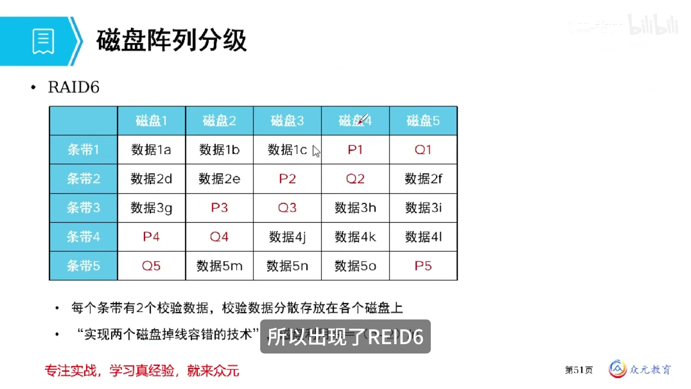

- 每个条带有 **2 个校验数据**（P、Q 双校验），校验数据分散存放在各个磁盘上
- 实现两个磁盘掉线容错的技术，**允许同时失效 2 块盘**
- 磁盘利用率 = **(n−2)/n**（双校验模式，分散存储）
- 所需磁盘数：**≥4**

### 6.6 RAID 7

- 严格说不只是一个方案，而是一个完整的整体系统：由操作系统 + 处理器 + 总线构成，不仅是芯片方式，还引入高速缓冲存储器配合
- 是目前理论上性能最高的模式，价格昂贵
- 有概念性认识即可

### 6.7 混合 RAID（RAID 10 与 RAID 01）

RAID 0 与 RAID 1 分别把性能和可靠性做到极限，两者可以组合。

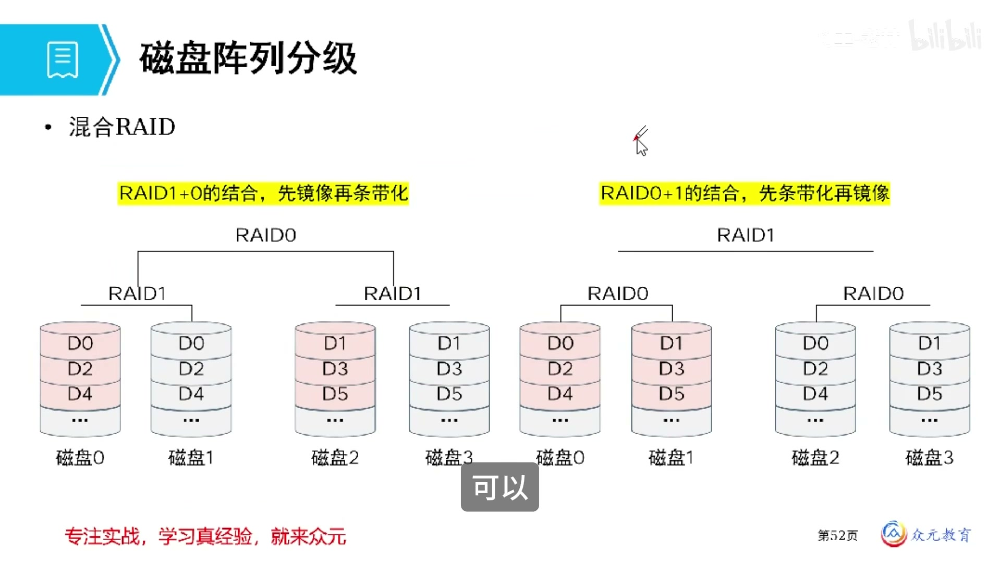

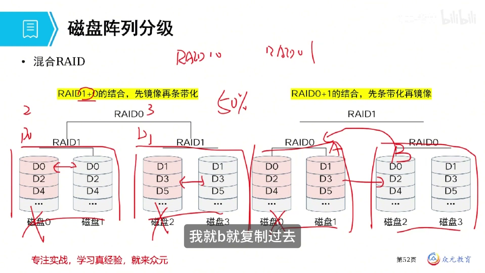

- **RAID 10（1+0）**：先**镜像**再**条带化**——先组成镜像对，再把镜像对作为一个整体做条带化
- **RAID 01（0+1）**：先**条带化**再**镜像**——先条带化成整体，再对整体做镜像
- 磁盘利用率均为 **50%**（含镜像）；所需磁盘 **≥4（2N）**

可靠性对比：RAID 10 更优。

- RAID 10 中一块盘故障，其镜像盘仍在，直接复制恢复；两块盘故障（如盘0和盘2）时，只要不在同一镜像对内，均能恢复
- RAID 01 中镜像以整体为单位（A、B 两个 RAID 0 组）：A 组内一块盘故障，整个 A 组失效，靠 B 组整体复制恢复；若 A、B 组各有一块盘同时故障，则整个阵列崩溃

因此 RAID 10 的可靠性、独立性更好。在企业级应用中，最常用、最有代表性的是 **RAID 10 和 RAID 5**。

### 6.8 RAID10 与 RAID5 对比

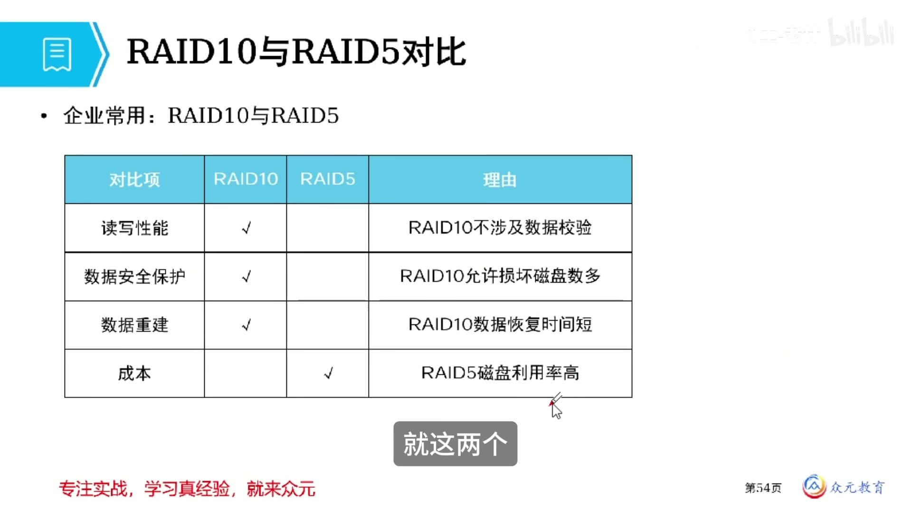

| 对比项 | RAID10 | RAID5 | 理由 |
| ------ | ------ | ----- | ---- |
| 读写性能 | [正确] | | RAID10 不涉及数据校验 |
| 数据安全保护 | [正确] | | RAID10 允许损坏磁盘数多（有条件时可损坏一半） |
| 数据重建 | [正确] | | RAID10 数据恢复时间短（有镜像，恢复效率更高） |
| 成本 | | [正确] | RAID5 磁盘利用率高 |

选题口诀（考频高）：

- **只考虑性能和成本**：RAID 0
- **考虑可靠性**：RAID 10
- **综合考虑（性价比）**：RAID 5

### 6.9 磁盘阵列分级小总结

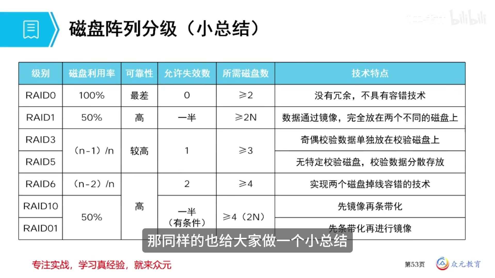

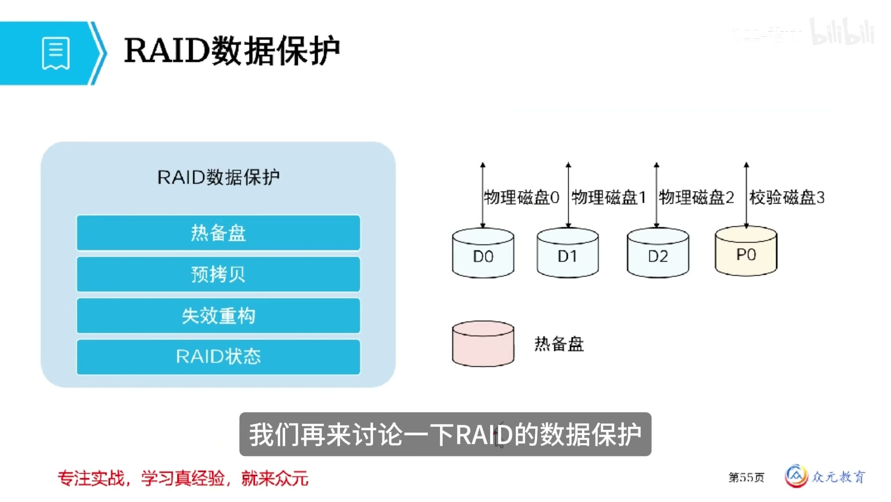

| 级别 | 磁盘利用率 | 可靠性 | 允许失效数 | 所需磁盘数 | 技术特点 |
| ---- | ---------- | ------ | ---------- | ---------- | -------- |
| RAID0 | 100% | 最差 | 0 | ≥2 | 没有冗余，不具有容错技术 |
| RAID1 | 50% | 高 | 一半 | ≥2N | 数据通过镜像，完全放在两个不同的磁盘上 |
| RAID3 | (n−1)/n | 较高 | 1 | ≥3 | 奇偶校验数据单独放在校验磁盘上 |
| RAID5 | (n−1)/n | 较高 | 1 | ≥3 | 无特定校验磁盘，校验数据分散存放 |
| RAID6 | (n−2)/n | 高 | 2 | ≥4 | 实现两个磁盘掉线容错的技术 |
| RAID10 | 50% | 高 | 一半（有条件） | ≥4（2N） | 先镜像再条带化 |
| RAID01 | 50% | 高 | 一半（有条件） | ≥4（2N） | 先条带化再进行镜像 |

复习时重点关注：磁盘利用率比值、可靠性、允许失效盘数、至少所需磁盘数（注意 RAID 1 的倍值关系 ≥2N）。

补充（RAID 50，嵌套级别）：RAID 50（RAID 5+0）将 RAID 0 条带化叠加在多个 RAID 5 组之上，最少需要 6 块盘（至少 2 个 RAID 5 组，每组至少 3 块）；每个 RAID 5 组内允许 1 块盘失效，磁盘利用率为 1 − 1/每组盘数（例如每组 3 块盘时为 (n−组数×1)/n，即整体 (n−组数)/n）。容错能力为每组各 1 块，但同一 RAID 5 组内不能失效 2 块。

---

## 7.RAID 数据保护

RAID 数据保护涉及四个关键词：**热备盘、预拷贝、失效重构、RAID 状态**。

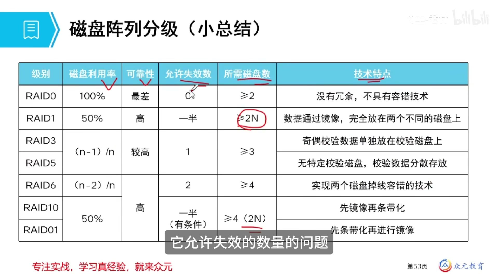

### 7.1 RAID 状态

RAID 状态可有四种：**创建、正常、工作、失效、降级**（描述各磁盘的状态）。不同状态有不同的处理方法：

- 若在磁盘完全失效之前发现状态异常（预先感知），可进行**预拷贝**：提前将数据交接给热备盘，由热备盘替代其工作；原盘恢复后退出
- 若磁盘突然完全失效，则进入**失效重构**：由热备盘依据校验信息进行重构恢复（需要一定的计算才能得到最终结果）；若同一时刻失效盘数超出该级别允许数量（如一下挂两块盘），则无法恢复——这正是强调"允许失效数量"的原因

### 7.2 热备盘

热备盘相当于后备队员：是一块**空白盘**，在不干扰当前 RAID 系统正常使用的情况下，用正常的备用磁盘顶替失效的磁盘。

热备盘一般有两种：

| 类型 | 说明 |
| ---- | ---- |
| 全局式热备盘 | 为系统中所有冗余 RAID 组共享（一对多） |
| 专用式热备盘 | 仅为系统中某一组冗余 RAID 组专用（一对一） |

---

## 8.课堂习题与真题（RAID 分级）

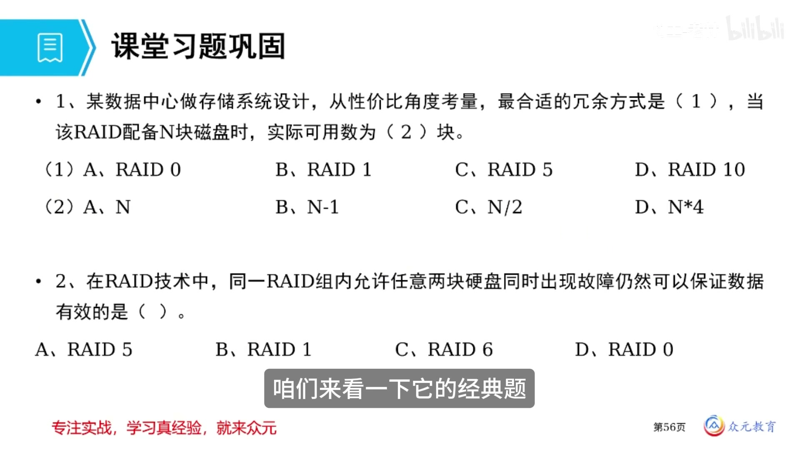

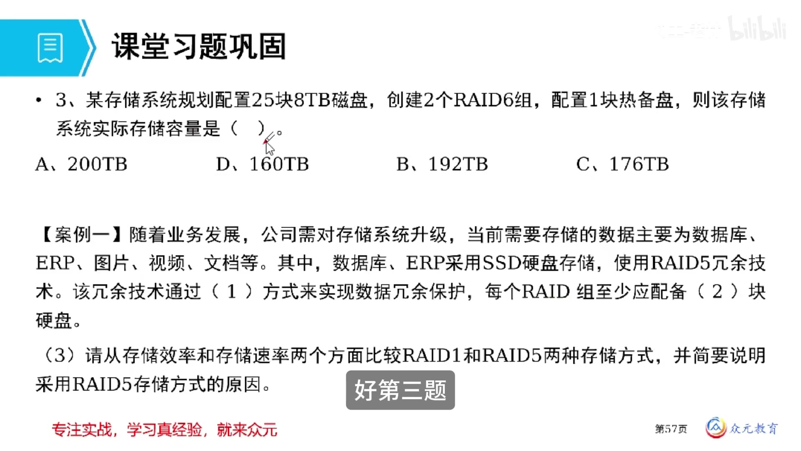

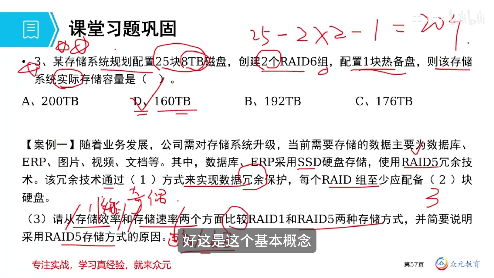

### 例题1：性价比选型与可用盘数

某数据中心做存储系统设计，从性价比角度考量，最合适的冗余方式是（1），当该 RAID 配备 N 块磁盘时，实际可用数为（2）块。

- （1）A、RAID 0　B、RAID 1　C、RAID 5 [正确]　D、RAID 10
- （2）A、N　B、N-1 [正确]　C、N/2　D、N*4

解答：性价比即综合考量成本与性能、可靠性，选 RAID 5；RAID 5 有一块校验盘（无专用校验盘但整体占用一块盘容量），实际可用为 N−1 块。

### 例题2：任意两块盘同时故障

在 RAID 技术中，同一 RAID 组内允许任意两块硬盘同时出现故障仍然可以保证数据有效的是（C）

- A、RAID 5
- B、RAID 1
- C、RAID 6 [正确]
- D、RAID 0

解答：注意关键词"任意两块"。RAID 6 双校验允许任意两块盘同时故障；RAID 5 只允许一块；RAID 1 可靠性极高但一般镜像对内只容忍一块；RAID 0 可靠性最差，无容错。

### 例题3：RAID6 组实际容量计算（2026年5月真题）

某存储系统规划配置 25 块 8TB 磁盘，创建 2 个 RAID6 组，配置 1 块热备盘，则该存储系统实际存储容量是（D）

- A、200TB
- B、192TB
- C、176TB
- D、160TB [正确]

解答：每个 RAID 6 组占用 2 块盘做校验，另有 1 块热备盘，均不计入实际容量：

```
可用盘数 = 25 − 2×2（两个 RAID6 组各 2 块校验盘） − 1（热备盘） = 20 块
实际容量 = 20 × 8TB = 160TB
```

[手写批注] 25 − 2×2 − 1 = 20。

**相似真题（2026年5月）**：8 块 8TB 磁盘组成 RAID 5，配置 1 块热备盘，问容量。复算：8 − 1（校验）− 1（热备）= 6 块可用，6 × 8TB = **48TB**。解题思路与上题一致，仅数据不同。

### 例题4：案例题（RAID5 冗余方式与比较）

【案例一】随着业务发展，公司需对存储系统升级，当前需要存储的数据主要为数据库、ERP、图片、视频、文档等。其中，数据库、ERP 采用 SSD 硬盘存储，使用 RAID5 冗余技术。该冗余技术通过（1）方式来实现数据冗余保护，每个 RAID 组至少应配备（2）块硬盘。

（1）答案：**奇偶校验**。
（2）答案：**3 块**（2 块做条带化，1 块做校验，至少 3 块起步）。

（3）请从存储效率和存储速率两个方面比较 RAID1 和 RAID5 两种存储方式，并简要说明采用 RAID5 存储方式的原因。

参考解答（开放性问答，两个角度都要写到）：

1. **存储效率方面**：RAID 1 的存储效率为 50%；RAID 5 的存储效率为 (n−1)/n。假设 4 块盘，RAID 1 效率为 50%，RAID 5 效率为 3/4（75%）。RAID 5 效率更高。
2. **存储速率（性能）方面**：RAID 5 提供更高的存储性能（条带化支持并行读写）；RAID 1 未考虑性能提升，单盘读写尚可，但并行读写不如 RAID 5，其优势主要在于恢复速度（有镜像，恢复快）。
3. **选择 RAID 5 的原因**：综合考虑成本与性能、可靠性，RAID 5 性价比最优。

作答时把利用率、可靠性、技术特点描述清楚即可得分。

---

## 9.RAID 技术的发展

RAID 技术从"固定组、专属盘"的模式，一步步进化到"全池化、细粒度"的模式。核心目标是解决传统 RAID 的**重构慢、扩展难、热点多**三大痛点，RAID 2.0+ 的块虚拟化是当前最成熟的解决方案。

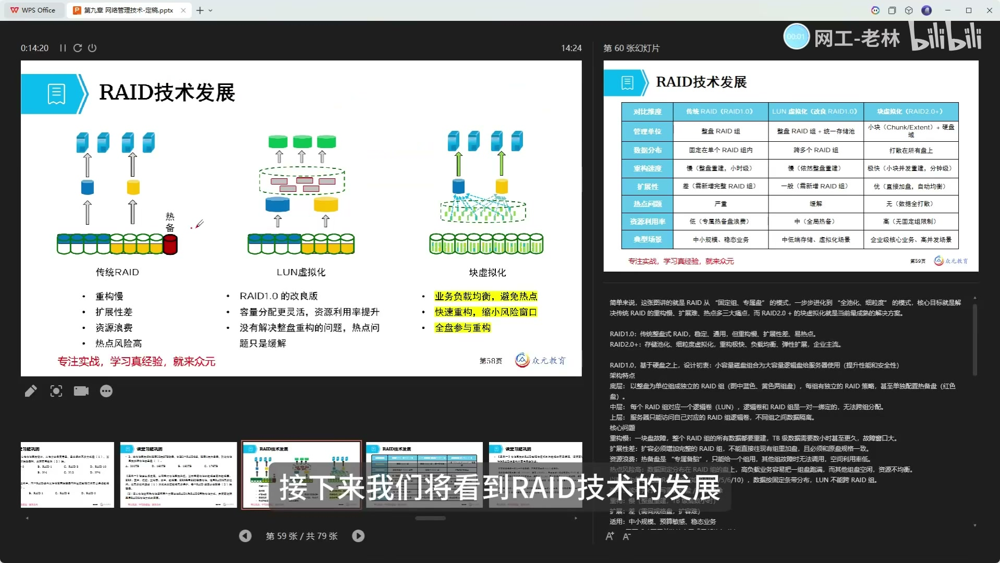

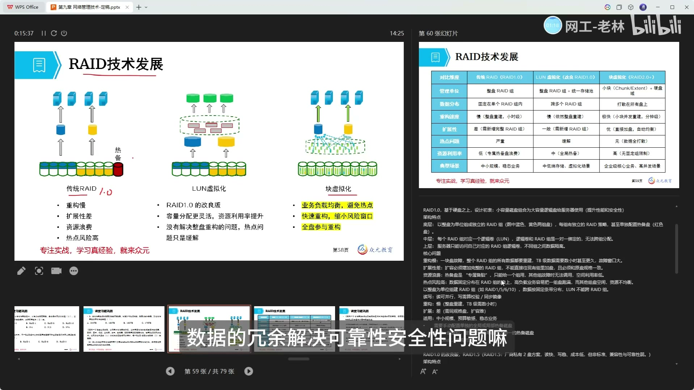

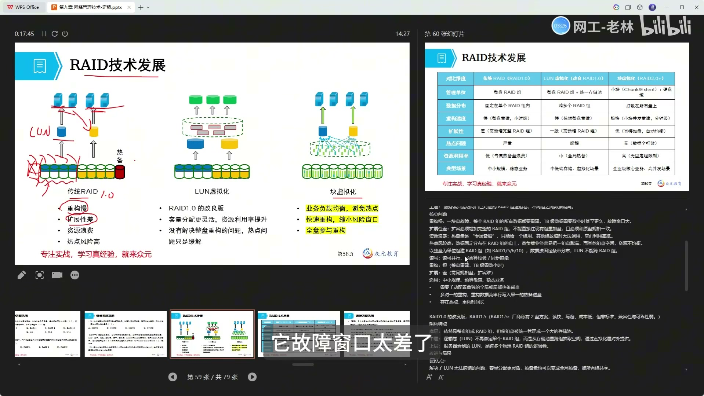

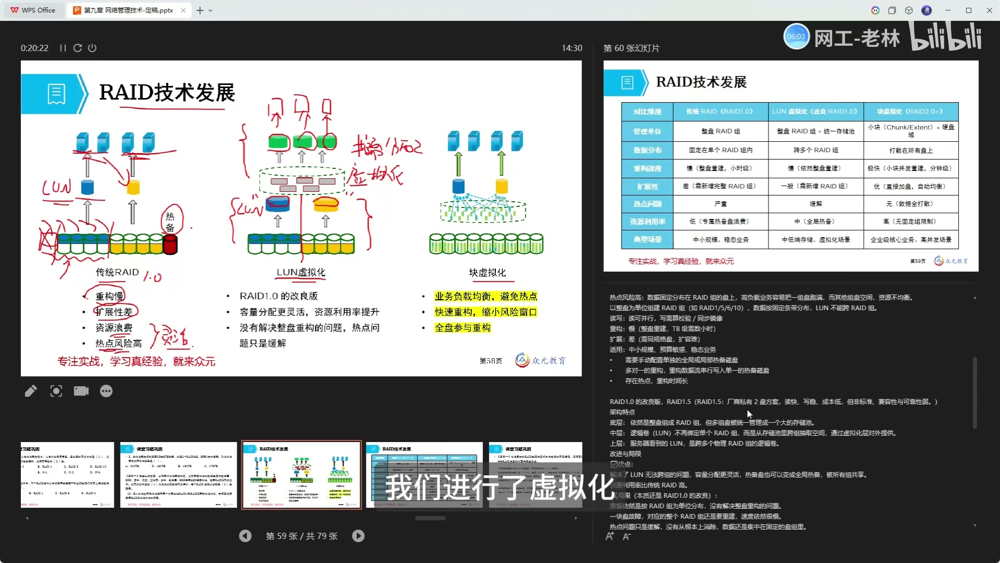

### 9.1 传统 RAID（RAID 1.0）

- 设计初衷：小容量磁盘组合为大容量的逻辑盘给服务器使用（提升性能和安全性）——条带化解决性能问题，数据冗余解决可靠性、安全性问题
- 架构特点：
  - 底层：以**整盘**为单位组成独立的 RAID 组，每组有独立的 RAID 策略，甚至单独配置热备盘
  - 中层：每个 RAID 组对应一个**逻辑卷（LUN）**，逻辑卷和 RAID 组是**一对一绑定**的，无法跨组分配
  - 上层：服务器只能访问自己对应的 RAID 组逻辑卷，不同组之间数据隔离
- 核心问题：
  - **重构慢**：一块盘故障，整个 RAID 组的所有数据都需要重建，TB 级数据需要数小时甚至更久，故障窗口大
  - **扩展性差**：扩容必须增加完整的 RAID 组，不能直接往现有组里加盘，且必须加同盘规格一致的盘；加入新盘后整个组的数据要重新条带化
  - **资源浪费**：热备盘是"专属储备"，只能给一个组用，其他组故障时无法调用，空间利用率低
  - **热点风险高**：数据固定分布在 RAID 组的盘上，高负载业务容易把一组盘跑满，而其他组空闲，资源不均衡

### 9.2 LUN 虚拟化（改良 RAID 1.0）

- RAID 1.0 的改良版：底层依旧按整盘组成 RAID 组，但多组磁盘被统一管理成一个大的**存储池**；逻辑卷（LUN）不再绑定单个 RAID 组，而是从存储池里跨组提取空间，通过虚拟化层对外提供
- 改进与局限：
  - 解决了 LUN 无法跨组的问题，容量分配更灵活
  - 热备盘可以变成**全局热备**，被所有组共享，资源利用率较传统 RAID 1.0 更高
  - 局限：数据依然按 RAID 组为单位分布，**没有解决整盘重构的问题**（一块盘故障仍要对整个 RAID 组重建，重构速度依旧很慢）；热点问题只是**缓解**，没有从根本上消除

### 9.3 块虚拟化（RAID 2.0+）

- 将底层从物理盘开始就进行虚拟化（块级虚拟化技术），把不同类型的硬盘组成存储资源池
- 两层虚拟化：**硬盘域 → Chunk → CKG → Extent**
  1. 将硬盘划分成若干个连续的、固定大小的存储空间，称为**存储块（Chunk，即 CK）**，通常 64MB
  2. Chunk 按 RAID 策略组合成 RAID 组，称为**存储块组（CKG，chunk group）**
  3. 在 CKG 中划分若干**更小的逻辑块（Extent，通常 4MB）**，即 Extent；LUN 就是由来自不同 CKG 的 Extent 组成，按需分配
  4. 用作热备空间的 CK 也是分散在各个盘上的
- 架构特点：
  - 底层：所有硬盘被统一纳入一个**硬盘域**，不再有独立的 RAID 组概念
  - 中层：每块盘被切成大量小块（Chunk），由这些小块组成虚拟 RAID 组（CKG），数据打散分布在整个硬盘域的所有盘上；逻辑卷（LUN）再由更细的 Extent 块组成，按需从整个池里分配
  - 上层：服务器访问 LUN 时，数据是从多块盘上并行读取/写入的
- 革命性优势：
  - **业务负载均衡，避免热点**：数据切片到资源池内所有硬盘上，没有热点，硬盘负载平均，避免个别盘因承担更多的写操作而提前达到寿命上限
  - **快速重构，缩小风险窗口**：一块盘故障，只需要重建这块盘上的小块数据，而且重建任务被分摊到所有正常盘上并发执行，TB 级数据通常几十分钟就能完成，大幅降低故障窗口
  - **全盘参与重构**：资源池内所有硬盘都会参与重构，每个盘的重构负载很低，重构过程对上层应用无影响
  - **弹性扩展**：新增硬盘加入硬盘域，数据会自动重新打散到新硬盘上，无需手动重建或迁移，扩容无压力
  - **资源利用率高**：没有专属热备盘，全局共享冗余空间，也没有固定的组容量限制，所有空间都能被高效利用

### 9.4 三代技术对比表

| 对比维度 | 传统 RAID（RAID1.0） | LUN 虚拟化（改良 RAID1.0） | 块虚拟化（RAID2.0+） |
| -------- | -------------------- | -------------------------- | -------------------- |
| 管理单位 | 整盘 RAID 组 | 整盘 RAID 组 + 统一存储池 | 小块（Chunk/Extent）+ 硬盘域 |
| 数据分布 | 固定在单个 RAID 组内 | 跨多个 RAID 组 | 打散在所有盘上 |
| 重构速度 | 慢（整盘重建，小时级） | 慢（依然整盘重建） | 极快（小块并发重建，分钟级） |
| 扩展性 | 差（需新增完整 RAID 组） | 一般（需新增 RAID 组） | 优（直接加盘，自动均衡） |
| 热点问题 | 严重 | 缓解 | 无（数据全打散） |
| 资源利用率 | 低（专属热备盘浪费） | 中（全局热备） | 高（无固定组限制） |
| 典型场景 | 中小规模、稳态业务 | 中低端存储、虚拟化场景 | 企业级核心业务、高并发场景 |

概括：RAID1.0 传统整盘式 RAID，稳定、通用，但重构慢、扩展性差、易热点；RAID2.0+ 存储池化、细粒度虚拟化，重构极快、负载均衡、弹性扩展，是企业主流。

### 9.5 真题：RAID 2.0 重构方面的改进（2018年案例题）

【案例一】存储系统的 RAID 故障恢复机制为数据的可靠保障，请简要说明 RAID2.0 较传统 RAID 在重构方面有哪些改进。

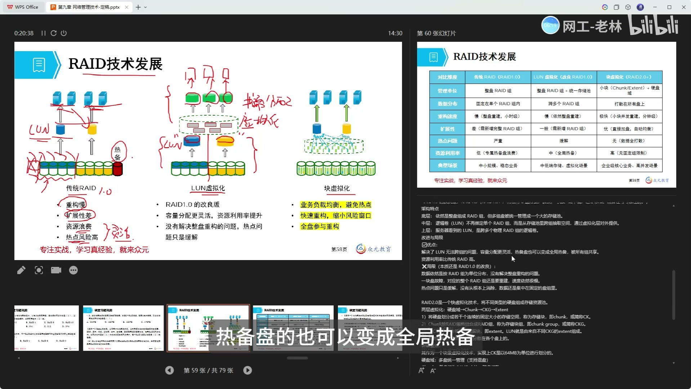

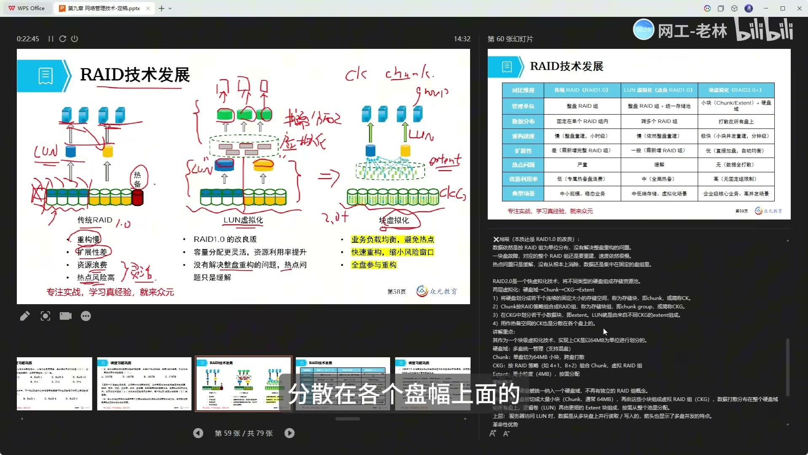

参考答案要点（抓住两个关键点即可拿分）：

1. **重构速度快**：一块盘故障只需重建该盘上的小块数据，重建任务分摊到所有正常盘上并发执行，TB 级数据通常几十分钟即可完成，大幅缩短重构时间、降低故障窗口
2. **全盘参与重构**：所有硬盘被统一纳入一个硬盘域，不再有独立的 RAID 组概念；重构不再是独立 RAID 组的整盘重建，而是由资源池内所有硬盘共同参与，每个盘的重构负载很低

[手写批注] 关键词"时间"、"全盘参与"。

---

## 10.本章小结

| 知识点 | 核心内容 |
| ------ | -------- |
| 1. 存储层次结构 | 高速缓存、内存、外存三级构成；Cache 解决 CPU 与内存速度不匹配，外存解决容量问题；虚拟存储 = 主存 + 辅存（解决内存空间不足，常考） |
| 2. 存储容量与带宽 | 存储容量 = 存储单元个数 × 存储字长（单元个数 = 2ⁿ，n 为地址位数）；存储带宽 = 单位时间内存储器存取的数据量 |
| 3. 分层存储 | 按数据价值分级：关键/热数据用在线存储（磁盘阵列），温数据用近线存储，冷数据用离线存储（磁带、光盘，脱机/备份级） |
| 4. 磁盘对比 | HDD：磁道/扇区/柱面定位，连续读写好、随机读写差；SSD：Flash 闪存、无旋转盘体、速度快、成本高、有擦写寿命、怕震动；两者适用场景对比常考 |
| 5. 磁盘接口 | SATA（家用主导）、SAS（服务器主导，串行 SCSI 兼容 SATA）、FC（光纤通道，高端服务器，需专用光纤交换机）；固态盘另有 M.2（家用）、U.2（企业）、PCIe |
| 6. RAID 基本思想 | 数据条带化提高性能，数据冗余提高可靠性；由 RAID 控制器、磁盘控制器、物理磁盘组成 |
| 7. RAID 分级 | RAID0 利用率 100% 可靠性最差；RAID1 镜像 50%≥2N 块；RAID3 专用校验盘（瓶颈）；RAID5 校验分散 (n−1)/n≥3 块；RAID6 双校验 (n−2)/n≥4 块；RAID7 理论性能最高 |
| 8. 混合 RAID | RAID10 先镜像再条带化（可靠性更优）、RAID01 先条带化再镜像；均 50%、≥4 块；企业常用 RAID10 与 RAID5 |
| 9. RAID 数据保护 | 热备盘（全局式/专用式）、预拷贝（提前感知交接）、失效重构（依据校验恢复）、RAID 状态 |
| 10. RAID 技术发展 | RAID1.0（整盘、一对一 LUN、重构慢扩展难热点多）→ LUN 虚拟化（存储池、全局热备，仅缓解）→ RAID2.0+ 块虚拟化（Chunk→CKG→Extent，重构极快、负载均衡、弹性扩展，企业主流） |
| 11. 容量计算 | 实际容量 =（总盘数 − 各组校验盘数 − 热备盘数）× 单盘容量，务必逐项扣减 |

考试重点：

1. 虚拟存储由主存和辅存（内存与外存）两级构成，用于解决内存空间不足，连续多年以选择题考查
2. 机械硬盘与固态硬盘的对比：介质、有无旋转盘体、速度、成本、寿命、适用场景
3. 磁盘接口三大经典类型 SATA、SAS、FC 的特点与应用环境；SPI 不属于硬盘接口协议
4. RAID 各级别的磁盘利用率、可靠性、允许失效数、最少磁盘数，注意 RAID1 的 2N 倍值关系
5. 选题口诀：只看性能成本选 RAID0，看可靠性选 RAID10，综合性价比选 RAID5
6. 容量计算：扣减每个 RAID 组的校验盘（RAID5 扣 1、RAID6 扣 2）与热备盘后再乘单盘容量
7. RAID2.0+ 的块虚拟化：重构速度快（小块并发、分钟级）且全盘参与重构，是案例题的两大得分点
