# 网络存储方案、数据备份与恢复 · 完整笔记

---

## 1.存储技术的发展脉络与章节地位

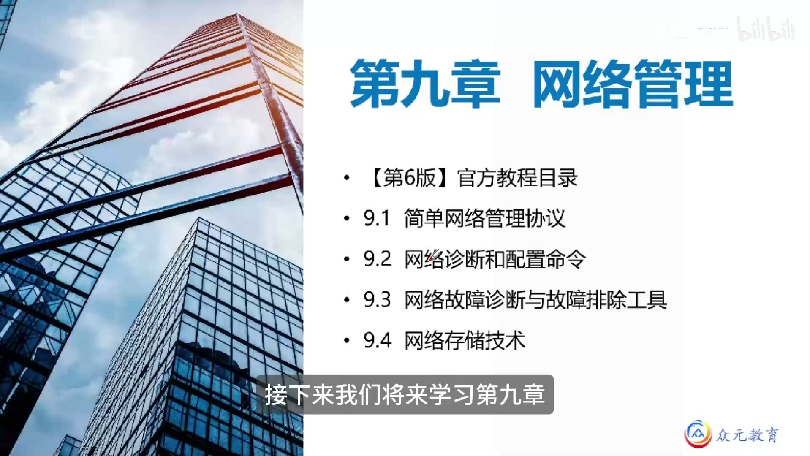

### 1.1 教程目录的变更情况

最新版官方教程对第九章「网络管理」的目录做了大幅度简化，由原先约九个小节压缩为四个小节，各部分的变动如下：

| 章节内容 | 变动情况 | 说明 |
| -------- | -------- | ---- |
| 网络管理基础知识 | 大幅简化 | 仅保留简单网络管理协议（SNMP）的概念描述，其模型与功能一并并入该板块统一介绍，仍是选择题考查的侧重点 |
| 故障诊断与排除 | 新增 | 由原先的「网络分析工具」改为「故障诊断与故障排除工具」，强调对设备、对网络稳定性的衡量 |
| 诊断与配置命令 | 删减 | 删除不常考、不常用的命令，保留常规代表，如 ping、tracert、ipconfig 等 |
| 网络存储技术 | 基本不变 | 考试内容未发生大的变化 |

### 1.2 考核形态

- 网络存储技术在案例题中考查频度较低，目前更加侧重考查一到两分的选择题
- 第九章的案例题考查更加侧重于故障的排除与诊断
- 存储技术部分属于中规中矩的板块，重点在于存储的基本概念

---

## 2.存储技术知识脉络

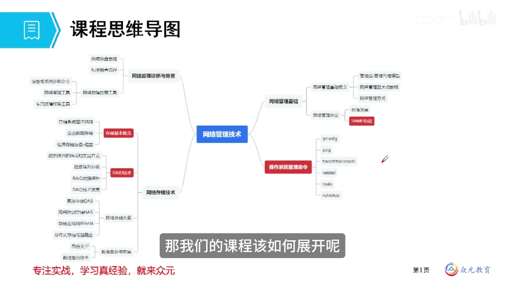

### 2.1 本章知识结构

| 板块 | 主要内容 | 重要程度 |
| ---- | -------- | -------- |
| 存储基本概念 | 多级存储结构分别解决的问题；磁盘（硬盘）的组成、工作原理与特色 | 需掌握 |
| 存储衡量指标 | 容量、速度、成本 | 需掌握 |
| 磁盘阵列技术 | RAID 技术、独立磁盘冗余阵列的实现方式与特点 | 需认识关键词 |
| 新兴发展方向 | 分布式存储、超融合在企业级数据部署与存储中的选择 | 需了解 |
| 数据备份与恢复 | 备份类型、备份技术名词、容灾指标 | 需侧重掌握 |

### 2.2 考情提示

- RAID 技术在往年考过案例题，但近几年只考选择题，且仅涉及一分左右，频度不高，但**需知道其可以往案例方向出题**
- 存储衡量与磁盘阵列属于拓展性内容，正课中不作过多展开

---

## 3.网络存储方案概述

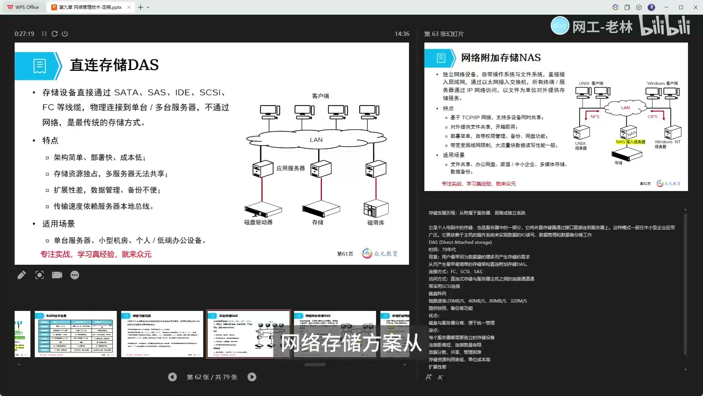

存储从附属于服务器，到剥离成为独立的存储系统，经历了三个非常经典的代表形态，其规模由小到大依次为：

| 演进顺序 | 形态 | 全称 |
| -------- | ---- | ---- |
| 第一代 | DAS | 直连式存储（Direct Attached Storage） |
| 第二代 | NAS | 网络附加存储（Network Attached Storage） |
| 第三代 | SAN | 存储区域网络（Storage Area Network） |

### 3.1 三种存储方案的演进关系

| 阶段 | 形态 | 与服务器的关系 |
| ---- | ---- | -------------- |
| 最初形态 | DAS | 存储设备直接挂在服务器内部或服务器总线上，是服务器的附属部件 |
| 中间形态 | NAS | 存储脱离服务器，成为网络中独立的文件服务器，但复用现有业务网络 |
| 高级形态 | SAN | 存储进一步剥离，单独组建一张专用于存储的网络，实现更大的存储空间与更高的读写性能 |

---

## 4.DAS 直连式存储

### 4.1 基本概念

DAS（Direct Attached Storage，直连式存储）：直接通过线缆接口将服务器连接在存储设备上，**不经过网络**。

典型形态：U 盘、移动硬盘，通过 USB 接口或硬盘接口直接插接完成连接。

### 4.2 特点

| 项目 | 内容 |
| ---- | ---- |
| 产生时间 | 二十世纪七十年代左右 |
| 依赖对象 | 更加依赖操作系统来实现数据的输入输出读写、数据管理与数据备份 |
| 优点 | 架构简单、部署快、成本低 |
| 缺点 | 扩展性差，随业务发展明显不够用 |
| 适用场景 | 个人电脑、个人设备；不适用于大型设备 |

**要点**：DAS 是最传统的存储方式，适用于单台个人设备，大型环境中不常见。

---

## 5.NAS 网络附加存储

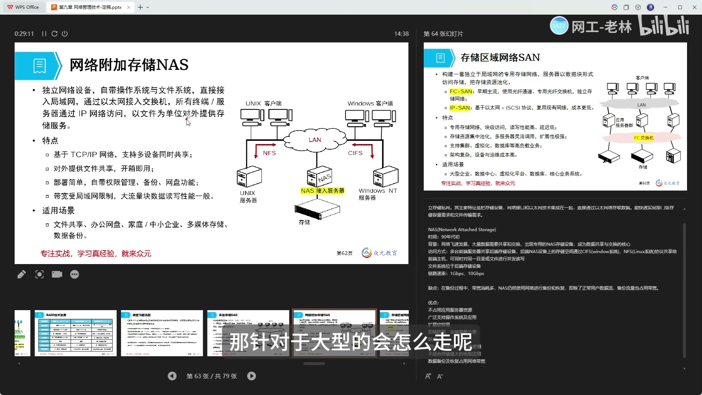

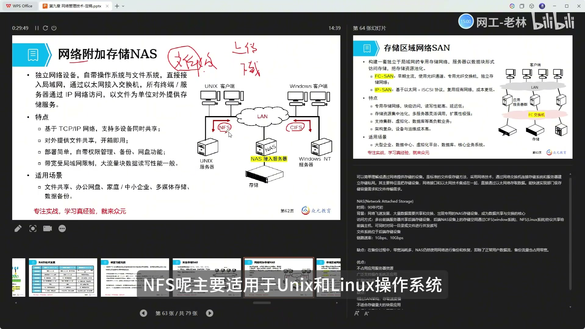

### 5.1 基本概念

NAS（Network Attached Storage，网络附加存储）：针对**文件级**的存储概念，以文件形式进行上传与下载，配备专用的文件管理服务器，采用网络技术与相应的服务协议。

**关键词：文件级**。

### 5.2 核心特征

| 特征 | 说明 |
| ---- | ---- |
| 访问单位 | 文件级（以文件为单位） |
| 访问方式 | 通过网络进行访问 |
| 服务协议 | NFS、CIFS |
| 产生时间 | 二十世纪九十年代初，网络飞速发展、大量数据需要共享与交换时期 |
| 地位 | 成为数据共享和交换的核心 |

### 5.3 经典协议对比

| 协议 | 英文全称 | 适用操作系统 | 版本 |
| ---- | -------- | ------------ | ---- |
| NFS | Network File System（网络文件系统） | Unix、Linux | NFSv2、NFSv3、NFSv4 |
| CIFS | Common Internet File System（通用互联网文件系统） | Windows 系列 | CIFS 为 SMB 的开放方言，现已被 SMB 2.0 / SMB 3.1.1 取代 |

补充要点：

- CIFS 由微软作为 SMB 协议的开放方言提出，两者可互换理解，但现代存储系统已很少使用 CIFS，普遍改用 SMB 2.0 及以上版本
- NFS 由 Sun 公司于 1984 年开发，现由 IETF 维护，主要基于远程过程调用（RPC）
- 两者均为**有状态/无状态**的重要区别：NFSv3 为无状态协议，文件锁由外部协议（NLM）处理；NFSv4 为有状态协议，文件锁集成于协议内；CIFS/SMB 为有状态协议，文件锁由服务器端处理
- 身份验证方式不同：NFS 传统上基于主机（IP 地址或主机名）；CIFS/SMB 基于用户（SID 转换，依赖 Active Directory）

### 5.4 优缺点

| 项目 | 内容 |
| ---- | ---- |
| 优点 | 可文件为单位通过网络进行访问，有协议支撑，便于数据共享 |
| 缺点 | **受局域网限制，大流量、快数据的读写性能一般** |
| 典型实例 | 网盘——文件过大、带宽不足时传输非常慢 |

**要点**：NAS 的最大缺点在于速率问题，受限于局域网带宽。

---

## 6.SAN 存储区域网络

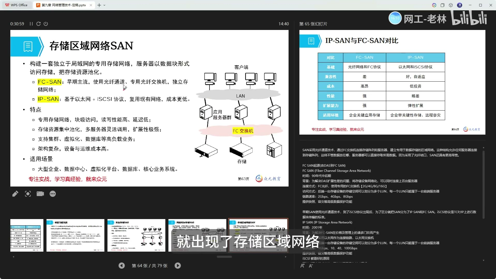

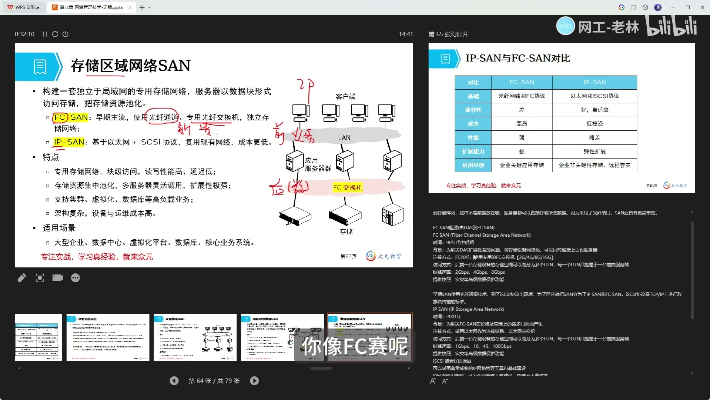

### 6.1 前端网络与后端网络

SAN 引入了**前端**与**后端**的概念：

| 网络 | 别称 | 作用 |
| ---- | ---- | ---- |
| 前端 | 业务网络 | 客户端与服务器群交互的正常业务网络 |
| 后端 | 数据网络 / 存储网络 | 单独划分出来专用于存储的网络 |

**要点**：SAN 的本质是把后端的数据网络（存储网络）与前端的业务网络分离开。

### 6.2 FC 的含义辨析

**关键辨析**：**FC 代表 Fibre Channel（光纤通道）**，不是「光纤（Fiber）」，也不是快速以太网（Fast Ethernet）等，务必区分清楚。

### 6.3 FC SAN

| 项目 | 内容 |
| ---- | ---- |
| 组网技术 | 光纤通道（Fibre Channel，FC） |
| 核心连接设备 | 专用的**光纤交换机** |
| 传输介质 | 光纤（也可用同轴铜缆、双绞合铜缆） |
| 服务器端接口 | **HBA（Host Bus Adapter，光纤通道主机总线适配器卡）** |
| 产生时间 | 二十世纪九十年代中后期 |
| 解决的问题 | 直连式存储扩展性差的问题，将存储设备网络化 |
| 缺点 | 新技术，需考虑兼容性与价格，设备昂贵，付出的代价比较高 |
| 典型速率 | 1 Gbps、2 Gbps、4 Gbps、8 Gbps、16 Gbps、32 Gbps |
| 传输距离 | 单模光纤最远约 10 公里，通过连接设备可达 100 公里；FC SAN 物理覆盖通常不超过 50 公里 |
| 拓扑结构 | 点对点（Point-to-Point）、仲裁环（Arbitrated Loop，最多 126 个设备）、交换式 Fabric（Switch Fabric，支持海量设备互连） |
| 寻址 | WWN（World Wide Name，64 位全球唯一地址，类似 MAC 地址）；24 位 FCID 地址（Domain / Area / Port 三段，类似 IP 地址） |

**要点**：FC SAN 是一种新技术与新概念，关键性设备为**光纤交换机**、**光纤通道**。

### 6.4 IP SAN

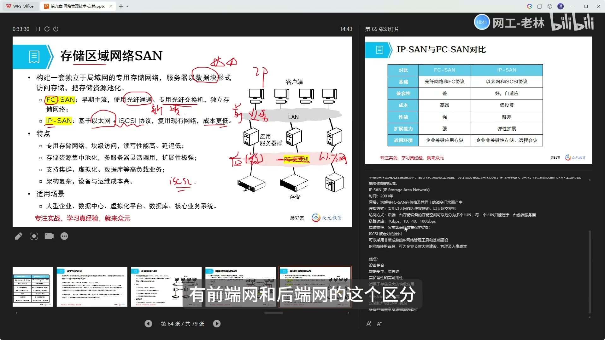

| 项目 | 内容 |
| ---- | ---- |
| 组网技术 | iSCSI（Internet SCSI，互联网小型计算机系统接口）协议 |
| 核心连接设备 | 以太网交换机 / IP 交换机 |
| 服务器端接口 | 普通网卡（NIC）或 iSCSI HBA 卡，无需专用 FC HBA |
| 本质 | 把后端的数据网络建立在以太网之上，基于以太网交换机、IP 交换机完成 |
| 解决目标 | 提供更价格低廉、性价比更高的网络存储方案，适配当前 IP 网络 |
| 优势 | 可为企业节省大笔的建设、管理以及人事成本 |
| 典型速率 | 千兆以太网（1 Gbps），随网卡与交换机升级可达 10 Gbps 及以上 |
| 传输距离 | 无距离限制，可借助现有 Internet 与广域网延伸 |

**要点**：IP SAN 与 FC SAN 的主要差异在于**是否采用 iSCSI 协议以实现异地间的数据交换**。

### 6.5 IP SAN 与 FC SAN 对比

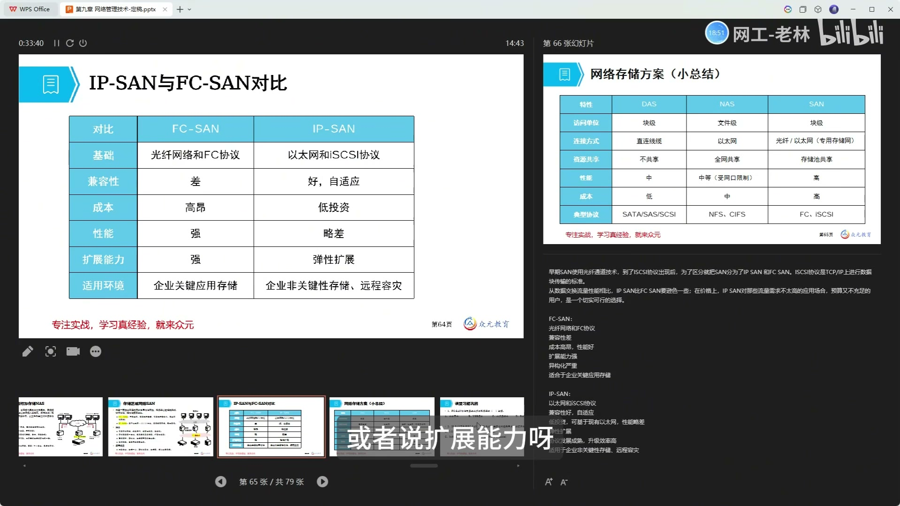

| 比较项 | FC SAN | IP SAN |
| ------ | ------ | ------ |
| 网络协议 | FC（光纤通道协议） | iSCSI（基于 TCP/IP） |
| 连接设备 | 光纤交换机 | 以太网交换机 |
| 连接线缆 | 光纤（或铜缆） | 网线（双绞线） |
| 服务器端设备 | 光纤通道 HBA 卡 | 普通网卡 / iSCSI HBA 卡 |
| 性能 | 更优 | 一般 |
| 扩展能力 | 良好，但受距离限制 | 更出色，无距离限制 |
| 成本 | 高（专用设备、专用 HBA） | 低（复用现有以太网设备） |
| 性价比 | 一般 | 更优 |
| 管理难度 | 复杂，需专业技术 | 简单，沿用已有 IP 网络知识 |
| 适用场景 | 大型、高端数据库等对性能要求极高的环境 | 对成本敏感、需远距离互联的中小企业环境 |

**解题要点**：

- 若题干侧重于**性能、扩展能力**，则选 FC SAN
- 若题干侧重于**成本、性价比**，则选 IP SAN
- 需根据题干或背景描述判断命题者期望的方向，本部分难度不高

---

## 7.三种存储方案综合对比

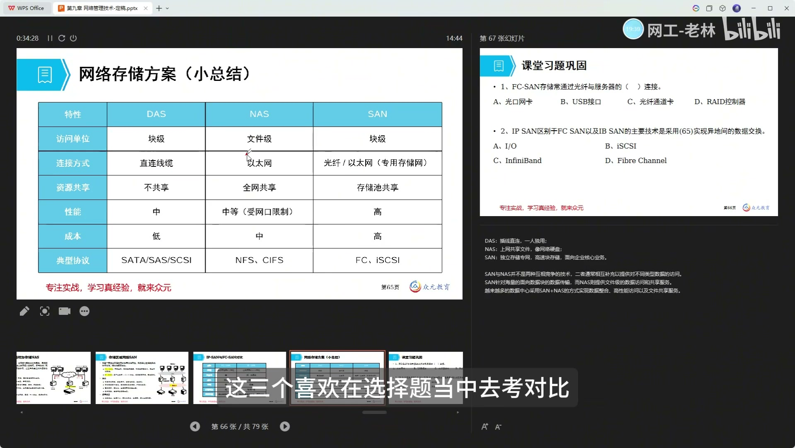

### 7.1 核心对比表

| 存储方案 | 英文全称 | 访问单位 | 连接方式 | 经典协议 / 技术 | 适用场景 |
| -------- | -------- | -------- | -------- | --------------- | -------- |
| DAS | Direct Attached Storage | 块级（本地） | 线缆直连，不经网络 | SCSI 等 | 个人设备、单台服务器 |
| NAS | Network Attached Storage | **文件级** | 以太网（复用业务网络） | **NFS、CIFS / SMB** | 文件共享、网盘 |
| SAN | Storage Area Network | **块级** | 独立存储网络（FC 或 IP） | FC、iSCSI | 数据库、大容量块存储 |

### 7.2 考查要点

本部分在选择题中喜欢考查**对比**，重点关注以下两项：

1. **访问单位**：文件级与块级的对比最为常见，NAS 为文件级，SAN 为块级
2. **经典协议**：NFS、CIFS / SMB、FC、iSCSI

其余内容不作过多要求。

### 7.3 存储类型的三层划分

除按组网方式划分外，存储还可按数据组织方式划分为三种，这是理解分布式存储的基础：

| 存储类型 | 数据组织方式 | 特点 | 适用场景 |
| -------- | ------------ | ---- | -------- |
| 块存储 | 拆分为固定大小的块，每块有唯一标识符 | 读写速度快、延迟低、可随机读写；共享性差、元数据有限、成本高 | 数据库、虚拟机磁盘、事务型工作负载 |
| 文件存储 | 树状目录结构，以路径访问 | 符合使用习惯、共享性好、支持 POSIX 语义；数据量增大后性能下降 | 共享文件、文档协作 |
| 对象存储 | 扁平结构，对象 = 数据 + 唯一标识符 + 自定义元数据 | 扩展性极强、元数据丰富、按需付费成本低；延迟较高、对象一经创建不可就地修改 | 非结构化数据、大数据、备份归档、云原生应用 |

---

## 8.超融合与分布式存储

### 8.1 超融合

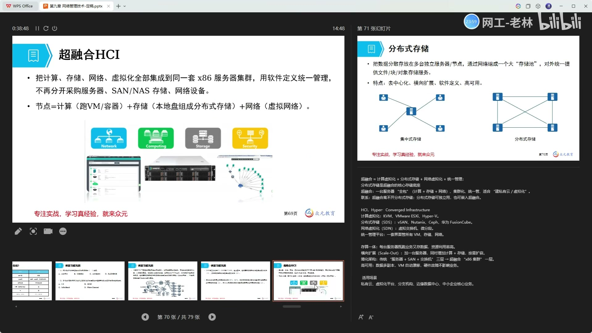

**超融合（Hyper-Converged Infrastructure，HCI）**：指将**计算、存储、网络虚拟化**全部集成到同一套服务器集群中，以**软件定义**的方式统一管理。

| 项目 | 内容 |
| ---- | ---- |
| 本质 | 在云计算概念上的延伸 |
| 管理方式 | 通过专用的管理型界面/平台统一管理，不需要分开采购服务器、存储、SDN 网络设备 |
| 服务形态 | 按需服务，像水电一样的公共资源；只需向服务方提出需求并购买即可 |
| 节点构成 | 节点上仍分为计算节点、存储节点、网络虚拟化节点等多个板块，只是被集成在一起提供 |
| 优势 | 不需要用户自行做组合与选择 |

**要点**：超融合是华为等厂商给出的存储解决方案中提出的代表性概念词，稍作了解即可。

### 8.2 分布式存储（本节核心）

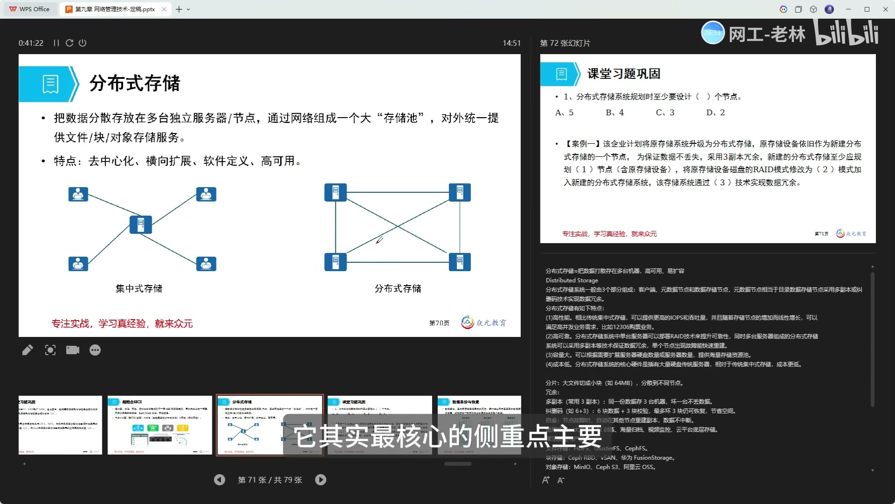

**分布式存储**：指将数据分散存放在多台独立服务器节点上，通过网络组成一个大的存储池，对外统一提供**文件、块或对象**形式的存储服务。

#### 8.2.1 核心特征

| 特征 | 说明 |
| ---- | ---- |
| 去中心化 | 分布式存储意味着去中心化，概念更灵活、多变 |
| 存储池 | 像水电一样提供租用、买卖服务，用户无需了解数据具体来自哪个节点 |
| 高可用 | 同一份数据保存多个副本，其中一台损坏不会造成数据丢失 |
| 易扩容 | 可通过增加节点实现横向扩展 |

#### 8.2.2 数据组织与保护机制

| 机制 | 说明 |
| ---- | ---- |
| 分块 | 将大文件切成更多的小块，分散存放在不同节点 |
| 多副本 | 默认采用**三个副本**（三副本冗余），同一份数据存于三台机器 |
| 自愈 | 节点故障后可自动恢复数据 |
| 纠删码 | 三副本之外的另一种数据保护方式 |

#### 8.2.3 三副本的放置策略

- **同一机架上存放两份，另一个机架再存放一份**
- 类比：鸡蛋不要放在同一个篮子里，而是放在多个篮子里

#### 8.2.4 适用场景

- 大数据
- AI 训练
- 云平台底层存储

**要点**：本部分是存储技术中最核心的侧重点，主要考**分布式的存储概念**。

### 8.3 相关名词辨析

| 名词 | 含义 | 说明 |
| ---- | ---- | ---- |
| 硬盘直通 | 磁盘访问模式 | 原存储设备加入新建分布式存储系统时需修改为该模式，否则默认为 RAID 模式 |
| 独立磁盘冗余模式 | 默认的 RAID 模式 | 与硬盘直通相对应的模式，两者需区分 |
| 纠删码 | 数据保护技术 | 与多副本并列的概念 |

### 8.4 新技术感知（备考提示）

- 有一年的考题直接从厂商的宣传资料中摘取，命题目的不在于考生是否真正理解，而在于**感知最新概念的提出**
- 建议时常翻阅华为、阿里等服务厂商的官网，关注其最近的设备型号、设备功能与特点更新
- 此类题目可能成为选择题或案例题中的偏题、难题，但**分数占比不高**，不会影响整体通过率，主要目的是打乱做题节奏
- 最近一次新技术的感知主要存在于芯片上的新技术研发，建议关注相关新闻
- 存储概念在大数据与数据规划师方向涉及力度更大

---

## 9.数据备份概述

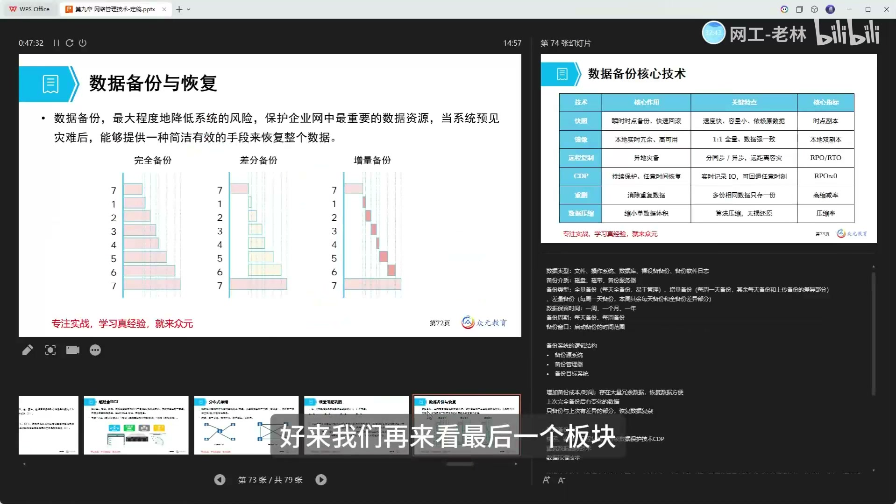

### 9.1 数据备份的定位

| 项目 | 内容 |
| ---- | ---- |
| 目的 | 降低系统风险，在发生意外后将损失降到最低限度 |
| 性质 | **补救性措施，而非预防性措施** |
| 应对对象 | 主要是天灾（水灾、地震等实在无法规避的情况），也包括人祸 |
| 手段 | 多地冗余，「狡兔三窟」 |

**易错点**：真正的预防仍需搭载安全防护系统，在事件发生**之前**做准备。数据备份是事件发生**之后**为降低损失所采取的补救手段。

### 9.2 与其他技术手段的关系

无论多副本还是各种存储方案，本质上都是为了保障**数据的读写性能和安全性**；数据备份与恢复（容灾）则是防止意外发生时降低损失的手段。

---

## 10.三种经典备份类型

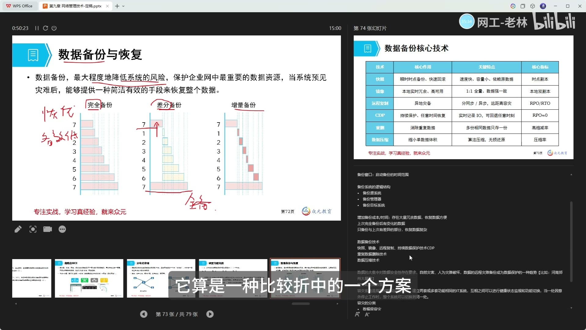

### 10.1 完全备份

**完全备份（Full Backup）**：无论前面数据有多少，每天都进行完整的备份。

- 类比：编辑一个 Word 文档，今天改了一点，整个 Word 文档都要拷贝一份；明天又改了一点，整个 Word 文档再拷贝一份
- 数据冗余量非常多，重复数据多
- 但**恢复速度快**：但凡出问题，直接拿过来即可，无需做任何额外的计算

| 项目 | 评价 |
| ---- | ---- |
| 备份效率 | 低 |
| 恢复速度 | 优（快） |
| 存储空间占用 | 大 |
| 数据冗余 | 多 |

### 10.2 差分备份

**差分备份（Differential Backup，也称差量备份）**：以周为单位，每周做一次完全备份（如周五），其余时间只保留**与上一次完全备份**不一样的地方。

| 项目 | 评价 |
| ---- | ---- |
| 备份效率 | 中等（每次备份的数据量逐日增加） |
| 恢复速度 | 中等偏快（只需最后一次全备 + 最后一次差分） |
| 存储空间占用 | 中等（随距上次全备的时间增加而增加） |
| 定位 | 比较折中的方案 |

### 10.3 增量备份

**增量备份（Incremental Backup）**：以周为单位，每周做一次完全备份，每天的备份针对**上一次备份**（如前一天）之后有变化的数据。

- 类比：上周周五全备，周六新增一点、周日新增一点、周一新增一点，每次只看新增的地方
- 没有过多冗余数据，但数据比较独立、比较散，恢复时比较麻烦

| 项目 | 评价 |
| ---- | ---- |
| 备份效率 | 最高 |
| 恢复速度 | 最低（慢） |
| 存储空间占用 | 最小 |
| 恢复复杂度 | 最高（需依次回溯完整备份链） |

### 10.4 三种备份类型综合对比

| 比较项 | 完全备份 | 差分备份 | 增量备份 |
| ------ | -------- | -------- | -------- |
| 备份依据 | 全部数据 | 上一次**完全备份**后有变化的数据 | 上一次**备份**（任意类型）后有变化的数据 |
| 备份效率 | 低 | 中 | 高 |
| 存储空间 | 大 | 中 | 小 |
| 恢复速度 | 快 | 较快 | 慢 |
| 恢复所需数据 | 最后一次全备 | 最后一次全备 + 最后一次差分 | 最后一次全备 + 之后**所有**增量备份 |

**核心辨析要点（命题重点）**：

- **差分**备份看的是「上一次**完全**备份」
- **增量**备份看的是「上一次**备份**」（昨天的备份），并非完全备份
- 两者在选择题中极易互为干扰项

### 10.5 扩展备份类型

| 类型 | 英文 / 缩写 | 说明 |
| ---- | ----------- | ---- |
| 合成完整备份 | Synthetic Full Backup | 将上次完整备份与后续增量备份合并，在服务器端生成新的完整备份；不节省存储空间，但节省网络带宽，且便于恢复 |
| 永久增量备份 | Incremental Forever | 仅第一轮做全备，之后无限期做增量；后台每次增量后将上一次副本与本次增量合并成一份全量副本，兼顾全备的恢复效率与增量的备份效率 |

---

## 11.数据备份相关技术名词

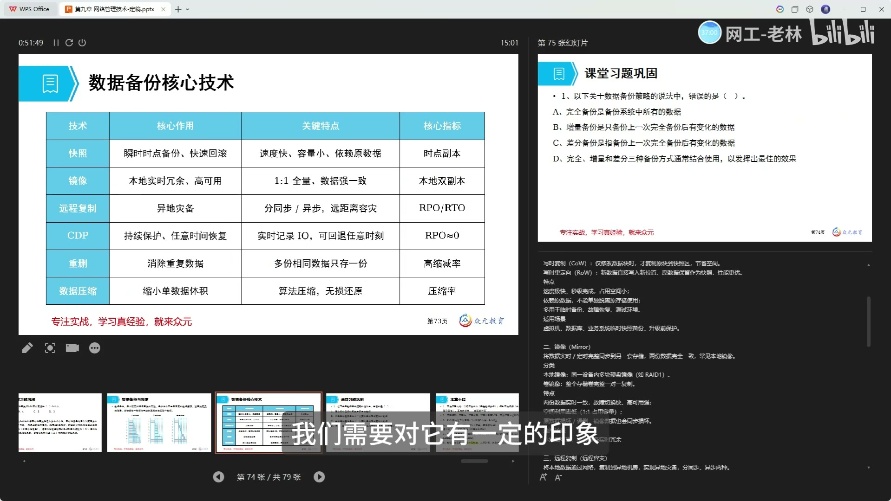

### 11.1 各类技术名词特征

| 名词 | 特征 | 说明 |
| ---- | ---- | ---- |
| 拷贝 | 数据复制 | 可分为同步、异步，与容灾联系紧密 |
| 镜像 | 一比一全量，本地双副本 | 高可用，数据强一致 |
| 快照 | **时间点型副本**，快速回滚 | 一般用于虚拟机较多，如搭建 Linux 服务器；配置出现意外时可快速回滚 |
| 远程复制 | 异地的复制（copy） | 核心级数据会做远程复制、远距离的容灾，往往在异地（如北京与武汉）再备一份 |
| 持续数据保护 | CDP（Continuous Data Protection） | 实时、持续捕获所有的输入输出读写操作，完整记录数据的每一个变化状态，**可恢复到任意历史节点**，依靠追踪数据修改日志实现 |
| 重复数据删除 | 重删 | 消除重复数据，减小数据冗余 |
| 数据压缩 | 压缩 | 减小数据体积 |

### 11.2 安全性辨析（易错点）

| 技术手段 | 能否保障数据安全性 / 防止数据丢失 |
| -------- | ---------------------------------- |
| 数据备份 | 能（但属于补救性措施） |
| 远程复制、快照、CDP | 能 |
| **重删** | **不能** |
| **数据压缩** | **不能** |

**要点**：重删与数据压缩主要做的是**数据处理操作**，目的是减小数据体积与冗余，而非保障数据安全。常见于「以下选项中不能对数据安全做到有效保护的是」这类题型。

### 11.3 冷数据与热数据

- **冷数据**：在灾备备份当中使用较多，指不经常被访问的数据
- 热数据：指经常被访问的数据

---

## 12.灾备指标与容灾

### 12.1 RPO 与 RTO

| 指标 | 英文全称 | 含义 | 单位 |
| ---- | -------- | ---- | ---- |
| RPO | Recovery Point Objective（恢复点目标） | **允许丢失的数据量** | 时间（如最多允许丢失 2 小时的数据量） |
| RTO | Recovery Time Objective（恢复时间目标） | **业务恢复运行的时长** | 时间（如能接受的最短业务中断时间，10 分钟内恢复） |

补充要点：

- RPO 决定备份需要以多高的频率执行，以避免丢失更多数据
- RTO 决定业务必须在多快的时间内恢复，才能恢复运营
- 关键业务应用（如大型在线零售商的电商系统、券商的交易系统）需要极短的 RTO 与 RPO
- RTO 与 RPO 的定义可参考 ISO/IEC 27031:2011 等灾备标准

### 12.2 备份策略原则

| 原则 | 内容 |
| ---- | ---- |
| 3-2-1 原则 | **3** 份数据副本（含原始数据）；存放在 **2** 种不同类型的介质上；其中 **1** 份副本保留在异地（场外 / 远程位置） |
| 3-2-1-1-0 原则 | 在 3-2-1 的基础上再增加：1 份离线（气隙隔离）副本，0 表示恢复验证零错误 |

**要点**：3-2-1 原则由美国摄影师 Peter Krogh 在关于数字资产管理的著作中提出，其目的是降低单点故障可能造成的影响。

### 12.3 容灾布局与等级

依据 GB/T 20988《信息系统灾难恢复规范》，灾难恢复能力的规划要点如下：

**版本提示**：GB/T 20988-2025《网络安全技术 信息系统灾难恢复规范》已于 2025 年 6 月 30 日发布、2026 年 1 月 1 日实施，全部代替 GB/T 20988-2007 与 GB/T 30285-2013，仍将灾难恢复能力划分为 6 级；下表等级与 RTO/RPO 的对应关系沿用 2007 版的示例，考试中仍按该示例记忆。

#### 12.3.1 同城与异地

| 类型 | 定义 | 距离要求 | 防范对象 |
| ---- | ---- | -------- | -------- |
| 同城 | 同一城市中处于不同风险区域的 2 个数据中心，形成「生产中心 + 容灾中心」格局 | 直线距离宜设置在 10 ~ 30 千米 | 小范围停电、建筑物火灾、基础设施设备故障、通信线路设备故障、软硬件故障、局部交通封锁或中断等小范围灾难 |
| 异地 | 在生产中心所在城市以外的城市建设或选择数据中心 | 建设距离宜大于 200 千米 | 大范围停电、地震、洪水、海啸、滑坡、泥石流、较大范围的公共卫生事件等较大规模区域性灾难 |

选址要求：

- 同城灾难恢复中心需与生产中心**不在同一个变电所的电网内、不在同一个通信网络节点内**
- 异地灾难恢复中心需**避开同一个地震带、龙卷风/台风路线等自然灾害同发地区**

#### 12.3.2 布局模式

| 布局模式 | 内容 |
| -------- | ---- |
| 一主一备 | 一个生产中心，一个灾难恢复中心 |
| 一主多备 | 一个生产中心，多个灾难恢复中心 |
| 互为备份 | 两个及以上生产中心互相备份 |
| 多主一备 | 多个生产中心共享一个灾难恢复中心 |
| 混合方式 | 以上方式的混合 |

#### 12.3.3 双活与多活

- **互为备份**包括双活和多活方式：所有的中心均提供实时服务，互为备份，当一个生产中心服务中断，由其他生产中心接管，保证业务连续性不受影响
- **同城双活**：通过数据复制、负载均衡等技术同时对外提供服务，保证更可靠的持续服务能力和更低的数据丢失率，适用于分布式架构、业务恢复时间要求很高、有同时对外提供服务需求的情况
- **异地多活**：适用于分布式架构且业务逻辑简单、一致性要求不高或可分模块独立处理业务、有同时对外提供服务需求的情况

#### 12.3.4 典型架构

| 架构 | 构成 | 特点 |
| ---- | ---- | ---- |
| 两地三中心 | 同城双中心（宜为双活数据中心）+ 异地中心（主备或多活） | 实现更高的容灾能力 |
| 三地六中心 | 在 3 个城市建设 6 个数据中心，每个城市 2 个同城双活数据中心，3 个城市之间互为主备或多活 | 无区域级单点故障 |

#### 12.3.5 灾难恢复能力等级

依据 GB/T 20988-2007 的等级示例：

| 等级 | 等级名 | RTO | RPO |
| ---- | ------ | --- | --- |
| 1 | 基本支持 | 2 天以上 | 1 天至 7 天 |
| 2 | 备用场地支持 | 24 小时以上 | 1 天至 7 天 |
| 3 | 电子传输和部分设备支持 | 12 小时以上 | 数小时至 1 天 |
| 4 | 电子传输及完整设备支持 | 数小时至 2 天 | 数小时至 1 天 |
| 5 | 实时数据传输及完整设备支持 | 数分钟至 2 天 | 0 到 30 分钟 |
| 6 | 数据零丢失和远程集群支持 | 数分钟 | 0 |

要点：

- 第 1 级要求完全数据备份至少每周一次，至少保留 1 个月冗余数据
- 第 3 级起要求完全数据备份至少每天一次，并实现小时级到天级 RPO
- 第 6 级为数据零丢失和远程集群支持，RPO 为 0

#### 12.3.6 灾难恢复类别

| 类别 | 说明 |
| ---- | ---- |
| 数据级 | 灾难发生后可确保数据不受到损坏 |
| 应用级 | 在数据级基础上，在灾难恢复中心构建与生产中心一样（或部分）的信息系统，生产中心中断时可实现接管，保障业务连续性 |
| 业务级 | 在应用级基础上，还具备用户和业务人员的办公场所，灾难发生时用户和业务人员可提供现场支持 |

---

## 13.备份介质

### 13.1 三类主要介质对比

| 介质 | 优点 | 缺点 | 适用场景 |
| ---- | ---- | ---- | -------- |
| 磁带 | 成本低、单位容量成本低；能耗低；体积小、易携带，属于可移动媒介；保存寿命长（约 30 年以上）；数据难以篡改；适合海量静态数据归档 | **顺序存取，读写速度慢**，寻址时间以分钟计量；保存环境要求高（温度、湿度、磁场、灰尘），需定期倒带；兼容性差（LTO 最多向下兼容两代）；易物理磨损 | 大容量数据的**离线备份**、长期归档、每日或每周备份 |
| 磁盘（硬盘） | **读写速度快**（可达 400 MB/s）；随机读写；存储容量大（单盘可达 20 TB）；支持复制、重删、快速搜索；配合 RAID 可提供单点故障保护 | 载体寿命短（一般 5 ~ 8 年），需不断迁移数据；需持续供电与降温，能耗大；防篡改性较差，面临黑客攻击或人为修改风险；不易扩展 | 大容量数据的**在线存储**、RTO/RPO 要求很短的备份场景 |
| 光盘（以蓝光 BD 为代表） | 载体寿命长（高质量光存储载体至少可达 30 年）；单位存储容量成本低；保存时几乎不消耗能量；**采用 WORM（一次写多次读）方式，防篡改安全性高**；抗磁暴 | 访问速度较慢（需将光盘加载到光驱）；载体不可重复利用；单盘容量相对较小（蓝光单盘 25 GB，多层可达 100 GB 以上） | 档案数据的**近线存储和离线备份**、长期保存 |

### 13.2 介质选择的实践要点

- 数据量较小时，宜优先选择蓝光光盘或容量较小的硬磁盘
- 数据量较大时，宜优先选择 LTO 磁带或容量较大的硬磁盘
- 离线异地备份可优先考虑硬磁盘（检测仅需计算机，而 LTO 磁带、蓝光光盘检测需专用设备）
- 制作多套离线备份数据时，宜选择**两种不同的存储载体**以实现优势互补

---

## 14.典型例题

### 例题1：FC SAN 的服务器端接口

FC SAN 存储常通过光纤与服务器的什么进行连接？

- A. 光口网卡
- B. USB 接口
- C. 光纤通道卡（正确）
- D. RAID 控制器

**解答**：FC 指 Fibre Channel（光纤通道），是一种新技术，因此对应的是**光纤通道卡**（HBA），而非普通的光口网卡。

**易错点**：以太网也会使用光口网卡，需与光纤通道卡区分，应往新技术方向去选。

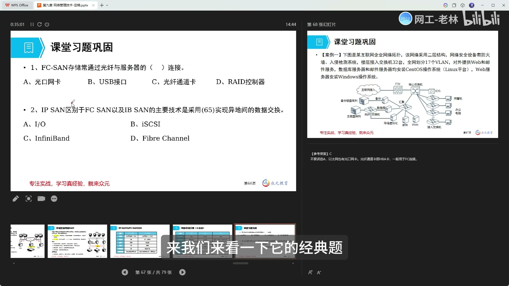

### 例题2：IP SAN 区别于 FC SAN 的主要技术

IP SAN 区别于 FC SAN 以及 IB SAN 的主要技术是采用（ ）实现异地间的数据交换。

- A. I/O
- B. iSCSI（正确）
- C. InfiniBand
- D. Fibre Channel

**解答**：IP SAN 与 FC SAN 的主要差异在于 **iSCSI 协议**，只看这一个差异点即可，无需考虑其他类别。

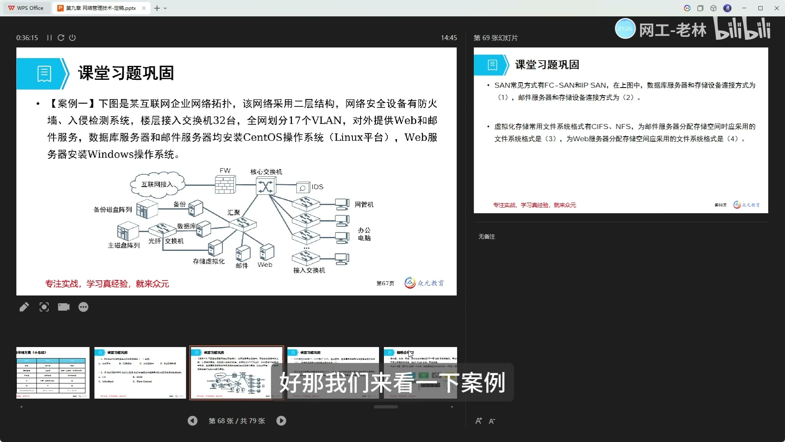

### 例题3：分布式存储节点规划

分布式存储系统规划时，至少要设计多少个节点？

- A. 5
- B. 4
- C. 3（正确）
- D. 2

**解答**：**三个节点**。对应三副本冗余，至少需要三个节点。

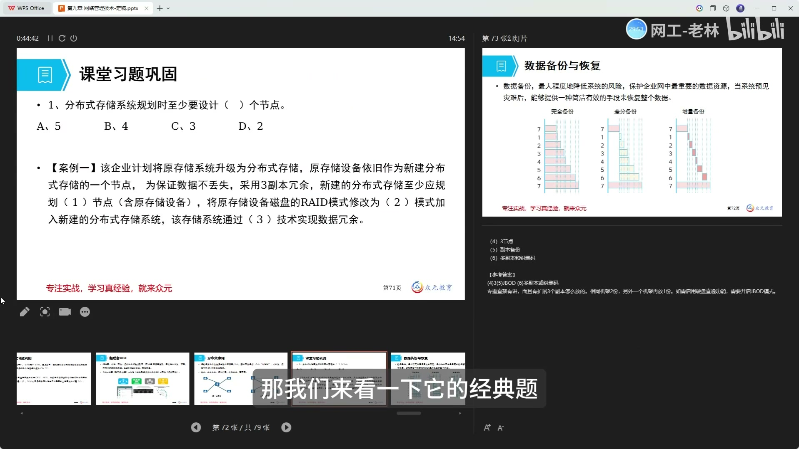

### 例题4：存储升级为分布式存储（案例题）

案例背景：将原存储升级为分布式存储，原存储设备依旧作为新建分布式存储的一个节点，为保证数据不丢失，采用三副本冗余。

问题1：新建的分布式存储至少应规划几个节点？

**解答**：**三个节点**，含原存储设备。

问题2：需将原存储设备的模式修改为什么？

**解答**：修改为**硬盘直通**模式，否则默认为 RAID 模式（独立磁盘冗余模式）。

问题3：该存储系统通过什么技术实现数据融合？

**解答**：通过**多副本**技术（三副本冗余）实现数据融合；除多副本外还可采用**纠删码**。

**说明**：该题型为较早的题型，仅在 2020 年前后考过一次，分数占比不高，目前已不再出现。

### 例题5：备份策略判断

以下关于数据备份策略的说法中，错误的是（ ）。

- A. 完全备份是备份系统中所有的数据
- B. 增量备份是只备份上一次完全备份后有变化的数据（错误）
- C. 差分备份是指备份上一次完全备份后有变化的数据
- D. 完全、增量和差分三种备份方式通常结合使用，以发挥出最佳的效果

**解答**：选 **B**。

**辨析**：增量备份与差分备份是冲突项，命题非常喜欢在此设置陷阱。增量备份是针对**上一次备份**（如昨天的备份）之后有变化的数据，并非仅以上一次完全备份为基准；差分备份才是统一以上一次完全备份为基准。

- 完全备份：备份系统内所有数据，A 说法正确
- 增量备份：仅备份上一次任务任意一次备份（完全或增量）之后发生变化的数据，B 错误
- 差分备份：统一以最近一次完全备份为基准，备份之后变化的数据，C 说法正确
- 实际应用中通常结合使用三种备份策略，兼顾备份效率、存储空间与恢复效率，D 说法正确

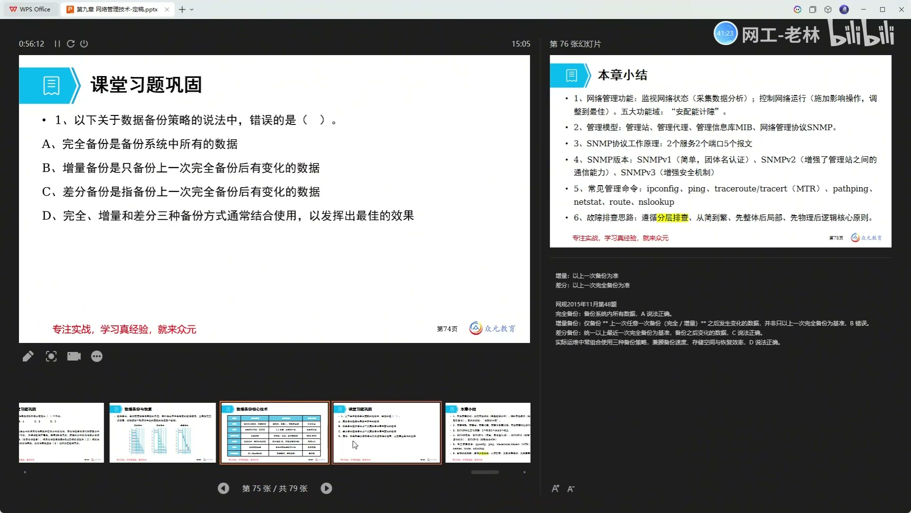

### 例题6：存储方案判断（案例题）

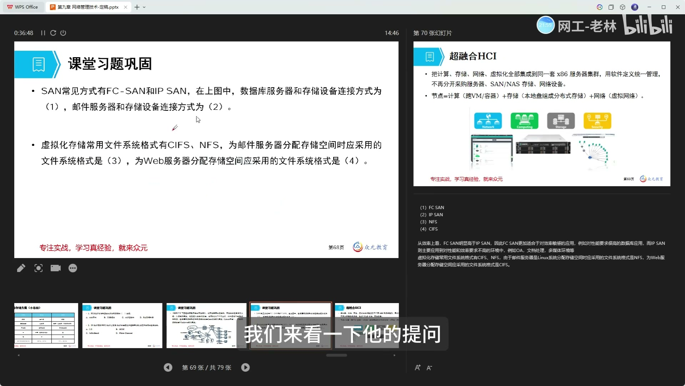

案例背景：某企业网络采用二层结构，部署有防火墙、入侵检测系统；楼层接入交换机 32 台，划分 17 个 VLAN；对外提供 Web 和邮件服务；数据库服务器与邮件服务器安装 CentOS Linux 平台，Web 服务器安装 Windows 操作系统。

问题1：上图当中数据库和存储设备的连接方式是？邮件服务和存储设备的连接方式是？

**解答**：

- 数据库与存储设备：**FC SAN**
- 邮件服务与存储设备：**IP SAN**

**判断依据**：看拓扑中是否强调**光纤交换机**。数据库侧强调了光纤交换机，邮件侧未强调，仅有汇聚交换机与核心交换机（以太网交换机，默认结构）。

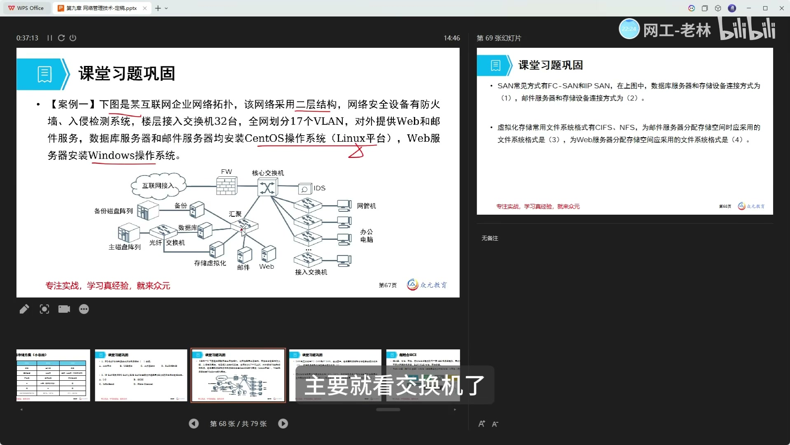

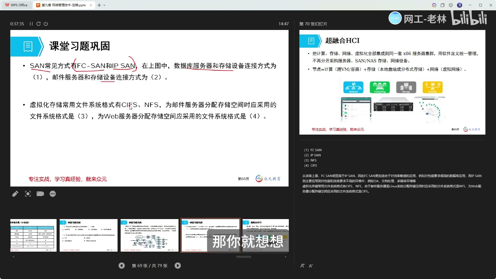

问题2：虚拟化存储常用的文件系统格式，邮件服务器所采用的文件系统类别是？

**解答**：**NFS**。依据：邮件服务器安装的是 CentOS Linux 平台。

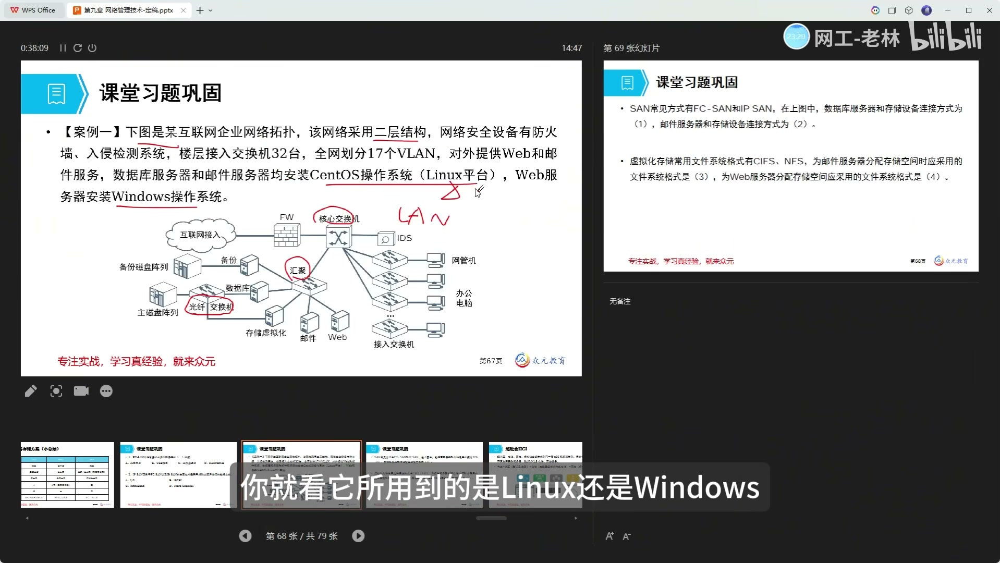

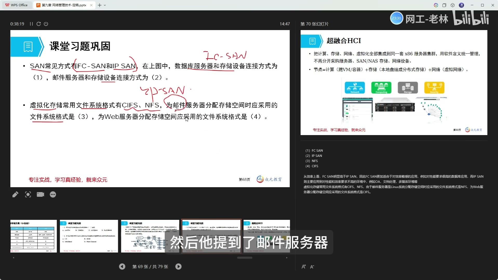

问题3：Web 服务器所采用的文件系统类别是？

**解答**：**CIFS**。依据：Web 服务器安装的是 Windows 操作系统。

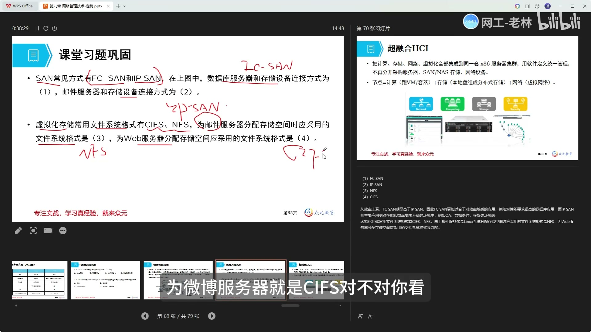

**说明**：考察到不常见的东西时，题目都会给出相应提示，本质上是将 Linux 与 Windows 两项放在不同位置上区分。该案例题型为较早题型，最近已不再出现。

---

## 15.本章小结

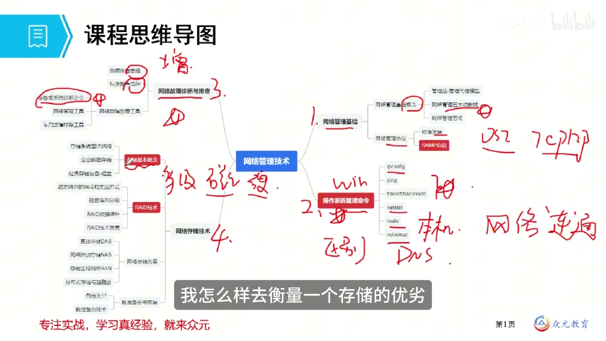

| 知识点 | 核心内容 |
| ------ | -------- |
| 1. 存储演进脉络 | DAS（直连）后发展为 NAS（文件级、复用业务网），再发展为 SAN（块级、独立存储网） |
| 2. DAS | 不经网络，线缆直连；架构简单、部署快、成本低；扩展性差，适用于个人设备 |
| 3. NAS | **文件级**存储；经以太网访问；协议为 **NFS（Unix/Linux）**、**CIFS/SMB（Windows）**；受局域网限制，大流量读写性能一般 |
| 4. SAN | **块级**存储；前端业务网与后端存储网分离；FC SAN 用光纤交换机 + HBA，IP SAN 用以太网交换机 + iSCSI |
| 5. FC 的含义 | **Fibre Channel（光纤通道）**，需与 Fast Ethernet 等区分 |
| 6. FC SAN 与 IP SAN 选型 | 题干重性能选 FC SAN；题干重成本、性价比选 IP SAN |
| 7. 超融合 | 计算、存储、网络虚拟化集成到同一套服务器集群，软件定义统一管理 |
| 8. 分布式存储 | 数据分散存放于多台独立节点，组成存储池，**去中心化**；大文件切块分散；**三副本**冗余（同机架两份 + 另一机架一份）；可自愈、可用纠删码；至少 3 个节点 |
| 9. 备份三种类型 | 完全备份（恢复快、效率低）、差分备份（看上一次**完全**备份，折中）、增量备份（看上一次**备份**，效率最高、恢复最慢） |
| 10. 备份技术名词 | 快照（时间点型副本、快速回滚）、镜像（一比一全量）、远程复制、CDP（可恢复到任意历史节点）、重删、压缩 |
| 11. 安全性辨析 | **重删与数据压缩属于数据处理操作，不能保障数据安全**；数据备份是**补救性措施而非预防性措施** |
| 12. RTO 与 RPO | RPO 为允许丢失的数据量；RTO 为业务恢复运行的时长 |
| 13. 3-2-1 原则 | 3 份副本、2 种介质、1 份异地 |
| 14. 容灾布局 | 同城（宜 10 ~ 30 千米）、异地（宜大于 200 千米）；双活 / 多活；两地三中心 |
| 15. 备份介质 | 磁带（离线归档、顺序存取、寿命长）、磁盘（在线、速度快、寿命短）、光盘（WORM 防篡改、寿命长、近线/离线） |

考试重点：

1. **访问单位与协议的对应**：NAS 为文件级，SAN 为块级；NFS 对应 Unix/Linux，CIFS/SMB 对应 Windows
2. **FC 代表光纤通道（Fibre Channel）**，不可误认为其他含义
3. **IP SAN 与 FC SAN 的核心差异是 iSCSI 协议**
4. **分布式存储的三副本与三节点**，以及三副本的机架放置策略（同机架两份 + 另一机架一份）
5. **差分备份与增量备份的辨析**：差分看上一次完全备份，增量看上一次备份，二者互为干扰项
6. **重删与数据压缩不保障数据安全**，数据备份是补救性措施
7. **RPO 是丢多少数据，RTO 是多快恢复**
8. 存储方案的案例判断依据：拓扑中是否强调**光纤交换机**；服务器的**操作系统类型**决定文件系统协议
