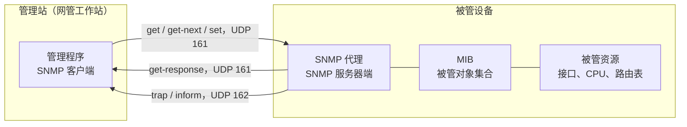

# 网络管理基础与操作系统管理命令 · 完整笔记

---

## 1.网络管理基本概念

### 1.1 定义与目标

网络管理的定义：**对网络的运行状态进行监测和控制**，用以保证网络能够**有效、可靠、安全、经济**地提供服务。

| 行为 | 性质 | 典型动作 |
| ---- | ---- | -------- |
| 监测（监视网络状态） | 被动性 | 采集数据并分析，如发现某参数长期门限为 80%，近期突然达到 99%，则需排查压力来源，避免崩溃 |
| 控制（控制网络运行） | 主动性 | 施加影响的操作，调整到最佳状态，如发现流量增长导致资源不足，调高分配的资源量 |

若以开放性问答考查“网络管理做什么、其核心目标是什么”，作答围绕**监测**与**控制**两个关键词展开即可。

### 1.2 管理站-管理代理模型（OSI 管理模型）

网络管理体系结构采用**管理站-管理代理模型**（管理者/代理模型）：

- **管理者（管理站）**：运行管理程序，向代理发出管理操作请求（查询、设置），是发起方、客户端。
- **代理（被管设备上的管理代理）**：运行代理程序，接收请求、访问本机管理信息库并返回结果；发现异常时可**主动向管理站发送通知**（事件报告）。
- **被管对象（MO）**：代理所管理的资源，其信息存储在管理信息库中。

### 1.3 模型要素

**（1）数据类型**：管理信息库 MIB 保存被管设备的各类信息，数据可分为三类：

| 数据类型 | 说明 |
| -------- | ---- |
| 结构数据（结构性数据） | 拓扑结构、设备之间的连接关系等静态描述信息 |
| 动态数据 | 运行过程中产生的状态变更，如性能数据、流量数据，不断变化 |
| 控制数据（控制性数据） | 可修改、调整的参数，调整后会影响设备的运行状态 |

管理信息库中的数据须按照规范要求进行命名和保存，而非任意存放。

**（2）功能和委托代理**：

- 代理接收来自管理站的请求，依据请求访问数据库，将结果返回给管理站；
- 管理代理可自主运行，发现网络异常时及时、主动地向管理站报告；
- **委托代理**：对不能直接运行管理代理软件的非标准设备，通过委托代理按管理标准响应管理站的请求，把相应操作转换成设备所支持的形式（类似“外包”协同管理）。

**（3）通信机制：轮询和事件报告**

| 机制 | 发起方 | 特点 |
| ---- | ------ | ---- |
| 轮询（轮询/查询） | 管理站 | 每隔一段时间向代理发起请求并等待响应，周期性采集数据 |
| 事件报告（Trap） | 被管设备/代理 | 发生紧急、异常情况时主动向管理站汇报，及时处理 |

此类管理协议为不给网络附加过多开销，追求快速、简洁，**大多基于 UDP**：SNMP、NetFlow、sFlow、Syslog（默认）都走 UDP；需要可靠传输或安全通道时才改用 TCP/TLS，例如 NETCONF 基于 SSH/TCP 830、Syslog over TLS 常用 6514。

### 1.4 轮询时间与管理设备数量的计算

计算公式：

```
N ≤ T / Δ
```

| 符号 | 含义 |
| ---- | ---- |
| N | 管理站最多可支持的被管设备数量 |
| T | 轮询周期（把所有设备轮询一遍的总时间） |
| Δ | 单个轮询需要的时间 |

例 1：LAN 中每 15min 轮询所有被管理设备一次，单个轮询约 0.202s：

```
N ≤ T/Δ = 15 × 60 / 0.202 ≈ 4455.4
向下取整为 4455，即管理站最多可支持约 4455 个设备（题目常取整写作约 4500）。
```

例 2：广域网中网络延迟更大（可达 0.5s），单个轮询约 1.2s：

```
N ≤ T/Δ = 15 × 60 / 1.2 = 750
即管理站可支持的设备最多为 750 个。
```

解题要点：题干中报文处理时间、网络延迟、拥塞、通信距离等均为解释单个轮询时间构成的**冗余信息**，只需找到“总时间 T”与“单个轮询时间 Δ”即可完成数量计算。此类题近年考查频度已明显下降，稍作了解即可。

---

## 2.网络管理五大功能域

根据 OSI 网络管理标准，网络管理包括以下五大功能域（核实：ISO/IEC 7498-4 管理框架定义的五大系统管理功能域，与此一致）：

| 五大功能 | 描述 | 要点 |
| -------- | ---- | ---- |
| 配置管理 | 负责初始化网络、并配置网络，以使其提供网络服务 | 与配置参数、命令等操作相关，是最基础的功能之一 |
| 故障管理 | 包括故障检测、隔离和纠正三方面 | 目标是实现自动化，但目前多数故障仍需人工介入；侧重告警、检测、隔离与备用方案（纠正）的制定，监控定位后等待人工切换与恢复 |
| 性能管理 | 估价系统资源的运行状况及通信效率等系统性能 | 处理动态数据，采集分析流量、功耗、上网行为等运行指标；典型参照是 CPU 运行状态 |
| 计费管理 | 记录网络资源的使用，控制和监测网络操作的费用和代价 | 关注计费开始/结束的规则与资源使用记录 |
| 安全管理 | 对授权机制、访问控制、加密和加密关键字的管理，以及维护和检查安全日志 | 包括安全日志的查看、轮询与数据保存等 |

要点：

1. **最基础的三项是配置管理、故障管理和性能管理**，大部分网络都必须包含；
2. 安全管理和计费管理根据需求选择：金融、财务类网站对安全防护要求高；运营商网络按付费使用需计费管理；
3. 常见助记：“安培能记账”（安全、性能、配置、故障、计费），也可按“基础三项 + 按需两项”分类记忆。

---

## 3.网络管理方式

| 模式 | 特点 | 优点 | 缺点 |
| ---- | ---- | ---- | ---- |
| 集中式网络管理模式 | 一个管理站集中对所有被管设备进行管理；所有被管设备的管理代理都和一个管理站进行通信 | 结构简单、低价格、易维护 | 信息流集中管理节点，易产生瓶颈，管理不够灵活，可扩展性差 |
| 分布式网络管理模式 | 把管理的功能或区域进行划分，每个管理站负责其中一个区域的网络资源管理，整个网络的情况可通过管理站之间交换信息获得 | 扩展性好，提高网络性能，稳固可靠 | 管理和维护比较复杂 |

理解方式：可类比社会组织的管理模式，设备规模扩大后由集中走向分区域（如按省、市分级）的分布式管理；分布式下参与对象增多，可能出现沟通、适配或信息不及时等问题。

---

## 4.网络管理协议标准与 SNMP

### 4.1 标准发展脉络

管理者和被管理者之间所有的管理信息交换都要遵循相应的协议。两条标准发展线：

| 参考模型 | 标准序列 | 内容 |
| -------- | -------- | ---- |
| OSI 参考模型 | ISO 9595 | 公共管理信息服务，定义 CMIS |
| OSI 参考模型 | ISO 9596 | 公共管理信息协议，规范 CMIP |
| OSI 参考模型 | ISO 10164 | 系统管理功能，规定 SMF |
| OSI 参考模型 | ISO 10165 | 管理信息结构，定义 SMI |
| TCP/IP 参考模型 | SGMP | 简单网关监视协议，SNMP 的前身，短期 Internet 管理方案（RFC 1028），属过渡方案 |
| TCP/IP 参考模型 | SNMP | 简单网络管理协议 |
| TCP/IP 参考模型 | CMOT | 基于 TCP/IP 的 CMIS/CMIP，为与 ISO 标准取得一致而提出的未来发展方向 |
| TCP/IP 参考模型 | RMON | 远程网络监视，对 SNMP 管理信息库的扩充 |

要点：

1. CMIS/CMIP 体系理论完善、具指导性，面向规模庞大、管理结构复杂的异构型网络，但**过于复杂、实现代价太高**，实际应用中未获推广（约 1989—1992 年间落地成熟）；
2. 实际应用以 TCP/IP 体系为主，SNMP 简单且易于实现而广受好评；
3. 其他标准还有 IEEE 发布的基于物理层、数据链路层的标准以及电信网的电信管理网（TMN）标准等，功能与发展方向大同小异，稍作了解。

### 4.2 SNMP 与 RMON 的区别

RMON（远程网络监视）是对 SNMP 管理信息库（MIB）的扩充，向数据库中加入更多需要监视和管理的数据内容（核实：RMON MIB 最初由 RFC 1757 定义，包含统计、历史、告警、事件等十个功能组；RMON II 为 RFC 2021）。

| 比较项 | SNMP | RMON |
| ------ | ---- | ---- |
| 定位 | 提供基本的**设备级**监控和管理功能 | 提供更详细的**网络级**监控和分析能力 |
| 适用场景 | 快速部署和基础管理 | 深入的流量分析和性能优化 |
| 组成设备 | 管理站、代理 | 网络监视器（监控器/管理器）与网络探测器（分析器）等分析性设备组合 |

### 4.3 SNMP 管理模型

SNMP 管理模型由**四部分**组成：管理站（网管工作站）、管理代理（被管设备）、网络管理协议（SNMP）和管理信息库（MIB）。

- 管理站（工作站）上运行**管理程序**，是 SNMP 的**客户端**；
- 被管设备上运行**代理程序**，是 SNMP 的**服务器端**，并保存管理信息库；
- 判断客户端/服务器的方法：**发起服务请求的一方是客户端，被请求的一方是服务器端**——管理站发起请求，故管理站为客户端，此处容易挖空设错。



### 4.4 管理信息库 MIB 与 OID

- **MIB（管理信息库）**：被管网络设备中标准变量定义的集合。存在于被管网络设备中，指明了网络元素能够被管理进程查询和设置的信息。
- MIB 中的变量使用**对象标识符（OID）**描述。OID 是对象在全局范围内**唯一的标识值**，确保对象在通信和信息处理中被正确定位和管理。

OID 命名树（核实：与 IANA SMI 编号一致）：

| 节点 | 编号 |
| ---- | ---- |
| ccitt（ITU-T） | 0 |
| iso | 1 |
| joint-iso-ccitt（joint-iso-itu-t） | 2 |
| org | 1.3 |
| dod | 1.3.6 |
| internet | 1.3.6.1 |
| directory | 1.3.6.1.1 |
| mgmt | 1.3.6.1.2 |
| mib-2 | 1.3.6.1.2.1 |
| system | 1.3.6.1.2.1.1 |
| interfaces | 1.3.6.1.2.1.2 |
| experimental | 1.3.6.1.3 |
| private | 1.3.6.1.4 |
| enterprises | 1.3.6.1.4.1 |

示例：internet 的标识为 {1.3.6.1}；MIB-2 下的 system 组为 1.3.6.1.2.1.1。命名逻辑类似 Linux 的目录树：把对应属性的文件放在对应的目录下。不要求完全记忆整棵树，考试中可查、可推。

### 4.5 SNMP 工作原理：2 个服务、2 个端口、5 个报文

| 项目 | 内容 |
| ---- | ---- |
| 2 个服务 | 轮询（查询）、事件报告（Trap） |
| 2 个端口 | UDP **161**（代理接收查询）、UDP **162**（接收 Trap/inform 等通知），均为知名端口 |
| 5 个报文 | **SNMPv1** 的 get-request、get-next-request、set-request、get-response、trap |

版本扩展：

| 版本 | 报文变化 |
| ---- | -------- |
| SNMPv1 | 上述 5 种基本报文 |
| SNMPv2c | 增加 **getbulk**（批量检索）与 **inform**（可确认的通知，管理站之间或代理到管理站） |
| SNMPv3 | 在 v2 基础上增加 **report**（引擎发现、差错报告），并引入 USM/VACM 安全机制 |

因此“5 个报文”是 **v1 的考试口径**；题干若问 v2/v3 新增能力，应能对应到 getbulk、inform、report。

各报文用途：

| 报文 | 方向 | 用途 | 所属服务 |
| ---- | ---- | ---- | -------- |
| get-request | 管理站→代理 | 发起获取请求 | 轮询 |
| get-next-request | 管理站→代理 | 查询下一个对象，返回下一个值 | 轮询 |
| set-request | 管理站→代理 | 修改/设置被管对象的属性值，代理给予响应 | 轮询 |
| get-response | 代理→管理站 | 对 get、get-next、set 的应答 | 轮询 |
| trap | 代理→管理站 | 事件报告，出现异常时主动汇报 | 事件报告 |

关键结论（核实：与 RFC 及主流厂商文档一致）：

1. **get/get-next/set 及 get-response 使用 UDP 161 端口**；**Trap 与 inform 发往 UDP 162 端口**（inform 的应答回到发起方源端口）；管理站是客户端，代理是服务器端
2. SNMP **基于 UDP 报文**传输，追求快、简，不建立 TCP 连接，因此不保证可靠送达
3. 简单轮询在超大规模网络中会产生较大管理开销和集中瓶颈，需要分区、分布式部署或调整轮询周期；早期教材所说“不适合大型网络”应理解为**默认单管理站、短周期轮询的局限**，而非协议绝对不能用于大型网络
4. 版本演进的主线：v2 扩大管理规模（getbulk、inform、管理站间通信），v3 补安全（认证、完整性、加密、访问控制）

### 4.6 SNMP 版本对比

| 版本 | 特色 | 增强 |
| ---- | ---- | ---- |
| SNMPv1 | 基于团体名认证，默认为 public；简单，易于实现，广泛应用；管理站与设备须配置一致的团体名，不同团体默认隔离；明文传输，无安全防护 | - |
| SNMPv2 | 支持集中式与分布式两种网络管理模式 | 扩充了管理信息结构、增强了管理站间的通信能力（新增 inform 操作，实现不同管理站之间的通信），添加了新的协议操作（GetBulk 块数据检索） |
| SNMPv3 | 达到商业级安全要求 | 提供了数据源标识、报文完整性认证、防止重放、报文机密性、授权和访问控制、远程配置和高层管理 |

各版本要点：

1. **v1**：早期版本，适用于简单的小规模网络，由管理站直接管理所有被管设备，团体名（community，默认 public）相当于分组口令；
2. **v2**（含 v2c）：v2c 沿用 v1 的团体名机制，只补充了 v2 消息格式，并未重新定义安全机制（RFC 1901 定义的 Community-based SNMPv2 属 experimental 框架）；侧重点是扩大管理规模，而非安全；
3. **v3**：核心是安全，认证与完整性使用 HMAC-MD5/HMAC-SHA 等哈希类算法，加密采用 DES/AES 等对称算法；USM 负责认证与加密，VACM 负责视图与访问控制；
4. **v3 未做防护的两类威胁**：拒绝服务与通信分析。

### 4.7 流量与日志采集：NetFlow、sFlow、Syslog

SNMP 主要解决“设备状态”的采集；流量分析与日志审计还需要专门机制：

| 技术 | 来源 / 标准 | 采集方式 | 传输 | 特点与用途 |
| ---- | ----------- | -------- | ---- | ---------- |
| NetFlow | Cisco 提出；v5、v9，v9 采用模板；IPFIX 为 IETF 标准化版本（RFC 7011，可视为 NetFlow v10） | 设备维护流缓存，按五元组等字段聚合，超时后导出 | 主要用 UDP（端口可配置，常见 2055、9995） | 有状态、字段丰富，能看“谁和谁、用什么协议、传了多少”；适合流量审计、计费、异常检测，开销较大 |
| sFlow | InMon 提出，RFC 3176 | 包采样 + 接口计数器轮询，不缓存流 | UDP（常见 6343） | 无状态、开销低，适合高速骨干；采样率越低越省资源，精度也越低 |
| Syslog | RFC 5424（UDP 传输见 RFC 5426） | 设备主动发送日志 | UDP 514；也可 TCP/TLS（TLS 常用 6514） | 事件日志，按 facility（来源）与 severity（级别）分类；PRI = facility × 8 + severity |
| SNMP Trap | SNMP | 代理主动上报 | UDP 162 | 告警事件，适合故障管理，不适合传输大段日志 |

要点：

- NetFlow 常用字段：源/目的 IP、源/目的端口、协议号、TOS、入接口、字节数、包数、时间戳，即“五元组 + 统计量”
- **sFlow 是采样技术，NetFlow 是流缓存技术**；两者可同时部署、互为补充
- Syslog 的 severity 为 0 ~ 7：Emergency、Alert、Critical、Error、Warning、Notice、Informational、Debug，**数值越小越严重**
- Syslog 只负责传输日志，UDP 下不保证可靠；要求可靠时改用 TCP/TLS，并配合本地缓冲
- 网络管理数据源可分三层：设备级（SNMP/MIB）、流级（NetFlow/sFlow/IPFIX）、日志级（Syslog/Trap）

### 4.8 典型例题（p80）

**例题1**：网络管理系统中故障管理的目标是（D）。

- A、自动排除故障
- B、优化网络性能
- C、提升网络安全
- D、自动检测故障

解答：故障管理包含故障检测、隔离和纠正。“自动排除故障”是未来目标，实际多为人工介入；优化网络性能属性能管理，提升网络安全属安全管理。抓住“故障检测、告警”关键词。

**例题2**：网络管理的五大功能域是（A）。

- A、配置管理、故障管理、计费管理、性能管理和安全管理
- B、配置管理、故障管理、计费管理、带宽管理和安全管理
- C、配置管理、故障管理、成本管理、带宽管理和安全管理
- D、配置管理、用户管理、计费管理、性能管理和安全管理

解答：五大功能域为配置、故障、性能、安全、计费。B、C 中的“带宽”和 D 中的“用户管理”均非功能域概念。

**例题3**：SNMP 管理模型由 4 部分组成，它们是管理站、（B）、网络管理协议和管理信息库。

- A、管理控制台　B、管理代理　C、管理标准　D、网络管理员

解答：四部分为管理站、管理代理（位于被管设备中）、网络管理协议、管理信息库。

**例题4**：使用 snmputil.exe 可以查看代理的 MIB 对象，下列文本框内 OID 部分是（B）。

```
c:\221>snmputil get 192.168.1.31 public .1.3.6.1.2.1.1.3.0
Variable = system.sysUpTime.0
value = TimeTicks 1268803
```

- A、192.168.1.31　B、1.3.6.1.2.1.1.3.0　C、system.sysUpTime.0　D、TimeTicks 1268803

解答：OID 是唯一的对象标识符，即命令中的 1.3.6.1.2.1.1.3.0；192.168.1.31 是代理 IP，public 是团体名，system.sysUpTime.0 是变量名，TimeTicks 1268803 是返回值。此类题型已久未考查，稍作了解。

**例题5**：在 SNMP 协议中，管理站要设置被管对象属性信息，需要采用（C，set）命令进行操作；被管对象有差错报告，需要采用（D，trap）命令进行操作。

- 选项均为：A、get　B、getnext　C、set　D、trap

解答：设置/写入用 set；差错报告（事件报告）用 trap；查询类动作用 get 或 getnext，应答为 get-response。

**例题6**：Windows 中标准的 SNMP Service 和 SNMP Trap 分别使用的默认 UDP 端口是（C）。

- A、25 和 26　B、160 和 161　C、161 和 162　D、161 和 160

解答：SNMP 服务端口为 161，SNMP Trap 端口为 162。

**例题7**：SNMPv3 新增了（C）功能。

- A、管理站之间通信　B、代理　C、认证和加密　D、数据块检索

解答：管理站之间通信（inform）与数据块检索（GetBulk）均为 v2 新增；代理（管理代理）各版本都有；认证和加密是 v3 新增的安全功能。

**例题8**：下列关于 SNMP 的说法中正确的是（A）。

- A、SNMP 可以实现对不同设备的统一管理，管理成本低
- B、SNMP 采用 TCP 报文承载数据，保障设备信息传输的可靠性
- C、SNMPv2c 在 SNMPv1 的基础上重新定义了网络管理框架和安全机制
- D、SNMPv3 专为管理 IPv6 设备而定制的版本，不支持 IPv4 设备

解答：A 正确：SNMP 简单，可实现不同设备的统一管理，管理成本低。B 错误：SNMP 基于 UDP，不保障可靠性。C 错误：v2c 主要针对团体名做改进，未重新定义安全机制。D 错误：v3 并非 IPv6 专属，也支持 IPv4 设备。

---

## 5.操作系统管理命令

### 5.1 ipconfig（Windows）

ipconfig 用于显示 TCP/IP 配置（作用与 Linux 的 ifconfig 相近，注意区分）。常用参数：

| 参数 | 功能 |
| ---- | ---- |
| /all | 显示本机 TCP/IP 配置的所有详细信息 |
| /release | DHCP 客户端手工释放 IP 地址 |
| /renew | DHCP 客户端手工向服务器刷新请求 |
| /flushdns | 清除本地 DNS 缓存内容 |
| /displaydns | 显示本地 DNS 内容 |
| /registerdns | DNS 客户端手工向服务器进行注册 |

参数的考查方向集中在 **DHCP 服务**（release、renew）与 **DNS 服务**（flushdns、displaydns、registerdns）。注意：执行 release 后若不 renew，使用 DHCP 分配地址的主机可能暂时无法上网。

`/all` 输出中包含的上网必备信息：物理地址、是否 DHCP 启用、IPv4 地址、IPv6 地址、子网掩码、获得租约的时间、租约过期的时间、默认网关、DHCP 服务器、DNS 服务器等。这些信息也正是 DHCP 分配的上网参数所涵盖的内容。

由该输出可延伸的考题：给定主机信息，判断是否开启了 DHCP 服务（看“DHCP 已启用”字段）、计算租约时长（租约过期时间 − 获得租约时间）或回答租期默认天数。

### 5.2 ping

ping 用于**测试网络连通性**、检验本机 IP 地址是否正确（附带效果：可测试 DNS 是否正常工作），是网络故障排查的常用命令。

| 参数 | 数据对象 | 功能 |
| ---- | -------- | ---- |
| -t | 目标 IP/域名 | 持续 ping，直到终止（Ctrl+C 停止） |
| -l | 目标 IP/域名 | 指定数据包大小（字节），默认 32 字节 |
| -n | 目标 IP/域名 | 指定回显数据包的数目，默认 4 个 |
| -a | 目标 IP/域名 | ping 的同时，解析目的主机名 |

ping 使用 **ICMP 协议**的询问（回声请求）与回应（回声应答）报文，此关联点常考。

典型变式题：若结果中“字节”由 32 变为 64，问改动的是哪个参数——`-l`（数据包大小）；若“已发送=6、已接收=4、丢失=2”，则改动的是 `-n`（包的数量）。

### 5.3 tracert / traceroute 及其扩展

**tracert（Windows）/ traceroute（Linux）**：路径跟踪命令，显示到达目的地经过的节点。要点：

1. 命令后直接接 IP 或域名；
2. 输出中**第一跳通常是网关地址**；若目的主机与源主机同网段，也可能第一跳就是目的主机；
3. 可据此判定 DNS 工作是否正常（命令接域名时可解析）；
4. 中间的“请求超时”而后续跳仍正常：多为该路由器开启了**防止探测的安全防护**功能，只告知流量经过但不反馈具体信息，不代表路径不通；
5. 原理：基于 **TTL 逐跳递减**——首包 TTL 置 1，到达第一跳后减为 0，该路由器返回 **ICMP 超时（Time Exceeded）** 报文；下一包 TTL 置 2，依此类推完成逐跳跟踪
6. 探测报文类型有差异：Windows **tracert 默认发 ICMP Echo**；Linux **traceroute 默认发 UDP 高端口报文**，加 `-I` 才改用 ICMP；两者都依赖中间路由器返回 ICMP 超时报文

扩展工具（了解）：

| 工具 | 说明 |
| ---- | ---- |
| pathping | Windows 下 ping 与 tracert 功能的结合 |
| MTR（my traceroute） | 把 ping 和 tracert 合二为一，可分析路径上每一跳的时延、丢包率、抖动情况 |

对比：ping 只能测连通性和整体情况，无法定位具体哪个节点出问题；tracert 能逐跳跟踪路径，但不做持续性丢包率测量。

### 5.4 netstat（Windows）

netstat 是网络状态查看命令，更倾向查看**连接状态**，可按协议（TCP、UDP、以太网、ICMP）归类查看。

| 参数 | 功能 |
| ---- | ---- |
| -a | 显示所有连接和监听端口 |
| -s | 显示按协议统计信息 |
| -e | 显示以太网统计信息 |
| -r | 显示主机的路由表（与 route print 等价） |
| -n | 以数字形式显示地址和端口号 |
| -o | 显示与每个连接相关的所属进程 ID |
| -p | 显示指定协议的连接 |

连接状态的典型含义（需结合 TCP 三次握手、四次挥手知识）：

| 状态 | 含义 |
| ---- | ---- |
| LISTENING | 监听状态，服务端口已开启等待连接 |
| ESTABLISHED | 连接已建立，正在完成数据传输 |
| TIME_WAIT | 等待关闭，操作结束后的半关闭状态 |
| CLOSE_WAIT | 关闭等待 |

加 `-n` 参数后，外部地址的服务名显示为数字端口（如 https 显示 443、http 显示 80）。考查方式：给出命令输出，判断哪一条目说明某服务（如 HTTPS）已正确建立连接、哪些处于关闭或建立中状态。

### 5.5 route（Windows）

route 命令针对**主机的路由表**（不是路由器的路由表，注意区分），使用较少但需有印象。

| 命令 | 功能 |
| ---- | ---- |
| route print | 查看主机路由表（与 netstat -r 等价） |
| route add | 添加路由，如 `route add 209.98.32.33 mask 255.255.255.224 202.96.123.5 metric 5` |
| route change | 修改路由，如 `route change 209.98.32.33 mask 255.255.255.224 202.96.123.50 metric 3` |
| route delete | 删除路由，如 `route delete 209.98.32.33`（Windows 用 delete，不是 Linux 的 del） |

route add 的要素仍是老规矩：**目的地（网络目标）、掩码（mask）、下一跳、开销（metric）**，其中开销可不指定；route change 需把整条路由写全，被改变的是下一跳和掩码值等差异点。Windows 下加 `-p`（如 `route -p add ...`）可让路由在重启后仍保留；Linux 对应命令为 `ip route add/del`。

主机路由表与路由器路由表结构略有差异：表中包含本主机相关信息、广播地址、测试用的回环地址（127.0.0.0/8 相关表项）等。同时主机也存在 IPv6 路由信息。

### 5.6 nslookup（Windows/Linux 通用）

nslookup 用于**显示 DNS 查询信息**，可做诊断和故障排查，是判断域名、DNS 服务器问题的主要工具。输出中“非权威应答”表示该结果来自缓存或非该区域授权的服务器。

可选参数：**type** 设定查询的记录类型（如 NS 记录表示该区域的域名服务器，即主域名服务器和辅助域名服务器；MX 记录为邮件交换记录；A 记录对应 IPv4 地址等，均属区域文件中的资源记录类型）；**timeout** 设置超时时间间隔。也支持**交互式查询**：先进入 nslookup 界面，再用 set type 等指令逐步查询。

### 5.7 arp 命令

arp 用于查看和管理 **IP 与 MAC 地址的绑定关系**（ARP 缓存表）：

| 参数 | 功能 |
| ---- | ---- |
| -a 或 -g | 查看 ARP 缓存表 |
| -s | 静态绑定 IP 与 MAC（可缓解 ARP 欺骗，但不能完全防护） |
| -d | 删除 ARP 缓存表项 |

Linux 操作系统下的管理命令使用范围比 Windows 广泛得多（Windows 更多依赖图形化界面）。

### 5.8 Linux 下的对应命令（补充）

课程主要讲 Windows 命令，与 Linux 存在同异，需对比区分（核实：现行 Linux 发行版中 net-tools 的 ifconfig、netstat、route、arp 已被弃用，新命令如下）：

| 功能 | Windows | Linux（传统/现代） |
| ---- | ------- | ------------------ |
| 查看/配置网卡与地址 | ipconfig | ifconfig / **ip addr**（iproute2） |
| 路由表 | route print | route / **ip route** |
| 连接与端口状态 | netstat | netstat / **ss**（socket statistics） |
| 地址解析表 | arp -a | arp / **ip neigh** |
| 连通性测试 | ping | ping |
| 路径跟踪 | tracert | traceroute（另有 tracepath、mtr） |
| DNS 查询 | nslookup | nslookup / **dig** |
| 抓包分析 | - | **tcpdump**（用 tcpdump 抓包分析，配合过滤器使用） |

常用参数差异（易混）：

| 功能 | Windows | Linux |
| ---- | ------- | ----- |
| 指定发送次数 | `ping -n 4` | `ping -c 4` |
| 指定包大小 | `ping -l 1472` | `ping -s 1472` |
| 持续 ping | `ping -t` | 默认持续，`Ctrl+C` 停止；`-c` 限定次数 |
| 路径跟踪 | `tracert` | `traceroute`（默认 UDP，`-I` 改用 ICMP） |
| 查看监听端口与进程 | `netstat -ano` | `ss -tulnp` |
| 查询 MX 记录 | `nslookup -qt=mx 域名` | `dig MX 域名` |

### 5.9 典型例题（p81）

**例题1**：在 Windows 中，使用（B）命令来清除本地 DNS 缓存。

- A、ipconfig /release　B、ipconfig /flushdns　C、ipconfig /displaydns　D、ipconfig /registerdns

解答：清除用 flushdns；displaydns 是展示；release 是释放 DHCP 地址；registerdns 是向服务器注册。

**例题2**：网络管理员调试网络，使用（B）命令来持续查看网络连通性。

- A、ping 目标地址 -g　B、ping 目标地址 -t　C、ping 目标地址 -r　D、ping 目标地址 -a

解答：持续性 ping 用 -t，停止方式为 Ctrl+C。

**例题3**：Windows 7 环境下，在命令行执行（1，A）命令，若输出中出现（2，A）表项，说明 SNMP 服务已经启动，对应端口已经开启。

- （1）A、netstat -a　B、ipconfig /all　C、tasklist　D、net start
- （2）A、UDP 0.0.0.0:161　B、UDP 0.0.0.0:500　C、TCP 0.0.0.135　D、TCP 0.0.0.0:445

解答：（1）输出为“活动连接”表（协议、本地地址、外部地址、状态 LISTENING），是 netstat -a 的结果，注意 netstat 与 -a 之间无空格拼写。（2）SNMP 基于 UDP 协议且使用 161/162 端口，输出中存在 `UDP 0.0.0.0:161` 与 `UDP [::]:161` 表项即说明 SNMP 服务已启动。此类题本质是考查服务的基本概念（协议 + 端口号）。

**例题4**：网管员在 Windows 系统中，使用命令 `C:\>nslookup -qt=a cc.com`，得到的输出结果是（A）。

- A、cc.com 主机的 IP 地址　B、cc.com 的邮件交换服务器地址　C、cc.com 的别名　D、cc.com 的 PTR 指针

解答：-qt=a 指定查询 A 记录，A 记录对应 IPv4 地址；MX 是邮件交换记录，CNAME 是别名，PTR 是反向解析指针。本题实际考查 DNS 区域文件中的资源记录类型。

**例题5**（案例）：我们可以在自己的电脑上执行（1）命令显示地址解析协议缓存表内容，检测后无异常；可再通过执行（2）命令发送 ICMP 回声请求测试，另外还可以通过执行（3）命令显示本机路由表。

解答：（1）为 arp -a（或 arp -g）；（2）为 ping（使用 ICMP 回声请求/应答报文）；（3）为 route print（或 netstat -r）。

（注：原课程末尾还提到一类结合服务器配置的填空题（如 NetState 类），此类题型近年已很少考，当前考试更侧重网络部署、管理与规范，掌握选择题即可。）

---

## 6.本章小结

| 知识点 | 核心内容 |
| ------ | -------- |
| 网络管理定义 | 监测（被动采集分析）+ 控制（主动调整），目标是网络有效、可靠、安全、经济地提供服务 |
| 管理模型 | 管理站-管理代理模型；要素为数据类型（结构/动态/控制）、功能和委托代理、通信机制（轮询与事件报告） |
| 轮询计算 | N ≤ T/Δ，抓住总时间与单个轮询时间，排除冗余条件 |
| 五大功能域 | 配置、故障、性能为基础三项；安全、计费按需选择；助记“安培能记账” |
| 管理方式 | 集中式（简单易维护、易瓶颈）与分布式（扩展性好、管理复杂） |
| 协议标准 | OSI 线：CMIS/CMIP（ISO 9595/9596）等，理论完善但复杂未推广；TCP/IP 线：SGMP→SNMP→CMOT→RMON |
| MIB 与 OID | MIB 为被管设备标准变量集合；OID 唯一标识对象，internet 为 1.3.6.1，mib-2 为 1.3.6.1.2.1，system 为 1.3.6.1.2.1.1 |
| SNMP 要点 | 2 服务（轮询、事件报告）、2 端口（UDP 161/162）、**v1 的 5 报文**（get、getnext、set、get-response、trap）；基于 UDP；管理站为客户端 |
| SNMP 版本 | v1 团体名 public、明文；v2 增 getbulk 与 inform（管理站间通信）；v3 增 report 与 USM/VACM（认证、完整性、加密），但不防拒绝服务与通信分析 |
| RMON | SNMP 管理信息库的扩充，提供网络级监控与流量分析，设备为监视器与探测器 |
| 流量与日志 | NetFlow（流缓存、有状态、UDP）、sFlow（采样、无状态、UDP 6343）、Syslog（UDP 514，severity 0~7）、Trap（UDP 162） |
| ipconfig | /all 看详情；/release、/renew 对 DHCP；/flushdns、/displaydns、/registerdns 对 DNS |
| ping | 测连通性，基于 ICMP；-t 持续（Ctrl+C 停）、-l 包大小（默认 32）、-n 包数（默认 4）、-a 解析主机名；Linux 用 -c/-s |
| tracert | 路径跟踪，基于 TTL 与 ICMP 超时报文；第一跳通常是网关；Windows 默认 ICMP，Linux traceroute 默认 UDP |
| netstat | 网络状态；-a 所有连接与监听端口、-s 按协议统计、-r 路由表、-n 数字形式、-o 进程 ID、-p 指定协议 |
| route | 主机路由表：print/add/change/delete；add 需目的地、掩码、下一跳，开销可省略；删除用 `route delete` |
| nslookup | DNS 查询与诊断；type 指定记录类型（A/NS/MX 等）、timeout 超时；支持交互式 |
| arp | -a/-g 查看缓存表、-s 静态绑定可缓解 ARP 欺骗、-d 删除 |
| Linux 对应 | ip（替代 ifconfig/route）、ss（替代 netstat）、dig/nslookup、tcpdump、traceroute/mtr |

考试重点：

1. 五大功能域的名称与归属判断（送分题，注意“带宽”“用户管理”等干扰项）；
2. SNMP 四要素（管理站、管理代理、协议、MIB）与客户端/服务器端归属；
3. 端口号：查询/设置/应答用 UDP 161，Trap 与 inform 用 UDP 162；SNMP 基于 UDP；
4. 报文与功能对应：设置用 set，差错报告用 trap，查询用 get/getnext，应答为 get-response；v2 新增 getbulk/inform，v3 新增 report；
5. 三个版本的关键词：v1 简单/团体名、v2 扩规模/GetBulk/inform/管理站间通信、v3 安全/认证加密；
6. 命令与功能的对应及输出结果判读（ipconfig 参数、ping 参数改动识别、netstat 状态、SNMP 服务端口的判断、A 记录与资源记录类型）；
7. 流量与日志三件套：NetFlow 看流、sFlow 采样、Syslog 传日志；注意各自传输层与默认端口。
