# 网络故障诊断与排查 · 完整笔记

---

## 1.考情分析与课程定位

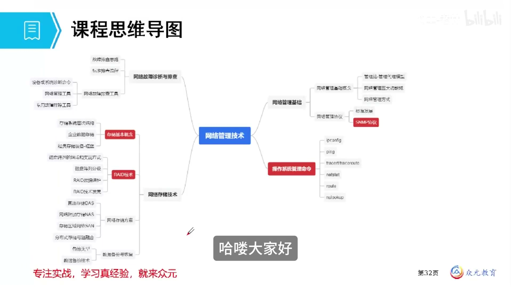

*图 1：网络管理技术章课程思维导图，本节对应其中"网络故障诊断与排查"分支（故障排查思路、故障排查工具），以及操作系统管理命令（ipconfig、ping、tracert/traceroute、netstat、route、nslookup）等前置知识的综合运用。*

网络故障诊断与排查是网络管理技术的第三个板块，在 2021 年的习题中出现较为频繁，随后主要以**选择题**形式考查，案例题涉及较少。作为网络工程师、运维人员，尤其是从事网络布线工作时必然要与故障排查打交道。

本节需掌握的核心内容：

| 内容 | 要求 |
| ---- | ---- |
| 通用的故障排查思路 | 掌握基本的、通用的排查思路，形成整体概念 |
| 管理命令的使用 | 巩固操作系统及网络设备的常用管理命令及其判读 |
| 故障排查工具 | 认识设备诊断命令、网络管理工具、专用故障排除工具三类工具 |

---

## 2.故障排查思路（核心原则与分层排查法）

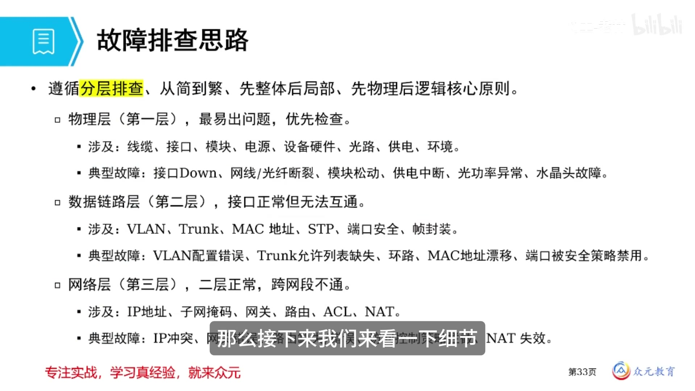

*图 2：故障排查思路课件页，给出分层排查核心原则与物理层、数据链路层、网络层的涉及范围和典型故障。*

网络工程师通用的故障排查思路，遵循四条核心原则：

| 原则 | 含义 |
| ---- | ---- |
| 分层排查 | 依据分层模型自下而上逐层定位，避免盲目排查 |
| 从简到繁 | 先从简单的事情入手（如先确认是否通电），再思考深层次问题；运维中"80% 以上的故障可以用重启解决"即为这一思想的通俗体现 |
| 先整体后局部 | 先判断是单点故障还是区域性故障，再缩小区间逐一排查 |
| 先物理后逻辑 | 物理层最易出问题，优先检查；逻辑（配置）问题后查 |

其中**分层排查**是网络领域最经典的代表方法。以两大分层标准（OSI 七层模型、TCP/IP 四层结构）为基础，自下而上划分为：物理层 → 数据链路层 → 网络层 → 传输层 → 应用层。大部分故障问题基本出现在**物理层、数据链路层和网络层**，其次是应用层。逐层定位可以避免盲目排查。

### 2.1 物理层（第一层）

物理层最易出问题，优先检查。

- 涉及范围：线缆、接口、模块、电源、设备硬件、光路、供电、环境
- 典型故障：接口 Down、网线/光纤断裂、模块松动、供电中断、光功率异常、水晶头故障
- 解决方案：可使用专用检测设备检测，也可采用**替换法**（拔插、更换备件）处理；日常最常见的就是网线连接问题与接口问题

### 2.2 数据链路层（第二层）

接口正常但无法互通时，向数据链路层思考。

- 涉及范围：VLAN、Trunk、MAC 地址、STP、端口安全、帧封装、网卡驱动与速率协商
- 典型故障：VLAN 划分配置错误、Trunk 允许列表缺失导致 VLAN 无法通过、出现环路、MAC 地址漂移、端口被安全策略禁用

### 2.3 网络层（第三层）

二层正常但跨网段不通时，向网络层思考。

- 涉及范围：IP 地址、子网掩码、网关、路由、ACL、NAT
- 典型故障：IP 冲突、网关配置错误、路由策略被 ACL 拦截、NAT 失效

### 2.4 更高层（传输层与应用层）

更高层一般指业务系统：业务系统是否正常工作、业务服务器是否配置正常、配置文件是否正常运行等，即终端整体运行状态的检查。

作答提示：在进行网络环境分析时，若案例出现开放性问答，可从层次角度着手描述，描述合理到位即可获得相应分数。

---

## 3.经典故障场景与排查方法

### 3.1 典型场景

| 场景 | 故障现象 | 排查要点 |
| ---- | -------- | -------- |
| 单个终端无法上网 | 一位员工反馈终端无法上网，周边同事正常 | 先检查终端配置：IP 是否配置正常、网卡与网线状态，再检查该终端连接交换机的端口、VLAN 划分、黑白名单等；一般为单点问题 |
| 整个网段故障 | 一个区域（一片楼栋）均无法上网或频繁掉线 | 检查汇聚层设备或 VLAN 网关设备的状态，可能是网关故障或流量被处理掉；需进一步到数据链路层、网络层考量 |
| 内网通、外网不通 | 内网可互通，但无法访问外网 | 按阶段依次测试：先 ping 网关，再 ping 公网 IP，再 ping 域名，依次排查路由、出口设备、DNS |
| 网络通但业务慢 | 可以连通但业务缓慢、频繁丢包 | 考虑带宽问题，抓包查看是否存在异常流量；检查链路是否存在误码、光路光功率是否异常，即线路带宽速率类问题 |
| 设备割接与变更 | 更换设备、原设备配置变更后出现故障 | 变更前必须**备份配置**以防万一；切换后仍有故障时，执行**回滚配置**，对比新旧配置差异，检查 VLAN 划分、Trunk 允许、路由策略等变更项是否存在问题 |

### 3.2 标准排查流程（四步）

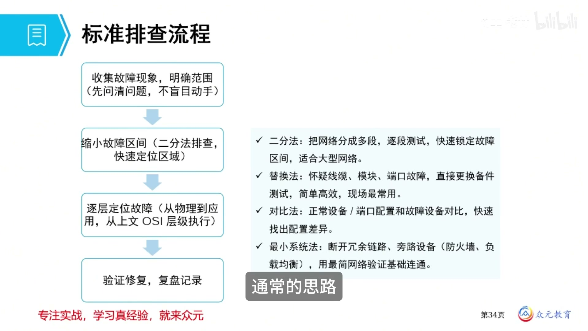

*图 3：标准排查流程，左侧为四步流程图，右侧为二分法、替换法、对比法、最小系统法四种区间缩小手段。[手写批注] 重点标注"二分法排查"的"区域"、"逐层定位故障"的"物理到应用"、"验证修复"与"复盘记录"；在"二分法：把网络分成多段，逐段测试"处标注 ping；替换法圈出"备件"，旁注"备件库"。*

| 步骤 | 内容 |
| ---- | ---- |
| 1. 收集故障现象，明确范围 | 先问清问题，不盲目动手。判断是单点还是区域性故障；听取各方反馈时，用户不会使用专业术语，需要进一步引导提问明确需求：是自己无法上网还是周边三四个人都没有，或是整个办公楼栋都没有；是访问太慢还是完全打不开网页；部分网页能打开而另一些不能；是否在固定时间掉线（如每次中午十二点断网）；是内网访问服务器不通而外网正常等。盲目听取不专业的意见就动手，很可能造成更大影响 |
| 2. 缩小故障区间（二分法排查，快速定位区域） | 区域性问题需要缩小到具体点位和线路，手段见下表 |
| 3. 逐层定位故障（从物理到应用） | 按 OSI 层级自下而上执行（见 3.3 节） |
| 4. 验证修复，复盘记录 | 恢复后进行多终端、多场景复测，确认故障完全解决；记录故障原因、处理过程、规避方案，形成运维台账（事件报告），避免重复性问题再次发生时无据可查。该思维方式不仅适用于网络，软件运维同理 |

缩小故障区间的常用手段：

| 手段 | 做法 | 特点 |
| ---- | ---- | ---- |
| 二分法 | 把网络分成多段，逐段测试（配合 ping 测试），快速锁定故障区间 | 适合大型网络，使用最频繁 |
| 替换法 | 怀疑线缆、模块、端口故障时，直接更换备件测试（如先换网线，再换接口） | 简单高效，现场最常用；需要备件库或备件记录支撑 |
| 对比法 | 将正常设备/端口的配置与故障设备对比 | 快速找出配置差异 |
| 最小系统法 | 断开冗余链路、旁路设备（防火墙、负载均衡），用最简网络验证基础连通 | 排除复杂环节的干扰 |

### 3.3 各层定位的检查手段

| 层级 | 检查内容与常用手段 |
| ---- | ------------------ |
| 物理层 | 查看接口、网线的连接情况，网线是否断裂、破损 |
| 数据链路层 | 使用 display 命令查看 VLAN 配置、Trunk 配置、STP 环路问题等交换机相关配置信息（在组网技术、局域网技术章节所学内容均可在此查看排查） |
| 网络层 | 集中在网络互联（路由器）上：是否有 ACL 拦截等安全问题，动态路由是否正常形成有来有回的路径指向，是否有 NAT 配置实现外网访问 |
| 应用层及更高层 | 是否正常访问服务；多用 ping、nslookup 等管理性系统命令，需回顾操作系统管理命令一节的内容 |

### 3.4 排查禁忌与注意事项

排查禁忌考查较少，口头总结如下：

1. **做好备份**：重大变更、割接等操作前必须备份配置，出现意外时可以回滚；变更时间最好选择业务低峰期，避免造成大的业务影响。
2. **故障未定位前不盲目动手**：不做盲目修改和批量修改，避免扩大故障范围。
3. **重视日志与告警信息**：部署了相应告警或故障监测后，日志条目中往往给出发生故障的具体原因。例如网络安全中 DDoS 攻击的分析依据就是日志中存在大量未知源 IP 的访问记录；跨站脚本攻击（XSS）、SQL 注入攻击则是通过日志中明显的条目和拦截行为发现的，据此可以快速定位故障。

---

## 4.网络故障排查工具总览

网络故障排查工具分为三大类：

| 类别 | 内容 | 考查频度 |
| ---- | ---- | -------- |
| 设备或系统诊断命令 | 操作系统的常见管理命令：ping、tracert 等 | 较高 |
| 网络管理工具 | 图形化界面软件、控制台 | 一般 |
| 专用故障排除工具 | 线缆接口类物理层检测工具 | **考试最频繁** |

---

## 5.设备或系统诊断命令

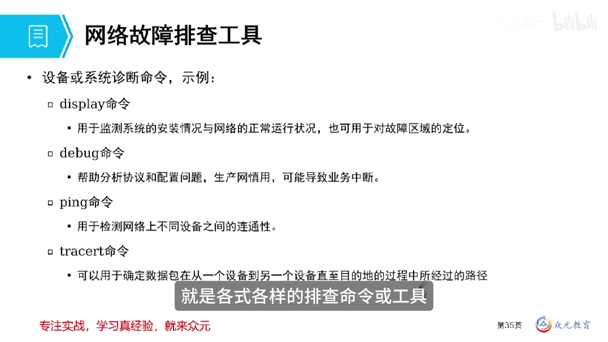

*图 4：设备或系统诊断命令课件页，列出 display、debug、ping、tracert 四个命令及其用途。*

### 5.1 display 与 debug（网络设备侧）

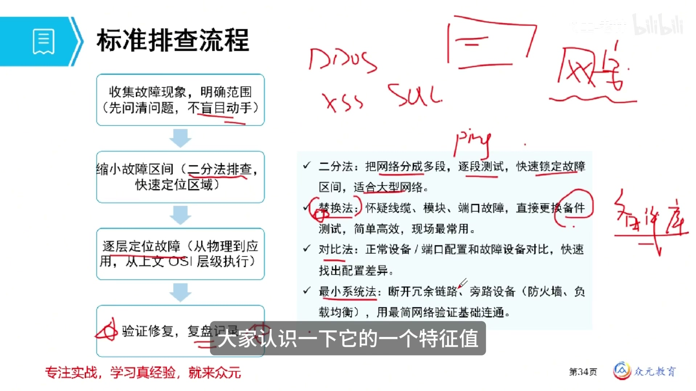

*图 5：同上页手写批注版。display 下方批注"show"（思科对应命令）；tracert 旁批注 MTR、pathping。*

| 命令 | 说明 |
| ---- | ---- |
| display 命令（华为）/ show 命令（思科） | 用于监测系统的安装情况与网络的正常运行状况，也可用于对故障区域的定位；可查看路由表、VLAN 划分、各端口配置情况等。需背记的内容集中在组网技术一章 |
| debug 命令（也写作 debugging） | 在网络设备故障时打开调试开关，用于跟踪业务的运行过程、查找故障原因；调试完成后在用户视图下执行 `undo debugging all` 关闭所有调试开关。生产网慎用，很可能造成业务中断 |
| ping 命令 | 用于检测网络上不同设备之间的连通性（测试连通性） |
| tracert 命令 | 用于确定数据包从一个设备到另一个设备直至目的地的过程中所经过的路径（看路径跳数） |


*图 4b：同上页课件，讲解 debug（debugging）命令：故障时打开调试开关跟踪业务运行过程查找故障原因，调试完成后在用户视图执行 undo debugging all 关闭所有调试开关，生产网慎用。*

### 5.2 连通性与路径测试命令对比

除 ping、tracert 外，还有 tracert 命令（Windows 下为 tracert，思科设备下为 traceroute）、pathping、mtr（My Traceroute）等常见命令：

| 命令 | 功能定位 | 特点 |
| ---- | -------- | ---- |
| ping | 测试连通性 | 最基础的连通性测试 |
| tracert / traceroute | 查看路径跳数 | 逐跳显示路径，但不显示丢包 |
| pathping | 综合性强：既有 ping 的特征，也有串扫（tracert）命令的特征 | 可显示通信线路上每个子网的延时和丢包率（Windows 自带） |
| mtr（My Traceroute） | 综合性强，兼具 ping 与 traceroute 特征 | 可分析路径上哪一跳在丢包、抖动；更好用、性能更好。**排查抖动和严重丢包时优选 mtr** |

### 5.3 ping 与 tracert 的工作原理（联网核实要点）

ping 基于 ICMP 协议：源主机发送 ICMP 回显请求（Echo Request，类型 8），目标主机返回回显应答（Echo Reply，类型 0），通过应答的有无与往返时延（RTT）判断连通性。ping 结果判读：

- 回应中 TTL 值每经过一个路由器减 1，据此可粗略推断到目标的跳数（如 TTL=57 对应初始值 64 的主机，表示相距 7 跳）
- 丢包率高于 0% 在有线局域网中即视为异常；部分路由器对 ICMP 限速，可能出现"ping 路由器丢包、ping 穿过路由器正常"的非故障现象

tracert 的工作原理（Windows tracert 与 Linux traceroute 略有差异）：

| 命令 | 探测方式 | 到达终点的判定 |
| ---- | -------- | -------------- |
| Windows tracert | 每跳发送 ICMP 回显请求，TTL 从 1 起逐跳递增；TTL 减为 0 时路由器返回 ICMP 超时报文（类型 11，Time Exceeded），从而暴露该跳地址 | 目标返回回显应答（类型 0） |
| Linux traceroute | 默认发送 UDP 高端口数据包，TTL 同样逐跳递增 | 目标返回 ICMP 端口不可达（类型 3，代码 3）；可用 -I 参数改用 ICMP 方式 |

tracert 结果判读：

- 中间某跳显示星号（*）但后续跳正常，是该路由器不回应 ICMP 超时报文，流量仍正常通过，属无害现象
- 从某跳起直到结束均为星号，需结合 ping 判断：若业务正常则是目标过滤 ICMP；否则路径在该跳附近断裂
- 同一地址反复出现提示存在**路由环路**
- 时延在某一跳突增且在下一跳回落，是路由器对 ICMP 降级处理，可忽略；突增且持续则是长距离链路的正常表现

### 5.4 端口连通性测试

ping 只能验证主机级连通性，无法验证应用端口是否开放。测试 TCP 端口连通性的常用方式：

| 工具 | 用法 |
| ---- | ---- |
| Windows PowerShell | `Test-NetConnection <目标> -Port <端口号>`（可加 -TraceRoute 跟踪路径） |
| Linux | `telnet <目标> <端口号>`，或 `nc -zv <目标> <端口号>` |
| tcping | 第三方工具，对 TCP 端口进行类 ping 测试 |

端口不通而 ping 通，通常为服务未启动、ACL/防火墙拦截该端口等逻辑类问题。

---

## 6.抓包分析工具（Wireshark 与 tcpdump）

抓包分析（嗅探）类工具属于网络分析仪/嗅探软件范畴（如 Sniffer、Wireshark），既能用于**网络故障排查**，也可能被用作**被动攻击的经典工具**（嗅探、扫描、网络流量分析），考查时需根据使用角度辨别。

### 6.1 Wireshark

Wireshark 是图形化的网络协议分析器，可完整解码各层协议，适用于查看异常流量、分析协议交互过程。常用**显示过滤器**语法（联网核实）：

| 过滤表达式 | 含义 |
| ---------- | ---- |
| `ip.addr == 192.168.1.1` | 源或目的地址为该 IP 的报文 |
| `ip.src == 192.168.1.1 && ip.dst == 10.0.0.1` | 指定源与目的地址 |
| `ip.addr == 192.168.1.0/24` | 某网段的报文（支持 CIDR） |
| `tcp.port == 80` 或 `tcp.port in {80,443,8080}` | 指定 TCP 端口的报文 |
| `icmp.type == 8` / `icmp.type == 0` | ICMP 回显请求 / 回显应答 |
| `icmp.type == 3 && icmp.code == 4` | 目标不可达——需要分片但 DF 置位（PMTU 黑洞的关键证据） |
| `tcp.flags.syn == 1`（等价 `tcp.flags & 0x02`） | TCP SYN 报文 |
| `tcp.analysis.retransmission` | TCP 重传报文 |
| `http.request.method == "GET"` | 指定 HTTP 请求方法 |

逻辑运算符支持 `&&/and`、`||/or`、`!/not`，比较运算符支持 `==/eq`、`!=/ne`、`>/gt` 等。

### 6.2 tcpdump

tcpdump 是 Linux 命令行抓包工具，适合在服务器、无图形界面环境使用，抓包结果可保存为 pcap 文件后再用 Wireshark 分析。常用参数与过滤表达式（联网核实）：

| 参数/表达式 | 含义 |
| ------------ | ---- |
| `-i eth0` | 指定监听网卡（`-i any` 监听所有接口） |
| `-n` / `-nn` | 不解析主机名 / 不解析主机名与端口名，加快输出 |
| `-w file.pcap` | 将抓包结果保存为文件 |
| `-c N` | 抓满 N 个包后停止 |
| `host 192.168.1.1` | 只抓与该主机相关的报文 |
| `port 80` / `udp port 53` | 按端口（含协议类型）过滤 |
| `and`、`or`、`not` | 组合过滤条件，如 `tcpdump -i eth0 -nn host 192.168.1.1 and port 80` |

排查网络故障时的典型流程：在故障链路两端同时抓包，对比报文是否到达、是否被中间设备丢弃，从而定位丢包点。

---

## 7.网络管理工具

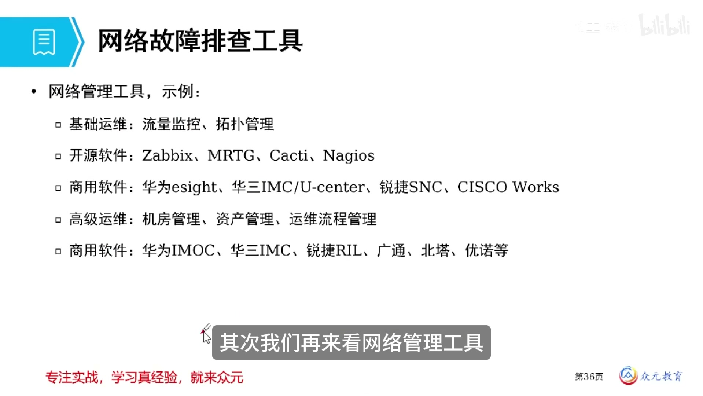

*图 6：网络管理工具课件页，按基础运维、开源软件、商用软件、高级运维分类列出示例。*

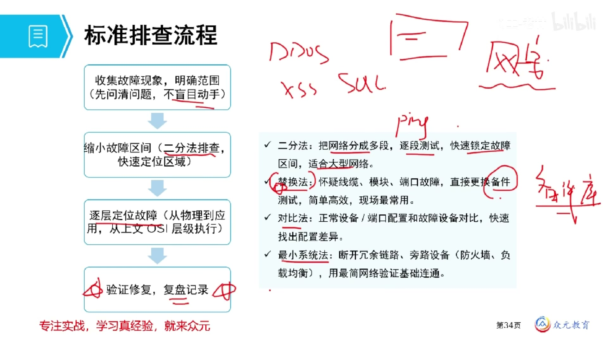

*图 7：同上页手写批注版。MRTG、Cacti 一旁批注"可视化"，Nagios 一旁批注"故障发现"；"华三"处批注 H3C；高级运维与商用软件两行被框注为高级运维类别。*

网络管理工具以图形化界面为主，使用方便、易于上手，一般以软件、桌面型、控制台的形式呈现。按层次分类如下：

| 类别 | 代表 | 特点 |
| ---- | ---- | ---- |
| 基础运维 | 流量监控、拓扑管理 | 最基础的手段；流量监控可快速定位带宽、异常流量、攻击流量、业务卡顿等问题；拓扑管理可更直观地发现整个组网的效果 |
| 开源软件 | Zabbix、MRTG、Cacti、Nagios | 免费、轻量化，适合中小型企业或自研运维平台参考；一般支持 SNMP 简单网络管理、监控网络设备、阈值告警、分布式监控；但部署有一定门槛 |
| 商用软件（网络管理平台） | 华为 eSight、华三（H3C）IMC/U-Center、锐捷 SNC、Cisco Works | 面向政企、大型园区、医院、高校等；付费，价格较贵，有配套服务 |
| 高级运维（一体化综合运维平台） | 华为 IMOC、华三 IMC、锐捷 RIL、广通、北塔、优诺等 | 涉及机房管理、资产管理、运维流程管理；智能化程度更高，支持 AI 决策推理与分析；适用于数字化大型集团、数据中心、大型政企多分支机构的复杂运维管理 |

各类开源软件的功能侧重（考查较少，稍作认识）：

| 工具 | 侧重 |
| ---- | ---- |
| MRTG | 老牌流量监控专用工具，基于 SNMP 协议采集端口流量，专注于端口出入带宽统计；适合小型网络纯流量查看；部署简单、占用资源低，但功能单一 |
| Cacti | 基于 MRTG 的升级版本，以图表为核心的图形化流量与性能监控工具，可视化效果优秀（运维人员最爱看的流量报表分析）；但告警能力较弱 |
| Nagios | 经典的故障告警监控，主打状态巡检与故障提醒，侧重故障发现；常与前两者及综合监控类开源软件搭配使用 |
| Zabbix | 综合监控平台，支持 SNMP 监控、阈值告警、分布式监控 |

开源组合最常用方案：将故障发现（告警）+ 可视化（状态报表）+ 综合监控组合，进行常规化管理。

商用平台补充说明：

- 华为 eSight：统一网络管理平台，主打华为全系列网络设备的管理，适合华为设备为主的园区、运营商分支，稳定性好、界面友好
- 华三 H3C：核心管理平台主流版本为 iMC；U-Center 面向高端场景
- Cisco Works：老牌网管套件，面向思科全系列网络设备，正逐渐被思科新版平台取代，但仍有老旧网络在使用
- 设备厂商一般都会提供相应的配套管理服务，应依据自身需求和设备类型选择

---

## 8.专用故障排除工具（考试重点）

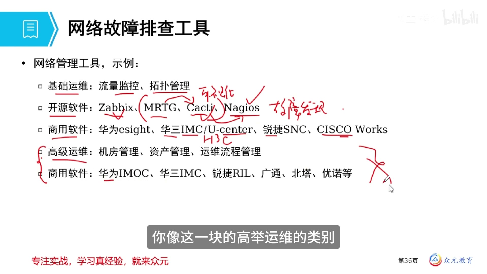

*图 8：专用故障排除工具课件页，列出欧姆表、数字万用表、电缆测试器、时域反射计（TDR）、光时域反射计（OTDR）、断接盒、位/数据块错误测试器（BERT/BLERT）、网络监测器、网络分析仪（如 Sniffer）。*

专用故障排除工具主要对应**线缆与接口，即物理层**，是考试较频繁的部分。

### 8.1 工具一览

| 工具 | 检测对象与用途 | 能否定位故障位置 |
| ---- | -------------- | ---------------- |
| 欧姆表、数字万用表 | 电流、电压是否稳定 | 否 |
| 电缆测试器 | 电缆/双绞线等金属电缆的断路、短路、压接不匹配等问题；检测线缆是否连通、正常工作 | 否 |
| 时域反射计（TDR，Time Domain Reflectors） | 同上，针对金属电缆 | **是**，可定位断点的长度与位置 |
| 光时域反射计（OTDR，Optical Time Domain Reflectors） | 针对光纤（光信号）：测量光纤长度、断裂位置、信号衰减、损耗 | **是**，可定位断裂位置 |
| 光功率计 | 针对光纤：测量某段光信号的相对损耗（衰减问题） | 否 |
| 断接盒（breakout boxes）、智能测试盘 | 对外围接口的故障进行排除 | 否 |
| 位/数据块错误测试器（BERT/BLERT） | 数据块错误测试 | 否 |
| 网络监测器 | 持续跟踪数据包，反馈活动图像 | 否 |
| 网络分析仪（例如 Sniffer） | 更深层次的数据分析和挖掘（嗅探） | 否 |

### 8.2 核心辨析：能否定位故障位置

**重点**：电缆测试器、时域反射计（TDR）、光时域反射计（OTDR）、光功率计之间的区别，核心在于**能否定位断裂位置或问题位置**。

| 判据 | 工具 |
| ---- | ---- |
| 能定位故障长度与位置 | 时域反射计（TDR）——电缆断点；光时域反射计（OTDR）——光纤断点 |
| 只能测试连通性或损耗，不能定位位置 | 电缆测试器（连通性）；光功率计（光信号衰减/相对损耗） |

选择题判定口诀：题干关键词为"电缆 + 断点 + 位置"选 TDR；"光纤（光缆）+ 断点 + 位置"选 OTDR；仅检测光衰减大小选光功率计。

### 8.3 工程实践中补充的工具

综合布线中网络工程师还会接触到的线缆接口工具：

| 工具 | 用途 |
| ---- | ---- |
| 测线仪 | 双绞线两端安装水晶头后，测试线缆是否连通（8 芯逐芯对应检测） |
| 红光笔（可见光检测笔） | 便于携带的光纤通断检测工具：将红光笔对接光纤头，若另一端能看到红光（持续或脉冲式发光），说明光能传播到另一端，光纤连通；价格便宜 |
| 绞线钳（压线钳）、水晶头 | 双绞线制作工艺所用：剥线、排序、压制水晶头 |
| 光纤熔接机 | 光纤熔接的专用设备。双绞线断裂可换线或重做水晶头，而光纤断裂需使用光纤熔接机重新熔接 |

---

## 9.光功率与 dBm 概念（通信领域延伸考点）

近年真题（2023、2024 年）从通信领域延伸考查了光功率相关概念，一般只占一分，作适当了解即可。

### 9.1 dBm 的定义

dBm 是以 **1 毫瓦（mW）为基准的相对光功率**单位，计算公式：

```
P(dBm) = 10 × lg( P / 1mW )
```

常见换算结论（记结果即可）：

| 功率 | dBm 值 |
| ---- | ------ |
| 1 mW | 0 dBm |
| 10 mW | 10 dBm |
| 100 mW | 20 dBm |
| 1000 mW（1 W） | 30 dBm |
| 10 W | 40 dBm |

即 dBm 数值每增加 10，对应功率扩大 10 倍。

### 9.2 相关单位辨析

| 单位 | 含义 | 使用场景 |
| ---- | ---- | -------- |
| mW（毫瓦） | 功率的绝对单位 | 表示功率本身 |
| dBm | 以 1 mW 为基准的相对光功率 | **常用光功率的单位**（考题答案） |
| dB | 相对的增益或损耗，表示差值 | 不单独表示光功率；光衰减用 dB 表示 |
| dBu | 一般用于音频、射频信号 | 不用于光通信 |

---

## 10.典型例题

### 例题1：确定电缆断点位置的工具（选择题）

采用网络测试工具（ ）可以确定电缆断点的位置。

- A. OTDR
- B. TDR（正确）
- C. BERT
- D. Sniffer

解答：抓住关键词"电缆""断点""位置"，能定位电缆断点位置的是时域反射计 TDR。注意区分：若题干是光纤（光缆）的断点位置，则应选 OTDR（A 选项）。

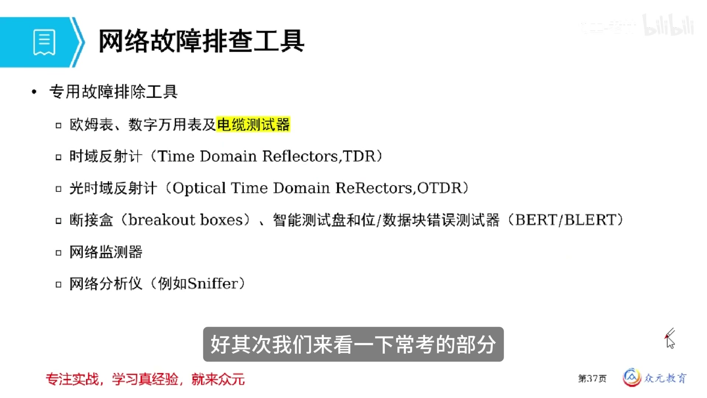

*图 9：课堂习题巩固，例题 1 至例题 3 原题。*

### 例题2：激光器光功率计算（选择题）

若在光纤通信系统中使用 100 mW 的激光器，当其发射波长为 1550 nm 时，其光功率为（ ）。

- A. 40 dBm
- B. 30 dBm
- C. 20 dBm（正确）
- D. 10 dBm

解答：本题考查通信领域的 dBm 概念（属于第二章通信相关知识的延伸）。

```
P(dBm) = 10 × lg( P / 1mW ) = 10 × lg(100) = 20 dBm
```

要点：dBm 的 m 指代一毫瓦，即以 1 mW 为基准的相对光功率。类似的考法还有：dBm 值为 30 dBm，对应功率为 10³ mW = 1 W。该类计算题不属于网络工程师的核心内容，实在不掌握可适当放弃，一般只占一分。

### 例题3：常用光功率的单位（选择题）

常用光功率的单位为（ ）。

- A. mW
- B. dBm（正确）
- C. dB
- D. dBu

解答：mW 是功率的绝对单位；dB 指相对的增益或损耗，表示差值，不单独表示光功率（光衰减用 dB 表示）；dBu 一般用于音频、射频信号，不用于光通信。常用光功率的单位是 dBm。

### 例题4：光缆故障案例（案例题，2021 年真题）

【案例一】针对故障一，网络管理员使用（1）设备对光缆检查，发现光衰非常大，超出正常范围，初步判断为光缆故障；使用（2）设备判断出光缆的故障位置，经检查故障点发现该处光缆断裂，可采用（3）措施处理较为合理。

（1）～（2）备选答案（每个备选答案只可选一次）：

- A. 网络寻线仪
- B. 可见光检测笔
- C. 光时域反射计
- D. 光功率计

（3）备选答案：

- A. 使用两台光纤收发器连接
- B. 使用光纤熔接机熔接断裂光纤（正确）
- C. 使用黑色绝缘胶带缠绕接线
- D. 使用一台五电口小交换机连接

解答：

1. （1）处填**光功率计**（D）：题干条件是"光衰（衰减）非常大"，测光信号衰减程度用光功率计。
2. （2）处填**光时域反射计**（C）：题干要求"判断出故障位置"，能定位断裂位置的是 OTDR。区分点就在于是否涉及"位置"。
3. （3）处选**使用光纤熔接机熔接断裂光纤**（B）：光缆断裂的处理方式是用专用设备光纤熔接机重新熔接；若是双绞线断裂，则更换网线或重新制作水晶头。注意两类线缆修复方式的区别。

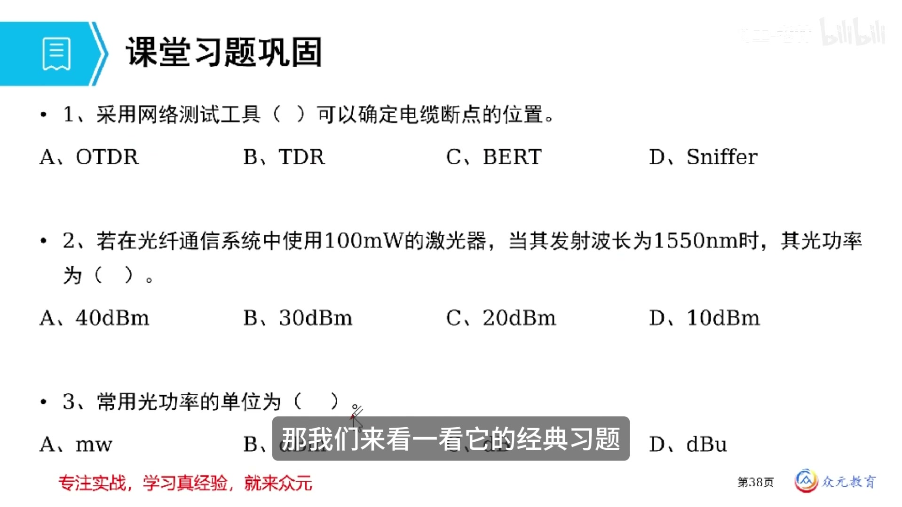

*图 10：案例一原题，2021 年网络工程师下午案例真题改编。*

### 例题5：常见故障案例扩展（联网核实补充）

以下为常见故障现象与排查方法的归纳，供案例答题参考：

| 故障案例 | 典型现象 | 判断方法 | 处理措施 |
| -------- | -------- | -------- | -------- |
| IP 地址冲突 | 部分终端时通时断、无法上网；日志提示 IP address conflict | 终端用 `arp -a` 查看网关 IP 对应的 MAC 是否异常；设备侧发生冲突的 IP 会存在源 IP 相同而源 MAC 不同的 ARP 表项；设备可通过发送免费 ARP（免费 ARP 报文中源 IP 与接口 IP 相同）主动检测冲突 | 排查私自配置静态 IP 的终端，规范 DHCP 分配；在接入交换机做 IP-MAC 绑定；清理冲突主机 |
| 网关配置错误 | 本网段内互通正常，跨网段全部不通 | `ipconfig /all` 核对默认网关与掩码；ping 同网段地址通、ping 网关通但外网不通时核对网关地址 | 修正网关配置 |
| VLAN 不通 | 同 VLAN 跨交换机终端无法互通，或跨 VLAN 无法互访 | 使用 display 命令检查：`display vlan`（VLAN 是否创建、接口是否加入）、`display port vlan`（接口 Link Type、PVID、Trunk VLAN List）；核对两端 Trunk 的 `port trunk allow-pass vlan` 允许列表是否一致、Access 端口 `port default vlan` 是否正确 | 补建 VLAN、将接口加入正确 VLAN、补全 Trunk 允许列表 |
| 二层环路/广播风暴 | 广播风暴导致大量终端上网异常，设备 CPU 占用率异常偏高、MAC 地址漂移告警 | `display interface` 查看端口流量带宽利用率是否远超正常业务水平；`display mac-address flapping` 查看 MAC 漂移记录；`display cpu-usage` 查看 CPU 占用率；`display stp brief` 检查 STP 端口状态 | 排除物理环路、修复/正确部署 STP，必要时启用环路检测与 storm-control 风暴抑制 |
| MTU 与分片问题 | ping 小包通、大包不通；网页能打开但部分应用（如大流量传输）异常卡死 | Windows 下 `ping -l 1472 -f <目标>`（-f 为 IP 头 DF 不分片标志，-l 指定数据长度，1472 + 20 字节 IP 头 + 8 字节 ICMP 头 = 1500 字节标准以太网 MTU）；若返回"需要分片但设置了 DF"（ICMP 类型 3 代码 4），说明路径 MTU 小于 1500 | 用递减包长二分探测路径 MTU；调低接口 MTU 或调整 TCP MSS 钳制 |
| DNS 解析失败 | ping IP 通但 ping 域名不通，应用无法按域名访问 | `nslookup <域名>` 测试解析（不带缓存，直接问 DNS 服务器）；`ipconfig /all` 核对 DNS 服务器地址；`ipconfig /displaydns`、`ipconfig /flushdns` 查看/清除本地缓存；DNS 查询使用 UDP/TCP 53 端口 | 修正 DNS 服务器配置、清理缓存、排查 53 端口是否被 ACL/防火墙拦截 |
| ACL 误拦 | 特定业务流量被丢弃，其余正常 | 设备上 `display acl all` 查看规则及匹配计数；注意 ACL 匹配顺序：config 模式下规则编号从小到大匹配，**一旦命中即停止匹配**；确认 ACL 应用方向（traffic-filter inbound/outbound）与动作 permit/deny | 调整规则编号或顺序，将精确规则前置；误拦规则改为 permit 或删除 |

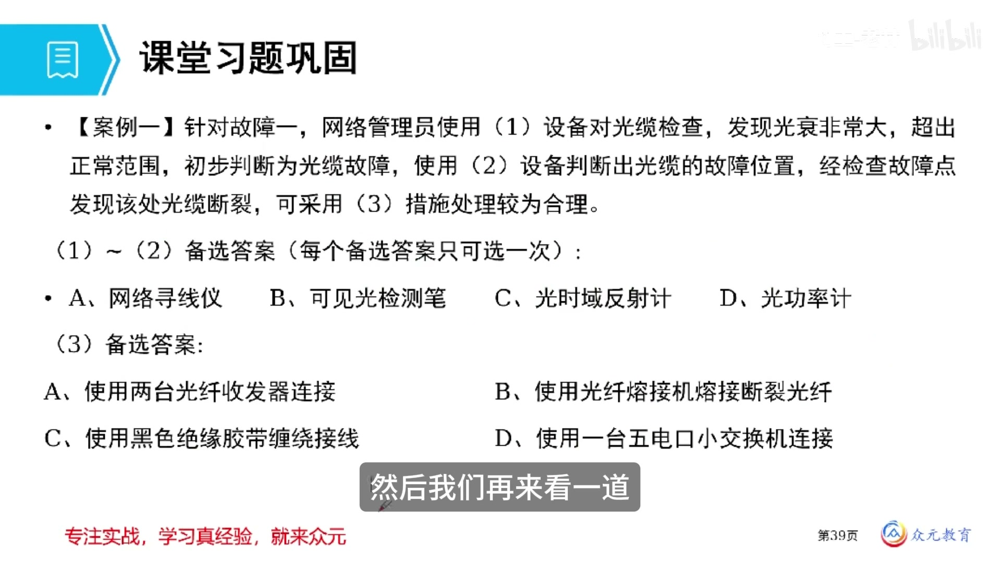

*图 11：课堂收尾页，网络管理工具分类的补充说明（基础运维、开源软件、商用软件、高级运维示例的强调版）。*

---

## 11.第九章（网络管理技术）章节小结

以下为 p83 章节小结集内容。第九章"网络管理技术"常考项目前集中于**选择题**，案例题比重有所降低但仍需复习课堂强调的题型。

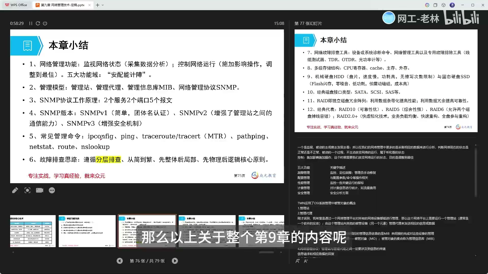

*图 12：第九章本章小结（上），涵盖网络管理功能、管理模型、SNMP 工作原理与版本、常见管理命令、故障排查思路。[手写批注] 在"监视""控制"处批注"查、修"（对应查看信息与修改参数）；在"2个服务2个端口5个报文"旁批注 Get、Set、Response、Trap。*

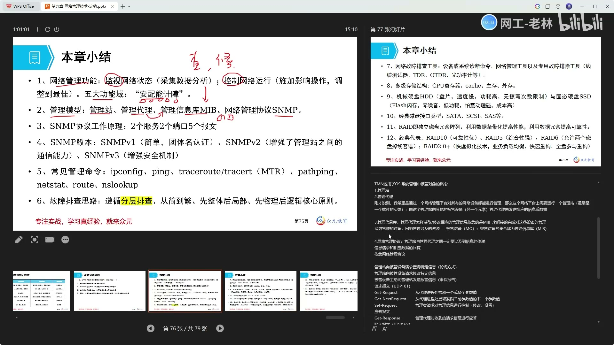

*图 13：第九章本章小结（下），涵盖网络故障排查工具、多级存储结构、机械硬盘与固态硬盘、经典磁盘接口类型、RAID 原理与经典代表。[手写批注] 在"网络故障排查工具"处批注"位置"，强调 TDR/OTDR 与光功率计的区别在于能否定位故障位置；"RAID"处批注"1.0"。*

### 11.1 网络管理基本功能与管理模型

- **基本功能**：两个方向——监视网络状态（采集数据分析，"查"）；控制网络运行（施加影响操作、调整参数到最佳，"修"）
- **五大功能域**：安全管理（安）、配置管理（配）、性能管理（能）、计费管理（计）、故障管理（障），即"安配能计障"；其中最经典、最基础的是**配置管理、性能管理、故障管理**三个
- **管理模型**：管理站—管理代理模型，基本要素为管理站、管理代理、管理信息库（MIB）及网络管理协议（SNMP 为经典代表）；管理信息库由 OID 标识，管理代理上放置存储 MIB，有固定的格式文件组织要求

### 11.2 SNMP 协议工作原理

SNMP 是管理站与管理代理之间信息传递的主要角色，选择题常考。工作原理涉及**两个服务、两个端口、五个报文**：

| 要素 | 内容 |
| ---- | ---- |
| 两个服务（轮询类） | 管理站向被管设备请求查询特定信息；管理站向被管设备请求修改特定信息 |
| 两个服务（事件报告） | 被管设备主动向管理站发送报警信息、事件报告 |
| 两个端口 | UDP 161（查询请求类报文）；UDP 162（Trap 陷入报文） |
| 五个报文（v1） | get-request、get-next-request、set-request、get-response、trap |

- get 用于查询，set 用于修改，response 为应答，trap 为陷入（主动报警）
- SNMPv2 在 v1 基础上新增了报文类别（如 get-bulk，即快数据类别 get bulk），增强了管理站之间的通信能力与快数据的传输能力
- SNMPv3 主要在**安全机制**上优化提升：认证、加密等（基于 USM 用户安全模块与 VACM 访问控制）
- v2 与 v3 的对比是近年选择题考查频度较高的题型

### 11.3 常见管理命令与故障排查（与本节内容呼应）

- 常见管理命令：ipconfig、ping、traceroute/tracert（MTR）、pathping、netstat、route、nslookup；故障排查的测试（丢包率、路径、是否连通）都离不开这一类命令
- netstat 用于查看连接状态（TCP/UDP 端口号连接状态），另有查看网卡信息、DNS 相关信息、路由表信息的命令
- 故障排查思路目前考试频度较低，但开放性试题非常有代表性，注意**分层排查思想**（物理层、数据链路层、网络层），可结合前面章节所学知识综合出题
- 本章重点是**故障排查工具的辨别**：核心对比在于线缆测试器/光功率计与时域反射计/光时域反射计——**能专门查到故障位置的**是（光）时域反射计，**不能定位位置的**是光功率计、线缆测试器等

### 11.4 网络存储与其他考点（同章概览）

| 考点 | 核心内容 |
| ---- | -------- |
| 多级存储结构 | CPU 寄存器、Cache、主存、外存；采用多级存储的原因：解决容量问题与速度不匹配问题 |
| 机械硬盘 HDD 与固态硬盘 SSD | HDD：盘片存储介质，速度慢、功耗高、无擦写次数限制；SSD：Flash 闪存，零噪音、低功耗、怕震动磕碰、成本高；选择题易出对比 |
| 经典磁盘接口类型 | SATA、SCSI、SAS 等 |
| RAID | 独立磁盘冗余阵列（或称廉价磁盘冗余阵列）1.0 版本传统结构：利用**数据条带化**提高性能，利用**数据冗余**提高可靠性；经典代表 RAID10（可靠性优）、RAID5（综合性能强）、RAID6（允许两个磁盘掉线容错）、RAID2.0+（块虚拟化技术，业务负载均衡、快速重构、全盘参与重构）；常考磁盘数量计算与性能/利用率/允许失效盘数对比 |
| 网络存储方案 | 考试力度很低；新方向为分布式存储、超融合（计算虚拟化 + 分布式存储 + 网络虚拟化 + 统一管理），涉及云计算、AI、大数据分析领域、数据中心，将存储变成像水电一样集成、统一的解决方案，在成本与操作实现方式上大幅优化简化 |
| 数据备份与恢复 | 全量备份（每天全备份，易于管理）、差分备份（每周一天全备，本周其余每天备份和全备份有差异的部分）、增量备份（每周一天全备，其余每天备份和上次备份有差异的部分）；数据备份能否有效解决数据安全问题需注意辨别；近年考查频度明显降低，有概念即可 |

2026 年 5 月真题集中考查了 SNMP、多级存储结构、RAID 磁盘数量计算，应优先掌握。

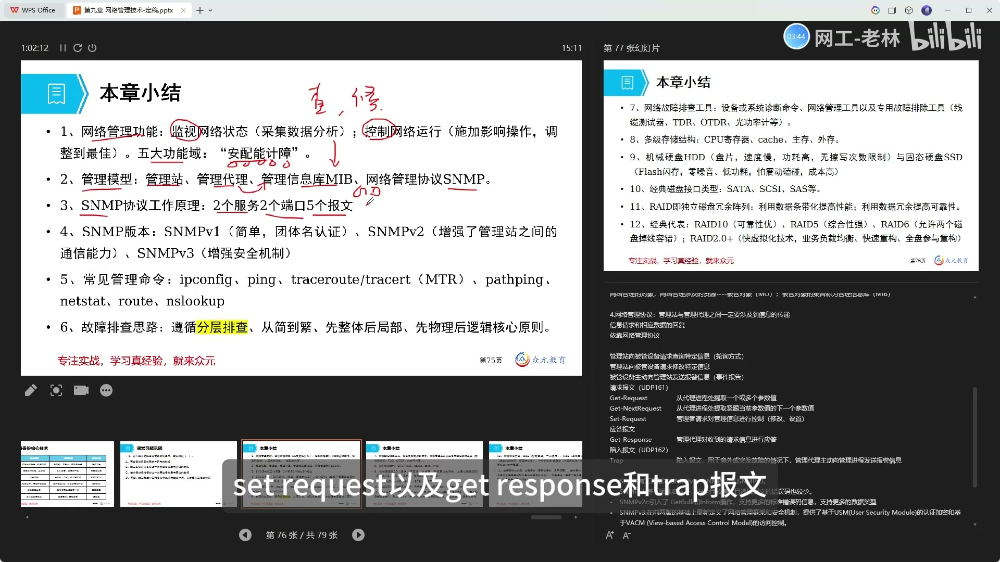

*图 14：章节回顾幻灯片（本章小结第 1 至 6 条手写强调版），常见管理命令与故障排查思路为重点标注内容。*

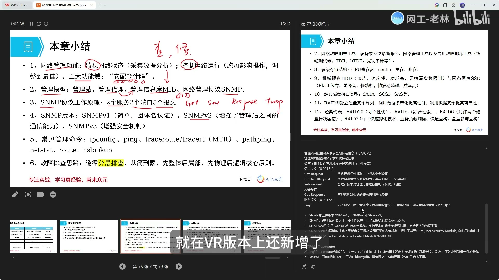

*图 15：章节回顾幻灯片，强调 SNMP 协议工作原理"2 个服务 2 个端口 5 个报文"。*

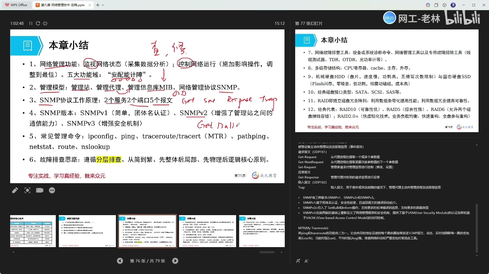

*图 16：章节回顾幻灯片，强调 SNMPv1/v2/v3 版本对比及新增的 get-bulk 报文。*

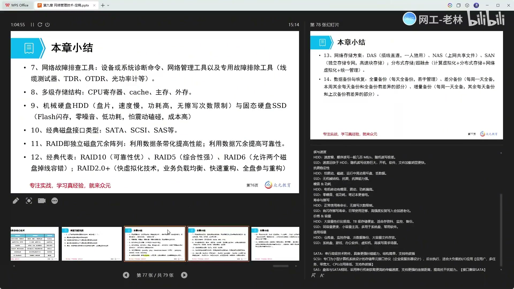

*图 17：章节回顾幻灯片，第 7 至 12 条小结强调版，标注多级存储结构、RAID 等重点。*

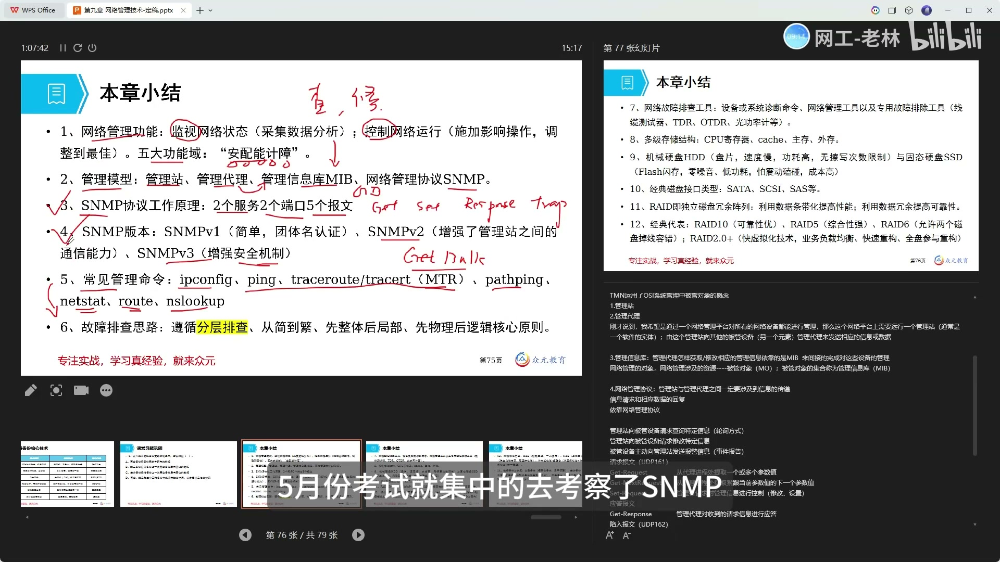

*图 18：章节回顾幻灯片，第 13 至 14 条小结：网络存储方案与数据备份分类。*

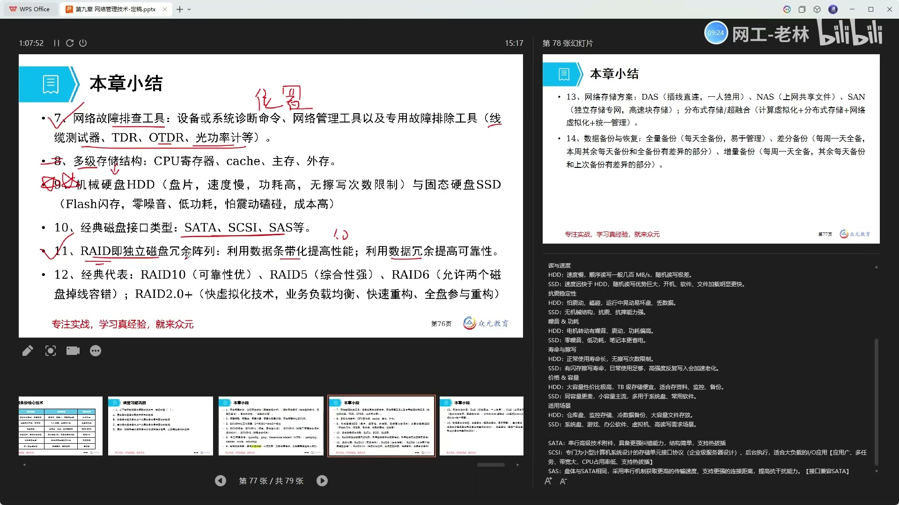

*图 19：章节回顾幻灯片，网络存储方案中"分布式存储/超融合"被重点圈注。*

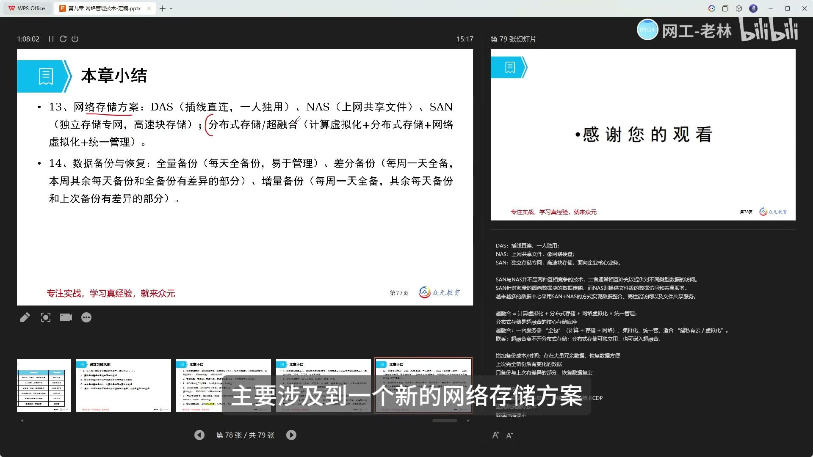

*图 20：章节回顾幻灯片，常见管理命令与故障排查思路被逐项标注强调。*


*图 21：课程结束页（感谢观看），无知识点内容。*

---

## 12.本章小结

| 知识点 | 核心内容 |
| ------ | -------- |
| 1. 核心原则 | 分层排查、从简到繁、先整体后局部、先物理后逻辑 |
| 2. 分层排查法 | 物理层（线缆、接口、电源，最易出问题，优先检查）→ 数据链路层（VLAN、Trunk、MAC、STP、环路）→ 网络层（IP、网关、路由、ACL、NAT）→ 传输层 → 应用层（业务系统）；大部分故障出现在物理层、数据链路层和网络层 |
| 3. 标准流程 | 收集现象明确范围（不盲目动手）→ 缩小区间（二分法/替换法/对比法/最小系统法）→ 逐层定位 → 验证修复并复盘记录 |
| 4. 排查禁忌 | 变更前备份、选择业务低峰期、故障未定位不盲目修改、重视日志与告警 |
| 5. 设备诊断命令 | display（华为）/show（思科）查配置；debug 跟踪业务、生产网慎用（undo debugging all 关闭）；ping 测连通性；tracert 看路径；pathping 与 mtr 兼具延时和丢包分析，排查抖动与严重丢包优选 mtr |
| 6. 连通性测试 | ping（ICMP 类型 8/0）、tracert（TTL 递增 + ICMP 超时类型 11）、端口测试（Test-NetConnection/telnet/nc）；判读要点：中间跳星号无碍、路由环路地址重复、ping 通而端口不通查 ACL/服务 |
| 7. 抓包分析 | Wireshark 显示过滤器（ip.addr、tcp.port、icmp.type、tcp.flags.syn 等）与 tcpdump 命令行抓包；嗅探类工具既可排障也可用于被动攻击 |
| 8. 网络管理工具 | 基础运维（流量监控、拓扑管理）；开源（Zabbix、MRTG、Cacti、Nagios）；商用（华为 eSight、华三 iMC/U-Center、锐捷 SNC、Cisco Works）；高级运维一体化平台（华为 IMOC 等） |
| 9. 专用排除工具（考试重点） | 电缆测试器/光功率计只能测连通或损耗；TDR（电缆）、OTDR（光纤）可**定位断点位置**——"位置"是判定关键词；另有万用表、断接盒、BERT/BLERT、网络监测器、网络分析仪（Sniffer）、测线仪、红光笔、光纤熔接机 |
| 10. 光功率单位 | dBm 以 1 mW 为基准：P(dBm) = 10 lg(P/1mW)；100 mW = 20 dBm；dB 表示增益/损耗差值，dBu 用于音频射频 |

考试重点：

1. 专用故障排除工具的辨析：抓住"能否定位故障位置"这一判据，电缆断点选 TDR，光缆断点选 OTDR，仅测光衰减选光功率计
2. 排查命令的功能区分：ping 测连通、tracert 看路径、pathping/mtr 分析延时与丢包、mtr 优选排查抖动和严重丢包
3. 分层排查思想：按物理层 → 数据链路层 → 网络层 → 高层的顺序逐层定位，案例开放题按此思路作答
4. 标准流程四步与四种缩小区间手段（二分法、替换法、对比法、最小系统法）及其特点
5. SNMP 两个服务、两个端口（161/162）、五个报文（get-request、get-next-request、set-request、get-response、trap）及版本对比是本章选择题高频考点
6. 光功率 dBm 计算与单位辨析为近年延伸考点，一般一分，掌握 100 mW = 20 dBm 等常见结论即可
