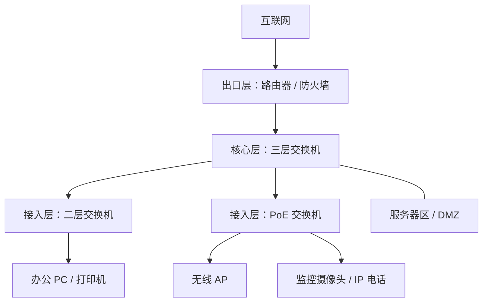
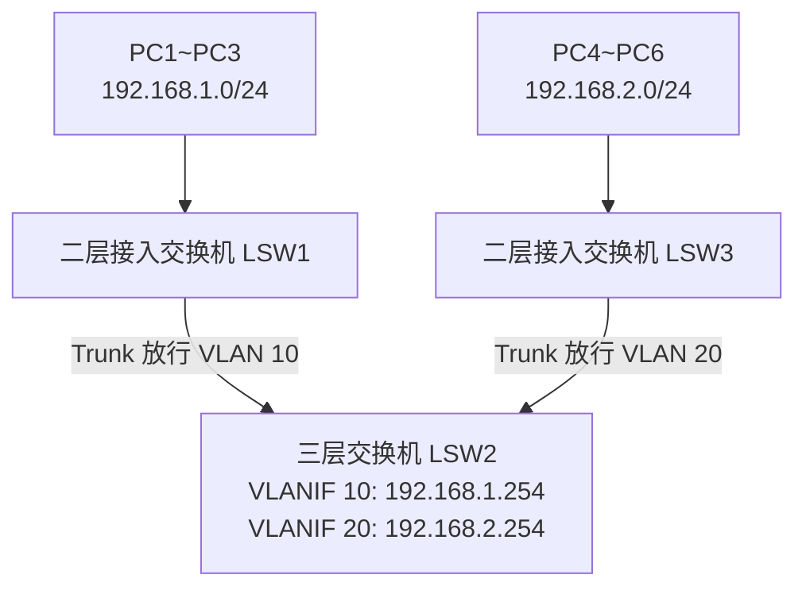
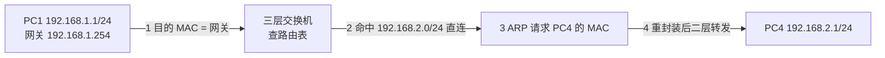
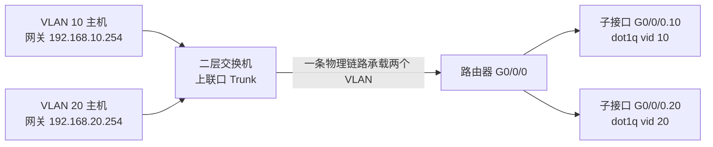
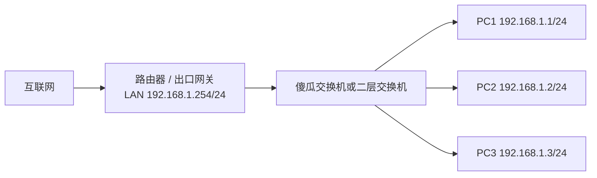
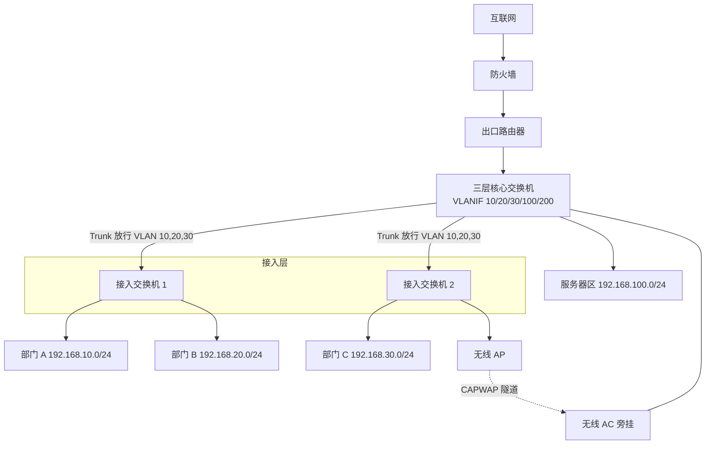

# 企业网设备与局域网组建 · 完整笔记

---

## 1.企业网建设总体框架

本课以"零基础掌握企业网设计和调试"为目标，学完后应具备独立组建一个局域网的技术能力。课程内容分为六个模块：

| 序号 | 模块 | 主要目标 |
| ---- | ---- | -------- |
| 1 | 常见网络设备应用场景 | 认识企业级网络设备的类型、位置与作用 |
| 2 | 组建同网段局域网 | 掌握同网段判定与最小局域网搭建 |
| 3 | 组建多 VLAN 多网段局域网 | 掌握 VLAN 划分、网关与三层互通 |
| 4 | 企业网 DHCP 配置和优化 | 为客户端自动分配 IP 地址并进行优化 |
| 5 | 使用路由器连接内外网 | 掌握路由转发、默认路由与 NAT |
| 6 | 使用防火墙提升网络安全性 | 掌握边界过滤、访问控制与功能扩展 |

### 1.1 企业级设备与消费级设备的区别

本课所说的网络设备，特指**专业的企业级网络设备**，而非家用消费级产品。常见企业级品牌包括**华为、华三（H3C）、锐捷、迈普、深信服**等。这些设备的核心价值不在于"能通"，而在于**性能、可靠性、可管理性与安全性**。

| 维度 | 消费级设备 | 企业级设备 |
| ---- | ---------- | ---------- |
| 转发性能 | 满足家庭带宽，缓存小 | 高交换容量、高包转发率，满配线速 |
| 可靠性 | 单电源、无冗余 | 冗余电源、双上行、堆叠、双机热备 |
| 可管理性 | 手机 App 简单设置 | CLI/Web/SNMP/集中网管、日志与告警 |
| 安全与隔离 | 基本无 | VLAN、端口隔离、ACL、802.1X、DHCP Snooping |
| 生命周期 | 3~5 年，无备件承诺 | 5~10 年，有备件与售后服务 |

### 1.2 企业网设备的六大类

企业网中常见的网络设备可归纳为六类：

| 类别 | 具体形态 | 主要作用 |
| ---- | -------- | -------- |
| 接入交换 | 傻瓜交换机、企业级可网管二层交换机 | 扩展端口、接入终端、二层转发 |
| 核心路由交换 | 三层交换机 | 多网段互联、VLAN 间路由、核心转发 |
| 无线接入 | 无线 AC、无线 AP | 组建企业级 Wi-Fi，集中管理、无缝漫游 |
| 边界路由 | 企业级路由器 | 连接内外网、路由转发、NAT |
| 安全防护 | 防火墙 | 访问控制、攻击防护、行为管理、VPN |
| 流量调度 | 负载均衡设备、网关 | 多链路/多服务器调度、协议转换与出口 |

上述设备在拓扑中的位置可以概括为：**出口（路由器/防火墙）— 核心（三层交换机）— 接入（二层交换机）— 终端（PC/AP/服务器）**。本节后续按此顺序逐一说明。



---

## 2.企业网常见网络设备

### 2.1 傻瓜交换机（非网管交换机）

"傻瓜交换机"是**非网管交换机**的俗称。其特点是**不需要复杂调试、使用简单、价格便宜、插上线即可使用**。

价格量级：便宜的几十元，贵的几百元。以电商在售产品为例（参考价，随行情浮动），5 口全千兆约 60 元、8 口全千兆约 100 元、16 口全千兆约 220 元、24 口全千兆约 370 元。

适用场景：

- 网络规模较小，仅十几台至几十台电脑
- 只需组建一个**同网段**的简单局域网
- 对可靠性、可管理性、安全性无特殊要求

所谓"一个网段"，即所有主机的 IP 地址形如 `192.168.1.x`，网络位相同。傻瓜交换机只做二层转发，不涉及网段划分。

结论：几十人的简单同网段局域网，用一台傻瓜交换机加若干网线即可完成，无需任何配置。但实际企业网络中，规模更大、技术需求更复杂，因此需要企业级可网管二层交换机。

### 2.2 企业级二层可网管交换机

以锐捷 RG-NBS3100-24GT4SFP-P 为例：24 个千兆电口、4 个千兆 SFP 光口、支持 PoE 供电、二层网管，电商价约 5000 元。相比傻瓜交换机，价格从几十、两三百元上升到几千元。

价格差异对应四类核心能力：

| 能力 | 说明 |
| ---- | ---- |
| 更强的转发性能 | 网络规模更大、吞吐量更高时，需专业设备承载 |
| 故障隔离 | 通过 **VLAN、端口隔离** 等技术，使某部门故障不影响其他部门 |
| 链路聚合 | 捆绑多条物理链路，提高上下行带宽并提供冗余 |
| 远程监控与管理 | 支持 SNMP、Web、CLI 等管理方式，故障或非法接入时自动告警 |

故障隔离的企业价值：一个部门发生网络故障（广播风暴、环路、非法接入）时，不会扩散到全网。

虽然采购成本高，但网络质量、稳定性、可靠性显著提高。一次网络故障导致业务中断的损失，往往远超一台交换机的采购成本。因此，对网络质量有要求的单位，普遍采用企业级二层管理交换机。

### 2.3 三层交换机

无论傻瓜交换机还是企业级二层交换机，**都只能实现同网段通信**。当网络达到一定规模，必然会划分多个网段，例如 `192.168.1.x`、`192.168.2.x`、`192.168.3.x`。不同网段互联必须使用**三层交换机**。

"三层"指具备**网络层路由转发能力**，核心作用是实现不同网段之间的互联。除网段互联外，三层交换机的转发性能也远强于二层设备。

在典型小型企业网中，三层交换机担任**核心交换机**，承载各部门之间的数据通信，以及所有部门访问外网的必经流量。因此它是网络中最关键的节点，性能、可靠性要求最高。

结论：**任何一个略有规模的网络都一定会有三层交换机**，因为其必然划分了多个网段。

三层交换的转发机制（补充）：首个报文由 CPU 走一遍路由查询，随后把"目的网段 → 下一跳 MAC"的对应关系写入**硬件转发表（FIB/ARP 表）**，后续同流报文直接由 ASIC 线速转发，因此性能接近二层交换而远高于路由器逐包查表。

### 2.4 无线 AC 与 AP

前述交换机组建的都是**有线局域网**。智能手机、平板、笔记本等终端往往没有网线接口，需要 Wi-Fi，因此要引入 **AC + AP** 架构。

**AP（Access Point，无线接入点）**：安装在天花板或墙壁上，负责收发无线信号。手机、平板通过 Wi-Fi 连接到 AP。

企业网需要完整覆盖，因此 AP 数量很多。例如一个几平方公里的校园网，可能需要几百个 AP。几百个 AP 协同工作、放出同一个 Wi-Fi，用户连接一次后可在覆盖范围内自由走动、持续使用，这称为**漫游**。

**AC（Access Controller，无线控制器）**：作为管理者，统一控制大量 AP。它向 AP 统一下发命令，规定：

- 放出什么名称的 Wi-Fi（SSID）
- 用户接入需要输入什么密码
- 用户接入后划分到哪个 VLAN、哪个子网

企业网通常部署**一台 AC**；为提高可靠性，也可部署**两台 AC** 互为备份，管理大量 AP，实现完整无线覆盖。

架构要点：

| 项目 | 说明 |
| ---- | ---- |
| 瘦 AP | 本身不保存完整配置，由 AC 集中下发 |
| 胖 AP | 独立工作，需逐台配置，适合家庭/小微场景 |
| 管理协议 | CAPWAP（控制与配置无线接入点协议），控制隧道 UDP 5246、数据隧道 UDP 5247 |
| 供电方式 | PoE 交换机供电，免布电源线 |
| 部署方式 | AC 旁挂核心交换机（常见，二层/三层组网）或串联部署 |
| 漫游 | 同一 AC 下 AP 间二层漫游；跨网段需三层漫游，由 AC 或隧道保障会话不中断 |
| 认证 | Portal、802.1X、MAC 认证，常与 RADIUS 服务器配合 |

### 2.5 路由器

前面所有设备都只能实现**局域网内部**通信。要连接互联网，需使用**路由器**或**防火墙**。路由器的安全性不及防火墙，先讨论路由器。

路由器放置在网络的**边界处**，作用是连通内网与外网。

核心功能一：**路由转发**。访问互联网需配置一条指向互联网的**默认路由**（`0.0.0.0/0`）。

核心功能二：**NAT（Network Address Translation，网络地址转换）**。内网主机使用私网 IP。例如演示主机为 `192.168.0.106`。常见私网地址段：

| 地址段 | 掩码长度 | 地址数量 | 说明 |
| ------ | -------- | -------- | ---- |
| 10.0.0.0 ~ 10.255.255.255 | /8 | 约 1677 万 | A 类私网 |
| 172.16.0.0 ~ 172.31.255.255 | /12 | 约 104 万 | B 类私网 |
| 192.168.0.0 ~ 192.168.255.255 | /16 | 约 6.5 万 | C 类私网 |

私网 IP 只能在局域网内部使用，不允许在互联网上路由。

上网时，内网主机向外网目标发送数据包，数据包经过边界路由器，路由器将**不能上网的私网 IP 转换为可上网的公网 IP**，从而实现内外网连通。该过程即 NAT。

补充：私网地址段由 RFC 1918 定义；另有 169.254.0.0/16（链路本地，DHCP 失败时 Windows 自动配置）与 127.0.0.0/8（环回）。主机拿到 `169.254.x.x` 地址基本可判定为**未获取到 DHCP 地址**。

### 2.6 防火墙

防火墙也能实现内外网互联，但与路由器有明显区别。

区别一：**安全性更高**。互联网上存在病毒、攻击等大量安全威胁。防火墙可将不安全因素隔离在网络外部，阻止有害数据包进入内网；同时可限制内网用户访问外网的不良资源。

区别二：**功能可扩展**。防火墙内部类似一个计算机系统，可通过软件扩展功能，例如增加**上网行为管理**功能，或增加 **VPN** 功能，支持远程接入或分支互联。

因此防火墙具备两大优势：**更安全**、**可通过软件扩展企业网新增功能**。其价格也高于路由器。

防火墙常见技术能力（补充）：

| 能力 | 说明 |
| ---- | ---- |
| 包过滤 | 依据五元组（源/目的 IP、源/目的端口、协议）允许或拒绝 |
| 状态检测 | 维护会话表，仅放行已建立连接的返回流量 |
| NAT | 源 NAT（内网上网）、目的 NAT（服务器发布） |
| 安全区域 | Trust（内网）、Untrust（外网）、DMZ（服务器区）、Local（本机） |
| VPN | IPsec VPN、SSL VPN |
| 入侵防御 | IPS/IDS、病毒过滤、应用识别与控制 |
| 高可用 | 双机热备（主备/负载分担），华为为 HRP + VRRP |

部署模式（补充）：

| 模式 | 工作层次 | 特点 | 适用场景 |
| ---- | -------- | ---- | -------- |
| 路由模式 | 三层 | 接口配 IP，作为网关，可做 NAT 与策略路由 | 常见出口部署 |
| 透明模式 | 二层 | 接口不配 IP，像网桥一样串入链路，业务无需改网关 | 已有出口路由、需加一层防护 |
| 旁路模式 | 二层/监听 | 只镜像流量做检测与审计，不阻断转发 | 只审计不改网、IDS 部署 |

### 2.7 负载均衡设备（补充）

课程未展开，但属于企业网常见设备，考试可能涉及概念辨析。

| 项目 | 说明 |
| ---- | ---- |
| 定义 | 将访问流量按策略分发到多台服务器或多条链路 |
| 四层负载 | 依据 IP + 端口分发，如 LVS、F5 |
| 七层负载 | 依据 URL、Host、Cookie 等内容分发，如 Nginx、HAProxy |
| 常见算法 | 轮询、加权轮询、最小连接数、源地址哈希、最短响应时间 |
| 健康检查 | 定期探测后端服务器，故障节点自动摘除 |
| 会话保持 | 同一用户请求持续落到同一后端，保证登录状态 |
| 链路负载 | 多条运营商出口按带宽/质量调度，提升出口可靠性 |

### 2.8 网关（补充）

| 项目 | 说明 |
| ---- | ---- |
| 广义网关 | 连接两个不同协议或体系结构的网络，完成协议转换 |
| 默认网关 | 主机访问本网段以外目标时的下一跳 IP 地址 |
| 出口网关 | 企业边界设备，集成路由、NAT、防火墙、行为管理、AC 管理等功能 |
| 与路由器/防火墙关系 | 路由器、防火墙、UTM、多业务网关均可承担网关角色 |

关键结论：**默认网关的 IP 必须与主机自身 IP 处于同一网段**，否则主机无法通过该网关转发。[正确]

### 2.9 设备对比与选型

| 设备 | 工作层次 | 核心功能 | 能否跨网段 | 典型位置 | 价格量级 |
| ---- | -------- | -------- | ---------- | -------- | -------- |
| 傻瓜交换机 | 二层 | 端口扩展、MAC 转发 | 否 | 小微网络接入 | 几十至几百元 |
| 企业级二层交换机 | 二层 | VLAN、隔离、聚合、网管 | 否 | 部门接入 | 几千元 |
| 三层交换机 | 二/三层 | 高速转发 + VLAN 间路由 | 是 | 企业网核心 | 数千至数万元 |
| 无线 AP | 二层 | 无线信号收发 | 否 | 室内覆盖 | 几百至数千元 |
| 无线 AC | 二/三层 | 集中管理 AP、漫游、认证 | 是（旁挂） | 核心旁挂 | 数千至数万元 |
| 路由器 | 三层 | 路由转发、NAT、VPN | 是 | 网络出口 | 数千至数万元 |
| 防火墙 | 三至七层 | 访问控制、NAT、IPS、VPN | 是 | 网络出口 | 高于同档路由器 |
| 负载均衡 | 四/七层 | 流量分发、健康检查 | 是 | 服务器区前/出口 | 数万至数十万元 |

选型要点（结合企业实践核实）：

| 维度 | 交换机 | 路由器 | 防火墙 |
| ---- | ------ | ------ | ------ |
| 端口/接口 | 端口数量按终端数预留约 20% 余量；上行选千兆/万兆 SFP+ | WAN/LAN 口数量与类型匹配线路 | 内网接口数量、可扩展槽位 |
| 性能 | 交换容量、包转发率、满配置吞吐量 | 吞吐量按出口带宽 1.5~2 倍配置 | 吞吐量大于出口带宽，并发连接数满足终端数 × 50~100 |
| 功能 | VLAN、STP、链路聚合、堆叠、QoS、ACL | 静态路由、OSPF、NAT、VPN、策略路由 | 状态检测、NAT、ACL、IPS/IDS、应用识别 |
| 供电 | 接 AP/摄像头/IP 电话时选 PoE（802.3af 15.4 W、at 30 W、bt 60 W/90 W） | 一般无需 PoE | 一般无需 PoE |
| 可靠性 | 冗余电源、双上行、堆叠 | 双 WAN、VRRP/双机 | 双机热备 |
| 管理 | SNMP、Web、CLI、集中网管 | 同上 | 集中策略管理、日志审计 |
| 成本与生态 | 主流品牌、备件与售后、5~8 年生命周期 | 同左 | 同左 |

性能估算补充：

- 包转发率（Mpps）≈ 千兆端口数 × 1.488 + 百兆端口数 × 0.1488 + 万兆端口数 × 14.88；交换容量（Gbps）≈ 端口数 × 端口速率 × 2（全双工双向）
- 例：24 口千兆 + 4 口万兆的交换机，线速包转发率约 24 × 1.488 + 4 × 14.88 ≈ 95 Mpps，交换容量约 24 × 1 × 2 + 4 × 10 × 2 = 128 Gbps
- 选型时设备标称值应不小于线速值，若标称远低于计算值，说明存在收敛比，满配时可能拥塞

选型原则可概括为：**需求匹配优先、架构适配为基、性能与成本平衡、生态与未来兼容**。

---

## 3.同网段局域网组建

### 3.1 同网段的判定

组建最小型网络时，首先遇到两个问题：**如何判断两台主机是否同网段**，以及**如何配置 IP 地址**。

配置 IP 地址时，除 IP 本身外，还必须配置**子网掩码**。子网掩码决定两台主机是否在同一网段。

示例：IP 地址 `6.6.6.1`，子网掩码 `255.255.255.0`。

IP 地址由**网络位 + 主机位**组成，可用身份证号码类比：

| 身份证号码 | IP 地址 |
| ---------- | ------- |
| 前六位表示所在地区 | 网络位表示所在网段 |
| 后续位表示个人信息 | 主机位表示网段内的具体主机 |

判定方法：

1. 观察子网掩码中有几个 `255`；
2. `255` 对应的 IP 段即为**网络位**；
3. 比较两台主机 IP 的网络位是否相同；
4. 相同即同网段，不同即不同网段。

`[错误]` "数 255 的个数"只对 `255.255.255.0` 这类整段掩码成立。遇到 `255.255.255.192`、`255.255.254.0` 等掩码时，必须把 IP 与掩码**逐位相与**求网络地址，不能只数 255。

以 `6.6.6.1/255.255.255.0` 为例：掩码有三个 `255`，故前三段 `6.6.6` 为网络位。

| 对比对象 | 网络位 | 判定 |
| -------- | ------ | ---- |
| 6.6.6.1 与 6.6.6.x | 均为 6.6.6 | 同网段 |
| 6.6.6.1 与 6.6.7.33 | 6.6.6 与 6.6.7 | 不同网段 |
| 6.6.6.1 与 6.6.7.33，掩码改为 255.255.0.0 | 均为 6.6 | 同网段 |

结论：**同网段与否由"IP + 子网掩码"共同决定，不能只看 IP 地址**。掩码变宽（网络位变短）后，原本不同网段的主机可能变为同网段。

补充：将 IP 与掩码逐位相与，得到**网络地址**；网络地址相同即同网段。例如 `192.168.1.10/24` 的网络地址为 `192.168.1.0`，`192.168.1.200/24` 也为 `192.168.1.0`，二者同网段。

相关计算（补充）：

| 项目 | 公式 | 示例（192.168.1.0/24） |
| ---- | ---- | ---------------------- |
| 可用主机数 | 2^主机位 − 2 | 2^8 − 2 = 254 |
| 网络地址 | 主机位全 0 | 192.168.1.0 |
| 广播地址 | 主机位全 1 | 192.168.1.255 |
| 可用主机范围 | 网络地址 +1 ~ 广播地址 −1 | 192.168.1.1 ~ 192.168.1.254 |

### 3.2 组建步骤

同网段局域网的组建可归纳为五步：

| 步骤 | 工作内容 | 关键产出 |
| ---- | -------- | -------- |
| 1. 需求与拓扑 | 确定终端数量、位置、是否有无线需求；绘制拓扑 | 拓扑图 |
| 2. IP 规划 | 选定网段、掩码、网关、DNS；编制地址分配表 | IP 规划表 |
| 3. 线缆与端口 | 制作/敷设网线，记录交换机端口与信息点对应关系 | 端口对照表、标签 |
| 4. 设备配置 | 交换机上电（傻瓜交换机免配）；终端配置静态 IP 或 DHCP | 配置记录 |
| 5. 连通性测试 | `ping` 同网段主机与网关，检查 `ipconfig`、`arp -a` | 测试记录 |

线缆与连接要点：

| 场景 | 线缆 | 说明 |
| ---- | ---- | ---- |
| PC—交换机 | 直通线 | 两端线序一致 |
| 交换机—交换机 | 直通线（现代设备支持 Auto-MDI/MDIX） | 早期设备需交叉线 |
| PC—PC | 交叉线（现代网卡多支持自动翻转） | 临时直连 |
| 水平布线 | 超五类（Cat5e）或六类（Cat6）双绞线 | 水平缆线 ≤90 m（含两端跳线的信道 ≤100 m） |
| 上行链路 | 光纤 + SFP 模块 | 距离远、带宽高时使用 |

实验使用华为官方模拟器 **eNSP**。拓扑为：一台二层交换机 + 三台 PC，PC 分别连接到交换机任意以太网口（拓扑见 5.1 节的对照图，去掉出口路由器即为本实验）。

### 3.3 实验配置

同网段局域网无需在交换机上做任何配置，只需将三台 PC 配为同网段：

| 主机 | IP 地址 | 子网掩码 | 默认网关 |
| ---- | ------- | -------- | -------- |
| PC1 | 192.168.1.1 | 255.255.255.0 | 不填 |
| PC2 | 192.168.1.2 | 255.255.255.0 | 不填 |
| PC3 | 192.168.1.3 | 255.255.255.0 | 不填 |

关键点：**同网段内通信不需要网关**。主机访问同网段目标时，直接通过 ARP 获取对方 MAC 地址，由交换机二层转发。

### 3.4 连通性测试

测试工具为 **ping**：向目标发送 ICMP 回显请求，若收到回显应答，说明链路连通。

在 eNSP 中双击 PC，进入"命令行"页签，在 PC1 上依次执行：

```text
ping 192.168.1.2
ping 192.168.1.3
```

均收到回复，说明三台主机互联互通，同网段局域网组建完成。

排错提示：若 ping 不通，先用 `ipconfig` 核对 IP 与掩码是否同网段、网线是否插在正确的口、接口指示灯是否点亮；再用 `arp -a` 确认是否学到对端 MAC。Windows 主机还需注意防火墙默认可能拦截 ICMP 回显请求。

### 3.5 同网段局域网配置清单

| 项目 | 配置 |
| ---- | ---- |
| 交换机 | 无需配置（傻瓜/非网管）；网管交换机保持默认 VLAN 1 |
| PC1 | IP 192.168.1.1 / 掩码 255.255.255.0 |
| PC2 | IP 192.168.1.2 / 掩码 255.255.255.0 |
| PC3 | IP 192.168.1.3 / 掩码 255.255.255.0 |
| 网关 | 不配置 |
| 验证 | `ping 192.168.1.2`、`ping 192.168.1.3` 均通 |

---

## 4.多 VLAN 多网段局域网组建

### 4.1 为什么需要多网段

网络达到一定规模后，必然划分为多个网段。**仅使用二层交换机无法实现多网段通信**，因此需要三层交换机。

本实验拓扑：

- 上方一台交换机作为**三层交换机**（LSW2）
- 下方两台交换机作为**二层接入交换机**（LSW1、LSW3）
- 左侧终端规划为 `192.168.1.0/24`（一段）
- 右侧终端规划为 `192.168.2.0/24`（二段）

实现多网段互通需要两个关键技术：**VLAN** 与 **网关**。



### 4.2 VLAN 的概念与作用

**VLAN（Virtual Local Area Network，虚拟局域网）**：将一个完整的物理局域网，逻辑上分隔成多个小的虚拟局域网。其本质是一种**隔离技术**。

作用一：**故障隔离**。左侧部门出现网络故障时，通过 VLAN 隔离，不影响右侧部门。

作用二：**广播隔离**。计算机和网络设备会发出广播报文。设备少时影响不大；设备多时广播包大量增加，若不做隔离，将严重损耗网络性能。

VLAN 的两大好处：**隔离故障、隔离广播**。此外还可带来安全隔离、简化管理、灵活分组等收益。

补充要点：

| 项目 | 说明 |
| ---- | ---- |
| 标准 | IEEE 802.1Q |
| 标签长度 | 4 字节：2 字节 TPID（0x8100）+ 2 字节 TCI（3 位优先级 PCP、1 位 DEI、12 位 VLAN ID） |
| VLAN ID 范围 | 0~4095，可用 1~4094（0 与 4095 保留），共 4094 个 |
| 默认 VLAN | VLAN 1，所有端口初始属于 VLAN 1 |
| 广播域 | 一个 VLAN 即一个广播域 |
| 划分方式 | 基于端口（最常用）、基于 MAC、基于协议、基于子网 |

注意：VLAN 1 不建议承载业务，也不建议用作管理 VLAN；管理地址应放在独立的管理 VLAN 中，避免与业务广播混在一起。

### 4.3 VLAN 划分配置

在三层交换机上配置 VLAN 分两步：

1. **创建 VLAN**；
2. **将接口划分到对应的 VLAN**。

实验中将网络分为两个部门，因此创建 VLAN 10 与 VLAN 20。交换机左侧接口为 `G0/0/1`，右侧接口为 `G0/0/2`；将 `G0/0/1` 放入 VLAN 10，将 `G0/0/2` 放入 VLAN 20，即相当于把两个接口所连终端分入两个部门。

```text
<Huawei> system-view
[Huawei] vlan 10
[Huawei-vlan10] vlan 20
[Huawei-vlan20] quit
```

VLAN 使用数字编号，可用范围很大（1~4094）。批量创建也可用 `vlan batch 10 20`。

接口划分方法：先进入接口视图，再设置接口类型，最后将接口加入 VLAN。

```text
[Huawei] interface GigabitEthernet 0/0/1
[Huawei-GigabitEthernet0/0/1]
```

### 4.4 接口类型：Access 与 Trunk

常见 VLAN 接口类型有两种：**Access** 与 **Trunk**（华为另有 Hybrid）。

| 接口类型 | 通过的 VLAN 数 | 报文标签 | 典型连接 |
| -------- | -------------- | -------- | -------- |
| Access | 仅 1 个 | 发往终端时剥除标签（Untagged） | 交换机—PC、交换机—AP |
| Trunk | 多个 | 除 PVID 外均携带 802.1Q 标签（Tagged） | 交换机—交换机、交换机—路由器 |
| Hybrid（华为） | 多个 | 可按 VLAN 分别配置 tagged/untagged | 交换机—交换机、交换机—IP 电话/AP |

选择原则：**只有一个 VLAN 通过时用 Access；有多个 VLAN 通过时用 Trunk**。

标签处理细节（易错）：

| 方向 | Access 口 | Trunk 口 |
| ---- | --------- | -------- |
| 收到无标签帧 | 打上本口 PVID | 打上本口 PVID（默认 VLAN 1） |
| 收到带标签帧 | 一般丢弃（除非 VLAN 与 PVID 相同） | 检查允许列表，放行则透传 |
| 发出帧 | 剥掉标签 | VLAN 在允许列表且非 PVID 时带标签发出；PVID 对应 VLAN 不带标签 |

本实验中 `G0/0/1` 下所有终端都属于 VLAN 10，只需一个 VLAN 通过。

Trunk 中文称"干道"，可同时承载多个 VLAN 的流量。

| 场景 | 接口类型 |
| ---- | -------- |
| 接口只属于一个 VLAN，连接终端 | Access |
| 接口需要承载多个 VLAN，连接交换机/路由器 | Trunk |

```text
[Huawei] interface GigabitEthernet 0/0/1
[Huawei-GigabitEthernet0/0/1] port link-type access
[Huawei-GigabitEthernet0/0/1] port default vlan 10
[Huawei-GigabitEthernet0/0/1] quit

[Huawei] interface GigabitEthernet 0/0/2
[Huawei-GigabitEthernet0/0/2] port link-type access
[Huawei-GigabitEthernet0/0/2] port default vlan 20
[Huawei-GigabitEthernet0/0/2] quit
```

至此完成 VLAN 划分。

方法总结：

1. 创建 VLAN：`vlan 10`、`vlan 20`；
2. 将接口放入 VLAN，分两小步：
   - 进入接口视图；
   - 设置接口类型，并将接口加入 VLAN。

此时 `G0/0/1` 属于 VLAN 10，`G0/0/2` 属于 VLAN 20。

厂商命令差异（补充，避免混淆）：

| 操作 | 华为 | 华三 H3C |
| ---- | ---- | -------- |
| 接口设为 Access | `port link-type access` | `port link-type access` |
| 加入 VLAN | `port default vlan 10` | `port access vlan 10` |
| 设为 Trunk | `port link-type trunk` | `port link-type trunk` |
| 放行 VLAN | `port trunk allow-pass vlan 10 20` | `port trunk permit vlan 10 20` |

### 4.5 网关与 VLAN 间路由

只完成 VLAN 划分，`192.168.1.x` 与 `192.168.2.x` 仍不能互通，还需要**网关**。

**网关**：访问其他网段时，数据包必须先交给网关，由网关转发。

本实验用三层交换机充当网关。一段访问二段时，数据包先交给三层交换机，再由其转发到二段。

需要解决两个问题：

1. 让 PC 知道"跨网段要去找三层交换机"——在 PC 上配置**默认网关**；
2. 让 PC 知道"三层交换机的地址是什么"——在三层交换机上配置 **VLANIF 接口 IP**，并与 PC 网关地址一致。

在 PC1 上配置网关，例如 `192.168.1.254`。注意：**网关地址必须与 PC 自身 IP 处于同一网段**。PC 为 `192.168.1.1`，网关为 `192.168.1.254`，同属一段。

PC 上配置的网关 `192.168.1.254`，必须与三层交换机上某个接口的 IP 完全对应。

```text
[Huawei] interface Vlanif 10
[Huawei-Vlanif10] ip address 192.168.1.254 255.255.255.0
[Huawei-Vlanif10] quit
```

命令含义：进入 VLAN 10 的三层逻辑接口（VLANIF 10），为其配置 IP，使三层交换机成为 VLAN 10 的网关。

只要在三层交换机上配置该地址，PC 查找网关时就能找到三层交换机。同理配置 VLANIF 20：

```text
[Huawei] interface Vlanif 20
[Huawei-Vlanif20] ip address 192.168.2.254 255.255.255.0
[Huawei-Vlanif20] quit
```

三层交换机同时作为 VLAN 10 与 VLAN 20 的网关，从而实现两个 VLAN、两个子网互通。右侧 PC 配置：IP `192.168.2.1`，掩码 `255.255.255.0`，网关 `192.168.2.254`。

VLAN 间路由的完整数据流：



要点：跨网段转发时，**源/目的 IP 不变，源/目的 MAC 逐跳重写**。PC 把包发给网关（目的 MAC 为 VLANIF 的 MAC），三层交换机查路由后重新封装为目的主机 MAC，从 VLAN 20 的接口发出。

### 4.6 互通测试

在 PC1 上 `ping` 右侧 PC4：`ping 192.168.2.1`。一段与二段打通，跨网段通信成功。

排错命令（补充）：

| 命令 | 作用 |
| ---- | ---- |
| `display vlan` | 查看 VLAN 及端口归属 |
| `display port vlan` | 查看接口的 PVID 与允许通过的 VLAN |
| `display ip interface brief` | 查看 VLANIF 接口状态与 IP |
| `display ip routing-table` | 查看直连路由是否生成 |
| `display arp` | 查看 ARP 表项是否学习正常 |
| `ping -a 源IP 目的IP` | 指定源地址测试 |
| `tracert` | 查看跨网段转发路径 |

常见失败原因：VLANIF 未创建或未 UP（该 VLAN 下没有任何 UP 的端口时，VLANIF 可能处于 DOWN）、PC 网关写错、Trunk 未放行对应 VLAN、主机掩码写错导致误判同网段。

### 4.7 隔离与互通的辩证关系

疑问：划分 VLAN 是为了隔离，为何又用网关把两个 VLAN 打通？

二者并不矛盾。VLAN 隔离的是**可能引起故障的数据包**，例如某部门产生异常流量导致网络故障。这些异常数据包被 VLAN 限制在本部门内，不会传播到右侧，也不会影响其他部门。而网关连通的是**正常通信**，例如部门 A 向部门 B 发送文件，属于正常业务流量，必须放行。

结论：**隔离异常流量（广播、故障、攻击），连通正常单播业务**，这正是划分 VLAN 并配置三层网关的意义。

### 4.8 配置总结

PC 侧：在 IP 配置中填写默认网关（如 `192.168.1.254`），左侧用户属于 VLAN 10。

交换机侧：进入 `interface Vlanif 10`，配置 IP `192.168.1.254`。VLAN 10 的 PC 找网关时即可找到三层交换机；VLAN 20 同理。

最终，三层交换机同时充当两个 VLAN 的网关，把两个 VLAN、两个子网连通。这是企业局域网中**划分 VLAN 并实现 VLAN 间互联**的典型方法。

### 4.9 另一种方案：单臂路由（补充）

当只有二层交换机、没有三层交换机时，可用路由器的**单臂路由**实现 VLAN 间互通。

| 项目 | 三层交换（VLANIF） | 单臂路由（子接口） |
| ---- | ------------------ | ------------------ |
| 网关设备 | 三层交换机 | 路由器 |
| 逻辑接口 | VLANIF / SVI | 路由器子接口 |
| 链路 | 交换机—交换机 Trunk | 交换机—路由器 Trunk |
| 转发性能 | 硬件线速，优 | 受单链路与路由器性能限制 |
| 适用规模 | 中大型企业网 | 小型网络、临时改造 |
| 配置复杂度 | 较低 | 需配置子接口封装 |



华为路由器单臂路由关键配置：

```text
interface GigabitEthernet0/0/0.10
 dot1q termination vid 10
 ip address 192.168.10.254 255.255.255.0
 arp broadcast enable
```

交换机侧连接路由器的接口必须为 Trunk，并放行 VLAN 10、20：

```text
interface GigabitEthernet0/0/24
 port link-type trunk
 port trunk allow-pass vlan 10 20
```

注意：单臂路由的所有 VLAN 流量共用一条物理链路，容易形成性能瓶颈，现网已基本被三层交换取代。`arp broadcast enable` 必须配置，否则子接口不处理广播报文，无法解析终端 MAC。

### 4.10 DHCP 部署要点（补充，后续课程展开）

多网段环境下，逐台配置静态 IP 工作量巨大，通常部署 DHCP。

| 方式 | 配置位置 | 适用场景 |
| ---- | -------- | -------- |
| 接口地址池 | 在 VLANIF 接口下 `dhcp select interface` | 小型网络，网关即 DHCP 服务器 |
| 全局地址池 | `ip pool` + `dhcp select global` | 多网段统一管理 |
| DHCP 中继 | 交换机/路由器 `dhcp relay` | DHCP 服务器集中部署在服务器区 |

华为三层交换机接口地址池示例：

```text
[Huawei] dhcp enable
[Huawei] interface Vlanif 10
[Huawei-Vlanif10] ip address 192.168.1.254 255.255.255.0
[Huawei-Vlanif10] dhcp select interface
[Huawei-Vlanif10] dhcp server dns-list 114.114.114.114
[Huawei-Vlanif10] quit
```

全局地址池示例：

```text
[Huawei] ip pool vlan10
[Huawei-ip-pool-vlan10] network 192.168.1.0 mask 255.255.255.0
[Huawei-ip-pool-vlan10] gateway-list 192.168.1.254
[Huawei-ip-pool-vlan10] dns-list 114.114.114.114
[Huawei-ip-pool-vlan10] lease day 7
[Huawei-ip-pool-vlan10] quit
[Huawei] interface Vlanif 10
[Huawei-Vlanif10] dhcp select global
```

关键点：**地址池网段必须与 VLANIF 接口网段一致；网关地址即 VLANIF 地址；需排除网关、服务器等固定地址。**

### 4.11 多 VLAN 配置清单

| 设备 | 接口 | 配置 |
| ---- | ---- | ---- |
| 三层交换机 | G0/0/1 | `port link-type access`；`port default vlan 10` |
| 三层交换机 | G0/0/2 | `port link-type access`；`port default vlan 20` |
| 三层交换机 | Vlanif 10 | `ip address 192.168.1.254 24` |
| 三层交换机 | Vlanif 20 | `ip address 192.168.2.254 24` |
| 二层交换机（若级联） | 上联口 | `port link-type trunk`；`port trunk allow-pass vlan 10 20` |
| PC1~PC3 | — | `192.168.1.1~3/24`，网关 `192.168.1.254` |
| PC4~PC6 | — | `192.168.2.1~3/24`，网关 `192.168.2.254` |
| 验证 | — | PC1 `ping 192.168.2.1` 成功 |

---

## 5.典型拓扑与配置清单

### 5.1 小型同网段办公网



| 项目 | 内容 |
| ---- | ---- |
| 适用规模 | 10~30 人 |
| 网段 | 192.168.1.0/24 |
| 网关 | 192.168.1.254（路由器 LAN 口） |
| 设备 | 路由器 1 台、交换机 1 台、网线若干 |
| 特点 | 成本低、免配置、无隔离、无管理 |

### 5.2 多部门多 VLAN 企业网



| VLAN | 部门 | 网段 | 网关（VLANIF） |
| ---- | ---- | ---- | -------------- |
| 10 | 部门 A | 192.168.10.0/24 | 192.168.10.254 |
| 20 | 部门 B | 192.168.20.0/24 | 192.168.20.254 |
| 30 | 部门 C | 192.168.30.0/24 | 192.168.30.254 |
| 100 | 服务器区 | 192.168.100.0/24 | 192.168.100.254 |
| 200 | 管理 VLAN | 192.168.200.0/24 | 192.168.200.254 |

### 5.3 无线扩展拓扑

| 项目 | 说明 |
| ---- | ---- |
| 架构 | AC 旁挂核心交换机，AP 接入 PoE 接入交换机 |
| 管理 VLAN | AP 管理地址单独划分，如 VLAN 200 |
| 业务 VLAN | 不同 SSID 映射不同业务 VLAN |
| 供电 | PoE 交换机（802.3af/at） |
| 漫游 | 同一 AC 下 AP 间二层/三层漫游 |
| 出口 | 无线流量经核心交换机、防火墙访问互联网 |

### 5.4 设备与线缆清单

| 类别 | 规格 | 数量估算 |
| ---- | ---- | -------- |
| 出口路由器 | 企业级，吞吐量 ≥ 出口带宽 × 1.5 | 1 台（可双机） |
| 防火墙 | 吞吐量 ≥ 出口带宽，支持 IPS/VPN | 1 台（可双机） |
| 核心交换机 | 三层，24/48 口千兆，万兆上行 | 1~2 台（堆叠） |
| 接入交换机 | 二层可网管，24/48 口千兆 | 按信息点/24 向上取整 |
| PoE 交换机 | 802.3at，功率满足 AP/摄像头 | 按 AP 数量 |
| 无线 AC | 可管理 AP 数 ≥ 实际 AP 数 | 1~2 台 |
| 无线 AP | 802.11ac/ax，吸顶式 | 按覆盖面积与并发 |
| 光模块/跳线 | 单模/多模，匹配距离 | 按上行链路 |
| 双绞线 | Cat5e/Cat6，单段 ≤ 100 m | 按信息点 |
| 机柜/配线架 | 19 英寸标准机柜 | 按设备数量 |

---

## 6.典型例题

### 6.1 例题1：子网掩码与同网段判定

主机 A 的地址为 `192.168.1.10`，主机 B 的地址为 `192.168.2.10`。请判断：

（1）两者掩码均为 `255.255.255.0` 时是否同网段；

（2）两者掩码均为 `255.255.0.0` 时是否同网段。

解答：

（1）掩码 `/24`，网络位为前三段。A 的网络地址为 `192.168.1.0`，B 的网络地址为 `192.168.2.0`，**不同网段**。

（2）掩码 `/16`，网络位为前两段。A 的网络地址为 `192.168.0.0`，B 的网络地址为 `192.168.0.0`，**同网段**。

要点：判断同网段必须同时看 IP 与掩码，网络地址相同才同网段。

### 6.2 例题2：默认网关的取值

主机 IP 为 `192.168.1.10/24`，下列地址中可作为其默认网关的是（ ）

- A. 192.168.1.254
- B. 192.168.2.254
- C. 10.0.0.1
- D. 192.168.1.255

解答：**A**。

默认网关必须与主机处于同一网段，且不能是网络地址或广播地址。`192.168.1.255` 为该网段广播地址，不能作为主机地址；B、C 均不在 `192.168.1.0/24` 内。

### 6.3 例题3：接口类型的选用

两台交换机通过一条链路互联，需要同时承载 VLAN 10、VLAN 20 的流量，该互联接口应配置为（ ）

- A. Access
- B. Trunk
- C. Hybrid 且不允许多 VLAN
- D. 路由口

解答：**B**。

Access 接口只能属于一个 VLAN；一条链路需承载多个 VLAN 时，必须使用 Trunk（或 Hybrid）并放行相应 VLAN。

### 6.4 例题4：三层交换机实现 VLAN 间互通

三层交换机已创建 VLAN 10（`192.168.10.0/24`）与 VLAN 20（`192.168.20.0/24`），要使两 VLAN 主机互通，必须配置（ ）

- A. 仅创建 VLAN
- B. 仅将端口加入 VLAN
- C. 配置 VLANIF 10 与 VLANIF 20 的接口 IP，并将其作为主机网关
- D. 配置默认路由

解答：**C**。

VLAN 划分只完成二层隔离；VLAN 间路由需要三层接口。VLANIF 接口 IP 即该 VLAN 的网关，直连路由随之生成。

### 6.5 例题5：VLANIF 地址与网关的对应

VLAN 20 的主机地址为 `192.168.20.1/24`，网关配置为 `192.168.20.254`。三层交换机上应如何配置？

解答：

```text
[Huawei] vlan 20
[Huawei-vlan20] quit
[Huawei] interface Vlanif 20
[Huawei-Vlanif20] ip address 192.168.20.254 255.255.255.0
```

要点：VLANIF 编号必须与 VLAN ID 一致；接口 IP 必须与主机网关完全一致，且与主机同网段。

### 6.6 例题6：单臂路由的子接口配置

路由器通过单臂路由连接二层交换机，交换机上联口为 Trunk，承载 VLAN 10、20。路由器子接口需完成哪些关键配置？

解答：

```text
interface GigabitEthernet0/0/0.10
 dot1q termination vid 10
 ip address 192.168.10.254 255.255.255.0
 arp broadcast enable
```

关键点：

1. 子接口编号与 VLAN 对应；
2. `dot1q termination vid` 指定封装并终结的 VLAN 标签；
3. 配置该 VLAN 的网关 IP；
4. 开启 ARP 广播功能，否则无法解析终端 MAC。

### 6.7 例题7：VLAN 可用数量

IEEE 802.1Q 中 VLAN ID 字段为 12 位，实际可分配给用户使用的 VLAN 数量为（ ）

- A. 4096
- B. 4095
- C. 4094
- D. 1024

解答：**C**。

12 位可表示 0~4095 共 4096 个编号，其中 0 与 4095 保留，可用范围为 1~4094，共 4094 个。

---

## 7.本章小结

| 章节 | 核心内容 |
| ---- | -------- |
| 1. 总体框架 | 企业网建设六模块：设备认知、同网段、多 VLAN、DHCP、出口路由、防火墙 |
| 2. 网络设备 | 傻瓜交换机、二层网管交换机、三层交换机、无线 AC/AP、路由器、防火墙、负载均衡、网关 |
| 3. 设备选型 | 端口与速率、PoE 功率、交换容量/包转发率、冗余、管理、成本与生态 |
| 4. 同网段 | 由 IP + 掩码确定网络位；网络位相同即同网段；同网段通信不需要网关 |
| 5. 同网段组建 | 拓扑、IP 规划、线缆、配置、ping 测试；交换机免配，终端同网段 |
| 6. VLAN | 802.1Q，VLAN ID 1~4094，隔离故障与广播；Access 单 VLAN、Trunk 多 VLAN |
| 7. 三层互通 | 三层交换机配置 VLANIF 作为网关，PC 网关与 VLANIF 地址一致 |
| 8. 单臂路由 | 路由器子接口 + dot1q 封装 + Trunk，适用于无三层交换机的小型网络 |
| 9. DHCP | 接口地址池/全局地址池/中继；地址池与 VLANIF 同网段 |

考试重点：

1. **同网段判定**：用掩码取出网络位比较，不能只看 IP 前三段，也不能只数 255 的个数。
2. **默认网关**：必须与主机同网段，且不能是网络地址或广播地址。
3. **Access 与 Trunk**：单 VLAN 用 Access，多 VLAN 用 Trunk；Trunk 上非 PVID 的 VLAN 带标签转发。
4. **VLANIF**：编号与 VLAN ID 一致，接口 IP 即网关，直连路由自动生成。
5. **VLAN 数量**：12 位 VLAN ID，可用 4094 个。
6. **设备定位**：二层设备不能跨网段，三层交换机负责 VLAN 间路由，路由器/防火墙负责出口与 NAT。
7. **隔离与互通**：VLAN 隔离广播与故障，网关连通正常单播业务，二者不矛盾。
8. **单臂路由**：子接口 + `dot1q termination vid` + `arp broadcast enable`，上联口必须为 Trunk 并放行对应 VLAN。
