# 企业网DHCP、路由与防火墙配置 · 完整笔记

---

## 1.企业网 DHCP 配置

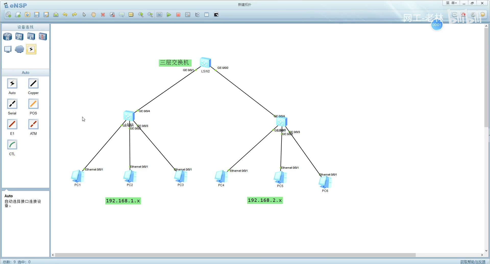

图注：企业网实验拓扑。三层交换机 LSW2 作为网关，左侧接入交换机下挂 PC1~PC3（网段 192.168.1.x），右侧接入交换机下挂 PC4~PC6（网段 192.168.2.x）。上一章已通过多 VLAN、多网段配置实现两部门互联互通与故障隔离。

### 1.1 引入 DHCP 的背景

- 上一章的网络中，每台电脑的 IP 地址都是**手动配置**的。实际工作中，多数用户不会配置 IP 地址，即使提供说明也容易配错。
- 解决方法：部署 **DHCP（动态主机配置协议）**，让终端自动获取 IP 地址。

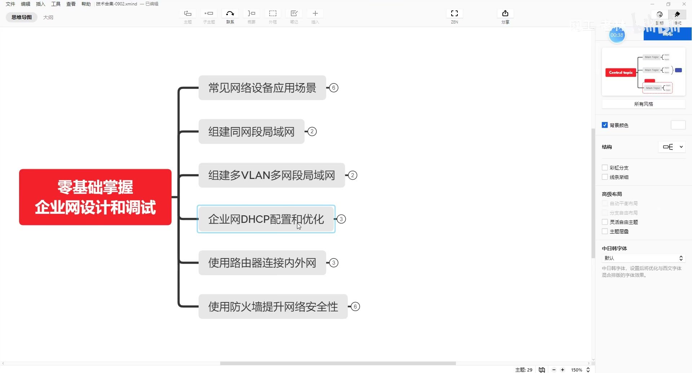

图注：课程思维导图。"零基础掌握企业网设计和调试"包含：常见网络设备应用场景、组建同网段局域网、组建多 VLAN 多网段局域网、**企业网 DHCP 配置和优化**、使用路由器连接内外网、使用防火墙提升网络安全性。

### 1.2 华为设备 DHCP 配置三步骤


图注：DHCP 配置三步骤：1、在三层交换机开启 DHCP 功能；2、创建地址池；3、在网关接口启用 DHCP。

以华为设备为例，在作为网关的三层交换机上配置：

| 步骤 | 操作 | 命令（示例） | 说明 |
| ---- | ---- | ---- | ---- |
| 1 | 全局开启 DHCP 功能 | `dhcp enable` | 一条命令即可开启 |
| 2 | 创建地址池 | `ip pool 部门A` → `network 192.168.1.0 mask 255.255.255.0` | 有几个网段就创建几个地址池；地址池名字可自取，好认即可 |
| 2 | 配置网关 | `gateway-list 192.168.1.254` | 为客户端分配网关地址 |
| 2 | 配置 DNS | `dns-list 114.114.114.114` | 为客户端分配 DNS 服务器地址 |
| 3 | 网关接口激活 DHCP | `interface Vlanif 1` → `dhcp select global` | 进入网关接口，启用全局地址池方式 |

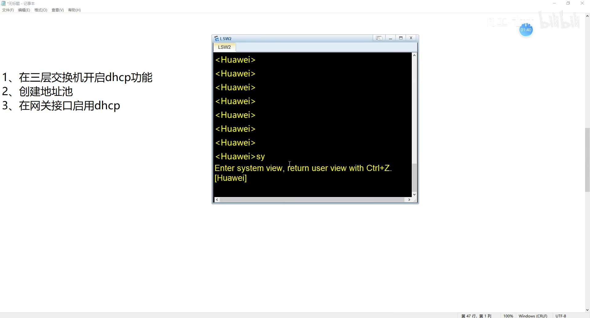

图注：第一步执行 `dhcp enable` 开启 DHCP 功能，第二步创建名为"部门A"的地址池并用 `network` 命令指定分配的地址段与掩码。

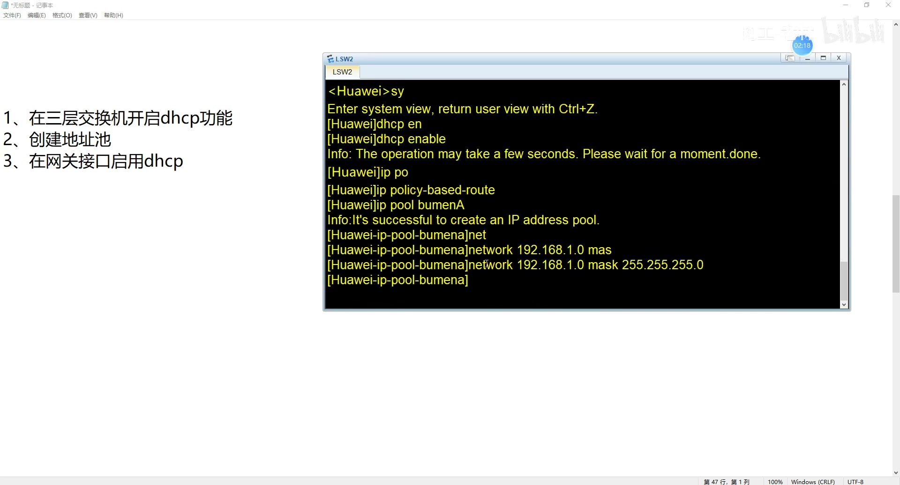

图注：仅有 IP 地址与掩码不够，还需通过 `gateway-list` 为客户端指定网关。

### 1.3 DNS 服务器的作用

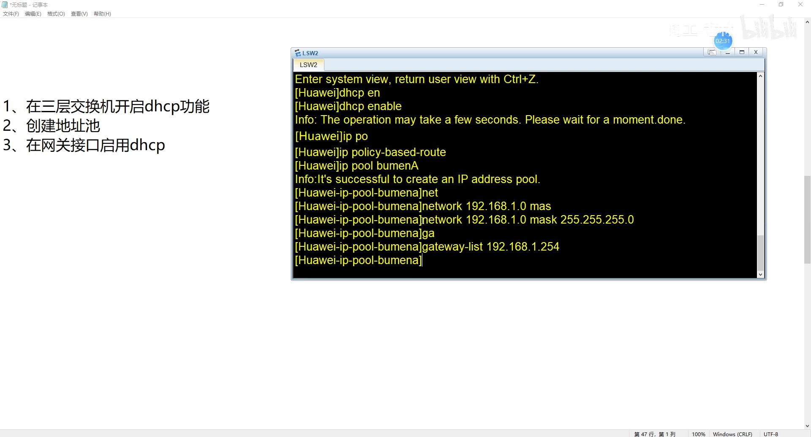

图注：在地址池中通过 `dns-list 114.114.114.114` 为客户端指定 DNS 服务器。DNS 的作用：互联网通信必须知道目标主机的 IP 地址，而用户习惯用网址（如百度）访问；DNS 服务器负责把网址转换为 IP 地址，实际工作中必须配置。

### 1.4 第二个部门的地址池

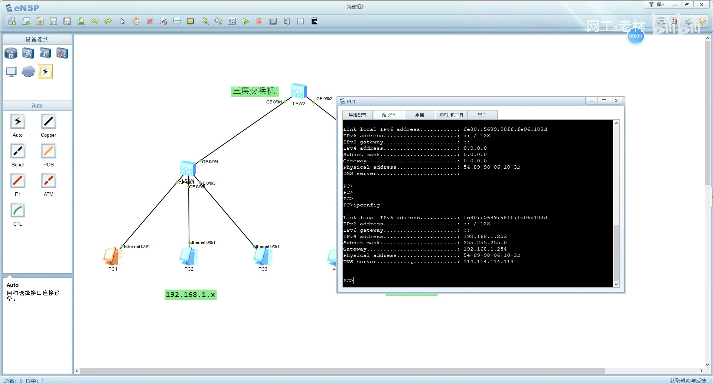

图注：PC1 执行 `ipconfig` 后成功获取 IP、掩码、网关与 DNS。同理为右侧部门 B 创建地址池（地址段 192.168.2.0/24、网关 192.168.2.254、DNS），并进入 `interface Vlanif 20` 执行 `dhcp select global`，PC4~PC6 也能自动获取地址。

要点：无论自动获取还是手动配置，跨网段通信原理相同——都是先找到网关，再由网关进行转发。

### 1.5 企业网 DHCP 进阶配置（真实配置实例）

以下实例截取自真实企业网的配置文件，比基础实验复杂得多：

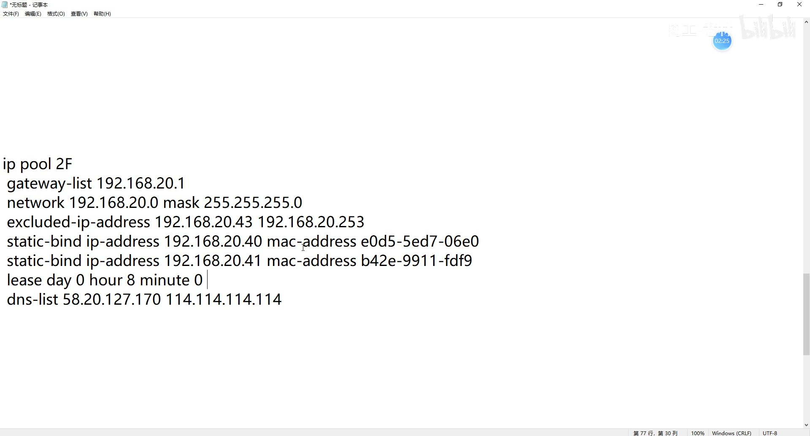

图注：真实企业网 DHCP 配置。创建名为 2F（对应网络二楼）的地址池，除地址段与网关外，还包含地址排除、静态绑定、租约与双 DNS 配置。

```text
ip pool 2F
 gateway-list 192.168.20.1
 network 192.168.20.0 mask 255.255.255.0
 excluded-ip-address 192.168.20.43 192.168.20.253
 static-bind ip-address 192.168.20.40 mac-address e0d5-5ed7-06e0
 static-bind ip-address 192.168.20.41 mac-address b42e-9911-fdf9
 lease day 0 hour 8 minute 0
 dns-list 58.20.127.170 114.114.114.114
```

| 配置项 | 命令 | 作用 |
| ---- | ---- | ---- |
| 地址段与网关 | `network` / `gateway-list` | 与基础实验相同，为客户端分配地址段、掩码与网关 |
| 地址排除 | `excluded-ip-address 192.168.20.43 192.168.20.253` | 排除一段地址不参与分配。这些地址可能被保留、或已在其他地方使用，按实际需要保留一部分地址以备不时之需 |
| 静态绑定 | `static-bind ip-address 192.168.20.40 mac-address e0d5-5ed7-06e0` | 给特定主机（按 MAC 地址识别）固定分配某个 IP。每次都获取到该地址，不会获取到别的地址。典型应用：服务器、打印机等设备——客户端需要经常访问服务器，固定其 IP 便于查找 |
| 租约 | `lease day 0 hour 8 minute 0` | 设置租约 8 小时。地址分配给客户端后，若不续约，到期即回收，防止地址浪费。临时使用场景（如咖啡馆、饭店 WiFi）应将租约设得相对短一些 |
| 双 DNS | `dns-list 58.20.127.170 114.114.114.114` | 配置两台 DNS 服务器，可靠性更高：一台故障时自动使用另一台进行域名解析 |


图注：`static-bind` 命令中，MAC 地址用 12 个十六进制字符表示（可能含字母），是设备网卡的唯一标识；命令含义是将该 MAC 的设备与指定 IP 绑定。

查看本机 MAC 地址的方法：在 Windows 命令行执行 `ipconfig /all`，每个网卡的"物理地址"即 MAC 地址。查到设备 MAC 后，即可在地址池中做静态绑定，使其永远使用固定的 IP。

---

## 2.企业网路由器配置（连接内外网）

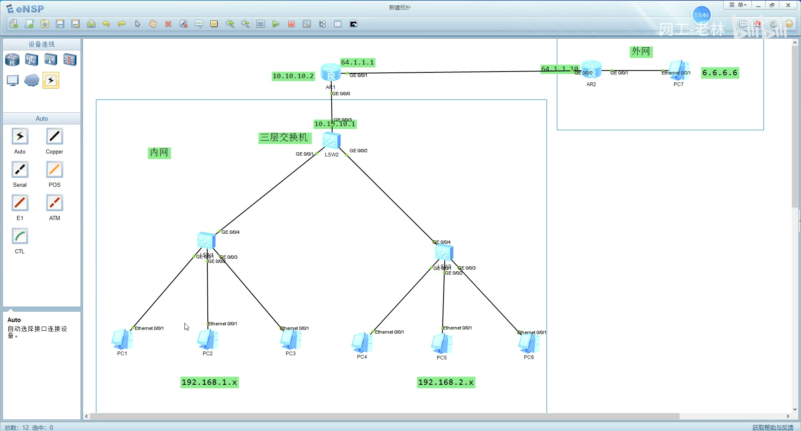

图注：完整实验拓扑。内网部分（三层交换机 LSW2 + 两个部门网段 192.168.1.x / 192.168.2.x）通过路由器 AR1 连接外网：AR1 内网口 G0/0/0 配 10.10.10.2，外网口 G0/0/1 配 64.1.1.1；运营商设备 AR2 模拟外网（64.1.1.10），目标主机 PC7（6.6.6.6）。

局域网内部已实现自动获取地址，但只能内网通信，不能连接外网。本节用路由器打通内网与外网。

### 2.1 路由器与三层交换机的互联

- 路由器接口可直接配置 IP：进入 `G0/0/0`（连接内网的接口），执行 `ip address 10.10.10.2 255.255.255.0`。
- **三层交换机的物理接口不支持直接配置 IP**，直接在 G0/0/3 上配 IP 会报错。解决办法是"曲线救国"：把 IP 配在 VLANIF（VLAN 接口）上。
  1. 创建用于互联的 `VLAN 100`；
  2. `interface Vlanif 100`，将互联地址 `10.10.10.1/24` 配置在该 VLANIF 上；
  3. 将 `G0/0/3` 口设为 Access 类型并加入 VLAN 100。此后数据包进入 G0/0/3 即等于进入 VLAN 100，与 VLANIF 100 上的 IP 互通。
- 配好后，三层交换机 ping 通路由器（10.10.10.2）即说明两者连接成功。

### 2.2 路由器与外网的连接

- 用一台路由器（AR2）模拟运营商设备，其接口配置公网 IP：公司侧 64.1.1.1，运营商侧 64.1.1.10。
- 公网 IP 的来源：办理企业宽带后，运营商会分配公网 IP 供公司使用，并告知其对端接收数据的 IP 地址。
- 再拿一台电脑（PC7）模拟外网目标主机，配 IP 6.6.6.6，用于测试内网主机能否访问外网。
- 公司出口路由器是**边界设备**：G0/0/0 连接内网，G0/0/1 连接外网，用它实现内外网连通。

### 2.3 配置路由（第一步）

路由的基本概念：路由器、三层交换机、防火墙等网络设备收到去往不同网段的数据包时，会查**路由表**。路由表相当于调度规则，记录了去往每个网段应该怎么走。

验证方法：`display ip routing-table 6.6.6.6` 可查看关于目标 6.6.6.6 的路由信息。初始状态下三层交换机与路由器均无该路由，不会转发去往 6.6.6 的包。

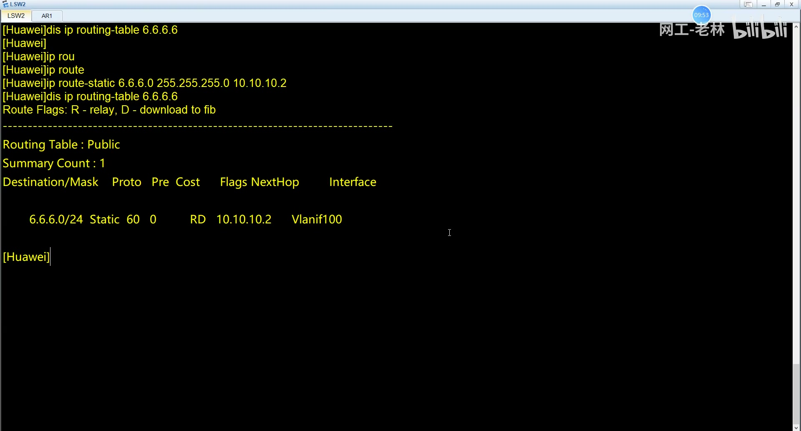

图注：在三层交换机上执行 `ip route-static 6.6.6.0 255.255.255.0 10.10.10.2` 添加静态路由后，再次查看路由表，出现 6.6.6.0/24 的静态路由条目（Static，优先级 60，下一跳 10.10.10.2，出接口 Vlanif100）。

配置路由的两个部分：

| 路由类型 | 配置位置 | 命令示例 | 含义 |
| ---- | ---- | ---- | ---- |
| 去程路由 | 三层交换机 | `ip route-static 6.6.6.0 255.255.255.0 10.10.10.2` | 收到目标为 6 段的包，交给下一跳 10.10.10.2（路由器） |
| 去程路由 | 出口路由器 | `ip route-static 6.6.6.0 255.255.255.0 64.1.1.10` | 收到目标为 6 段的包，交给下一跳 64.1.1.10（运营商）。转发像接力棒一样逐跳传递 |
| 回程路由 | 出口路由器 | `ip route-static 192.168.1.0 255.255.255.0 10.10.10.1`、`ip route-static 192.168.2.0 255.255.255.0 10.10.10.1` | 目标是内网主机网段，下一跳为三层交换机（10.10.10.1），用于给内网主机回包 |

要点：**数据包一定要保证能去也能回**。外网部分（运营商侧）不需要我们配置；只需管好自己公司的设备。去程与回程都写好，包才有去有回。

### 2.4 默认路由（真实工作场景）

实际工作中要访问的互联网目标很多（百度、抖音等），不可能逐条写上万条路由。因此去往互联网的路由应写成**默认路由**：

```text
ip route-static 0.0.0.0 0.0.0.0 <下一跳IP>
```

目标网段与掩码全为 0（八个 0）代表**所有目标**。这样去往互联网任何一个目标都知道该怎么走。真实场景中，三层交换机与路由器去往互联网的路由都必须这样写。

### 2.5 NAT 配置（第二步）

配好路由后仍然 ping 不通外网，因为还需要做 **NAT**：把不能上网的私网地址转换为能上网的公网地址。

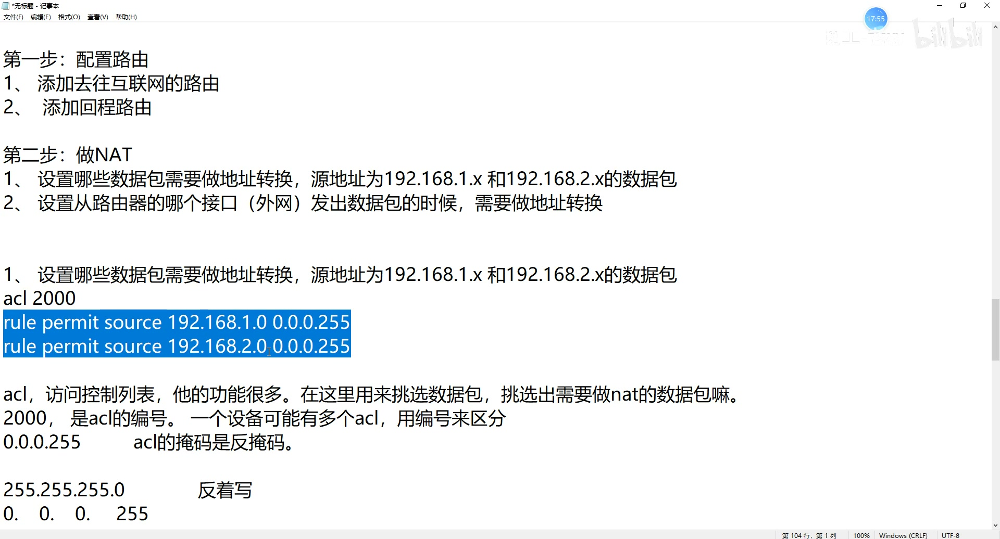

图注：路由器上网配置两步。第一步配置路由：添加去往互联网的路由、添加回程路由。第二步做 NAT：1、设置哪些数据包需要做地址转换（源地址为 192.168.1.x 和 192.168.2.x 的数据包）；2、设置从路由器哪个接口（外网口）发出数据包时做地址转换。ACL 部分命令如下，其中 0.0.0.255 是 ACL 的反掩码（由 255.255.255.0 反写得到：255 变 0、0 变 255）。

NAT 配置分两步：

**第一步：用 ACL 挑选需要做地址转换的数据包**

```text
acl 2000
 rule permit source 192.168.1.0 0.0.0.255
 rule permit source 192.168.2.0 0.0.0.255
```

| 要素 | 说明 |
| ---- | ---- |
| `acl 2000` | 创建编号为 2000 的 ACL（访问控制列表）。ACL 功能很多，这里用于**挑选数据包**——挑选出需要做 NAT 的数据包。一台设备可能有多个 ACL，用编号区分；2001、2002 等编号均可 |
| `rule permit source ...` | 两条规则分别挑选出源地址为 192.168.1.0 段与 192.168.2.0 段的包（它们是私网 IP，不能直接上网） |
| 反掩码 `0.0.0.255` | ACL 语法的掩码必须**反着写**（反掩码）：普通掩码 255.255.255.0 中的 255 变成 0、0 变成 255，得到 0.0.0.255 |

**第二步：在外网口应用 NAT**

```text
int g0/0/1
 nat outbound 2000
```

含义：从 G0/0/1（外网口）发出、且被 ACL 2000 挑选中的数据包，将做地址转换，转换为该出接口的 IP。由于出接口是外网口，其 IP（64.1.1.1）就是能上网的公网 IP。

配置 NAT 后，内网主机（PC1）即可 ping 通外网目标 6.6.6.6——私网 IP 已被转换为公网 IP。

### 2.6 路由器上网配置总结

路由器连接内外网只需解决两个问题：

1. **配置路由**：去程（去互联网，实际用默认路由）与回程（针对内网网段，下一跳指向三层交换机）都要写。
2. **配置 NAT**：把不能上网的私网 IP 转换成能上网的公网 IP。

---

## 3.防火墙配置（上）：基本配置与安全策略

防火墙作为网络出口，可以在实现路由器功能的同时加强网络安全：不让陌生的外网流量进入内网，并可根据需要禁止某些主机访问外网。

### 3.1 安全域（Security Zone）的概念

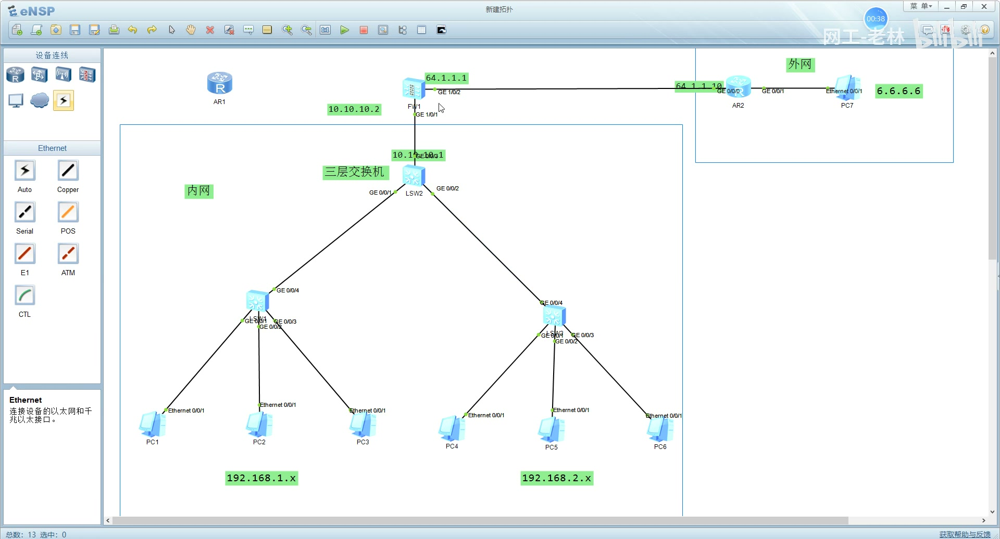

图注：防火墙安全域示意。内网区为信任区（Trust），外网区为非信任区（Untrust），服务器区处于两者之间的中间地带，称为 DMZ。

- 从防火墙角度看，不同区域的**安全级别不同**：内网是可信任区域，外网是非信任区域。
- 从信任区域（内网）去往非信任区域（外网）可以放行；但从外部进来则要严加管控，必须遵循精准的管控原则。
- 常见安全域：

| 安全域 | 英文 | 安全级别 | 对应网络 |
| ---- | ---- | ---- | ---- |
| 信任区 | Trust | 高 | 内网用户所在网络 |
| 非信任区 | Untrust | 低 | Internet 等外网 |
| 中间地带 | DMZ | 介于信任与非信任之间 | 内部服务器区 |

（华为设备另有 Local 区域代表防火墙本机，见 4.2 节。）

配置方法：进入信任域，把连接内网的接口加入信任域；同理把连接外网的接口加入非信任域；若有服务器，把连接服务器的接口加入 DMZ。

### 3.2 安全策略的概念

- **安全策略**决定什么样的数据包允许通过、什么样的数据包不允许通过。
- 路由器、交换机是"人性本善"：只要配好基本路由，数据默认都能通。
- 防火墙是"人性本恶"：**没有通过策略放行的数据一律禁止**。不做安全策略则整个网络中断，因此安全策略是必备配置。
- **NAT 策略**功能与路由器相同（私网 IP 转公网 IP），但配置方式略有区别。
- 防火墙功能很多，命令行配置复杂，实际工作中往往开启**图形化（Web）管理**。

### 3.3 防火墙基础配置（华为 USG6000V）

- 华为 USG 系列设备默认账号 `admin`、默认密码 `Admin@123`；首次登录强制修改密码，新密码须符合长度与复杂度要求，否则不允许使用。
- 基础配置与路由器类似：进入内网口 G1/0/1 配内网 IP，进入外网口 G1/0/2 配外网 IP（64.1.1.1）；再配置路由——去往互联网的路由与给内网主机回包的回程路由，方法与路由器相同：

```text
ip route-static 192.168.1.0 255.255.255.0 10.10.10.1
ip route-static 192.168.2.0 255.255.255.0 10.10.10.1
```

### 3.4 配置安全域

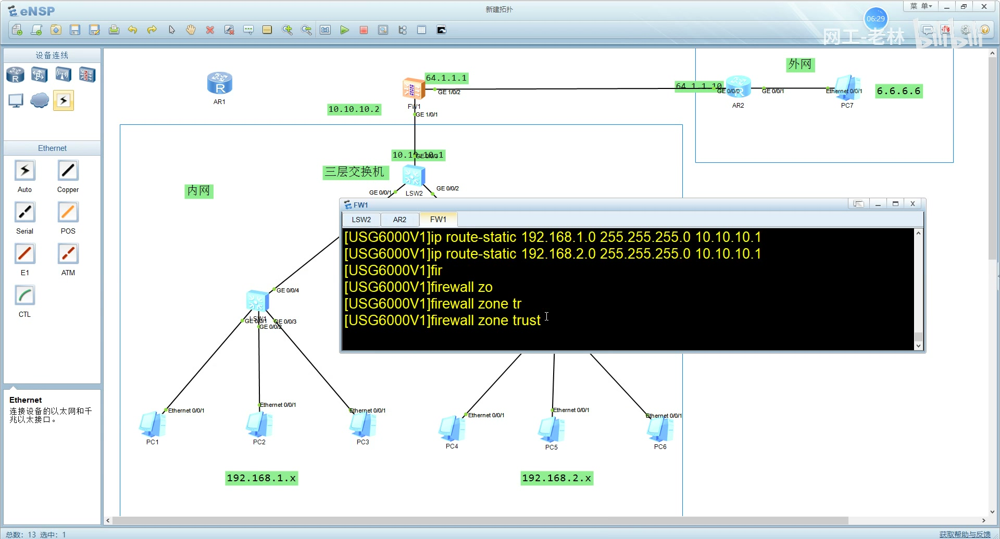

图注：在防火墙上先配置回程静态路由，再进入安全域配置视图。

```text
firewall zone trust
 add interface GigabitEthernet 1/0/1
firewall zone untrust
 add interface GigabitEthernet 1/0/2
```

- 内网口 G1/0/1 加入信任域（trust），防火墙即知该接口连接的是可信任的内网。
- 外网口 G1/0/2 加入非信任域（untrust，即 trust 前加 un）。
- 若网络中有服务器，则把连接服务器的接口加入 DMZ。

### 3.5 配置安全策略

```text
security-policy
 rule name 上网
  source-zone trust
  destination-zone untrust
  action permit
```

| 要素 | 说明 |
| ---- | ---- |
| `rule name 上网` | 添加一条规则，规则名可自取 |
| `source-zone trust` | 源区域为信任区域（数据包来自内网） |
| `destination-zone untrust` | 目标区域为非信任区域（数据包去往外网） |
| `action permit` | 动作为放行 |

效果：允许内网访问外网，同时禁止外网主动进入内网。

### 3.6 配置 NAT 策略

```text
nat policy
 rule name 上网
  source-zone trust
  destination-zone untrust
  action source-nat easy-ip
```

- 同样创建一条名为"上网"的 NAT 策略：从 trust 区域来、去往 untrust 区域的数据包执行**源地址转换（source-nat）**。
- `easy-ip` 表示转换成**出接口的 IP**：数据包从 G1/0/2 发出，即转换为出接口 IP 64.1.1.1。

### 3.7 验证与防火墙的默认禁 ping

- 配置完成后，内网 PC 可 ping 通外网 6.6.6.6，网络配通。
- 但 ping 防火墙本身不通：防火墙是安全设备，安全要求严格，**默认禁 ping**。防火墙本身 ping 不通是正常现象，只要能 ping 通外网即可。

### 3.8 开启防火墙 Web 图形化管理（准备工作）

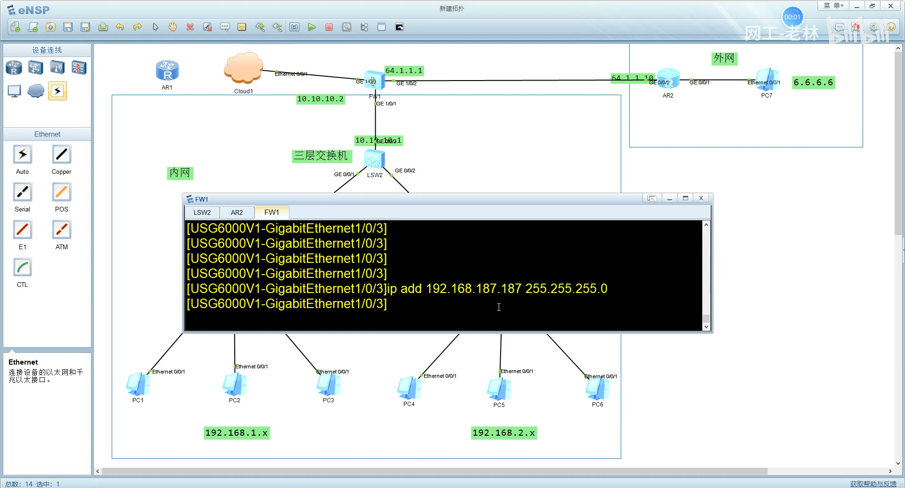

图注：通过 Cloud（云）把防火墙 G1/0/3 接口桥接到真机网卡，为 Web 管理做准备。

1. 用云（Cloud）连接真机网卡，桥接到防火墙的 G1/0/3 接口；
2. 给防火墙 G1/0/3 配置**管理 IP**，与管理电脑同网段（如 192.168.187.187/24）；
3. 后续步骤（加入安全域、开启接口管理权限、放行管理策略）见下一节。

---

## 4.防火墙配置（下）：Web 管理与策略匹配顺序

### 4.1 开启接口管理权限

- 把 G1/0/3 加入信任域（相当于内网接口）；
- 接口默认禁 ping，须在该接口上开启**允许管理**服务：允许 ping、HTTPS、HTTP、Web 等。开启后真机即可 ping 通防火墙管理地址。

### 4.2 放行管理流量（trust 到 local 的安全策略）

- 开启 Web 界面管理，除接口管理权限外，还须增加一条安全策略：

```text
security-policy
 rule name 管理
  source-zone trust
  destination-zone local
  action permit
```

- **Local 区域**代表防火墙本机：该规则含义是允许从信任区域访问防火墙本机。只有放行这条策略，才能对防火墙进行管理。

### 4.3 Web 界面登录与操作

- 浏览器访问 `https://192.168.187.187:8443`（默认端口 8443），忽略证书警告点"继续访问"，输入账号密码即可登录 Web 界面。
- Web 界面同样可以配置安全策略，点鼠标配置更加直观。

### 4.4 用 Web 界面禁止特定主机上网

案例：禁止 192.168.1.10（假设为财务电脑）访问互联网。

| 配置项 | 取值 |
| ---- | ---- |
| 名称 | 禁止（自取，如"禁止访问外网"） |
| 源安全区域 | trust（内网区域） |
| 目的安全区域 | untrust（外网区域） |
| 源地址 | 192.168.1.10 |
| 目的地址 | 任意（也可用 IP 地址库按地区限制目标） |
| 动作 | 禁止 |

补充说明：防火墙提供 **IP 地址库**功能——每个地区的 IP 地址段可以在线检索，例如根据 113.218 段可判断归属湖南省长沙市。"目标地区"可用于限制主机访问哪些地区的外网目标；本案例中目的地址直接写"所有"。

### 4.5 安全策略的匹配顺序（关键问题）

配置禁止策略后测试发现 192.168.1.10 依然能访问外网，策略没有生效。原因：

- 防火墙执行安全策略时**从上往下逐条匹配**：数据包先匹配第一条规则，若第一条是允许通过的规则，包就直接放行了，轮不到后面的禁止规则。
- 解决方法：把禁止规则**移动到策略列表顶部**，使 192.168.1.10 的数据包进入时最先匹配这条禁止规则。
- 移到顶部后，PC 改为 192.168.1.10 再 ping 外网，结果为超时，禁止生效；改用 192.168.1.11（未被禁止）则可以正常访问。

要点：实际工作中必须注意**策略序号（顺序）**，否则可能因序号问题被前面的规则误放行。

---

## 5.企业级设备总结


图注：企业网设计和调试的六大模块，对应本系列课程的完整主线。

### 5.1 常见设备与组网回顾

| 内容 | 要点 |
| ---- | ---- |
| 常见设备 | 交换机、路由器、防火墙等的功能与应用场景 |
| 同网段局域网 | 两个 IP 通过子网掩码确定网络位，网络位相同即同网段。同网段组网简单：用交换机连接，主机配同网段 IP 即可互通 |
| 多网段与多 VLAN | 规模变大后按部门划分不同网段；多 VLAN 起隔离作用：故障隔离在小范围内、隔离广播，避免终端收到无关报文，减轻性能消耗 |
| 网关 | 隔离后不同 VLAN/网段的正常通信靠网关转发 |

### 5.2 网关与 VLANIF

- 本网络用三层交换机作网关：创建 VLAN 后，把每个 VLAN 当作接口——`interface Vlanif 10`（简写 `int vlan 10`），再配上 IP，该 IP 即为 VLAN 10 内主机的网关。
- 有了网关即可实现 VLAN 间通信。

### 5.3 DHCP 回顾

- DHCP 的价值：减少维护工作量、用户使用简便、减少网络故障。
- 华为设备配置三步：**开启 DHCP 服务 → 创建地址池 → 在接口启用 DHCP**。
- 企业网进阶用法：

| 进阶项 | 作用 |
| ---- | ---- |
| 地址排除 | 保留部分 IP 不分配，以备不时之需 |
| 静态绑定 | 给特定主机分配固定 IP |
| 租约机制 | 节省地址使用，及时回收不再使用的地址 |
| 双 DNS | 保证 DNS 可靠性，一台故障不影响使用 |

### 5.4 连接外网：路由器与防火墙两种方案

- 实现局域网连通后，连接外网有两种方法：**路由器**或**防火墙**。防火墙更安全，但配置更多、调试更麻烦；路由器相对简单。
- 路由器方案两个要点：
  1. 路由器与三层交换机互联，各配一个 IP；三层交换机的 IP 很可能需要配到 VLANIF 上才能使用；
  2. 路由器与外网连接分两步：
     - **配好路由**：去互联网的路由用一条缺省（默认）路由 `ip route-static 0.0.0.0 0.0.0.0 <下一跳>` 即可；再配一条针对内网（如 192.168.x.0）的回程路由，下一跳指向三层交换机；
     - **配好 NAT**：把不能上网的私网 IP 转换成能上网的公网 IP。
- 防火墙方案：除代替路由器实现基本路由转发与 NAT 外，还有安全功能：
  1. **安全域**：连接内网的接口放入信任域（trust），连接外网的接口放入非信任域（untrust）；
  2. **安全策略**：控制哪些数据包允许通过、哪些不允许通过；
  3. **NAT 策略**：与路由器相同。
- 开启防火墙 Web 图形化管理分几步：
  1. 配置管理 IP，并保证与管理电脑网络互通；
  2. 接口开启管理权限（ping、HTTP/HTTPS 等）；
  3. 安全策略放行管理电脑访问防火墙（trust → local）。
  以上完成后即可进行 Web 管理。

---

## 6.本章小结

| 模块 | 核心配置要点 |
| ---- | ---- |
| DHCP 基础（华为） | 三步：`dhcp enable` → `ip pool`（network / gateway-list / dns-list）→ 网关接口 `dhcp select global` |
| DHCP 进阶 | 地址排除（excluded-ip-address）、静态绑定（static-bind，按 MAC 固定 IP）、租约（lease，防地址浪费）、双 DNS（提高可靠性） |
| 交换机与路由器互联 | 路由器接口直接配 IP；三层交换机物理口不能直接配 IP，须配到 VLANIF 上并把物理口以 Access 方式加入该 VLAN |
| 路由配置 | 去程 + 回程都要配，包才有去有回；去互联网用默认路由 `0.0.0.0 0.0.0.0` |
| 路由器 NAT | 第一步 ACL 2000 挑选私网源地址包（掩码用反掩码）；第二步在外网口 `nat outbound 2000`，转换为出接口公网 IP |
| 防火墙安全域 | Trust（内网）/ Untrust（外网）/ DMZ（服务器区）/ Local（防火墙本机）；接口分别加入对应安全域 |
| 防火墙安全策略 | 默认全禁止，须显式放行（如 trust→untrust 上网、trust→local 管理）；策略自上而下匹配，禁止规则须移到顶部 |
| 防火墙 NAT | `nat policy` 中对 trust→untrust 执行 source-nat，`easy-ip` 即转换为出接口 IP |
| 防火墙特性 | 默认禁 ping；USG 默认账号 admin / Admin@123，首登强制改密；Web 管理需管理 IP + 接口管理权限 + 放行策略，默认端口 8443 |
| 设备选型 | 路由器上网简单（路由 + NAT 两步）；防火墙更安全但配置更多 |
