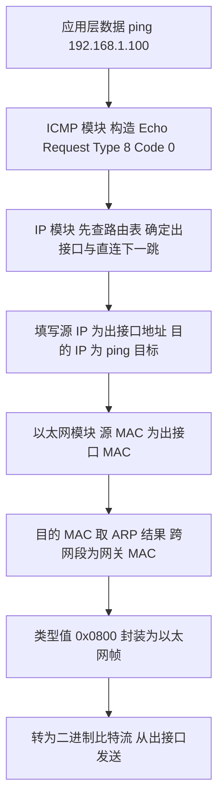
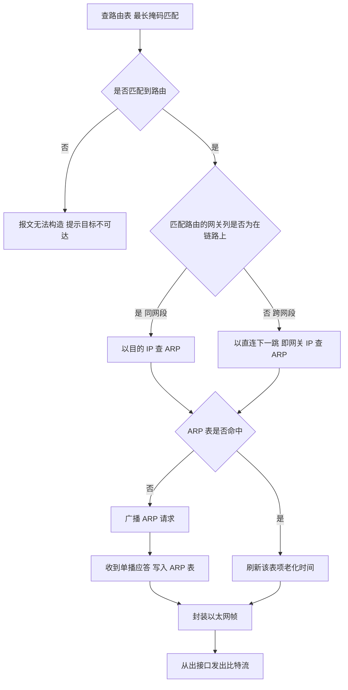
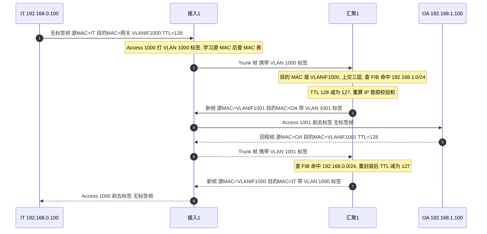

# 报文封装与转发过程 · 完整笔记

---

## 1.实验拓扑与地址规划

本节沿用上一节项目课的拓扑（eNSP“设备工作机制及静态路由规划”）：出口路由器、核心、汇聚 1/2 为三层设备，接入 1/2 为二层交换机，下挂 IT、OA、RD 三台 PC。业务网关配置在汇聚交换机的 VLANIF 上，接入交换机只承担二层转发。

### 1.1 规划思路回顾

1. 先划分 VLAN（即先弄清广播域），再根据广播域进行 IP 地址规划；
2. VLAN 分为三类，规划顺序为：**管理 VLAN → 互联 VLAN → 业务 VLAN**。

| VLAN 类别 | 划分方法 | 本拓扑取值 |
| --------- | -------- | ---------- |
| 管理 VLAN | 交换机数量少时全网共用一个管理 VLAN（网关放核心交换机）；规模大（数百上千台）时按汇聚区划分，每个汇聚区一个 /24 管理网段，区内每台设备各取一个地址 | 左侧（汇聚 1 及其下接入）VLAN 2，右侧（汇聚 2 及其下接入）VLAN 3 |
| 互联 VLAN | 拿一大段地址子网化成 /30，仅在两台三层设备之间的链路上允许通过 | 核心与出口路由器间 VLAN 11，核心—汇聚 1 间 VLAN 12，核心—汇聚 2 间 VLAN 13 |
| 业务 VLAN | 按部门划分，从 PC 到接入交换机到对应网关（汇聚交换机）打通即可 | IT 部门 VLAN 1000，OA 部门 VLAN 1001，RD 部门 VLAN 1002 |

AP 管理同理：AP 数量少时共用一个管理 VLAN；数量多时按物理范围划分（如汇聚 1 下一个 AP 管理 VLAN、汇聚 2 下一个 AP 管理 VLAN），AP 与 AC 之间用三层组网（AP 网段与 AC 网段不在同一网段，只要路由可达，AP 即可在 AC 上线）。

### 1.2 IP 地址规划原则

| 规划对象 | 方法 | 本拓扑取值 |
| -------- | ---- | ---------- |
| 路由器 / 核心交换机网管地址 | 取一段 /24 子网化成 /32，逐台配置 Loopback | 出口路由器 L0: 10.0.0.1/32；核心 L0: 10.0.0.2/32 |
| 交换机管理 IP | 每个管理 VLAN 取一个独立网段，区内每台设备在该网段占一个地址（掩码 /24） | 左侧管理 VLAN 2 用 10.0.2.0/24（vlanif2: 汇聚 1 为 10.0.2.1/24、接入 1 为 10.0.2.2/24）；右侧管理 VLAN 3 用 10.0.3.0/24（vlanif3: 汇聚 2 为 10.0.3.1/24、接入 2 为 10.0.3.2/24） |
| 互联地址 | 一段地址子网化成 /30，每条互联链路两端各一个 | vlanif11: 172.16.0.2/30（核心）与 172.16.0.1/30（出口路由器 G0）；vlanif12: 172.16.0.5/30（核心）与 172.16.0.6/30（汇聚 1）；vlanif13: 172.16.0.9/30（核心）与 172.16.0.10/30（汇聚 2） |
| 业务网关与终端 | 直接使用 /24 网段划分，无需按主机数精细计算掩码 | vlanif1000: 192.168.0.1/24；vlanif1001: 192.168.1.1/24；vlanif1002: 192.168.2.1/24 |

终端地址与链路类型：

| 对象 | 地址 / 配置 |
| ---- | ----------- |
| IT | 192.168.0.100/24，网关 192.168.0.1 |
| OA | 192.168.1.100/24，网关 192.168.1.1 |
| RD | 192.168.2.100/24，网关 192.168.2.1 |
| 接入 1 下行 | Eth0/0/1 access VLAN 1000（接 IT）；Eth0/0/2 access VLAN 1001（接 OA） |
| 接入 2 下行 | Eth0/0/1 access VLAN 1002（接 RD） |
| 接入 1—汇聚 1 | trunk，放行 VLAN 2、1000、1001 |
| 接入 2—汇聚 2 | trunk，放行 VLAN 3、1002 |
| 核心—汇聚 1 / 汇聚 2 | 互联 /30 只承载一条 VLAN，按课程配置为 access VLAN 12 / VLAN 13（若用 trunk，只需放行 VLAN 12 / 13） |
| 出口路由器—核心 | access VLAN 11 |

**约束：全网 IP 与网段均不能冲突。** 网段冲突的例子：若核心交换机的 Loopback 配置 10.0.0.2/32，而汇聚 1 的管理 VLANIF 又配置 10.0.0.4/24，则两处网段重叠。此时汇聚 1 访问 10.0.0.2 时会认为该地址与自己是同一网段，导致部分业务访问异常。

## 2.PC 的报文封装过程

以 IT 的 PC（192.168.0.100/24）ping OA 的 PC（192.168.1.100/24）为例，说明 PC 从上层到下层逐层封装的过程。若访问的是 Web 页面等应用，则先由传输层 TCP 三次握手建立连接；无论哪种协议，PC 都是从 TCP/IP 分层的上层开始向下逐层封装：先构造应用层数据，再封装传输层、网络层、数据链路层，最后变为二进制比特流发送。

### 2.1 第一步：构造上层协议报文（ICMP 模块）

每一个协议都可以认为是一个模块。ping 使用 ICMP 报文，因此先交给 ICMP 模块构造**类型值为 8、代码为 0 的 ICMP 请求（Echo Request）报文**，报文中还包含校验和、标识符（Identifier）、序列号（Sequence number）与填充字段（Data）。

抓包观察到的字段值：

| 观察点 | 取值 |
| ------ | ---- |
| ICMP 类型 / 代码 | Type 8（Echo Request）、Code 0 |
| ICMP 其余字段 | Identifier、Sequence number、32 字节 Data |
| 以太网源 MAC | 54:89:98:09:74:16（IT 的网卡） |
| 以太网目的 MAC | 4c1f-cc2a-42f4（跨网段通信，为网关 VLANIF1000 的 MAC） |
| IP 源 / 目的 | 192.168.0.100 / 192.168.1.100 |
| TTL | 128 |

### 2.2 第二步：交给 IP 模块封装（网络层）

ICMP 报头构造好后交给 IP 模块封装 IP 报头：

| 字段 | 取值 | 说明 |
| ---- | ---- | ---- |
| 协议号 Protocol | **1** | IP 中的协议号 1 表示上层是 ICMP 协议（TCP = 6，UDP = 17） |
| 源 IP 地址 | 出接口的 IP 地址 | 默认情况下源 IP 选用出接口的 IP；使用 ping 的 `-a`（Windows 为 `-S`）参数可指定源 IP |
| 目的 IP 地址 | 已知（ping 的目标） | — |

本实验抓包中的 IP 首部：首部长度 20 字节、总长度 60、TTL 128、协议号 1、源 192.168.0.100、目的 192.168.1.100。

**出接口从哪里来？** 出接口不是查 ARP 表得到的，也不是随便选一个物理网卡：PC 通过**查询路由表**得知**出接口及直连下一跳**。只有查到路由、确定出接口之后，才知道源 IP 填谁。所以 PC 封装报文的实质是：先基于目标 IP 查路由，有路由才有出接口，才有源 IP。

若 PC 只有一个接口一个 IP（如本拓扑的 IT），源 IP 必然是该地址；若 PC 有多个网卡（有线、无线、虚拟网卡，每网卡各有 IP），源 IP 默认取**出接口**的地址，出接口由路由表决定。

### 2.3 第三步：交给以太网模块封装（数据链路层）

构造好的 IP 报文交给出接口对应的以太网模块进行数据链路层封装，需要确定三项内容：

| 封装字段 | 取值 | 来源 |
| -------- | ---- | ---- |
| 源 MAC | 出接口的 MAC 地址 | 查路由得知出接口后即确定 |
| 目的 MAC | 下一跳的 MAC 地址（跨网段时即网关的 MAC） | 通过 **ARP** 学习获取 |
| 类型值 Type | **0x0800** | 上层是 IP 协议（ARP 报文为 0x0806） |

### 2.4 PC 封装流程小结

1. 先进行对应上层协议的报文构造。以 ICMP 为例，交给 ICMP 模块，构造类型值为 8、代码为 0 的 ICMP 请求报文；
2. 把 ICMP 交给 IP 模块进行封装：协议号是 1，源 IP 默认选用出接口的 IP 地址（加 `-a` 参数可指定源 IP），目的 IP 已知；
3. PC 通过查询路由表，得知出接口及直连下一跳；
4. 构造好的 IP 报文交给对应的以太网模块进行数据链路层封装：需要知道源 MAC（出接口的 MAC）、目的 MAC（通过 ARP 获取）与类型值（0x0800，因为上层是 IP 协议）。

最后将完整以太网帧变为二进制流从出接口发送出去。

## 3.PC 的路由表

PC 上的路由工作机制与三层设备完全相同，这些机制是通用的，不因设备是交换机、路由器还是 PC 而不同。PC 的路由来源：**直连路由**与**静态路由**（PC 一般不支持动态路由协议，操作系统中不集成）。

### 3.1 直连路由

在 Windows 上使用 `route print` 查看路由表，配合 `ipconfig` 查看网卡地址。

`route print` 的输出分两部分：上半部分为接口列表（每块网卡一个 ID），下半部分为 IPv4 路由表，列为“网络目标、网络掩码、网关、接口、跃点数”。`ipconfig` 则列出网卡地址，例如 WLAN 的 IPv4 地址为 192.168.0.111/24、默认网关 192.168.0.1。

一条典型的主机路由表：

| 网络目标 | 网关列 | 含义 |
| -------- | ------ | ---- |
| 0.0.0.0/0 | 192.168.0.1 | 由默认网关生成的缺省路由 |
| 192.168.0.0/24 | 在链路上 | 直连网段路由 |
| 192.168.0.111/32 | 在链路上 | 本机接口地址的主机路由 |
| 192.168.0.255/32 | 在链路上 | 本网段广播地址的主机路由 |

结论：**每一个网卡上只要 IP 地址、掩码配置好且网卡处于 UP 状态，就会在路由表中形成对应的直连路由。** PC 的直连路由比路由器上更细：目标网段的网络地址、接口主机地址、对应的广播地址各生成一条（例如 192.168.0.0/24、192.168.0.111/32、192.168.0.255/32）。路由表中的“网关”列显示“在链路上”（On-link）表示该路由是直连的、没有下一跳网关；“跃点数”即开销（cost）值。

### 3.2 静态路由

`route` 命令的语法为 `route ADD 目标网段 MASK 掩码 下一跳 METRIC 值 IF 接口编号`，其中各参数含义如下：

| 参数 | 含义 |
| ---- | ---- |
| `目标网段` + `MASK 掩码` | 要到达的目的网络与前缀长度 |
| `下一跳` | 网关地址；直连路由可省略 |
| `METRIC 值` | 跃点数（开销），多路由时用于比较 |
| `IF 接口编号` | 出接口，对应 `route print` 接口列表中的网卡 ID |

1. **默认网关**：配置默认网关后，电脑上会自动形成一条缺省路由（0.0.0.0/0），下一跳即网关地址（如 192.168.0.1），接口用代表该网卡的接口 ID 表示；
2. **手工静态路由**：使用 `route add 目标网段 mask 掩码 下一跳 metric 跃点数 if 接口ID` 添加，其中 if 后的接口编号即接口列表中网卡的 ID。

### 3.3 路由匹配原则

PC 的路由匹配与路由器一样，遵循**最长掩码匹配原则**：匹配到路由后即得到出接口和下一跳。

## 4.PC 的报文转发过程（ARP 的使用）

### 4.1 同网段与跨网段的区别

路由匹配时当然要用掩码参与计算，但**匹配完成之后**判断同网段还是跨网段，依据是**匹配到的这条路由**：若该路由的网关列显示“在链路上”（无直连下一跳），说明目标与自己是同一网段（路由本身来源于掩码配置；也可以手工添加明细静态路由改变这一行为）。

| 匹配结果 | 查询 ARP 表所用的 IP | 原因 |
| -------- | -------------------- | ---- |
| 目标 IP 与自己同一网段 | 以**目标 IP** 查询 ARP 表项 | 报文要直接发给目标主机 |
| 目标 IP 与自己不同网段 | 以**直连下一跳（网关）**查询 ARP 表项 | 报文要发给网关，由网关转发 |

这一结论与厂商官方文档一致：源主机比较自身 IP 与目的 IP，同一网段则获取目的主机 MAC 作为帧的目的 MAC；不同网段则获取网关的 MAC 作为目的 MAC，把帧发给网关（如华为《Intra-VLAN/Inter-VLAN Communication》所述）。**IP 地址端到端不变，MAC 地址逐跳变化。**

### 4.2 ARP 查询结果的处理

| 情形 | 处理 |
| ---- | ---- |
| ARP 表中有对应表项 | 直接匹配，并**刷新该 ARP 表项的超时时间**（动态学习的表项有老化时间），得到目的 MAC 后构造以太网帧，从出接口以二进制流方式发送 |
| ARP 表中无对应表项 | PC 构造 ARP 请求报文（目的 MAC 为全 F 的广播），封装到数据链路层以**广播**形式发出；目标主机收到后以单播回应 ARP 应答，PC 收到后填入 ARP 表，再完成帧封装与发送 |

ARP 请求以广播形式发送、ARP 应答以单播形式发送；同网段内的交换机只起转发作用，不更改以太网帧内容（仅按端口类型添加或剥离 VLAN 标签）。

### 4.3 PC 工作所需的表项

PC 要完成报文的构造与发送，需要两类表项：**路由表**与 **ARP 表**，两者的分工如下：

| 表项 | 回答的问题 | 何时使用 |
| ---- | ---------- | -------- |
| 路由表 | 目的 IP 从哪个出接口发出、下一跳是谁 | 封装 IP 报文之前 |
| ARP 表 | 下一跳（或同网段目的主机）的 MAC 是多少 | 封装以太网帧之前 |

### 4.4 排障应用：目标不可达与请求超时

PC ping 测试时两种典型显示及其根因：

| 显示 | 根因 | 含义 |
| ---- | ---- | ---- |
| **目标不可达（Destination host unreachable）** | 1. 没有路由条目匹配（跨网段无路由可达）；2. 没有对应的 ARP 表项匹配（同网段但解析不到对方 MAC） | 报文根本没有构造出来，无法发出 |
| **请求超时（Request timeout）** | 报文已构造好并发出，但没有收到回应 | ICMP 请求已发出，回程或对端应答有问题 |

两类实验现象对照：

| 实验 | 结果 | 结论 |
| ---- | ---- | ---- |
| IT ping 192.168.1.100（跨网段，网关正常） | 通，回包 ttl=127 | 经汇聚 1 的 VLANIF 网关转发一次，TTL 128 − 1 |
| IT ping 192.168.0.3（同网段，无 ARP 表项且无主机应答） | Destination host unreachable | 同网段解析不到 MAC，报文构造不出来 |
| IT ping 192.168.1.3（跨网段，有路由但对端无回应） | Request timeout | 有路由（匹配缺省路由），报文能发出，但对端无回应 |

此外，若链路本身宕掉（down），会显示“传输失败”之类的提示。

### 4.5 TTL 的变化

结合抓包与公开协议规范（RFC 791、华为文档）核实：

| 项目 | 结论 |
| ---- | ---- |
| 初始 TTL | 由发送方操作系统设定：Windows 常为 128（本实验抓包即为 128），Linux 常为 64，网络设备常为 255 |
| 递减规则 | IP 报文**每经过一台三层设备（路由器/三层交换机）转发，TTL 减 1**；二层交换机转发帧不修改 TTL |
| TTL 耗尽 | 转发设备把 TTL 减 1 后结果为 0（即收到 TTL = 1 的报文）且目的地址不是本机时，丢弃该报文并向源头发送 ICMP Time Exceeded（类型 11、代码 0）；traceroute 即利用此机制 |
| 实验印证 | IT（192.168.0.100）ping OA（192.168.1.100）跨两网段，经汇聚 1 的 VLANIF 网关转发一次，回包显示 ttl=127（128 − 1） |

补充：TTL 只由三层转发修改，且只减不增；回程报文由 OA 以 128 发出，经同一台网关转发后同样变为 127。

## 5.交换机与路由器处理数据帧的差异

结合课程内容与厂商文档（华为以太网交换配置指南、RFC 1812）核实两类设备的处理差异：

| 对比项 | 二层交换机（接入 1/2） | 三层设备（汇聚/核心/路由器） |
| ------ | ---------------------- | ---------------------------- |
| 工作层次 | 数据链路层 | 网络层 |
| 转发依据 | 目的 MAC 地址查 **MAC 地址表** | 目的 IP 地址查**路由表**（最长掩码匹配） |
| 对帧的改动 | 不解封装、不改变源/目的 MAC（仅按端口类型添加或剥离 VLAN 标签，并重算 FCS） | 剥离旧帧头，转发后**重新封装新的帧头**：新源 MAC 为本设备出接口 MAC，新目的 MAC 为下一跳 MAC |
| TTL | 不变 | 每次三层转发减 1，并重算 IP 首部校验和 |
| 广播域 | 同一 VLAN 内转发广播 | 隔离广播域，不转发跨网段广播 |

VLAN 标签的添加与剥离规则（华为官方文档）：

| 接口类型 | 收到帧的处理 | 发送帧的处理 |
| -------- | ------------ | ------------ |
| Access | 无标签则打上该端口的 PVID；带标签则仅当 VLAN ID 等于 PVID 时接收，否则丢弃 | **剥去 PVID 标签**后发送（发给 PC 的帧不带标签） |
| Trunk | 无标签则打上 PVID；带标签且 VLAN 在允许列表内则接收，否则丢弃 | VLAN ID 等于 PVID 且允许时剥去标签发送；VLAN ID 不等于 PVID 但在允许列表内时**保留标签**发送；不允许则丢弃 |
| Hybrid | 收到帧的处理与 Trunk 相同 | 可配置该 VLAN 带标签或不带标签发送 |

设备内部为了统一处理，所有帧均携带 VLAN 标签；跨 VLAN 的三层通信由 VLANIF 网关完成：主机以网关 IP 发 ARP 请求，设备以 VLANIF 的 MAC 应答；三层转发时查路由表命中直连网段后，再在出 VLAN 内 ARP 解析目的主机，从 access 口发出前剥去 VLAN 标签。

本实验中的帧处理路径（IT → OA，OA 与 IT 同接在接入 1 上）：

1. IT 发出无标签帧，目的 MAC 为网关 VLANIF1000 的 MAC，源 MAC 为 IT 网卡；
2. 接入 1 的 access 口按 PVID 打上 VLAN 1000 标签，学习源 MAC 并查 MAC 表，从 trunk 上行口发往汇聚 1（保留 VLAN 1000 标签）；
3. 汇聚 1 的 VLANIF1000 收到后做三层转发，查路由命中直连网段 192.168.1.0/24，出接口为 VLANIF1001；
4. 汇聚 1 以目的 IP 192.168.1.100 查 ARP（未命中则先解析），重封装帧头：源 MAC 为 VLANIF1001 的 MAC，目的 MAC 为 OA 的 MAC；
5. 帧进入 VLAN 1001，查 MAC 表后从 trunk 口以 VLAN 1001 标签发回接入 1；
6. 接入 1 的 access VLAN 1001 口剥去标签，把无标签帧发给 OA。

全过程中源/目的 IP 始终为 192.168.0.100 与 192.168.1.100，帧的源/目的 MAC 在每一段链路上重新封装，TTL 经一次三层转发由 128 变为 127。

## 6.本章小结

| 知识点 | 核心内容 |
| ------ | -------- |
| 1. VLAN 与 IP 规划 | 先分广播域（管理 / 互联 / 业务 VLAN）再规划地址；全网 IP 与网段不可冲突；路由器与核心用 Loopback /32 做网管地址，互联 /30，业务 /24 |
| 2. PC 封装四步 | 构造上层报文（ICMP Type 8 Code 0）→ IP 封装（协议号 1，源 IP 默认取出接口，`-a` 可指定）→ 查路由表得出接口与直连下一跳 → 以太网封装（源 MAC = 出接口 MAC，目的 MAC 由 ARP 获取，类型值 0x0800） |
| 3. PC 路由表 | 来源为直连路由（网卡 UP 即生成，含网段 / 主机 / 广播三条）与静态路由（缺省路由 + route add）；匹配遵循最长掩码原则 |
| 4. 同网段与跨网段 | 同网段以目标 IP 查 ARP，直接发给目标主机；跨网段以直连下一跳（网关）查 ARP，交给网关转发；IP 端到端不变，MAC 逐跳变化 |
| 5. ARP 机制 | 请求广播、应答单播；命中表项则刷新超时时间；未命中则发 ARP 请求解析 |
| 6. TTL | 每经过一台三层设备减 1（128 → 127），减为 0 丢弃并回 ICMP Time Exceeded（Type 11 Code 0） |
| 7. VLAN 标签 | Access 口收帧打 PVID 标签、发帧剥标签；Trunk 口非 PVID 的允许 VLAN 保留标签转发；设备内部统一带标签处理 |
| 8. 交换机与路由器 | 交换机二层查 MAC 表、不改帧；三层设备查路由表、重封装帧头并使 TTL 减 1 |
| 9. 排障现象 | 目标不可达 = 没有路由匹配或没有 ARP 匹配（报文未发出）；请求超时 = 报文已发出但无回应；链路宕则显示传输失败 |

考试重点：

1. **顺序不能颠倒**：先查路由表定出接口与下一跳，才能确定源 IP、目的 MAC 与出接口。
2. **同网段与跨网段的分水岭**：以匹配到的路由是否为直连（On-link）判断，而不是再算一次掩码；同网段 ARP 查目的 IP，跨网段 ARP 查网关 IP。
3. **地址变化规律**：IP 地址端到端不变，MAC 地址逐跳重写，TTL 每经一台三层设备减 1。
4. **标签处理**：Access 收帧打 PVID、发帧剥标签；Trunk 只对 PVID 剥标签，其余允许的 VLAN 带标签转发。
5. **故障现象对应**：目标不可达多为无路由或无 ARP；请求超时多为报文已发出但对端或回程有问题。
