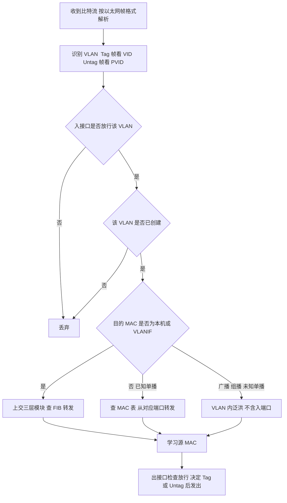
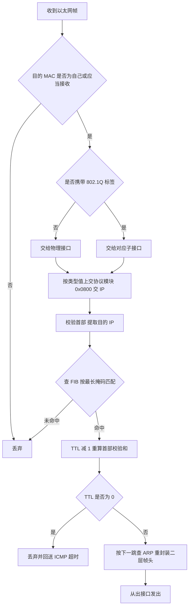
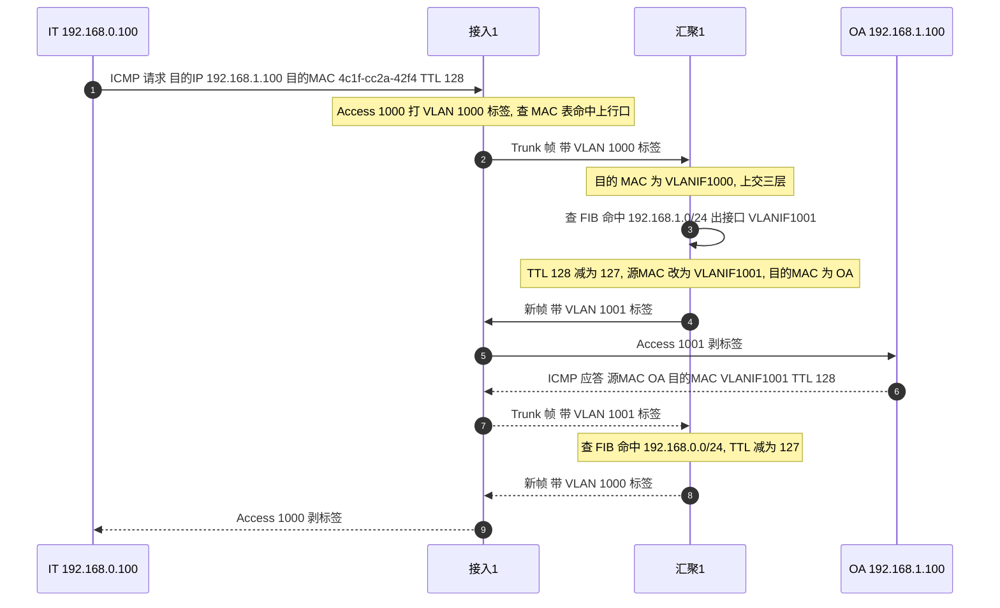

# 交换机与路由器工作流程 · 完整笔记

---

本讲承接 PC 的工作机制，梳理二层交换机、三层交换机与路由器在收到数据后的内部处理顺序，并用一个端到端 ping 过程串联全部环节。掌握这套顺序，是定位"哪一跳不通"的基础。

---

## 1.二层交换机与三层交换机的区别

### 1.1 交换机的本质：以 VLAN 为基本单位

无论二层交换机还是三层交换机，其物理实体都是一个"框"，内部工作的基本单位是 **VLAN**。

- 在交换机上创建若干 VLAN，每个 VLAN 可视为一台**小型的、独立的交换机**；
- VLAN 与物理端口建立关联，端口收到帧后先确定其所属 VLAN，再交给该 VLAN 对应的交换实体处理；
- 因此，交换机内部的转发并不是"整机一个广播域"，而是"每个 VLAN 一个广播域"。

### 1.2 二层交换机的内部结构

二层交换机由若干 VLAN 交换实体加管理功能组成。

| 组成 | 说明 |
| ---- | ---- |
| VLAN 交换实体 | 每个 VLAN 相当于一台小交换机，负责本 VLAN 内基于 MAC 地址的二层转发 |
| 端口与 VLAN 的关联 | 通过 Access、Trunk、Hybrid 等链路类型决定端口属于/允许哪些 VLAN |
| 管理 VLAN | 二层交换机支持网管，需指定一个 VLAN 作为管理 VLAN |
| 管理 IP（VLANIF） | 在管理 VLAN 对应的 VLANIF 接口上配置 IP 地址、掩码 |
| 默认路由 | 配置一条指向网关的默认路由，使管理报文可以跨网段回送 |

管理 VLAN 的作用，相当于在二层交换机内部"模拟"了一台 PC：为该 PC 配置管理 IP 与网关后，管理员即可通过访问该 IP 管理交换机本身。该 IP 只用于管理，不承担业务报文的转发。

### 1.3 三层交换机：二层 + 路由模块

三层交换机是在二层交换机的基础上，**增加了一个三层（路由）模块**，其具体体现就是 **VLANIF 接口**。

- 具备 VLANIF 接口后，交换机即可对报文进行**三层转发**；
- 因而三层交换机既能工作在数据链路层，也能工作在网络层；
- 三层交换的本质是"**一次路由，多次转发**"：首个数据流由路由模块完成路由决策并建立转发表项，后续同流报文直接命中硬件转发表转发，避免逐包查表带来的延迟。严格地说，现代三层交换机的数据报文都由硬件按 FIB 与邻接表转发，"一次路由"指的是首个数据流触发路由查找与表项建立，而不是只有首包才走三层。

三层交换机内部的路由模块与路由器的转发机制**完全一致**，区别仅在于：路由器的三层接口是物理接口，三层交换机的三层接口是 VLANIF 逻辑接口。

### 1.4 二层与三层交换机的核心区别

| 比较项 | 二层交换机 | 三层交换机 |
| ------ | ---------- | ---------- |
| 工作层次 | 数据链路层（二层） | 数据链路层 + 网络层（三层） |
| 转发依据 | 目的 MAC 地址 + VLAN | 同 VLAN 内查 MAC 表；跨 VLAN 查路由表（FIB） |
| 路由模块 | 无（仅有管理用 VLANIF） | 有，支持 VLANIF 接口与三层转发 |
| 路由协议 | 不支持 | 支持静态路由；中高端设备支持动态路由协议 |
| 硬件转发 | 专用 ASIC 芯片完成查表与转发，线速转发 | 二层由 ASIC 完成；三层转发同样由硬件（ASIC/专用芯片）完成，仅路由计算、表项维护由软件完成 |
| 典型时延 | 低 | 接近二层交换机，明显低于传统路由器 |
| 应用场景 | 接入层，同一 VLAN 内终端互访 | 汇聚层/核心层，VLAN 间互访、大型局域网内部子网互联 |
| 广播域隔离 | 依靠 VLAN 划分 | 依靠 VLAN 划分，并由 VLANIF 承担网关 |

补充说明（已核实）：

- 二层交换机通常配有专门处理转发的 **ASIC（专用集成电路）**，转发速度很快，不同厂家 ASIC 的差异直接影响设备性能；
- 三层交换机的路由功能服务于"加快大型局域网内部数据交换"这一目的：**规律性的转发由硬件高速实现，路由信息更新、路由表维护、路由计算、路由确定由软件实现**；
- 典型部署是：局域网内部各子网互联、VLAN 间路由用三层交换机完成；局域网与公网互联、跨地域访问才使用专业路由器。

### 1.5 如何判断一台交换机是二层还是三层

| 时期 | 判断方式 |
| ---- | -------- |
| 早期 | 查看设备型号即可区分，二层交换机只允许一个 VLANIF 接口配置 IP |
| 当前 | 凡可配置的交换机基本都具备路由模块，均属三层交换机 |

当前设备之间的差异不在于"有无路由模块"，而在于路由模块的能力：

- 低端设备：可配置多个 VLANIF 地址、可配置静态路由，但**不支持动态路由协议**；
- 高端设备：支持动态路由协议等完整三层特性。

### 1.6 易混淆点

| 说法 | 判断 | 说明 |
| ---- | ---- | ---- |
| 二层交换机查 ARP 表转发 | [错误] | 二层转发查 **MAC 地址表**；ARP 表用于封装以太网帧时确定目的 MAC，不参与报文转发决策 |
| 三层交换机比二层交换机多了"路由"这一件事 | [正确] | 本质是增加了三层模块（VLANIF），可进行三层转发并支持路由协议 |
| Hub 属于二层交换机 | [错误] | Hub 是集线器，工作在物理层，连网桥都不是，不具备 MAC 地址表与二层转发能力 |
| 三层交换机内部的三层转发与路由器机制不同 | [错误] | 两者机制相同，仅三层接口形态不同（VLANIF 与物理口） |

---

## 2.交换机的工作流程

### 2.1 总体流程

交换机收到二进制比特流后，按以太网帧结构解读，并依次完成以下步骤：

| 步骤 | 处理内容 | 关键依据 |
| ---- | -------- | -------- |
| 1 | 识别数据帧属于哪一个 VLAN | Untag 帧按 PVID 等五种方式；Tag 帧按帧内 VLAN ID |
| 2 | 检查入接口是否允许该 VLAN 通过 | Access / Trunk / Hybrid 的放行规则 |
| 3 | 交给对应的 VLAN 处理 | 该 VLAN 必须已在交换机上创建 |
| 4 | 判断目的 MAC 是否为本机 | 是本机则交路由模块三层转发；不是则查 MAC 表二层转发 |
| 5 | 学习源 MAC 并完成出方向封装 | 源 MAC + 入端口 + VLAN 写入 MAC 表；按需 Tag/Untag |

### 2.2 第一步：识别数据帧所属 VLAN

以太网帧头的前 6 字节是目的 MAC，随后 6 字节是源 MAC，再后是类型值。当类型值为 **0x8100** 时，表示帧中携带 802.1Q 标签，标签中的 VLAN ID 即该帧所属的 VLAN。交换机识别 VLAN 的方式分两类：

| 帧类型 | 识别方式 |
| ------ | -------- |
| Untag 帧（不带标签） | 可基于 **PVID、MAC 地址、子网、协议、策略** 五种方式识别，**默认使用 PVID** |
| Tag 帧（带标签） | 直接以数据帧中携带的 **VLAN ID** 识别 |

五种识别方式的含义：

| 方式 | 依据 |
| ---- | ---- |
| 基于端口（PVID） | 按入端口的 PVID 归属 VLAN，最常用，也是默认方式 |
| 基于 MAC 地址 | 按源 MAC 地址映射到指定 VLAN |
| 基于子网 | 按源 IP 所在子网映射到指定 VLAN |
| 基于协议 | 按上层协议类型映射到指定 VLAN |
| 基于策略 | 按复合策略（MAC、IP、端口等组合）映射到指定 VLAN |

> 早先讲解"交换机先看目的 MAC"，是为了简化；完整流程中，交换机必须**先确定 VLAN**，因为后续的 MAC 表查找与转发都限定在该 VLAN 内。

### 2.3 第二步：检查接口是否允许该 VLAN 通过

识别出 VLAN 后，交换机检查入接口是否放行该 VLAN。只有放行，帧才能进入交换机内部并被交给对应 VLAN。

| 链路类型 | 放行规则 | 默认行为 |
| -------- | -------- | -------- |
| Access | 只允许 **PVID** 通过 | 端口默认属于 VLAN 1 |
| Trunk | 由允许列表控制（`port trunk allow-pass vlan`） | **默认允许 VLAN 1** |
| Hybrid | 由 **Tag 列表**与 **Untag 列表**共同控制 | **默认 VLAN 1 属于 Untag 列表** |

所有接口默认都属于 VLAN 1，因此所有接口默认放通 VLAN 1。这样形成的广播域极大，实际组网中应避免继续使用 VLAN 1 承载业务。

### 2.4 第三步：交给对应 VLAN 处理

帧进入交换机内部后，交给其所属 VLAN 的交换实体处理。前提是**该 VLAN 已预先在交换机上创建**；若未创建，则没有对应的交换实体，帧收到后也无法处理。

### 2.5 第四步：判断目标 MAC 是否为本机

VLAN 内部首先比较数据帧的目的 MAC 地址：

| 判断结果 | 处理方式 |
| -------- | -------- |
| 目的 MAC 是自己 | 交给三层模块（路由模块），即对应的 **VLANIF** 接口，查路由表进行**三层转发** |
| 目的 MAC 不是自己 | 查 **MAC 地址表**，进行**二层转发** |
| 广播、组播、未知单播 | 直接**泛洪** |

这一判断的实质是：VLANIF 接口也有自己的 MAC 地址，它相当于 VLAN 内的一台"路由器"。若目的 MAC 等于 VLANIF 的 MAC，说明该帧是发给本机三层接口的，必须上交路由模块；否则只需按 MAC 表在二层转发。

之所以**先比较目的 MAC、再查 MAC 表**，而不是一律先查 MAC 表，是出于效率考虑：若先查 MAC 表，虽然也能由指向 VLANIF 的表项把帧引向路由模块，但每次都要多一次表项查找；直接比较目的 MAC 可以省去这一跳。

### 2.6 BUM 帧的泛洪

BUM 指**广播帧、组播帧、未知单播帧**。三类帧均直接在 VLAN 内泛洪。

- 泛洪范围是**广播域**（即该 VLAN），不是地理意义上的"区域"；
- 泛洪时**不回送源端口**，只从同 VLAN 的其他端口发出；
- 若该 VLAN 配置了 **VLANIF** 接口，泛洪范围也包括 VLANIF。VLANIF 的 MAC 地址同样是广播域内的一员，若它收不到广播帧，ARP 请求就无法被解析，VLAN 间通信也就无法建立；
- 当 VLAN 通过 Trunk 连接到路由器时，广播帧同样会沿该链路送出；路由器会接收并处理（剥去数据链路层封装），但不会把该帧再泛洪到其他广播域。

可以把三层交换机内部理解为"一台不支持 VLAN 的傻瓜交换机 + 一个路由器"：VLAN 对应傻瓜交换机的端口，VLANIF 就是挂在对应端口上的路由器接口。

补充：上表是"未配置二层组播优化"时的默认行为。实际设备开启 **IGMP Snooping** 后，组播帧只在有组成员的端口转发，不再全网泛洪；未知单播也可通过端口安全或风暴控制限制泛洪范围。

### 2.7 MAC 地址学习与老化

交换机在转发的同时完成 MAC 地址学习：把**源 MAC 地址、接收端口、VLAN 信息**写入（刷新）MAC 地址表。

MAC 地址表的关键机制（已核实）：

| 项目 | 说明 |
| ---- | ---- |
| 学习触发 | 收到数据帧时，解析源 MAC 与 VLAN ID；表中无此表项则新增，已有则重置老化时间 |
| 表项内容 | MAC 地址、VLAN ID、出接口（若端口加入 Eth-Trunk，则出接口为 Eth-Trunk） |
| 表项类型 | 动态表项（自动学习）、静态表项（手工配置） |
| 老化时间 | 动态表项默认 **300 秒**（华为、思科设备均为 300 s） |
| 老化过程 | 周期检查命中标志；一个老化周期内未被刷新则删除，动态表项实际存在时间为 T 至 2T |
| 特例 | 目的 MAC 为 BPDU 地址（0180-c200-xxxx）的帧不进行 MAC 学习 |

MAC 表容量有限，老化机制保证表项能跟随网络变化及时更新；若出现 MAC 地址漂移（同一 MAC 在两个端口间反复学习），往往意味着二层环路或攻击。

### 2.8 出方向处理：Tag/Untag 转发

无论二层转发还是三层转发，确定出接口后，都要先检查**出接口是否允许该 VLAN 通过**，规则与入方向一致（Access、Trunk、Hybrid）。放行后，再决定封装为 Tag 帧还是 Untag 帧发出。

判断原则：**看对端需要接收哪种帧**。

| 对端设备/场景 | 发送方式 |
| ------------- | -------- |
| 对端是 PC | Untag |
| 对端是路由器，使用物理口处理 | Untag |
| 对端是路由器，使用子接口处理 | Tag |
| 对端是交换机 | 一般为 Tag |

配置层面的对应关系：

| 链路类型 | Tag 转发 | Untag 转发 |
| -------- | -------- | ---------- |
| Access | — | 全部 Untag |
| Trunk | 非 PVID 的 VLAN | PVID 对应的 VLAN |
| Hybrid | Tag 列表中的 VLAN | Untag 列表中的 VLAN |

因此，每个接口的链路类型并非固定不变，而是由业务转发需求决定：业务需要对端收到 Tag 帧，就配置为 Tag 方式；需要对端收到 Untag 帧，就配置为 Untag 方式。

### 2.9 交换机的三大功能

| 功能 | 内容 |
| ---- | ---- |
| 学习 | 根据收到帧的源 MAC 地址、入端口、VLAN，建立/刷新 MAC 地址表 |
| 转发（过滤） | 目的 MAC 在表中有对应表项时，只从该表项所指端口转发，而非所有端口 |
| 泛洪 | 目的 MAC 为广播、组播或表中不存在的未知单播时，从同 VLAN 内除入端口外的所有端口发出 |

补充说明（已核实）：部分教材把交换机的三大功能表述为"**学习、转发/过滤、消除环路**"，其中"消除环路"由生成树协议完成，属于对环路问题的处理能力，而非逐帧转发动作。考试中若出现"三大功能"的表述，应结合选项判断：涉及逐帧处理时选学习、转发、泛洪；涉及网络可靠性时选学习、转发、消除环路。

### 2.10 生成树在交换网络中的作用

交换机隔离冲突域，但不隔离广播域；为提高可靠性而部署的冗余链路会形成二层环路，导致：

- **广播风暴**：广播帧在环路中反复增生，迅速耗尽链路与设备资源；
- **MAC 地址表震荡**：同一源 MAC 在两个端口间反复学习，破坏转发表；
- **帧的多副本**：同一帧被多次送达，干扰上层协议。

STP（IEEE 802.1D）通过交互 BPDU 发现环路，选举**根桥、根端口、指定端口**，将部分冗余链路置为阻塞状态，把环形拓扑修剪为无环的树形拓扑；主链路故障时再激活备用链路。RSTP 加快收敛，MSTP 支持按 VLAN 映射多实例、实现负载分担。

考试要点：**STP 的作用是消除二层环路、提供冗余备份，不负责路由与三层转发**。三层交换机上同样需要运行 STP。

---

## 3.路由器的工作流程

### 3.1 总体流程

路由器（包括三层交换机中的路由模块）收到数据帧后，依次完成：

| 步骤 | 处理内容 |
| ---- | -------- |
| 1 | 判断目的 MAC 是否为自己，或自己是否应当接收 |
| 2 | 接收后按以太网帧的 Tag 情况交给不同逻辑接口（Untag→物理口，Tag→子接口） |
| 3 | 接口按以太网帧类型值把上层数据交给对应协议模块（0x0800→IP 模块） |
| 4 | 提取目的 IP，查询路由表（FIB 表），按最长掩码原则匹配 |
| 5 | 未匹配则丢弃；匹配则重新封装二层帧头并从出接口转发 |

### 3.2 第一步：判断目的 MAC 是否接收

| 帧类型 | 处理 |
| ------ | ---- |
| 单播 | 目的 MAC 是自己则接收，否则丢弃 |
| 组播 | 若本机加入了该组播组则接收 |
| 广播 | 一律接收 |

本讲后续以最常见的单播为主线。

### 3.3 第二步：按 Tag 交给逻辑接口

接收后，依据以太网帧是否携带标签，交给不同的逻辑接口：

| 帧形态 | 处理接口 |
| ------ | -------- |
| Untag 帧 | 物理接口 |
| Tag 帧 | 对应的子接口（单臂路由场景中的子接口） |

子接口在"VLAN 间通信"中已使用：一个物理接口通过多个子接口分别承载不同 VLAN，每个子接口对应一个 VLAN 的网关。

### 3.4 第三步：按类型值上交协议模块

接口根据以太网帧的类型值，把上层数据交给对应协议模块：

| 类型值 | 上层协议 |
| ------ | -------- |
| 0x0800 | IP 模块 |
| 0x0806 | ARP 模块 |
| 0x8100 | 802.1Q 标签（需先剥离标签再判断内层类型） |

以 0x0800 为例，数据被交给 IP 模块处理。

### 3.5 第四步：查 FIB 表并最长掩码匹配

IP 模块先对 IP 首部进行校验和验证，再提取**目的 IP** 查询路由表。严格来说，业务转发查的是 **FIB 表**：

| 表 | 作用 |
| -- | ---- |
| 路由表（RIB） | 由路由协议或静态配置生成，保存路由来源、开销等信息 |
| FIB 表 | 路由表经优选、加工后下发到转发平面的结果，业务转发实际匹配 FIB |

匹配原则为**最长掩码匹配**：在所有能匹配目的 IP 的路由中，选择掩码最长（最精确）的一条。匹配成功后即可确定**出接口**与**直连下一跳**。

这一过程与 PC 上的三层转发过程完全一致：PC 同样查路由表、按最长掩码匹配、确定出接口与下一跳，再查 ARP 完成封装。

### 3.6 第五步：重新封装并转发

| 匹配结果 | 处理 |
| -------- | ---- |
| 未匹配到 FIB 表项 | 丢弃报文 |
| 匹配到 FIB 表项 | 进行三层转发 |

三层转发必须**重新构建二层数据帧头部**：

| 字段 | 取值 |
| ---- | ---- |
| 源 MAC | 出接口的 MAC 地址 |
| 目的 MAC | 直连下一跳对应的 ARP 表项；若目的 IP 与出接口同网段，则以目的 IP 查 ARP |
| 类型值 | 按上层协议填写（如 IPv4 为 0x0800） |

补充说明（已核实）：转发过程中路由器还会将 IP 首部的 **TTL 减 1** 并重新计算首部校验和；TTL 减为 0 时丢弃报文并回送 ICMP 超时报文。

### 3.7 快速转发、逐包转发与路由缓存

路由器对每个报文的处理方式，取决于其采用的转发路径（已核实）：

| 转发方式 | 决策依据 | 特点 |
| -------- | -------- | ---- |
| 逐包转发（Process Switching） | 每个报文都由 CPU 进程查询 **RIB + ARP 缓存**，重写 MAC 头 | 兼容性最好，所有特性都率先在此路径实现；速度最慢 |
| 快速转发（Fast Switching） | 首个报文走逐包转发并建立**路由缓存**，后续报文命中缓存直接转发 | 缓存以二叉树组织，保存目的地址、出接口与 MAC 头重写信息；仅按目的地址负载分担 |
| CEF（特快转发） | 控制平面预先建立 **FIB + 邻接表**，转发时直接查表 | 无需为首包建缓存，性能与一致性最好，现代路由器默认方式 |

路由缓存的关键点：

- 缓存表项是在逐包转发过程中建立的，因此首包一定较慢；
- ARP 表变化时，相关缓存表项必须失效并重建；
- 为保持与路由表、ARP 表同步并节约内存，快速转发表会周期性随机失效一部分表项（约为每分钟 1/20，内存紧张时每分钟 1/5）。

考试中若问"快速转发的依据"，应答"**路由缓存**"；若问"逐包转发的依据"，应答"**路由表 + ARP 缓存**，由 CPU 逐包处理"。

厂商对应关系（补充）：思科的 CEF 由 **FIB + 邻接表** 支撑；华为 VRP 与 H3C Comware 的转发平面同样使用 **FIB（转发表）+ 邻接表**，报文由硬件查表转发，并不使用早期的路由缓存机制。因此"路由缓存"只属于快速转发这一历史阶段，不要与 FIB 混为一谈。

---

## 4.设备表项与转发对比

### 4.1 三类设备的表项

| 设备 | MAC 地址表 | 路由表 | ARP 表 |
| ---- | ---------- | ------ | ------ |
| PC | 一般无（仅自身网卡） | 有（直连、静态、默认路由） | 有 |
| 二层交换机 | 有 | 一般无（仅管理 VLAN 的默认路由） | 管理口可能有 |
| 三层交换机 | 有 | 有 | 有 |
| 路由器 | 可以有（配置交换接口/交换板时） | 有 | 有 |

结论：**"交换机只有 MAC 表、路由器只有路由表"是初学阶段的简化说法，并不成立**。现代设备往往同时具备多种表项，只是默认形态与主要用途不同。

### 4.2 表项的用途区别

| 表项 | 回答的问题 | 是否直接决定转发 |
| ---- | ---------- | ---------------- |
| MAC 地址表 | 目的 MAC 在哪个端口、属于哪个 VLAN | 是（二层转发） |
| 路由表 / FIB | 目的 IP 应从哪个出接口、哪个下一跳发出 | 是（三层转发） |
| ARP 表 | 下一跳 IP 对应的 MAC 是多少 | 否，只用于重新封装帧头 |

ARP 表不参与"往哪里转发"的决策，只在已经确定出接口与下一跳之后，提供重写目的 MAC 所需的地址映射。这是本讲反复强调的易错点。

### 4.3 三层交换机与路由器的机制对照

| 比较项 | 路由器 | 三层交换机路由模块 |
| ------ | ------ | ------------------ |
| 三层接口 | 物理接口（或子接口） | VLANIF 逻辑接口 |
| 转发流程 | 收帧→判 MAC→解封装→查 FIB→重封装→转发 | 完全相同 |
| 路由表、ARP 表 | 有 | 有 |
| MAC 表 | 具备交换接口时可有 | 有 |
| 性能 | 软件转发为主，特性丰富 | 硬件转发为主，速度快、成本低 |

### 4.4 PC 的处理流程（对照）

PC 发送报文时的顺序，可作为理解路由器/三层模块的参照：

1. 查路由表，确定出接口与直连下一跳（来源包括直连路由、静态路由，按最长掩码匹配）；
2. 若目的 IP 与本机同网段，以**目的 IP** 查 ARP；若不同网段，以**直连下一跳（网关）** 查 ARP；
3. 查到 ARP 表项，则刷新其超时时间，构造以太网帧并从出接口以二进制比特流发出；
4. 查不到 ARP 表项，则先发送 ARP 请求，报文在 ARP 解析完成前处于等待状态。

ping 失败的两种典型现象：

| 现象 | 原因 |
| ---- | ---- |
| 目标不可达 | 没有匹配的路由条目，或没有可用的 ARP 表项，报文未能构造完成 |
| 请求超时 | 报文已构造并发出，但在规定时间内没有收到回应 |

### 4.5 路由器能否进行二层转发

可以。部分路由器支持添加**交换接口模板**（如 AR 系列增加交换板/交换口），此时接口表现为二层口（`switchport`），可配置链路类型与 VLAN，并依据 MAC 地址表进行二层转发。

因此路由器同样可以有 MAC 地址表。初学阶段之所以强调"路由器查路由表"，是为了避免概念混淆；实际设备往往是多业务能力的组合。

---

## 5.端到端转发实例：IT 访问 OA

### 5.1 拓扑与地址规划

本讲使用如下拓扑（eNSP）串联全部处理步骤：

| 设备 | 接口/地址 | 说明 |
| ---- | --------- | ---- |
| 出口路由器 | Lo0：10.0.0.1/32；G0/0/0：172.16.0.1/30 | 出口 |
| 核心 | Lo0：10.0.0.2/32；VLANIF11：172.16.0.2/30；VLANIF12：172.16.0.5/30；VLANIF13：172.16.0.9/30 | 三层核心 |
| 汇聚1 | VLANIF2：10.0.2.1/24；VLANIF12：172.16.0.6/30；VLANIF1000：192.168.0.1/24；VLANIF1001：192.168.1.1/24 | IT、OA 的网关 |
| 汇聚2 | VLANIF3：10.0.3.1/24；VLANIF13：172.16.0.10/30；VLANIF1002：192.168.2.1/24 | RD 的网关 |
| 接入1 | 上行 G0/0/1 Trunk 允许 VLAN 2、1000、1001；Eth0/0/1 Access 1000 接 IT；Eth0/0/2 Access 1001 接 OA | 二层接入 |
| 接入2 | 上行 G0/0/1 Trunk 允许 VLAN 3、1002；Eth0/0/1 Access 1002 接 RD | 二层接入 |
| IT | 192.168.0.100/24，网关 192.168.0.1 | VLAN 1000 |
| OA | 192.168.1.100/24，网关 192.168.1.1 | VLAN 1001 |
| RD | 192.168.2.100/24，网关 192.168.2.1 | VLAN 1002 |

关键点：**网关配置在汇聚交换机的 VLANIF 接口上**，而不是接入交换机上。IT 访问其他网段时，必须先把帧发给网关，网关的 MAC 即 VLANIF1000 的 MAC（本实验中为 `4c1f-cc2a-42f4`）。

### 5.2 地址解析阶段

在 IT 上执行 `ping 192.168.1.100`，并在各接口同时抓包。

1. IT 先查路由表：目的地址与自己不同网段，命中默认路由，下一跳为网关 192.168.0.1；
2. IT 查 ARP 表：无网关对应的表项，无法封装以太网帧；
3. IT 构造 **ARP 请求**（广播，请求 192.168.0.1 的 MAC），从 Eth0/0/1 发出；
4. 接入1 从 Eth0/0/1 收到 Untag 帧，按 PVID 1000 识别为 VLAN 1000，接口 Access 1000 允许通过；
5. 接入1 学习源 MAC（IT 的 `5489-9809-7416`）到 VLAN 1000 的 MAC 表，出接口为 Eth0/0/1；
6. 该帧为广播帧，在 VLAN 1000 内泛洪：从上行 Trunk 口 G0/0/1 发出，携带 VLAN 1000 标签；
7. 泛洪**不回送源端口**，因此不会从 IT 所在的 Eth0/0/1 再发回；
8. 汇聚1 从 G0/0/2 收到 Tag 帧，接口允许 VLAN 1000 通过，识别为 VLAN 1000 并接收；
9. 汇聚1 学习源 MAC 到 VLAN 1000 表项（出接口 G0/0/2）；
10. 广播帧继续在 VLAN 1000 内泛洪，其中包括 **VLANIF1000**。

### 5.3 ARP 应答阶段

1. VLANIF1000 收到 ARP 请求，先学习请求方的 ARP 信息（192.168.0.100 对应 `5489-9809-7416`），写入 ARP 表；
2. VLANIF1000 构造 **ARP 应答**（单播），源 MAC 为 VLANIF1000 的 MAC `4c1f-cc2a-42f4`；
3. 应答报文从 VLANIF1000 进入 VLAN 1000，进行二层转发：查 VLAN 1000 的 MAC 表，命中 IT 的表项；
4. 从 G0/0/2 发出，携带 VLAN 1000 标签；
5. 接入1 从 G0/0/1 接收，查 MAC 表并学习，从 Eth0/0/1 以 **Access 1000 的 Untag** 方式发给 IT；
6. IT 收到后把网关的 ARP 信息刷新到 ARP 表。

此时 IT 才具备封装 ICMP 报文的条件。第一个 ping 报文往往显示**超时**，原因正是 ARP 解析尚未完成；而且**每个广播域内部都需要各自的 ARP 解析**，并非只有源端一次。

### 5.4 ICMP 转发阶段

1. IT 将此前等待的 ICMP 请求继续处理：IP 首部已封装好，补上新的以太网帧头，目的 MAC 为网关 `4c1f-cc2a-42f4`，从 Eth0/0/1 发出；
2. 接入1 收到后判断目的 MAC 不是自己，查 VLAN 1000 的 MAC 表，二层转发至 G0/0/1（Tag 1000）；
3. 汇聚1 收到后判断目的 MAC 是自己（VLANIF1000 的 MAC），交给三层模块；
4. 三层模块查路由表：192.168.1.100 为直连网段（VLANIF1001：192.168.1.1/24），出接口为 VLANIF1001，下一跳为直连；
5. 以目的 IP 192.168.1.100 查 ARP 表；若已有表项则直接封装，若无则先由汇聚1 向 OA 发送 ARP 请求，OA 应答后再继续（该 ARP 过程在抓包中同样可见）；
6. 重新构造以太网帧：源 MAC 为 VLANIF1001 的 MAC，目的 MAC 为 OA 的 MAC；
7. 报文进入 VLAN 1001，查 MAC 表进行二层转发，从 G0/0/2 发出（Tag 1001）；
8. 接入1 从 G0/0/1 接收，查 MAC 表并学习，从 Eth0/0/2 以 **Access 1001 的 Untag** 方式发给 OA。

至此完成一次跨 VLAN 的三层转发。变化规律必须分清：

| 项目 | 本段链路上的取值 | 变化规律 |
| ---- | ---------------- | -------- |
| 源 / 目的 IP | 192.168.0.100 / 192.168.1.100 | 端到端不变 |
| 第一段帧的源 / 目的 MAC | IT 网卡 / VLANIF1000 的 MAC | 逐段重写 |
| 第二段帧的源 / 目的 MAC | VLANIF1001 的 MAC / OA 网卡 | 逐段重写 |
| TTL | 128 → 127 | 每经一台三层设备减 1 |

也就是说，**只有两端网卡的 MAC 分别出现在首段和末段帧中，中间每一跳的源/目的 MAC 都会按该段链路重新填写**；二层交换机只转发帧、不重写 MAC，但会在 access 口打标签、trunk 口保留标签、出 access 口剥标签。

### 5.5 为什么只能访问同汇聚下的网段

在 IT 上 `tracert 192.168.2.100` 无法到达。原因不是链路故障，而是**汇聚1 上没有去往 192.168.2.0/24 的路由**：汇聚1 只有 VLANIF1000、VLANIF1001 的直连路由，报文在汇聚1 查 FIB 失败后被丢弃。

这也是后续"静态路由规划"的出发点：需要为各网段补齐路由，才能实现全网互通。

排障方法论：沿着数据流向逐台设备检查——该设备应发出什么报文、收到后应完成哪些步骤、当前是否具备完成这些步骤所需的表项（MAC 表、路由表、ARP 表）。哪一步缺失，故障点就在哪里。

---

## 6.典型例题

### 例题1：二层交换机的转发判断

一台二层交换机收到一个目的 MAC 地址不在其 MAC 地址表中的单播帧，该帧所属 VLAN 为 10，入端口为 G0/0/1。交换机的处理方式是（B）

- A. 丢弃该帧
- B. 在 VLAN 10 内除 G0/0/1 外的所有端口泛洪（含 VLANIF10）
- C. 从 G0/0/1 发回源端
- D. 直接交给路由模块进行三层转发

解答：目的 MAC 未命中 MAC 表，属于**未知单播帧**，与广播帧、组播帧同属 BUM，处理方式为在所属广播域（VLAN 10）内泛洪。泛洪不回送源端口，故排除 C；是否上交路由模块取决于目的 MAC 是否为 VLANIF 的 MAC，而非"查不到表项"，故排除 D；未知单播不会被丢弃，故排除 A。

### 例题2：二层交换机与三层交换机的本质区别

下列关于二层交换机与三层交换机的叙述中，正确的是（C）

- A. 二层交换机查 ARP 表转发，三层交换机查路由表转发
- B. 三层交换机比二层交换机多了一块交换芯片
- C. 三层交换机在二层交换的基础上增加了路由模块，可通过 VLANIF 接口进行三层转发
- D. 三层交换机不能用于 VLAN 间通信

解答：二层交换机依据 MAC 地址表转发，ARP 表只用于封装帧头，A 错误；三层交换机增加的是三层（路由）模块，而非交换芯片，B 错误；三层交换机的主要应用正是 VLAN 间路由，D 错误。故选 C。

### 例题3：路由器收到帧后的处理顺序

路由器从接口收到一个目的 MAC 为自己的 Untag 以太网帧，类型值为 0x0800。其后续处理顺序是（A）

- A. 交给物理接口→上交 IP 模块→查 FIB 表→重新封装二层帧→从出接口转发
- B. 查 MAC 地址表→二层转发
- C. 查 ARP 表→直接转发
- D. 泛洪到所有端口

解答：Untag 帧交物理接口处理；类型值 0x0800 表示上层为 IP，交 IP 模块；IP 模块提取目的 IP 查 FIB 表并按最长掩码匹配；匹配成功后重写二层帧头（源 MAC 为出接口 MAC，目的 MAC 由 ARP 表获得）再转发。查 MAC 表是交换机的二层行为，故 B 错误；ARP 表不决定转发方向，C 错误；泛洪仅适用于交换机的 BUM 帧，D 错误。

### 例题4：ping 故障现象判断

PC 已配置 IP 地址与网关，执行 ping 后返回"请求超时"。最可能的原因是（B）

- A. 本机没有匹配的路由条目，报文无法构造
- B. 报文已构造并发出，但未收到回应
- C. 网关的 MAC 地址配置错误
- D. 交换机未创建 VLAN

解答："请求超时"表示报文已经封装完成并从出接口发出，只是在规定时间内没有收到应答，可能原因包括链路中断、对端未响应、路由不可达等。若没有匹配路由或没有 ARP 表项，报文无法构造完成，通常表现为"目标不可达"。故选 B。

---

核实来源：

- 华为技术支持：MAC 地址学习与老化、MAC 缺省配置（动态表项老化时间 300 秒）；STP 原理与作用。
- 思科技术文档：Process Switching、Fast Switching、CEF 转发路径对比。
- 公开技术文献：二层/三层交换机在 ASIC 硬件转发、路由功能与典型应用场景上的差异。

---

## 7.本章小结

| 知识点 | 核心内容 |
| ------ | -------- |
| 1. 二层与三层交换机 | 本质相同，均以 VLAN 为基本交换单位；三层交换机多一个路由模块（VLANIF），可三层转发并支持路由协议 |
| 2. 硬件转发 | 二层由 ASIC 完成查表转发；三层交换的规律性转发同样由硬件完成，路由计算与表项维护由软件完成，实现"一次路由、多次转发" |
| 3. 应用场景 | 二层交换机用于接入层、同 VLAN 互访；三层交换机用于汇聚/核心、VLAN 间互访与局域网子网互联；路由器用于局域网与公网互联、跨地域访问 |
| 4. 交换机处理五步 | 识别 VLAN→检查入接口放行→交给对应 VLAN→判断目的 MAC（自己→三层，非自己→二层）→学习源 MAC 并按 Tag/Untag 发出 |
| 5. VLAN 识别 | Untag 帧五种方式（PVID、MAC、子网、协议、策略，默认 PVID）；Tag 帧按帧内 VLAN ID |
| 6. 放行规则 | Access 只放 PVID；Trunk 由允许列表控制，默认放 VLAN 1；Hybrid 由 Tag/Untag 列表控制，默认 VLAN 1 在 Untag 列表 |
| 7. 三大功能 | 学习、转发（过滤）、泛洪；另有教材表述为学习、转发、消除环路 |
| 8. MAC 表老化 | 动态表项默认 300 秒，超时未刷新即删除；MAC 漂移通常意味着环路或攻击 |
| 9. 生成树 | 通过阻塞冗余链路消除二层环路，防止广播风暴与 MAC 表震荡，并提供冗余备份 |
| 10. 路由器处理五步 | 判目的 MAC→按 Tag 交逻辑接口→按类型值上交协议模块→查 FIB 最长掩码匹配→重封装二层帧并转发 |
| 11. 重封装要点 | 源 MAC 为出接口 MAC；目的 MAC 由直连下一跳的 ARP 表项获得；TTL 减 1 并重算校验和 |
| 12. 转发表项 | 交换机有 MAC 表，三层交换机与路由器有路由表、ARP 表；路由器配置交换口后也可有 MAC 表；ARP 表不决定转发方向 |
| 13. 快速转发 | 逐包转发查 RIB 与 ARP、由 CPU 处理；快速转发依赖路由缓存；CEF 依赖 FIB 与邻接表 |
| 14. 排障方法 | 按数据流向逐台设备核对"应发什么报文、应完成哪些步骤、是否具备相应表项" |

考试重点：

1. **判断转发层次**：目的 MAC 是自己→三层；不是自己→二层；BUM→泛洪。
2. **区分表项用途**：MAC 表决定二层出端口，FIB 决定三层出接口与下一跳，ARP 表只用于重写目的 MAC。
3. **牢记默认值**：Access 默认 VLAN 1、Trunk 默认放行 VLAN 1、Hybrid 默认 VLAN 1 属 Untag、MAC 动态表项老化 300 秒。
4. **理解"一次路由、多次转发"**：三层交换机的首个数据流触发路由查找并建立转发表项，后续同流报文命中硬件转发表，而不是每包都由 CPU 查路由。
5. **掌握端到端过程**：每一跳都要重新封装二层帧，源/目的 MAC 逐跳改变，IP 地址端到端不变。
6. **区分故障现象**："目标不可达"多为无路由或无 ARP；"请求超时"多为报文已发出但无回应。
