# 各厂商网络设备配置对比 · 完整笔记

---

本笔记对应课程 p99—p102 四集，分别覆盖 DHCP、NAT、VLAN 与 Trunk、静态路由四条配置主线，横向对比华为 VRP、H3C Comware、锐捷 RGOS、思科 IOS 四家厂商的命令差异。

## 1.四厂商命令体系与学习方法

### 1.1 四家厂商与网络操作系统

| 厂商 | 网络操作系统 | 常用模拟器 | 命令风格 | 本文简称 |
| ---- | ------------ | ---------- | -------- | -------- |
| 华为 | VRP | eNSP | 华为系 | 华为 |
| 新华三 | Comware V7 | HCL | 华为系（与华为同源，细节有差异） | H3C |
| 锐捷 | RGOS | 锐捷模拟器 / CPT | 思科系 | 锐捷 |
| 思科 | IOS | Cisco Packet Tracer（CPT） | 思科系 | 思科 |

记忆要点：四家厂商实际分为两个命令家族。

- **华为系**：华为 VRP、H3C Comware。共同点是 `system-view` 进入系统视图、`quit` 退出、`display` 查看、`save` 保存。
- **思科系**：思科 IOS、锐捷 RGOS。共同点是 `enable` 进入特权模式、`configure terminal` 进入全局配置模式、`show` 查看、`write` 保存。

锐捷属于思科系，思科、锐捷、迈普这一类设备的配置方法基本一致；华为与 H3C 同源，但地址池、ACL、Trunk 放行等命令存在细节差异，不能互相照抄。

### 1.2 视图层级对照

| 操作 | 华为 VRP | H3C Comware | 锐捷 RGOS | 思科 IOS |
| ---- | -------- | ----------- | --------- | -------- |
| 用户视图提示符 | `<Huawei>` | `<H3C>` | `Ruijie>` | `Router>` |
| 进入配置视图 | `system-view` | `system-view` | `enable` 后 `configure terminal` | `enable` 后 `configure terminal` |
| 配置视图提示符 | `[Huawei]` | `[H3C]` | `Ruijie(config)#` | `Router(config)#` |
| 接口视图 | `[Huawei-GigabitEthernet0/0/1]` | `[H3C-GigabitEthernet1/0/1]` | `Ruijie(config-if-GigabitEthernet 0/1)#` | `Router(config-if)#` |
| 退出当前视图 | `quit` | `quit` | `exit` | `exit` |
| 返回用户视图 | `return` 或 `Ctrl+Z` | `return` 或 `Ctrl+Z` | `end` | `end` |
| 保存配置 | `save` | `save` | `write` | `write` 或 `copy running-config startup-config` |
| 查看配置 | `display current-configuration` | `display current-configuration` | `show running-config` | `show running-config` |

### 1.3 接口命名与查看方法

四家厂商的接口编号规则不同，照抄命令会直接报错，这是初学者最先遇到的问题。

| 厂商 | 常见接口写法 | 说明 |
| ---- | ------------ | ---- |
| 华为 | `GigabitEthernet 0/0/1` | 槽位/子卡/端口三级编号，路由器常见 `G0/0/0` |
| H3C | `GigabitEthernet 1/0/1` | HCL 中交换机常见 `G1/0/1`，与华为写法不同 |
| 锐捷 | `FastEthernet 0/1`、`GigabitEthernet 0/1` | `F` 开头为百兆，`G` 开头为千兆 |
| 思科 | `FastEthernet 0/1`、`GigabitEthernet 0/1` | 同上，`F0/1` 为百兆口 |

查看接口的命令：

| 厂商 | 查看接口摘要 | 查看路由表 | 查看 VLAN |
| ---- | ------------ | ---------- | --------- |
| 华为 | `display ip interface brief` | `display ip routing-table` | `display vlan` |
| H3C | `display ip interface brief` | `display ip routing-table` | `display vlan` |
| 锐捷 | `show ip interface brief` | `show ip route` | `show vlan` |
| 思科 | `show ip interface brief` | `show ip route` | `show vlan brief` |

配置前先确认接口编号，配置后用对应的查看命令验证，是四家厂商通用的排错起点。

---

## 2.DHCP 配置对比

### 2.1 实验拓扑与地址规划

统一实验需求：

- 一台路由器同时充当 PC 的**网关**和 **DHCP 服务器**；
- 一台接入交换机连接多台 PC；
- 路由器与交换机之间为直连链路，PC 与服务器处于同一网段；
- 由路由器自动向 PC 分配地址、掩码、网关和 DNS。

| 参数 | 取值 |
| ---- | ---- |
| 地址段 | 192.168.10.0/24 |
| 掩码 | 255.255.255.0 |
| 网关 | 192.168.10.1（路由器接口地址） |
| DNS | 114.114.114.114 |
| 地址池名称 | for10（名称可自定义，仅用于标识） |


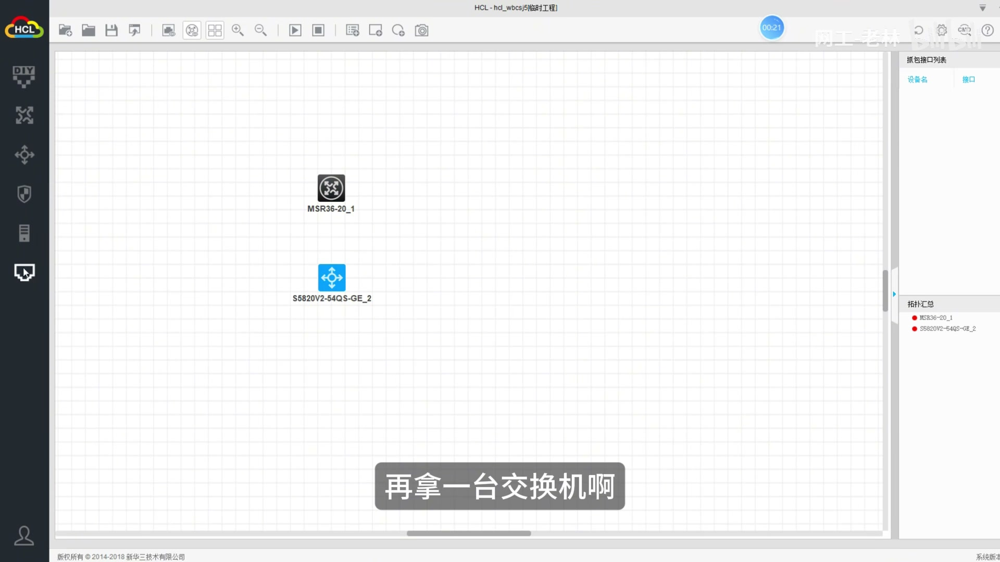

### 2.2 H3C Comware 配置

H3C 的配置分两步：使能 DHCP 服务、创建地址池。**不需要在接口下额外激活 DHCP**，这是 H3C 与华为最明显的步骤差异。

```
<H3C> system-view
[H3C] dhcp enable
[H3C] dhcp server ip-pool for10
[H3C-dhcp-pool-for10] network 192.168.10.0 mask 255.255.255.0
[H3C-dhcp-pool-for10] gateway-list 192.168.10.1
[H3C-dhcp-pool-for10] dns-list 114.114.114.114
[H3C-dhcp-pool-for10] quit
[H3C] interface GigabitEthernet 0/0
[H3C-GigabitEthernet0/0] ip address 192.168.10.1 24
```

关键点：

1. 创建地址池的命令是 `dhcp server ip-pool 名称`，不是在 `ip pool` 前直接加 `dhcp`；
2. 地址段必须带 `mask` 关键字：`network 192.168.10.0 mask 255.255.255.0`；
3. 网关用 `gateway-list`，DNS 用 `dns-list`，两个命令都带 `list`；
4. 接口默认已启用 DHCP 服务器功能，无需再输入 `dhcp select server`。

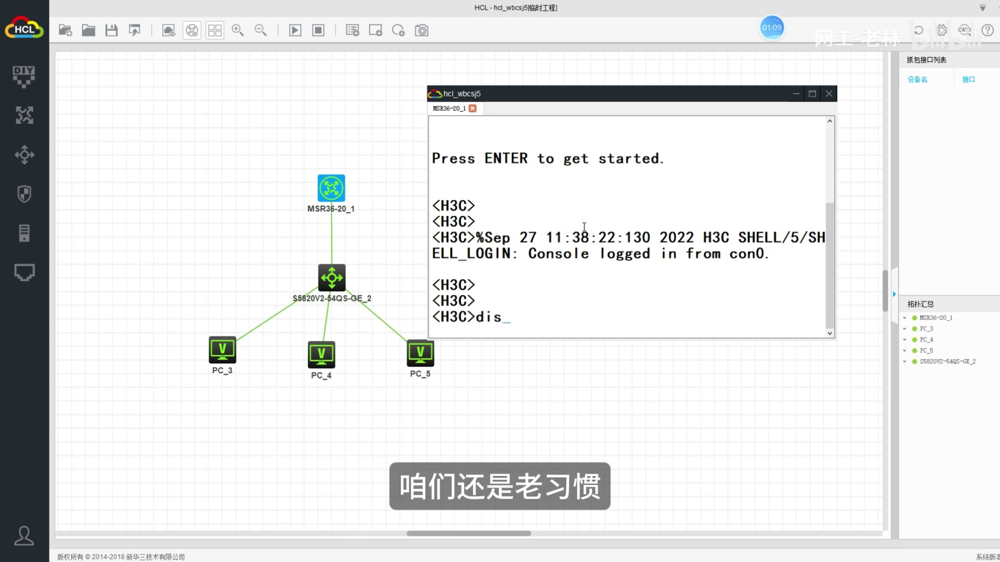

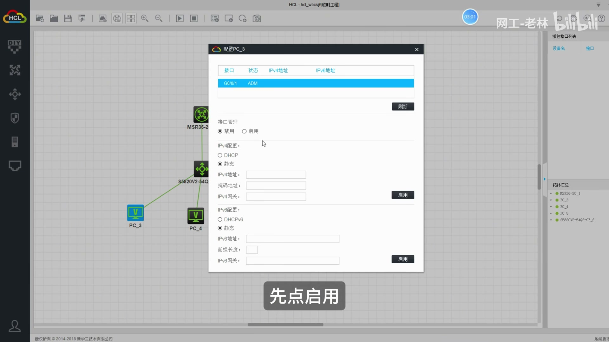

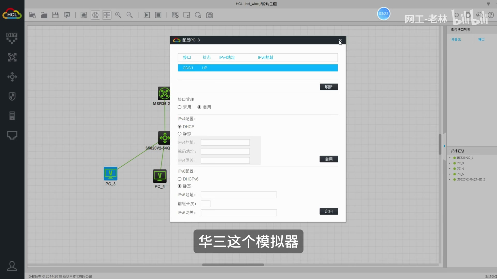

验证命令：

```
<H3C> display dhcp server pool
<H3C> display dhcp server ip-in-use
```

### 2.3 华为 VRP 配置

华为的配置分三步：使能 DHCP 服务、创建全局地址池、在网关接口激活 DHCP。

```
<Huawei> system-view
[Huawei] dhcp enable
[Huawei] ip pool for10
[Huawei-ip-pool-for10] network 192.168.10.0 mask 255.255.255.0
[Huawei-ip-pool-for10] gateway-list 192.168.10.1
[Huawei-ip-pool-for10] dns-list 114.114.114.114
[Huawei-ip-pool-for10] quit
[Huawei] interface GigabitEthernet 0/0/0
[Huawei-GigabitEthernet0/0/0] ip address 192.168.10.1 24
[Huawei-GigabitEthernet0/0/0] dhcp select global
```

| 步骤 | 命令 | 作用 |
| ---- | ---- | ---- |
| 第一步 | `dhcp enable` | 全局使能 DHCP 服务 |
| 第二步 | `ip pool 名称` + `network` + `gateway-list` + `dns-list` | 创建地址池并定义分配参数 |
| 第三步 | 接口下 `dhcp select global` | 指定该接口从全局地址池分配地址 |

**第三步是华为必配、H3C 不必配的关键差异。** 若漏掉 `dhcp select global`，即使地址池配置完全正确，PC 仍然无法获取地址。


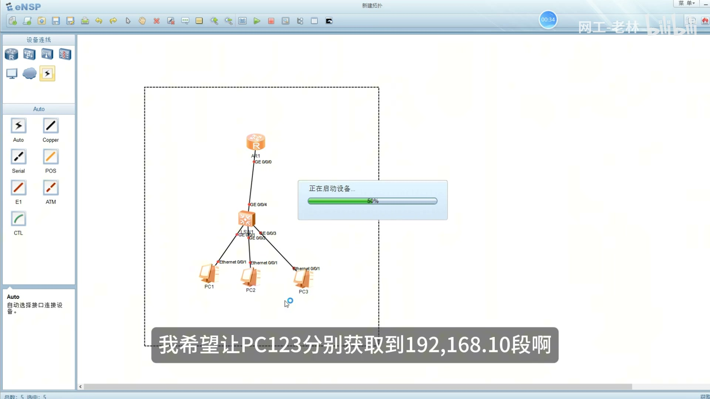

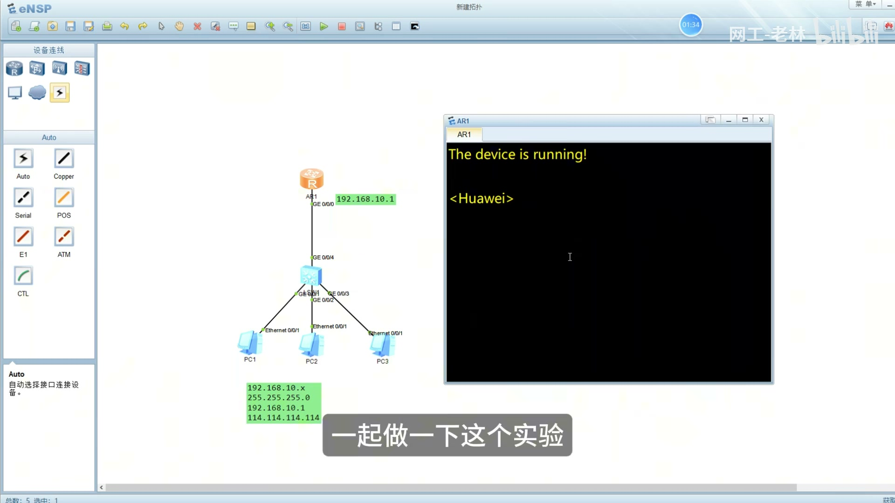

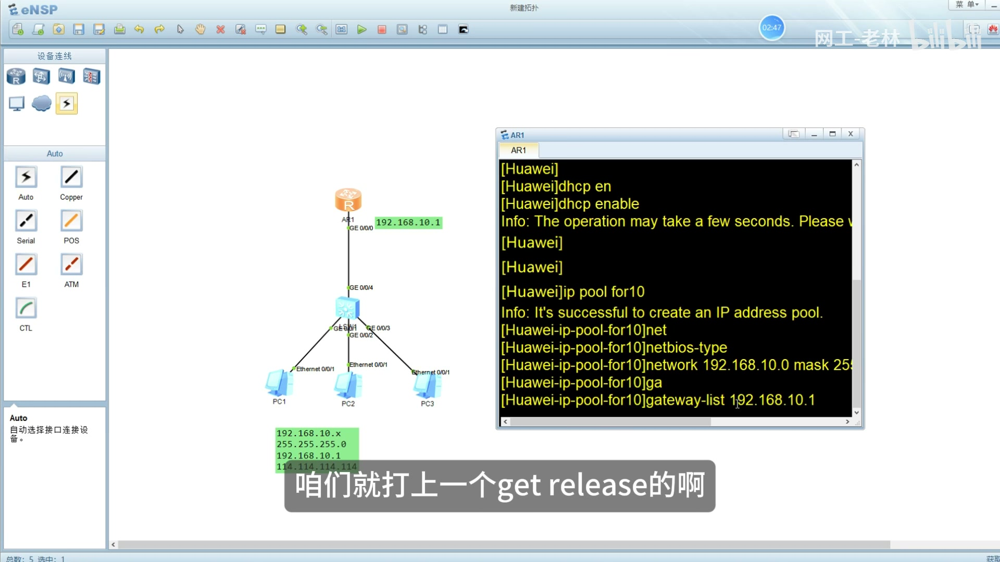

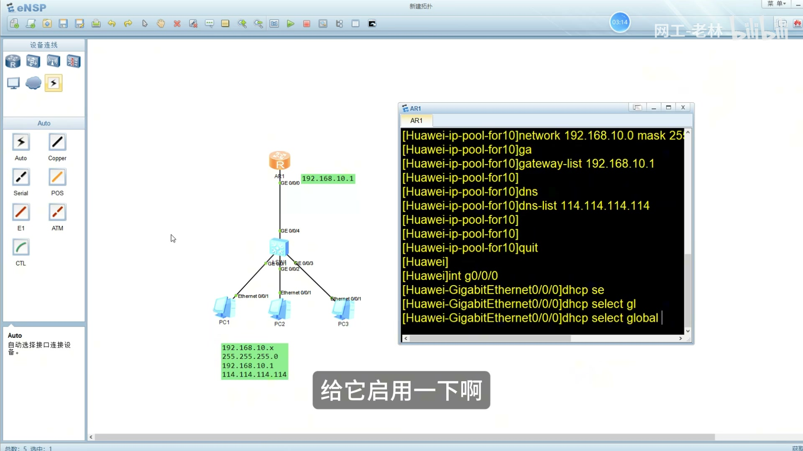

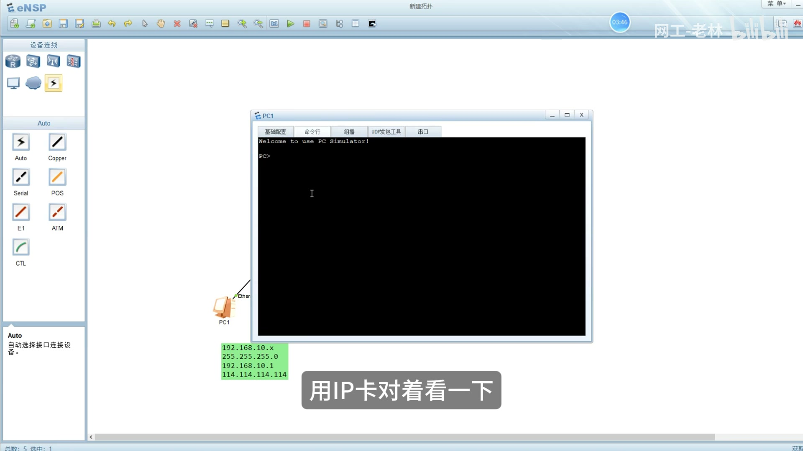

### 2.4 锐捷 RGOS 与思科 IOS 配置

思科系采用 `service dhcp` 使能服务，地址池命令为 `ip dhcp pool`，网关与 DNS 分别使用 `default-router` 与 `dns-server`。

锐捷 RGOS：

```
Ruijie> enable
Ruijie# configure terminal
Ruijie(config)# service dhcp
Ruijie(config)# ip dhcp pool for10
Ruijie(dhcp-config)# network 192.168.10.0 255.255.255.0
Ruijie(dhcp-config)# default-router 192.168.10.1
Ruijie(dhcp-config)# dns-server 114.114.114.114
Ruijie(dhcp-config)# exit
Ruijie(config)# interface GigabitEthernet 0/0
Ruijie(config-if-GigabitEthernet 0/0)# ip address 192.168.10.1 255.255.255.0
```

思科 IOS：

```
Router> enable
Router# configure terminal
Router(config)# service dhcp
Router(config)# ip dhcp excluded-address 192.168.10.1
Router(config)# ip dhcp pool for10
Router(dhcp-config)# network 192.168.10.0 255.255.255.0
Router(dhcp-config)# default-router 192.168.10.1
Router(dhcp-config)# dns-server 114.114.114.114
Router(dhcp-config)# exit
Router(config)# interface FastEthernet 0/0
Router(config-if)# ip address 192.168.10.1 255.255.255.0
Router(config-if)# no shutdown
```

差异说明：

1. 思科系 `network` 后直接写掩码，**不加 `mask` 关键字**；华为、H3C 必须写 `mask`。
2. 思科路由器接口默认处于 `shutdown` 状态，必须 `no shutdown`；锐捷接口默认开启，可省略。
3. 思科 DHCP 服务默认已启用，`service dhcp` 属于确认性配置；实验中也常显式输入。
4. 网关地址应从地址池中排除，避免分配给 PC 造成冲突。

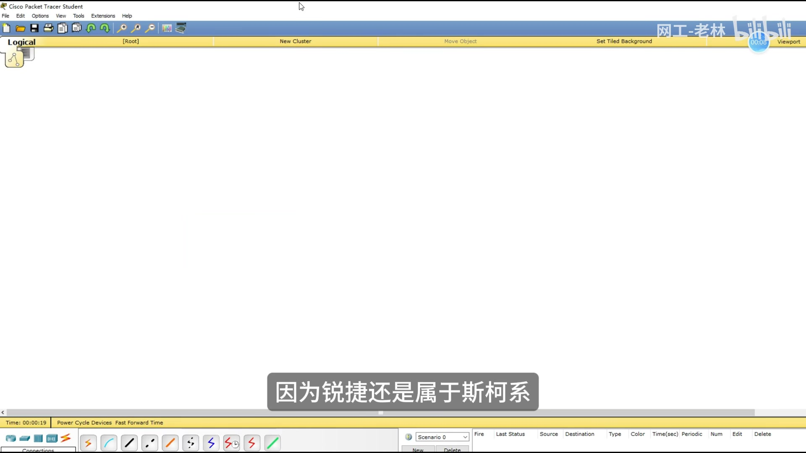

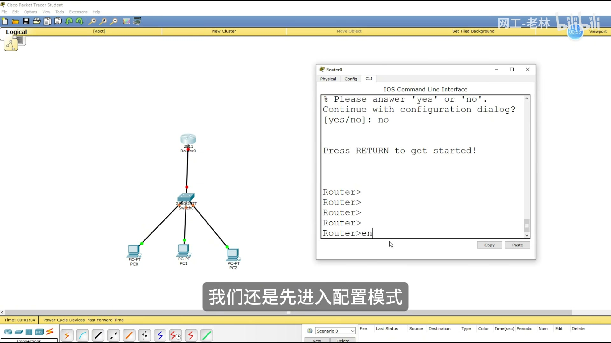

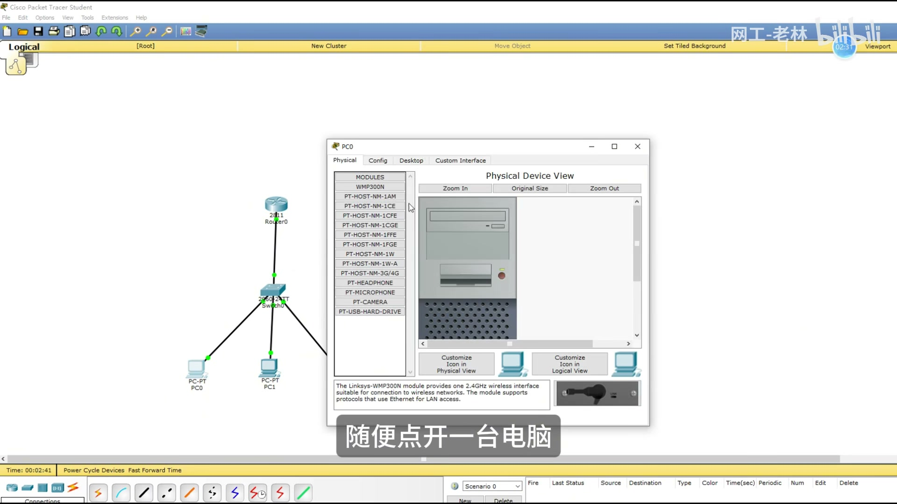

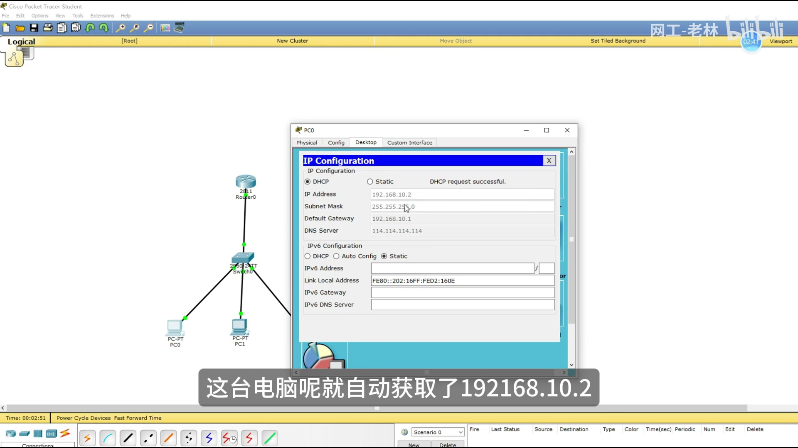

### 2.5 四厂商 DHCP 命令对照

| 配置项 | 华为 VRP | H3C Comware | 锐捷 RGOS | 思科 IOS |
| ------ | -------- | ----------- | --------- | -------- |
| 使能 DHCP 服务 | `dhcp enable` | `dhcp enable` | `service dhcp` | `service dhcp`（默认开启） |
| 创建地址池 | `ip pool for10` | `dhcp server ip-pool for10` | `ip dhcp pool for10` | `ip dhcp pool for10` |
| 地址段 | `network 192.168.10.0 mask 255.255.255.0` | `network 192.168.10.0 mask 255.255.255.0` | `network 192.168.10.0 255.255.255.0` | `network 192.168.10.0 255.255.255.0` |
| 掩码关键字 | 必须写 `mask` | 必须写 `mask` | 不写 `mask` | 不写 `mask` |
| 网关 | `gateway-list 192.168.10.1` | `gateway-list 192.168.10.1` | `default-router 192.168.10.1` | `default-router 192.168.10.1` |
| DNS | `dns-list 114.114.114.114` | `dns-list 114.114.114.114` | `dns-server 114.114.114.114` | `dns-server 114.114.114.114` |
| 接口激活 | `dhcp select global`（必配） | 默认已启用，无需配置 | 无需配置 | 无需配置 |
| 排除地址 | 地址池视图 `excluded-ip-address 192.168.10.1` | 系统视图 `dhcp server forbidden-ip 192.168.10.1` | 全局 `ip dhcp excluded-address 192.168.10.1` | 全局 `ip dhcp excluded-address 192.168.10.1` |
| 租期 | `lease day 7` | `expired day 7` | `lease 7` | `lease 7` |
| 查看地址池 | `display ip pool` | `display dhcp server pool` | `show ip dhcp pool` | `show ip dhcp pool` |
| 查看已分配地址 | `display ip pool` | `display dhcp server ip-in-use` | `show ip dhcp binding` | `show ip dhcp binding` |

### 2.6 验证与常见故障

验证方法：

1. 在 PC 上把网卡设置为“DHCP”，启用后等待若干秒；
2. 用 `ipconfig` 查看是否获得规划网段的地址、正确掩码、网关与 DNS；
3. 服务器侧用上表的查看命令确认地址池与绑定表项。

常见故障：

| 现象 | 原因 | 处理 |
| ---- | ---- | ---- |
| PC 获取到 169.254.x.x | 未收到 DHCP 响应 | 检查服务是否使能、链路是否 Up、地址池网段是否与接口同网段 |
| 华为设备地址池正确但 PC 无地址 | 接口未执行 `dhcp select global` | 进入网关接口补充该命令 |
| H3C 创建地址池时报错 | 误用华为的 `ip pool` | 改用 `dhcp server ip-pool` |
| 思科 `network` 后写 `mask` 报错 | 思科不接受该关键字 | 直接写掩码或掩码长度 |
| 获取的网关或 DNS 为空 | 地址池缺少 `gateway-list`、`dns-list` 或 `default-router`、`dns-server` | 补全对应命令 |
| 模拟器中 PC 长时间无地址 | HCL 等模拟器响应较慢 | 等待一段时间或重启设备后再试 |

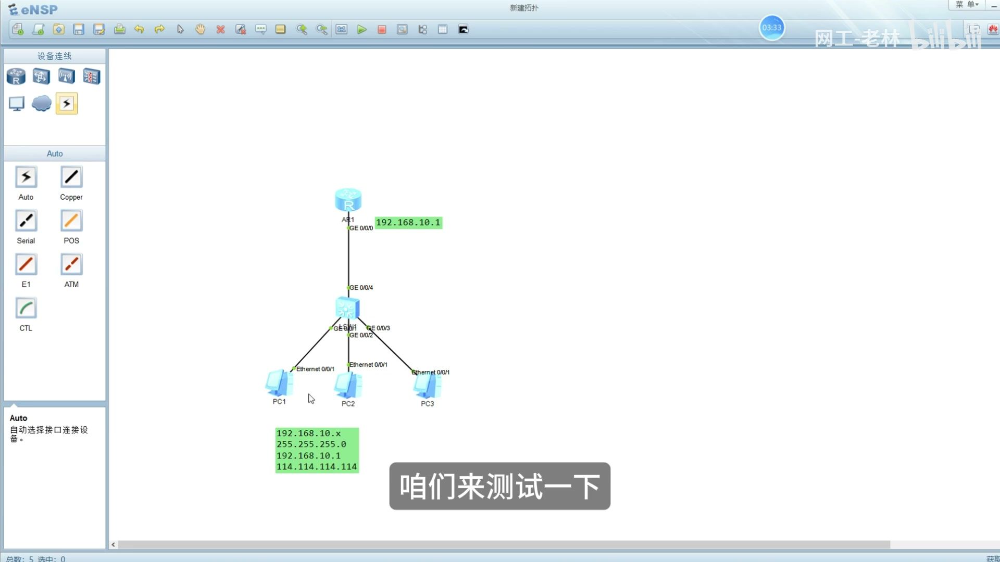

---

## 3.NAT 配置对比

### 3.1 NAT 基本原理与分类

私网地址不能在公网上路由，访问互联网时必须把私网地址转换为公网地址。NAT 的核心是“**谁需要转换**”和“**转换成什么**”两个问题。

| 类型 | 转换关系 | 是否转换端口 | 典型用途 |
| ---- | -------- | ------------ | -------- |
| 静态 NAT（Basic NAT） | 一个私网地址固定映射一个公网地址 | 否 | 少量服务器对外发布 |
| 动态 NAT（NO-PAT） | 从地址池中动态取一个公网地址，一对一 | 否 | 公网地址数量充足时 |
| NAPT / PAT | 多个私网地址共享一个或少量公网地址 | 是 | 绝大多数上网场景 |
| Easy IP | NAPT 的特例，直接借用出接口地址 | 是 | 拨号、拨光纤等动态公网地址场景 |
| NAT Server | 公网地址+端口固定映射到内网服务器 | 是（端口映射） | 对外发布 Web、Mail 等服务器 |

NAT 的通用配置思路只有两步：

1. 用 **ACL 挑选**需要转换的数据包（通常按源地址匹配）；
2. 在**外网出接口**上调用 NAT 策略。

思科系在此之外多出一步：必须显式指定哪个接口是 `inside`、哪个接口是 `outside`。

### 3.2 H3C Comware 配置

```
<H3C> system-view
[H3C] acl basic 2000
[H3C-acl-ipv4-basic-2000] rule permit source 192.168.10.0 0.0.0.255
[H3C-acl-ipv4-basic-2000] quit
[H3C] interface GigabitEthernet 0/2
[H3C-GigabitEthernet0/2] nat outbound 2000
```

关键点：

1. H3C 创建 ACL 时必须**手动指定类型**：`acl basic 2000` 或 `acl advanced 3000`。直接输入 `acl 2000` 会报错。
2. 基本 ACL 只匹配源 IP；高级 ACL 还可匹配目的 IP、协议号、端口号。本实验只需按源地址匹配，使用基本 ACL 即可。
3. `nat outbound 2000` 未指定地址组时，直接使用该出接口的地址做 NAPT，即 **Easy IP**。
4. 与华为一样，H3C 不需要在接口上标记 inside/outside，NAT 规则配置在出接口即代表方向。

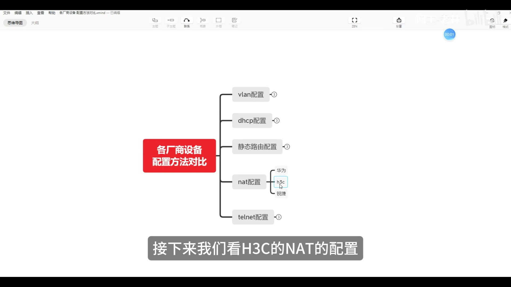

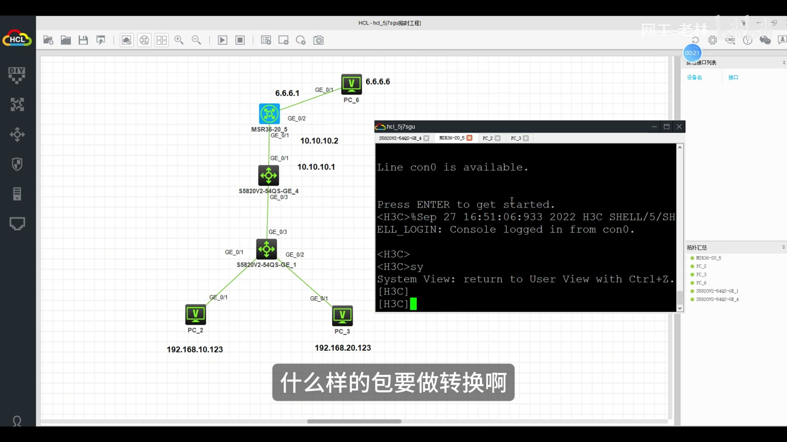

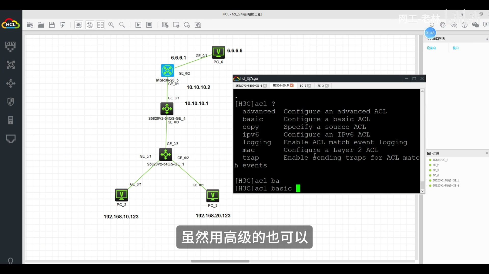

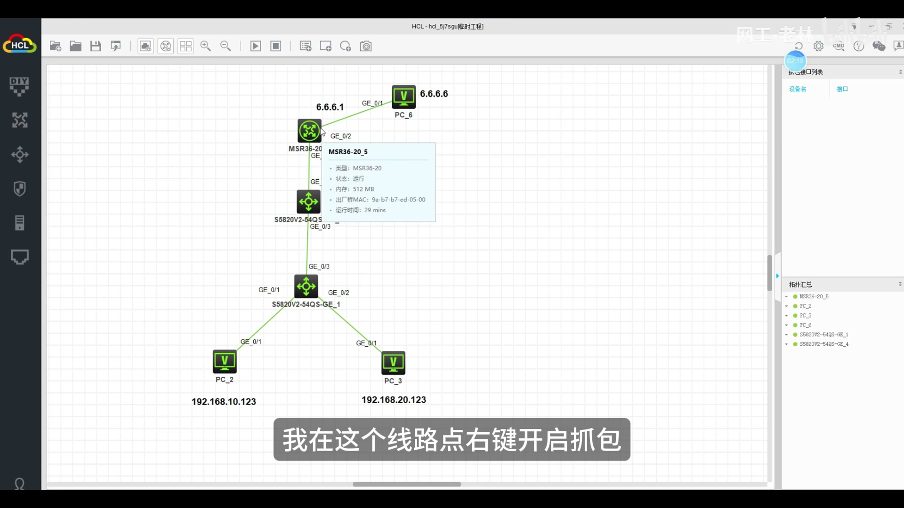

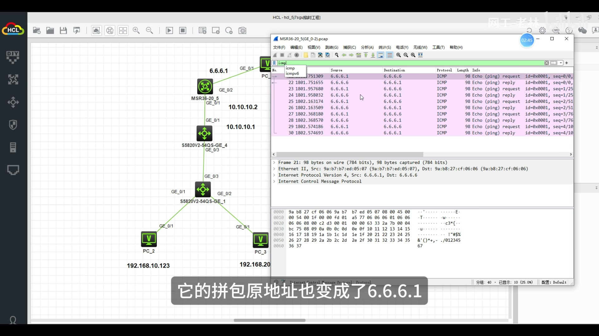

### 3.3 华为 VRP 配置

```
<Huawei> system-view
[Huawei] acl 2000
[Huawei-acl-basic-2000] rule permit source 192.168.10.0 0.0.0.255
[Huawei-acl-basic-2000] quit
[Huawei] interface GigabitEthernet 0/0/1
[Huawei-GigabitEthernet0/0/1] nat outbound 2000
```

关键点：

1. 华为输入 `acl 2000` 时会自动归入基本 ACL，编号 2000—2999 为基本 ACL，3000—3999 为高级 ACL；这一点比 H3C 省事。
2. ACL 中的掩码是**通配符掩码（反掩码）**：`192.168.10.0/24` 对应 `0.0.0.255`。
3. 出接口执行 `nat outbound 2000` 后，匹配 ACL 的报文源地址被转换为该接口地址，实现 Easy IP。
4. 需要指定公网地址池时，先创建 `nat address-group`，再在 `nat outbound` 后追加地址组编号。

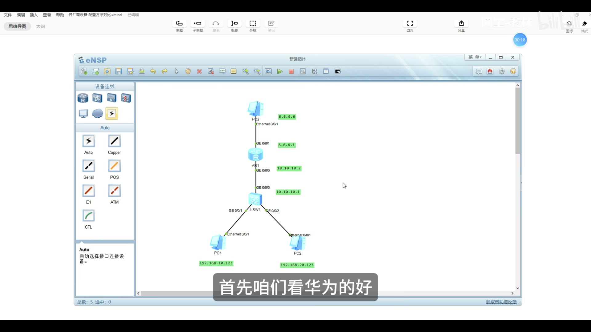

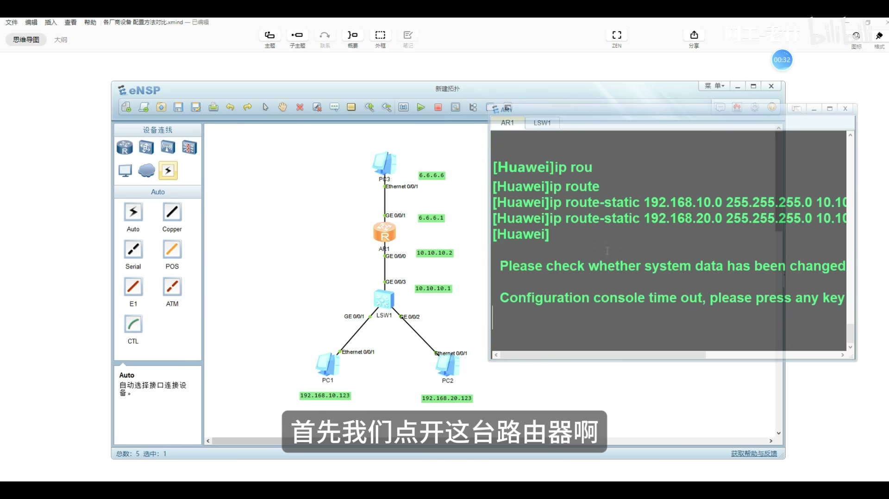

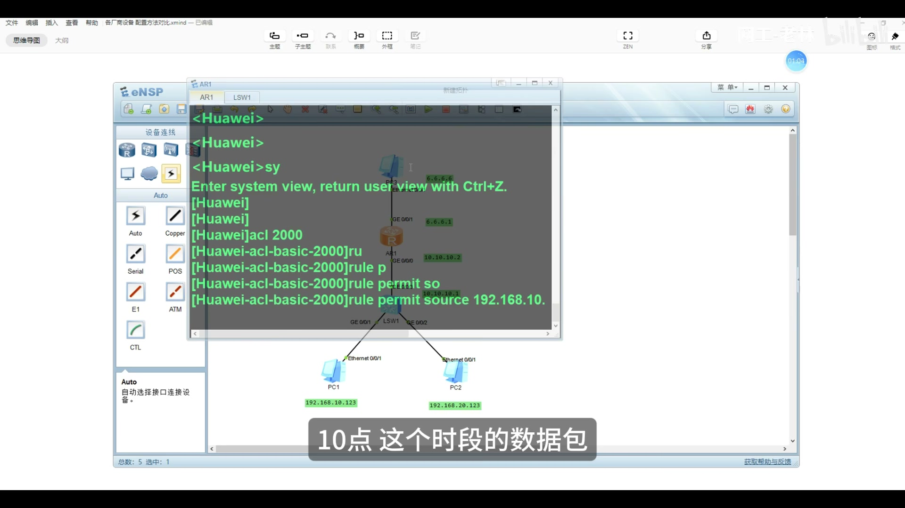

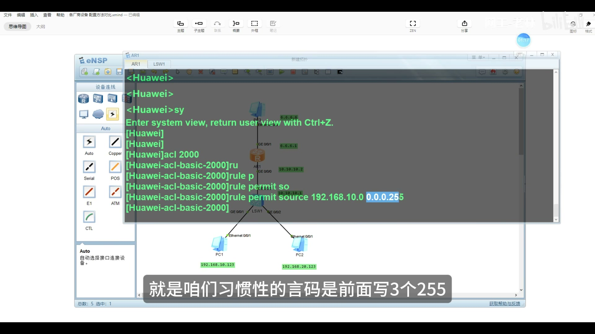

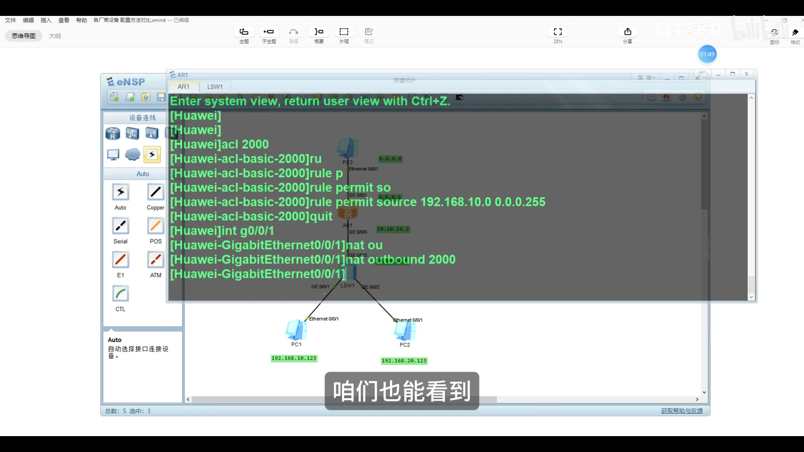

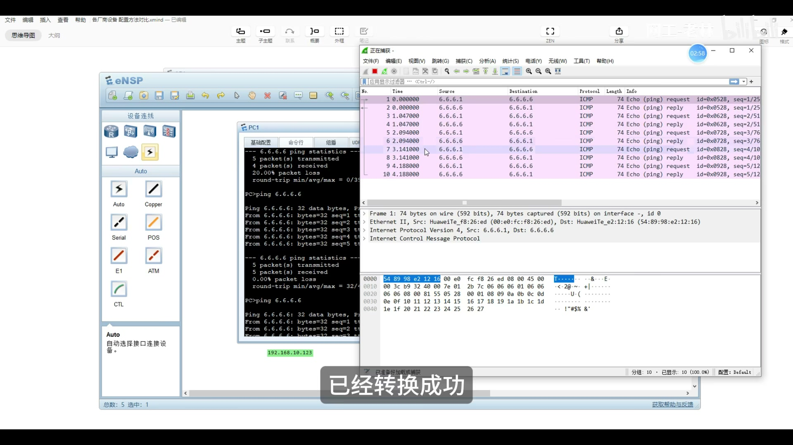

### 3.4 锐捷 RGOS 与思科 IOS 配置

思科系的配置思路与华为系差别较大，分为三步：ACL 匹配、NAT 转换规则、接口内外标记。

```
Router> enable
Router# configure terminal
Router(config)# access-list 1 permit 192.168.10.0 0.0.0.255
Router(config)# ip nat inside source list 1 interface FastEthernet 0/1 overload
Router(config)# interface FastEthernet 0/0
Router(config-if)# ip nat inside
Router(config-if)# exit
Router(config)# interface FastEthernet 0/1
Router(config-if)# ip nat outside
```

关键点：

1. 思科/锐捷标准 ACL 编号为 1—99，扩展 ACL 为 100—199；标准 ACL 只检查源 IP。
2. `ip nat inside source list 1 interface F0/1 overload` 的含义是：ACL 1 匹配的报文从内网发起，转换到 F0/1 的接口地址，`overload` 启用端口复用。
3. **`overload` 不能省**。不加 `overload` 时只做一对一的地址转换，同一公网地址同一时刻只能供一台主机使用，其他主机表现为上网卡顿甚至不通。
4. 必须进入内网接口执行 `ip nat inside`、进入外网接口执行 `ip nat outside`。**漏掉这两条，NAT 完全不生效**，这是思科系最容易忽视的一步。
5. 锐捷 RGOS 与思科 IOS 命令完全一致，仅提示符不同。

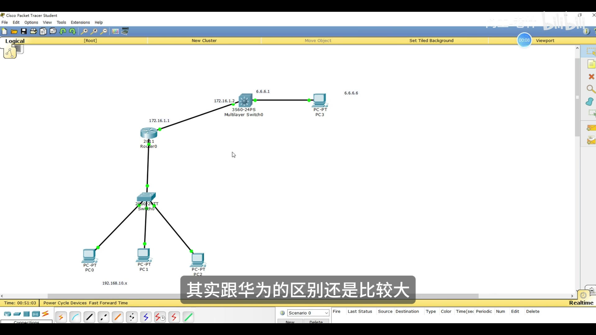

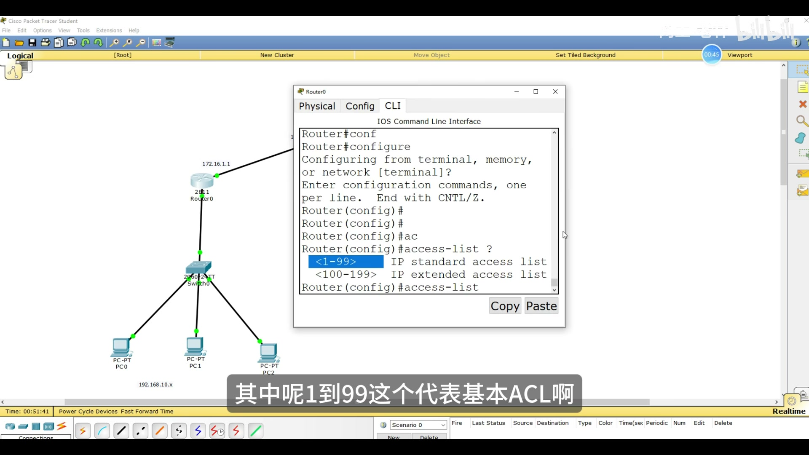

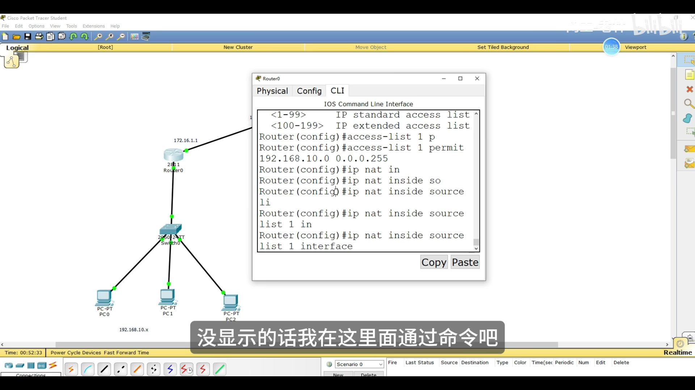

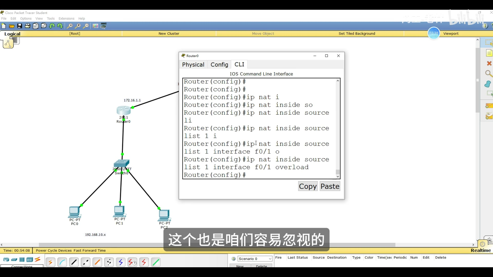

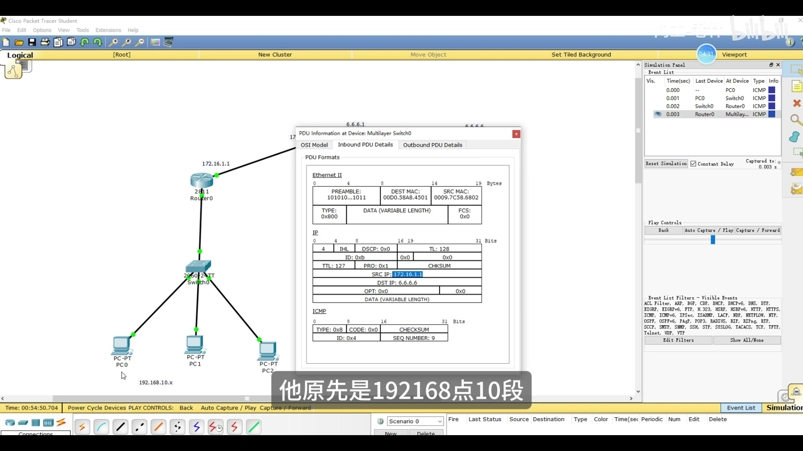

### 3.5 四厂商 NAT 命令对照

基础 Easy IP（NAPT 借用出接口地址）：

| 配置项 | 华为 VRP | H3C Comware | 锐捷 RGOS | 思科 IOS |
| ------ | -------- | ----------- | --------- | -------- |
| 创建 ACL | `acl 2000` | `acl basic 2000` | `access-list 1 permit ...` | `access-list 1 permit ...` |
| ACL 类型 | 2000—2999 基本，3000—3999 高级 | 必须写 `basic` 或 `advanced` | 1—99 标准，100—199 扩展 | 1—99 标准，100—199 扩展 |
| 匹配源地址 | `rule permit source 192.168.10.0 0.0.0.255` | `rule permit source 192.168.10.0 0.0.0.255` | `access-list 1 permit 192.168.10.0 0.0.0.255` | `access-list 1 permit 192.168.10.0 0.0.0.255` |
| 转换规则 | 出接口 `nat outbound 2000` | 出接口 `nat outbound 2000` | `ip nat inside source list 1 interface F0/1 overload` | `ip nat inside source list 1 interface F0/1 overload` |
| 内外网口标记 | 不需要 | 不需要 | `ip nat inside` / `ip nat outside` | `ip nat inside` / `ip nat outside` |
| 端口复用 | 默认启用 PAT | 默认启用 PAT | 必须加 `overload` | 必须加 `overload` |
| 查看转换表 | `display nat session all` | `display nat session` | `show ip nat translations` | `show ip nat translations` |
| 调试 | `display nat session all` | `display nat session` | `debug ip nat` | `debug ip nat` |

使用公网地址池的 NAPT：

| 配置项 | 华为 VRP | H3C Comware | 锐捷 RGOS | 思科 IOS |
| ------ | -------- | ----------- | --------- | -------- |
| 创建地址池 | `nat address-group 1` | `nat address-group 1` | `ip nat pool POOL 6.6.6.2 6.6.6.10 netmask 255.255.255.0` | `ip nat pool POOL 6.6.6.2 6.6.6.10 netmask 255.255.255.0` |
| 添加地址段 | `section 0 6.6.6.2 6.6.6.10` | `address 6.6.6.2 6.6.6.10` | 地址池命令中直接给出起止地址 | 地址池命令中直接给出起止地址 |
| 引用地址池 | `nat outbound 2000 address-group 1` | `nat outbound 2000 address-group 1` | `ip nat inside source list 1 pool POOL overload` | `ip nat inside source list 1 pool POOL overload` |

NAT Server（对外发布内网服务器）：

| 配置项 | 华为 VRP | H3C Comware | 锐捷 RGOS | 思科 IOS |
| ------ | -------- | ----------- | --------- | -------- |
| 公网地址映射 | `nat server protocol tcp global current-interface 80 inside 192.168.10.100 80` | `nat server protocol tcp global current-interface 80 inside 192.168.10.100 80` | `ip nat inside source static tcp 192.168.10.100 80 6.6.6.1 80` | `ip nat inside source static tcp 192.168.10.100 80 6.6.6.1 80` |
| 指定公网 IP | 把 `current-interface` 换成具体公网地址 | 把 `current-interface` 换成具体公网地址 | 命令末尾直接写公网地址与端口 | 命令末尾直接写公网地址与端口 |
| 配置位置 | 外网接口视图 | 外网接口视图 | 全局配置模式 | 全局配置模式 |

### 3.6 抓包验证

| 厂商 | 抓包方式 | 观察点 |
| ---- | -------- | ------ |
| 华为 | eNSP 中在链路右键抓包，或直接 `display nat session all` | 出接口报文源地址变为公网地址 |
| H3C | HCL 中在链路右键启动 Wireshark | 过滤 `ip.addr == 6.6.6.6`，源地址应为 6.6.6.1 |
| 锐捷 | 模拟器抓包或 `show ip nat translations` | 转换表出现 inside local 与 inside global 映射 |
| 思科 | CPT 右下角进入 Simulation 模式，逐跳查看信封 | 出方向报文源地址变为转换后的公网地址 |

判别标准：在出接口抓到的报文中，**内网源地址应完全消失**，取而代之的是公网地址；若仍能看到 192.168.x.x，说明 NAT 未生效。

---

## 4.VLAN 与 Trunk 配置对比

### 4.1 VLAN 隔离与三层互通原理

VLAN 的作用是把一个物理交换机划分成多个逻辑广播域，实现**广播隔离**与**故障隔离**。代价是不同 VLAN 之间的正常通信也被隔离，因此需要用三层设备做 VLAN 间路由。

| 概念 | 含义 | 使用场景 |
| ---- | ---- | -------- |
| Access 接口 | 只承载一个 VLAN，发出的帧不打标签 | 连接 PC、打印机等终端 |
| Trunk 接口 | 承载多个 VLAN，帧打 802.1Q 标签 | 交换机之间的上联链路 |
| PVID | 接口的缺省 VLAN，Access 口收到的无标签帧归入该 VLAN | 终端接入 |
| VLANIF / SVI | 三层交换机上对应某个 VLAN 的虚拟接口，可配 IP 作为网关 | VLAN 间路由 |

实验需求：

- PC1 属于 VLAN 10，地址 192.168.10.123/24，网关 192.168.10.1；
- PC2 属于 VLAN 20，地址 192.168.20.123/24，网关 192.168.20.1；
- 接入交换机负责划分 VLAN，核心交换机负责 VLAN 间路由；
- 两台交换机之间使用 Trunk，放行 VLAN 10 与 VLAN 20。

VLAN 间互通的配置可以归纳为三步：

1. 把两台交换机互联的接口配置为 Trunk，并放行需要通过的 VLAN；
2. 在核心交换机上创建各 VLAN；
3. 创建 VLANIF（SVI）接口并配置 IP，作为对应 VLAN 的网关。


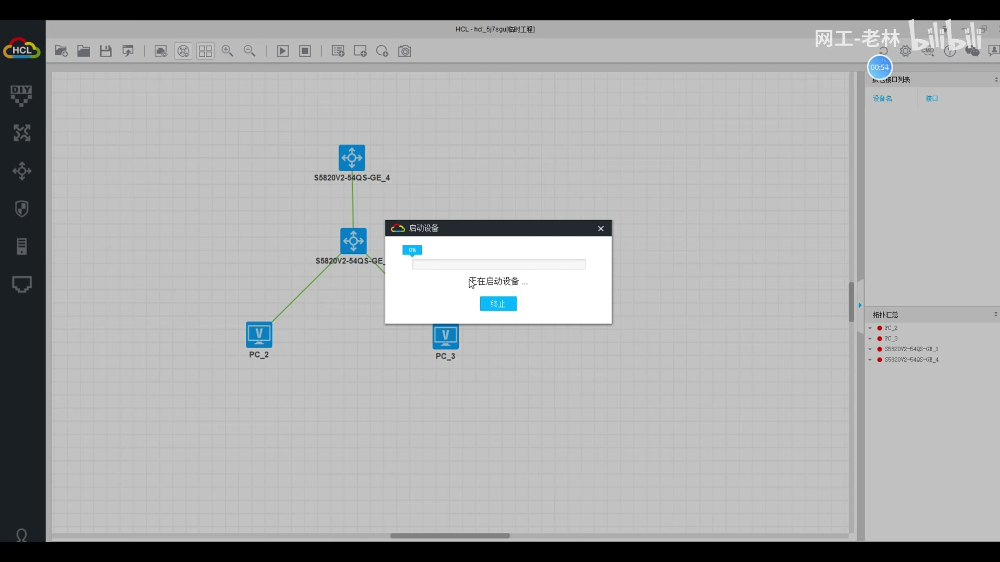

### 4.2 H3C Comware 配置

接入交换机：

```
<H3C> system-view
[H3C] vlan 10
[H3C-vlan10] quit
[H3C] vlan 20
[H3C-vlan20] quit
[H3C] interface GigabitEthernet 1/0/1
[H3C-GigabitEthernet1/0/1] port link-type access
[H3C-GigabitEthernet1/0/1] port access vlan 10
[H3C-GigabitEthernet1/0/1] quit
[H3C] interface GigabitEthernet 1/0/2
[H3C-GigabitEthernet1/0/2] port link-type access
[H3C-GigabitEthernet1/0/2] port access vlan 20
[H3C-GigabitEthernet1/0/2] quit
[H3C] interface GigabitEthernet 1/0/3
[H3C-GigabitEthernet1/0/3] port link-type trunk
[H3C-GigabitEthernet1/0/3] port trunk permit vlan 10 20
```

核心交换机：

```
[H3C] vlan 10
[H3C] vlan 20
[H3C] interface Vlan-interface 10
[H3C-Vlan-interface10] ip address 192.168.10.1 24
[H3C] interface Vlan-interface 20
[H3C-Vlan-interface20] ip address 192.168.20.1 24
```

关键点：

1. H3C 把接口加入 VLAN 的命令是 `port access vlan 10`；
2. Trunk 放行 VLAN 用 `port trunk permit vlan 10 20`，不是华为的 `allow-pass`；
3. H3C 的 Trunk 默认只允许 VLAN 1 通过，必须显式放行；
4. 三层接口名称为 `Vlan-interface`，不是华为的 `Vlanif`；
5. 接口编号需先用 `display interface brief` 确认，HCL 中常见 `G1/0/1`，直接照抄华为的 `G0/0/1` 会报错。

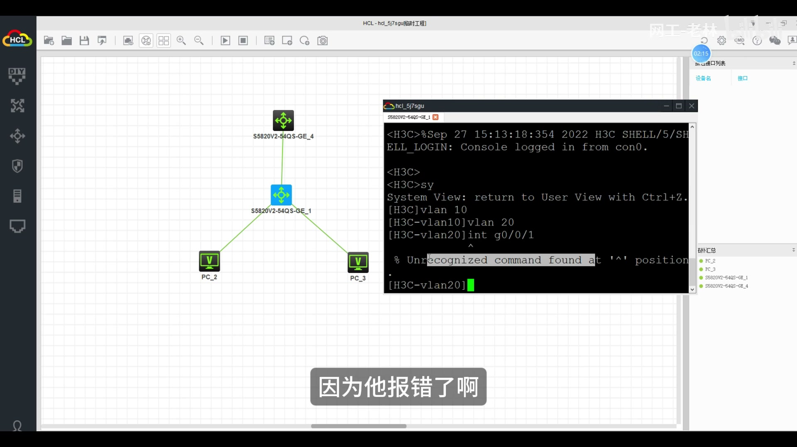

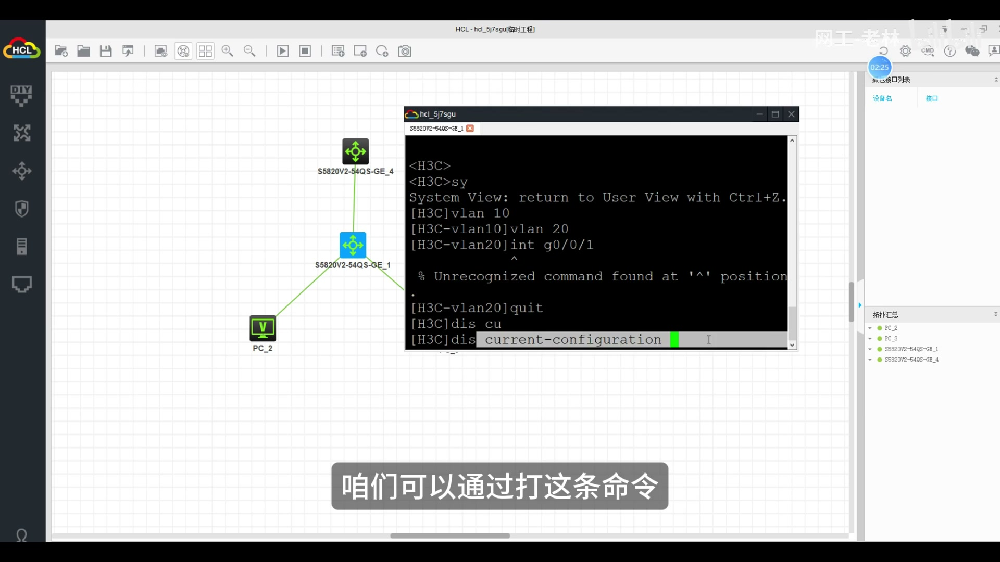

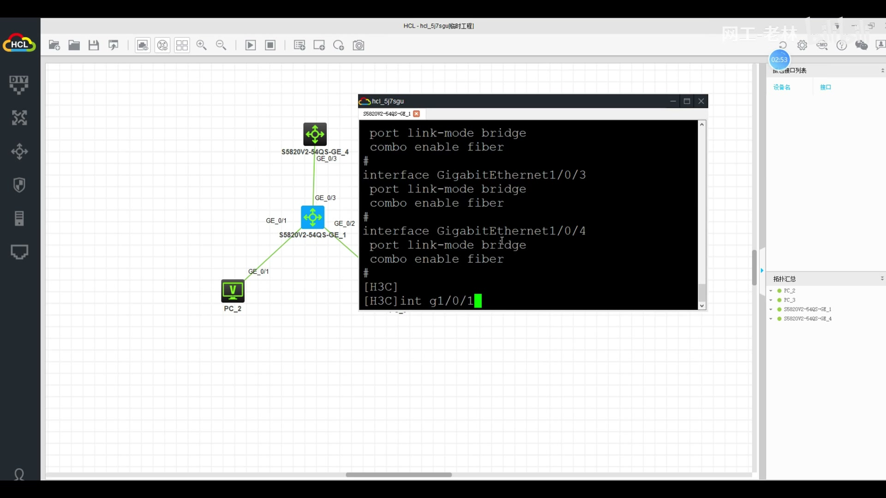

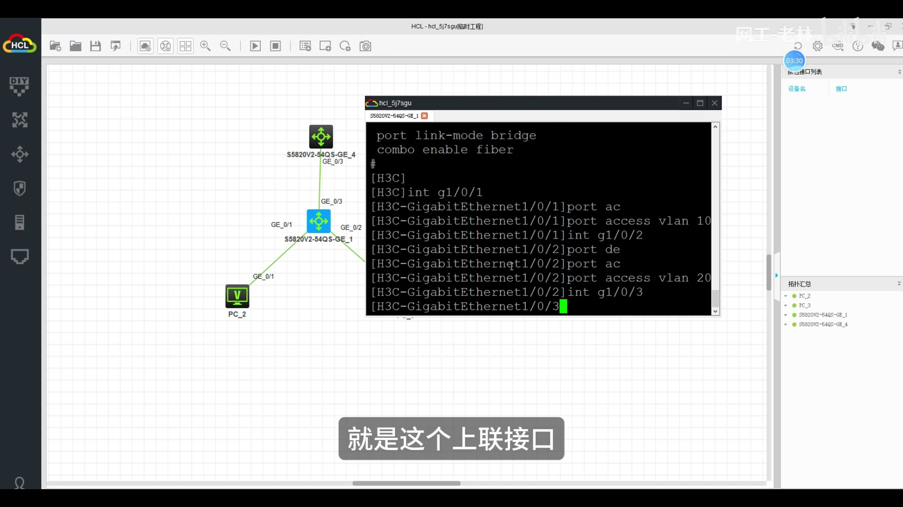

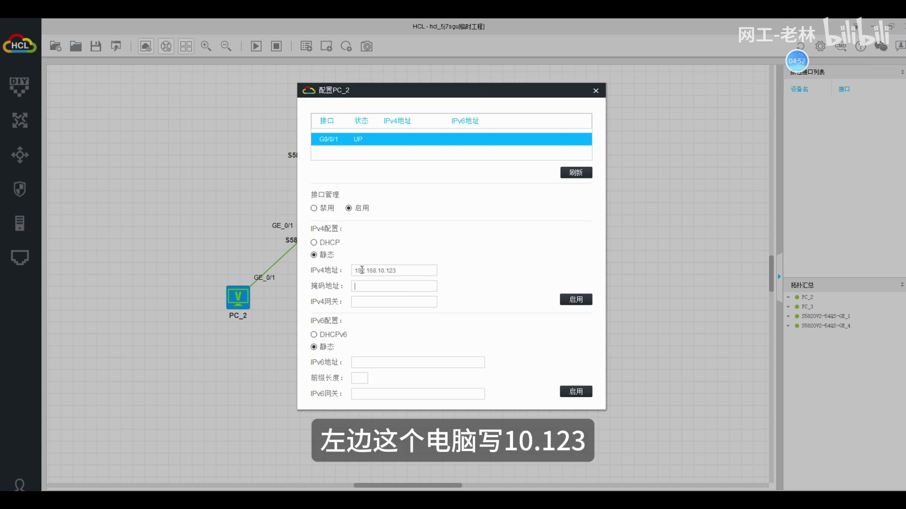

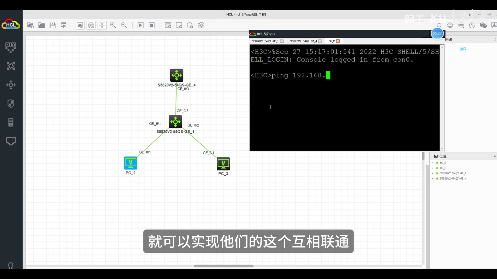

### 4.3 华为 VRP 配置

接入交换机：

```
<Huawei> system-view
[Huawei] vlan 10
[Huawei] vlan 20
[Huawei] interface GigabitEthernet 0/0/1
[Huawei-GigabitEthernet0/0/1] port link-type access
[Huawei-GigabitEthernet0/0/1] port default vlan 10
[Huawei-GigabitEthernet0/0/1] quit
[Huawei] interface GigabitEthernet 0/0/2
[Huawei-GigabitEthernet0/0/2] port link-type access
[Huawei-GigabitEthernet0/0/2] port default vlan 20
[Huawei-GigabitEthernet0/0/2] quit
[Huawei] interface GigabitEthernet 0/0/3
[Huawei-GigabitEthernet0/0/3] port link-type trunk
[Huawei-GigabitEthernet0/0/3] port trunk allow-pass vlan 10 20
```

核心交换机：

```
[Huawei] vlan 10
[Huawei] vlan 20
[Huawei] interface Vlanif 10
[Huawei-Vlanif10] ip address 192.168.10.1 24
[Huawei] interface Vlanif 20
[Huawei-Vlanif20] ip address 192.168.20.1 24
```

关键点：

1. 华为把接口加入 VLAN 用 `port default vlan 10`，这是与 H3C 的 `port access vlan` 最直接的区别；
2. Trunk 放行用 `port trunk allow-pass vlan 10 20`，可简写为 `port trunk allow-pass vlan all`；
3. 华为 Trunk 默认只允许 VLAN 1 通过，必须显式放行；
4. 三层接口名称为 `Vlanif`；
5. 命令较长时可用 `Tab` 键补全，不必逐字输入。

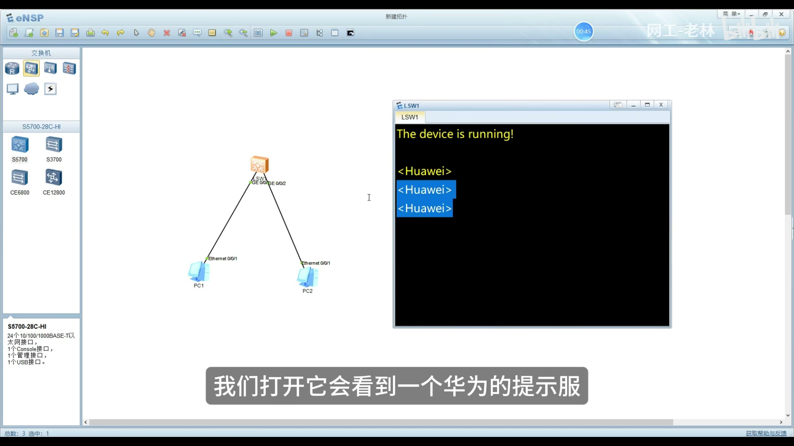

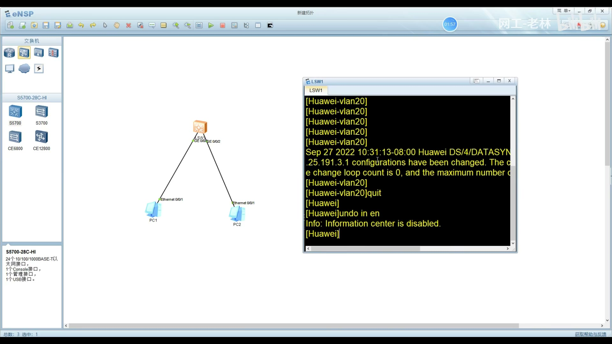

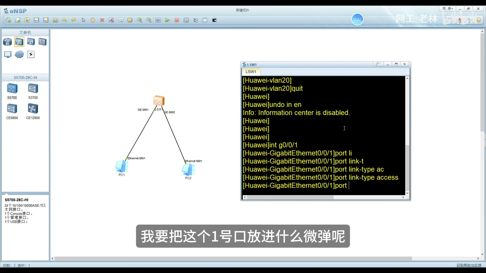

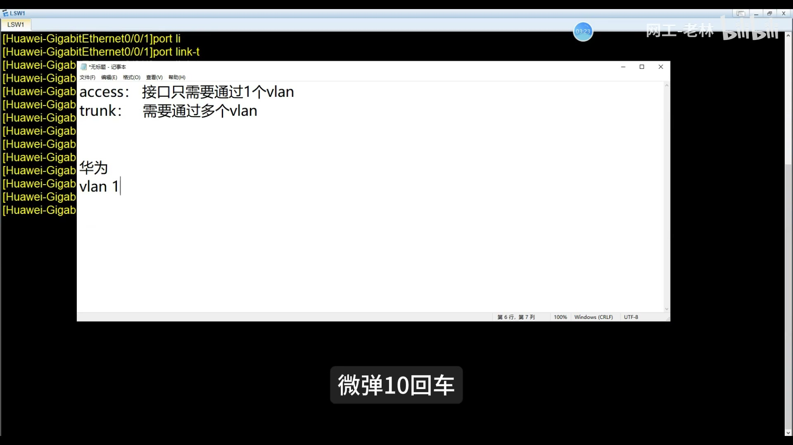

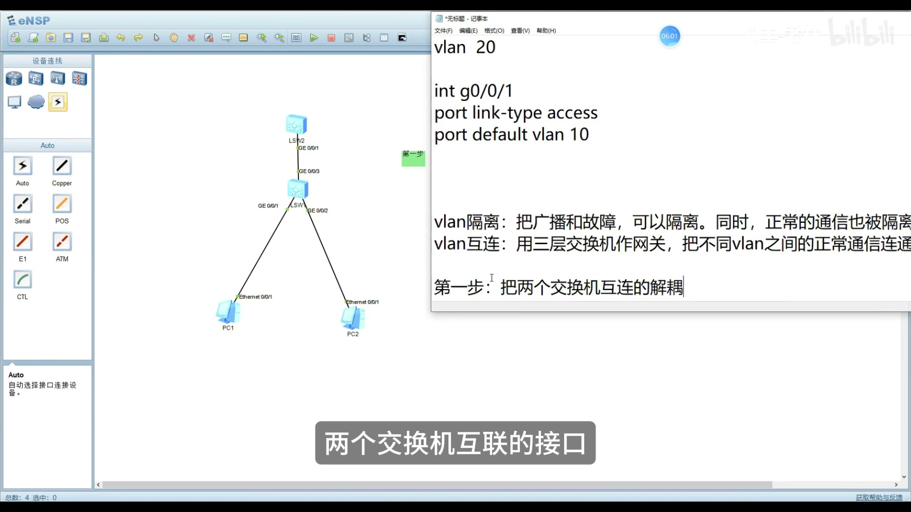

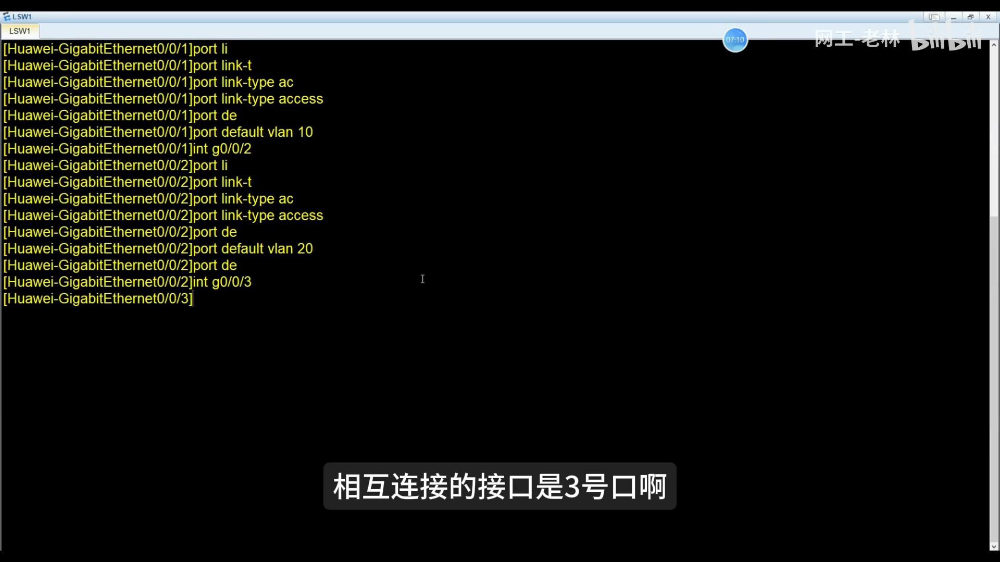

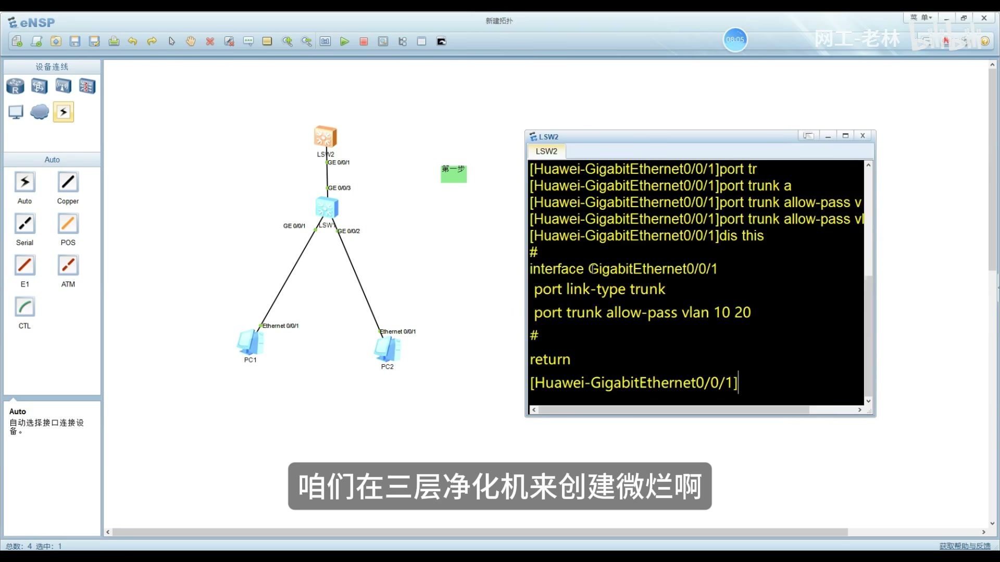

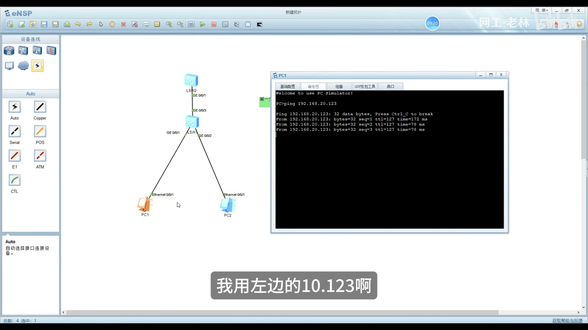

### 4.4 锐捷 RGOS 与思科 IOS 配置

锐捷 RGOS：

```
Ruijie> enable
Ruijie# configure terminal
Ruijie(config)# vlan 10
Ruijie(config-vlan)# exit
Ruijie(config)# vlan 20
Ruijie(config-vlan)# exit
Ruijie(config)# interface FastEthernet 0/1
Ruijie(config-if-FastEthernet 0/1)# switchport mode access
Ruijie(config-if-FastEthernet 0/1)# switchport access vlan 10
Ruijie(config)# interface FastEthernet 0/2
Ruijie(config-if-FastEthernet 0/2)# switchport mode access
Ruijie(config-if-FastEthernet 0/2)# switchport access vlan 20
Ruijie(config)# interface FastEthernet 0/3
Ruijie(config-if-FastEthernet 0/3)# switchport mode trunk
Ruijie(config)# interface vlan 10
Ruijie(config-if-VLAN 10)# ip address 192.168.10.1 255.255.255.0
Ruijie(config)# interface vlan 20
Ruijie(config-if-VLAN 20)# ip address 192.168.20.1 255.255.255.0
```

思科 IOS：

```
Switch> enable
Switch# configure terminal
Switch(config)# vlan 10
Switch(config-vlan)# exit
Switch(config)# interface FastEthernet 0/1
Switch(config-if)# switchport mode access
Switch(config-if)# switchport access vlan 10
Switch(config)# interface FastEthernet 0/3
Switch(config-if)# switchport trunk encapsulation dot1q
Switch(config-if)# switchport mode trunk
Switch(config)# interface Vlan 10
Switch(config-if)# ip address 192.168.10.1 255.255.255.0
Switch(config)# ip routing
```

关键点：

1. 思科系进入配置模式必须先 `enable` 再 `configure terminal`，比华为系多一步；
2. 接口加入 VLAN 用 `switchport access vlan 10`，接口类型用 `switchport mode access`；
3. Trunk 用 `switchport mode trunk`；
4. 部分思科三层交换机支持 ISL 与 802.1Q 两种封装，必须先执行 `switchport trunk encapsulation dot1q`，否则 `switchport mode trunk` 会被拒绝。实际环境中一律使用 `dot1q`；
5. 锐捷只支持 802.1Q，不需要封装命令；
6. 思科与锐捷的 Trunk 默认允许**所有 VLAN** 通过，需要限制时才用 `switchport trunk allowed vlan`；
7. 三层交换机必须开启 `ip routing` 才能进行 VLAN 间转发。思科默认关闭，锐捷多数三层交换机默认开启。

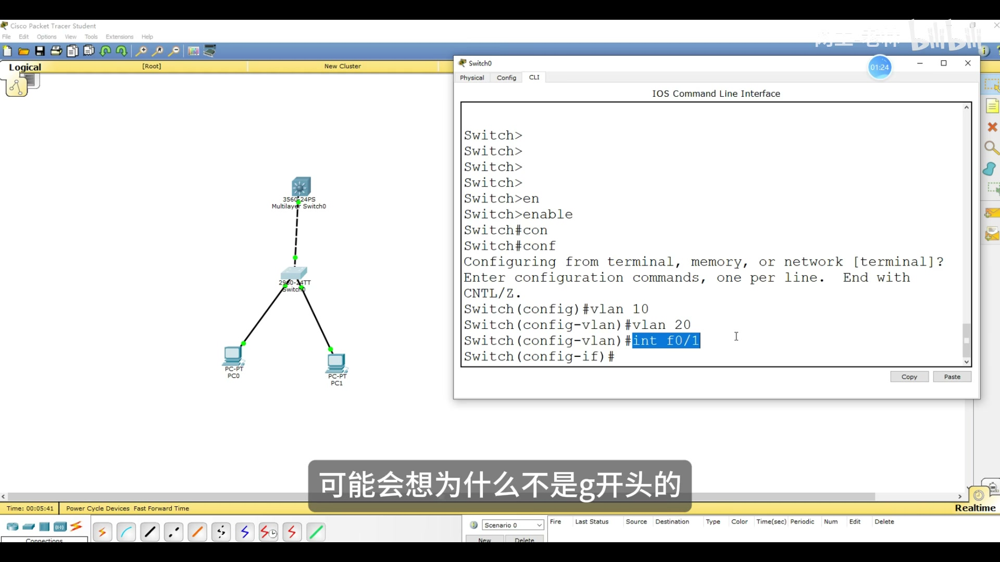

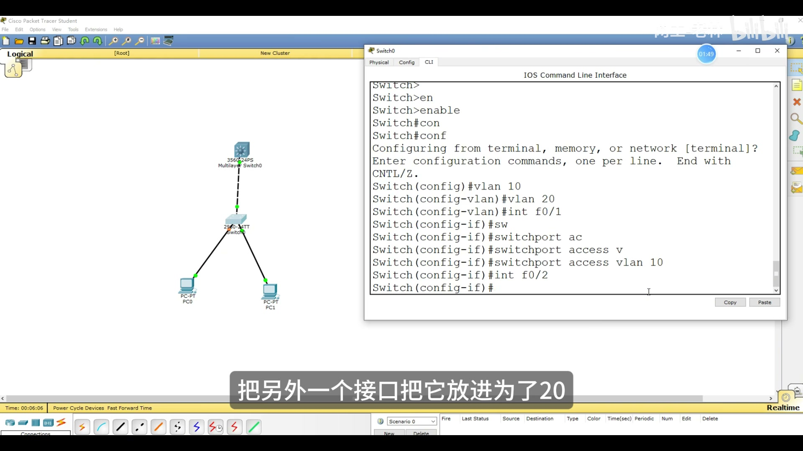

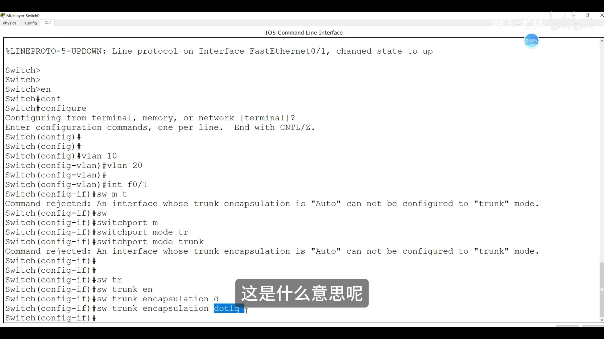

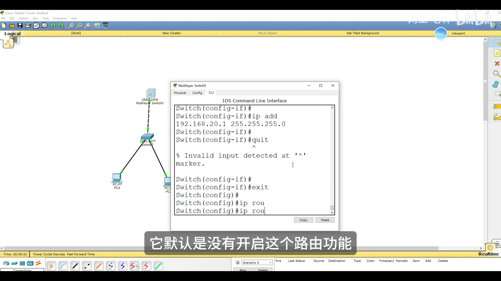

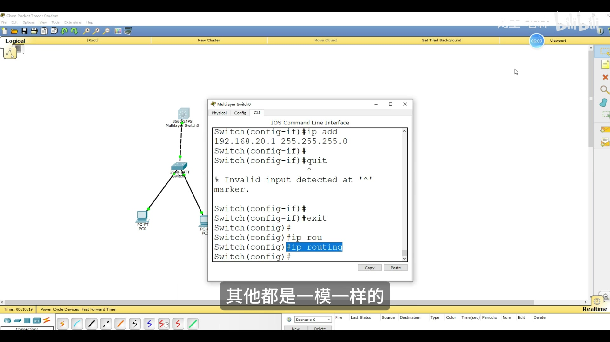

### 4.5 四厂商 VLAN 与 Trunk 命令对照

| 配置项 | 华为 VRP | H3C Comware | 锐捷 RGOS | 思科 IOS |
| ------ | -------- | ----------- | --------- | -------- |
| 创建 VLAN | `vlan 10` | `vlan 10` | `vlan 10` | `vlan 10` |
| 接口设为 Access | `port link-type access` | `port link-type access` | `switchport mode access` | `switchport mode access` |
| 接口加入 VLAN | `port default vlan 10` | `port access vlan 10` | `switchport access vlan 10` | `switchport access vlan 10` |
| 接口设为 Trunk | `port link-type trunk` | `port link-type trunk` | `switchport mode trunk` | `switchport mode trunk` |
| Trunk 封装 | 仅 802.1Q，无需配置 | 仅 802.1Q，无需配置 | 仅 802.1Q，无需配置 | `switchport trunk encapsulation dot1q`（部分平台必配） |
| Trunk 放行 VLAN | `port trunk allow-pass vlan 10 20` | `port trunk permit vlan 10 20` | `switchport trunk allowed vlan add 10,20` | `switchport trunk allowed vlan add 10,20` |
| Trunk 缺省放行范围 | 仅 VLAN 1 | 仅 VLAN 1 | 全部 VLAN | 全部 VLAN |
| 三层网关接口 | `interface Vlanif 10` | `interface Vlan-interface 10` | `interface vlan 10` | `interface Vlan 10` |
| 网关地址 | `ip address 192.168.10.1 24` | `ip address 192.168.10.1 24` | `ip address 192.168.10.1 255.255.255.0` | `ip address 192.168.10.1 255.255.255.0` |
| 开启三层路由 | 默认开启 | 默认开启 | 多数型号默认开启 | `ip routing`（必配） |
| 查看 VLAN | `display vlan` | `display vlan` | `show vlan` | `show vlan brief` |
| 查看 Trunk | `display port vlan` | `display port trunk` | `show interfaces trunk` | `show interfaces trunk` |

### 4.6 三层互通与 ip routing 专题

在三层交换机上配置 VLANIF/SVI 后，接口状态为 Up 并不代表路由功能已开启。

| 厂商 | 三层路由缺省状态 | 是否需要显式开启 | 验证 |
| ---- | ---------------- | ---------------- | ---- |
| 华为 | 开启 | 否 | `display ip routing-table` 能看到直连网段 |
| H3C | 开启 | 否 | `display ip routing-table` 能看到直连网段 |
| 锐捷 | 多数三层交换机开启 | 一般否，视型号而定 | `show ip route` 能看到直连网段 |
| 思科 | 关闭 | 是，执行 `ip routing` | 开启前只有直连网段，开启后跨网段可通 |

排错顺序：

1. 物理链路与接口状态是否 Up；
2. Access 口是否加入正确 VLAN；
3. Trunk 两端是否都放行了对应 VLAN；
4. VLANIF/SVI 是否创建并配置了正确 IP；
5. 三层路由功能是否开启；
6. PC 的网关是否指向对应 VLANIF 地址。

生成树收敛需要时间。实验初期 Ping 不通时，等待约 30 秒待接口指示灯变绿后再测试，属于正常现象。

---

## 5.静态路由配置对比

### 5.1 静态路由原理与回程路由

静态路由由管理员手工指定“去往某个目的网段，下一跳交给谁”。数据要双向可达，必须同时具备**去程路由**与**回程路由**。

| 概念 | 含义 | 示例 |
| ---- | ---- | ---- |
| 直连路由 | 接口配置 IP 并 Up 后自动生成 | 192.168.10.0/24 直连 |
| 静态路由 | 手工指定目的网段与下一跳 | `ip route 6.6.6.0 255.255.255.0 10.10.10.2` |
| 默认路由 | 目的网段为 0.0.0.0/0 的静态路由 | `ip route 0.0.0.0 0.0.0.0 10.10.10.2` |
| 回程路由 | 反向指向源网段的路由 | 上层设备回指 192.168.0.0/16 |
| 路由汇总 | 用一条较短前缀覆盖多个连续子网 | 192.168.0.0/16 覆盖 192.168.10.0/24 与 192.168.20.0/24 |

实验拓扑要点：

- 核心三层交换机下挂 PC1（192.168.10.0/24）与 PC2（192.168.20.0/24）；
- 核心交换机通过 10.10.10.0/24 链路连接路由器；
- 路由器上联 6.6.6.0/24，接目标主机 6.6.6.6；
- 目标是让 PC1、PC2 都能 Ping 通 6.6.6.6。

排错的基本方法：先分段测试（路由器到 6.6.6.6 是否通、路由器到核心交换机是否通），再查路由表缺哪一条，最后补去程与回程。


### 5.2 H3C Comware 配置

H3C 交换机的物理接口默认是二层桥接模式，不能直接配 IP，需要先切换为三层路由模式。

```
<H3C> system-view
[H3C] interface GigabitEthernet 1/0/1
[H3C-GigabitEthernet1/0/1] port link-mode route
[H3C-GigabitEthernet1/0/1] ip address 10.10.10.1 24
[H3C-GigabitEthernet1/0/1] quit
[H3C] ip route-static 6.6.6.0 24 10.10.10.2
[H3C] ip route-static 192.168.0.0 16 10.10.10.2
```

关键点：

1. `port link-mode route` 把接口从二层交换模式切换为三层路由模式，之后才能直接配置 IP；
2. `port link-mode bridge` 是缺省值，表示二层交换口；
3. H3C 静态路由命令为 `ip route-static 目的网段 掩码 下一跳`，掩码可写长度或点分十进制；
4. 在 HCL 中部分交换机允许直接在物理口配 IP，但真机上并非所有型号都支持，配置前需确认。


### 5.3 华为 VRP 配置

华为部分交换机的物理接口不支持直接配置 IP，需要借助 VLAN 与 VLANIF 实现三层接口。

```
<Huawei> system-view
[Huawei] vlan 100
[Huawei] interface Vlanif 100
[Huawei-Vlanif100] ip address 10.10.10.1 24
[Huawei-Vlanif100] quit
[Huawei] interface GigabitEthernet 0/0/3
[Huawei-GigabitEthernet0/0/3] port link-type access
[Huawei-GigabitEthernet0/0/3] port default vlan 100
[Huawei-GigabitEthernet0/0/3] quit
[Huawei] ip route-static 6.6.6.0 255.255.255.0 10.10.10.2
[Huawei] ip route-static 192.168.0.0 255.255.0.0 10.10.10.1
```

关键点：

1. 物理口报错时，改用“创建 VLAN → VLANIF 配 IP → 物理口加入该 VLAN”的方式；
2. 物理口加入 VLAN 100 后，从该口进入的流量等同于进入 VLANIF 100，因此可以访问 VLANIF 上的地址；
3. `ip route-static 192.168.0.0 255.255.0.0 10.10.10.1` 是一条汇总回程路由，用 /16 覆盖 192.168.10.0/24 与 192.168.20.0/24；
4. 若设备支持 `undo portswitch`，也可直接把物理口切换为三层口后配 IP。


### 5.4 锐捷 RGOS 与思科 IOS 配置

思科系使用 `no switchport` 把交换口切换为路由口，静态路由命令为 `ip route`。

锐捷 RGOS：

```
Ruijie> enable
Ruijie# configure terminal
Ruijie(config)# vlan 6
Ruijie(config-vlan)# exit
Ruijie(config)# interface FastEthernet 0/2
Ruijie(config-if-FastEthernet 0/2)# switchport access vlan 6
Ruijie(config)# interface vlan 6
Ruijie(config-if-VLAN 6)# ip address 6.6.6.1 255.255.255.0
Ruijie(config)# interface FastEthernet 0/1
Ruijie(config-if-FastEthernet 0/1)# no switchport
Ruijie(config-if-FastEthernet 0/1)# ip address 172.16.1.2 255.255.255.0
Ruijie(config)# ip route 6.6.6.0 255.255.255.0 172.16.1.1
```

思科 IOS：

```
Switch> enable
Switch# configure terminal
Switch(config)# interface FastEthernet 0/1
Switch(config-if)# no switchport
Switch(config-if)# ip address 172.16.1.1 255.255.255.0
Switch(config-if)# no shutdown
Switch(config)# ip route 6.6.6.0 255.255.255.0 172.16.1.2
Switch(config)# ip routing
```

关键点：

1. `no switchport` 把交换口切换为三层路由口，之后才能直接配 IP；
2. 思科路由器接口默认 `shutdown`，配完地址必须 `no shutdown`；交换机端口默认开启，无需该命令；
3. 思科系静态路由命令为 `ip route 目的网段 掩码 下一跳`，没有 `-static` 后缀；
4. 思科三层交换机必须执行 `ip routing`，否则路由表中有条目也不会转发；
5. 锐捷 RGOS 与思科 IOS 的静态路由写法完全一致。


### 5.5 四厂商静态路由命令对照

| 配置项 | 华为 VRP | H3C Comware | 锐捷 RGOS | 思科 IOS |
| ------ | -------- | ----------- | --------- | -------- |
| 静态路由命令 | `ip route-static 6.6.6.0 255.255.255.0 10.10.10.2` | `ip route-static 6.6.6.0 24 10.10.10.2` | `ip route 6.6.6.0 255.255.255.0 10.10.10.2` | `ip route 6.6.6.0 255.255.255.0 10.10.10.2` |
| 命令关键词 | `route-static` | `route-static` | `route` | `route` |
| 掩码写法 | 点分十进制或长度 | 点分十进制或长度 | 点分十进制 | 点分十进制 |
| 默认路由 | `ip route-static 0.0.0.0 0.0.0.0 下一跳` | `ip route-static 0.0.0.0 0 下一跳` | `ip route 0.0.0.0 0.0.0.0 下一跳` | `ip route 0.0.0.0 0.0.0.0 下一跳` |
| 出接口写法 | 命令末尾可只写出接口 | 命令末尾可只写出接口 | 可写“出接口 + 下一跳” | 可写“出接口 + 下一跳” |
| 缺省优先级 | 60 | 60 | 1 | 1 |
| 三层物理口 | `undo portswitch`（部分型号） | `port link-mode route` | `no switchport` | `no switchport` |
| 备选三层方案 | VLAN + VLANIF | VLAN + Vlan-interface | VLAN + SVI | VLAN + SVI |
| 开启路由功能 | 默认开启 | 默认开启 | 多数型号默认开启 | `ip routing`（必配） |
| 查看路由表 | `display ip routing-table` | `display ip routing-table` | `show ip route` | `show ip route` |

### 5.6 路由汇总与排错

路由汇总示例：

| 明细网段 | 汇总网段 | 掩码 | 效果 |
| -------- | -------- | ---- | ---- |
| 192.168.10.0/24 | 192.168.0.0/16 | 255.255.0.0 | 一条路由覆盖所有 192.168.x.x |
| 192.168.20.0/24 | 192.168.0.0/16 | 255.255.0.0 | 减少路由表条目 |
| 6.6.6.0/24 | 不做汇总 | 255.255.255.0 | 目标网段单一，直接明细 |

排错要点：

1. 先确认接口地址与掩码是否配置正确，地址写错是常见故障；
2. 用 `display ip routing-table 6.6.6.6` 或 `show ip route 6.6.6.6` 精确查询目标路由；
3. 只有去程没有回程时，表现为“请求能到达、响应回不来”，必须在反向设备补回程路由；
4. 汇总路由的下一跳必须指向正确的上游设备；
5. 路由表中出现条目但业务仍不通时，检查三层转发功能是否开启（思科 `ip routing`）。

---

## 6.记忆口诀与易错点

### 6.1 记忆口诀

| 口诀 | 对应知识点 | 解释 |
| ---- | ---------- | ---- |
| 华为华三先建池，思科锐捷先服务 | DHCP 第一步 | 华为 `dhcp enable`、H3C `dhcp enable`；思科/锐捷 `service dhcp` |
| 华为 pool，华三 server ip-pool，思科锐捷 ip dhcp pool | DHCP 地址池 | 三种写法按顺序记忆，H3C 多出 `server` |
| 带 list 的是华为华三，带 default 的是思科锐捷 | DHCP 网关与 DNS | `gateway-list`、`dns-list` 对 `default-router`、`dns-server` |
| 华为华三要 mask，思科锐捷不要 | DHCP 地址段 | 只有华为系需要 `mask` 关键字 |
| 华为多一步，华三少一步 | DHCP 接口激活 | 华为 `dhcp select global` 必配；H3C 默认已启用 |
| 华三 ACL 先表态，华为 ACL 自动排 | NAT 的 ACL | H3C 必须 `basic`/`advanced`；华为按编号自动归类 |
| 两个 list 走天下 | 思科系 NAT | `access-list` 选流量，`ip nat ... list` 做转换 |
| inside 加 outside，NAT 才开工 | 思科系 NAT | 漏配内外网口标记，NAT 不生效 |
| overload 不加，一人一地址 | NAPT | 端口复用必须显式开启 |
| 华 default，三 access，思 switchport | VLAN 加入 | 华为 `port default vlan`、H3C `port access vlan`、思科/锐捷 `switchport access vlan` |
| 华 allow-pass，三 permit，思科全放行 | Trunk 放行 | 华为/H3C 默认只放 VLAN 1，思科/锐捷默认全放 |
| 华为 Vlanif，华三 Vlan-interface，思科锐捷 interface vlan | 三层网关接口 | 接口名称按厂商记忆 |
| 思科要 routing，锐捷多半不用 | 三层转发 | 思科 `ip routing` 必配 |
| 华为华三 route-static，思科锐捷 route | 静态路由 | 只差一个 `-static` |
| 三层口：华为 undo portswitch，华三 link-mode route，思科锐捷 no switchport | 物理口转三层 | 四家四种写法 |

### 6.2 易错点清单

1. **H3C 直接输入 `acl 2000`**。H3C Comware V7 要求显式写 `acl basic 2000` 或 `acl advanced 3000`；华为则可直接 `acl 2000` 并自动归为基本 ACL。[正确] H3C：`acl basic 2000`；[错误] H3C：`acl 2000`。
2. **ACL 掩码写成正常掩码**。ACL 使用通配符掩码，192.168.10.0/24 应写 `0.0.0.255`，不是 `255.255.255.0`。
3. **思科/锐捷忘记 `ip nat inside`、`ip nat outside`**。这是思科系 NAT 不生效的首要原因，抓包会看到源地址仍是私网地址。
4. **思科/锐捷忘记 `overload`**。多台内网主机无法共享一个公网地址，表现为部分主机上网卡顿或不通。
5. **思科三层交换机忘记 `ip routing`**。VLANIF 配置正确、接口 Up，跨 VLAN 仍然不通。
6. **思科 Trunk 未指定封装**。部分平台默认封装为 `auto`，直接 `switchport mode trunk` 会被拒绝，需先 `switchport trunk encapsulation dot1q`。
7. **华为交换机物理口直接配 IP**。华为部分交换机物理口默认为二层口，配 IP 会报错，应改用 `undo portswitch` 或 VLANIF 方案。
8. **H3C 交换机物理口直接配 IP**。H3C 物理口默认 `port link-mode bridge`，需先 `port link-mode route`。
9. **只配去程不配回程**。静态路由必须双向配置，否则表现为“能去不能回”。
10. **地址池网关与接口地址不一致**。PC 获取的网关必须是路由器接口的真实地址，否则无法上网。
11. **华为漏配 `dhcp select global`**。地址池正确但 PC 拿不到地址，是最典型的华为 DHCP 故障。
12. **思科接口忘记 `no shutdown`**。思科物理接口默认关闭，配了地址也不通；锐捷默认开启，容易形成思维定式。
13. **VLANIF 对应的 VLAN 未创建或物理口未加入**。VLANIF 状态会保持 Down，网关地址无法生效。
14. **照抄接口编号**。华为 `G0/0/1`、H3C `G1/0/1`、锐捷/思科 `F0/1`，配置前先查看接口列表。
15. **H3C Trunk 忘记放行 VLAN**。H3C 与华为的 Trunk 默认只允许 VLAN 1，未放行的 VLAN 无法跨交换机通信。
16. **误以为 Trunk 放行越多越好**。思科/锐捷默认放行全部 VLAN，生产环境应按需限制，避免不必要的广播扩散。

---

## 7.例题与解析

### 7.1 例题1：华为 DHCP 的必要步骤

在华为 VRP 设备上配置 DHCP 服务器，使直连网段的 PC 通过全局地址池获取 IP 地址。地址池与接口地址均已正确配置，但 PC 仍无法获取地址。最可能缺少的命令是（ ）

- A. `dhcp enable`
- B. `dhcp select global`
- C. `service dhcp`
- D. `dhcp server ip-pool for10`

解答：选 **B**。

华为的 DHCP 配置分为三步：全局 `dhcp enable`、创建 `ip pool`、在网关接口执行 `dhcp select global`。若地址池与接口地址均已正确配置，缺的通常是第三步。`service dhcp` 是思科/锐捷的命令；`dhcp server ip-pool` 是 H3C 的命令。

### 7.2 例题2：H3C 的 ACL 类型

在 H3C Comware V7 设备上为 NAT 创建基本 ACL，下列命令正确的是（ ）

- A. `acl 2000`
- B. `acl basic 2000`
- C. `acl standard 1`
- D. `access-list 1 permit any`

解答：选 **B**。

H3C 必须显式指定 ACL 类型：`acl basic 2000` 或 `acl advanced 3000`。`acl 2000` 是华为的写法；`access-list` 是思科/锐捷的写法。

### 7.3 例题3：思科 NAT 不生效

思科路由器已配置 `access-list 1 permit 192.168.10.0 0.0.0.255` 与 `ip nat inside source list 1 interface F0/1 overload`，但抓包发现出方向报文源地址仍为 192.168.10.2。最可能的原因是（ ）

- A. ACL 掩码写错
- B. 未配置 `ip nat inside` 与 `ip nat outside`
- C. 未配置 `ip routing`
- D. 未配置默认路由

解答：选 **B**。

思科系必须显式标记内网口与外网口：内网口 `ip nat inside`，外网口 `ip nat outside`。缺少任一标记，NAT 规则不会生效。`overload` 已配置，说明端口复用不是问题；ACL 掩码写法正确；NAT 转换本身不依赖 `ip routing`。

### 7.4 例题4：跨交换机 VLAN 不通

两台交换机通过 Trunk 互联，VLAN 10 与 VLAN 20 均已创建，接入端口也已正确加入对应 VLAN，但两端的 PC 无法互通。最可能的原因是（ ）

- A. 未配置 VLANIF
- B. Trunk 未放行 VLAN 10 与 VLAN 20
- C. 未配置静态路由
- D. 未配置 DNS

解答：选 **B**。

华为与 H3C 的 Trunk 默认只允许 VLAN 1 通过，必须显式放行。华为用 `port trunk allow-pass vlan 10 20`，H3C 用 `port trunk permit vlan 10 20`。同一交换机内的 VLAN 间通信才需要 VLANIF；跨交换机同 VLAN 通信属于二层转发，不需要静态路由。

### 7.5 例题5：静态路由的回程问题

PC1（192.168.10.123）能 Ping 通路由器接口 10.10.10.2，但无法 Ping 通 6.6.6.6。在核心交换机上已配置 `ip route-static 6.6.6.0 255.255.255.0 10.10.10.2`。最可能缺少的配置是（ ）

- A. PC1 的网关
- B. 路由器上回指 192.168.0.0/16 的静态路由
- C. 核心交换机的 VLANIF 地址
- D. DNS 服务器地址

解答：选 **B**。

PC1 能 Ping 通 10.10.10.2，说明网关与直连链路正常；去程路由已配置，报文可以到达 6.6.6.6，但响应报文回到路由器后，路由器不知道如何前往 192.168.10.0/24，因此需要在路由器上配置回程路由：

```
ip route-static 192.168.0.0 255.255.0.0 10.10.10.1
```

该汇总路由同时覆盖 192.168.10.0/24 与 192.168.20.0/24。

### 7.6 例题6：DHCP 地址段命令的差异

下列四家厂商的 DHCP 地址段配置中，命令写法正确的是（ ）

- A. 华为：`network 192.168.10.0 255.255.255.0`
- B. H3C：`network 192.168.10.0 mask 255.255.255.0`
- C. 锐捷：`network 192.168.10.0 mask 255.255.255.0`
- D. 思科：`network 192.168.10.0 mask 255.255.255.0`

解答：选 **B**。

华为与 H3C 必须写 `mask`，写法为 `network 192.168.10.0 mask 255.255.255.0`；锐捷与思科直接写掩码，不写 `mask`。选项 A、C、D 均不符合各自厂商的语法。

---

## 8.本章小结

| 知识点 | 核心内容 |
| ------ | -------- |
| 1. 命令家族 | 华为 VRP 与 H3C Comware 为华为系；思科 IOS 与锐捷 RGOS 为思科系 |
| 2. DHCP 三步 | 华为：`dhcp enable` → `ip pool` → 接口 `dhcp select global`；H3C 无第三步 |
| 3. DHCP 命令差异 | 华为 `ip pool`、H3C `dhcp server ip-pool`、思科/锐捷 `ip dhcp pool`；华为系要 `mask` |
| 4. NAT 两步 | ACL 选流量 → 出接口 `nat outbound`；思科系另加 `ip nat inside`/`outside` 与 `overload` |
| 5. NAT 类型 | 静态 NAT、动态 NAT、NAPT/PAT、Easy IP、NAT Server；Easy IP 借用出接口地址 |
| 6. VLAN 配置 | 创建 VLAN → Access 口加入 VLAN → Trunk 放行 → VLANIF 配网关 |
| 7. Trunk 差异 | 华为 `allow-pass`、H3C `permit`；华为/H3C 默认只放 VLAN 1，思科/锐捷默认全放 |
| 8. 三层转发 | 思科必须 `ip routing`；锐捷多数默认开启；华为/H3C 默认开启 |
| 9. 静态路由 | 华为/H3C `ip route-static`；思科/锐捷 `ip route`；去程与回程必须成对 |
| 10. 三层口转换 | 华为 `undo portswitch`、H3C `port link-mode route`、思科/锐捷 `no switchport` |

考试重点：

1. 牢记四家厂商 DHCP 地址池命令的前缀差异：`ip pool`、`dhcp server ip-pool`、`ip dhcp pool`。
2. 华为 DHCP 的第三步 `dhcp select global` 是必考点，H3C 没有这一步。
3. H3C 的 ACL 必须写明 `basic` 或 `advanced`，华为按编号自动归类。
4. NAT 的 ACL 使用通配符掩码，192.168.10.0/24 对应 `0.0.0.255`。
5. 思科系 NAT 的三要素：ACL、`ip nat inside source`、内外网口标记；端口复用加 `overload`。
6. 华为与 H3C 的 Trunk 默认只允许 VLAN 1，必须显式放行；思科与锐捷默认全部放行。
7. 华为用 `port default vlan`，H3C 用 `port access vlan`，思科/锐捷用 `switchport access vlan`。
8. 思科三层交换机必须开启 `ip routing`，这是跨 VLAN 不通的高频原因。
9. 静态路由只配去程会导致“能去不能回”，回程路由与路由汇总是常考组合。
10. 物理口无法配 IP 时，四家厂商分别使用 `undo portswitch`、`port link-mode route`、`no switchport`，或改用 VLANIF/SVI 方案。

四厂商一句话总结：

- **华为**：三步 DHCP，`ip pool` 加 `dhcp select global`，`nat outbound` 一键 Easy IP。
- **H3C**：与华为同源但更“严格”，ACL 要表态、地址池带 `server`、Trunk 用 `permit`。
- **锐捷**：命令与思科一致，配置更省事，多数三层交换机默认开启路由。
- **思科**：功能最全也最“啰嗦”，`overload`、`inside/outside`、`ip routing`、`dot1q` 一个都不能少。
