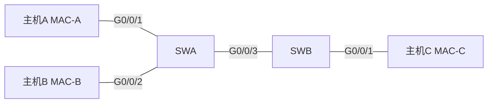

# 软考选择题真题解析（一） · 完整笔记

---

本笔记整理自「软考中级网络工程师」真题解析课第 103、104 集，共 38 道选择题，覆盖终端与网络设备、OSI 参考模型、VRP 基础操作、交换机转发与 VLAN、IP 地址与子网划分五个部分。题干与命令均按课件原始表述保留，命令按华为 VRP 语法核对；课件中被页边界遮挡、公开题库也无法还原的选项仍标注 `[文字被遮挡]`，命题本身存在歧义或版本差异的标注 `[存疑]`。本次整理对照了 2015—2021 年网络工程师上午题公开真题，在对应题目下补充「同类真题」，并把原先依赖截图的图示改为 Mermaid 拓扑图与表格。

> 阅读约定：选项后的 `[正确]` 表示该选项是本题应选答案，`[错误]` 表示不选；否定式题干（「不是」「不包括」「不支持」）的答案本身往往是一个错误表述，解析中会单独说明表述真假。题号、题序与模块划分保持原样。

---

## 1.网络设备与 OSI 参考模型

本部分共 10 题，覆盖终端设备与网络设备的区分、网络覆盖范围、OSI 各层职责、拓扑结构特性、数据封装以及光模块接口。

### 1.1 第1题：网络通信终端设备的识别

**【题目】** 以下选项中属于网络通信终端设备的是？

**【选项】**

- A. 笔记本电脑 [正确]
- B. 交换机 [错误]
- C. 路由器 [错误]
- D. 防火墙 [错误]

**【答案】** A

**【解析】** 终端设备是数据通信的起点或终点，由用户直接操作，负责产生、发送、接收和消费数据。判断标准是「是否作为数据的生产者或消费者」，而不是「是否联网」。

- A 正确：笔记本电脑运行应用程序，产生和接收数据，是典型终端。
- B 错误：交换机是网络设备，依据 MAC 地址表在同一网段内转发数据帧，本身不作为数据的起点或终点。
- C 错误：路由器是网络设备，依据 IP 地址和路由表完成跨网段转发。
- D 错误：防火墙是安全设备，部署在网络边界执行访问控制、NAT、入侵检测等，不属于终端。

服务器、网络打印机、IP 摄像头、智能电视、智能手机同样是终端；「能联网」不是区分终端与网络设备的依据。

**【考点】** 终端设备与网络设备的分类；数据通信端点的判断。

### 1.2 第2题：交换机的主要作用

**【题目】** 交换机的作用是？

**【选项】**

- A. 作为网关，实现内外网的通信 [错误]
- B. 用于实现内外网隔离，提高安全性 [错误]
- C. 构建无线网络（wifi） [错误]
- D. 用于终端接入网络 [正确]

**【答案】** D

**【解析】** 交换机的核心职责是把终端接入网络，并在同一网段内依据 MAC 地址转发数据帧，同时把每个端口划分为独立的冲突域。

- A 错误：「网关 + NAT」由路由器或防火墙完成，普通二层交换机没有路由和地址转换能力。
- B 错误：内外网隔离由防火墙、网闸、隔离网闸等安全设备完成。交换机可以划分 VLAN 隔离广播域，但这不是「内外网隔离」的主要手段。
- C 错误：无线网络需要 AP 把有线信号转换为无线信号，并由 AC 管理；交换机只提供有线以太网接口。PoE 交换机可以为 AP 供电，但仍不产生无线信号。
- D 正确：接入层交换机提供大量下行端口，计算机、打印机、摄像头等终端通过双绞线或光纤接入。

交换机的作用可以概括为「接入、二层转发、隔离冲突域、划分广播域」；路由选择、NAT、安全隔离不属于它的职责。

**【考点】** 交换机、路由器、防火墙、AP 的职责边界。

### 1.3 第3题：局域网、城域网与广域网的划分

**【题目】** 以下属于局域网的是（多选）

**【选项】**

- A. 一个企业分公司的内网 [正确]
- B. 一个大型企业北京总部和各省分公司通信的专网 [错误]
- C. 某市范围的教育网 [错误]
- D. 手机、平板、智能电视组成的家庭网络 [正确]

**【答案】** A、D

**【解析】** 按覆盖范围划分，网络可分为局域网、城域网和广域网。

| 类型 | 典型覆盖范围 | 建设与管理 | 本题对应 |
| ---- | ------------ | ---------- | -------- |
| 局域网 LAN | 房间、楼层、楼宇、园区 | 用户自建、自管 | A、D |
| 城域网 MAN | 一个城市 | 运营商或行业主管单位 | C |
| 广域网 WAN | 跨省、跨国 | 租用运营商专线 | B |

- A 正确：「分公司内网」限定在分公司园区范围内，属于局域网。
- B 错误：虽然属于同一企业的专网，但物理范围跨省，链路通常向运营商租用，属于广域网。「专网」不等于「局域网」。
- C 错误：覆盖整个城市，属于城域网。
- D 正确：家庭网络覆盖范围最小，是典型的局域网。

若把 A 改成「总部与各省分公司互联的网络」，就应判为广域网；范围题的关键是看链路跨越的地理范围，而不是看是否属于同一单位。

**【考点】** 局域网、城域网、广域网的覆盖范围与归属。

### 1.4 第4题：路由器工作的 OSI 层次

**【题目】** 路由器工作在 OSI 参考模型的哪一层？

**【选项】**

- A. 应用层 [错误]
- B. 网络层 [正确]
- C. 数据链路层 [错误]
- D. 传输层 [错误]

**【答案】** B

**【解析】** 路由器的核心功能是路由：依据目的 IP 地址查找路由表，选择出接口和下一跳，在不同网段之间转发 IP 数据报，属于网络层功能。

| 设备 | 转发依据 | 所属层次 |
| ---- | -------- | -------- |
| 集线器、中继器 | 无，信号再生与广播 | 物理层 |
| 交换机、网桥 | MAC 地址 | 数据链路层 |
| 路由器 | IP 地址、路由表 | 网络层 |
| 三层交换机 | MAC 地址 + IP 地址 | 数据链路层与网络层 |

- A 错误：应用层面向具体应用进程，如 HTTP、DNS、SMTP。
- C 错误：数据链路层依据 MAC 地址在同一链路内转发帧。
- D 错误：传输层依据端口号区分应用进程，负责端到端传输。

路由器的接口同时具备物理层和数据链路层功能，但「路由」这一核心行为发生在网络层，因此标准答案取网络层。

**【考点】** 路由器与网络层；各层寻址依据。

### 1.5 第5题：以太网交换机工作的 OSI 层次

**【题目】** 以太网交换机（非管理型）工作在 OSI 参考模型的哪一层？

**【选项】**

- A. 数据链路层 [正确]
- B. 传输层 [错误]
- C. 物理层 [错误]
- D. 网络层 [错误]

**【答案】** A

**【解析】** 交换机收到帧后，学习「源 MAC + 入接口」，再依据目的 MAC 查表转发，MAC 地址属于数据链路层的寻址标识，因此二层交换机工作在数据链路层。

- A 正确：二层转发的核心是 MAC 地址表。
- B 错误：传输层依据端口号工作，交换机不解析 TCP/UDP 端口。
- C 错误：集线器只做信号再生与广播，工作在物理层。
- D 错误：路由器依据 IP 地址工作在网络层。

管理型交换机可以配置管理 IP，用于 Telnet、SSH、Web 远程管理，但该 IP 只服务于管理平面；其数据转发平面仍然是二层转发，不能因此判为网络层。三层交换机则同时具备二层交换和三层路由功能。

**【考点】** 交换机与数据链路层；集线器、交换机、路由器的层次差异。

**【同类真题】** 2015年5月网络工程师上午题第13题：以下关于网桥和交换机的区别叙述中，正确的是（ ）。A. 交换机主要是基于软件实现，而网桥是基于硬件实现；B. 交换机定义了广播域，而网桥定义了冲突域；C. 交换机根据 IP 地址转发，而网桥根据 MAC 地址转发；D. 交换机比网桥的端口多，转发速度更快。答案 D。该题明确指出交换机和网桥都是二层设备、都基于 MAC 地址转发，可作为本题「交换机工作在数据链路层」的旁证。

### 1.6 第6题：路由器与交换机的工作层次判断

**【题目】** 以下说法正确的是？

**【选项】**

- [文字被遮挡：课件截图仅保留题干，四个选项均未进入画面；公开题库中未检索到完全一致的题目，无法还原选项文字与字母]

**【答案】** 路由器工作在网络层、交换机工作在数据链路层的表述正确（对应选项字母无法确认）[存疑]

**【解析】** 本题只能确定知识点结论，无法确定选项字母。判断设备层次的关键是看转发时依据哪种地址：

| 转发依据 | 所属层次 | 典型设备 |
| -------- | -------- | -------- |
| 比特、电平、光信号 | 物理层 | 集线器、中继器、光电转换器 |
| MAC 地址 | 数据链路层 | 交换机、网桥、网卡 |
| IP 地址 | 网络层 | 路由器、三层交换机 |
| 端口号 | 传输层 | 主机协议栈、防火墙 |
| 应用协议 | 应用层 | 代理服务器、网关应用 |

因此，若选项中出现「路由器工作在网络层」「交换机工作在数据链路层」，该表述正确；若出现「路由器工作在数据链路层」「交换机工作在网络层」「交换机工作在物理层」，均为错误表述。集线器工作在物理层，不能与交换机混为一谈。

**【考点】** 以寻址依据判断设备所属层次。

### 1.7 第7题：数据封装是否必须有尾部

**【题目】** 网络通信中，数据封装必须要有尾部（ ）

**【选项】**

- A. 对 [错误]
- B. 错 [正确]

**【答案】** B

**【解析】** 封装是在原始数据前面加上首部，必要时在末尾加上尾部。首部携带地址、控制、协议类型等信息，作用类似快递单，是绝大多数协议的必需项；尾部则按协议需要添加。

| 协议数据单元 | 首部 | 尾部 |
| ------------ | ---- | ---- |
| 以太网帧 | 目的 MAC、源 MAC、类型/长度 | FCS，4 字节 |
| IP 数据报 | 20~60 字节首部 | 无 |
| TCP 报文段 | 20~60 字节首部 | 无 |
| UDP 数据报 | 8 字节首部 | 无 |
| PPP 帧 | 地址、控制、协议等字段 | FCS |

以太网帧的 FCS 属于尾部，用于 CRC 差错检测；IP、TCP、UDP 都没有尾部。因此「数据封装必须要有尾部」的说法错误。A 错在把「首部必需」扩大成了「尾部也必需」；尾部只在以太网、PPP 等部分协议中存在。

补充：以太网最小帧长为 64 字节（不含 7 字节前导码和 1 字节 SFD），数据字段不足 46 字节时要在数据字段内填充，这不是「添加尾部」。本题若把「数据封装」狭义理解为以太网帧，容易误判为对；按封装的通用定义应判错。

**【考点】** 封装中头部与尾部的作用；以太网帧 FCS。

### 1.8 第8题：网络拓扑结构的特性

**【题目】** 以下说法正确的是？（多选）

**【选项】**

- A. 总线型拓扑的安全性低 [正确]
- B. 树型结构的拓扑易于扩充网络规模 [正确]
- C. 全网状拓扑的可靠性高 [正确]
- D. 全网状拓扑建设成本较低 [错误]

**【答案】** A、B、C

**【解析】** 四种常见拓扑的特性对比如下：

| 拓扑 | 可靠性 | 建设成本 | 扩展性 | 安全性 | 关键结论 |
| ---- | ------ | -------- | ------ | ------ | -------- |
| 总线型 | 低，总线断则全网瘫痪 | 低 | 差 | 低，共享介质易被监听 | A 正确 |
| 星型 | 依赖中心节点 | 中 | 较易 | 中 | 中心节点是单点故障 |
| 树型 | 较高 | 中 | 好，逐级分支扩展 | 中 | B 正确 |
| 全网状 | 最高，多路径绕行 | 最高 | 差，链路数增长快 | 较高 | C 正确，D 错误 |

- A 正确：总线型所有主机共享一条传输介质，任一台主机发出的信号会被总线上所有主机收到，信息容易被窃听。
- B 正确：树型结构按层次逐级分支，增加节点只需扩展对应分支，便于扩充规模。
- C 正确：全网状拓扑中任意两个节点都有直连链路，单条链路故障可由其他路径绕行，可靠性最高。
- D 错误：全网状拓扑的链路数为 n(n-1)/2，随节点数平方增长。6 个节点需要 15 条链路，建设成本最高，D 把结论说反了。

**【考点】** 总线型、树型、网状拓扑的安全性、扩展性与成本。

### 1.9 第9题：SFP 光模块与 LC 接口

**【题目】** 交换机的 sfp 光模块，使用 lc 接口的光纤（ ）

**【选项】**

- A. 对 [正确]
- B. 错 [错误]

**【答案】** A

**【解析】** 交换机的光口本身是空插槽，不能直接插光纤，必须先插入 SFP 光模块。SFP 模块完成电信号与光信号的转换，前端通常为 LC 双工接口，通过一对光纤分别收发。

- LC：小方口，体积小，密度高，是 SFP、SFP+ 光模块最常用的接口。
- SC：大方口，体积较大，常见于 GBIC 模块和部分光纤配线架。
- FC、ST：圆形卡口或卡接式接口，多见于早期网络与光纤配线。

工程选型时必须保证两端模块的单模/多模类型、波长、速率、传输距离一致，否则无法连通。例如一端是 1310nm 单模 10km，另一端是 850nm 多模 550m，即使接口都是 LC 也不能正常通信。LC 与 SC 是不同接头，不能直接互插，需要更换模块或使用转接跳线。B 项错误：SFP 模块前端通常就是 LC 接口，题干描述与工程实际一致，不能判错。

**【考点】** SFP 光模块；LC、SC 接口的识别与选型。

**【同类真题】** 2018年11月网络工程师上午题第48题：路由器的（ ）接口通过光纤连接广域网。A. SFP 端口；B. 同步串行口；C. Console 接口；D. AUX 端口。答案 A。该题与本题同考 SFP 光口，且进一步说明 SFP 模块用于把电信号转换为光信号、连接光纤链路。2017年5月上午题第14题也以「路由器通过光纤连接广域网接口」考过同一知识点，答案为 SFP 端口。

### 1.10 第10题：OSI 网络层的功能

**【题目】** 关于 OSI 参考模型中网络层的功能说法正确的是？

**【选项】**

- A. 在设备之间传输比特流，规定了电平、速度和电缆针脚 [错误]
- B. OSI 参考模型中最靠近用户的那一层，为应用程序提供网络服务 [错误]
- C. 提供面向连接或非面向连接的数据传递以及进行重传前的差错检测 [错误]
- D. 将比特组合成字节，再将字节组合成帧，使用链路层地址（以太网使用 MAC 地址）来访问介质，并进行差错检测 [错误]
- E. 提供逻辑地址（如 IP 地址），实现数据从源到目的地的转发 [正确]

**【答案】** E

**【解析】** 本题把 OSI 五层的主要功能各描述了一遍，逐项对应即可。

| 选项 | 描述的核心功能 | 对应层次 |
| ---- | -------------- | -------- |
| A | 比特流、电平、速度、电缆针脚 | 物理层 |
| B | 最靠近用户、为应用程序提供网络服务 | 应用层 |
| C | 面向连接/无连接、重传前的差错检测 | 传输层 |
| D | 成帧、MAC 地址、介质访问控制、差错检测 | 数据链路层 |
| E | 逻辑地址（IP）、源到目的转发 | 网络层 |

- A 错误：物理层负责在传输介质上透明传输比特流，规定机械、电气、功能和规程特性。
- B 错误：应用层最靠近用户，直接为应用程序提供网络服务。
- C 错误：传输层提供面向连接的 TCP 和无连接的 UDP，负责端到端传输、流量控制、重传与差错检测。
- D 错误：数据链路层把比特组织成帧，使用 MAC 地址访问介质，并用 FCS 做差错检测。
- E 正确：网络层提供逻辑地址（IP），通过路由选择把数据报从源主机转发到目的主机。

补充区分三层差错检测：网络层 IPv4 首部校验和只校验首部；数据链路层 FCS 校验整个帧；传输层 TCP 校验和覆盖首部、数据和伪首部。

**【考点】** OSI 七层模型中各层功能的对应关系。

**【同类真题】** 2016年11月网络工程师上午题第51题：如果路由器显示「Serial 1 is down，line protocol is down」故障信息，则问题出在 OSI 参考模型的（ ）。A. 物理层；B. 数据链路层；C. 网络层；D. 会话层。答案 A。该题同样要求把具体现象映射到 OSI 层次：接口物理层 down 时，线路协议也无法建立，故定位物理层。

---

## 2.华为 VRP 基础操作

本部分共 10 题，覆盖设备配置方式、命令行编辑与报错提示、VRP 文件操作、配置保存与启动配置、恢复出厂配置以及远程管理权限。

### 2.1 第11题：华为设备不支持的配置方式

**【题目】** 华为网络设备不支持哪种方式对设备进行配置？

**【选项】**

- A. 通过 mini USB 口对路由器进行配置 [错误]
- B. 通过 FTP 对路由器进行配置 [正确]
- C. 通过 console 口对路由器进行配置 [错误]
- D. 通过 telnet 对路由器进行配置 [错误]

**【答案】** B

**【解析】** 华为设备的配置入口主要有以下几类：

| 方式 | 性质 | 说明 |
| ---- | ---- | ---- |
| Console（RJ-45 或 mini USB） | 带外管理 | 直连设备，不依赖 IP，首次上电和救援时使用 |
| Telnet | 带内管理 | TCP 23，明文传输，安全性低 |
| SSH | 带内管理 | TCP 22，加密传输，替代 Telnet |
| HTTPS/Web | 带内管理 | TCP 443，图形化网管 |
| SNMP | 带内管理 | 监控与部分配置，不是命令行配置 |
| FTP/TFTP | 文件传输 | 上传下载镜像、配置文件，不提供命令行配置会话 |

- A 错误：部分华为路由器的 mini USB 口就是 Console 口，可以用 USB 线连接电脑进行本地配置。
- B 正确：FTP 只用于文件传输。可以上传系统镜像完成升级，也可以上传、下载配置文件，甚至把上传的配置文件指定为下次启动文件，从而间接改变配置；但 FTP 本身不能进入 system-view 下发命令，不能像 Telnet 那样交互式配置设备。
- C 错误：Console 是最基础的本地配置方式。
- D 错误：Telnet 是常用的远程配置方式。

本题问「不支持哪种方式对设备进行配置」，按「能否进入命令行交互配置」判断，选 B。若题目问「哪种方式可用于备份配置文件」，FTP 是可以的，注意区分。

**【考点】** 带内管理与带外管理；FTP 的功能边界。

### 2.2 第12题：调出上一条历史命令

**【题目】** 在网络设备上，可以通过下面哪种方式访问上一条历史命令（ ）

**【选项】**

- A. Ctrl+P [正确]
- B. 上光标键 [正确]
- C. Ctrl+U [错误]
- D. 左光标 [错误]

**【答案】** A、B

**【解析】** 华为 VRP 命令行支持历史命令缓存，常用快捷键如下：

| 操作 | 快捷键 |
| ---- | ------ |
| 上一条历史命令 | 上光标键、Ctrl+P |
| 下一条历史命令 | 下光标键、Ctrl+N |
| 删除光标左侧内容 | Ctrl+U |
| 光标左移一位 | 左光标键 |
| 光标移到行首 | Ctrl+A |
| 光标移到行尾 | Ctrl+E |
| 补全唯一关键字 | Tab |

- A 正确：Ctrl+P 取出历史缓存区中的前一条命令。
- B 正确：上光标键与 Ctrl+P 等价。
- C 错误：Ctrl+U 删除光标左侧的字符，不调取历史命令。
- D 错误：左光标键只移动光标位置，不改变命令行内容。

B 项文字在原课件截图中未进入画面，现按华为 HCIA 题库同题补全为「上光标键」。该题库原文为「上光标为访问上条历史命令，Ctrl+P 为显示历史缓存区的前一条命令」，与本题判断一致；选项字母仍以课件为准。

**【考点】** VRP 命令行快捷键与历史命令缓存。

### 2.3 第13题：命令不完整的报错提示

**【题目】** 输入命令不完整时，会出现下列哪条信息提示？

**【选项】**

- A. Error: Too many parameters found at '^' position [错误]
- B. Error: wrong parameter found at '^' position [错误]
- C. Error: incomplete command found at '^' position [正确]
- D. Error: ambiguous command found at '^' position [错误]

**【答案】** C

**【解析】** VRP 命令行会把四类典型输入错误区分为四条提示，`^` 指向出错位置。

| 提示 | 含义 | 示例 |
| ---- | ---- | ---- |
| Too many parameters found | 参数个数超过命令模板 | `vlan 100 200`，`vlan` 只接受一个 VLAN ID |
| Wrong parameter found | 参数类型或取值范围非法 | `vlan abc`，VLAN ID 位置输入了字母 |
| Incomplete command found | 命令未输完，缺少关键字或参数 | 只输入 `vlan` 后直接回车 |
| Ambiguous command found | 缩写过于简略，匹配到多条命令 | 在系统视图输入 `i`，可能同时匹配 `interface`、`ip`、`info-center` 等多条命令 |

题干问「命令不完整」，对应 Incomplete command，选 C。VRP 实际回显首字母大写，如 `Error: Incomplete command found at '^' position.`，选项中的小写不影响判断。

排错方法：在当前位置输入 `?`，系统会列出可用的关键字和参数；输入 Tab 可补全唯一匹配的关键字。若提示 ambiguous，说明缩写不够长，需要多输入几个字符。

**【考点】** VRP 命令行的四类典型报错及排错方法。

### 2.4 第14题：mkdir 创建目录

**【题目】** 华为的 VRP 操作平台中使用命令 mkdir test，系统会创建一个名字为 test 的目录。（ ）

**【选项】**

- A. 对 [正确]
- B. 错 [错误]

**【答案】** A

**【解析】** `mkdir` 用于在设备文件系统中创建目录，命令格式为 `mkdir <目录名>`。在设备当前目录下执行 `mkdir test`，即创建名为 test 的子目录。

相关命令：

| 命令 | 作用 |
| ---- | ---- |
| `mkdir test` | 在当前目录下创建 test 目录 |
| `dir` | 列出当前目录下的文件和子目录 |
| `cd test` | 进入 test 目录 |
| `pwd` | 显示当前工作目录 |
| `rmdir test` | 删除空目录 |

创建成功后，`dir` 输出中该目录名前会显示 `d` 标记，表示 directory。B 项错误：`mkdir test` 是合法的 VRP 命令，会在当前目录创建 test 目录，题干描述正确。课件个别页面把命令写作 `mkdir dir test`，其中 `dir` 并非 VRP 关键字，应视为笔误或示意；实际在设备上执行 `mkdir test` 即可。

**【考点】** VRP 文件系统操作；`mkdir`、`dir`、`cd`、`pwd`。

### 2.5 第15题：pwd 与 dir 的区别

**【题目】** VRP 操作平台中 pwd 和 dir 命令都可以查看当前目录下的文件信息。（ ）

**【选项】**

- A. 对 [错误]
- B. 错 [正确]

**【答案】** B

**【解析】** `pwd` 与 `dir` 的功能不同，不能互相替代。

| 命令 | 作用 | 是否列出文件与子目录 |
| ---- | ---- | -------------------- |
| `pwd` | 显示当前所处的工作目录路径 | 否 |
| `dir` | 列出当前目录下的文件、子目录、大小、修改时间 | 是 |
| `cd` | 切换当前工作目录 | 否 |

题干说「pwd 和 dir 都可以查看当前目录下的文件信息」，把 `pwd` 的作用说成了 `dir` 的作用，因此错误。A 项错在混淆了「显示路径」与「列出目录内容」两个功能。

标准排查顺序：先用 `pwd` 确认当前所在目录，再用 `dir` 查看目录内容；进入子目录用 `cd`，返回上级用 `cd ..`。

**【考点】** `pwd` 与 `dir` 的功能区分。

### 2.6 第16题：save 命令的作用

**【题目】** 华为 AR 路由器的命令行界面下，save 命令的作用是保存当前的系统时间（ ）

**【选项】**

- A. 对 [错误]
- B. 错 [正确]

**【答案】** B

**【解析】** `save` 把 RAM 中的当前运行配置写入设备的存储介质，默认文件为 `vrpcfg.zip`，使设备断电重启后配置仍然生效。它不负责系统时间。

时间相关命令：

| 命令 | 作用 |
| ---- | ---- |
| `clock datetime HH:MM:SS YYYY-MM-DD` | 设置系统日期和时间 |
| `clock timezone 名称 add HH:MM:SS` | 设置时区 |
| `display clock` | 查看当前时间 |

配置管理相关命令：

| 命令 | 作用 |
| ---- | ---- |
| `display current-configuration` | 查看当前运行配置（RAM） |
| `display saved-configuration` | 查看已保存配置（存储介质） |
| `save` | 把当前配置保存到存储介质 |
| `compare configuration` | 比较当前配置与保存配置的差异 |

执行 `save` 时系统可能提示 `Are you sure to continue? [Y/N]`，确认后写入。若配置完成后未执行 `save` 就重启，未保存的配置会全部丢失。A 项错误：`save` 保存的是配置文件，不是系统时间，题干把两个完全不同的功能混在一起。

**【考点】** 当前配置与保存配置；`save` 命令；系统时间设置。

**【同类真题】** 2016年11月网络工程师上午题第50题：把路由器当前配置文件存储到 NVRAM 中的命令是（ ）。A. `Router(config)#copy current to starting`；B. `Router#copy starting to running`；C. `Router(config)#copy running-config starting-config`；D. `Router#copy run startup`。答案 D。该题考的是 Cisco 的等价操作：把 running-config 保存为 startup-config；华为对应命令就是 `save`，两者都是把运行配置持久化，区别只在厂商语法。

### 2.7 第17题：指定下次启动配置文件

**【题目】** VRP 界面下，使用命令 startup saved-configuration backup.cfg，配置下次启动时使用 backup.cfg 文件（ ）

**【选项】**

- A. 对 [正确]
- B. 错 [错误]

**【答案】** A

**【解析】** `startup saved-configuration <文件名>` 用于指定设备下次启动时加载的配置文件。执行后可用 `display startup` 查看：

- Current startup saved-configuration file：本次启动使用的配置文件。
- Next startup saved-configuration file：下次启动将使用的配置文件。
- Startup system software：下次启动加载的系统镜像。

使用该命令有两个前提：backup.cfg 必须已经存在于设备存储介质中；文件名要与实际文件一致。该命令只改变「下次启动」的加载对象，不改变当前运行配置，也不立即重启设备。

典型场景：修改配置前先备份为 backup.cfg，新配置调试失败后执行 `startup saved-configuration backup.cfg`，再 `reboot`，设备就会用备份配置启动，实现配置回退。B 项错误：该命令的语义就是指定下次启动加载的配置文件，题干描述与命令功能一致，不能判错。

**【考点】** 配置文件管理与回退；`display startup`。

### 2.8 第18题：恢复初始配置的必要操作

**【题目】** 一台 AR2200 路由器需要恢复初始配置，则下面哪些操作是必须的？（ ）

**【选项】**

- A. 重置 saved configuration [正确]
- B. 清除 current configuration [错误]
- C. 重启该 AR2200 路由器 [正确]
- D. 重新指定下次启动加载的配置文件 [错误]

**【答案】** A、C

**【解析】** 恢复出厂的实质是让设备下次启动时找不到已保存的配置文件。

正确步骤：

1. 执行 `reset saved-configuration`，删除存储介质中已保存的配置文件（通常是 `vrpcfg.zip`），按提示确认。
2. 执行 `reboot` 重启设备；若重启时提示是否保存当前配置，应选择不保存，避免把当前配置又写回存储介质。
3. 设备在没有配置文件的情况下启动，进入出厂初始状态。

- A 正确：不删除已保存配置，重启后原配置会重新加载。
- B 错误：`reset current-configuration` 只清除 RAM 中的当前运行配置，不删除保存文件；单独执行它，重启后旧配置依然恢复。
- C 正确：删除保存文件后必须重启，设备才会以出厂状态重新初始化。
- D 错误：`startup saved-configuration` 是切换下次启动加载的配置文件，不是恢复出厂；若指定的仍是旧配置文件，重启后配置不会清空。

**【考点】** `reset saved-configuration` 与 `reboot` 的配合；运行配置与保存配置的区别。

### 2.9 第19题：网络设备的配置管理方式

**【题目】** 常见的网络设备支持通过哪几种方式对路由器进行配置？（ ）

**【选项】**

- A. 通过 Telnet 对路由器进行配置 [正确]
- B. 通过 Console 口对路由器进行配置 [正确]
- C. 通过 HTTPS 对路由器进行配置 [正确]
- D. 通过 SSH 对路由器进行配置 [正确]

**【答案】** A、B、C、D

**【解析】** 四种方式都属于常见的设备配置手段，区别在带内/带外与安全性。

| 方式 | 带内/带外 | 默认端口 | 特点 |
| ---- | --------- | -------- | ---- |
| Console | 带外 | 无 | 配置线直连，不依赖 IP，首次上电和远程不可达时救援 |
| Telnet | 带内 | TCP 23 | 明文传输，用户名和密码可被嗅探 |
| SSH | 带内 | TCP 22 | 加密传输，安全性高于 Telnet，生产环境优先 |
| HTTPS | 带内 | TCP 443 | 浏览器图形化网管，操作直观 |

- A 正确：Telnet 需要设备管理 IP 可达，属于带内管理。
- B 正确：Console 不依赖网络，属于带外管理。
- C 正确：华为设备支持 HTTPS Web 网管，通过浏览器完成配置。
- D 正确：SSH 提供加密的远程命令行。

补充：AUX 口通过 Modem 拨号也属于带外管理，但本题未列出；SNMP 主要用于监控，不属于本题的配置方式。

**【考点】** 带内管理与带外管理；Telnet、SSH、HTTPS 的差异。

**【同类真题】** 2017年5月网络工程师上午题第14题：路由器与计算机串行接口连接，利用虚拟终端对路由器进行本地配置的接口是（ ），路由器通过光纤连接广域网接口是（ ）。第一空选项 A. Console 口、B. 同步串行口、C. SFP 端口、D. AUX 端口；第二空选项相同。答案 A、C。该题第一空直接考 Console 本地配置，第二空考 SFP 光纤接口，可作为本题 B 项与第9题的共同旁证。

### 2.10 第20题：Telnet 登录后无法配置接口 IP

**【题目】** 管理员通过 Telnet 成功登录路由器后，发现无法配置路由器的接口 IP 地址。那么可能的原因有（ ）

**【选项】**

- A. Telnet 用户的认证方式配置错误 [错误]
- B. 管理员使用的 Telnet 终端软件禁止相应操作 [错误]
- C. Telnet 用户的级别配置错误 [正确]
- D. SNMP 参数配置错误 [错误]

**【答案】** C

**【解析】** 题目给出的关键信息是「成功登录」，说明认证已经通过，问题出在登录之后的授权环节。

- A 错误：认证方式错误会导致登录失败，而不是登录成功后无法配置。
- B 错误：SecureCRT、PuTTY 等终端软件只负责字符收发和终端仿真，不会限制设备端的命令权限。
- C 正确：VRP 用户级别为 0~15，级别决定可执行的命令范围。级别不足时无法进入 system-view，也就不能进入接口视图配置 IP 地址。
- D 错误：SNMP 是独立的网络管理协议，用于监控和部分配置，与 Telnet 命令行的权限无关。

排查与解决：

| 操作 | 作用 |
| ---- | ---- |
| `display users` | 查看当前登录用户及其级别 |
| `display local-user` | 查看本地用户及权限 |
| `local-user 用户名 privilege level 15` | 在 AAA 视图提升本地用户级别 |
| `user-privilege level 15` | 在 VTY 视图设置 Telnet 用户默认级别 |

核心是区分「认证」与「授权」：认证回答「你是谁」，授权回答「你能做什么」。登录成功只证明认证通过，授权不足仍然不能配置。

**【考点】** AAA 本地用户级别；Telnet 权限排障。

---

## 3.交换机工作原理与 VLAN

本部分共 8 题，覆盖交换机 MAC 地址学习与转发、CSMA/CD 机制、VLAN 的作用，以及 Access、Trunk、Hybrid 三种接口的标签处理规则。

### 3.1 第21题：单播帧命中 MAC 地址表后的处理

**【题目】** 交换机收到一个单播数据帧，如果该数据帧目的 MAC 在 MAC 地址表中能够找到，则此数据帧一定会从此 MAC 对应端口转发出去。（ ）

**【选项】**

- A. 对 [错误]
- B. 错 [正确]

**【答案】** B

**【解析】** 交换机查表后还要比较出接口与入接口，不能机械地「查表即转发」。

| 条件 | 处理动作 |
| ---- | -------- |
| 目的 MAC 未命中 | 除入接口外泛洪 |
| 命中，出接口与入接口不同 | 从对应出接口定向转发 |
| 命中，出接口与入接口相同 | 丢弃 |
| 目的地址为广播或未知组播 | 泛洪 |

同端口丢弃的典型场景：目的主机与源主机接在同一个集线器网段，帧从该网段进入交换机后，查表发现目的 MAC 对应的出接口正是这个入接口；此时目的主机已经通过集线器收到了该帧，交换机若再从同一接口发回，只会造成重复帧。网络存在临时环路时，帧也可能从多个方向回到同一交换机，触发同样的丢弃逻辑。

除同端口外，以下情况也不会转发：出接口被 STP 阻塞、帧的 VLAN 与出接口允许的 VLAN 不匹配、MAC 表项为黑洞或指向空接口、端口处于 down 状态、帧校验失败被丢弃。因此「一定会转发」错误。A 项错在忽略了「出接口等于入接口时丢弃」这一例外，「一定」过于绝对。

**【考点】** 交换机转发三原则：同端口丢弃、命中表项定向转发、未命中泛洪。

**【同类真题】** 2016年5月网络工程师上午题第11题：以下关于以太网交换机地址学习机制的说法中，错误的是（ ）。A. 交换机的初始 MAC 地址表为空；B. 交换机接收到数据帧后，如果没有相应的表项，则不转发该帧；C. 交换机通过读取输入帧中的源地址添加相应的 MAC 地址表项；D. 交换机的 MAC 地址表项是动态变化的。答案 B。该题的错误项正是「未命中不转发」，实际应泛洪，与本题同考交换机的基本转发规则。

### 3.2 第22题：CSMA/CD 的工作原理

**【题目】** 以下哪项不是 CSMA/CD 的工作原理？

**【选项】**

- A. 边发边听 [错误]
- B. 延迟固定时间后重发 [正确]
- C. 冲突停发 [错误]
- D. 随机延迟后重发 [错误]
- E. 先听后发 [错误]

**【答案】** B

**【解析】** CSMA/CD 的完整流程是「先听后发、边发边听、冲突停发、随机重发」。

1. 先听后发：发送前监听信道，空闲才发送；忙则继续监听。
2. 边发边听：发送过程中继续检测冲突。
3. 冲突停发：检测到冲突立即停止发送，并发送强化信号，让所有站点都感知到冲突。
4. 随机重发：按二进制指数退避算法等待一个随机时间后重试。

二进制指数退避：第 n 次冲突后，从 0 到 2^k−1 个时隙中随机取一个，k = min(n, 10)；连续冲突 16 次仍失败则丢弃该帧并向高层报告。

- A、C、E 都是 CSMA/CD 的真实机制。
- B 不是：若所有冲突站点都等待同一个固定时间，它们会在同一时刻再次同时发送，仍然冲突；只有随机等待才能把重发时刻错开。

补充：10Mb/s 以太网的时隙为 51.2μs，最小帧长为 64 字节，二者共同保证发送站能在帧发送完毕前检测到最远端的冲突。

**【考点】** CSMA/CD 四步流程；二进制指数退避；冲突窗口与最小帧长。

**【同类真题】** 2015年11月网络工程师上午题第47题：以下关于 CSMA/CD 协议的叙述中，正确的是（ ）。A. 每个结点按照逻辑顺序占用一个时间片轮流发送；B. 每个结点检查介质是否空闲，如果空闲则立即发送；C. 每个结点想发就发，如果没有冲突则继续发送；D. 得到令牌的结点发送，没有得到令牌的结点等待。答案 B。该题对应「先听后发」，A、D 描述的是令牌环等受控访问机制，C 忽略了发送前监听。

### 3.3 第23题：MAC 地址表的学习结果

**【题目】** 如下图所示，所有主机之间都可以正常通信，下列说法正确的有？



**【选项】**

- A. SWB 的 G0/0/3 学习到 2 个 mac 地址 [正确]
- B. SWA 的 G0/0/3 学习到 1 个 mac 地址 [正确]
- C. SWA 的 G0/0/3 学习到 2 个 mac 地址 [错误]
- D. SWA 的 G0/0/3 学习到 3 个 mac 地址 [错误]

**【答案】** A、B

**【解析】** 交换机按「源 MAC + 接收端口」学习表项，收到帧时先学习源地址，再按目的地址转发。

| 交换机 | 接口 | 学习到的 MAC | 数量 |
| ------ | ---- | ------------ | ---- |
| SWA | G0/0/1 | MAC-A | 1 |
| SWA | G0/0/2 | MAC-B | 1 |
| SWA | G0/0/3 | MAC-C | 1 |
| SWB | G0/0/1 | MAC-C | 1 |
| SWB | G0/0/3 | MAC-A、MAC-B | 2 |

- A 正确：SWB 的 G0/0/3 是通往 SWA 的互联口，会收到主机 A、B 发出的帧，因此学习到 MAC-A、MAC-B 两个表项。
- B 正确：SWA 的 G0/0/3 是通往 SWB 的互联口，只会收到主机 C 发出的帧，因此只学习到 MAC-C 一个表项。
- C 错误：SWA 的 G0/0/3 不会收到 A、B 的帧。A、B 的帧进入 SWA 后，依据 MAC 表从 G0/0/1、G0/0/2 发出，不会再从 G0/0/3 发出。
- D 错误：SWA 的 G0/0/3 只对应主机 C 一个源 MAC，不可能学习到 3 个。

注意：交换机之间互发的是数据帧时，对端交换机的 MAC 也不会作为「主机 MAC」被学习，因为交换机自身通常不产生用户数据帧；STP BPDU 也不进入普通 MAC 地址表。实验验证：两台交换机互 ping 后各自查看 MAC 地址表，均显示 3 条表项，其中互联的 G0/0/3 端口上，SWA 为 1 条、SWB 为 2 条，与推理一致。

**【考点】** MAC 地址表学习机制；互联端口的表项数量。

**【同类真题】** 2015年11月网络工程师上午题第48题：以下关于交换机获取与其端口连接设备的 MAC 地址的叙述中，正确的是（ ）。A. 交换机从路由表中提取设备的 MAC 地址；B. 交换机检查端口流入分组的源地址；C. 交换机之间互相交换地址表；D. 由网络管理员手工输入设备的 MAC 地址。答案 B。该题直接考「依据入帧源 MAC 学习」，与本题表项数量的推导依据相同。

### 3.4 第24题：VLAN 的主要作用

**【题目】** VLAN（虚拟局域网）的主要作用不包括以下哪一项？

**【选项】**

- A. 隔离广播域 [错误]
- B. 提高物理传输带宽 [正确]
- C. 增强网络安全性 [错误]
- D. 简化网络管理 [错误]

**【答案】** B

**【解析】** 本题为否定式提问，要选「不属于 VLAN 作用」的一项。选项后的判断表示是否为本题答案，A、C、D 的表述本身是成立的，只是不符合「不包括」的要求。

- A 成立：VLAN 在二层把一台交换机逻辑划分为多个广播域，广播帧只在同一 VLAN 内泛洪，从而隔离广播、抑制广播风暴。
- B 不成立：接口的物理速率由硬件、线缆和链路协商决定，千兆口不会因为划分 VLAN 变成两千兆。VLAN 是逻辑划分，不增加物理带宽；跨 VLAN 通信还要经过三层转发，反而可能增加开销。
- C 成立：广播域缩小后，ARP 欺骗、私设 DHCP、DHCP 饿死等基于广播的攻击被限制在单个 VLAN 内，攻击面变小。
- D 成立：按部门划分 VLAN 后，增加、移除、移动主机只需修改端口配置，不必重新布线；故障和地址冲突也被限制在小范围内。

补充区分：VLAN 隔离的是广播域，不是冲突域。交换机的每个端口本身就是一个冲突域；集线器的所有端口才共享一个冲突域。不同 VLAN 之间默认不能二层互通，需要路由器或三层交换机做单臂路由或 VLANIF 接口。

**【考点】** VLAN 的四大作用；广播域与冲突域的区别；VLAN 间通信。

**【同类真题】** 2021年5月网络工程师上午题第55题：当网络中充斥着大量广播包时，可以采取（ ）措施解决问题。A. 客户端通过 DHCP 获取 IP 地址；B. 增加接入层交换机；C. 创建 VLAN 来划分更小的广播域；D. 网络结构修改为仅有核心层和接入层。答案 C。该题正面考「VLAN 隔离广播域」，与本题 A 项互为印证。2015年5月上午题第22题则从另一角度考 VLAN 的作用，标准答案只取「简化在网络中增加、移除和移动主机的操作」，说明该题不把「对分组过滤」视为 VLAN 的主要作用。

### 3.5 第25题：Trunk 配置片段的正误判断

**【题目】** 观察以下配置片段：

```text
interface GigabitEthernet0/0/1
port link-type trunk
port trunk allow-pass vlan 2 to 4094
```

关于此接口的描述，正确的是：

**【选项】**

- A. 该接口允许 VLAN 1 的流量通过 [正确]
- B. 该接口不允许 VLAN 1 的流量通过 [错误]
- C. 该接口是一个 Hybrid 接口 [错误]
- D. 该接口的 PVID 肯定是 1 [错误]

**【答案】** A

**【解析】** 华为 Trunk 接口有两个缺省行为：缺省已加入 VLAN 1，缺省 PVID 为 1。`port trunk allow-pass vlan 2 to 4094` 是在允许列表里追加 VLAN 2~4094，并不会删除 VLAN 1。

- A 正确：VLAN 1 仍在允许列表中，其流量可以通过。
- B 错误：与 A 相反，VLAN 1 没有被过滤。
- C 错误：`port link-type trunk` 已明确指定接口类型为 Trunk，不是 Hybrid。
- D 错误：仅就可见的三行而言，PVID 缺省为 1；但配置片段可能被截断，若后面还有 `port trunk pvid vlan 20`，PVID 就不是 1。「肯定」过于绝对，按单选题的命题逻辑判错。

本题 D 项在原笔记中标为 `[存疑]`。现按「绝对化表述」判错：考试给出的是配置片段，不是完整配置，不能排除后续命令修改 PVID；若题目明确说明「该片段为完整配置」且为多选，D 也可以成立。

验证命令：`display port vlan` 可查看接口的 PVID、允许通过的 VLAN 列表和 Link Type；`display interface brief` 查看接口状态。实验验证：只配置上述三条命令后，VLAN 1 的主机仍可跨交换机通信，说明 VLAN 1 未被过滤。

**【考点】** 华为 Trunk 缺省允许 VLAN 1；配置片段的完整性；PVID 缺省值。

**【同类真题】** 2019年5月网络工程师上午题第50题：默认管理 VLAN 是（ ）。A. VLAN 0；B. VLAN 1；C. VLAN 10；D. VLAN 100。答案 B。该题直接考华为/H3C 体系的缺省 VLAN 1，是本题 A 项「VLAN 1 缺省已加入 Trunk」的同一知识点。2021年5月上午题第53题还考过 `display port vlan` 查看「VLAN 和 Link Type」、`port link-type trunk` 修改「接口类型」，可作为本题验证命令的补充。

### 3.6 第26题：数据帧从 Trunk 口发出的标签状态

**【题目】** 网络管理员在一台交换机上进行了如下配置：

```text
vlan batch 10 20
interface GigabitEthernet0/0/1
port link-type access
port default vlan 10
interface GigabitEthernet0/0/2
port link-type trunk
port trunk allow-pass vlan 10 20
port trunk pvid vlan 20
```

那么，当一台计算机连接到 G0/0/1 端口并发送一个数据帧时，以下说法正确的是：

**【选项】**

- A. 该数据帧从 G0/0/2 端口发出时不会携带 VLAN 标签 [错误]
- B. 该数据帧从 G0/0/2 端口发出时会携带 VLAN 10 的标签 [正确]
- C. 该数据帧从 G0/0/2 端口发出时会携带 VLAN 20 的标签 [错误]
- D. 该数据帧无法从 G0/0/2 端口发出 [错误]

**【答案】** B

**【解析】** 数据帧的标签变化可以分为三段：


| 环节 | VLAN 身份 | 标签状态 |
| ---- | --------- | -------- |
| 主机发出 | 无 | Untagged |
| 进入 G0/0/1 | Access 口 PVID 10 | 打上 Tag 10 |
| 交换机内部转发 | VLAN 10 | 带 Tag 10 |
| 从 G0/0/2 发出 | VLAN 10，PVID 为 20 | VLAN 10 不等于 PVID，保留 Tag 10 |

- A 错误：Trunk 口只对 PVID 对应的 VLAN 剥离标签，VLAN 10 不是 PVID，故带标签发出。
- B 正确：帧属于 VLAN 10，出接口允许 VLAN 10 通过，且 VLAN 10 不等于 PVID 20，因此携带 VLAN 10 的标签。
- C 错误：VLAN 20 是 PVID，若真有 VLAN 20 的帧从该口发出，才会剥离标签；本题帧来自 VLAN 10。
- D 错误：`port trunk allow-pass vlan 10 20` 已放行 VLAN 10，帧可以发出。

若对端 Trunk 的 PVID 也是 10，对端收到的是带 Tag 10 的帧，进入对端交换机后仍属 VLAN 10；只有当帧从对端的 Access 口或 PVID 为 10 的 Trunk 口发出时，才会剥离标签。实验验证：在 G0/0/2 抓包可见 ICMP 报文携带 802.1Q 标签，VLAN ID 为 10，与解析一致。

**【考点】** Access 口打标签、Trunk 口 PVID 剥离标签的规则。

**【同类真题】** 2015年11月网络工程师上午题第50题：用来承载多个 VLAN 流量的协议组是（ ）。A. 802.11a 和 802.1q；B. ISL 和 802.1q；C. ISL 和 802.3ab；D. SSL 和 802.11b。答案 B。该题考 Trunk 链路上的两种标签封装：IEEE 802.1Q 标准标签和 Cisco 私有 ISL，与本题「Trunk 链路携带 VLAN 标签」属于同一知识背景。

### 3.7 第27题：Hybrid 口剥离标签的 VLAN

**【题目】** 交换机某个端口配置信息如下，则此端口在发送携带哪些 VLAN 的数据帧时剥离 VLAN TAG？

```text
#
interface GigabitEthernet0/0/1
port hybrid tagged vlan 2 to 3 100
port hybrid untagged vlan 4 6
#
```

**【选项】**

- A. 4,5,6 [错误]
- B. 4,6 [错误]
- C. 1,4,6 [正确]
- D. 1,4,5,6 [错误]

**【答案】** C

**【解析】** Hybrid 口的发送规则是：以 `untagged` 方式加入的 VLAN，发送时剥离标签；以 `tagged` 方式加入的 VLAN，发送时保留标签。此外，华为 Hybrid 口缺省以 Untagged 方式加入 VLAN 1。

| VLAN | 配置方式 | 发送时标签 |
| ---- | -------- | ---------- |
| 1 | 缺省 Untagged | 剥离 |
| 2 | tagged | 保留 |
| 3 | tagged | 保留 |
| 4 | untagged | 剥离 |
| 5 | 未加入允许列表 | 不发送 |
| 6 | untagged | 剥离 |
| 100 | tagged | 保留 |

因此剥离标签的是 VLAN 1、4、6，选 C。

- A 错误：VLAN 5 没有被加入允许列表，根本不会从该口发送，更谈不上剥离标签。
- B 错误：漏掉了缺省以 Untagged 方式加入的 VLAN 1。
- D 错误：既多算了 VLAN 5，又漏掉了 VLAN 1 的缺省行为。

补充：`port hybrid pvid vlan X` 修改的是 PVID，决定入方向无标签帧归入哪个 VLAN；出方向是否剥离标签由 tagged/untagged 列表决定，两者不要混淆。实验验证：`display vlan` 输出中，VLAN 1 显示为 `UT:GE0/0/1(U)`，VLAN 4、6 为 UT，VLAN 2、3、100 为 TG，与解析一致。

**【考点】** Hybrid 口 tagged/untagged 规则；VLAN 1 的缺省行为。

### 3.8 第28题：Trunk 口剥离哪个 VLAN 的标签

**【题目】** 交换机某个端口配置信息如下，则此端口发送携带哪个 VLAN TAG 的数据帧时，剥离 VLAN TAG？

```text
#
interface GigabitEthernet0/0/1
port link-type trunk
port trunk pvid vlan 10
port trunk allow-pass vlan 10 20 30 40
#
```

**【选项】**

- A. 10 [正确]
- B. 20 [错误]
- C. 30 [错误]
- D. 40 [错误]

**【答案】** A

**【解析】** Trunk 口在发送方向只对 PVID 所对应的 VLAN 剥离标签，其余允许通过的 VLAN 一律带标签发出。

| VLAN | 与 PVID 的关系 | 出方向标签 |
| ---- | -------------- | ---------- |
| 10 | 等于 PVID | 剥离 |
| 20 | 不等于 PVID | 保留 Tag |
| 30 | 不等于 PVID | 保留 Tag |
| 40 | 不等于 PVID | 保留 Tag |

本例 PVID 为 10，故 VLAN 10 的帧不带标签，VLAN 20、30、40 的帧均带标签，选 A。

Hybrid 与 Trunk 的关键差别：Hybrid 可以同时对多个 untagged VLAN 剥离标签；Trunk 只能对 PVID 一个 VLAN 剥离。若把 PVID 改为 20，则改为剥离 VLAN 20 的标签，说明 PVID 是「唯一可剥离」的那个 VLAN。

**【考点】** Trunk 口 PVID 与标签剥离；Trunk 与 Hybrid 的差异。

---

## 4.IP 地址与子网划分

本部分共 10 题，覆盖掩码的简写表示、可用主机数计算、特殊地址、网络地址与广播地址的求法，以及按主机数需求反推子网掩码。

### 4.1 第29题：子网掩码的简写表示

**【题目】** 子网掩码 255.255.255.0 对应的简写表示法是？

**【选项】**

- A. /16 [错误]
- B. /24 [正确]
- C. /32 [错误]
- D. /8 [错误]

**【答案】** B

**【解析】** 简写表示法统计掩码中连续 1 的个数。255 的二进制为 11111111，含 8 个 1；三个 255 共 24 个 1，最后一个 0 不含 1，因此前缀长度为 /24。

常用换算：

| 前缀 | 掩码 | 地址块大小 | 每子网地址数 |
| ---- | ---- | ---------- | ------------ |
| /8 | 255.0.0.0 | 16777216 | 16777216 |
| /16 | 255.255.0.0 | 65536 | 65536 |
| /24 | 255.255.255.0 | 256 | 256 |
| /25 | 255.255.255.128 | 128 | 128 |
| /26 | 255.255.255.192 | 64 | 64 |
| /27 | 255.255.255.224 | 32 | 32 |
| /28 | 255.255.255.240 | 16 | 16 |
| /29 | 255.255.255.248 | 8 | 8 |
| /30 | 255.255.255.252 | 4 | 4 |
| /32 | 255.255.255.255 | 1 | 1 |

反过来：/8 对应 255.0.0.0，/16 对应 255.255.0.0，/32 对应 255.255.255.255，即主机路由。

**【考点】** 点分十进制掩码与前缀长度的换算。

**【同类真题】** 2015年11月网络工程师上午题第17题：下面 4 种路由中，哪一种路由的子网掩码是 255.255.255.255？（ ）。A. 远程网络路由；B. 主机路由；C. 默认路由；D. 静态路由。答案 B。该题说明 /32 对应主机路由，可作为本题掩码换算表的补充结论。

### 4.2 第30题：C 类网络的最大主机数

**【题目】** 一个 C 类网络（默认掩码 255.255.255.0）最多可容纳多少台主机？

**【选项】**

- A. 254 [正确]
- B. 256 [错误]
- C. 255 [错误]
- D. 253 [错误]

**【答案】** A

**【解析】** IPv4 地址共 32 位，C 类默认掩码 /24，主机位为 8 位，地址总数为 2⁸ = 256。其中全 0 为网络地址、全 1 为广播地址，二者不能分配给主机，故可用主机数为 256 − 2 = 254。

- A 正确：按标准公式 2ⁿ − 2，n = 8。
- B 错误：256 是地址总数，包含网络地址和广播地址。
- C 错误：255 只减去了一个地址，通常是把广播地址或网络地址漏算了一个。
- D 错误：253 是再扣除一个网关地址后的结果，不是「最多可容纳」的标准答案。

补充：若网络还需要一个网关地址，实际可分配给终端的主机数为 253；本题问「最多可容纳」，按标准公式取 254。RFC 3021 允许 /31 点对点链路使用 2 个地址，但那是特殊场景，不适用于 C 类网络。

**【考点】** 可用主机数公式 2ⁿ − 2；网关占用的实际影响。

**【同类真题】** 2020年11月网络工程师上午题第49题：下面的 IP 地址中，可以用作主机 IP 地址的是（ ）。A. 92.168.15.255/20；B. 172.16.23.255/20；C. 172.20.83.255/22；D. 202.100.10.15/28。答案 B。该题要求判断「主机位是否全 0 或全 1」，与本题网络地址、广播地址不能分配的主机数计算依据相同。

### 4.3 第31题：/25 网段的可用主机数

**【题目】** 一个网段的子网掩码 255.255.255.128，这个网段可用的主机数量是？

**【选项】**

- A. 126 [正确]
- B. 128 [错误]
- C. 62 [错误]
- D. [文字被遮挡]（原课件未显示该选项，公开题库未检索到完全同题，无法补齐）

**【答案】** A

**【解析】** 255.255.255.128 的最后一个字节为 10000000，前缀长度为 /25，主机位为 32 − 25 = 7 位。地址总数 2⁷ = 128，扣除网络地址与广播地址，可用主机数为 128 − 2 = 126。

| 子网 | 网络地址 | 可用地址范围 | 广播地址 | 可用数 |
| ---- | -------- | ------------ | -------- | ------ |
| 第 1 个 | x.x.x.0/25 | x.x.x.1 ~ x.x.x.126 | x.x.x.127 | 126 |
| 第 2 个 | x.x.x.128/25 | x.x.x.129 ~ x.x.x.254 | x.x.x.255 | 126 |

- A 正确：2⁷ − 2 = 126。
- B 错误：128 是地址总数，未扣除网络地址和广播地址。
- C 错误：62 对应 /26 的可用主机数（2⁶ − 2）。
- D 无法判断：原课件被页边界遮挡。若 D 是 254，则对应 /24；若是 30，则对应 /27；无论哪种都不是本题答案，A 已唯一正确。

**【考点】** /25 子网的主机数；借位划分子网。

**【同类真题】** 2018年5月网络工程师上午题第52题：某公司网络的地址是 192.168.192.0/20，要把该网络分成 32 个子网，则对应的子网掩码应该是（ ），每个子网可分配的主机地址数是（ ）。第一空选项 A. 255.255.252.0、B. 255.255.254.0、C. 255.255.255.0、D. 255.255.255.128；第二空选项 A. 62、B. 126、C. 254、D. 510。答案 D、B。该题第二空与本题同为「/25 可用主机数 = 126」。

### 4.4 第32题：回环测试地址

**【题目】** 以下哪个地址是回环测试地址？

**【选项】**

- A. 127.0.0.1 [正确]
- B. 192.168.0.1 [错误]
- C. 0.0.0.0 [错误]
- D. 255.255.255.255 [错误]

**【答案】** A

**【解析】** 127.0.0.0/8 整段保留为回环地址，最常用的是 127.0.0.1。

- A 正确：ping 127.0.0.1 可验证本机 TCP/IP 协议栈是否正常，数据不经过网卡，也不进入网络。
- B 错误：192.168.0.1 属于 RFC 1918 私网地址，不是回环地址。
- C 错误：0.0.0.0 表示「任意地址」或默认路由，不能作为目的主机地址。
- D 错误：255.255.255.255 是受限广播地址，只在本地网段广播，路由器不转发。

补充特殊地址：

| 地址 | 含义 |
| ---- | ---- |
| 127.0.0.0/8 | 回环地址，常用 127.0.0.1 |
| ::1/128 | IPv6 回环地址 |
| 0.0.0.0 | 任意地址、默认路由 |
| 255.255.255.255 | 受限广播 |
| 169.254.0.0/16 | APIPA 链路本地地址，DHCP 失败时自动配置 |
| 224.0.0.0/4 | IPv4 组播 |
| 240.0.0.0/4 | 保留地址 |

前后端部署在同一台服务器时，常用 127.0.0.1 表示「连接本机」，以避免依赖外部地址或网卡状态。

**【考点】** 特殊 IPv4 地址；回环地址的作用。

**【同类真题】** 2018年11月网络工程师上午题第43题：以下 IP 地址中，既能作为目标地址又能作为源地址，且以该地址为目的地址的报文在 Internet 上通过路由器进行转发的是（ ）。A. 0.0.0.0；B. 127.0.0.1；C. 100.10.255.255/16；D. 202.117.112.5/24。答案 D。该题把 0.0.0.0、127.0.0.1、广播地址与普通单播地址放在一起辨析，与本题的特殊地址判断同源。

### 4.5 第33题：/12 地址的网络地址

**【题目】** IP 地址 172.16.1.1/12 的网络地址是？

**【选项】**

- A. 172.16.0.0 [正确]
- B. 172.0.0.0 [错误]
- C. 172.16.1.0 [错误]
- D. 172.15.0.0 [错误]

**【答案】** A

**【解析】** /12 表示前 12 位为网络位，即第一个字节 8 位加第二个字节的前 4 位。

```text
172.16.1.1   = 10101100 00010000 00000001 00000001
前 12 位保留 = 10101100 0001
主机位清零   = 10101100 00010000 00000000 00000000
             = 172.16.0.0
```

其掩码为 255.240.0.0，地址块大小为 16 个 /16 网段，范围 172.16.0.0 ~ 172.31.255.255。

| /12 地址块 | 覆盖范围 |
| ---------- | -------- |
| 172.0.0.0/12 | 172.0.0.0 ~ 172.15.255.255 |
| 172.16.0.0/12 | 172.16.0.0 ~ 172.31.255.255 |
| 172.32.0.0/12 | 172.32.0.0 ~ 172.47.255.255 |

- A 正确：172.16.1.1 落在 172.16.0.0/12 内，网络地址为 172.16.0.0。
- B 错误：172.0.0.0 是 172.0.0.0/12 的网络地址，属于上一个地址块。
- C 错误：172.16.1.0 是 /24 的网络地址，掩码长度不对。
- D 错误：172.15.0.0 是 172.0.0.0/12 内的地址，不是本网段的网络地址。

172.16.0.0 是该 /12 的网络地址，不能分配给主机；第一个可用地址是 172.16.0.1。该 /12 正好是 RFC 1918 的 B 类私网段。

**【考点】** 依据前缀长度求网络地址；/12 的掩码与地址块。

**【同类真题】** 2019年11月网络工程师上午题第45题：主机地址 202.115.2.160 所在的网络是（ ）。A. 202.115.2.64/26；B. 202.115.2.128/26；C. 202.115.2.96/26；D. 202.115.2.192/26。答案 B。该题与本题同为「已知 IP 和前缀，求网络地址」，只需把主机位清零；160 落在 128~191 的 /26 块内，故为 202.115.2.128/26。

### 4.6 第34题：/24 网段的广播地址

**【题目】** 网段 192.168.1.0/24 的广播地址是？

**【选项】**

- A. 192.168.1.1 [错误]
- B. 192.168.1.255 [正确]
- C. 192.168.0.0 [错误]
- D. 192.168.255.255 [错误]

**【答案】** B

**【解析】** 求广播地址的方法是：网络位保持不变，主机位全部置 1。/24 的网络位为前三段，主机位为最后 8 位，全置 1 即 255，得到 192.168.1.255。

- A 错误：192.168.1.1 是该网段第一个可用地址，通常被网关占用。
- B 正确：主机位全 1，得到 192.168.1.255。
- C 错误：192.168.0.0 是 192.168.0.0/24 的网络地址，属于上一个网段。
- D 错误：192.168.255.255 是 192.168.0.0/16 的广播地址，前缀长度不对。

【速算】广播地址 = 下一个子网网络地址 − 1。对 /24 而言，下一个网段是 192.168.2.0，减 1 得 192.168.1.255。

**【考点】** 广播地址求法：网络位不变、主机位全 1。

**【同类真题】** 2019年11月网络工程师上午题第46题：某端口的 IP 地址为 61.116.7.131/26，则该 IP 地址所在网络的广播地址是（ ）。A. 61.116.7.255；B. 61.116.7.129；C. 61.116.7.191；D. 61.116.7.252。答案 C。/26 的块大小为 64，131 落在 128~191 块内，广播地址为 191。该题与本题的求法完全一致。

### 4.7 第35题：可容纳主机数最多的地址与掩码组合

**【题目】** 以下哪个 IP 地址和子网掩码组合表示的网络可容纳的主机数最多？

**【选项】**

- A. 192.168.1.0/24 [错误]
- B. 172.16.0.0/16 [错误]
- C. 10.0.0.0/8 [正确]
- D. 192.168.1.0/30 [错误]

**【答案】** C

**【解析】** 可容纳主机数只取决于主机位长度：主机位越多，地址块越大，可用主机数为 2ⁿ − 2。

| 选项 | 前缀 | 主机位 n | 地址总数 | 可用主机数 |
| ---- | ---- | -------- | -------- | ---------- |
| A | /24 | 8 | 256 | 254 |
| B | /16 | 16 | 65536 | 65534 |
| C | /8 | 24 | 16777216 | 16777214 |
| D | /30 | 2 | 4 | 2 |

- A 错误：/24 只有 254 个可用地址。
- B 错误：/16 有 65534 个可用地址，小于 /8。
- C 正确：/8 的主机位最多，可用地址约 1677 万。
- D 错误：/30 只有 2 个可用地址，通常用于点对点互联。

注意：10.0.0.0/8 是私网地址，但题目只问容量，不问是否可在公网路由；地址类别和前缀长度不是一回事。

**【考点】** 前缀长度与网络容量的关系。

**【同类真题】** 2017年5月网络工程师上午题第41题：假设某单位有 1000 台主机，则至少需分配（ ）个 C 类网络，若分配的超网号为 202.25.64.0，则地址掩码是（ ）。第一空 A. 4、B. 8、C. 12、D. 16；第二空 A. 255.255.224.0、B. 255.255.240.0、C. 255.255.248.0、D. 255.255.252.0。答案 A、D。该题从「主机数反推地址块大小」的角度考容量计算：4 个 C 类共 1024 个地址，聚合为 /22 才能容纳 1000 台主机。

### 4.8 第36题：公网地址与私网地址的区分

**【题目】** 以下哪个地址是公网 IP 地址？

**【选项】**

- A. 10.1.1.1 [错误]
- B. 172.31.1.1 [错误]
- C. 192.168.1.1 [错误]
- D. 203.0.113.1 [正确]

**【答案】** D（按题意；该地址属 RFC 5737 文档示例网段，严格说也不可在公网路由）[存疑]

**【解析】** RFC 1918 规定三段私网地址，只能在内网使用，不能直接在互联网上路由。

| 类别 | 私网范围 | 前缀 |
| ---- | -------- | ---- |
| A 类 | 10.0.0.0 ~ 10.255.255.255 | 10.0.0.0/8 |
| B 类 | 172.16.0.0 ~ 172.31.255.255 | 172.16.0.0/12 |
| C 类 | 192.168.0.0 ~ 192.168.255.255 | 192.168.0.0/16 |

- A 错误：10.1.1.1 落在 10.0.0.0/8 内，是私网地址。
- B 错误：172.31.1.1 落在 172.16.0.0/12 内，是私网地址；172.32.x.x 才是公网。
- C 错误：192.168.1.1 落在 192.168.0.0/16 内，是私网地址。
- D 正确（按命题逻辑）：203.0.113.1 不在 RFC 1918 私网范围内。

需要特别说明：203.0.113.0/24 是 RFC 5737 保留的 TEST-NET-3，专用于文档和示例，客观上也不能在互联网上路由。因此严格说 D 也不是「可用的公网地址」，本题选项设置不严谨。按「排除私网地址」的命题逻辑取 D，并保留 `[存疑]`。

其他特殊用途地址段：192.0.2.0/24（TEST-NET-1）、198.51.100.0/24（TEST-NET-2）、169.254.0.0/16（链路本地）、224.0.0.0/4（组播）、240.0.0.0/4（保留）。

**【考点】** 私网地址范围；特殊用途地址段。

**【同类真题】** 2018年11月网络工程师上午题第42题：下列关于私有地址个数和地址的描述中，都正确的是（ ）。A. A 类有 10 个：10.0.0.0~10.10.0.0；B. B 类有 16 个：172.0.0.0~172.15.0.0；C. B 类有 16 个：169.0.0.0~169.15.0.0；D. C 类有 256 个：192.168.0.0~192.168.255.0。答案 D。该题直接考 RFC 1918 三段私网范围，可作为本题排除 A、B、C 的依据。

### 4.9 第37题：/28 子网的广播地址

**【题目】** IP 地址 200.100.50.0/28 的子网广播地址是？

**【选项】**

- A. 200.100.50.15 [正确]
- B. 200.100.50.16 [错误]
- C. 200.100.50.255 [错误]
- D. 200.100.50.31 [错误]

**【答案】** A

**【解析】** /28 表示最后一个字节的前 4 位为网络位，主机位为 4 位，每个子网 16 个地址，块大小为 16。

| 子网 | 网络地址 | 可用范围 | 广播地址 |
| ---- | -------- | -------- | -------- |
| 第 1 个 | 200.100.50.0 | .1 ~ .14 | .15 |
| 第 2 个 | 200.100.50.16 | .17 ~ .30 | .31 |
| 第 3 个 | 200.100.50.32 | .33 ~ .46 | .47 |

200.100.50.0 落在第一个子网 200.100.50.0/28 内，主机位全置 1 得 `00001111`，即 15，故广播地址为 200.100.50.15。

- A 正确：第一个 /28 子网的广播地址。
- B 错误：.16 是下一个子网的网络地址，不是广播地址。
- C 错误：.255 是 200.100.50.0/24 的广播地址，前缀长度不对。
- D 错误：.31 是 200.100.50.16/28 的广播地址，属于把子网起点算错。

【速算】块大小 = 256 − 240 = 16；网络地址是 16 的整数倍；广播地址 = 本块起点 + 15。

**【考点】** /28 子网划分；广播地址的边界。

**【同类真题】** 2020年11月网络工程师上午题第47题：公司为服务器分配了 IP 地址段 121.21.35.192/28，下面的 IP 地址中，不能作为 Web 服务器地址的是（ ）。A. 121.21.35.204；B. 121.21.35.205；C. 121.21.35.206；D. 121.21.35.207。答案 D。/28 的块为 192~207，其中 192 是网络地址、207 是广播地址，不能分配给主机。该题与本题同考 /28 的边界。

### 4.10 第38题：按子网数与主机数反推掩码

**【题目】** 某公司需要将 C 类网络 192.168.100.0/24 划分为 5 个子网，每个子网至少 20 台主机，应使用的子网掩码是？

**【选项】**

- A. 255.255.255.0 [错误]
- B. 255.255.255.224 [正确]
- C. 255.255.255.240 [错误]
- D. 255.255.255.248 [错误]

**【答案】** B

**【解析】** 子网划分要同时满足「主机数」和「子网数」两个约束，正确顺序是先按主机数确定主机位，再校验子网数。

1. 主机数约束：2ⁿ − 2 ≥ 20。n = 4 时 2⁴ − 2 = 14，不够；n = 5 时 2⁵ − 2 = 30，满足。故主机位至少 5 位。
2. 子网数约束：C 类默认主机位 8 位，借位 8 − 5 = 3 位，可划分 2³ = 8 个子网，满足至少 5 个。
3. 前缀长度 = 24 + 3 = 27，掩码为 255.255.255.224。

8 个 /27 子网如下，取前 5 个即可满足需求：

| 子网 | 网络地址 | 可用范围 | 广播地址 | 可用数 |
| ---- | -------- | -------- | -------- | ------ |
| 1 | 192.168.100.0 | .1 ~ .30 | .31 | 30 |
| 2 | 192.168.100.32 | .33 ~ .62 | .63 | 30 |
| 3 | 192.168.100.64 | .65 ~ .94 | .95 | 30 |
| 4 | 192.168.100.96 | .97 ~ .126 | .127 | 30 |
| 5 | 192.168.100.128 | .129 ~ .158 | .159 | 30 |
| 6 | 192.168.100.160 | .161 ~ .190 | .191 | 30 |
| 7 | 192.168.100.192 | .193 ~ .222 | .223 | 30 |
| 8 | 192.168.100.224 | .225 ~ .254 | .255 | 30 |

- A 错误：/24 只有 1 个网段，不满足 5 个子网。
- B 正确：/27 每子网 30 台主机，且可划分 8 个子网。
- C 错误：/28 每子网只有 14 台主机，不满足 20 台。
- D 错误：/29 每子网只有 6 台主机，更不满足。

注意：不能只按「5 个子网」借 3 位就结束，也不能只按「20 台主机」取 5 位就结束；两个条件必须同时校验。若题目要求「最节省地址」，还需在满足条件的前提下选择借位最少的方案。

**【考点】** 子网划分的双向约束：先满足主机数，再校验子网数。

**【同类真题】** 2017年5月网络工程师上午题第40题：某单位 IP 地址需求数如下表所示，给定地址 192.168.1.0/24，按照可变长子网掩码的设计思想，部门 3 的子网掩码为（ ）。A. 255.255.255.128；B. 255.255.255.192；C. 255.255.255.224；D. 255.255.255.240。答案 C。该题用 VLSM 逐级借位，部门 3 最终使用 /27，与本题的「按主机数确定借位数」思路一致。2018年5月第52题（/20 分 32 个子网 → /25，每子网 126 台）和 2019年5月第44题（/19 分 30 个子网 → /24）也都是同一考点的变体。

---

## 5.本章小结

### 5.1 考点分布

| 模块 | 题号 | 题数 | 主要考点 |
| ---- | ---- | ---- | -------- |
| 网络设备与 OSI | 1~10 | 10 | 终端与网络设备、LAN/MAN/WAN、设备层次、拓扑特性、封装首尾、SFP/LC、OSI 各层功能 |
| 华为 VRP 操作 | 11~20 | 10 | 配置方式、历史命令、四类报错、文件操作、save、启动配置、恢复出厂、Telnet 权限 |
| 交换机与 VLAN | 21~28 | 8 | MAC 学习与转发、CSMA/CD、VLAN 作用、Access/Trunk/Hybrid 标签处理、VLAN 1 缺省 |
| IP 与子网划分 | 29~38 | 10 | 掩码换算、主机数、特殊地址、网络地址、广播地址、私网、/28、VLSM |
| 合计 | 1~38 | 38 | 上午题高频基础模块 |

### 5.2 高频考点与关键结论

| 模块 | 高频考点 | 关键结论 |
| ---- | -------- | -------- |
| 网络设备与 OSI | 终端与网络设备区分、各层职责、拓扑特性、SFP/LC | 交换机依据 MAC 工作于数据链路层，路由器依据 IP 工作于网络层；封装必须有头部，尾部按需 |
| VRP 基础操作 | 配置方式、命令行报错、`mkdir`/`pwd`/`dir`、`save`、`startup saved-configuration`、恢复出厂 | FTP 不能交互式配置设备；四类报错分别为参数过多、参数非法、命令不完整、命令歧义；恢复出厂为 `reset saved-configuration` 加 `reboot` |
| 交换机与 VLAN | MAC 学习与转发、CSMA/CD、VLAN 作用、Access/Trunk/Hybrid 标签 | 同端口命中即丢弃；VLAN 不提高物理带宽；Trunk 只对 PVID 剥离标签，Hybrid 可对多个 untagged VLAN 剥离；VLAN 1 缺省允许，Trunk 缺省 PVID 为 1、Hybrid 缺省 Untagged，二者都会剥离 VLAN 1 标签 |
| IP 地址与子网 | 掩码简写、可用主机数、网络地址与广播地址、私网地址、子网划分 | 可用主机数 2ⁿ − 2；网络地址主机位全 0，广播地址主机位全 1；先满足主机数再校验子网数；块大小 = 256 − 掩码末字节 |

### 5.3 易错点

1. **设备层次**：交换机基于 MAC 地址，属数据链路层；路由器基于 IP 地址，属网络层；集线器只做信号再生，属物理层。管理型交换机的管理 IP 不改变其转发层次。
2. **封装结构**：头部必需，尾部按需；以太网帧的 FCS 属于尾部，但 IP、TCP、UDP 都没有尾部。
3. **拓扑成本**：全网状可靠性最高，同时成本也最高；总线型安全性最低，已被淘汰；树型易扩展但依赖根节点。
4. **FTP 与配置**：FTP 只能传输文件，可用于升级、备份、上传启动配置，但不能进入命令行交互配置设备。
5. **`save` 与 `startup saved-configuration`**：前者保存当前配置，后者指定下次启动加载哪个配置文件，二者作用不同。
6. **恢复出厂**：必须删除保存的配置文件再重启；只清除当前运行配置，重启后原配置会恢复。
7. **MAC 表转发**：目的 MAC 命中但出接口等于入接口时必须丢弃，不能机械地「查表即转发」；未命中则泛洪。
8. **CSMA/CD 退避**：冲突后等待随机时间，不是固定时间；固定等待会导致再次冲突；连续 16 次失败丢弃该帧。
9. **VLAN 的作用边界**：VLAN 隔离广播域、提升安全性与可管理性，但不改变接口物理速率；VLAN 不隔离冲突域。
10. **Trunk 与 Hybrid**：Trunk 只对 PVID 一个 VLAN 剥离标签，Hybrid 可对多个 untagged VLAN 剥离；华为 Trunk 与 Hybrid 缺省都加入 VLAN 1。
11. **配置片段题**：片段可能不完整，判断 PVID 等默认值时要考虑未显示的命令；出现「肯定」「一定」时要警惕绝对化错误。
12. **主机数计算**：先由 2ⁿ − 2 ≥ 主机数确定主机位，再由子网数校验借位数，两个条件必须同时满足。
13. **私网地址范围**：10.0.0.0/8、172.16.0.0/12、192.168.0.0/16；注意 172.31.x.x 仍属私网，172.32.x.x 才是公网。
14. **否定式题干**：看到「不包括」「不是」「不支持」，先选表述错误的那一项，再回读题干确认；不要因为选项表述本身正确就误选。
15. **VLAN 1 缺省行为**：Trunk 缺省允许 VLAN 1，Hybrid 缺省以 Untagged 方式加入 VLAN 1；配置 `allow-pass vlan 2 to 4094` 或 `untagged vlan 4 6` 都不会自动删除 VLAN 1。

### 5.4 速算口诀

- **掩码换算**：「几个 1，就是几」。255 记 8，254 记 7，252 记 6，248 记 5，240 记 4，224 记 3，192 记 2，128 记 1，0 记 0。
- **可用主机**：「主机位 n，地址 2ⁿ，可用减二」。/24 是 254，/25 是 126，/26 是 62，/27 是 30，/28 是 14，/29 是 6，/30 是 2。
- **块大小**：「256 减掩码末字节」。/25 块 128，/26 块 64，/27 块 32，/28 块 16，/29 块 8，/30 块 4。
- **网络地址**：「主机位清零」；**广播地址**：「主机位全 1」，也等于「下一块起点减 1」。
- **子网划分**：「先主机，后子网，两条件都满足」。2ⁿ − 2 ≥ 主机数，2ᵏ ≥ 子网数，前缀 = 原前缀 + k。
- **私网范围**：「10 全段，172.16 到 31，192.168 全段」。
- **设备层次**：「物理比特、链路帧、网络包、传输段、应用数据」；「交换机看 MAC，路由器看 IP」。
- **交换转发**：「同口命中丢，异口定向发，未命中泛洪」。
- **CSMA/CD**：「先听、边听、冲突停、随机退」；「退避随机不固定，十六次败就丢弃」。
- **VLAN 标签**：「Access 进打 PVID、出剥光；Trunk 只剥 PVID；Hybrid 剥 untagged」。
- **VRP 配置**：「save 存当前，startup 定下次；reset saved 加 reboot 回出厂」。

### 5.5 题库核对与存疑说明

本次核对范围包括 2015—2021 年网络工程师上午题公开真题（2015年5月、2015年11月、2016年5月、2016年11月、2017年5月、2017年11月、2018年5月、2018年11月、2019年5月、2019年11月、2020年11月、2021年5月，共 12 套），参考了信管网、希赛、51CTO 的真题索引与公开解析，以及华为官方文档中华为 VRP 的命令说明。

核对结论：

- 38 道题的答案与原笔记一致，未发现需要改答案的题目。
- 补齐或纠正 3 题：第12题补全 B 项「上光标键」；第25题把 D 项由 `[存疑]` 明确判为错误；第36题补充 RFC 5737 说明并保留 `[存疑]`。
- 新增 21 条同类真题，均标明考试年月与上午题题号。
- 原笔记中的 46 处图片引用已全部删除，图片文件未改动；拓扑、VLAN 标签与子网划分改用 Mermaid 图和表格表达。

仍存疑的题目：

1. **第6题**：课件只保留题干，四个选项均未进入画面；公开题库中未检索到完全一致的题目，只能确认「路由器网络层、交换机数据链路层」这一结论，无法确认选项字母。
2. **第31题**：D 项被页边界遮挡，公开题库未检索到完全同题，无法补齐；A 项 126 已唯一正确，不影响作答。
3. **第36题**：D 项 203.0.113.1 属于 RFC 5737 的 TEST-NET-3 文档示例网段，严格说不是可路由的公网地址，题目选项设置不严谨；按「排除私网」的命题逻辑选 D。
4. **第25题**：配置片段可能被截断，D 项「PVID 肯定是 1」按单选题的绝对化表述判错；若片段确认为完整配置且为多选，D 也可成立。
