# 软考选择题真题解析（二） · 完整笔记

---

本笔记整理自「软考中级网络工程师」真题解析课第 105 集（约 90 分钟），共 47 道选择题，覆盖静态路由、VLAN 与三层交换、ACL 与 NAT、AAA 与设备管理、DHCP 与网络管理、生成树六个部分。每道题按【题目】【选项】【答案】【解析】【考点】五部分整理，题目文字按课件原始表述保留，命令均按华为 VRP 语法核对；课件中被遮挡的选项标注为 `[文字被遮挡]`，存在命题歧义或版本差异的标注为 `[存疑]`。

---

## 1.静态路由

本部分共 11 题，核心是静态路由的默认优先级、默认路由写法、`preference` 参数、最长掩码匹配、浮动静态路由、等价路由与 `undo` 删除操作。

### 1.1 第1题 华为静态路由的默认优先级

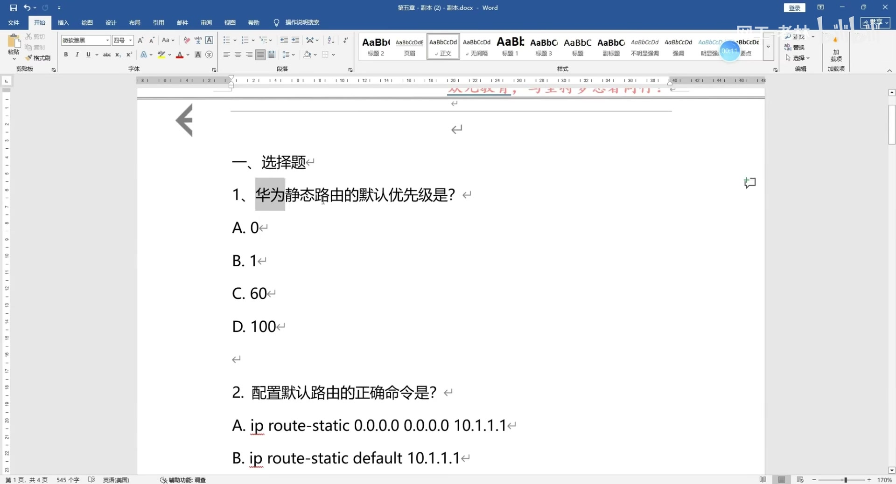

**【题目】** 华为静态路由的默认优先级是？

**【选项】**

| 选项 | 内容 |
| ---- | ---- |
| A | 0 [错误] |
| B | 1 [错误] |
| C | 60 [正确] |
| D | 100 [错误] |

**【答案】** C

**【解析】**

华为与 H3C 的静态路由默认外部优先级 `Preference` 为 **60**。优先级数值越小越优：直连路由为 0，OSPF 为 10，IS-IS 为 15，静态路由为 60，RIP 为 100，BGP 为 255。配置时可用 `preference` 参数修改，例如 `ip route-static 192.168.2.0 24 10.1.1.1 preference 100`。

**【考点】** 路由协议默认优先级；`Preference` 数值与优先级高低的关系。

### 1.2 第2题 默认路由的正确配置命令

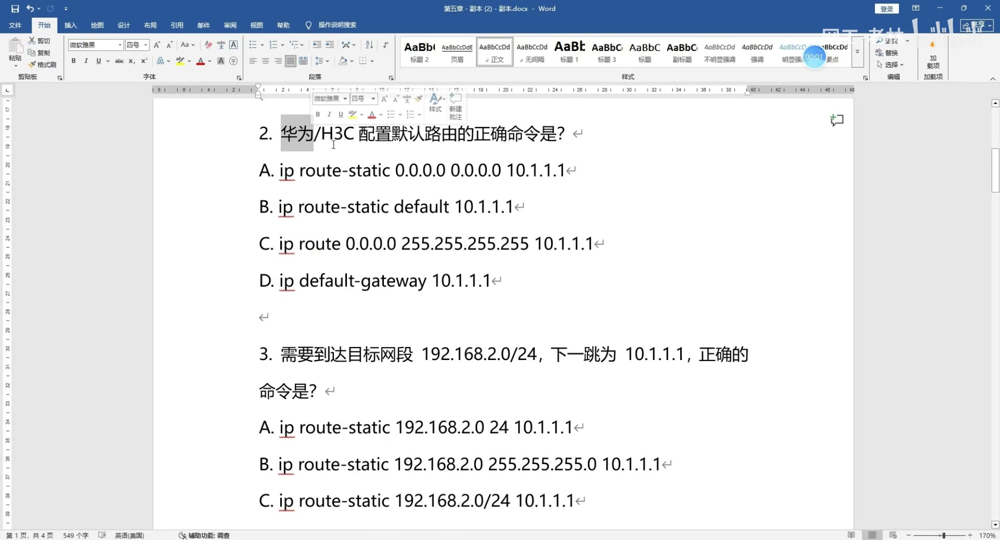

**【题目】** 华为/H3C 配置默认路由的正确命令是？

**【选项】**

| 选项 | 内容 |
| ---- | ---- |
| A | `ip route-static 0.0.0.0 0.0.0.0 10.1.1.1` [正确] |
| B | `ip route-static default 10.1.1.1` [错误] |
| C | `ip route 0.0.0.0 255.255.255.255 10.1.1.1` [错误] |
| D | `ip default-gateway 10.1.1.1` [错误] |

**【答案】** A

**【解析】**

默认路由的目的网段为 `0.0.0.0/0`，华为使用 `ip route-static` 命令，目的地址与掩码写为 `0.0.0.0 0.0.0.0`。掩码部分也可简写为一个 `0`，即 `ip route-static 0.0.0.0 0 10.1.1.1`，但目的地址必须写全四个 0。B 中的 `default` 不是华为关键字；C 是 Cisco 风格命令；D 是主机默认网关命令，不是路由配置。

**【考点】** 默认路由的匹配条件与华为命令格式。

### 1.3 第3题 指定目标网段与下一跳的静态路由

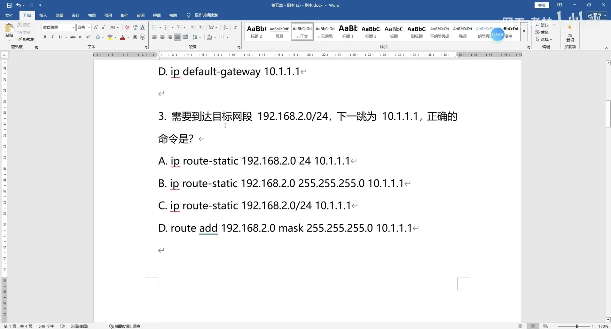

**【题目】** 需要到达目标网段 `192.168.2.0/24`，下一跳为 `10.1.1.1`，正确的命令是？

**【选项】**

| 选项 | 内容 |
| ---- | ---- |
| A | `ip route-static 192.168.2.0 24 10.1.1.1` [正确] |
| B | `ip route-static 192.168.2.0 255.255.255.0 10.1.1.1` [正确] |
| C | `ip route-static 192.168.2.0/24 10.1.1.1` [错误] |
| D | `route add 192.168.2.0 mask 255.255.255.0 10.1.1.1` [错误] |

**【答案】** A、B（两条命令等价，均可配置成功）[存疑]

**【解析】**

华为静态路由的掩码既可以用掩码长度 `24`，也可以写完整点分十进制 `255.255.255.0`，两条命令含义完全一致。C 把 CIDR 斜杠写法直接放进命令，VRP 不识别；D 是 Windows 主机的路由命令。若考试为单选题，通常以 A 为标准答案；本题课件明确演示两条命令均可下发，故此处并列。

**【考点】** 静态路由命令的掩码参数写法。

### 1.4 第4题 静态路由优先级参数

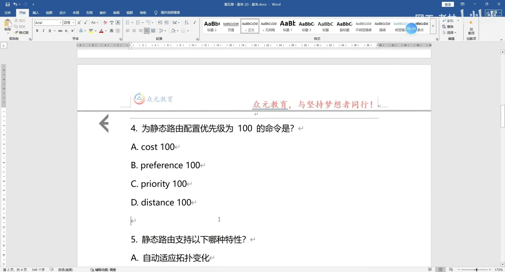

**【题目】** 为静态路由配置优先级为 100 的命令是？

**【选项】**

| 选项 | 内容 |
| ---- | ---- |
| A | `cost 100` [错误] |
| B | `preference 100` [正确] |
| C | `priority 100` [错误] |
| D | `distance 100` [错误] |

**【答案】** B

**【解析】**

华为使用 `preference` 表示路由优先级，追加在静态路由命令末尾；`cost` 表示度量值；`priority` 常用于 STP 端口优先级等场景；`distance` 是 Cisco 的管理距离。三者含义不同，不能混用。

**【考点】** `preference`、`cost`、`priority`、`distance` 的区分。

### 1.5 第5题 静态路由的特性

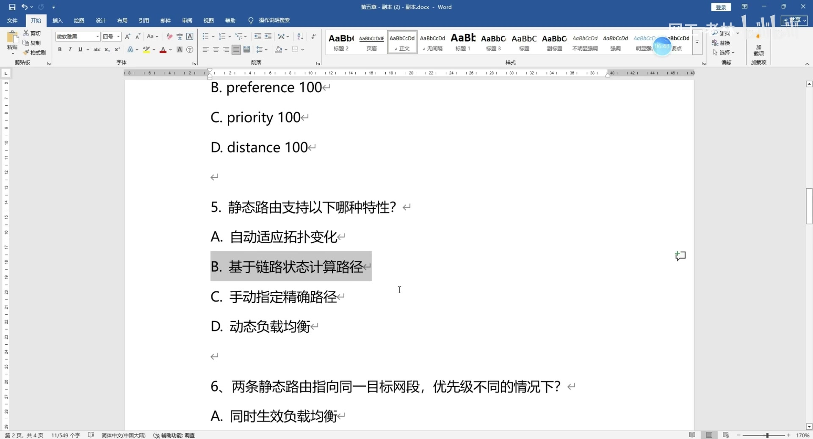

**【题目】** 静态路由支持以下哪种特性？

**【选项】**

| 选项 | 内容 |
| ---- | ---- |
| A | 自动适应拓扑变化 [错误] |
| B | 基于链路状态计算路径 [错误] |
| C | 手动指定精确路径 [正确] |
| D | 动态负载均衡 [错误] |

**【答案】** C

**【解析】**

静态路由由管理员逐条手工配置，不运行路由协议，不能自动发现邻居或适应拓扑变化，也不会基于链路状态计算路径。其优点是可控、精确、开销小；缺点是新旧路径切换需要人工干预。静态路由可以配置等价路由实现负载分担，但这是静态配置的结果，不是“动态负载均衡”。

**【考点】** 静态路由与动态路由的差异。

### 1.6 第6题 同一目标网段、不同优先级的静态路由

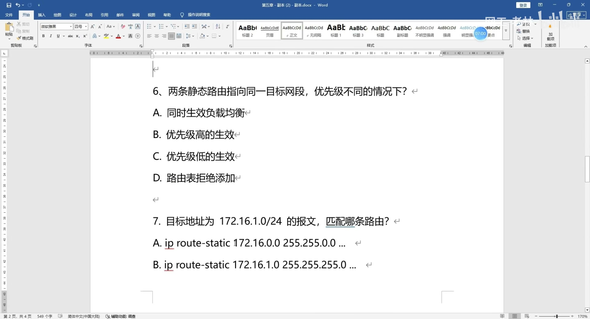

**【题目】** 两条静态路由指向同一目标网段，优先级不同的情况下？

**【选项】**

| 选项 | 内容 |
| ---- | ---- |
| A | 同时生效负载均衡 [错误] |
| B | 优先级高的生效 [正确] |
| C | 优先级低的生效 [错误] |
| D | 路由表拒绝添加 [错误] |

**【答案】** B

**【解析】**

同一目的网段存在多条路由时，先比较优先级，`Preference` 数值越小优先级越高，只有最优路由进入路由表并参与转发。优先级较低的路由不会删除，可作为备份，主路由失效后接管，这就是浮动静态路由。若两条路由优先级相同，才会形成等价路由并负载分担。

**【考点】** 路由选路顺序；浮动静态路由的形成条件。

### 1.7 第7题 最长掩码匹配

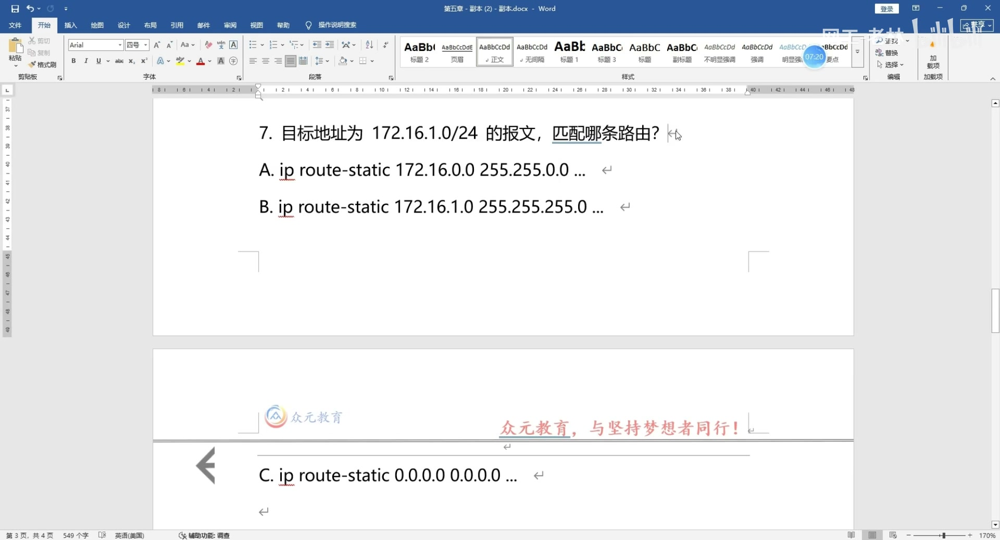

**【题目】** 目标地址为 `172.16.1.0/24` 的报文，匹配哪条路由？

**【选项】**

| 选项 | 内容 |
| ---- | ---- |
| A | `ip route-static 172.16.0.0 255.255.0.0 ...` [错误] |
| B | `ip route-static 172.16.1.0 255.255.255.0 ...` [正确] |
| C | `ip route-static 0.0.0.0 0.0.0.0 ...` [错误] |
| D | [文字被遮挡，课件仅见 A~C 三项] |

**【答案】** B

**【解析】**

路由表查找遵循**最长掩码匹配**原则：目的地址同时命中多条路由时，选择掩码最长、最精确的一条。A 为 `/16`，覆盖 `172.16.0.0/16`；B 为 `/24`，只覆盖 `172.16.1.0/24`；C 为默认路由 `/0`，最不精确。因此 B 最优。实验中写入三条路由后查询 `172.16.1.100`，下一跳为 `64.1.1.20`，验证了最长掩码优先。

**【考点】** 最长前缀匹配；路由表查询。

### 1.8 第8题 浮动静态路由的关键

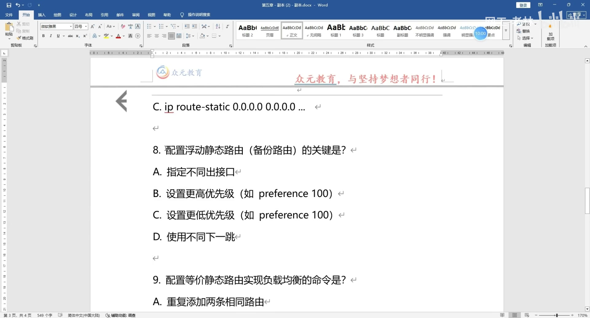

**【题目】** 配置浮动静态路由（备份路由）的关键是？

**【选项】**

| 选项 | 内容 |
| ---- | ---- |
| A | 指定不同出接口 [错误] |
| B | 设置更高优先级（如 `preference 100`） [错误] |
| C | 设置更低优先级（如 `preference 100`） [正确] |
| D | 使用不同下一跳 [错误] |

**【答案】** C

**【解析】**

浮动静态路由的做法是：主路由保持默认优先级 60，备份路由设置一个**更大的** `preference` 值（数值更大表示优先级更低），例如 100。这样备份路由平时不进路由表，只有当主路由失效时才浮出并接管流量。B 的“更高优先级”与 `preference 100` 自相矛盾：100 大于 60，实际是更低优先级。

**【考点】** 浮动静态路由；`preference` 数值方向。

### 1.9 第9题 等价静态路由与负载均衡

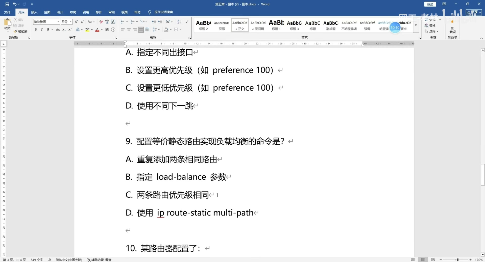

**【题目】** 配置等价静态路由实现负载均衡的命令是？

**【选项】**

| 选项 | 内容 |
| ---- | ---- |
| A | 重复添加两条相同路由 [正确] |
| B | 指定 `load-balance` 参数 [错误] |
| C | 两条路由优先级相同 [错误] |
| D | 使用 `ip route-static multi-path` [错误] |

**【答案】** A

**【解析】**

华为设备上，为同一目的网段配置两条**优先级相同、下一跳不同**的静态路由，即可形成等价路由，流量按哈希算法在多条链路上分担。命令层面就是重复添加两条相同目的网段的路由，不需要额外的 `load-balance` 或 `multi-path` 参数。C 只是等价路由成立的条件之一，不是命令。

**【考点】** 等价路由；负载分担。

### 1.10 第10题 两条静态路由的生效结果

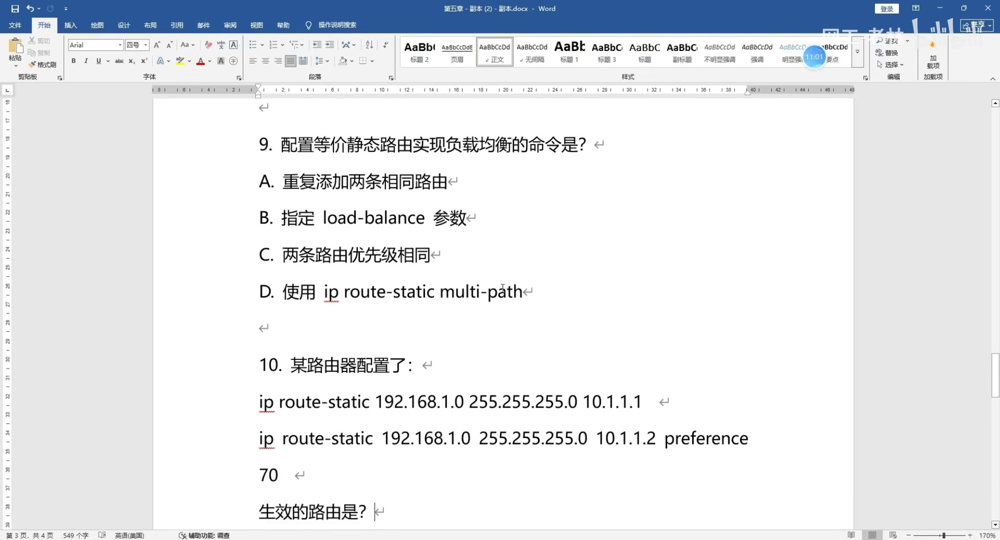

**【题目】** 某路由器配置了：

```text
ip route-static 192.168.1.0 255.255.255.0 10.1.1.1
ip route-static 192.168.1.0 255.255.255.0 10.1.1.2 preference 70
```

生效的路由是？

**【选项】**

| 选项 | 内容 |
| ---- | ---- |
| A | 两条形成负载均衡 [错误] |
| B | 下一跳 `10.1.1.1` 的路由 [正确] |
| C | 下一跳 `10.1.1.2` 的路由 [错误] |
| D | 路由冲突报错 [错误] |

**【答案】** B

**【解析】**

第一条未指定优先级，取默认值 60；第二条指定 70。60 小于 70，第一条优先级更高，只有下一跳 `10.1.1.1` 的路由进入路由表。第二条作为备份保留，不会报错。若要让两条形成负载均衡，必须把两条的 `preference` 配成相同值。

**【考点】** 默认优先级与显式优先级的比较。

### 1.11 第11题 删除静态路由的命令

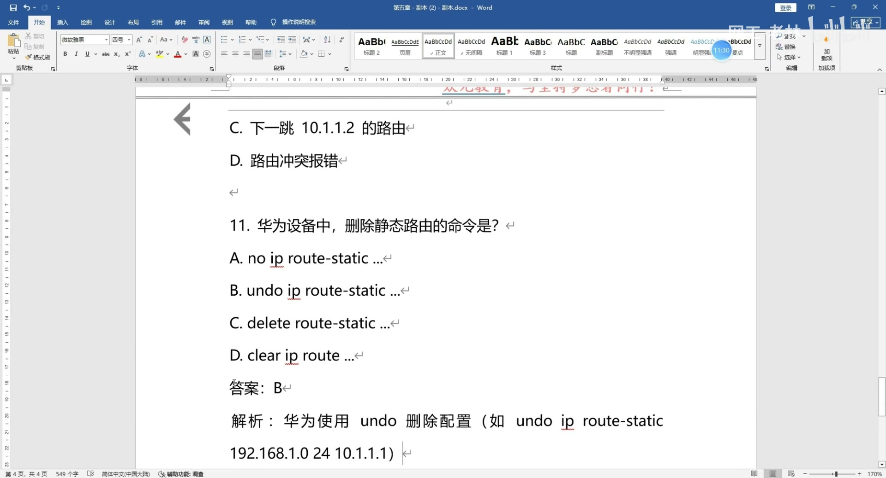

**【题目】** 华为设备中，删除静态路由的命令是？

**【选项】**

| 选项 | 内容 |
| ---- | ---- |
| A | `no ip route-static` [错误] |
| B | `undo ip route-static` [正确] |
| C | `delete route-static` [错误] |
| D | `clear route` [错误] |

**【答案】** B

**【解析】**

华为/H3C 使用 `undo` 前缀删除配置，例如 `undo ip route-static 192.168.2.0 24 10.1.1.1`。`no` 是 Cisco 的否定命令；`delete` 用于删除文件；`clear` 多用于清除统计信息或表项，不能删除静态路由配置。

**【考点】** 华为 `undo` 命令体系。

**补充验证：** 使用 `display current-configuration | include static` 过滤查看静态路由配置，再对目标条目加 `undo`，可确认该条目已从配置和路由表中消失。

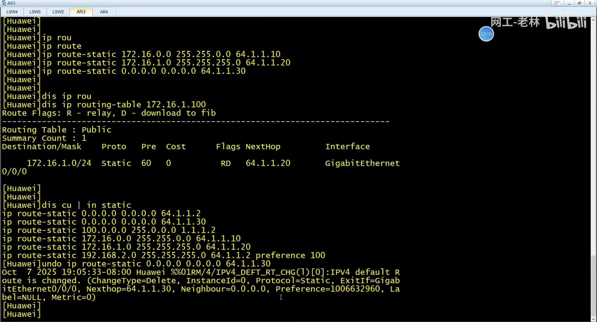

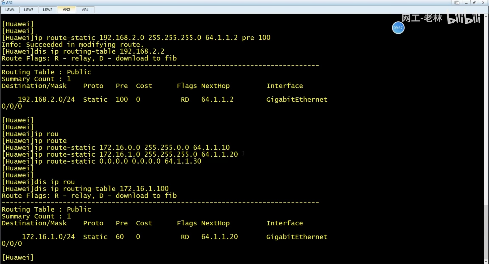

---

## 2.VLAN 与三层交换

本部分共 7 题，覆盖 VLAN 间通信方案、Eth-Trunk 配置、VLANIF 网关、Cisco 三层交换机默认路由功能、Trunk/Hybrid 承载多 VLAN、出口默认路由以及聚合口状态查看。

### 2.1 第1题 不同 VLAN 间主机通信的常用方案

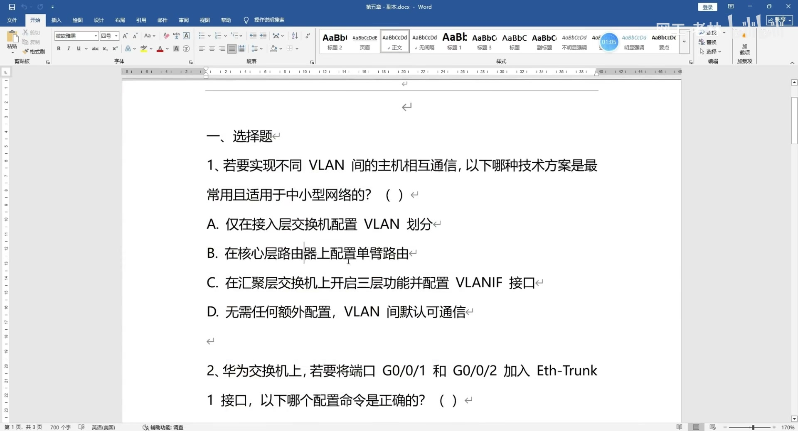

**【题目】** 若要实现不同 VLAN 间的主机相互通信，以下哪种技术方案是最常用且适用于中小型网络的？

**【选项】**

| 选项 | 内容 |
| ---- | ---- |
| A | 仅在接入层交换机配置 VLAN 划分 [错误] |
| B | 在核心层路由器上配置单臂路由 [错误] |
| C | 在汇聚层交换机上开启三层功能并配置 VLANIF 接口 [正确] |
| D | 无需任何额外配置，VLAN 间默认可通信 [错误] |

**【答案】** C

**【解析】**

中小型网络最常用的做法是使用三层交换机，为每个 VLAN 创建 VLANIF 接口并配置网关 IP，实现 VLAN 间受控转发。接入层交换机通常只做二层接入和 VLAN 划分，不能承担网关；单臂路由虽然也能实现 VLAN 间通信，但链路带宽容易成为瓶颈，现网已较少使用；VLAN 默认相互隔离，必须配置三层网关才能互通。

**【考点】** VLAN 间路由；三层交换机与 VLANIF。

### 2.2 第2题 将端口加入 Eth-Trunk 的正确命令

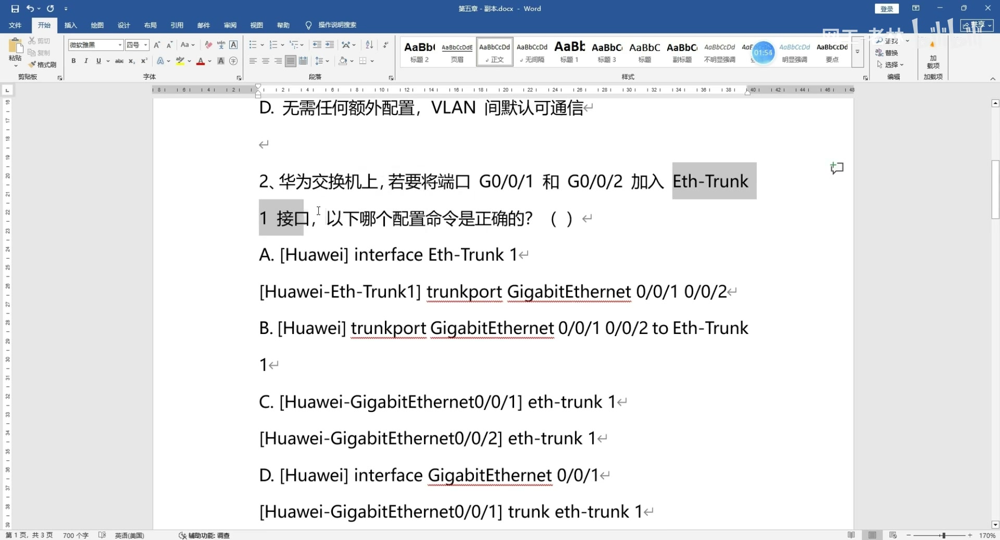

**【题目】** 华为交换机上，若要将端口 `G0/0/1` 和 `G0/0/2` 加入 `Eth-Trunk 1` 接口，以下哪个配置命令是正确的？

**【选项】**

| 选项 | 内容 |
| ---- | ---- |
| A | `[Huawei] interface Eth-Trunk 1`；`[Huawei-Eth-Trunk1] trunkport GigabitEthernet 0/0/1 0/0/2` [错误] |
| B | `[Huawei] trunkport GigabitEthernet 0/0/1 0/0/2 to Eth-Trunk 1` [错误] |
| C | `[Huawei-GigabitEthernet0/0/1] eth-trunk 1`；`[Huawei-GigabitEthernet0/0/2] eth-trunk 1` [正确] |
| D | `[Huawei] interface GigabitEthernet 0/0/1`；`[Huawei-GigabitEthernet0/0/1] trunk eth-trunk 1` [错误] |

**【答案】** C

**【解析】**

华为有两种合法配置方式：其一，在 Eth-Trunk 视图下使用 `trunkport GigabitEthernet 0/0/1 to GigabitEthernet 0/0/2`（必须有 `to`）；其二，分别进入成员口，在接口视图下执行 `eth-trunk 1`。A 的 `trunkport` 缺少 `to`，命令不完整；B 在系统视图直接使用 `trunkport`，视图和语法都不对；D 的 `trunk eth-trunk` 不存在。

**【考点】** Eth-Trunk 成员口加入方式。

### 2.3 第3题 VLANIF 接口实现 VLAN 间通信

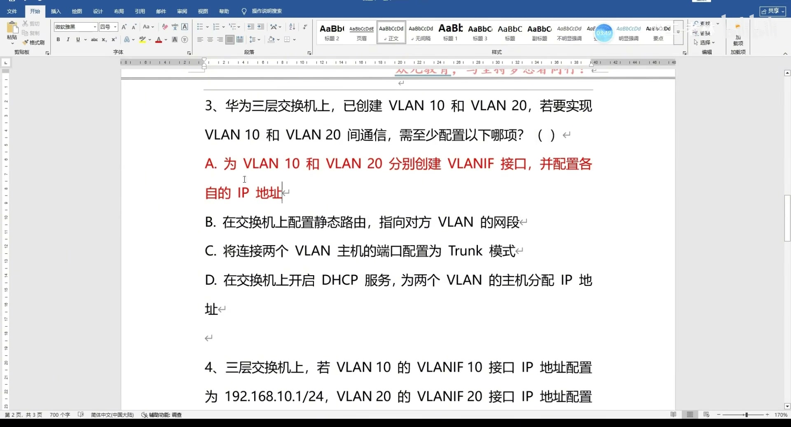

**【题目】** 华为三层交换机上已创建 VLAN 10 和 VLAN 20，若要实现 VLAN 10 和 VLAN 20 间通信，需至少配置以下哪项？

**【选项】**

| 选项 | 内容 |
| ---- | ---- |
| A | 为 VLAN 10 和 VLAN 20 分别创建 VLANIF 接口，并配置各自的 IP 地址 [正确] |
| B | 在交换机上配置静态路由，指向对方 VLAN 的网段 [错误] |
| C | 将连接两个 VLAN 主机的端口配置为 Trunk 模式 [错误] |
| D | 在交换机上开启 DHCP 服务，为两个 VLAN 的主机分配 IP 地址 [错误] |

**【答案】** A

**【解析】**

三层交换机跨 VLAN 转发依赖 VLANIF 接口：VLAN 10 的主机把网关指向 VLANIF 10 的地址，VLAN 20 的主机把网关指向 VLANIF 20 的地址，交换机查路由表完成三层转发。两个 VLAN 都属于同一台三层交换机的直连网段，不需要额外静态路由；连接主机的接入口仍配置为 Access；DHCP 只负责分配地址，不负责跨网段转发。

**【考点】** VLANIF 网关；直连网段与静态路由的适用边界。

### 2.4 第4题 主机无法通信的最可能原因

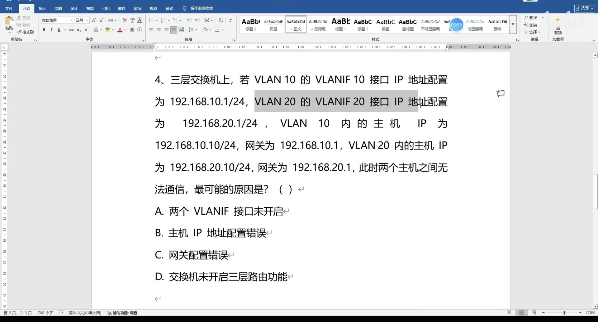

**【题目】** 三层交换机上，若 VLAN 10 的 VLANIF 10 接口 IP 地址配置为 `192.168.10.1/24`，VLAN 20 的 VLANIF 20 接口 IP 地址配置为 `192.168.20.1/24`，VLAN 10 内的主机 IP 为 `192.168.10.10/24`、网关为 `192.168.10.1`，VLAN 20 内的主机 IP 为 `192.168.20.10/24`、网关为 `192.168.20.1`，此时两个主机之间无法通信，最可能的原因是？

**【选项】**

| 选项 | 内容 |
| ---- | ---- |
| A | 两个 VLANIF 接口未开启 [错误] |
| B | 主机 IP 地址配置错误 [错误] |
| C | 网关配置错误 [错误] |
| D | 交换机未开启三层路由功能 [正确] |

**【答案】** D

**【解析】**

题干没有说明是华为设备，而 Cisco 三层交换机默认**未开启**三层路由功能，必须在全局视图执行 `ip routing`，才能在不同网段之间转发。华为、H3C、锐捷等设备默认开启该功能，所以同样的配置在华为上可直接通信。VLANIF 接口配置 IP 后即具备转发条件（还需 VLAN 内有处于 up 状态的成员口），A 不对；按题干给出的地址与网关，B、C 也均正确。

**【考点】** Cisco 三层交换机 `ip routing` 默认关闭；厂商默认行为差异。

### 2.5 第5题 Eth-Trunk 承载多个 VLAN 的模式

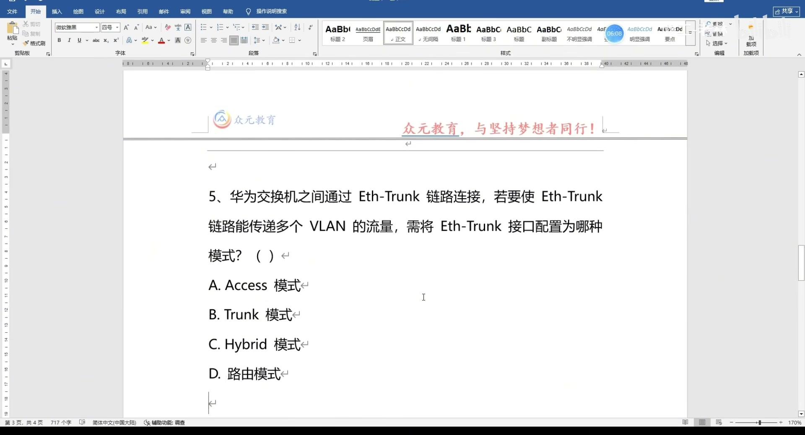

**【题目】** 华为交换机之间通过 `Eth-Trunk` 链路连接，若要使 `Eth-Trunk` 链路能传递多个 VLAN 的流量，需将 `Eth-Trunk` 接口配置为哪种模式？

**【选项】**

| 选项 | 内容 |
| ---- | ---- |
| A | Access 模式 [错误] |
| B | Trunk 模式 [正确] |
| C | Hybrid 模式 [正确，与 B 等效；若为单选按 B] |
| D | 路由模式 [错误] |

**【答案】** B（标准答案）；C 亦可实现，本题命题不严谨 [存疑]

**【解析】**

Trunk 与 Hybrid 都能在二层链路上携带 VLAN Tag，从而同时承载多个 VLAN；Access 口只能属于一个 VLAN，路由口工作在三层，不参与 VLAN Tag 转发。课件实验使用 Trunk，配置 `port link-type trunk` 与 `port trunk allow-pass vlan 10 20`，并说明 Hybrid 同样可行。若为单选，按教材标准选 Trunk。

**【考点】** Access、Trunk、Hybrid 的 VLAN 承载能力。

### 2.6 第6题 三层交换机访问互联网的额外配置

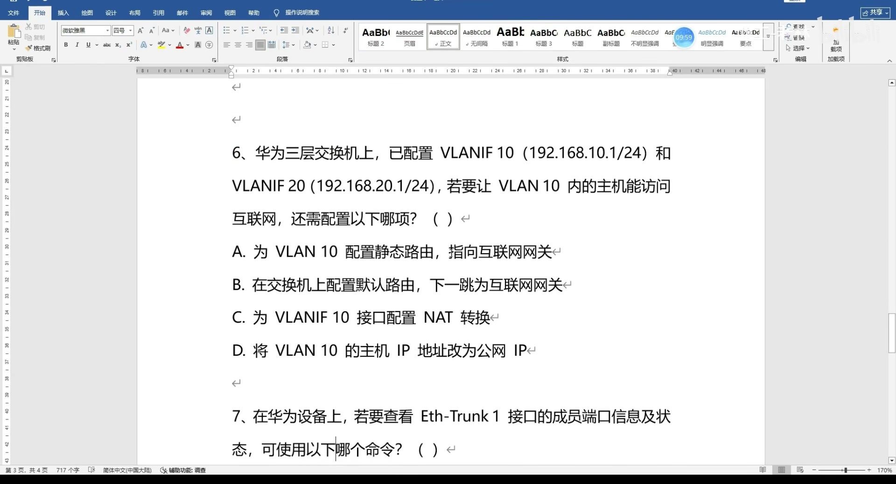

**【题目】** 华为三层交换机上，已配置 VLANIF 10（`192.168.10.1/24`）和 VLANIF 20（`192.168.20.1/24`），若要让 VLAN 10 内的主机能访问互联网，还需配置以下哪项？

**【选项】**

| 选项 | 内容 |
| ---- | ---- |
| A | 为 VLAN 10 配置静态路由，指向互联网网关 [错误] |
| B | 在交换机上配置默认路由，下一跳为互联网网关 [正确] |
| C | 为 VLANIF 10 接口配置 NAT 转换 [错误] |
| D | 将 VLAN 10 的主机 IP 改为公网 [错误] |

**【答案】** B

**【解析】**

三层交换机作为内网各 VLAN 的网关，收到去往互联网的报文后，必须有一条默认路由 `0.0.0.0/0` 指向出口设备（防火墙或出口路由器），否则无法转发。路由是设备全局配置，不需要“为某个 VLAN 配置”；NAT 通常在出口防火墙/路由器上完成，普通三层交换机一般不支持 NAT；把私网地址改成公网地址既不可扩展也不现实。

**【考点】** 默认路由；内网网关与出口设备的分工。

### 2.7 第7题 查看 Eth-Trunk 成员端口信息

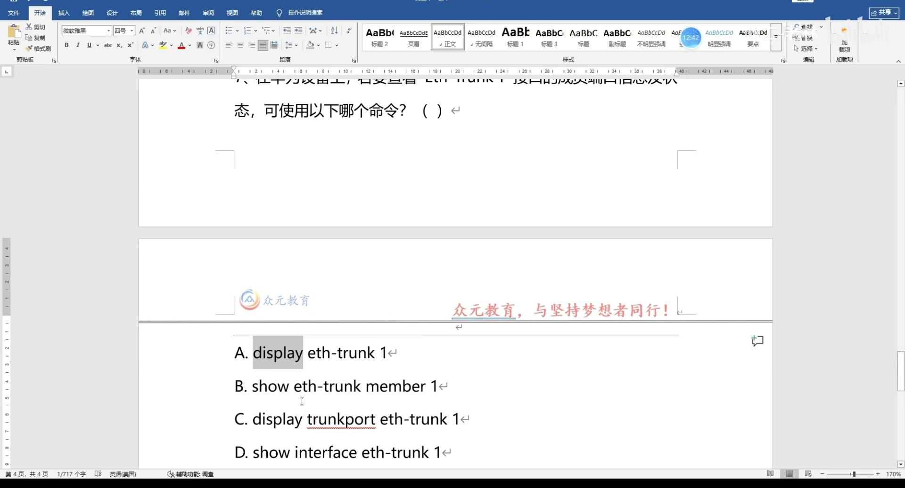

**【题目】** 在华为设备上，若要查看 `Eth-Trunk 1` 接口的成员端口信息及状态，可使用以下哪个命令？

**【选项】**

| 选项 | 内容 |
| ---- | ---- |
| A | `display eth-trunk 1` [正确] |
| B | `show eth-trunk member 1` [错误] |
| C | `display trunkport eth-trunk 1` [错误] |
| D | `show interface eth-trunk 1` [错误] |

**【答案】** A

**【解析】**

华为使用 `display` 查看状态，`display eth-trunk 1` 会输出成员口名称、状态、权重、活动端口数以及聚合总带宽等信息。`show` 是 Cisco、迈普、烽火等厂商的风格，华为/H3C 不识别。C 的 `trunkport` 是配置关键字，不是查看命令。

**【考点】** 华为 `display` 与 Cisco `show` 的区别。

**补充验证：** 实验中 `display eth-trunk 1` 的输出显示两个成员口均为 `Up`，聚合总带宽为 `2G`；`display interface eth-trunk 1` 则用于查看聚合口的整体状态与成员口分布。

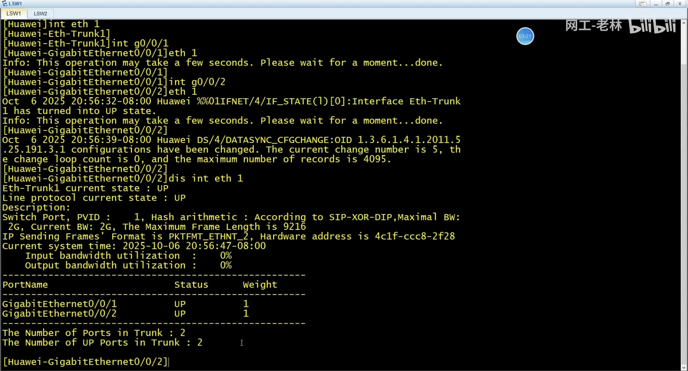

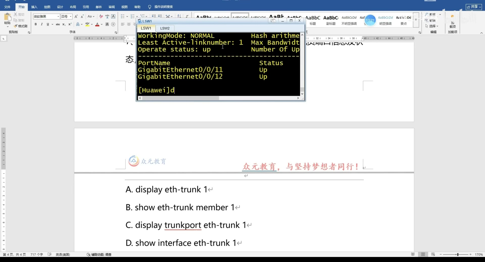

---

## 3.ACL 与 NAT

本部分共 7 题，覆盖基本 ACL 规则写法、ACL 在接口方向的调用、静态 NAT、PAT 的 ACL 匹配、ACL 查看、规则匹配顺序以及高级 ACL 的端口过滤能力。

### 3.1 第1题 基本 ACL 2000 的规则配置

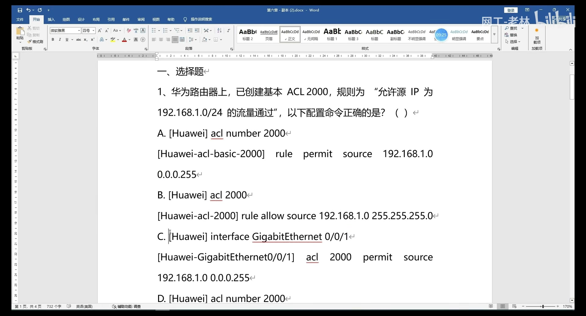

**【题目】** 华为路由器上，已创建基本 ACL 2000，规则为“允许源 IP 为 `192.168.1.0/24` 的流量通过”，以下配置命令正确的是？

**【选项】**

| 选项 | 内容 |
| ---- | ---- |
| A | `[Huawei] acl number 2000`；`[Huawei-acl-basic-2000] rule permit source 192.168.1.0 0.0.0.255` [正确] |
| B | `[Huawei] acl 2000`；`[Huawei-acl-2000] rule allow source 192.168.1.0 255.255.255.0` [错误] |
| C | `[Huawei] interface GigabitEthernet 0/0/1`；`[Huawei-GigabitEthernet0/0/1] acl 2000 permit source 192.168.1.0 0.0.0.255` [错误] |
| D | `[Huawei] acl number 2000` [文字被遮挡，后续规则未显示] [存疑] |

**【答案】** A

**【解析】**

基本 ACL 使用 `acl number 2000` 创建，进入 `acl-basic-2000` 视图后用 `rule permit source` 配置允许规则。ACL 使用**通配符掩码**（反掩码），`/24` 对应 `0.0.0.255`；B 用了正掩码且 `allow` 不是合法动作；C 把 ACL 规则写到接口视图，语法错误；D 仅显示到 `acl number 2000`，后续 `rule` 语句被页边界遮挡，无法据此判断，且就可见部分而言尚未配置任何规则，不能完成题目要求。

**【考点】** 基本 ACL 编号、`rule permit source`、通配符掩码。

### 3.2 第2题 ACL 在接口出方向的调用

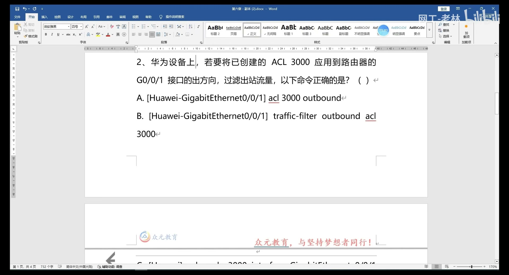

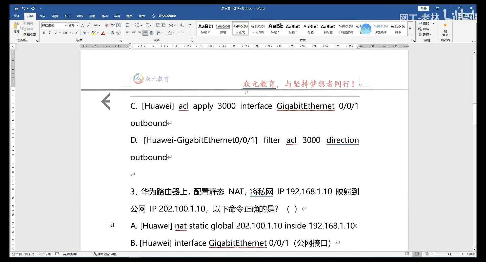

**【题目】** 华为设备上，若要将已创建的 ACL 3000 应用到路由器的 `G0/0/1` 接口的出方向，过滤出站流量，以下命令正确的是？

**【选项】**

| 选项 | 内容 |
| ---- | ---- |
| A | `[Huawei-GigabitEthernet0/0/1] acl 3000 outbound` [错误] |
| B | `[Huawei-GigabitEthernet0/0/1] traffic-filter outbound acl 3000` [正确] |
| C | `[Huawei] acl apply 3000 interface GigabitEthernet 0/0/1` [错误] |
| D | `[Huawei-GigabitEthernet0/0/1] filter acl 3000 direction outbound` [错误] |

**【答案】** B

**【解析】**

华为在接口视图下使用 `traffic-filter` 调用 ACL，`inbound` 表示进入接口的方向，`outbound` 表示从接口出去的方向。完整命令为 `traffic-filter outbound acl 3000`。A、C、D 均为不存在的命令形式，实验中无法下发。

**【考点】** ACL 的接口调用；`inbound`/`outbound` 方向。

### 3.3 第3题 静态 NAT 地址映射

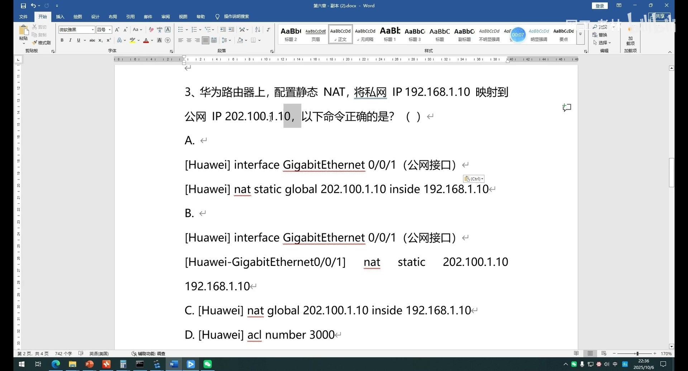

**【题目】** 华为路由器上，配置静态 NAT，将私网 IP `192.168.1.10` 映射到公网 IP `202.100.1.10`，以下命令正确的是？

**【选项】**

| 选项 | 内容 |
| ---- | ---- |
| A | `[Huawei] interface GigabitEthernet 0/0/1`（公网接口）；`[Huawei] nat static global 202.100.1.10 inside 192.168.1.10` [正确] |
| B | `[Huawei] interface GigabitEthernet 0/0/1`；`[Huawei-GigabitEthernet0/0/1] nat static 202.100.1.10 192.168.1.10` [错误] |
| C | `[Huawei] nat global 202.100.1.10 inside 192.168.1.10` [错误] |
| D | `[Huawei] acl number 3000` [文字被遮挡，后续规则未显示] |

**【答案】** A

**【解析】**

华为静态 NAT 的命令格式为 `nat static global <公网地址> inside <私网地址>`，在连接公网的接口视图下配置。选项 A 中的提示符之所以回到 `[Huawei]`，是课件粘贴命令时未重新进入接口视图所致，命令本身正确。其效果是外网访问 `202.100.1.10` 时，目的地址被转换为 `192.168.1.10`。实验中外网路由器 ping `202.100.1.10`，在内网主机抓包可看到目的地址已变为 `192.168.1.10`。B、C 的参数顺序或关键字错误；D 只是创建 ACL，不能完成静态映射。

**【考点】** 静态 NAT；`global`/`inside` 参数含义。

### 3.4 第4题 PAT 的 ACL 匹配规则

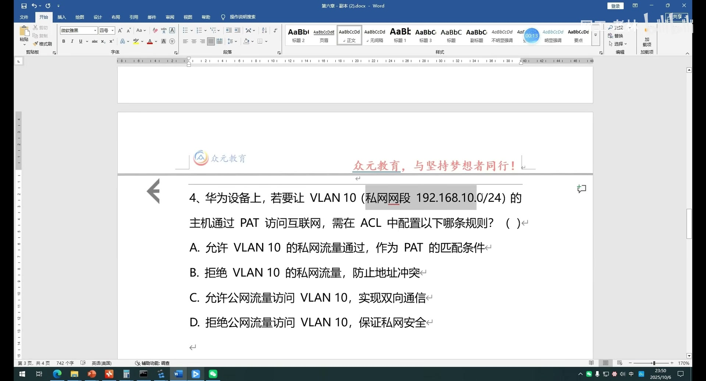

**【题目】** 华为设备上，若要让 VLAN 10（私网网段 `192.168.10.0/24`）的主机通过 PAT 访问互联网，需在 ACL 中配置以下哪条规则？

**【选项】**

| 选项 | 内容 |
| ---- | ---- |
| A | 允许 VLAN 10 的私网流量通过，作为 PAT 的匹配条件 [正确] |
| B | 拒绝 VLAN 10 的私网流量，防止地址冲突 [错误] |
| C | 允许公网流量访问 VLAN 10，实现双向通信 [错误] |
| D | 拒绝公网流量访问 VLAN 10，保证私网安全 [错误] |

**【答案】** A

**【解析】**

PAT 通过 ACL 匹配需要做地址转换的内网源地址，规则形如 `rule permit source 192.168.10.0 0.0.0.255`，再在出口接口执行 `nat outbound 2000`。若 ACL 拒绝该网段，内网主机根本无法上网；C、D 描述的是外网访问内网的方向，不是 PAT 的匹配条件。实验中配置 `nat outbound 2000` 后，内网主机可 ping 通外网地址，抓包可见源地址被转换为出口公网地址。

**【考点】** PAT/NAT 的 ACL 匹配逻辑；`nat outbound`。

### 3.5 第5题 查看 ACL 配置

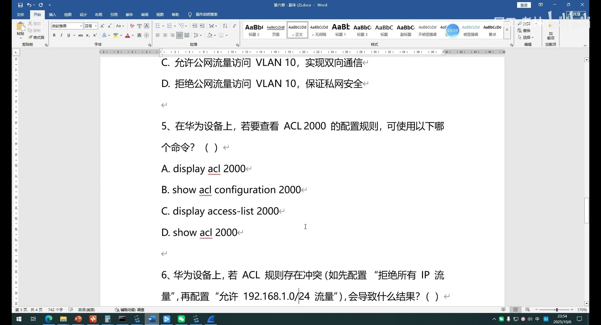

**【题目】** 在华为设备上，若要查看 ACL 2000 的配置规则，可使用以下哪个命令？

**【选项】**

| 选项 | 内容 |
| ---- | ---- |
| A | `display acl 2000` [正确] |
| B | `show acl configuration 2000` [错误] |
| C | `display access-list 2000` [错误] |
| D | `show acl 2000` [错误] |

**【答案】** A

**【解析】**

华为使用 `display acl 2000` 查看指定 ACL 的规则、规则编号、匹配顺序和命中情况；`display acl all` 可查看全部 ACL。B、D 使用 Cisco 的 `show` 风格，C 的 `access-list` 不是华为查看命令。

**【考点】** ACL 查看命令。

### 3.6 第6题 ACL 规则冲突与匹配顺序

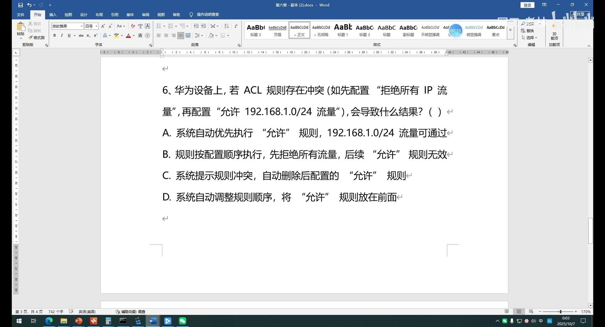

**【题目】** 华为设备上，若 ACL 规则存在冲突（如先配置“拒绝所有 IP 流量”，再配置“允许 `192.168.1.0/24` 流量”），会导致什么结果？

**【选项】**

| 选项 | 内容 |
| ---- | ---- |
| A | 系统自动优先执行“允许”规则，`192.168.1.0/24` 流量可通过 [错误] |
| B | 规则按配置顺序执行，先拒绝所有流量，后续“允许”规则无效 [正确] |
| C | 系统提示规则冲突，自动删除后配置的“允许”规则 [错误] |
| D | 系统自动调整规则顺序，将“允许”规则放在前面 [错误] |

**【答案】** B

**【解析】**

ACL 按规则编号从小到大逐条匹配，命中即停止，不会继续向下查找。华为默认步长为 5，第一条规则编号为 5，第二条为 10。先配置 `rule deny ip` 会拒绝所有流量，后面编号为 10 的 `permit` 永远不会被命中。正确做法是把精确的允许规则放在前面，末尾再显式拒绝其余流量。实验中加入 `rule 5 deny` 后业务立即中断，`undo rule 5` 后恢复。

**【考点】** ACL 匹配顺序；默认步长 5；隐式拒绝。

### 3.7 第7题 禁止访问外部 80 端口的 ACL 类型

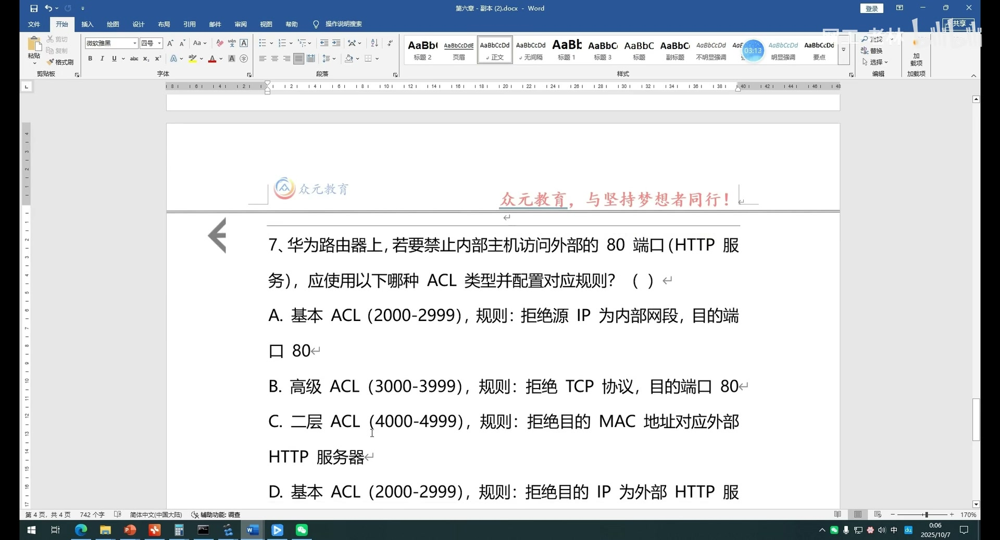

**【题目】** 华为路由器上，若要禁止内部主机访问外部的 80 端口（HTTP 服务），应使用以下哪种 ACL 类型并配置对应规则？

**【选项】**

| 选项 | 内容 |
| ---- | ---- |
| A | 基本 ACL（2000~2999），规则：拒绝源 IP 为内部网段，目的端口 80 [错误] |
| B | 高级 ACL（3000~3999），规则：拒绝 TCP 协议，目的端口 80 [正确] |
| C | 二层 ACL（4000~4999），规则：拒绝目的 MAC 地址对应外部 HTTP 服务器 [错误] |
| D | 基本 ACL（2000~2999），规则：拒绝目的 IP 为外部 HTTP 服务器端口 80 [错误] |

**【答案】** B

**【解析】**

基本 ACL 只能匹配源 IP 地址、分片信息和时间段，不能匹配目的 IP、协议类型和端口号；高级 ACL 可以匹配源/目的 IP、协议、源/目的端口等五元组信息，因此禁止 TCP 80 端口必须使用 3000~3999 的高级 ACL。二层 ACL 基于 MAC、VLAN 等二层信息，不能识别 TCP 端口。

**【考点】** 基本 ACL、高级 ACL、二层 ACL 的匹配能力与编号范围。

**补充验证：** 静态 NAT 实验中，外网侧访问映射后的公网地址，内网主机抓包显示目的地址已被转换为私网地址，说明静态 NAT 映射生效。

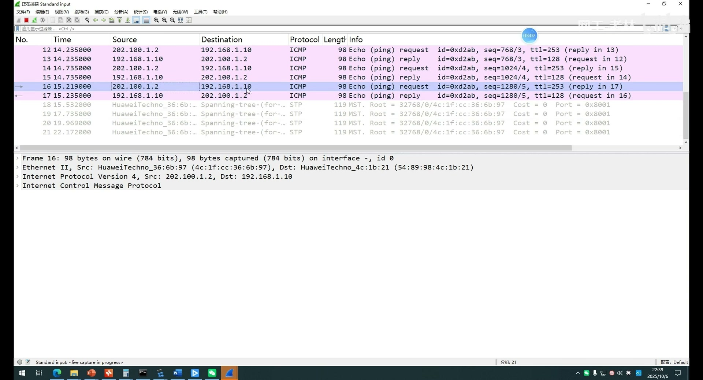

---

## 4.AAA 与设备管理

本部分共 6 题，覆盖本地 AAA 用户、Telnet 的 AAA 认证视图、DHCP 服务器地址池配置、地址池查看、AAA 本地计费以及禁用本地用户的简便方法。

### 4.1 第1题 配置本地 AAA 用户

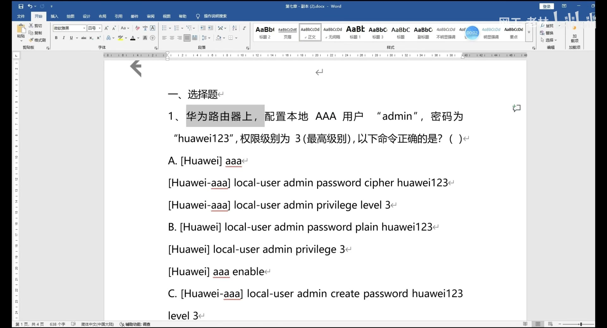

**【题目】** 华为路由器上，配置本地 AAA 用户 `admin`，密码为 `huawei123`，权限级别为 3（最高级别），以下命令正确的是？

**【选项】**

| 选项 | 内容 |
| ---- | ---- |
| A | `[Huawei] aaa`；`[Huawei-aaa] local-user admin password cipher huawei123`；`[Huawei-aaa] local-user admin privilege level 3` [正确] |
| B | `[Huawei] local-user admin password plain huawei123`；`[Huawei] local-user admin privilege 3`；`[Huawei] aaa enable` [错误] |
| C | `[Huawei-aaa] local-user admin create password huawei123 level 3` [错误] |
| D | [文字被遮挡] [存疑] |

**【答案】** A

**【解析】**

配置本地用户必须先执行 `aaa` 进入 AAA 视图，再用 `local-user <用户名> password cipher <密码>` 设置密文密码，最后用 `local-user <用户名> privilege level 3` 指定权限级别。B 缺少 AAA 视图且 `aaa enable` 不存在；C 的 `create`、`level` 参数形式错误。华为部分设备的最高权限级别为 15，本题按题干“3 为最高级别”的设定作答。

**【考点】** 本地 AAA 用户；`password cipher`；`privilege level`。

### 4.2 第2题 Telnet 的 AAA 认证应用视图

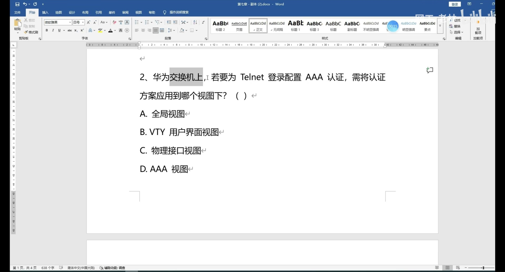

**【题目】** 华为交换机上，若要为 Telnet 登录配置 AAA 认证，需将认证方案应用到哪个视图下？

**【选项】**

| 选项 | 内容 |
| ---- | ---- |
| A | 全局视图 [错误] |
| B | VTY 用户界面视图 [正确] |
| C | 物理接口视图 [错误] |
| D | AAA 视图 [错误] |

**【答案】** B

**【解析】**

Telnet 属于远程登录，认证策略在 VTY 用户界面视图下应用：`user-interface vty 0 4` 进入 VTY 视图，再执行 `authentication-mode aaa`。`vty 0 4` 表示允许 0~4 共 5 个并发远程登录会话。全局视图、物理接口视图和 AAA 视图都不能直接完成 Telnet 认证绑定。

**【考点】** VTY 视图；`authentication-mode aaa`；并发会话数。

### 4.3 第3题 DHCP 服务器地址池配置步骤

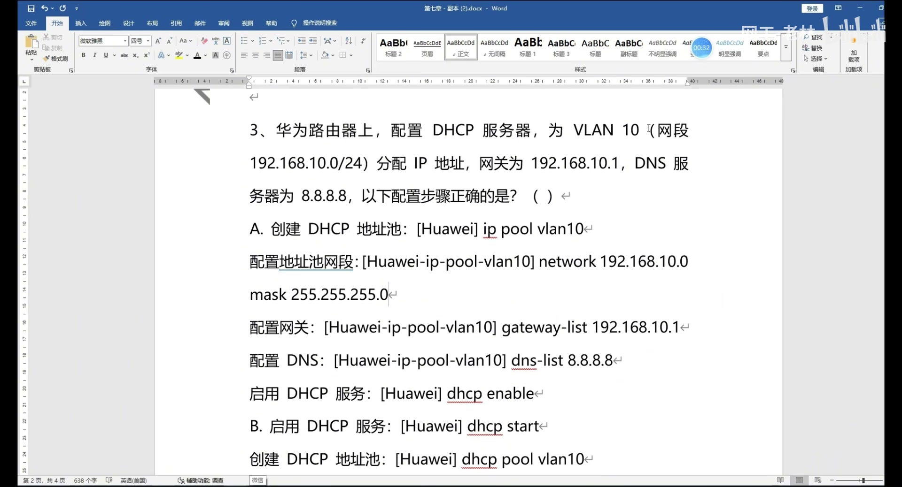

**【题目】** 华为路由器上，配置 DHCP 服务器，为 VLAN 10（网段 `192.168.10.0/24`）分配 IP 地址，网关为 `192.168.10.1`，DNS 服务器为 `8.8.8.8`，以下配置步骤正确的是？

**【选项】**

| 选项 | 内容 |
| ---- | ---- |
| A | `[Huawei] ip pool vlan10`；`[Huawei-ip-pool-vlan10] network 192.168.10.0 mask 255.255.255.0`；`gateway-list 192.168.10.1`；`dns-list 8.8.8.8`；`[Huawei] dhcp enable` [正确] |
| B | `[Huawei] dhcp start`；`[Huawei] dhcp pool vlan10` [错误] |
| C | [文字被遮挡] [存疑] |
| D | `[Huawei] ip pool 192.168.10.0`；`[Huawei-ip-pool-192.168.10.0] mask 255.255.255.0`；`gateway 192.168.10.1 dns 8.8.8.8`；`[Huawei] dhcp enable` [错误] |

**【答案】** A

**【解析】**

华为全局地址池的标准步骤是：`dhcp enable` 开启 DHCP 服务，`ip pool <池名>` 创建地址池，`network <网段> mask <掩码>` 指定可分配网段，`gateway-list` 指定网关，`dns-list` 指定 DNS。之后还需在连接用户的接口下执行 `dhcp select global`，地址池才会对该接口生效；课件选项 A 未列出这一步，但地址池配置本身正确。D 用网段作池名、参数形式也不对。

**【考点】** DHCP 全局地址池；`network`、`gateway-list`、`dns-list`、`dhcp select global`。

### 4.4 第4题 查看 DHCP 地址池分配情况

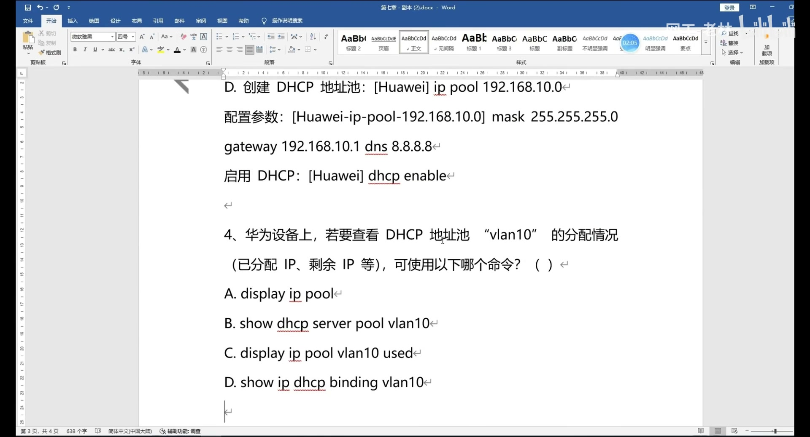

**【题目】** 华为设备上，若要查看 DHCP 地址池 `vlan10` 的分配情况（已分配 IP、剩余 IP 等），可使用以下哪个命令？

**【选项】**

| 选项 | 内容 |
| ---- | ---- |
| A | `display ip pool` [正确] |
| B | `show dhcp server pool vlan10` [错误] |
| C | `display ip pool vlan10 used` [错误] |
| D | `show ip dhcp binding vlan10` [错误] |

**【答案】** A

**【解析】**

`display ip pool` 会列出所有地址池的总地址数、已使用数、空闲数、冲突数等信息；若只想看某个池，可用 `display ip pool name vlan10`。B、D 使用 Cisco 风格的 `show`；C 的命令参数格式不符合华为 VRP。实验输出中地址池 `ceshi` 总地址 253 个、已用 1 个、空闲 252 个。

**【考点】** DHCP 地址池状态查看；`display ip pool`。

### 4.5 第5题 AAA 计费中的 local 含义

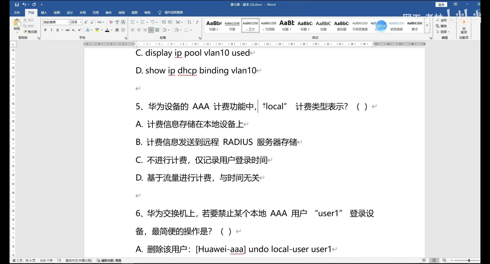

**【题目】** 华为设备的 AAA 计费功能中，`local` 表示？

**【选项】**

| 选项 | 内容 |
| ---- | ---- |
| A | 计费信息存储在本地设备上 [正确] |
| B | 计费信息发送到远程 RADIUS 服务器存储 [错误] |
| C | 不进行计费，仅记录用户登录时间 [错误] |
| D | 基于流量进行计费，与时间无关 [错误] |

**【答案】** A

**【解析】**

`accounting-method local` 表示本地计费，计费数据保存在设备本地；生产环境更常用 RADIUS 服务器计费，便于集中存储、备份和审计。B 对应 `radius` 方式；C、D 都不是 `local` 的含义。

**【考点】** AAA 计费方式；本地计费与 RADIUS 计费。

### 4.6 第6题 禁止本地 AAA 用户登录的简便方法

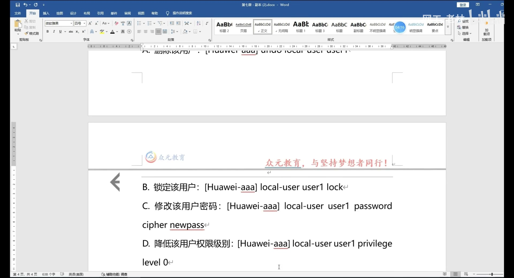

**【题目】** 华为交换机上，若要禁止某个本地 AAA 用户 `user1` 登录设备，最简便的操作是？

**【选项】**

| 选项 | 内容 |
| ---- | ---- |
| A | 删除该用户：`[Huawei-aaa] undo local-user user1` [错误] |
| B | 锁定该用户：`[Huawei-aaa] local-user user1 lock` [错误] |
| C | 修改该用户密码：`[Huawei-aaa] local-user user1 password cipher newpass` [正确] |
| D | 降低该用户权限级别：`[Huawei-aaa] local-user user1 privilege level 0` [错误] |

**【答案】** C

**【解析】**

修改密码后旧密码立即失效，用户无法再用原密码登录，操作最简单。删除用户也能达到目的，但会连同该用户的权限、属性一起删除，属于“过度操作”；B 的 `lock` 命令在华为 VRP 中不存在；D 只是降低权限，用户仍可登录并执行低级别命令。

**【考点】** 本地用户管理；密码、权限、删除操作的区别。

**补充验证：** `display ip pool` 的输出可同时查看地址池名称、总地址数、已用地址数、空闲地址数和冲突地址数，是 DHCP 排障的常用命令。

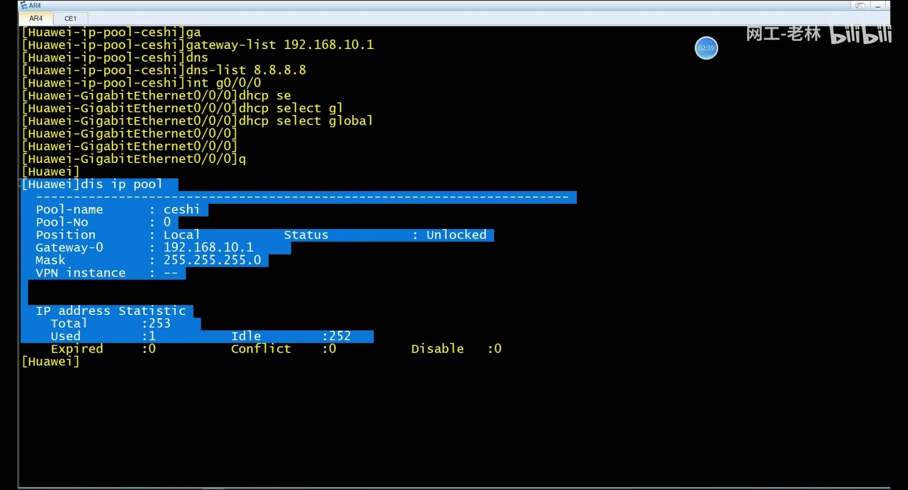

---

## 5.DHCP 与网络管理

本部分共 8 题，覆盖 DHCP 静态绑定、租约作用、租约时间命令、客户端分配记录、SNMP、Ping、DHCP 中继与 FTP 备份。

### 5.1 第1题 DHCP 静态绑定固定 IP

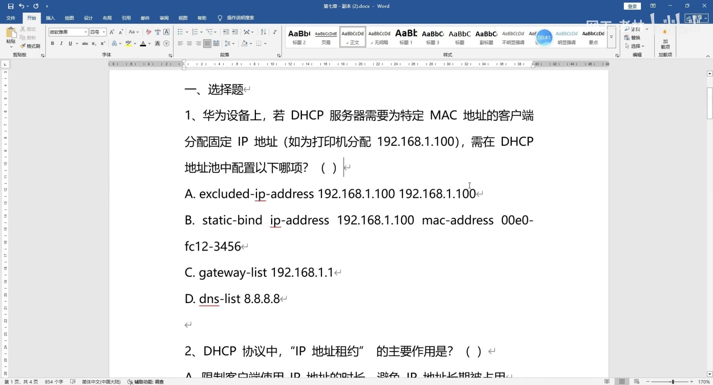

**【题目】** 华为设备上，若 DHCP 服务器需要为特定 MAC 地址的客户端分配固定 IP 地址（如为打印机分配 `192.168.1.100`），需在 DHCP 地址池中配置以下哪项？

**【选项】**

| 选项 | 内容 |
| ---- | ---- |
| A | `excluded-ip-address 192.168.1.100 192.168.1.100` [错误] |
| B | `static-bind ip-address 192.168.1.100 mac-address 00e0-fc12-3456` [正确] |
| C | `gateway-list 192.168.1.1` [错误] |
| D | `dns-list 8.8.8.8` [错误] |

**【答案】** B

**【解析】**

固定绑定使用 `static-bind ip-address <IP> mac-address <MAC>`，将指定 MAC 与固定 IP 绑定，客户端每次申请都会得到同一地址。A 的 `excluded-ip-address` 是把地址从可分配范围中排除，防止冲突，不是绑定；C、D 分别配置网关和 DNS。MAC 地址格式按设备要求书写，常见为 `xxxx-xxxx-xxxx`。

**【考点】** DHCP 静态绑定；`static-bind`。

### 5.2 第2题 DHCP 租约的作用

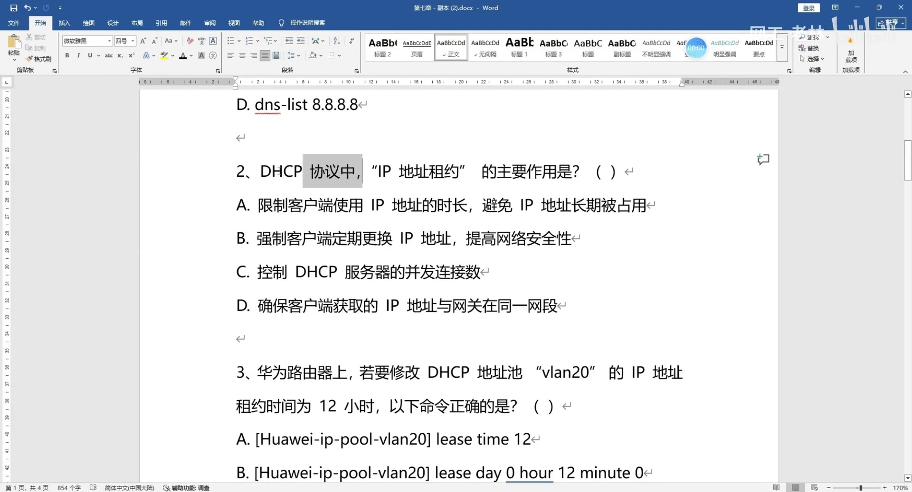

**【题目】** DHCP 协议中，“IP 地址租约”的主要作用是？

**【选项】**

| 选项 | 内容 |
| ---- | ---- |
| A | 限制客户端使用 IP 地址的时长，避免 IP 地址长期被占用 [正确] |
| B | 强制客户端定期更换 IP 地址，提高网络安全性 [错误] |
| C | 控制 DHCP 服务器的并发连接数 [错误] |
| D | 确保客户端获取的 IP 地址与网关在同一网段 [错误] |

**【答案】** A

**【解析】**

租约规定客户端可以使用某个 IP 地址的期限。到期后服务器回收地址，避免地址被长期占用；客户端在租约过半（50%）时会自动续租，若仍在使用则继续保留，并不是强制更换。C、D 与租约机制无关。

**【考点】** DHCP 租约；续租机制；地址回收。

### 5.3 第3题 修改 DHCP 租约时间

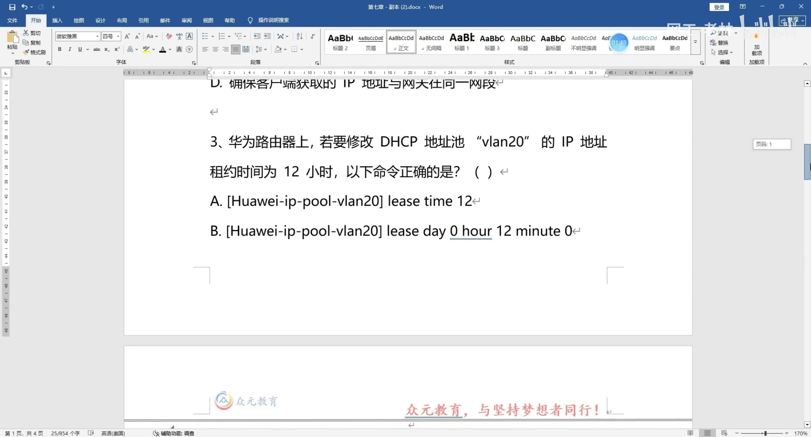

**【题目】** 华为路由器上，若要修改 DHCP 地址池 `vlan20` 的 IP 地址租约时间为 12 小时，以下命令正确的是？

**【选项】**

| 选项 | 内容 |
| ---- | ---- |
| A | `[Huawei-ip-pool-vlan20] lease time 12` [错误] |
| B | `[Huawei-ip-pool-vlan20] lease day 0 hour 12 minute 0` [正确] |
| C | [文字被遮挡] [存疑] |
| D | [文字被遮挡] [存疑] |

**【答案】** B

**【解析】**

华为全局地址池视图使用 `lease day <天> hour <小时> minute <分钟>` 配置租约，12 小时即 `lease day 0 hour 12 minute 0`；分钟部分可省略。A 中的 `time` 关键字不存在。命令下发后可用 `display ip pool name vlan20` 查看租约时间是否生效。

**【考点】** `lease` 命令；天、时、分参数。

### 5.4 第4题 查看 DHCP 客户端分配记录

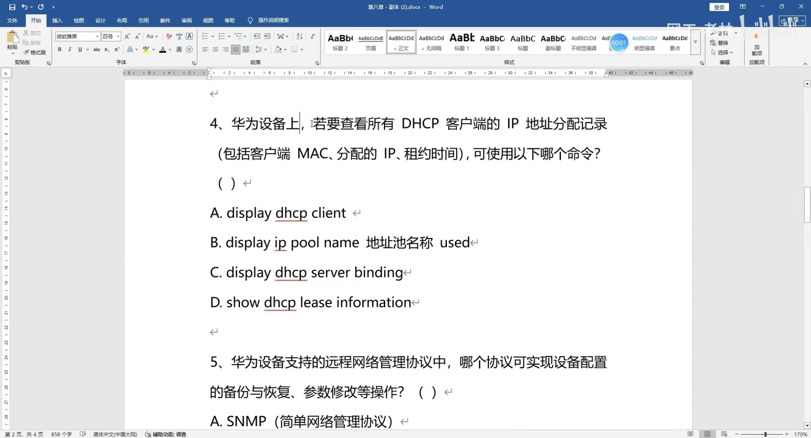

**【题目】** 华为设备上，若要查看所有 DHCP 客户端的 IP 地址分配记录（包括客户端 MAC、分配的 IP、租约时间），可使用以下哪个命令？

**【选项】**

| 选项 | 内容 |
| ---- | ---- |
| A | `display dhcp client` [错误] |
| B | `display ip pool name 地址池名称 used` [正确] |
| C | `display dhcp server binding` [错误] |
| D | `show dhcp lease information` [错误] |

**【答案】** B

**【解析】**

`display ip pool name <池名> used` 用于查看该地址池中已分配地址的客户端信息，包括客户端 IP、MAC、租约剩余时间和状态。A 是 DHCP 客户端侧查看自身租约的命令；C 不是华为 VRP 的标准查看命令；D 是 `show` 风格，华为不识别。

**【考点】** DHCP 客户端信息查看；`used` 关键字。

### 5.5 第5题 SNMP 的功能

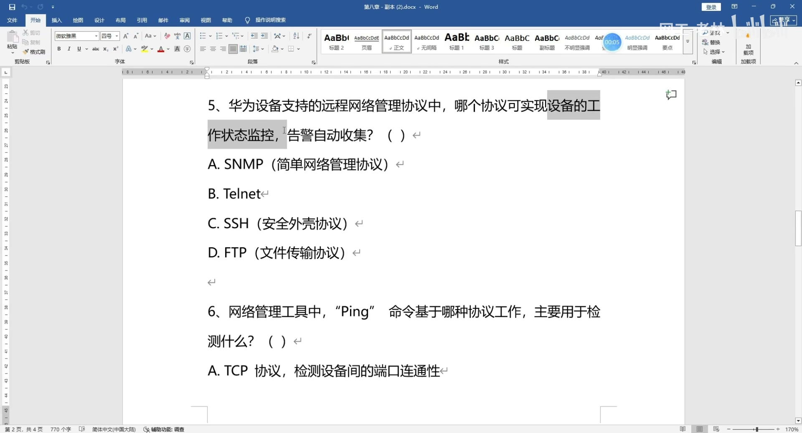

**【题目】** 华为设备支持的远程网络管理协议中，哪个协议可实现设备的工作状态监控、告警自动收集？

**【选项】**

| 选项 | 内容 |
| ---- | ---- |
| A | SNMP（简单网络管理协议） [正确] |
| B | Telnet [错误] |
| C | SSH（安全外壳协议） [错误] |
| D | FTP（文件传输协议） [错误] |

**【答案】** A

**【解析】**

SNMP 用于采集设备的 CPU、内存、接口带宽利用率等运行状态，并通过 Trap 将告警主动上报到网管服务器，是重要网络的标配。Telnet 用于明文远程登录配置；SSH 用于加密远程登录；FTP 用于文件传输和配置备份。四者用途不同。

同一课件另有一版第 5 题表述为“实现设备配置的备份与恢复、参数修改”，若按该表述应选 FTP；本课实际讲解与作答以“工作状态监控、告警自动收集”版本为准。[存疑]

**【考点】** SNMP、Telnet、SSH、FTP 的功能区分。

### 5.6 第6题 Ping 命令的协议与用途

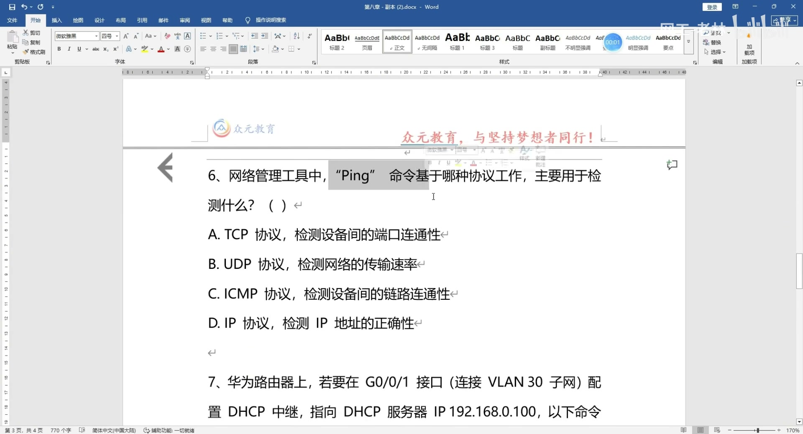

**【题目】** 网络管理工具中，“Ping”命令基于哪种协议工作，主要用于检测什么？

**【选项】**

| 选项 | 内容 |
| ---- | ---- |
| A | TCP 协议，检测设备间的端口连通性 [错误] |
| B | UDP 协议，检测网络的传输速率 [错误] |
| C | ICMP 协议，检测设备间的链路连通性 [正确] |
| D | IP 协议，检测 IP 地址的正确性 [错误] |

**【答案】** C

**【解析】**

Ping 使用 ICMP 的 Echo Request 与 Echo Reply 报文，检测目的设备是否可达，并可测量往返时延（RTT）。它不能检测具体 TCP/UDP 端口是否开放，也不用于测量带宽。Wireshark 抓包过滤 `ip.addr == 8.8.8.8` 可直接看到 ICMP 报文。

**【考点】** ICMP；Ping 的原理与能力边界。

### 5.7 第7题 DHCP 中继配置

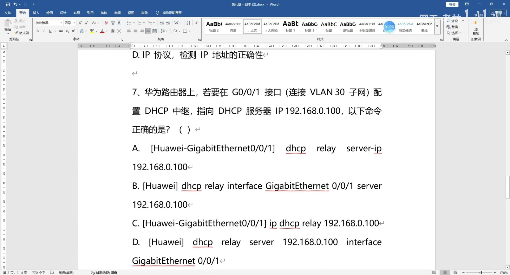

**【题目】** 华为路由器上，若要在 `G0/0/1` 接口（连接 VLAN 30 子网）配置 DHCP 中继，指向 DHCP 服务器 IP `192.168.0.100`，以下命令正确的是？

**【选项】**

| 选项 | 内容 |
| ---- | ---- |
| A | `[Huawei-GigabitEthernet0/0/1] dhcp relay server-ip 192.168.0.100` [正确] |
| B | `[Huawei] dhcp relay interface GigabitEthernet 0/0/1 server 192.168.0.100` [错误] |
| C | `[Huawei-GigabitEthernet0/0/1] dhcp relay 192.168.0.100` [错误] |
| D | `[Huawei] dhcp relay server 192.168.0.100 interface GigabitEthernet 0/0/1` [错误] |

**【答案】** A

**【解析】**

DHCP 中继配置在用户网关接口下：先 `dhcp enable`，再 `dhcp select relay` 指定中继方式，最后 `dhcp relay server-ip 192.168.0.100` 指定 DHCP 服务器地址。B、D 把命令写在系统视图且参数顺序错误；C 缺少 `server-ip` 关键字。中继设备到 DHCP 服务器之间必须有可达路由。实验中配置后，广播 Discover 被转为单播发给服务器，随后收到 Offer/ACK。

**【考点】** DHCP 中继；`dhcp select relay`；`dhcp relay server-ip`。

### 5.8 第8题 使用 FTP 备份配置文件

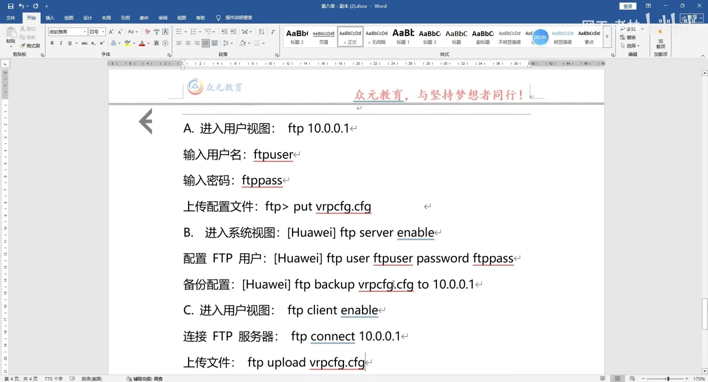

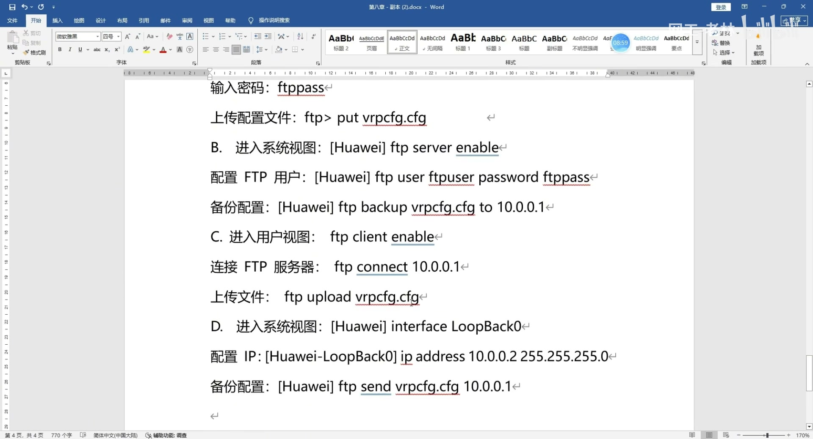

**【题目】** 华为设备上，若要使用 FTP 服务备份设备的配置文件到 FTP 服务器（IP `10.0.0.1`，用户名 `ftpuser`，密码 `ftppass`），以下操作步骤正确的是？

**【选项】**

| 选项 | 内容 |
| ---- | ---- |
| A | 进入用户视图：`ftp 10.0.0.1`；输入用户名 `ftpuser`；输入密码；`ftp> put vrpcfg.zip` [正确] |
| B | 进入系统视图：`ftp server enable`；配置 FTP 用户：`ftp user ftpuser password ftppass`；备份配置：`ftp backup vrpcfg.zip to 10.0.0.1` [错误] |
| C | 进入用户视图：`ftp client enable`；连接 FTP 服务器：`ftp connect 10.0.0.1`；上传文件：`ftp upload vrpcfg.zip` [错误] |
| D | 进入系统视图：`interface LoopBack0`；配置 IP；备份配置：`ftp send vrpcfg.zip 10.0.0.1` [错误] |

**【答案】** A

**【解析】**

这里设备作为 FTP **客户端**，在用户视图（`<Huawei>`）执行 `ftp 10.0.0.1` 连接服务器，按提示输入用户名和密码，登录后使用 `put` 上传文件、`get` 下载文件。B 是把设备配置成 FTP 服务器，方向相反；C、D 中的命令在华为 VRP 中不存在，也不需要 LoopBack 接口。

**【考点】** FTP 客户端模式；`put` 上传、`get` 下载。

**补充验证：** DHCP 中继实验中，抓包可见客户端发送广播 Discover，配置中继后服务器返回 Offer/ACK，客户端成功获取 `192.168.30.0/24` 地址；FTP 实验中登录服务器后使用 `put` 上传配置文件。

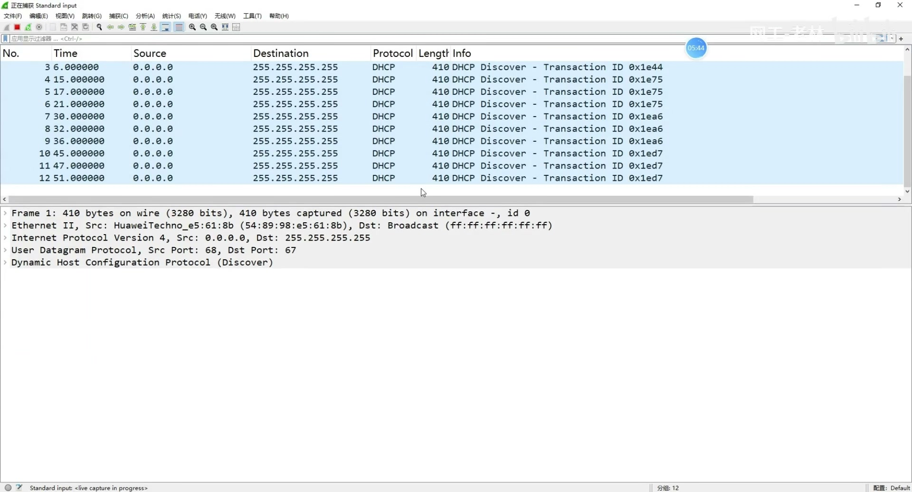

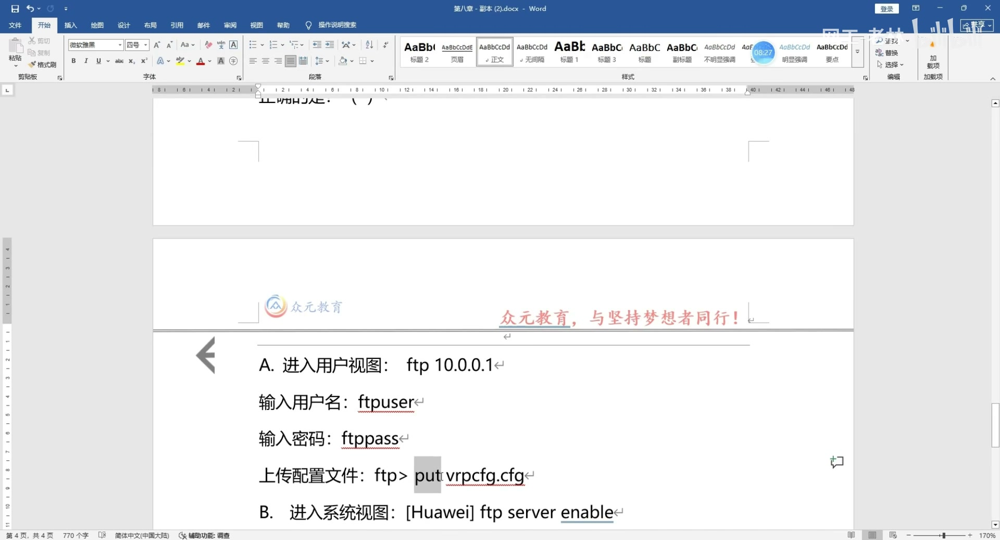

---

## 6.生成树协议

本部分共 8 题，覆盖 STP 桥优先级、端口状态查看、RSTP 改进、边缘端口、指定端口详情、根桥选举、Alternate 端口作用以及三交换机环网的阻塞端口判断。

### 6.1 第1题 修改桥优先级成为根桥

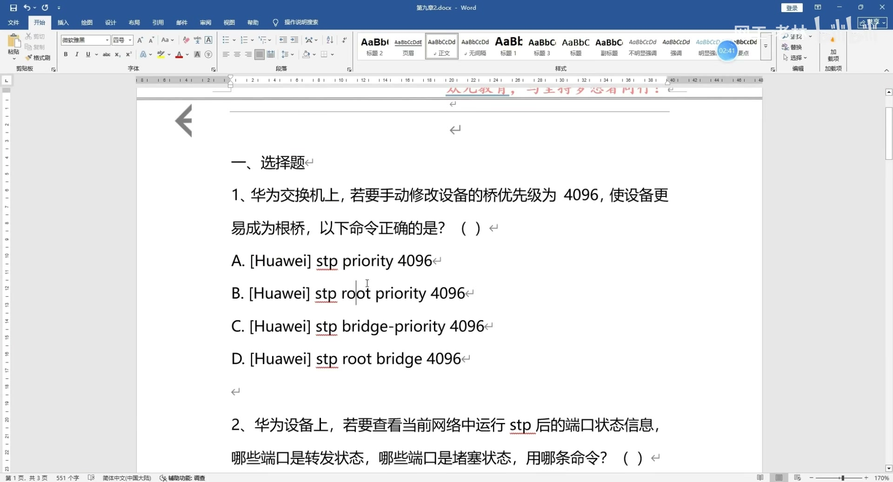

**【题目】** 华为交换机上，若要手动修改设备的桥优先级为 4096，使设备更易成为根桥，以下命令正确的是？

**【选项】**

| 选项 | 内容 |
| ---- | ---- |
| A | `[Huawei] stp priority 4096` [正确] |
| B | `[Huawei] stp root priority 4096` [错误] |
| C | `[Huawei] stp bridge-priority 4096` [错误] |
| D | `[Huawei] stp root bridge 4096` [错误] |

**【答案】** A

**【解析】**

华为在系统视图使用 `stp priority <值>` 修改桥优先级，取值必须是 4096 的整数倍（0~61440），数值越小越优先。默认优先级为 32768。也可用 `stp root primary` 直接把设备设为根桥（优先级置 0），或用 `stp root secondary` 设为备份根桥。B、C、D 的命令关键字均不存在。

**【考点】** STP 桥优先级；4096 步长；根桥配置。

### 6.2 第2题 查看 STP 端口状态


**【题目】** 华为设备上，若要查看当前网络中运行 STP 后的端口状态信息，哪些端口是转发状态，哪些端口是堵塞状态，用哪条命令？

**【选项】**

| 选项 | 内容 |
| ---- | ---- |
| A | `display stp root` [错误] |
| B | `show root-information` [错误] |
| C | `display stp brief` [正确] |
| D | `show stp root-bridge` [错误] |

**【答案】** C

**【解析】**

`display stp brief` 以摘要形式列出每个端口的角色（DESI、ROOT、ALTE、BACK）和状态（FORWARDING、DISCARDING），是查看阻塞端口的首选命令。A 用于查看根桥信息；B、D 是 Cisco 风格或不存在。实验输出中 `GigabitEthernet0/0/2` 的状态为 `DISCARDING`，即被生成树阻塞。

**【考点】** `display stp brief`；端口角色与状态。

### 6.3 第3题 RSTP 相对传统 STP 的优化


**【题目】** RSTP 与传统 STP（802.1D）相比，最显著的优化是？

**【选项】**

| 选项 | 内容 |
| ---- | ---- |
| A | 支持多 VLAN 生成树实例，可针对不同 VLAN 单独计算生成树 [错误] |
| B | 收敛速度更快，通过边缘端口、点对点链路等机制实现毫秒级收敛 [正确] |
| C | 无需选举根桥，直接根据端口带宽确定活动链路 [错误] |
| D | [文字被遮挡] [存疑] |

**【答案】** B

**【解析】**

RSTP（802.1w）最核心的改进是收敛速度快：引入边缘端口、点到点链路的 Proposal/Agreement 快速握手、Alternate/Backup 端口角色，故障切换可达到毫秒级。A 描述的是 MSTP 的多实例能力；C 错误，RSTP 仍然需要选举根桥、根端口和指定端口。

**【考点】** RSTP 的改进；RSTP 与 MSTP 的区别。

### 6.4 第4题 配置边缘端口


**【题目】** 华为交换机上，若将连接 PC 的端口 `G0/0/1` 配置为“边缘端口（Edge Port）”，以下命令正确的是？

**【选项】**

| 选项 | 内容 |
| ---- | ---- |
| A | `[Huawei-GigabitEthernet0/0/1] stp edged-port enable` [正确] |
| B | `[Huawei] stp edge-port GigabitEthernet 0/0/1` [错误] |
| C | `[Huawei-GigabitEthernet0/0/1] stp port-type edge` [错误] |
| D | `[Huawei] stp interface GigabitEthernet 0/0/1 edge enable` [错误] |

**【答案】** A

**【解析】**

边缘端口在接口视图下配置：`stp edged-port enable`。配置后端口不参与生成树计算，链路 up 后立即进入转发状态，避免终端接入等待约 30 秒，也避免终端在等待期间错过 DHCP 请求。批量配置可用 `interface range` 进入多个接口后统一执行。生产环境建议同时配置 BPDU 保护，防止边缘端口接入交换机形成环路。

**【考点】** 边缘端口；`stp edged-port enable`；终端接入优化。

### 6.5 第5题 查看指定端口的 STP 详细信息


**【题目】** 华为交换机上，若要查看指定端口 `G0/0/2` 的 STP 状态（如端口角色、状态、路径开销等），可使用以下哪个命令？

**【选项】**

| 选项 | 内容 |
| ---- | ---- |
| A | `display stp interface GigabitEthernet 0/0/2` [正确] |
| B | `show stp port GigabitEthernet 0/0/2 status` [错误] |
| C | `display stp port 0/0/2 detail` [错误] |
| D | `show stp interface GigabitEthernet 0/0/2 info` [错误] |

**【答案】** A

**【解析】**

`display stp interface GigabitEthernet 0/0/2` 输出该端口的详细 STP 信息，包括端口角色、状态、路径开销、优先级、指定桥等；若只看摘要，用 `display stp brief`。B、D 为 `show` 风格；C 的命令参数不符合华为 VRP。

**【考点】** STP 接口详情查看；`display stp interface`。

### 6.6 第6题 根桥选举的比较依据


**【题目】** 根桥选举中，若所有交换机优先级相同，则依据什么决定根桥？

**【选项】**

| 选项 | 内容 |
| ---- | ---- |
| A | IP 地址最小 [错误] |
| B | MAC 地址最小 [正确] |
| C | 端口 ID 最小 [错误] |
| D | 系统序列号最小 [错误] |

**【答案】** B

**【解析】**

根桥选举先比较桥 ID，桥 ID 由桥优先级和桥 MAC 地址组成，先比优先级（越小越优），优先级相同再比 MAC 地址（越小越优）。IP 地址、端口 ID、系统序列号都不参与根桥比较；端口 ID 用于在非根桥上选举根端口和在各链路上选举指定端口。

**【考点】** 桥 ID；根桥选举顺序。

### 6.7 第7题 RSTP 中 Alternate 端口的作用


**【题目】** RSTP 中的“Alternate 端口”作用是？

**【选项】**

| 选项 | 内容 |
| ---- | ---- |
| A | 直接连接终端设备 [错误] |
| B | 提供到达根桥的备份路径 [正确] |
| C | 转发所有流量 [错误] |
| D | 阻塞 BPDU 报文 [错误] |

**【答案】** B

**【解析】**

Alternate 端口是根端口的备份，提供另一条到达根桥的路径，处于 Discarding 状态；当根端口故障时，Alternate 端口可快速切换为新的根端口。直接连接终端的是边缘端口；Backup 端口是指定端口的备份；Alternate 端口并不转发用户流量，也不是“阻塞 BPDU”。

**【考点】** RSTP 端口角色；Alternate 与 Backup 的区别。

### 6.8 第8题 三交换机环网的阻塞端口判断


**【题目】** 如图，三台交换机仅开启生成树，没做任何配置，会堵塞哪个接口？

**【选项】**

| 选项 | 内容 |
| ---- | ---- |
| A | `SW2` 的 `g0/0/2` 口 [正确] |
| B | `SW1` 的 `g0/0/1` 口 [错误] |
| C | `SW3` 的 `g0/0/2` 口 [错误] |
| D | `SW2` 的 `g0/0/1` 口 [错误] |

**【答案】** A

**【解析】**

三台交换机优先级均为默认 32768，比较 MAC 地址：

| 交换机 | 桥 MAC | 比较结果 |
| ------ | ------ | -------- |
| LSW1 | `4c1f-cc5f-01f9` | 最小，选为根桥 |
| LSW3 | `4c1f-ccf1-386c` | 次小 |
| LSW2 | `4c1f-ccf3-62ae` | 最大 |

LSW1 为根桥，其两个端口均为指定端口并转发。LSW2 与 LSW3 各自到 LSW1 的端口为根端口。LSW2 与 LSW3 之间的链路上，二者到达根桥的路径开销相同，继续比较发送网桥 ID：LSW3 的 MAC 更小，因此 LSW3 的 `g0/0/1` 为指定端口并转发，LSW2 的 `g0/0/2` 落选为 Alternate 端口并阻塞。实验中在 LSW2 上查看，`G0/0/2` 的状态为 `DISCARDING`，与推理一致。

**【考点】** STP 选举顺序：先选根桥，再选根端口、指定端口，最后确定阻塞端口；桥 MAC 比较。

---

## 7.本章小结

### 7.1 高频考点

| 模块 | 高频考点 | 关键结论 |
| ---- | -------- | -------- |
| 静态路由 | 默认优先级、默认路由、`preference`、最长掩码、浮动路由、等价路由、`undo` | 静态路由默认 `Preference 60`；默认路由 `0.0.0.0/0`；数值越小越优；最长掩码优先；`undo` 删除 |
| VLAN 与三层交换 | VLANIF、Eth-Trunk、Trunk/Hybrid、出口默认路由 | 跨 VLAN 用三层交换机 + VLANIF；Eth-Trunk 成员口用 `eth-trunk 1` 或 `trunkport ... to ...`；出口需默认路由 |
| ACL | 基本/高级/二层 ACL、通配符掩码、接口调用、匹配顺序 | 基本 ACL 只匹配源 IP；高级 ACL 可匹配五元组；`traffic-filter outbound acl 3000`；ACL 自上而下命中即停 |
| NAT | 静态 NAT、PAT | `nat static global ... inside ...`；PAT 用 ACL 匹配内网源地址，出口 `nat outbound` |
| AAA 与设备管理 | 本地用户、VTY、DHCP 地址池、计费 | `aaa` 视图建用户；Telnet 认证在 VTY 视图；`ip pool` + `network` + `gateway-list` + `dns-list` |
| DHCP | 静态绑定、租约、中继、客户端信息 | `static-bind` 绑定 MAC；`lease day/hour/minute`；中继用 `dhcp select relay` + `dhcp relay server-ip` |
| 网络管理 | SNMP、Ping、FTP | SNMP 监控告警；Ping 基于 ICMP；FTP 客户端 `put` 上传、`get` 下载 |
| 生成树 | 桥优先级、边缘端口、RSTP 角色、根桥选举 | 优先级 4096 步长；`stp edged-port enable`；根桥先比优先级再比 MAC；Alternate 是根端口备份 |

### 7.2 易错点

1. **优先级方向**：华为 `Preference` 数值越小越优；静态路由默认 60，改成 100 是降低优先级，用于浮动备份。
2. **掩码写法**：华为静态路由支持掩码长度（`24`）和点分十进制（`255.255.255.0`），但不支持把 `192.168.2.0/24` 直接写进命令。
3. **`display` 与 `show`**：华为、H3C 用 `display`；Cisco、迈普、烽火等用 `show`。
4. **ACL 通配符掩码**：`/24` 对应 `0.0.0.255`，不是 `255.255.255.0`。
5. **ACL 顺序**：先配置的规则先匹配，`deny all` 放在前面会使后续 `permit` 全部失效。
6. **基本 ACL 的能力边界**：基本 ACL 只能匹配源 IP，不能匹配目的 IP、协议和端口；禁止 80 端口必须用高级 ACL。
7. **Cisco 三层交换机**：默认未开启 `ip routing`，华为/H3C/锐捷默认开启。
8. **Trunk 与 Hybrid**：二者都能承载多个 VLAN；Access 只能属于一个 VLAN。
9. **边缘端口命令**：华为正确关键字是 `stp edged-port enable`，配置在接口视图。
10. **根桥选举**：先比桥优先级，再比桥 MAC；不是比 IP、端口 ID 或系统序列号。

### 7.3 截图取舍与核对说明

本集共 290 张截图。笔记保留 **58 张**，取舍原则如下：

- **保留**：包含完整题干、选项的课件页；关键拓扑图；能够验证答案的典型 CLI 输出（如 `display eth-trunk 1`、`display ip pool`、`display stp brief`、NAT 抓包、DHCP 中继抓包、FTP `put`）。
- **跳过**：纯讲师镜头、课件翻页过程中的重复帧、终端滚动过程中的重复输出、无题目信息的过渡画面。
- **合并**：同一题分散在多帧的题干与选项，优先保留信息更完整的一帧；个别题目用两帧互补（如 STP 第 8 题的题干拓扑与选项）。
- **遮挡**：静态路由第 7 题的 D 项、AAA 第 1 题的 D 项、DHCP 地址池第 3 题的 C 项、DHCP 租约第 3 题的 C/D 项、RSTP 第 3 题的 D 项在原课件中即被页边界遮挡，已标注 `[文字被遮挡]`，未擅自补写。

### 7.4 存疑点汇总

| 位置 | 情况 | 本笔记处理 |
| ---- | ---- | ---------- |
| 1.3 指定目标网段与下一跳 | A（掩码长度 `24`）与 B（完整掩码）在 VRP 中均可下发，课件也当场演示了两条命令 | 两项并列标 `[正确]`，答案标 `[存疑]`，并说明单选通常取 A |
| 1.7 最长掩码匹配 | D 项被页边界遮挡 | 标 `[文字被遮挡，课件仅见 A~C 三项]`，不补写 |
| 2.5 Eth-Trunk 承载多 VLAN | Trunk 与 Hybrid 均可，题目未限定 | 答案取 B，C 标 `[正确，与 B 等效；若为单选按 B]` 并标 `[存疑]` |
| 3.1 基本 ACL 规则 | D 项只显示到 `acl number 2000` | 标 `[文字被遮挡]`，不推测后续规则 |
| 3.3 静态 NAT | D 项只显示到 `acl number 3000` | 标 `[文字被遮挡]` |
| 4.1 本地 AAA 用户 | D 项被遮挡 | 标 `[文字被遮挡]` |
| 4.3 DHCP 地址池 | C 项被遮挡 | 标 `[文字被遮挡]` |
| 5.3 租约时间 | C、D 两项被遮挡 | 标 `[文字被遮挡]` |
| 5.5 SNMP | 同一课件存在两版第 5 题：一版问“工作状态监控、告警收集”，一版问“配置备份与恢复、参数修改” | 以课堂实际讲解并作答的“状态监控、告警收集”版本为准，另一版作注 |
| 6.3 RSTP 优化 | D 项被遮挡 | 标 `[文字被遮挡]` |

上述遮挡均源于课件 Word 页面超出录制画面，并非整理遗漏；对应题目仍保留全部可见文字。

答案与解析已结合华为官方文档核对。课件题目未能在公开渠道检索到逐字对应的真题原文，因此以华为官方命令文档核对命令语法与结论；若原题存在版本差异，以文中 `[存疑]` 标注为准。主要依据：

- 华为《静态路由配置命令》：<https://support.huawei.com/enterprise/zh/doc/EDOC1000178145/3a7bfc3f>
- 华为《NAT 配置》：<https://support.huawei.com/enterprise/zh/doc/EDOC1100086644>
- 华为《STP/RSTP/MSTP 配置命令》：<https://support.huawei.com/enterprise/zh/doc/EDOC1100203219/9ccc5041>
- 华为《Eth-Trunk 接口配置》：<https://support.huawei.com/enterprise/zh/doc/EDOC1100367105/20c76fcd>
- 华为《配置用户通过 DHCP Relay 从 DHCP Server 获取 IP 地址》：<https://support.huawei.com/enterprise/zh/doc/EDOC1100130778/80eb5f39>
- Cisco《使用 Catalyst 交换机配置 VLAN 间路由》（`ip routing`）：<https://www.cisco.com/c/zh_cn/support/docs/lan-switching/inter-vlan-routing/41260-189.html>
