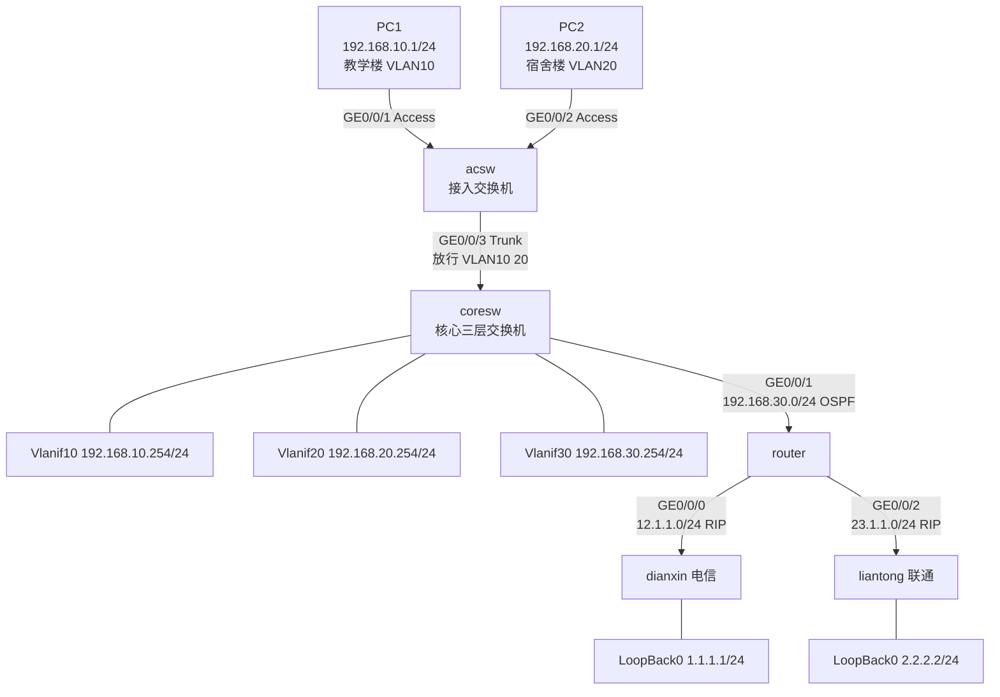

# 设备基础配置与命令体系 · 完整笔记

---

> 内容来源：培训讲义《华为设备配置与命令-基础篇》《华为配置专题01 基础配置》（summer 课堂）。两份讲义以 PPT 截图转纯文本，存在断行、命令粘连与形近字（如 `sys tem-view`、`v1an`、`gO/0/1`），本笔记已按**华为 VRP 官方命令语法**逐条还原并在正文用代码块呈现，校正明细见 2.3 与各节标注。
>
> 分工：18.0 讲"命令怎么写、实验怎么做、题怎么答"；视图原理、VLAN 原理见 11.0，DHCP/路由/VRRP 见 11.2，ACL/NAT 见 11.3，四厂商命令差异见 16.0。本文只写讲义独有内容与易错点，交叉处标注"详见"。

## 1.讲义定位与考情分布

### 1.1 两份讲义的覆盖范围

| 讲义 | 页数 | 主要内容 | 在本笔记中的位置 |
| ---- | ---- | -------- | ---------------- |
| 华为设备配置与命令-基础篇 | 6 页（正文 18 屏） | 复习节奏、eNSP 安装、SecureCRT、五类基础配置命令、掩码与反掩码、综合实验拓扑 | §2—§10 |
| 华为配置专题01 基础配置 | 13 屏 | 2018—2021 年配置分值统计、命令题目三档分类、配置视图图、同一套五类命令 | §1.2、§1.3、§2.1、§3—§7 |

两份讲义的五类命令（登录、VLAN/VLANIF、DHCP、ACL、NAT）内容基本重合，仅个别参数不同；本笔记取并集，冲突处以官方语法为准并在 2.3 列出。

### 1.2 2018—2021 年配置题分值分布

软考网工的华为配置题分布在**综合知识**与**案例分析**两卷，案例卷占比最大。

| 年份 | 配置分值合计 | 基础配置 | 高频配置 | 偏门配置 |
| ---- | ------------ | -------- | -------- | -------- |
| 2021 年 11 月 | 14+20+10=44 | 必考，5~8 分 | DHCP、ACL、静态路由、BFD、VRRP | 子网 VLAN |
| 2021 年 5 月 | 16+10=26 | 必考，5~8 分 | ACL、OSPF、BGP | POE |
| 2020 年 11 月 | 10+18+12=40 | 必考，5~8 分 | 默认路由、RIP、ACL、策略路由、DHCP | WLAN |
| 2019 年 11 月 | 20+15=35 | 必考，5~8 分 | VLAN、ACL、策略路由 | 无 |
| 2019 年 5 月 | 12+11=33 | 必考，5~8 分 | DHCP、ACL | IPSec、IPv6 |
| 2018 年 11 月 | 20+15=35 | 必考，5~8 分 | VLAN、VLANIF、静态路由/浮动路由、策略路由、ACL、NAT | 无 |
| 2018 年 5 月 | 6+13=19 | 必考，5~8 分 | DHCP、NAT、浮动静态路由 | 无 |

读表要点：

- 基础配置每年必考 5~8 分，属于"送分题"，失分最不划算；
- VLAN、DHCP、ACL、NAT 四条主线出现频率最高，策略路由与静态路由次之；
- 偏门配置（IPv6、4G、WLAN、IPSec、POE）逐年轮换，投入产出比低，放在最后。

### 1.3 配置命令的三档分类

| 档位 | 包含内容 | 复习要求 |
| ---- | -------- | -------- |
| 基础配置（送分题） | `system-view`、`sysname`、`interface vlanif`、配置 IP 地址 | 必须一次写对，包括提示符变化 |
| 高频配置（一定要会） | VLAN、DHCP、ACL、策略路由、NAT、静态/默认/RIP/OSPF | 能默写完整命令块并解释每条作用 |
| 偏门考点（尽力而为） | IPv6、4G、WLAN、IPSec | 认识关键词，能判断属于哪种技术 |

做题技巧：**联系上下文，回到题目中找答案**。案例题的填空往往能从题干地址表、拓扑图、前后行提示符推出，不必死记。

复习材料（讲义指定）：配置专题总结、华为配置手册、历年真题 + 实验手册。

---

## 2.配置视图与命令输入规则

### 2.1 七种视图与提示符

讲义用一张图给出"用户视图—系统视图—功能视图"的放射结构，核心是：**所有功能视图都由系统视图进入，`quit` 逐级返回**。

| 视图 | 提示符 | 进入命令 | 用途 |
| ---- | ------ | -------- | ---- |
| 用户视图 | `<Huawei>` | 登录后默认 | 查看简单运行状态与统计信息，执行 `save`、`display`、`ping` |
| 系统视图 | `[Huawei]` | `system-view` | 配置全局参数，进入其他视图 |
| 用户接口视图 | `[Huawei-ui-vty0-4]` | `user-interface vty 0 4` | Telnet/SSH 登录参数、ACL 应用 |
| 接口视图 | `[Huawei-GigabitEthernet0/0/0]` | `interface g0/0/0` | 接口速率、双工、链路类型、IP |
| ACL 视图 | `[Huawei-acl-basic-2000]` | `acl 2000` | 基本 ACL 规则 |
| VLAN 视图 | `[Huawei-vlan10]` | `vlan 10` | 创建 VLAN、按 VLAN 批量加端口 |
| 路由协议视图 | `[Huawei-ospf-1]` | `ospf 1` | 路由协议进程参数、宣告网段 |

提示符三条规则：

1. 方括号内为"设备名 + 视图标识"，设备名由 `sysname` 改变，改完后后续提示符全部跟着变；
2. 接口视图的"接口类型 + 编号"**连写无空格**，如 `GigabitEthernet0/0/0`，写成 `GigabitEthernet 0/0/0` 是常见干扰项；
3. VLAN 视图为 `-vlan10`，**中间没有连字符**。讲义第 4 屏写作 `[Huawei-vlan-10]`，属排版错误，已校正。

视图切换与返回：

```text
<Huawei> system-view                 //用户视图 → 系统视图
[Huawei] interface g0/0/0            //系统视图 → 接口视图
[Huawei-GigabitEthernet0/0/0] quit   //返回上一级系统视图
[Huawei] return                      //从任意视图直接回用户视图，等价 Ctrl+Z
```

### 2.2 命令输入的六条规则

| 规则 | 说明 | 示例 |
| ---- | ---- | ---- |
| 大小写不敏感 | 命令关键字可全小写 | `SYSTEM-VIEW` 与 `system-view` 等效 |
| 支持唯一前缀缩写 | 缩写必须能唯一识别 | `sys`、`int g0/0/1`、`dis cu` |
| `?` 联机帮助 | 列出当前视图可用命令或参数 | `sysname ?` |
| Tab 补全 | 终端软件需正确设置字符模式，见 10.2 | 输入 `sys` 后按 Tab |
| `undo` 取反 | 删除或关闭某项配置 | `undo vlan 10`、`undo shutdown` |
| `quit` 与 `return` | `quit` 退一级，`return` 直回用户视图 | 案例题常考二者区别 |

考试作答建议写**完整命令**（`system-view` 而非 `sys`），缩写虽合法，但阅卷按关键词比对时容易误判。

### 2.3 转文本识别错误与命令校正

PPT 截图转文本时，形近字符会被识别成字母或粘连成一行。下表左列为讲义/转写稿中的写法，右列为按 VRP 官方语法校正后的写法，正文一律使用右列。

| 序号 | 讲义原文 | 校正后 | 类型 | 依据 |
| ---- | -------- | ------ | ---- | ---- |
| 1 | `[Huawei-vlan-10]` | `[Huawei-vlan10]` | 视图提示符 | VLAN 视图提示符为设备名 + `-vlan` + VLAN ID，无连字符 |
| 2 | `dhcp select global/interface` | `dhcp select global` 或 `dhcp select interface` | 命令语法 | 斜杠是"二选一"的说明符，不是命令行参数，实际只能取一个 |
| 3 | `lease 10` | `lease day 10` | 命令语法 | 全局地址池租期格式为 `lease { day day [ hour hour [ minute minute ] ] \| unlimited }` |
| 4 | `local-user admin123 password admin123` | `local-user admin123 password irreversible-cipher admin123` | 命令语法 | 明文不能直接跟在 `password` 后；需密钥关键字，或只写 `local-user 用户名 password` 交互式输入 |
| 5 | `telent登陆` | `telnet 登录` | 拼写 | 协议名为 Telnet |
| 6 | `Setp3` | `Step3` | 拼写 | 复习三阶段编号 |
| 7 | `ENSP` | `eNSP` | 产品名 | 华为官方写法为 eNSP |
| 8 | `Lo0:1.1.1.1/24` | `LoopBack0` 接口 1.1.1.1/24 | 接口名还原 | VRP 中环回接口写作 `LoopBack 0` |

同类形近字还原规则（读稿、默写时通用）：

| 错误形态 | 还原 | 原因 |
| -------- | ---- | ---- |
| `sys tem-view`、`system -view` | `system-view` | 单词被空格切断 |
| `v1an`、`van` | `vlan` | 数字 1 与字母 l 混淆 |
| `gO/0/1`、`g0/O/1` | `GigabitEthernet0/0/1` | 字母 O 与数字 0 混淆 |
| `EtO/O/1` | `Ethernet0/0/1` | 同上 |
| `1ease` | `lease` | 数字 1 与字母 l 混淆 |
| `O.0.0.0` | `0.0.0.0` | 字母 O 与数字 0 混淆 |
| `2S5.2S5.2S5.0` | `255.255.255.0` | 字母 S 与数字 5 混淆 |
| `Vlanif`、`vlanif` | `Vlanif`（提示符）/ `vlanif`（命令） | 命令不区分大小写，提示符按设备显示 |

---

## 3.设备登录配置命令

### 3.1 Telnet 登录完整命令块

讲义给出的顺序是"开服务 → 开 vty → 定协议 → 定认证 → 建账号 → 授权限"，这一顺序不能颠倒：`authentication-mode aaa` 之前若没有 `aaa` 视图下的账号，登录会直接失败。

```text
<Huawei> system-view                                  //进入系统视图
[Huawei] sysname R1                                   //设备命名，讲义原文为 Huawei，可省略
[R1] telnet server enable                             //开启 Telnet 服务
[R1] user-interface vty 0 4                           //进入 vty 0~4 共 5 个虚拟终端
[R1-ui-vty0-4] protocol inbound telnet                //该 vty 只接受 Telnet 接入
[R1-ui-vty0-4] authentication-mode aaa                //认证方式为 AAA
[R1-ui-vty0-4] quit

[R1] aaa                                              //进入 AAA 视图
[R1-aaa] local-user admin123 password irreversible-cipher admin123   //用户名与密码
[R1-aaa] local-user admin123 service-type telnet      //该账号仅用于 Telnet
[R1-aaa] local-user admin123 privilege level 15       //用户级别 15（最高）
[R1-aaa] quit
[R1] return
<R1> save                                             //保存配置，否则重启丢失
```

### 3.2 逐条要点

| 命令 | 关键点 | 易错处 |
| ---- | ------ | ------ |
| `telnet server enable` | 华为服务启用统一用 `enable` 关键字 | 漏配则 vty 配置全部无效，端口 23 不监听 |
| `user-interface vty 0 4` | 0~4 是**用户编号**，共 5 个并发会话，第 6 个提示系统繁忙 | 误答成"端口号 0~4"或"允许 4 个用户" |
| `protocol inbound telnet` | 限定接入协议；不配时按设备缺省（一般为 all） | 与 `authentication-mode` 混淆，前者管协议、后者管认证 |
| `authentication-mode aaa` | 到本地 AAA 或 AAA 服务器认证 | 配成 `password` 则只需线路密码，不校验用户名 |
| `local-user ... password irreversible-cipher ...` | 不可逆密文存储，安全性最高 | 讲义原文省略密钥关键字，直接写明文，属语法错误 |
| `service-type telnet` | 不配则账号无任何接入类型，登录被拒 | 配成 `ssh` 后 Telnet 仍登不上 |
| `privilege level 15` | 用户级别 0~15，15 最高 | 与命令级别 0~3 混淆，详见 11.0 §5.3 |

补充：

- Telnet 明文传输，生产环境应改 SSH（`stelnet server enable`、`protocol inbound ssh`、`service-type ssh`），考试若题干强调"安全远程登录"即考这一点；
- 远程登录的前提是设备已有管理 IP 且客户端三层可达，仅配 vty 不配 IP 无法登录，详见 11.0 §5.2；
- `save` 在用户视图执行，配置未保存则重启后丢失，详见 11.0 §3。

---

## 4.VLAN 与 VLANIF 地址配置

### 4.1 讲义命令块

配置顺序固定为：**建 VLAN → 端口划入 VLAN → 配 VLANIF 网关**。部分版本在 `port default vlan` 时若 VLAN 不存在会自动创建，但不会补配 VLAN 名称、VLANIF 等属性，仍应按顺序显式创建，避免漏配网关。

```text
<HUAWEI> system-view
[HUAWEI] sysname Switch
[Switch] vlan 100                                        //创建并进入 VLAN 100
[Switch-vlan100] quit
[Switch] interface gigabitethernet 0/0/1
[Switch-GigabitEthernet0/0/1] port link-type access       //接口类型设为 access
[Switch-GigabitEthernet0/0/1] port default vlan 100       //接口划入 VLAN 100（同时设定 PVID）
[Switch-GigabitEthernet0/0/1] quit

[Switch] interface vlanif 100                             //进入 VLAN 100 的三层逻辑接口
[Switch-Vlanif100] ip address 172.16.1.1 24               //配置网关地址，掩码可写长度
[Switch-Vlanif100] quit
[Switch]
```

批量创建：

```text
[Switch] vlan batch 10 20                //创建 VLAN 10 与 VLAN 20 两个
[Switch] vlan batch 10 to 20             //创建 VLAN 10~20 共 11 个
```

### 4.2 讲义独有要点

| 要点 | 说明 |
| ---- | ---- |
| 命令与视图的对应 | `vlan 100` 进入的是 VLAN 视图，只能做 VLAN 自身属性；给 VLAN 配 IP 必须另进 `interface vlanif 100` |
| `port default vlan` 的双重作用 | 既把端口划入 VLAN，又把该 VLAN 设为端口 PVID；access 口接收无 tag 报文时打此 PVID |
| 掩码两种写法 | `ip address 172.16.1.1 24` 与 `ip address 172.16.1.1 255.255.255.0` 等效，考试两种都可能出现 |
| VLANIF 不是物理口 | 不能把 VLANIF 当 access 口使用；二层交换机也不能给物理口配 IP |
| 每 VLAN 一个网关 | 有几个业务 VLAN 就要建几个 VLANIF，IP 取各网段最后一个可用地址为惯例 |

VLAN 原理、接口类型对 tag 的处理、PVID 与 VID 的区别，详见 11.0 §6；此处只保留讲义命令与操作顺序。

### 4.3 常见错误对照

| 错误写法 | 现象 | 正确写法 |
| -------- | ---- | -------- |
| `port link-type access` 后配 `port trunk allow-pass vlan 100` | 命令不存在于 access 口 | access 口用 `port default vlan`，trunk 口才用 `allow-pass` |
| 只建 VLAN 不配 VLANIF | 同 VLAN 内可通，跨 VLAN 不通 | 三层交换机上补 `interface vlanif` + `ip address` |
| VLANIF 地址与终端网关不一致 | 终端能 ping 通网关外的地址却上不了网 | 终端网关 = VLANIF 地址 |
| `interface vlanif 100` 写成 `interface vlan 100` | 进入的是二层 VLAN 视图，无法配 IP | 三层逻辑接口关键字为 `vlanif` |

---

## 5.DHCP 配置命令

### 5.1 全局地址池方式

讲义以"VLANIF10 下客户端从全局地址池 ip pool 1 获取地址"为例。全局地址池在系统视图创建，可被多个接口引用。

```text
<SwitchA> system-view
[SwitchA] dhcp enable                                  //先全局启用 DHCP 服务
[SwitchA] ip pool 1                                    //创建全局地址池，池名为 1
[SwitchA-ip-pool-1] network 10.1.1.0 mask 255.255.255.128   //可分配网段（/25）
[SwitchA-ip-pool-1] gateway-list 10.1.1.1              //下发给终端的网关
[SwitchA-ip-pool-1] dns-list 10.1.1.1                  //下发给终端的 DNS
[SwitchA-ip-pool-1] excluded-ip-address 10.1.1.2       //保留地址，不参与分配
[SwitchA-ip-pool-1] excluded-ip-address 10.1.1.4       //可写多条，也可写范围
[SwitchA-ip-pool-1] lease day 10                       //租期 10 天
[SwitchA-ip-pool-1] quit

[SwitchA] interface vlanif 10
[SwitchA-Vlanif10] ip address 10.1.1.254 255.255.255.128    //VLAN 网关
[SwitchA-Vlanif10] dhcp select global                  //该接口使用全局地址池
[SwitchA-Vlanif10] quit
```

参数表：

| 命令 | 作用 | 取值与说明 |
| ---- | ---- | ---------- |
| `dhcp enable` | 全局使能 DHCP | 不执行则任何地址池都不工作 |
| `ip pool 名称` | 创建全局地址池 | 名称可自定义，讲义用数字 1 |
| `network 网段 mask 掩码` | 指定可分配范围 | 必须与接口网段一致，否则分配后不通 |
| `gateway-list 地址` | 默认网关 | 一般为该 VLAN 的 VLANIF 地址；可不配，配了自动加入排除列表 |
| `dns-list 地址` | DNS 服务器 | 可配主备两个 |
| `excluded-ip-address 起 [止]` | 保留地址 | 网关、服务器、打印机等固定地址必须排除 |
| `lease day 天 [hour 时 [minute 分]]` | 租期 | 缺省 1 天；`lease unlimited` 为永久 |
| `dhcp select global` | 接口引用全局池 | 与 `dhcp select interface` 二选一 |

### 5.2 接口地址池方式（讲义一笔带过，补齐）

`dhcp select interface` 表示用**接口自身地址所在网段**建池，不再需要 `ip pool`，但所有参数都要在接口下用 `dhcp server` 前缀配置。

```text
[SwitchA] dhcp enable
[SwitchA] interface vlanif 20
[SwitchA-Vlanif20] ip address 192.168.20.254 24
[SwitchA-Vlanif20] dhcp select interface                       //使用接口地址池
[SwitchA-Vlanif20] dhcp server dns-list 114.114.114.114
[SwitchA-Vlanif20] dhcp server excluded-ip-address 192.168.20.1 192.168.20.10
[SwitchA-Vlanif20] dhcp server lease day 1
[SwitchA-Vlanif20] quit
```

### 5.3 两种方式对比

| 对比项 | 全局地址池 | 接口地址池 |
| ------ | ---------- | ---------- |
| 创建位置 | 系统视图 `ip pool 名称` | 不单独创建，绑定在接口上 |
| 引用命令 | `dhcp select global` | `dhcp select interface` |
| 网段来源 | `network` 命令手工指定 | 接口 IP 所在网段自动确定 |
| 参数前缀 | 直接 `gateway-list`、`dns-list` | `dhcp server gateway-list`、`dhcp server dns-list` |
| 适用场景 | 多接口/中继场景共用地址池，可集中管理 | 单接口单网段，配置最简 |
| 考试出现频率 | 高（讲义主推） | 中（常作为对比项） |

### 5.4 验证与排错

| 命令 | 用途 |
| ---- | ---- |
| `display ip pool` | 查看所有地址池的网段、已用/空闲数量 |
| `display ip pool name 1` | 查看指定全局地址池详情 |
| `display dhcp server statistics` | 查看 DHCP 收发包统计，判断请求是否到达 |
| `display interface vlanif 10` | 确认网关接口 Up 且有地址 |

排错顺序：`dhcp enable` 是否执行 → 接口是否 `dhcp select` → 地址池网段与接口网段是否一致 → 地址是否被全部排除 → 终端与网关二层是否通。

讲义示例中地址池网关写 `10.1.1.1`、VLANIF 却配 `10.1.1.254/25`，二者不在同一 /25 网段（`10.1.1.0/25` 可用范围 10.1.1.1~10.1.1.126），属讲义数据前后不一致，实际配置时应统一为 VLANIF 地址 `10.1.1.254`（此时网段应改为 `10.1.1.0/24`）或把 VLANIF 改为 `10.1.1.1/25`。[存疑]

---

## 6.ACL 访问控制列表配置

### 6.1 基于时间段的登录控制

讲义场景：只允许 `192.168.1.10` 这一台主机在工作日 8:30—18:00 Telnet 登录交换机。

```text
[Huawei] time-range workday 08:30 to 18:00 working-day     //定义时间段：周一至周五该时段生效
[Huawei] acl 2000                                          //创建基本 ACL 2000
[Huawei-acl-basic-2000] rule permit source 192.168.1.10 0 time-range workday
[Huawei-acl-basic-2000] rule deny                          //可省略，末尾隐含 deny
[Huawei-acl-basic-2000] quit
[Huawei] user-interface vty 0 4
[Huawei-ui-vty0-4] acl 2000 inbound                         //在 vty 入方向应用 ACL
[Huawei-ui-vty0-4] quit
```

要点：

| 要点 | 说明 |
| ---- | ---- |
| 反掩码 `0` | 表示"每一位都必须匹配"，即精确匹配单个主机 192.168.1.10 |
| `time-range` 名称 | 自定义字符串，ACL 规则用 `time-range 名称` 引用，名称必须完全一致 |
| `working-day` | 工作日（周一至周五）；另有 `daily`（每天）、`off-day`（周六日）、`Mon` 等单日参数 |
| 隐含 deny | 基本 ACL 末尾隐含 `deny`，因此只写 permit 规则时，未匹配的源一律被拒绝 |
| `rule deny` | 可不写；写了也不改变结果，但便于阅读 |
| `inbound` | 在 vty 上表示"限制登录本机的流量"，不是接口转发方向 |

### 6.2 规则匹配顺序

- ACL 内规则按 **rule-id 从小到大**匹配，命中即停止，不再看后续规则；
- 不写 rule-id 时设备自动分配，步长缺省为 5（5、10、15……），便于中间插入；
- 因此"先 permit 特定主机、后 deny 其他"的写法必须保证 permit 的编号更小，否则特定主机也会被前面的 deny 拦住。

```text
[Huawei-acl-basic-2000] rule 5 permit source 192.168.1.10 0
[Huawei-acl-basic-2000] rule 10 deny
```

### 6.3 ACL 编号与用途

| 类别 | 编号范围 | 匹配依据 | 典型用途 |
| ---- | -------- | -------- | -------- |
| 基本 ACL | 2000~2999 | 源 IP 地址、时间段 | 限制登录源、NAT 匹配源网段 |
| 高级 ACL | 3000~3999 | 源/目的 IP、协议号、端口 | 过滤业务流、策略路由分类 |

### 6.4 验证

```text
<Huawei> display acl 2000              //查看规则及命中统计
<Huawei> display time-range all        //查看时间段当前是否 Active
```

若登录被拒，先确认 `display time-range all` 显示 `Active`，再确认 vty 上 ACL 方向为 `inbound`。

---

## 7.NAT 地址转换配置

### 7.1 讲义命令块（双地址池 + 双 ACL）

场景：内网两个网段分别转换成两个公网地址池，其中地址池 1 不做端口转换。

```text
[Router] nat address-group 1 2.2.2.100 2.2.2.200      //NAT 地址池 1，范围 100~200
[Router] nat address-group 2 2.2.2.80 2.2.2.83        //NAT 地址池 2，范围 80~83

[Router] acl 2000
[Router-acl-basic-2000] rule 5 permit source 192.168.20.0 0.0.0.255
[Router-acl-basic-2000] quit
[Router] acl 2001
[Router-acl-basic-2001] rule 5 permit source 10.0.0.0 0.0.0.255
[Router-acl-basic-2001] quit

[Router] interface gigabitethernet 3/0/0               //出口接口
[Router-GigabitEthernet3/0/0] nat outbound 2000 address-group 1 no-pat
[Router-GigabitEthernet3/0/0] nat outbound 2001 address-group 2
[Router-GigabitEthernet3/0/0] quit
```

### 7.2 命令解析

| 命令 | 作用 | 说明 |
| ---- | ---- | ---- |
| `nat address-group 索引 起始地址 结束地址` | 定义公网地址池 | AR 系列路由器 V200R010 命令参考中的写法；部分 S 系列交换机改为进入地址池视图后用 `section` 指定范围 |
| `acl 2000` + `rule permit source 网段 反掩码` | 圈定需要转换的内网源 | 反掩码 `0.0.0.255` 对应 `/24` |
| `nat outbound ACL号 address-group 池号` | 匹配 ACL 的流量做 PAT | 多对一，转换源 IP 与源端口，可复用公网地址 |
| `... no-pat` | 只转换 IP，不转换端口 | 一对一占用公网地址，地址数必须够用 |
| `nat outbound ACL号`（不带 address-group） | Easy IP | 直接用出接口地址做转换，适合拨号/单地址出口 |

PAT 与 no-pat 对比：

| 对比项 | PAT（缺省） | no-pat |
| ------ | ----------- | ------ |
| 是否转换端口 | 是 | 否 |
| 地址复用 | 多台内网主机可共用一个公网地址 | 一台内网主机占用一个公网地址 |
| 地址池要求 | 至少 1 个地址即可 | 地址数 ≥ 并发主机数 |
| 典型场景 | 企业上网出口 | 需要保留源端口、对外提供固定映射的场合 |

### 7.3 验证

```text
<Router> display nat address-group          //查看地址池及被引用次数
<Router> display nat outbound               //查看出方向 NAT 规则
<Router> display acl 2000                   //确认规则命中
<Router> display nat session all            //查看当前 NAT 会话表
```

排错要点：ACL 未命中（源网段写错或反掩码写反）→ 地址池被占满 → 缺少回程路由（公网侧不知道内网网段）→ `nat outbound` 配在错误接口。

---

## 8.掩码与反掩码

讲义用一句话区分用途，这是配置题最常设的陷阱：

| 名称 | 用途 | 写法特征 |
| ---- | ---- | -------- |
| 掩码（子网掩码） | IP 地址配置、DHCP 地址池 `network` | 连续的 1 在前，如 `255.255.255.0` |
| 反掩码（通配符掩码） | ACL 的 `source`/`destination`、OSPF 的 `network` | 掩码取反，0 表示"必须匹配"，1 表示"忽略" |

换算关系：

```text
反掩码 = 255.255.255.255 − 子网掩码
```

| 掩码长度 | 子网掩码 | 反掩码 | 匹配范围 |
| -------- | -------- | ------ | -------- |
| /24 | 255.255.255.0 | 0.0.0.255 | 一个 C 类网段 |
| /25 | 255.255.255.128 | 0.0.0.127 | 半个 C 类网段 |
| /26 | 255.255.255.192 | 0.0.0.63 | 四分之一个 C 类网段 |
| /30 | 255.255.255.252 | 0.0.0.3 | 4 个地址（点对点互联） |
| /32 | 255.255.255.255 | 0.0.0.0 | 单个主机 |

典型写法：

```text
[Huawei-acl-basic-2000] rule permit source 192.168.1.0 0.0.0.255    //整个 /24 网段
[Huawei-acl-basic-2000] rule permit source 192.168.1.10 0           //单台主机
[Huawei-ospf-1-area-0.0.0.0] network 192.168.1.0 0.0.0.255          //OSPF 宣告网段
```

易错判断：

| 说法 | 判定 |
| ---- | ---- |
| ACL 中 `192.168.1.0 0.0.0.255` 表示匹配 192.168.1.0/24 | [正确] 反掩码 0.0.0.255 对应 /24 |
| ACL 中可以直接写子网掩码 `255.255.255.0` | [错误] ACL 只接受反掩码，写掩码会匹配到错误范围 |
| OSPF 的 `network` 命令使用反掩码 | [正确] 与 ACL 一致 |
| DHCP 的 `network` 命令使用反掩码 | [错误] 地址池用 `mask 255.255.255.0` 或掩码长度 |

---

## 9.综合实验流程与命令清单

本节把第二份讲义的"三步走"综合实验展开为可照做的流程，命令与 §4—§7 一致，只补路由与策略路由部分。

### 9.1 实验目标与拓扑

讲义列出五项任务，正好对应案例题的五个小问：

1. 理解组网架构与网络拓扑（eNSP 实现，交换机 S5700、路由器 AR2220）；
2. VLAN 配置与 IP 地址配置，实现跨 VLAN 通信；
3. DHCP 配置（全局方式与基于接口方式）；
4. 路由配置：静态、默认、RIP/OSPF；
5. ACL 配置、NAT 配置、策略路由配置。



设备角色与连接：

| 设备 | 角色 | 关键接口 | 说明 |
| ---- | ---- | -------- | ---- |
| acsw | 二层接入交换机 | GE0/0/1、GE0/0/2 接 PC；GE0/0/3 上联 | 只做 VLAN 划分与 Trunk |
| coresw | 三层核心交换机 | GE0/0/3 下联；GE0/0/1 上联路由器 | 三个 VLANIF 做网关，跑 OSPF |
| router | 企业出口路由器 | GE0/0/1 接 coresw；GE0/0/0 接电信；GE0/0/2 接联通 | NAT、策略路由、RIP/OSPF 边界 |
| dianxin / liantong | 模拟运营商 | GE0/0/1 接 router；LoopBack0 模拟公网服务器 | 跑 RIP，验证出口切换 |

### 9.2 地址与 VLAN 规划

| 对象 | 地址/网段 | 说明 |
| ---- | --------- | ---- |
| PC1（教学楼） | 192.168.10.1/24，网关 192.168.10.254 | VLAN 10 |
| PC2（宿舍楼） | 192.168.20.1/24，网关 192.168.20.254 | VLAN 20 |
| coresw Vlanif10 | 192.168.10.254/24 | VLAN 10 网关 |
| coresw Vlanif20 | 192.168.20.254/24 | VLAN 20 网关 |
| coresw Vlanif30 | 192.168.30.254/24 | 与 router 互联 |
| router GE0/0/1 | 192.168.30.3/24 | 与 coresw 互联，OSPF |
| router GE0/0/0 | 12.1.1.0/24 网段内 | 接电信，RIP |
| router GE0/0/2 | 23.1.1.0/24 网段内 | 接联通，RIP |
| 电信 LoopBack0 | 1.1.1.1/24 | 模拟公网服务器 |
| 联通 LoopBack0 | 2.2.2.2/24 | 模拟公网服务器 |

[存疑] 讲义拓扑图中 `12.1.1.0/24`、`23.1.1.0/24`、`100.1.1.0/24` 三个标注与接口箭头位置错位，`100.1.1.0/24` 疑为运营商侧接公网的网段；上表按"路由器两个出口分别接电信、联通"的常规设计推定，对端具体主机位（.1/.2）图中未标，实验时按同网段自行分配。

### 9.3 第一步：内网配置（VLAN、Trunk、VLANIF）

接入交换机 acsw：

```text
<HUAWEI> system-view
[HUAWEI] sysname acsw
[acsw] vlan batch 10 20
[acsw] interface GigabitEthernet0/0/1
[acsw-GigabitEthernet0/0/1] port link-type access
[acsw-GigabitEthernet0/0/1] port default vlan 10
[acsw-GigabitEthernet0/0/1] quit
[acsw] interface GigabitEthernet0/0/2
[acsw-GigabitEthernet0/0/2] port link-type access
[acsw-GigabitEthernet0/0/2] port default vlan 20
[acsw-GigabitEthernet0/0/2] quit
[acsw] interface GigabitEthernet0/0/3
[acsw-GigabitEthernet0/0/3] port link-type trunk
[acsw-GigabitEthernet0/0/3] port trunk allow-pass vlan 10 20
[acsw-GigabitEthernet0/0/3] quit
```

核心交换机 coresw：

```text
<HUAWEI> system-view
[HUAWEI] sysname coresw
[coresw] vlan batch 10 20 30
[coresw] interface GigabitEthernet0/0/3
[coresw-GigabitEthernet0/0/3] port link-type trunk
[coresw-GigabitEthernet0/0/3] port trunk allow-pass vlan 10 20
[coresw-GigabitEthernet0/0/3] quit

[coresw] interface Vlanif10
[coresw-Vlanif10] ip address 192.168.10.254 24
[coresw-Vlanif10] quit
[coresw] interface Vlanif20
[coresw-Vlanif20] ip address 192.168.20.254 24
[coresw-Vlanif20] quit

[coresw] interface GigabitEthernet0/0/1
[coresw-GigabitEthernet0/0/1] port link-type access
[coresw-GigabitEthernet0/0/1] port default vlan 30
[coresw-GigabitEthernet0/0/1] quit
[coresw] interface Vlanif30
[coresw-Vlanif30] ip address 192.168.30.254 24
[coresw-Vlanif30] quit
```

验证：`display vlan` 看 VLAN 与端口归属，`display port vlan` 看各口 PVID 与允许列表，`display ip interface brief` 看三个 VLANIF 是否 Up。

### 9.4 第二步：骨干配置（路由与 DHCP）

#### 9.4.1 OSPF（coresw 与 router 之间）

```text
[coresw] ospf 1 router-id 10.0.0.1
[coresw-ospf-1] area 0
[coresw-ospf-1-area-0.0.0.0] network 192.168.30.0 0.0.0.255
[coresw-ospf-1-area-0.0.0.0] network 192.168.10.0 0.0.0.255
[coresw-ospf-1-area-0.0.0.0] network 192.168.20.0 0.0.0.255
[coresw-ospf-1-area-0.0.0.0] quit

[router] ospf 1 router-id 10.0.0.2
[router-ospf-1] area 0
[router-ospf-1-area-0.0.0.0] network 192.168.30.0 0.0.0.255
[router-ospf-1-area-0.0.0.0] quit
```

要点：`network` 后是**反掩码**；`router-id` 建议手工指定，避免用接口地址导致邻居震荡。

#### 9.4.2 静态路由与默认路由

```text
[coresw] ip route-static 0.0.0.0 0.0.0.0 192.168.30.3          //缺省路由指向出口路由器
[router] ip route-static 0.0.0.0 0.0.0.0 12.1.1.1              //默认走电信
[router] ip route-static 0.0.0.0 0.0.0.0 23.1.1.1 preference 80   //联通为备份，数值越大越劣
```

要点：

- 静态路由写"目的网段 + 掩码 + 下一跳"，默认路由即 `0.0.0.0 0.0.0.0`；
- `preference` 是路由优先级，数值**越小越优**，缺省 60；
- 浮动静态路由靠 `preference` 实现主备，主链路失效后备份路由才进入路由表。

#### 9.4.3 RIP（router 与两家运营商之间）

```text
[router] rip 1
[router-rip-1] version 2
[router-rip-1] network 12.0.0.0
[router-rip-1] network 23.0.0.0
[router-rip-1] quit

[dianxin] rip 1
[dianxin-rip-1] version 2
[dianxin-rip-1] network 12.0.0.0
[dianxin-rip-1] network 1.0.0.0

[liantong] rip 1
[liantong-rip-1] version 2
[liantong-rip-1] network 23.0.0.0
[liantong-rip-1] network 2.0.0.0
```

要点：`network` 后写**主类网段**（RIP 按有类网络宣告），RIPv2 才支持 VLSM 与组播更新；VRP 缺省关闭自动汇总。

补充：router 同时运行 RIP 与 OSPF，两个进程的路由默认互不通告。若要求两端都能学到对方明细路由，需在进程下做双向引入（如 `[router-rip-1] import-route ospf 1`、`[router-ospf-1] import-route rip 1`），并配合 Route-Policy 过滤，详见 11.2。仅要求"内网能上网"时，运营商侧有一条指向 router 的默认路由即可，可不做引入。

#### 9.4.4 DHCP（两种方式各配一个 VLAN）

```text
[coresw] dhcp enable

[coresw] ip pool vlan10
[coresw-ip-pool-vlan10] network 192.168.10.0 mask 255.255.255.0
[coresw-ip-pool-vlan10] gateway-list 192.168.10.254
[coresw-ip-pool-vlan10] dns-list 114.114.114.114
[coresw-ip-pool-vlan10] excluded-ip-address 192.168.10.1 192.168.10.10
[coresw-ip-pool-vlan10] lease day 1
[coresw-ip-pool-vlan10] quit
[coresw] interface Vlanif10
[coresw-Vlanif10] dhcp select global
[coresw-Vlanif10] quit

[coresw] interface Vlanif20
[coresw-Vlanif20] dhcp select interface
[coresw-Vlanif20] dhcp server dns-list 114.114.114.114
[coresw-Vlanif20] dhcp server excluded-ip-address 192.168.20.1 192.168.20.10
[coresw-Vlanif20] dhcp server lease day 1
[coresw-Vlanif20] quit
```

验证：PC 改为 DHCP 后 `ipconfig` 应拿到对应网段地址、网关为 VLANIF 地址；设备上用 `display ip pool` 看已分配数量。

### 9.5 第三步：网络出口（NAT 与策略路由）

```text
[router] acl 2000
[router-acl-basic-2000] rule 5 permit source 192.168.0.0 0.0.255.255
[router-acl-basic-2000] quit

[router] nat address-group 1 12.1.1.100 12.1.1.200
[router] interface GigabitEthernet0/0/0
[router-GigabitEthernet0/0/0] nat outbound 2000 address-group 1
[router-GigabitEthernet0/0/0] quit
```

要点：`192.168.0.0 0.0.255.255` 一次覆盖 VLAN10、VLAN20、VLAN30 三个网段；`nat outbound` 必须配在**出方向接口**上；地址池地址应与出接口同网段，或由运营商把该网段的路由指向本机，否则回程报文到不了。

策略路由用于"指定某类流量走某个出口"，与 NAT 不冲突：策略路由决定**从哪个口出去**，NAT 决定**出去时源地址换成什么**。

```text
[router] acl 3000
[router-acl-adv-3000] rule 5 permit ip source 192.168.20.0 0.0.0.255   //以宿舍楼（VLAN20）走电信为例
[router-acl-adv-3000] quit

[router] policy-based-route pbr1 permit node 10
[router-pbr-pbr1-10] if-match acl 3000
[router-pbr-pbr1-10] apply ip-address next-hop 12.1.1.1
[router-pbr-pbr1-10] quit

[router] interface GigabitEthernet0/0/1
[router-GigabitEthernet0/0/1] ip policy-based-route pbr1
[router-GigabitEthernet0/0/1] quit
```

### 9.6 三个策略路由场景的对应答法

讲义给出三个场景，本质是"按什么维度选路"的区别：

| 场景 | 需求 | 实现手段 | 匹配维度 |
| ---- | ---- | -------- | -------- |
| 场景 1 | 所有流量默认走电信，电信故障时切联通 | 两条默认路由 + `preference` 主备，配合 BFD/NQA 检测 | 无（全网默认） |
| 场景 2 | 访问电信服务器走电信出口，访问联通服务器走联通出口 | 策略路由按**目的地址**分类 | 目的 IP |
| 场景 3 | 宿舍楼走电信出口，教学楼走联通出口 | 策略路由按**源地址**分类 | 源 IP/源网段 |

场景 1 的完整做法：

```text
[router] ip route-static 0.0.0.0 0.0.0.0 12.1.1.1 preference 60     //电信为主
[router] ip route-static 0.0.0.0 0.0.0.0 23.1.1.1 preference 80     //联通为备
```

仅靠 `preference` 只能感知**接口物理 Down**；若电信侧链路"通但丢包"，需要 BFD 或 NQA 联动，详见 11.2 与真题 2021 下案例 3。

场景 2 按目的地址分两个节点，同一策略中分别指向两个出口：

```text
[router] acl 3001
[router-acl-adv-3001] rule 5 permit ip destination 1.1.1.0 0.0.0.255     //电信服务器网段
[router-acl-adv-3001] quit
[router] acl 3002
[router-acl-adv-3002] rule 5 permit ip destination 2.2.2.0 0.0.0.255     //联通服务器网段
[router-acl-adv-3002] quit

[router] policy-based-route pbr2 permit node 10
[router-pbr-pbr2-10] if-match acl 3001
[router-pbr-pbr2-10] apply ip-address next-hop 12.1.1.1
[router-pbr-pbr2-10] quit
[router] policy-based-route pbr2 permit node 20
[router-pbr-pbr2-20] if-match acl 3002
[router-pbr-pbr2-20] apply ip-address next-hop 23.1.1.1
[router-pbr-pbr2-20] quit
```

场景 3 按源地址分流：宿舍楼（VLAN 20，192.168.20.0/24）走电信，教学楼（VLAN 10，192.168.10.0/24）走联通。宿舍楼那条已由 9.5 的 `pbr1` node 10 完成，只需在同一策略中追加教学楼节点：

```text
[router] acl 3003
[router-acl-adv-3003] rule 5 permit ip source 192.168.10.0 0.0.0.255
[router-acl-adv-3003] quit
[router] policy-based-route pbr1 permit node 20
[router-pbr-pbr1-20] if-match acl 3003
[router-pbr-pbr1-20] apply ip-address next-hop 23.1.1.1
[router-pbr-pbr1-20] quit
```

注意：策略路由只在**入方向**对"进入本机、待转发"的流量生效，因此要配在连接内网的接口上；本机自身产生的流量不受策略路由影响。

### 9.7 验证与排错命令清单

| 阶段 | 命令 | 检查内容 |
| ---- | ---- | -------- |
| 二层 | `display vlan` | VLAN 是否创建、端口是否加入 |
| 二层 | `display port vlan` | 各口 PVID、Trunk 允许列表 |
| 三层 | `display ip interface brief` | 接口是否 Up、IP 是否正确 |
| 路由 | `display ip routing-table` | 是否有直连、静态、OSPF、RIP 路由 |
| 路由 | `display ospf peer brief` | OSPF 邻居是否 Full |
| 路由 | `display rip route` | RIP 是否学到远端网段 |
| DHCP | `display ip pool` | 地址池总量、已用、空闲 |
| NAT | `display nat outbound` | 规则是否存在、引用是否正确 |
| NAT | `display nat session all` | 是否有会话，源地址是否被转换 |
| 策略 | `display ip policy-based-route` | 策略节点、匹配 ACL 与下一跳 |
| 策略 | `display traffic policy statistics interface GigabitEthernet0/0/1 inbound` | 若改用流策略（`traffic policy`）实现，则用它看命中 |

排错顺序：先二层通（同 VLAN ping）→ 再网关通（ping VLANIF）→ 再路由通（ping 对端接口）→ 再 NAT 通（ping 公网）→ 最后策略（指定源访问）。

---

## 10.实验环境与备考方法

### 10.1 eNSP 安装环境要求

| 项目 | 最低配置 | 推荐配置 | 扩展配置 |
| ---- | -------- | -------- | -------- |
| CPU | 双核 2.0 GHz 以上 | 双核 2.0 GHz 以上 | 双核 2.0 GHz 以上 |
| 内存（G） | 2 | 4 | 4+N |
| 空闲磁盘（G） | 2 | 4 | 4 |
| 操作系统 | Windows XP/7/10 | Windows XP/7/10 | Windows XP/7/10 |
| 最大组网设备（台） | 10 | 24 | 24+10×N |

启动异常的通用处理顺序：重启电脑并重装软件 → 更换 VirtualBox 版本（最常见原因）→ 更换 eNSP 版本 → 在 VMware 中装 Win7/Win10 虚拟机后再跑模拟器。

讲义另附模拟器安装包（含全部插件版与免插件版）、模拟器视频教程与实验手册的网盘链接；此类链接易失效且涉第三方分享，本笔记只记录环境要求与处理方法，不转载下载地址。

### 10.2 SecureCRT 的 Tab 补全设置

仅考试用 eNSP 自带终端即可；日常调试设备建议用 SecureCRT。其常见问题是 Tab 键无法补全命令，原因是终端未按字符模式发送。

| 步骤 | 操作 |
| ---- | ---- |
| 1 | 选项 → 全局选项 → 常规 → 默认的会话设置 → 编辑默认的设置 → 连接，协议选 Telnet |
| 2 | 左侧选 telnet，右侧高级框中勾选"强制每次一个字符模式"，确定 |
| 3 | 连续确定后重启 SecureCRT，Tab 即可补全 |

### 10.3 复习节奏与材料

| 阶段 | 时间 | 任务 | 讲义提醒 |
| ---- | ---- | ---- | -------- |
| Step1 | 3 月 | 教材或精讲过一遍，每天约 2 小时，一个月完成 | 不可三天打鱼两天晒网 |
| Step2 | 4 月 | 先做 3 套真题并自评，再看解析，回归教材搞懂原理 | 不会做属正常 |
| Step3 | 5 月 | 知识点基本掌握后继续做题，总结考点 | 重点做 2018 年以后的真题，2015 年以前参考价值不大 |

讲义对 4 月的具体要求：过完一遍精讲、构建整体框架；开始做 3~5 套题找感觉，回归教材与精讲。

指定材料：《华为配置一本通》《华为数通网络实验手册（基础篇）》《综合实验配置手册》。

---

## 11.考点提示与答题规范

### 11.1 五条通用规范

1. **提示符是送分点**：`< >` 为用户视图，`[ ]` 为系统/功能视图，接口视图的接口名连写无空格。
2. **命令写全**：笔试与案例填空尽量写完整命令，缩写只用于设备实操。
3. **掩码与反掩码不能混**：配 IP、配地址池用掩码；ACL、OSPF 用反掩码。
4. **配置顺序即得分点**：VLAN 题按"建 VLAN → 划端口 → 配 VLANIF"；DHCP 题按"enable → 建池 → 接口引用"；NAT 题按"地址池 → ACL → 接口应用"。
5. **结合上下文找答案**：题干地址表、拓扑图、前后行提示符往往直接给出待填内容。

### 11.2 高频失分点

| 失分点 | 后果 | 纠正 |
| ------ | ---- | ---- |
| `dhcp select global/interface` 照抄斜杠 | 命令不存在 | 二选一，全局池用 `global`，接口池用 `interface` |
| `lease 10` | 缺少 `day` 关键字 | `lease day 10` |
| 全局池配了 `gateway-list`，VLANIF 却是另一个地址 | 终端拿到错误网关，无法出网 | 两者必须一致 |
| ACL 写子网掩码 | 匹配范围错误，可能放行整段 | 改为反掩码 |
| 只配 NAT 不配回程路由 | 内网能出去，公网回不来 | 公网侧补默认/静态路由 |
| 策略路由配在出接口 | 不生效或行为异常 | 一般配在**入方向**（LAN 侧接口） |
| 配完不 `save` | 重启配置全丢 | 用户视图 `save` |

### 11.3 讲义总结原话（去口语化）

讲义要求：重点命令应在草稿纸上写 10~20 遍；设备操作较少的学员另配《华为配置一本通》《华为数通网络实验手册（基础篇）》《综合实验配置手册》三份材料。

---

## 12.本章小结

| 知识点 | 核心内容 |
| ------ | -------- |
| 1. 考情 | 基础配置每年必考 5~8 分；高频为 VLAN、DHCP、ACL、NAT、静态/默认路由、RIP/OSPF；偏门为 IPv6、4G、WLAN、IPSec、POE |
| 2. 视图 | 用户视图 `<Huawei>` → `system-view` → 系统视图 `[Huawei]` → 各功能视图；`quit` 退一级，`return`/Ctrl+Z 直回用户视图 |
| 3. 提示符 | 接口名连写；VLAN 视图为 `-vlan10`（无连字符）；提示符随 `sysname` 改变 |
| 4. 登录 | `telnet server enable` → `user-interface vty 0 4` → `protocol inbound telnet` → `authentication-mode aaa` → AAA 建账号（`service-type telnet`、`privilege level 15`） |
| 5. VLAN | 建 VLAN（`vlan`/`vlan batch`）→ 端口 `port link-type access` + `port default vlan` → `interface vlanif` + `ip address` 做网关 |
| 6. DHCP | 全局池 `ip pool` + `network` + `gateway-list` + `dns-list` + `excluded-ip-address` + `lease day`，接口用 `dhcp select global`；接口池用 `dhcp select interface` + `dhcp server` 前缀 |
| 7. ACL | `time-range` 定义时间段，`acl 2000` + `rule permit source 主机 0 time-range 名称`，vty 下 `acl 2000 inbound`；末尾隐含 deny |
| 8. NAT | `nat address-group 索引 起 止` → `acl` 圈源 → 接口 `nat outbound ACL号 address-group 池号 [no-pat]`；不带 address-group 为 Easy IP |
| 9. 掩码/反掩码 | 配 IP、DHCP 用掩码；ACL、OSPF 用反掩码；反掩码 = 255.255.255.255 − 掩码，0 为精确匹配 |
| 10. 综合实验 | 三步：内网（VLAN/Trunk/VLANIF）→ 骨干（OSPF + 默认路由 + RIP + DHCP）→ 出口（NAT + 策略路由）；三场景分别用默认路由主备、目的地址策略、源地址策略 |
| 11. 环境 | eNSP 推荐 4G 内存、24 台设备；VirtualBox 版本是启动失败首因；SecureCRT 需勾选"强制每次一个字符模式"才能 Tab 补全 |

考试重点：

1. **视图与提示符判断**：给出命令行让填提示符，或给出提示符让填进入命令，是每年基础题的固定套路。
2. **配置顺序**：VLAN、DHCP、NAT 三类题都按固定三段式给分，顺序错易漏配或命令报错。
3. **`dhcp select global` 与 `dhcp select interface` 的区别**：全局池要建 `ip pool`，接口池参数带 `dhcp server` 前缀。
4. **ACL 反掩码**：`0` 精确匹配单主机，`0.0.0.255` 匹配 /24，写成子网掩码即错。
5. **NAT 三段式**：地址池 → ACL → 接口 `nat outbound`，`no-pat` 表示不转换端口。
6. **策略路由三个场景的维度**：默认路由主备用 `preference`，按目的地址、按源地址分别对应场景 2、场景 3。
7. **命令书写规范**：写全命令、注意关键字（`lease day`、`reduced`、`irreversible-cipher`），避免照抄 PPT 中的斜杠与省略写法。
