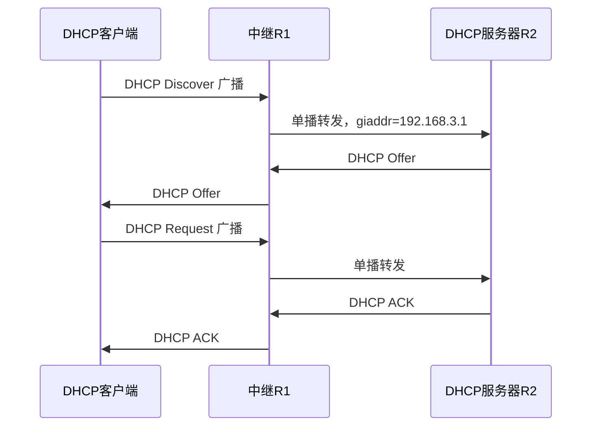

# DHCP 配置专题 · 完整笔记

> 内容来源：`06_重点2_动态主机配置协议DHCP_必会_.txt`（华为《动态主机配置协议 DHCP》培训胶片，第 0～11 页）与 `华为配置专题02_DHCP.txt`（同一套胶片的另一版导出，第 2～10 页）。两份讲义知识点一致，后者部分中文标题在 PDF 转文本时丢失，本文以 06 为主、以 02 核对配置代码块。
>
> 所有命令已按华为 VRP 官方命令参考校正；转纯文本造成的拼写与断行（如 `Gigabitthernet`、`dhcp se lect`、`ACL 3000` 粘连）已按官方语法还原；讲义中的占位符（`ip-address`、`ip-pool-name`）保留在语法说明中，实验部分替换为具体地址。与 `11.2-多臂路由、DHCP与路由配置` 重叠的原理性内容只做配置视角的速查，报文格式与状态机见 `5.2-DHCP协议与互联网新技术` §2～§4。

---

## 1.讲义定位与实验环境

### 1.1 两份讲义的关系

| 文件 | 页数 | 内容 | 文本质量 | 本文用法 |
| ---- | ---- | ---- | -------- | -------- |
| `06_重点2_动态主机配置协议DHCP_必会_.txt` | 12 页 | 问题导入、概念、优点、工作原理、租期更新、命令、两个实验 | 标题与正文基本可读 | 主稿，决定章节顺序 |
| `华为配置专题02_DHCP.txt` | 9 页 | 与 06 为同一套胶片 | 多处中文标题变成 `!"#$%` 等乱码，配置代码块完整 | 核对命令与实验参数 |

结论：这不是两套独立知识点，而是同一套华为培训胶片两次导出。本文按“一套知识、两份互校”处理，不重复计数。

### 1.2 讲义覆盖范围与本文对应节

| 讲义内容 | 讲义页 | 本文位置 |
| -------- | ------ | -------- |
| 手动配置网络参数的问题（1）（2） | 06 第 1～2 页 | §2.1 |
| DHCP 基本概念、C/S 架构 | 06 第 3 页 | §2.2 |
| DHCP 优点：统一管理、地址租期 | 06 第 4 页 | §2.3 |
| DHCP 工作原理（DORA） | 06 第 5 页 | §3.1、§3.2 |
| DHCP 租期更新与重绑定 | 06 第 6 页 | §3.3 |
| 接口地址池命令 1～5 | 06 第 7 页 | §4、§8.3 |
| 全局地址池命令 6～11 | 06 第 8 页 | §5、§8.2 |
| 接口地址池实验 | 06 第 9 页 | §4 |
| 全局地址池实验 | 06 第 10 页 | §5 |

### 1.3 实验拓扑与地址规划

讲义的两个实验都用“一台路由器作为 DHCP 服务器、GE0/0/0 连接二层广播域、客户端在同一网段”的最小拓扑。为避免两个实验地址混用，本文统一规划如下：

**实验一：接口地址池**

| 角色 | 接口/设备 | 地址 | 说明 |
| ---- | --------- | ---- | ---- |
| DHCP 服务器 | R1 GE0/0/0 | 10.1.1.1/24 | 接口地址即客户端网关 |
| DHCP 客户端 | PC1 | 动态获取 | 与 GE0/0/0 同一广播域 |
| DNS 服务器 | — | 10.1.1.2 | 由 `dhcp server dns-list` 下发 |
| 地址池 | 接口地址池 | 10.1.1.0/24 | 由接口地址与掩码自动推导 |
| 租期 | — | 3 天 | `dhcp server lease day 3` |

**实验二：全局地址池**

| 角色 | 接口/设备 | 地址 | 说明 |
| ---- | --------- | ---- | ---- |
| DHCP 服务器 | R1 GE0/0/0 | 1.1.1.1/24 | 讲义原文写 10.1.1.1/24，与地址池矛盾，已校正 |
| DHCP 客户端 | PC1 | 动态获取 | 与 GE0/0/0 同一广播域 |
| 全局地址池 | `pool2` | 1.1.1.0/24 | `network 1.1.1.0 mask 255.255.255.0` |
| 网关 | — | 1.1.1.1 | `gateway-list 1.1.1.1` |
| DNS | — | 1.1.1.1 | `dns-list 1.1.1.1`，即路由器自身兼作 DNS |
| 租期 | — | 10 天 | `lease day 10` |

### 1.4 配置前检查清单

| 检查项 | 要求 | 不满足时的现象 |
| ------ | ---- | -------------- |
| 全局 DHCP | 已执行 `dhcp enable` | 所有 DHCP 命令不生效，客户端拿不到地址 |
| 接口地址 | 服务器接口已配置 IP、接口 Up | 接口地址池无法推导网段；中继无源地址 |
| 地址池网段 | `network` 与接口网段一致（全局池） | 地址池存在但客户端拿不到同网段地址 |
| 网关可达 | `gateway-list` 与客户端同网段 | 客户端有 IP 但跨网段不通 |
| 排除地址 | 网关（全局池建议排除；接口池由设备自动占用）、DNS、服务器、保留地址已排除 | 地址冲突或服务器地址被占用 |
| 广播域 | 客户端与服务器接口在同一 VLAN/二层广播域 | Discover 到不了服务器 |
| 中继场景 | 中继接口到服务器路由可达，服务器有回程路由 | 服务器收到请求但 Offer 回不来 |
| 竞争服务器 | 网段内没有私设 DHCP 服务器 | 客户端拿到错误网关或错误网段地址 |

---

## 2.为什么需要 DHCP

### 2.1 手工配置的四类问题

讲义用两页说明“为什么不能继续手工配 IP”，四个问题分别对应 DHCP 的一项机制：

| 问题 | 讲义表述 | 直接后果 | DHCP 的对应机制 |
| ---- | -------- | -------- | --------------- |
| 参数多、理解难 | 普通用户不了解 IP、掩码、网关、DNS，经常配错 | 无法正常访问网络；随意配置导致地址冲突 | 服务器统一下发完整参数 |
| 工作量大 | 网络管理员逐台规划、分配、配置，属于重复性劳动 | 人力成本高、易出错 | 地址池自动分配，集中管理 |
| 利用率低 | 每人固定一个 IP，未在线用户的地址长期闲置 | 地址浪费，地址空间紧张 | 租期机制，到期回收再分配 |
| 灵活性差 | WLAN 使终端位置不固定，移动到另一覆盖区可能需要重新配 IP | 移动办公体验差 | 即插即用，接入新网段自动重新申请 |

讲义还特别指出：企业网中“一个人固定一个 IP”的做法，会使部分地址长期处于未使用状态；WLAN（Wireless Local Area Network，无线局域网）出现后，终端位置不再固定，静态配置更难维护。

### 2.2 DHCP 的定位与 C/S 架构

DHCP（Dynamic Host Configuration Protocol，动态主机配置协议）用于**动态、合理地分配 IP 地址及其配套参数**。它采用 **C/S（Client/Server）架构**：

| 角色 | 职责 |
| ---- | ---- |
| DHCP 客户端 | 无需手工配置，主动请求地址；获得地址后按租期使用 |
| DHCP 服务器 | 维护地址池与地址状态，分配地址、下发参数、处理续租与释放 |

DHCP 下发的并不只是 IP 地址，而是一组“上网必备参数”：

| 参数 | 作用 | 典型配置命令 |
| ---- | ---- | ------------ |
| IP 地址、子网掩码 | 主机身份与网段归属 | `network`（全局池）或接口地址（接口池） |
| 默认网关 | 跨网段通信的出口 | `gateway-list` / `dhcp server gateway-list` |
| DNS 服务器 | 域名解析 | `dns-list` / `dhcp server dns-list` |
| 域名后缀 | 配合 DNS 做域名补全 | `domain-name` / `dhcp server domain-name` |
| 租期 | 地址可用时长 | `lease` / `dhcp server lease` |
| 启动文件名、文件服务器 | IP 电话、无盘工作站等特定终端 | `bootfile`、`next-server` |
| 厂商自定义参数 | AP 找 AC、终端找管理平台等 | Option 43、Option 模板 |

### 2.3 讲义总结的三项优点

| 优点 | 讲义依据 | 配置落点 |
| ---- | -------- | -------- |
| 统一管理 | IP 地址从服务器地址池获取，服务器记录维护使用状态 | `ip pool`、`display ip pool` |
| 地址租期 | 提出 Lease 概念，到期回收，提高地址利用率 | `lease`、`dhcp server lease` |
| 即插即用 | 主机无需配置，接入网络即可获得地址 | `dhcp select interface/global` |

讲义第 4 页的地址池示意给出了以下字段，读 `display ip pool` 输出时会遇到：

| 字段 | 含义 | 示例 |
| ---- | ---- | ---- |
| Pool-No | 地址池编号 | 1 |
| Network / Mask | 地址池网段与掩码 | 10.1.2.0 / 255.255.255.0 |
| Gateway | 下发的网关 | 10.1.2.1 |
| DNS-server | 下发的 DNS | 10.1.1.2 |
| Total Address | 地址池地址总数 | 255 |
| Used Address | 已分配数量 | 2 |
| Lease | 租期 | 8 Hours |

讲义中同一页还出现 `Total 252` 的示例，这是扣除网络地址、广播地址、网关等不可用地址后的“可分配数”口径；不同版本显示口径略有差异，答题时以字段名含义为准，不必强行换算。

---

## 3.交互过程与租期（配置视角）

### 3.1 DORA 四报文

DHCP 使用 **UDP**，服务器端口 **67**，客户端端口 **68**。首次获取地址共四个主要报文：

| 报文 | 方向 | 源/目的地址（首次申请） | 源/目的端口 | 关键内容 | 讲义口径 |
| ---- | ---- | ---------------------- | ----------- | -------- | -------- |
| DHCP Discover | 客户端 → 服务器 | 0.0.0.0 → 255.255.255.255 | 68 → 67 | Option 53=1，Option 55 参数请求列表 | 广播 |
| DHCP Offer | 服务器 → 客户端 | 服务器地址 → 客户端地址或广播 | 67 → 68 | 预分配的 `yiaddr`、租期、服务器标识 | 单播 |
| DHCP Request | 客户端 → 服务器 | 0.0.0.0 → 255.255.255.255 | 68 → 67 | Option 50 请求的 IP、Option 54 选中的服务器 | 广播 |
| DHCP ACK | 服务器 → 客户端 | 服务器地址 → 客户端地址或广播 | 67 → 68 | 确认租期与全部参数 | 单播 |

补充报文：

| 报文 | 方向 | 作用 |
| ---- | ---- | ---- |
| DHCP NAK | 服务器 → 客户端 | 拒绝请求（地址已被占用、网段不符、租期失效），客户端重新申请 |
| DHCP Decline | 客户端 → 服务器 | 客户端检测到地址冲突，拒绝使用该地址 |
| DHCP Release | 客户端 → 服务器 | 客户端主动释放地址，服务器把地址置为空闲 |
| DHCP Inform | 客户端 → 服务器 | 客户端已有地址，只请求其他配置参数 |

说明：讲义把 Offer、ACK 标为“单播”，把 Request 标为“广播”，这是**首次申请**的典型流程。实际报文的单播/广播取决于客户端是否置位广播标志、是否已有地址；考试按讲义口径作答，工程排障时以抓包为准。详见 `5.2-DHCP协议与互联网新技术` §2.2。

### 3.2 为什么收到 Offer 后还要发送 Request

讲义第 5 页的思考题是本节最容易出简答题的地方。原因有四条：

1. **可能有多台 DHCP 服务器同时应答**。客户端会收到多个 Offer，必须通过广播 Request 声明“客户端选择了哪一台服务器、哪个地址”，未被选中的服务器收到后收回自己的预留地址。
2. **Offer 只是预分配，不是最终确认**。服务器在 Offer 阶段只做预留，收到 Request 后才正式提交绑定并回 ACK；客户端收到 ACK 才能开始使用该地址。
3. **避免地址冲突和重复分配**。广播 Request 让同一广播域内的所有 DHCP 服务器都知道该地址已被占用，防止另一台服务器把同一地址再分配给其他客户端。
4. **服务器可能拒绝**。若服务器发现地址已被占用或客户端不在授权范围，会回 NAK；客户端收到 NAK 后必须放弃该地址并重新 Discover。

| 阶段 | 服务器动作 | 地址状态 | 客户端状态 |
| ---- | ---------- | -------- | ---------- |
| Discover | 查找可用地址，发送 Offer | 预留（未提交） | 选择中 |
| Request | 校验地址与绑定关系 | 待确认 | 请求确认 |
| ACK | 建立绑定，记录 MAC、租期 | 已分配 | 可使用 |
| NAK | 拒绝绑定 | 保持可用或冲突 | 重新申请 |

### 3.3 租期更新与重绑定

租期（Lease）是 DHCP 提高地址利用率的核心机制。客户端在租期内有两个关键时间点：

| 时间点 | 名称 | 客户端动作 | 报文与目的地址 | 服务器响应 | 结果 |
| ------ | ---- | ---------- | -------------- | ---------- | ---- |
| 0% | 获得租期 | 收到 ACK，开始计时 | — | — | 正常使用 |
| 50% | 续租（Renewing） | 向**原服务器**请求延长租期 | DHCP Request，**单播** | ACK | 租期刷新为完整租期，重新计时 |
| 50% 未响应 | 继续等待 | 继续使用，等待 T2 | — | — | 不立即放弃地址 |
| 87.5% | 重绑定（Rebinding） | 向**任意服务器**广播请求 | DHCP Request，**广播** | ACK 或 NAK | ACK 则继续使用；无响应则租期到期 |
| 100% | 租期到期 | 停止使用该地址 | 可选 Release；随后重新 Discover | — | 地址被服务器回收 |

计算公式：

```
T1（续租时间） = 0.5 × Lease
T2（重绑定时间） = 0.875 × Lease
```

要点：

- **T1、T2 缺省由客户端按租期计算**：服务器未下发 Option 58/59 时，客户端取 T1 = 0.5 × Lease、T2 = 0.875 × Lease；RFC 2131 允许服务器用 Option 58/59 显式指定，华为 VRP 地址池不提供 T1/T2 配置命令，只下发租期；
- 50% 时是**单播**续租，87.5% 时才是**广播**重绑定，这两个百分比和报文方向是选择题高频点；
- 若 50% 续租收到 NAK，客户端应立即停止使用该地址并重新申请，不必等到 87.5%；
- 租期越短，地址回收越快，但续租报文越多；租期越长，报文越少，但地址可能被长期占用。

### 3.4 本节与其他笔记的分工

| 内容 | 本文处理 | 详细展开 |
| ---- | -------- | -------- |
| DHCP 报文首部、Option 字段格式 | 只列与配置相关的 Option | `5.2-DHCP协议与互联网新技术` §2.3 |
| 客户端状态机、异常处理 | 只列续租与重绑定 | `5.2-DHCP协议与互联网新技术` §3 |
| 全局池/接口池/中继/Option/Snooping 原理 | 以实验和命令为主 | `11.2-多臂路由、DHCP与路由配置` §3 |
| 本文重点 | 实验步骤、命令清单、排错、考点 | — |

---

## 4.接口地址池实验

### 4.1 需求描述

- 配置一台路由器作为 DHCP 服务器；
- 使用接口 GE0/0/0 所属网段作为 DHCP 客户端的地址池；
- 接口地址为 10.1.1.1/24，同时把 10.1.1.2 设为 DNS 服务器地址；
- 租期设置为 3 天；
- 客户端与 GE0/0/0 在同一二层广播域。

### 4.2 配置步骤

| 步骤 | 视图 | 命令 | 目的 |
| ---- | ---- | ---- | ---- |
| 1 | 系统视图 | `dhcp enable` | 全局使能 DHCP |
| 2 | 接口视图 | `ip address 10.1.1.1 24` | 配置接口地址，同时确定接口池网段 |
| 3 | 接口视图 | `dhcp select interface` | 指定该接口使用接口地址池 |
| 4 | 接口视图 | `dhcp server dns-list 10.1.1.2` | 下发 DNS |
| 5 | 接口视图 | `dhcp server excluded-ip-address 10.1.1.2` | 排除 DNS 地址，不参与动态分配 |
| 6 | 接口视图 | `dhcp server lease day 3` | 配置租期 3 天 |

完整配置：

```
<Huawei> system-view
[Huawei] sysname R1
[R1] dhcp enable
[R1] interface GigabitEthernet0/0/0
[R1-GigabitEthernet0/0/0] ip address 10.1.1.1 24
[R1-GigabitEthernet0/0/0] dhcp select interface
[R1-GigabitEthernet0/0/0] dhcp server dns-list 10.1.1.2
[R1-GigabitEthernet0/0/0] dhcp server excluded-ip-address 10.1.1.2
[R1-GigabitEthernet0/0/0] dhcp server lease day 3
[R1-GigabitEthernet0/0/0] quit
```

可选：显式指定网关。接口地址池的网关缺省就是接口地址，一般不需要配置；如考试题干要求写出，使用：

```
[R1-GigabitEthernet0/0/0] dhcp server gateway-list 10.1.1.1
```

### 4.3 逐条命令解释

| 命令 | 视图 | 解释 |
| ---- | ---- | ---- |
| `dhcp enable` | 系统视图 | 全局开关，未执行时后续 DHCP 配置不生效 |
| `interface GigabitEthernet0/0/0` | 系统视图 | 进入连接客户端的接口 |
| `ip address 10.1.1.1 24` | 接口视图 | 接口地址池的网段由“接口地址 + 掩码”自动推导，无需再写 `network` |
| `dhcp select interface` | 接口视图 | 选择接口地址池模式；这是与全局池最直观的区别 |
| `dhcp server dns-list 10.1.1.2` | 接口视图 | 下发 DNS，可跟多个地址 |
| `dhcp server excluded-ip-address 10.1.1.2` | 接口视图 | 排除单个地址；也可写 `起始地址 结束地址` 排除一段 |
| `dhcp server lease day 3` | 接口视图 | 租期 3 天；缺省为 1 天，`unlimited` 表示无限期 |

### 4.4 验证

服务器侧：

```
[R1] display ip pool interface GigabitEthernet0/0/0
[R1] display ip pool
[R1] display current-configuration interface GigabitEthernet0/0/0
```

客户端侧（Windows）：

```
ipconfig /all
ipconfig /release
ipconfig /renew
```

预期结果：

| 检查项 | 预期值 |
| ------ | ------ |
| 客户端 IP | 10.1.1.3～10.1.1.254 中的某个地址（10.1.1.2 已排除） |
| 子网掩码 | 255.255.255.0 |
| 默认网关 | 10.1.1.1 |
| DNS | 10.1.1.2 |
| 租期 | 3 天 |
| 地址池状态 | `Used` 增加，`Idle` 减少 |

### 4.5 讲义标注的四处问题

| 原文 | 问题 | 校正 |
| ---- | ---- | ---- |
| `[Huawei-Gigabitthernet0/0/0]` | `Gigabitthernet` 拼写漏字，讲义中出现多次 | 改为 `GigabitEthernet0/0/0` |
| “排除地址（将接口自身地址排除在外）” | 实际排除的是 10.1.1.2，而接口地址是 10.1.1.1 | 10.1.1.2 是 DNS 地址；接口地址（网关）不参与动态分配，无需手工排除。官方配置指南称分配时设备自动将其置为 Conflict，故障案例中网关地址常显示 Used，随版本/场景不同 |
| `dhcp server dns-list ip-address` | 语法占位符 | 实验中替换为 `10.1.1.2` |
| `dhcp server excluded-ip-address start-ip-address [ end-ip-address ]` | 语法占位符 | 单地址写一个参数，地址段写两个参数 |

---

## 5.全局地址池实验

### 5.1 需求描述

- 配置一台路由器作为 DHCP 服务器；
- 创建全局地址池 `pool2`，为客户端分配 1.1.1.0/24 网段地址；
- 网关地址 1.1.1.1，DNS 地址同样为 1.1.1.1；
- 租期 10 天；
- 在 GE0/0/0 接口下调用全局地址池。

### 5.2 配置步骤

| 步骤 | 视图 | 命令 | 目的 |
| ---- | ---- | ---- | ---- |
| 1 | 系统视图 | `dhcp enable` | 全局使能 DHCP |
| 2 | 系统视图 | `ip pool pool2` | 创建全局地址池并进入池视图 |
| 3 | 地址池视图 | `network 1.1.1.0 mask 255.255.255.0` | 指定可分配地址块 |
| 4 | 地址池视图 | `gateway-list 1.1.1.1` | 下发网关 |
| 5 | 地址池视图 | `dns-list 1.1.1.1` | 下发 DNS |
| 6 | 地址池视图 | `lease day 10` | 租期 10 天 |
| 7 | 接口视图 | `ip address 1.1.1.1 24` | 接口地址落在池网段内 |
| 8 | 接口视图 | `dhcp select global` | 指定该接口使用全局地址池 |

完整配置：

```
<Huawei> system-view
[Huawei] sysname R1
[R1] dhcp enable
[R1] ip pool pool2
[R1-ip-pool-pool2] network 1.1.1.0 mask 255.255.255.0
[R1-ip-pool-pool2] gateway-list 1.1.1.1
[R1-ip-pool-pool2] dns-list 1.1.1.1
[R1-ip-pool-pool2] lease day 10
[R1-ip-pool-pool2] quit
[R1] interface GigabitEthernet0/0/0
[R1-GigabitEthernet0/0/0] ip address 1.1.1.1 24
[R1-GigabitEthernet0/0/0] dhcp select global
[R1-GigabitEthernet0/0/0] quit
```

`network` 的掩码也可以写长度：

```
[R1-ip-pool-pool2] network 1.1.1.0 mask 24
```

两种写法等价，考试建议写完整的点分十进制掩码，减少歧义。

### 5.3 逐条命令解释

| 命令 | 视图 | 解释 |
| ---- | ---- | ---- |
| `ip pool pool2` | 系统视图 | 创建全局地址池，名称自定义；同一台设备可创建多个池 |
| `network 1.1.1.0 mask 255.255.255.0` | 地址池视图 | 指定地址池范围；全局池必须写，接口池不写 |
| `gateway-list 1.1.1.1` | 地址池视图 | 下发的默认网关，应与客户端同网段 |
| `dns-list 1.1.1.1` | 地址池视图 | 下发的 DNS，可配置多个 |
| `lease day 10` | 地址池视图 | 租期 10 天；缺省 1 天 |
| `dhcp select global` | 接口视图 | 该接口收到的 DHCP 请求从全局地址池取地址 |

### 5.4 验证

```
[R1] display ip pool name pool2
[R1] display ip pool name pool2 all
[R1] display ip pool name pool2 used
[R1] display current-configuration interface GigabitEthernet0/0/0
```

预期结果：客户端获得 1.1.1.x 地址，网关与 DNS 均为 1.1.1.1，租期 10 天；`display ip pool name pool2` 中 `Used` 增加。

### 5.5 讲义中的三处需要说明的地方

| 需要说明的点 | 原文 | 分析 | 处理 |
| ---- | ---- | ---- | ---- |
| 接口视图不一致 | 先 `interface GigabitEthernet0/0/0`，下一行提示符却是 `[Huawei-GigabitEthernet0/0/1]` | 转文本或排版错误 | 统一为 GE0/0/0 |
| 接口地址与池网段不一致 | 拓扑标 10.1.1.1/24，地址池却是 1.1.1.0/24 | 网关 1.1.1.1 不在客户端链路网段，客户端无法通过网关通信 | 本文把接口地址校正为 1.1.1.1/24；若坚持 10.1.1.0/24 链路，则应把池改为 10.1.1.0/24、网关改为 10.1.1.1 |
| 网关与 DNS 相同 | `gateway-list 1.1.1.1`、`dns-list 1.1.1.1` | 路由器自身兼作网关与 DNS 时合法 | 保留，实验环境可用 |

`[存疑]` 讲义全局池实验的地址规划应视为排版错误。考试中若出现同类题，判断标准只有一条：**全局池的 `network`、`gateway-list` 必须与客户端所在网段一致**，否则客户端即使拿到地址也无法正常通信。

### 5.6 两种地址池的配置对比

| 对比项 | 全局地址池 | 接口地址池 |
| ------ | ---------- | ---------- |
| 创建命令 | `ip pool 名称` | 不创建池，直接进接口 |
| 地址块来源 | `network` 手工指定 | 接口地址与掩码自动推导 |
| 配置视图 | 地址池视图 | 接口视图 |
| 命令前缀 | 直接写 `gateway-list`、`dns-list` 等 | 统一带 `dhcp server` 前缀 |
| 选择命令 | `dhcp select global` | `dhcp select interface` |
| 网关缺省值 | 需配置 `gateway-list`，否则不下发网关 | 缺省为接口地址 |
| 是否可跨网段 | 可以，配合 DHCP 中继 | 不可以，只服务本网段 |
| 典型场景 | 中大型网络、服务器集中部署 | 小型网络、单网关分支 |
| 判读关键词 | `ip pool`、`global` | `dhcp select interface`、`dhcp server` |

判读技巧：题目问“使用的是全局还是接口地址池”，只看两个关键词——出现 `ip pool` 或 `global` 即全局；出现 `dhcp select interface` 或 `dhcp server` 即接口。

---

## 6.地址池进阶配置

### 6.1 排除地址

作用：把网关、DNS、服务器、打印机、AP 管理地址等**不希望动态分配**的地址排除在外。

全局地址池：

```
[R1] ip pool pool2
[R1-ip-pool-pool2] excluded-ip-address 1.1.1.1 1.1.1.10
[R1-ip-pool-pool2] excluded-ip-address 1.1.1.100
```

接口地址池：

```
[R1] interface GigabitEthernet0/0/0
[R1-GigabitEthernet0/0/0] dhcp server excluded-ip-address 10.1.1.2 10.1.1.10
[R1-GigabitEthernet0/0/0] dhcp server excluded-ip-address 10.1.1.100
```

规则：

| 规则 | 说明 |
| ---- | ---- |
| 单地址/地址段 | 只写一个参数为单地址，写两个参数为闭区间地址段 |
| 可多次配置 | 需要多个不连续范围时重复执行命令 |
| 只限制动态分配 | 被排除的地址进入 Disabled 状态；若要 `static-bind`，必须先取消排除 |
| 地址必须在池内 | 超出 `network` 范围的排除地址无意义，设备可能报错 |
| 接口地址自动排除 | 接口地址池中，接口自身地址（即网关）不参与动态分配，不需要手工排除；分配时设备自动将其置为 Conflict（故障案例中网关地址亦常显示 Used，随版本/场景） |
| 建议排除对象 | 网关、DNS、WINS、服务器、网络设备管理地址、保留段 |

常见误区：把“排除地址”理解成“删除地址”。排除只是不参与动态分配，地址仍在池的统计范围内，`display ip pool` 中显示为 Disabled 状态（统计中的 `Disabled` 列）。

### 6.2 租期

全局地址池：

```
[R1-ip-pool-pool2] lease { day day [ hour hour [ minute minute ] ] | unlimited }
```

接口地址池：

```
[R1-GigabitEthernet0/0/0] dhcp server lease { day day [ hour hour [ minute minute ] ] | unlimited }
```

参数：

| 参数 | 含义 | 取值范围 |
| ---- | ---- | -------- |
| `day day` | 天数 | 0～999 |
| `hour hour` | 小时 | 0～23 |
| `minute minute` | 分钟 | 0～59 |
| `unlimited` | 永不过期 | — |
| 缺省值 | 1 天 | `lease day 1` |

租期设计建议：

| 场景 | 建议租期 | 理由 |
| ---- | -------- | ---- |
| 固定办公区 | 1～3 天 | 终端位置稳定，减少续租报文 |
| 会议室、培训室 | 数小时 | 人员流动快，及时回收 |
| 机场、车站、酒店 | 30 分钟～2 小时 | 高流动性，避免地址被长期占用 |
| 服务器、打印机、IP 电话 | `unlimited` 或静态绑定 | 需要长期稳定地址 |
| 实验环境 | 1 天（缺省） | 便于观察续租与到期 |

注意：`lease day 0 hour 8` 合法，表示 8 小时；不要写成 `lease 8 hour`，`day` 关键字不能省略。

### 6.3 静态绑定

作用：把某个 IP 固定分配给指定 MAC，适用于服务器、打印机、IP 电话、AP 等需要稳定地址但又想统一由 DHCP 下发的终端。

全局地址池：

```
[R1-ip-pool-pool2] static-bind ip-address 1.1.1.20 mac-address 5489-98a1-1234
```

接口地址池：

```
[R1-GigabitEthernet0/0/0] dhcp server static-bind ip-address 10.1.1.20 mac-address 5489-98a1-1234
```

规则：

| 规则 | 说明 |
| ---- | ---- |
| MAC 格式 | 华为使用 `H-H-H`，如 `5489-98a1-1234`，不是 `5489.98a1.1234` 或 `548998a11234` |
| 地址范围 | 绑定的 IP 必须属于该地址池网段 |
| 一对一 | 一个 IP 只能绑定一个 MAC，一个 MAC 也只能绑定一个 IP |
| 与排除地址的关系 | 被 `excluded-ip-address` 排除的地址为 Disabled 状态，不能直接 `static-bind`，需先取消排除 |
| 与租期的关系 | 静态绑定地址不老化，租期变为无限长；删除绑定后恢复为地址池租期 |
| 可选模板 | `static-bind ... option-template 模板名` 可为该终端附加 Option 参数 |

### 6.4 Option 模板与常用 Option

DHCP 通过 Option 字段携带扩展参数。考试常考“某个需求对应哪个 Option”，实验常考“IP 电话如何获得启动文件”。

| Option | 名称 | 作用 |
| ------ | ---- | ---- |
| 1 | Subnet Mask | 子网掩码 |
| 3 | Router | 默认网关 |
| 6 | Domain Name Server | DNS 服务器 |
| 15 | Domain Name | 域名后缀 |
| 43 | Vendor Specific Information | 厂商自定义信息，常见于 AP 找 AC |
| 50 | Requested IP Address | 客户端请求的地址 |
| 51 | IP Address Lease Time | 租期 |
| 53 | DHCP Message Type | 报文类型（Discover/Offer/Request/ACK 等） |
| 54 | Server Identifier | 服务器标识，客户端用它区分 Offer 来源 |
| 55 | Parameter Request List | 客户端请求的参数列表 |
| 61 | Client Identifier | 客户端标识，常用 MAC |
| 66 | TFTP Server Name | 启动文件服务器名 |
| 67 | Bootfile Name | 启动文件名 |
| 82 | Relay Agent Information | 中继代理信息，携带 Circuit ID、Remote ID |

Option 模板用于给**特定类型终端**下发统一参数。以 IP 电话为例：

```
[R1] dhcp option template tpl-phone
[R1-dhcp-option-template-tpl-phone] gateway-list 10.1.1.1
[R1-dhcp-option-template-tpl-phone] dns-list 10.1.1.2
[R1-dhcp-option-template-tpl-phone] bootfile phone.cfg
[R1-dhcp-option-template-tpl-phone] next-server 10.1.1.10
[R1-dhcp-option-template-tpl-phone] quit
```

在地址池的静态绑定中引用模板：

```
[R1] ip pool pool2
[R1-ip-pool-pool2] static-bind ip-address 1.1.1.30 mac-address 5489-98a1-5678 option-template tpl-phone
```

| 命令 | 作用 |
| ---- | ---- |
| `dhcp option template 名称` | 创建 Option 模板并进入模板视图 |
| `gateway-list` | 模板内下发的网关 |
| `dns-list` | 模板内下发的 DNS |
| `bootfile 文件名` | 下发的启动配置文件名 |
| `next-server 地址` | 获取启动文件的服务器地址（TFTP/FTP） |
| `static-bind ... option-template 名称` | 在静态绑定中引用模板 |

Option 模板的字段含义与引用方式详见 `11.2-多臂路由、DHCP与路由配置` §3.5；本节只补充讲义未展开的 Option 码与实验写法。

WLAN 场景常用 Option 43 告诉 AP“AC 在哪里”。华为 AP 支持子选项 1/2/3，常用写法如下：

```
# 全局地址池视图：子选项 2 直接写 AC 的 IP
[R1-ip-pool-pool2] option 43 sub-option 2 ip-address 10.1.1.100

# 等价的十六进制写法：02=子选项 2，04=长度 4 字节，0a010164=10.1.1.100
[R1-ip-pool-pool2] option 43 hex 02040a010164

# 接口地址池视图则使用 dhcp server 前缀
[R1-GigabitEthernet0/0/0] dhcp server option 43 sub-option 2 ip-address 10.1.1.100
```

`[已定案]` 华为 AP 可识别 Option 43 的子选项 1（十六进制）、2（IP 地址）、3（ASCII），单 AC 任选一种；多 AC 时用子选项 2 或 3，最多 8 个地址。全局地址池用 `option 43 ...`，接口地址池用 `dhcp server option 43 ...`。考试若未给出具体格式，只需答出“Option 43 用于 AP 获取 AC 地址”即可，不要死记十六进制串。

### 6.5 租期续租与服务器配置的关系

| 客户端动作 | 触发条件 | 报文 | 服务器侧可见结果 |
| ---------- | -------- | ---- | ---------------- |
| 首次申请 | 无地址 | Discover/Request/ACK | 地址从 Idle 变为 Used |
| 续租 | 到 50% 租期 | Request 单播 | 租期刷新，地址保持 Used |
| 重绑定 | 到 87.5% 租期且原服务器无响应 | Request 广播 | 任意服务器可接管，刷新绑定 |
| 主动释放 | 用户执行 `ipconfig /release` 或关机释放 | Release | 地址提前变为 Idle |
| 租期到期 | 100% 租期 | 无 | 地址回收，可再分配 |

工程要点：

- 服务器只配置 `lease`；未下发 Option 58/59 时，T1/T2 由客户端按 50%、87.5% 计算，不要把这两个百分比写进服务器配置；
- 租期过短会增加续租报文和服务器负担，过长会降低地址周转率；
- 排障时先看 `display ip pool` 的 `Used`、`Idle`、`Conflict`，再判断是地址耗尽还是续租失败；
- 客户端跨网段移动后，原地址可能已不在新网段，客户端会重新 Discover，由新网段的地址池分配。

---

## 7.DHCP 中继实验

### 7.1 场景与地址规划

客户端与 DHCP 服务器不在同一网段，网关设备充当中继：

| 设备 | 接口 | 地址 | 角色 |
| ---- | ---- | ---- | ---- |
| R1 | GE0/0/1 | 192.168.3.1/24 | 客户端网关 + DHCP 中继 |
| R1 | GE0/0/0 | 192.168.1.2/24 | 连接 DHCP 服务器 |
| R2 | GE0/0/0 | 192.168.1.1/24 | DHCP 服务器 |
| PC1 | — | 192.168.3.10/24（动态） | DHCP 客户端 |
| 地址池 | `pool3` | 192.168.3.0/24 | 网关 192.168.3.1 |

R1 与 R2 之间配置直连路由或静态路由，保证 192.168.1.0/24 与 192.168.3.0/24 互通。

### 7.2 服务器端配置

```
[R2] dhcp enable
[R2] ip pool pool3
[R2-ip-pool-pool3] network 192.168.3.0 mask 255.255.255.0
[R2-ip-pool-pool3] gateway-list 192.168.3.1
[R2-ip-pool-pool3] dns-list 192.168.1.1
[R2-ip-pool-pool3] lease day 1
[R2-ip-pool-pool3] quit
```

服务器不需要在 192.168.3.0/24 上拥有接口，但必须有到 192.168.3.0/24 的回程路由，下一跳指向 R1 的 192.168.1.2：

```
[R2] ip route-static 192.168.3.0 255.255.255.0 192.168.1.2
```

### 7.3 中继端配置

```
[R1] dhcp enable
[R1] interface GigabitEthernet0/0/1
[R1-GigabitEthernet0/0/1] ip address 192.168.3.1 24
[R1-GigabitEthernet0/0/1] dhcp select relay
[R1-GigabitEthernet0/0/1] dhcp relay server-ip 192.168.1.1
[R1-GigabitEthernet0/0/1] quit
```

| 命令 | 作用 |
| ---- | ---- |
| `dhcp select relay` | 指定接口工作在 DHCP 中继模式 |
| `dhcp relay server-ip 192.168.1.1` | 指定 DHCP 服务器地址，可配置多个 |
| `dhcp enable` | 全局使能，中继同样依赖此开关 |

### 7.4 工作过程



步骤说明：

1. 客户端在本网段广播 Discover，源地址 0.0.0.0，目的地址 255.255.255.255；
2. 中继接口收到广播后，把报文改为单播，源地址改为自己的接口地址，并在 `giaddr` 字段填入接收接口的地址 192.168.3.1；
3. 服务器根据 `giaddr` 判断客户端所在网段，选择 `pool3`；
4. 服务器回 Offer，目的地址为 `giaddr` 或客户端地址，经路由送到中继；
5. 中继把 Offer 转发给客户端，后续 Request/ACK 同理。

### 7.5 验证

```
[R2] display ip pool name pool3
[R1] display ip routing-table
[R1] display current-configuration interface GigabitEthernet0/0/1
```

客户端执行 `ipconfig /all`，确认地址属于 192.168.3.0/24，网关为 192.168.3.1。

### 7.6 常见故障

| 现象 | 可能原因 | 处理 |
| ---- | -------- | ---- |
| 客户端一直拿不到地址 | 中继接口未配 `dhcp select relay` | 补配模式 |
| 同上 | 未配 `dhcp relay server-ip` | 指定服务器地址 |
| 同上 | 中继到服务器无路由 | 配置静态路由或动态路由 |
| 同上 | 服务器地址池 `network` 与客户端网段不一致 | 改为 192.168.3.0/24 |
| 同上 | 服务器没有回程路由 | 添加指向 192.168.3.0/24、下一跳 192.168.1.2 的路由 |
| 同上 | 中间设备 ACL 阻断 UDP 67/68 | 放行 DHCP 报文 |
| 客户端拿到其他网段地址 | 服务器按 `giaddr` 选错池，或存在多个地址池 | 检查 `giaddr` 与池网段 |
| 客户端有 Offer 无 ACK | 服务器到客户端网段回程不通 | 检查回程路由与中继接口状态 |
| 地址冲突 | 网段内存在私设 DHCP 服务器或静态地址 | 部署 DHCP Snooping，清理私设服务器 |

### 7.7 中继与 Option 82

中继可以在转发的 DHCP 报文中插入 Option 82（Relay Agent Information），携带客户端接入的 Circuit ID、Remote ID 等信息，服务器可据此按位置分配地址或做接入控制。

```
[R1] dhcp enable
[R1] interface GigabitEthernet0/0/1
[R1-GigabitEthernet0/0/1] dhcp relay information enable
```

要点：

- Option 82 由中继添加，客户端通常不感知；
- 服务器需要支持并按 Option 82 匹配地址池，否则只作为信息记录；
- 与 DHCP Snooping 结合时，可用于防止地址伪造和私设服务器；
- DHCP Snooping 的配置与绑定表见 `11.2-多臂路由、DHCP与路由配置` §3.6。

---

## 8.命令清单

### 8.1 系统视图

| 命令 | 作用 | 备注 |
| ---- | ---- | ---- |
| `dhcp enable` | 全局使能 DHCP | 所有 DHCP 配置的前提 |
| `ip pool 名称` | 创建全局地址池 | 进入地址池视图 |
| `dhcp option template 名称` | 创建 Option 模板 | 进入模板视图 |
| `display ip pool` | 查看所有地址池 | 全局与接口池均可显示 |

### 8.2 全局地址池视图

| 命令 | 作用 |
| ---- | ---- |
| `network ip-address [ mask { mask 或 mask-length } ]` | 指定可分配地址块 |
| `gateway-list 地址` | 下发默认网关，可多个 |
| `dns-list 地址` | 下发 DNS，可多个 |
| `domain-name 域名` | 下发域名后缀 |
| `excluded-ip-address 起始地址 [ 结束地址 ]` | 排除不参与动态分配的地址 |
| `static-bind ip-address 地址 mac-address MAC` | 静态绑定 |
| `static-bind ... option-template 模板名` | 静态绑定并引用 Option 模板 |
| `lease { day day [ hour hour [ minute minute ] ] 或 unlimited }` | 配置租期 |

### 8.3 接口地址池视图

| 命令 | 作用 |
| ---- | ---- |
| `dhcp select interface` | 选择接口地址池 |
| `dhcp server gateway-list 地址` | 下发网关（缺省为接口地址） |
| `dhcp server dns-list 地址` | 下发 DNS |
| `dhcp server domain-name 域名` | 下发域名后缀 |
| `dhcp server excluded-ip-address 起始地址 [ 结束地址 ]` | 排除地址 |
| `dhcp server static-bind ip-address 地址 mac-address MAC` | 静态绑定 |
| `dhcp server lease { day day [ hour hour [ minute minute ] ] 或 unlimited }` | 配置租期 |
| `dhcp server bootfile 文件名` | 下发启动文件名 |
| `dhcp server next-server 地址` | 下发启动文件服务器地址 |

### 8.4 接口选择与中继

| 命令 | 作用 |
| ---- | ---- |
| `dhcp select global` | 接口使用全局地址池 |
| `dhcp select interface` | 接口使用接口地址池 |
| `dhcp select relay` | 接口作为 DHCP 中继 |
| `dhcp relay server-ip 地址` | 指定 DHCP 服务器地址 |
| `dhcp relay information enable` | 使能 Option 82 |

### 8.5 Option 模板视图

| 命令 | 作用 |
| ---- | ---- |
| `gateway-list 地址` | 模板内网关 |
| `dns-list 地址` | 模板内 DNS |
| `domain-name 域名` | 模板内域名后缀 |
| `bootfile 文件名` | 启动文件名 |
| `next-server 地址` | 启动文件服务器地址 |

### 8.6 维护与验证

| 命令 | 作用 |
| ---- | ---- |
| `display ip pool` | 查看所有地址池概况 |
| `display ip pool name 池名` | 查看指定全局池 |
| `display ip pool name 池名 all` | 查看池内全部地址状态 |
| `display ip pool name 池名 used` | 查看已分配地址 |
| `display ip pool name 池名 conflict` | 查看指定池的冲突地址 |
| `display ip pool interface 接口名` | 查看接口地址池 |
| `display dhcp option template name 模板名` | 查看 Option 模板 |
| `display current-configuration interface 接口名` | 查看接口下的 DHCP 配置 |
| `display ip routing-table` | 中继场景检查路由 |

---

## 9.讲义校正与存疑

### 9.1 命令与语法校正表

| 序号 | 讲义原文 | 问题 | 校正后 |
| ---- | -------- | ---- | ------ |
| 1 | `[Huawei-Gigabitthernet0/0/0]` | `Gigabitthernet` 拼写漏字 | `[Huawei-GigabitEthernet0/0/0]` |
| 2 | 先 `interface GigabitEthernet0/0/0`，后提示符 `[Huawei-GigabitEthernet0/0/1]` | 接口不一致 | 统一为 `GigabitEthernet0/0/0` |
| 3 | 全局池实验接口 10.1.1.1/24、池 1.1.1.0/24 | 网关不在客户端链路网段 | 接口改为 1.1.1.1/24；或池改为 10.1.1.0/24 且网关改为 10.1.1.1 |
| 4 | “排除地址（将接口自身地址排除在外）” | 实际排除的是 DNS 10.1.1.2 | 接口地址（网关）自动占用、不参与分配（官方配置指南称 Conflict，故障案例常称 Used），无需手工排除 |
| 5 | `network 1.1.1.0 mask 24` | 掩码长度写法合法但易误读 | 建议写 `mask 255.255.255.0` |
| 6 | `dhcp server dns-list ip-address` | 语法占位符 | `dhcp server dns-list 10.1.1.2` |
| 7 | `dhcp server excluded-ip-address start-ip-address [ end-ip-address ]` | 语法占位符 | `dhcp server excluded-ip-address 10.1.1.2 10.1.1.10` |
| 8 | `ip pool ip-pool-name` | 语法占位符 | `ip pool pool2` |
| 9 | `lease { day ... }` 未说明取值 | 缺省与范围缺失 | 缺省 1 天，day 0～999、hour 0～23、minute 0～59 |
| 10 | 中继、Option 模板、静态绑定未给命令 | 讲义只讲地址池 | 按官方语法补齐 `dhcp select relay`、`dhcp relay server-ip`、`dhcp option template`、`static-bind ... option-template` |

### 9.2 存疑点

| 编号 | 存疑内容 | 本文处理 |
| ---- | -------- | -------- |
| 1 | 全局池实验接口地址与池网段矛盾 | 按“接口与池同网段”校正为 1.1.1.1/24，并在 §5.5 说明另一种改法 |
| 2 | 接口池注释称排除接口自身地址 | 按官方行为改为“接口地址（网关）自动占用、不参与分配”，排除的是 DNS；状态随版本显示 Conflict 或 Used |
| 3 | Offer/ACK 单播、Request 广播 | 按讲义口径写，补充实际取决于广播标志位 |
| 4 | Option 43 命令格式 | 已定案：全局池 `option 43 ...`、接口池 `dhcp server option 43 ...`；子选项 1/2/3 华为 AP 均支持 |
| 5 | `Total 252` 与 `Total 255` 的差异 | 说明为可分配数口径差异，不强行推导 |

---

## 10.考点与易错点

### 10.1 高频考点

| 考点 | 核心结论 | 常见题型 |
| ---- | -------- | -------- |
| 全局池 vs 接口池 | 看 `ip pool`/`global` 与 `dhcp select interface`/`dhcp server` | 命令判读、填空 |
| 缺省租期 | 1 天 | 选择、填空 |
| 排除地址 | 排除后为 Disabled，需先取消排除才能 `static-bind` | 判断、配置 |
| 静态绑定 | IP 与 MAC 一对一，MAC 用 `H-H-H` | 填空 |
| 中继 | `dhcp select relay` + `dhcp relay server-ip` | 配置、排错 |
| 中继选池 | 服务器按 `giaddr` 选择地址池 | 选择、案例 |
| 续租 | 50% 单播续租，87.5% 广播重绑定 | 选择、简答 |
| DORA | Discover 广播、Offer 预分配、Request 确认、ACK 生效 | 排序、简答 |
| Option | Option 3 网关、6 DNS、43 厂商、82 中继 | 选择 |
| 配置前提 | `dhcp enable` 不可省 | 排错 |

### 10.2 易错判断

| 说法 | 判定 |
| ---- | ---- |
| DHCP 使用 TCP 67/68 端口 | [错误] 使用 UDP，服务器 67、客户端 68 |
| 全局地址池必须绑定到接口才能使用 | [错误] 地址池本身不绑定接口，通过接口下 `dhcp select global` 关联 |
| 接口地址池需要手工写 `network` | [错误] 网段由接口地址与掩码自动推导 |
| 被 `excluded-ip-address` 排除的地址不能再静态绑定 | [正确] 排除后为 Disabled，需先取消排除再 `static-bind` |
| DHCP 缺省租期为 1 天 | [正确] 全局池与接口池缺省均为 1 天 |
| 客户端在 50% 租期时广播发送 Request | [错误] 50% 时单播向原服务器续租，87.5% 才广播重绑定 |
| 中继会把报文的源地址改为自己的接口地址 | [正确] 同时填写 `giaddr`，服务器据此选池 |
| 中继场景下服务器必须与客户端同网段 | [错误] 服务器可跨网段，靠中继与 `giaddr` 选择地址池 |
| 接口地址池的网关必须手工配置 | [错误] 缺省为接口地址，可用 `dhcp server gateway-list` 显式下发 |
| Option 模板配置后对所有客户端自动生效 | [错误] 模板需在 `static-bind` 中通过 `option-template` 引用 |
| 同一网段有多台 DHCP 服务器时，客户端会使用最先收到的 Offer | [正确] 客户端选择第一个 Offer，其余服务器收回预留 |
| 租期到期后客户端可以继续使用原地址 | [错误] 租期到期必须停止使用并重新申请 |

### 10.3 下午题答题模板

第一步：判断地址池模式。

| 题干关键词 | 判断 | 关键命令 |
| ---------- | ---- | -------- |
| “使用接口所在网段作为地址池” | 接口地址池 | `dhcp select interface` |
| “创建全局地址池”“地址池不绑定接口” | 全局地址池 | `ip pool` + `dhcp select global` |
| “客户端与服务器跨网段”“中继” | 中继 + 全局池 | `dhcp select relay` + `dhcp relay server-ip` |
| “固定分配”“绑定 MAC” | 静态绑定 | `static-bind` |
| “不参与分配”“保留地址” | 排除地址 | `excluded-ip-address` |
| “租期”“有效期” | 租期 | `lease` |
| “IP 电话”“启动文件”“TFTP” | Option 模板 | `dhcp option template` |

第二步：按“全局开关 → 地址池 → 接口选择”的顺序写命令，避免漏 `dhcp enable`。

第三步：写验证命令，至少包含 `display ip pool` 与客户端 `ipconfig /all`。

第四步：排错按“物理/ VLAN → 接口地址 → 地址池网段 → 中继路由 → ACL”顺序检查。

---

## 11.本章小结

| 知识点 | 核心内容 |
| ------ | -------- |
| 1. 手工配置问题 | 参数多、工作量大、利用率低、灵活性差 |
| 2. DHCP 架构 | C/S 架构，UDP 67/68，动态下发 IP、掩码、网关、DNS、租期等 |
| 3. 三项优点 | 统一管理、地址租期、即插即用 |
| 4. DORA | Discover 广播、Offer 预分配、Request 确认、ACK 生效；Offer 后必须 Request 以防止多服务器冲突 |
| 5. 租期更新 | 50% 单播续租，87.5% 广播重绑定，100% 到期回收 |
| 6. 接口地址池 | 网段由接口地址推导，命令带 `dhcp server` 前缀，`dhcp select interface` |
| 7. 全局地址池 | `ip pool` + `network` + `gateway-list` + `dns-list` + `lease`，接口下 `dhcp select global` |
| 8. 排除地址 | `excluded-ip-address` / `dhcp server excluded-ip-address`，排除后为 Disabled |
| 9. 静态绑定 | `static-bind ip-address ... mac-address ...`，可引用 Option 模板 |
| 10. 中继 | `dhcp select relay` + `dhcp relay server-ip`，服务器按 `giaddr` 选池 |
| 11. Option | Option 3 网关、6 DNS、43 厂商、50 请求地址、51 租期、53 报文类型、54 服务器标识、82 中继信息 |
| 12. 排错 | 先查 `dhcp enable`，再查接口地址、池网段、路由、ACL 与竞争服务器 |

考试重点：

1. **判读模式**：看到 `ip pool`、`dhcp select global` 判为全局池；看到 `dhcp select interface`、`dhcp server` 判为接口池。
2. **缺省租期 1 天**，`unlimited` 表示无限期，`day/hour/minute` 可组合。
3. **排除地址进入 Disabled 状态**，不能直接静态绑定；需先取消排除。
4. **中继的核心动作**：客户端侧广播，中继侧单播，`giaddr` 填中继接口地址，服务器据此选池。
5. **续租的两个百分比**：50% 单播续租，87.5% 广播重绑定。
6. **DORA 的方向与作用**：Offer 只是预分配，Request 才是确认，ACK 后才生效。
7. **`dhcp enable` 是前提**，任何 DHCP 配置漏掉它都不生效。
8. **全局池的 `network`、`gateway-list` 必须与客户端网段匹配**，否则地址可用但网关不可达。

---

## 12.校验记录

核对范围：UDP 67/68 端口、8 种报文及方向、DORA 流程、T1/T2（50%/87.5%）、`dhcp enable`、`ip pool`/`network`、`dhcp select global/interface/relay`、`excluded-ip-address`、`lease day`（0～999，缺省 1 天）、`dns-list`、`gateway-list`、中继 `dhcp relay server-ip`、Option 43/82。客户端状态机与冲突检测细节本文未展开（见 `5.2`、`11.2`），其余核对无误；下表只列改动与存疑。

| 位置 | 原文 | 改为 | 依据 |
| ---- | ---- | ---- | ---- |
| §4.5 校正表第 2 行 | 接口地址由设备自动置为 Conflict，不会分配 | 接口地址（网关）由设备自动占用，状态为 Used，不会分配 | 华为《设备作为 DHCP 服务器故障案例》：网关 IP 地址状态默认为 used |
| §6.1 规则表“只限制动态分配” | 被排除的地址仍可通过 `static-bind` 固定分配给指定终端 | 被排除的地址进入 Disabled 状态；若要 `static-bind`，必须先取消排除 | `dhcp server static-bind` 命令参考：绑定地址不能是 `excluded-ip-address` 排除的地址；报错 `This IP address has been excluded...` |
| §6.1 规则表“接口地址自动排除” | 接口自身地址会被设备自动置为 Conflict | 接口自身地址（即网关）自动占用并显示为 Used | 同上，网关地址状态为 used |
| §6.1 末段 | `display ip pool` 中会显示为 Conflict 或 Idle 之外的状态 | `display ip pool` 中显示为 Disabled 状态（统计中的 `Disabled` 列） | 华为文档：被排除的 IP 地址即 Disable 状态 |
| §6.3 规则表“与排除地址的关系” | `excluded-ip-address` 只限制动态分配，不影响 `static-bind` | 被排除的地址为 Disabled，不能直接 `static-bind`，需先取消排除 | 同上 |
| §6.4 Option 43 十六进制示例 | `[R1-ip-pool-pool2] dhcp server option 43 hex 0104c0a86401` | 保留（存疑） | 全局池视图常见写法为 `option 43 hex ...`，`dhcp server option 43` 多用于接口视图；版本差异大，未改 |
| §9.1 第 4 行 | 接口地址由设备自动置 Conflict | 接口地址（网关）自动占用（Used） | 同上 |
| §9.2 第 2 行 | 接口地址自动 Conflict | 接口地址（网关）自动占用为 Used | 同上 |
| §10.1 高频考点“排除地址” | 只影响动态分配，不影响 `static-bind` | 排除后为 Disabled，需先取消排除才能 `static-bind` | 同上 |
| §10.2 易错判断 | 被 `excluded-ip-address` 排除的地址不能再静态绑定：[错误] 排除只限制动态分配，`static-bind` 仍可使用 | [正确] 排除后为 Disabled，需先取消排除再 `static-bind` | 同上 |
| §10.2 易错判断 | 同一网段有多台 DHCP 服务器时，客户端会使用最先收到的 Offer：[正确] | 保留（存疑） | 华为教材口径为“只接受第一个 Offer”；RFC 2131 允许客户端选择任一 Offer，工程以抓包为准 |
| §11 小结第 8 项 | `excluded-ip-address` / `dhcp server excluded-ip-address`，只影响动态分配 | 排除后为 Disabled | 同上 |
| §11 考试重点第 3 条 | 排除地址只影响动态分配，静态绑定仍可使用被排除地址 | 排除地址进入 Disabled 状态，不能直接静态绑定；需先取消排除 | 同上 |

**二轮复核（复核上表 13 条）**：上轮把“接口地址/网关状态”在 4 处统一改为 `Used`，依据仅为故障案例，表述过于绝对；官方配置指南明确接口地址在分配时被置为 `Conflict`，故二轮改为双口径。其余上轮改动（排除地址=`Disabled`、`static-bind` 需先取消排除）经复核正确，予以保留。二轮另修正 Option 43 十六进制示例、静态绑定租期、T1/T2 表述与检查清单，并与 `11.2` 同步。

| 位置 | 上轮结论 | 二轮处理 | 依据 |
| ---- | -------- | -------- | ---- |
| §4.5、§6.1、§9.1、§9.2（4 处） | 接口地址（网关）由设备自动占用，状态为 `Used` | 改为“不参与动态分配；官方配置指南称分配时置 `Conflict`，故障案例中网关地址常显示 `Used`，随版本/场景” | 华为 S1700/S5700/S6700 V600R025《配置基于接口方式的地址池》：服务器连接客户端的接口地址，地址分配时设备自动将其置为冲突（Conflict）状态；华为《设备作为 DHCP 服务器故障案例》：网关 IP 地址状态默认为 used。两者场景不同，不能只取一说 |
| §6.4 Option 43 示例 | `dhcp server option 43 hex 0104c0a86401`，标注“保留（存疑）” | 改为 `option 43 hex 02040a010164`，并补接口池 `dhcp server option 43` 写法 | 华为《华为AP支持识别的Option 43格式》：子选项 2 的 hex 为 `02`+长度 `04`+IP 的十六进制；`0104c0a86401` 是子选项 1 且对应 192.168.100.1，与正文 10.1.1.100 不符。全局池用 `option`、接口池用 `dhcp server option` |
| §6.3 规则表“与租期的关系” | 静态绑定仍会下发租期 | 静态绑定地址不老化，租期变为无限长；删除绑定后恢复地址池租期 | 华为 `dhcp server static-bind` 命令参考：After an IP address is bound to a MAC address, the IP address does not expire... the lease time becomes unlimited；删除绑定后租期恢复为地址池配置值 |
| §3.3 要点第 1 条 | T1/T2 由客户端计算，服务器只下发租期 | 补“未收到 Option 58/59 时客户端按 50%/87.5% 计算；RFC 2131 允许服务器用 Option 58/59 指定，华为 VRP 不提供 T1/T2 配置命令” | RFC 2131 §4.4.5、Option 58/59；华为 `option` 命令参考中 58/59 为保留码，地址池只能配 `lease`。与 `5.2` 的“Option 58/59 下发”口径统一 |
| §1.4 检查清单“排除地址” | 网关、DNS、服务器、保留地址已排除 | 网关注明“全局池建议排除；接口池由设备自动占用” | 接口地址池中接口地址自动占用，无需手工排除；全局池的 `gateway-list` 地址由设备自动加入不可分配列表 |
| 交叉：`11.2` §3.2 与存疑第 4 条 | “被排除的地址仍可通过 `static-bind` 固定分配” | 已同步改为“排除后为 Disabled，须先取消排除；示例绑定地址由 .2 改为 .3” | 同上，华为《为什么地址池静态绑定IP地址失败？》：Disable 状态需先取消排除才能静态绑定 |

二轮剩余存疑（已二次核实，未定论）：

1. 同一网段多台 DHCP 服务器时客户端是否只接受第一个 Offer：华为教材口径为“是”，RFC 2131 允许选择任一 Offer；正文按考试口径保留 `[正确]`，工程以抓包为准。
2. `Total Address` 的 252/255 两种口径：不同版本文档统计方式不同，正文只解释字段含义，不强行换算。
3. 全局池实验“接口 10.1.1.1/24、池 1.1.1.0/24”的矛盾：按“接口与池同网段”校正，属讲义排版问题，非命令错误。
