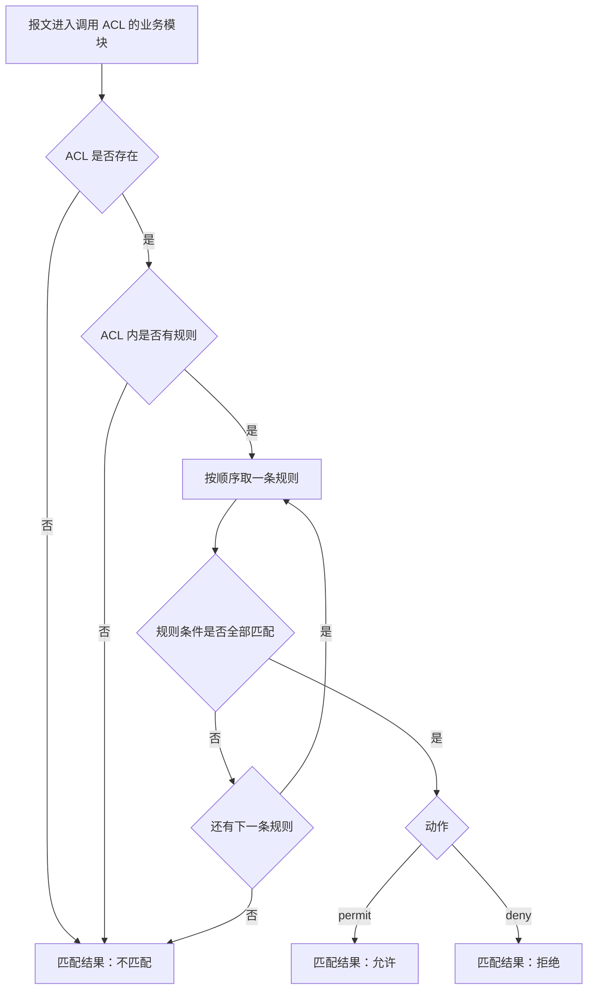
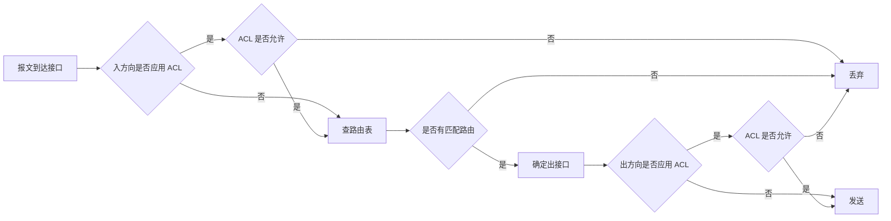

# ACL 配置专题 · 完整笔记

> 内容来源：`05_重点1_ACL原理与配置_必会_.txt`（华为《ACL 原理与配置》培训胶片，第 1～25 页）与 `华为配置专题03_ACL.txt`（同一套胶片的另一版导出，第 2～24 页）。两份知识点一致，后者标题与部分正文在 PDF 转文本时出现乱码，本文以 05 为主稿、以 03 核对命令与案例。
>
> 所有命令已按华为 VRP 官方命令参考校正；转纯文本造成的拼写与断行（如 `ACL 3000` 粘连、规则跨行）已按官方语法还原。与 `11.3-ACL、NAT与IPSec VPN配置` 重叠的 NAT、策略路由、路由策略调用细节只做速查，详细展开见 11.3 §2～§4。

---

## 1.讲义定位与知识地图

### 1.1 两份讲义的关系

| 文件 | 大小 | 内容 | 文本质量 | 本文用法 |
| ---- | ---- | ---- | -------- | -------- |
| `05_重点1_ACL原理与配置_必会_.txt` | 26 KB | ACL 概述、工作原理、配置及应用、两个案例、思考题 | 标题与正文基本可读 | 主稿，决定章节顺序 |
| `华为配置专题03_ACL.txt` | 20 KB | 与 05 为同一套胶片 | 多处标题与正文乱码，命令与案例完整 | 核对命令、案例参数 |

结论：两份讲义是同一套华为培训胶片的两次导出，不是两套知识点。本文按“一套知识、两份互校”处理。

### 1.2 讲义的三个板块

| 板块 | 讲义页 | 解决的问题 | 本文位置 |
| ---- | ------ | ---------- | -------- |
| ACL 概述 | 05 第 3～4 页 | ACL 是什么、能匹配什么、被谁调用 | §2.1 |
| ACL 工作原理 | 05 第 6～15 页 | 规则如何组成、编号、通配符、分类、匹配顺序、方向 | §2～§5 |
| ACL 配置及应用 | 05 第 17～22 页 | 基本 ACL、高级 ACL 的命令与两个实验 | §6～§9 |
| 思考题与总结 | 05 第 23～25 页 | 合法规则判断、高级 ACL 匹配条件 | §11 |

### 1.3 考查定位

| 题型 | 考查方式 | 需要的核心能力 |
| ---- | -------- | -------------- |
| 选择题 | 编号范围、通配符计算、匹配顺序、合法规则判断、默认动作 | 记住规则并能逐条代入 |
| 下午配置题 | 补全 ACL 规则、选择调用接口与方向、分析某流量是否放行 | 能把业务需求翻译成 `rule` 语句 |
| 排错题 | 规则顺序错误、方向反了、通配符写错、协议/端口不匹配 | 按“匹配顺序 → 方向 → 字段”排查 |

### 1.4 学习主线

1. **ACL 是一张有序规则表**，本身只是匹配工具，不调用不生效。
2. **编号决定类型**：2000 基本、3000 高级、4000 二层、5000 用户自定义、6000 以上用户。
3. **通配符决定范围**：0 必须匹配，1 不关心，不是子网掩码。
4. **顺序决定结果**：一旦命中立即停止，严格规则在前、宽泛规则在后。
5. **调用决定生效点**：接口、方向、业务模块三者缺一不可。

---

## 2.ACL 的组成与匹配机制

### 2.1 ACL 的定义与作用

ACL（Access Control List，访问控制列表）是由一系列 `permit` 或 `deny` 语句组成的、**有序的规则列表**。它能够对报文进行匹配和区分，是一个**匹配工具**。

ACL 最基本的匹配对象是**五元组**：源 IP 地址、目的 IP 地址、协议类型、源端口号、目的端口号。基本 ACL 只能取其中的源 IP 地址，高级 ACL 才能取全部五元组；二层 ACL 则取以太网帧头中的 MAC、VLAN 等字段。

讲义用一个企业场景引入：

| 角色 | 网段/VLAN | 需求 |
| ---- | --------- | ---- |
| 研发部门 | 192.168.2.0/24，VLAN10 | 禁止访问财务服务器 |
| 总裁办公室 | 192.168.3.0/24，VLAN20 | 不受限制 |
| 财务服务器 | 192.168.4.4/24 | 只允许授权人员访问 |
| 出口 | Internet | 其余流量正常转发 |

在这个场景中，ACL 需要完成三件事：识别“谁发的”（源地址）、“发给谁”（目的地址）、“什么业务”（协议与端口），然后在设备上对匹配的流量执行允许或拒绝。

ACL 的典型调用位置：

| 调用位置 | 作用 | 详见 |
| -------- | ---- | ---- |
| Traffic-filter | 接口报文过滤 | §5.5、§6、§7 |
| NAT | 指定哪些地址参与地址转换 | 11.3 §6 |
| 路由策略 | 过滤或修改路由 | 11.3 §4.5～§4.11 |
| 防火墙策略 | 安全域之间的访问控制 | 11.3 §6.8 |
| QoS / 流策略 | 分类、重标记、限速、重定向 | 11.3 §4.2 |

### 2.2 一条规则的组成

讲义给出的规则示例：

```
acl number 2000
rule 5 permit source 1.1.1.0 0.0.0.255
rule 10 deny source 2.2.2.0 0.0.0.255
rule 15 permit source 3.3.3.0 0.0.0.255
rule 4294967294 deny
```

| 组成部分 | 示例 | 含义 |
| -------- | ---- | ---- |
| ACL 编号 | `2000` | 决定 ACL 类型，2000 为基本 ACL |
| 规则编号（Rule ID） | `5`、`10`、`15` | 决定匹配先后，越小越先匹配 |
| 动作 | `permit`、`deny` | 匹配成功后执行允许或拒绝 |
| 匹配项 | `source 1.1.1.0 0.0.0.255` | 源地址与通配符 |
| 通配符 | `0.0.0.255` | 指定哪些位必须匹配、哪些位不关心 |
| 隐含规则 | `rule 4294967294 deny` | 系统在 ACL 末尾隐含的规则，`display acl` 可见 |

要点：

- `rule 4294967294 deny` 是**系统隐含规则**，不是管理员手工配置的规则，不出现在 `display current-configuration` 中；
- 隐含规则表示“ACL 内部未匹配任何规则时，匹配结果为拒绝”，但报文最终是否被丢弃，仍由调用 ACL 的业务模块决定（见 §2.6）；
- 一条 ACL 可以有多条规则，规则按编号升序排列。

### 2.3 规则编号与步长

**规则编号（Rule ID）**：ACL 中每条规则都有一个编号，报文按编号从小到大匹配。

**步长（Step）**：系统自动分配规则编号时，相邻规则编号之间的差值，缺省为 **5**。步长的作用是方便在旧规则之间插入新规则。

讲义示例：

```
acl number 2000
rule 5  deny   source 10.1.1.1 0
rule 10 deny   source 10.1.1.2 0
rule 15 permit source 10.1.1.0 0.0.0.255
```

若要在 `rule 10` 与 `rule 15` 之间插入一条拒绝 `10.1.1.3` 的规则，可以使用编号 11、12、13、14 中的任意一个：

```
acl number 2000
rule 5  deny   source 10.1.1.1 0
rule 10 deny   source 10.1.1.2 0
rule 11 deny   source 10.1.1.3 0
rule 15 permit source 10.1.1.0 0.0.0.255
```

自动分配规则编号的规则：

| 场景 | 分配的编号 |
| ---- | ---------- |
| ACL 中第一条未手工指定编号的规则 | 使用步长值，如步长 5 时首条为 5 |
| 后续未指定编号的规则 | 大于当前 ACL 内最大编号、且是步长整数倍的最小整数 |
| 已有 5、10、15 | 下一条为 20 |
| 已有 5、10、11、15 | 下一条为 20（最大 15，下一个 5 的倍数是 20） |
| 已有 10、20、30 | 下一条为 40 |

修改步长：

```
[R1] acl 3000
[R1-acl-adv-3000] step 10
[R1-acl-adv-3000] quit
```

步长改为 10 后，自动编号变为 10、20、30，插入空间更大。步长的取值范围以设备版本为准，实验中最常用缺省值 5。

### 2.4 匹配流程

ACL 的匹配原则是：**从编号最小的规则开始逐条匹配，一旦命中立即停止，不再向下匹配**。



三种匹配结果：

| 结果 | 含义 | 后续处理 |
| ---- | ---- | -------- |
| 允许 | 命中 `permit` 规则 | 由调用模块决定放行或执行动作 |
| 拒绝 | 命中 `deny` 规则 | 由调用模块决定丢弃或拒绝 |
| 不匹配 | 所有规则都未命中，或 ACL 不存在/为空 | 由调用模块的缺省动作决定 |

`[正确]` “命中即停止”是 ACL 最重要的匹配原则，也是规则顺序题的解题依据。

### 2.5 匹配顺序：config 与 auto

华为 VRP 支持两种匹配顺序：

| 匹配顺序 | 关键字 | 含义 | 缺省 |
| -------- | ------ | ---- | ---- |
| 配置顺序 | `config` | 按规则编号从小到大匹配 | 是 |
| 自动排序 | `auto` | 按“深度优先”原则自动排序，条件更精确的规则优先 | 否 |

配置顺序下，规则编号决定匹配先后，因此**书写顺序非常重要**：条件严格、范围窄的规则应靠前，范围宽的规则应靠后，否则宽规则会提前命中，使后面的精确规则永远匹配不到。

自动排序 `auto` 的“深度优先”可以理解为：匹配字段越多、条件越具体的规则排在越前面。实际考试中绝大多数题目按缺省的 `config` 顺序分析，除非题干明确写出 `match-order auto`。

设置方式：

```
[R1] acl 3000 match-order auto
```

或在 ACL 视图下：

```
[R1-acl-adv-3000] match-order auto
```

注意：即使使用 `config` 顺序，如果规则编号是手工指定的，仍然是“编号小的先匹配”；“配置顺序”不等于“敲命令的先后顺序”。

### 2.6 匹配结果不等于最终动作

这是 ACL 概念题最容易失分的地方。ACL 只给出“允许 / 拒绝 / 不匹配”三种匹配结果，**最终对报文做什么，由调用 ACL 的模块决定**。

| 调用模块 | `permit` 的含义 | `deny` 的含义 | 未匹配任何规则 |
| -------- | --------------- | ------------- | -------------- |
| 接口报文过滤 `traffic-filter` | 允许报文通过 | 丢弃报文 | 缺省允许 |
| 流策略 `traffic-policy` | 匹配成功 | 匹配失败 | 不匹配，继续后续分类 |
| 策略路由 `policy-based-route` | 匹配该节点，执行 `apply` | 不匹配该节点，继续下一节点 | 查普通路由表 |
| 路由策略 `route-policy` | 匹配该节点，执行 `apply` | 拒绝该路由 | 继续下一节点，全部不匹配则拒绝 |
| NAT | 允许该流量进入地址转换 | 不转换 | 不转换 |
| 防火墙安全策略 | 放行 | 拒绝 | 通常缺省拒绝 |

讲义中的结论可以概括为：

- **路由器上的 ACL 主要用于指路和路由过滤，未匹配时通常是隐含允许**；
- **防火墙上的 ACL 服务于安全策略，未匹配时通常是隐含拒绝**；
- 若希望实现“白名单”效果，必须在 ACL 末尾显式添加 `rule deny`，不能依赖默认动作；
- 在流策略、策略路由、NAT 中，`deny` 往往表示“不匹配”，而不是“丢弃报文”，这是与 `traffic-filter` 最大的语义差异。

### 2.7 ACL 的作用边界

| 边界 | 说明 |
| ---- | ---- |
| 只对转发流量生效 | ACL 过滤的是经过设备的报文，不过滤设备自身产生的本地流量 |
| 必须被调用 | 配置 ACL 后不调用，不产生任何过滤效果 |
| 无状态 | ACL 不记录会话，去程与回程需要分别匹配；需要状态检测时应使用防火墙 |
| 方向相对接口 | `inbound`/`outbound` 是相对接口的流入/流出，不是“内网到外网”的业务方向 |
| 只看三层/四层字段（基本/高级） | 不解析应用层内容；需要匹配应用层时使用其他技术 |

---

## 3.ACL 的分类与编号

### 3.1 按规则定义方式分类

| 类型 | 编号范围 | 主要匹配字段 | 命名关键字 | 典型用途 |
| ---- | -------- | ------------ | ---------- | -------- |
| 基本 ACL | 2000～2999 | 源 IP 地址、分片信息、生效时间段 | `basic` | 只按“来自哪里”过滤 |
| 高级 ACL | 3000～3999 | 源/目的 IP、IP 协议类型、ICMP 类型、TCP/UDP 源/目的端口、生效时间段 | `advance` | 精确到业务与目的 |
| 二层 ACL | 4000～4999 | 源 MAC、目的 MAC、以太网帧类型、VLAN ID、802.1p | `link` | 根据以太网帧头过滤 |
| 用户自定义 ACL | 5000～5999 | 报文头偏移位置、字符串掩码、自定义字符串 | `user` | 匹配特殊字节特征 |
| 用户 ACL | 6000～9999 | 源/目的 IP 或 UCL 组、协议类型、ICMP 类型、TCP/UDP 端口 | `ucl` | 面向用户或用户组的访问控制 |

关于编号范围的两点说明：

1. 讲义第 10 页把用户 ACL 写作 **6000～6999**，这是较早版本或课程口径；当前华为命令参考写 **6000～9999**。考试若题干明确给出 6000～6999，按题干作答；未给范围时，答“6000 以上”或“6000～9999”更稳妥。
2. 高级 ACL 的命名关键字是 **`advance`**，不是 `advanced`。部分笔记与资料写成 `advanced`，属于笔误，设备会报错。

### 3.2 按标识方式分类

| 类型 | 标识方法 | 创建示例 | 特点 |
| ---- | -------- | -------- | ---- |
| 数字型 ACL | 用唯一数字标识 | `acl 2000`、`acl number 2000` | 传统方式，编号即类型 |
| 命名型 ACL | 用名称代替编号 | `acl name basic-filter basic` | 可读性好，便于维护 |

命名型 ACL 也可以同时指定编号：

```
[R1] acl name basic-filter 2000
[R1] acl name adv-filter advance
[R1] acl name l2-filter link
```

若名称后跟编号，ACL 类型由编号决定；若名称后跟类型关键字，则由关键字决定。两种写法等价，实验常用“名称 + 类型关键字”。

### 3.3 基本 ACL 与高级 ACL

| 对比项 | 基本 ACL | 高级 ACL |
| ------ | -------- | -------- |
| 编号范围 | 2000～2999 | 3000～3999 |
| 匹配层次 | 只看 IP 头部 | IP 头部 + TCP/UDP 头部 |
| 源地址 | 支持 | 支持 |
| 目的地址 | 不支持 | 支持 |
| 协议类型 | 不支持 | 支持 `ip`、`tcp`、`udp`、`icmp` 等 |
| 源/目的端口 | 不支持 | 支持 |
| ICMP 类型 | 不支持 | 支持 |
| 分片信息 | 支持 | 支持 |
| 生效时间段 | 支持 | 支持 |
| DSCP/TOS/Precedence | 不支持 | 支持 |
| 部署位置 | 尽量靠近目的端 | 尽量靠近源端 |
| 典型命令 | `rule deny source 10.1.1.0 0.0.0.255` | `rule deny tcp source ... destination ... destination-port eq 80` |

讲义的两条示例对比：

```
# 基本 ACL：只能看到源地址
acl number 2000
rule 5  deny   source 10.1.1.1 0
rule 10 deny   source 10.1.1.2 0
rule 15 permit source 10.1.1.0 0.0.0.255

# 高级 ACL：可以看到源、目的、协议、端口
acl number 3000
rule 5  permit ip  source 10.1.1.0 0.0.0.255 destination 10.1.3.0 0.0.0.255
rule 10 permit tcp source 10.1.2.0 0.0.0.255 destination 10.1.3.0 0.0.0.255 destination-port eq 21
```

### 3.4 编号判读

| 编号首位 | 类型 | 记忆 |
| -------- | ---- | ---- |
| 2 | 基本 ACL | 二基本 |
| 3 | 高级 ACL | 三高级 |
| 4 | 二层 ACL | 四二层 |
| 5 | 用户自定义 ACL | 五自定义 |
| 6～9 | 用户 ACL | 六以上用户 |

常见陷阱：

- `ACL 3000` 表示“编号为 3000 的高级 ACL”，不是“3000 条规则”；
- `acl 2000` 与 `acl number 2000` 等价，`number` 可省略；
- 看到 `acl-adv-3000` 的视图提示符，说明当前在高级 ACL 视图；
- 看到 `acl-basic-2000`，说明当前在基本 ACL 视图。

---

## 4.通配符掩码

### 4.1 定义

通配符（Wildcard）是一个 **32 比特**的数值，用于指示 IP 地址中哪些比特位需要严格匹配、哪些位无需匹配。

| 位值 | 含义 |
| ---- | ---- |
| 0 | 该位必须与配置地址一致，参与匹配 |
| 1 | 该位不关心，不参与匹配 |

讲义原文把 1 解释为“随机分配”，这种说法容易误解。准确表述是“**不关心 / 无需匹配**”：该位可以是 0 或 1，不是由设备随机决定。

### 4.2 与子网掩码的关系

对于连续的地址段，通配符掩码等于“**255.255.255.255 减去子网掩码**”：

```
通配符 = 255.255.255.255 − 子网掩码
```

| 要匹配的范围 | 子网掩码 | 通配符掩码 | 说明 |
| ------------ | -------- | ---------- | ---- |
| 192.168.1.0/24 | 255.255.255.0 | 0.0.0.255 | 匹配 192.168.1.0～192.168.1.255 |
| 192.168.0.0/16 | 255.255.0.0 | 0.0.255.255 | 匹配 192.168.0.0～192.168.255.255 |
| 10.1.1.0/24 | 255.255.255.0 | 0.0.0.255 | 匹配 10.1.1.0～10.1.1.255 |
| 10.0.0.0/30 | 255.255.255.252 | 0.0.0.3 | 只有 .1 与 .2 两个可用主机地址 |
| 单台主机 192.168.1.1 | 255.255.255.255 | 0.0.0.0 | 只匹配该主机 |
| 任意地址 | 0.0.0.0 | 255.255.255.255 | 等价于 `any` |

### 4.3 二进制判断

以 192.168.1.0/24 为例：

```
配置地址   192.168.1.1   11000000 10101000 00000001 00000001
通配符     0.0.0.255     00000000 00000000 00000000 11111111
                         严格匹配                 不关心
```

前 24 位通配符为 0，必须与 192.168.1 一致；最后 8 位为 1，可以是任意值，因此匹配整个 192.168.1.0/24 网段。

严格的匹配公式：

```
(报文地址 & ~通配符) == (配置地址 & ~通配符)
```

其中 `~` 表示按位取反。通配符为 0 的位参与比较，通配符为 1 的位被屏蔽，不参与比较。

### 4.4 不连续通配符：匹配奇数地址

通配符中的 0 和 1 可以不连续，这是 ACL 比子网掩码更灵活的地方。

**需求：匹配 192.168.1.0/24 中的奇数地址，如 192.168.1.1、192.168.1.3、192.168.1.5。**

```
192.168.1.1    ... 00000001
0.0.0.254      ... 11111110
```

最后一位通配符为 0，表示“必须是 1”；其余 7 位为 1，表示“不关心”。因此只要是奇数就匹配。

```
rule permit source 192.168.1.1 0.0.0.254
```

同理，匹配偶数地址：

```
rule permit source 192.168.1.0 0.0.0.254
```

| 目标 | 地址 + 通配符 | 说明 |
| ---- | ------------- | ---- |
| 奇数地址 | `192.168.1.1 0.0.0.254` | 最后一位必须为 1 |
| 偶数地址 | `192.168.1.0 0.0.0.254` | 最后一位必须为 0 |
| 前 16 个地址 | `192.168.1.0 0.0.0.15` | 低 4 位不关心 |
| 后 16 个地址 | `192.168.1.240 0.0.0.15` | 高 4 位必须为 1111 |

### 4.5 特殊通配符

| 写法 | 含义 | 等价写法 |
| ---- | ---- | -------- |
| `192.168.1.1 0.0.0.0` | 精确匹配单台主机 | `192.168.1.1 0`、`source 192.168.1.1 0` |
| `0.0.0.0 255.255.255.255` | 匹配任意地址 | `any` |
| `source any` | 任意源地址 | `source 0.0.0.0 255.255.255.255` |
| `destination any` | 任意目的地址 | `destination 0.0.0.0 255.255.255.255` |

讲义第 9 页把任意地址写成 `0.0.0.0 255.255.255`，少了一个 `255` 段，属于排版漏字；正确的通配符必须是 32 位，即 **255.255.255.255**。

### 4.6 计算练习

| 目标 | 配置地址 | 通配符 | 校验 |
| ---- | -------- | ------ | ---- |
| 10.1.1.0/24 | 10.1.1.0 | 0.0.0.255 | 匹配 10.1.1.0～10.1.1.255 |
| 172.16.0.0/16 | 172.16.0.0 | 0.0.255.255 | 匹配 172.16.0.0～172.16.255.255 |
| 192.168.1.1/32 | 192.168.1.1 | 0.0.0.0 | 只匹配该主机 |
| 192.168.1.0/25 | 192.168.1.0 | 0.0.0.127 | 前半段 |
| 192.168.1.128/25 | 192.168.1.128 | 0.0.0.127 | 后半段 |
| 10.0.0.0/30 | 10.0.0.0 | 0.0.0.3 | 4 个地址 |
| 192.168.1.x 中的奇数 | 192.168.1.1 | 0.0.0.254 | 最后一位必须为 1 |
| 任意地址 | 0.0.0.0 | 255.255.255.255 | 等价 `any` |

### 4.7 易错点

| 错误 | 正确理解 |
| ---- | -------- |
| 把通配符当子网掩码使用 | 通配符 0 表示匹配、1 表示不关心，与掩码含义相反 |
| 认为通配符只能是连续的 1 | 可以不连续，用于匹配奇偶地址、离散位 |
| 用 `255.255.255.0` 表示 /24 | 这是子网掩码；ACL 中应写 `0.0.0.255` |
| `source 192.168.1.1 0.0.0.255` 表示一台主机 | 表示整个 192.168.1.0/24；单主机应写 `0` 或 `0.0.0.0` |
| `any` 与 `0.0.0.0 0.0.0.0` 等价 | `any` 等价于 `0.0.0.0 255.255.255.255` |
| 不连续通配符也直接用 255 减掩码 | 不连续时不能简单相减，要按二进制逐位计算 |

---

## 5.匹配顺序、方向与部署

### 5.1 规则顺序决定结果

ACL 按编号从小到大匹配，命中即停止。因此**严格规则必须放在宽泛规则前面**。

讲义第 13 页的例子：

```
acl 2000
rule 1 permit source 192.168.1.1 0.0.0.0
rule 2 permit source 192.168.1.2 0.0.0.0
rule 3 deny   source 192.168.1.3 0.0.0.0
rule 4 permit source 0.0.0.0 255.255.255.255
```

| 源地址 | 命中规则 | 结果 |
| ------ | -------- | ---- |
| 192.168.1.1 | rule 1 | 允许 |
| 192.168.1.2 | rule 2 | 允许 |
| 192.168.1.3 | rule 3 | 拒绝 |
| 192.168.1.4 | rule 4 | 允许 |
| 192.168.1.5 | rule 4 | 允许 |

讲义在此处提出“允许是指允许流量通过吗？”。答案是否定的：ACL 的 `permit` 只表示**匹配成功**，报文最终是否真正被放行，由调用 ACL 的模块决定。只有在 `traffic-filter` 下，`permit` 才直接表示放行；在流策略、策略路由、NAT、路由策略中，`permit` 的含义各不相同（见 §2.6）。

如果把 rule 3 和 rule 4 对调：

```
acl 2000
rule 1 permit source 192.168.1.1 0.0.0.0
rule 2 permit source 192.168.1.2 0.0.0.0
rule 3 permit source 0.0.0.0 255.255.255.255
rule 4 deny   source 192.168.1.3 0.0.0.0
```

则 192.168.1.3 会先命中 rule 3 的“允许所有”，rule 4 永远不会生效，拒绝 192.168.1.3 的需求落空。

结论：

| 规则类型 | 建议位置 |
| -------- | -------- |
| 主机、单个地址、精确端口 | 最前 |
| 网段、协议+端口组合 | 中间 |
| 大网段、任意地址 | 最后 |
| 默认拒绝/默认允许 | ACL 末尾 |

### 5.2 入站与出站方向

ACL 在接口上应用时必须指定方向：

| 方向 | 关键字 | 含义 | 检查时机 |
| ---- | ------ | ---- | -------- |
| 入站 | `inbound` | 报文从该接口进入设备 | 进入接口后、查路由前 |
| 出站 | `outbound` | 报文从该接口离开设备 | 查路由后、发送前 |

方向的判断标准是“**报文相对于接口的流向**”，不是“内网到外网”或“外网到内网”的业务方向。

| 场景 | 接口 | 方向 |
| ---- | ---- | ---- |
| 研发部主机 → Router GE0/0/1 | Router GE0/0/1 | `inbound` |
| Router GE0/0/2 → 市场部主机 | Router GE0/0/2 | `outbound` |
| 外网 → 内网服务器 | 外网侧接口 | `inbound`（相对该接口） |
| 内网服务器 → 外网 | 外网侧接口 | `outbound`（相对该接口） |

### 5.3 入站与出站的处理流程



要点：

- **入方向 ACL 在查路由之前执行**，可以尽早丢弃非法流量，节省路由查找与转发资源；
- **出方向 ACL 在查路由之后执行**，此时已经知道报文从哪个接口发出；
- 同一接口的入方向与出方向可以分别应用不同的 ACL；
- 方向配反是下午题最常见的失分点：流量从 GE0/0/1 进入设备，就应配在 GE0/0/1 的 `inbound`，而不是 GE0/0/2 的 `outbound`。

### 5.4 部署位置

| ACL 类型 | 推荐位置 | 原因 |
| -------- | -------- | ---- |
| 基本 ACL | 尽量靠近**目的端** | 基本 ACL 只看源地址；若靠近源端，可能把该源访问其他合法目标的流量一并拒绝 |
| 高级 ACL | 尽量靠近**源端** | 高级 ACL 能精确到目的地址与端口，靠近源端可尽早丢弃非法流量，节省带宽与设备资源 |

讲义案例：某源主机允许访问目的 A，但拒绝访问目的 B。

| 部署方式 | 结果 |
| -------- | ---- |
| 在源端用基本 ACL 拒绝该源 | 访问目的 A 的流量也被误杀 |
| 在目的 B 侧用基本 ACL 拒绝该源 | 只影响目的 B，访问目的 A 正常 |
| 在源端用高级 ACL 拒绝“源→目的 B:端口” | 精确匹配，不影响目的 A |

结论：**基本 ACL 靠近目的，高级 ACL 靠近源**，这是华为教材与软考的标准口径。

### 5.5 调用方式总表

ACL 配置完成后必须被调用才生效。常见调用方式：

| 调用方式 | 作用平面 | 作用 | 典型命令 | 详见 |
| -------- | -------- | ---- | -------- | ---- |
| 接口报文过滤 | 转发平面 | 在接口入/出方向允许或拒绝报文 | `traffic-filter inbound acl 2000` | §6、§7 |
| 流策略 | 转发平面 | 基于 MQC 分类，执行允许、拒绝、重标记、限速、重定向 | `traffic-policy` | 11.3 §4.2 |
| 策略路由 | 转发平面 | 按策略指定下一跳或出接口 | `policy-based-route` | 11.3 §4.3 |
| 路由策略 | 控制平面 | 过滤路由、修改路由属性 | `route-policy` | 11.3 §4.8 |
| 过滤策略 | 控制平面 | 对接收或发布的路由过滤 | `filter-policy` | 11.3 §4.6 |
| NAT | 转发平面 | 指定参与地址转换的流量 | `nat outbound 2000` | 11.3 §6 |
| 防火墙安全策略 | 转发平面 | 安全域之间的访问控制 | `security-policy` | 11.3 §6.8 |

### 5.6 调用后的联动关系

| 关系 | 说明 |
| ---- | ---- |
| 一个 ACL 可被多个模块引用 | 修改 ACL 会影响所有引用它的业务 |
| 一个接口一个方向通常只应用一个 `traffic-filter` ACL | 需要组合条件时，把多条规则写进同一个 ACL |
| ACL 与调用模块是“先匹配、后动作” | ACL 只负责分类，模块负责最终处理 |
| 删除 ACL 前先解除引用 | 否则可能删除失败或导致业务中断 |

---

## 6.基本 ACL 配置

### 6.1 命令语法

创建基本 ACL：

```
[Huawei] acl [ number ] acl-number [ match-order { config | auto } ]
[Huawei] acl name acl-name { basic | acl-number } [ match-order { config | auto } ]
```

配置基本 ACL 规则：

```
[Huawei-acl-basic-2000] rule [ rule-id ] { deny | permit } [ source { source-address source-wildcard | any } | fragment | time-range time-name ]*
```

| 片段 | 含义 |
| ---- | ---- |
| `acl 2000` | 创建编号 2000 的基本 ACL，`number` 可省略 |
| `acl number 2000` | 同上，显式写 `number` |
| `acl name basic-filter basic` | 创建名为 basic-filter 的基本 ACL |
| `rule 5` | 规则编号 5，省略时按步长自动分配 |
| `permit` / `deny` | 允许 / 拒绝 |
| `source 192.168.1.0 0.0.0.255` | 匹配源网段 |
| `source 192.168.1.1 0` | 匹配单台主机 |
| `source any` | 匹配任意源地址 |
| `fragment` | 只匹配分片报文 |
| `time-range 名称` | 只在指定时间段生效 |

基本 ACL 的规则也可以只写动作，表示匹配任意源地址：

```
[R1-acl-basic-2000] rule permit
[R1-acl-basic-2000] rule deny
```

### 6.2 实验一：使用基本 ACL 过滤数据流量

**拓扑与地址：**

| 设备/网段 | 接口 | 地址 |
| --------- | ---- | ---- |
| 研发部网段 | Router GE0/0/1（内网侧） | 192.168.1.0/24 |
| 另一内网网段 | 经二层网络接入 Router GE0/0/1 | 192.168.2.0/24 |
| 服务器网络 | Router GE0/0/2 | 10.1.1.1/24 |
| Server | — | 10.1.1.x/24 |

说明：讲义设定“Router 已完成 IP 地址和路由配置”，两个内网网段如何落到 GE0/0/1（子接口、辅助 IP 或二层交换机划分 VLAN）不影响 ACL 分析；本实验只关注“流量从 GE0/0/1 进入、源地址属于 192.168.1.0/24”这一事实。

**需求：** 在 Router 上部署基本 ACL，过滤源地址为 192.168.1.0/24 的数据包，放行其他流量，禁止研发部访问 Router 右侧的服务器网络。

**配置步骤：**

| 步骤 | 命令 | 目的 |
| ---- | ---- | ---- |
| 1 | `acl 2000` | 创建基本 ACL |
| 2 | `rule 5 deny source 192.168.1.0 0.0.0.255` | 拒绝研发部网段 |
| 3 | `rule 10 permit source any` | 放行其他源地址 |
| 4 | `interface GigabitEthernet0/0/1` | 进入流量进入设备的接口 |
| 5 | `traffic-filter inbound acl 2000` | 在入方向调用 ACL |

完整配置：

```
[Router] acl 2000
[Router-acl-basic-2000] rule 5 deny source 192.168.1.0 0.0.0.255
[Router-acl-basic-2000] rule 10 permit source any
[Router-acl-basic-2000] quit
[Router] interface GigabitEthernet0/0/1
[Router-GigabitEthernet0/0/1] traffic-filter inbound acl 2000
[Router-GigabitEthernet0/0/1] quit
```

### 6.3 规则分析

| 源地址 | 命中规则 | ACL 结果 | `traffic-filter` 最终动作 |
| ------ | -------- | -------- | ------------------------ |
| 192.168.1.10 | rule 5 deny | 拒绝 | 丢弃 |
| 192.168.1.254 | rule 5 deny | 拒绝 | 丢弃 |
| 192.168.2.10 | rule 5 不匹配，rule 10 permit | 允许 | 通过 |
| 10.1.1.20 | rule 5 不匹配，rule 10 permit | 允许 | 通过 |
| 其他地址 | rule 10 permit | 允许 | 通过 |

要点：

- `rule 10 permit source any` 是显式白名单。`traffic-filter` 未匹配时缺省允许，因此这条规则在功能上不是必需的，但在工程上建议写出，便于阅读，也便于把同一 ACL 复用到缺省拒绝的模块；
- 若只写 `rule 5 deny` 而不写 `rule 10 permit`，其他流量在 `traffic-filter` 下仍然会被允许，这是“隐含允许”的体现；
- 如果题干要求“只允许 192.168.2.0/24，其他全部拒绝”，则必须写成：

```
[Router] acl 2000
[Router-acl-basic-2000] rule 5 permit source 192.168.2.0 0.0.0.255
[Router-acl-basic-2000] rule 10 deny source any
[Router-acl-basic-2000] quit
```

### 6.4 验证

```
[Router] display acl 2000
[Router] display current-configuration interface GigabitEthernet0/0/1
```

`display acl 2000` 的输出包含：

| 字段 | 含义 |
| ---- | ---- |
| `Basic ACL 2000` | ACL 类型与编号 |
| `Acl's step is 5` | 当前步长 |
| `rule 5 deny source ...` | 规则内容 |
| 匹配计数 | 该规则命中的报文数，可用于验证策略是否生效 |

客户端侧用 `ping` 验证：192.168.1.0/24 的主机 ping 服务器应不通，192.168.2.0/24 的主机应通。

### 6.5 常见错误

| 错误 | 现象 | 修正 |
| ---- | ---- | ---- |
| ACL 创建后未调用 | 配置存在但不生效 | 在接口下加 `traffic-filter` |
| 调用方向写成 `outbound` | 规则可能不按预期生效 | 流量从哪个接口进入就用 `inbound` |
| 通配符写成 `255.255.255.0` | 匹配范围错误 | 改为 `0.0.0.255` |
| 规则顺序反了 | 精确规则被宽规则覆盖 | 精确规则编号更小 |
| 忘记 `source` 关键字 | 命令报错 | 基本 ACL 规则写 `source ...` |
| 在基本 ACL 中写 `tcp`/`port` | 命令报错 | 基本 ACL 不支持四层字段，改用高级 ACL |

---

## 7.高级 ACL 配置

### 7.1 命令语法

创建高级 ACL：

```
[Huawei] acl [ number ] acl-number [ match-order { config | auto } ]
[Huawei] acl name acl-name { advance | acl-number } [ match-order { config | auto } ]
```

配置高级 ACL 规则：

```
[Huawei-acl-adv-3000] rule [ rule-id ] { deny | permit } { protocol-number | icmp | ip | tcp | udp }
    [ source { source-address source-wildcard | any } ]
    [ destination { destination-address destination-wildcard | any } ]
    [ source-port { eq port | gt port | lt port | range port-start port-end } ]
    [ destination-port { eq port | gt port | lt port | range port-start port-end } ]
    [ icmp-type { icmp-name | icmp-type icmp-code } ]
    [ tcp-flag { ack | fin | syn }* ]
    [ dscp dscp | tos tos | precedence precedence ]
    [ fragment ]
    [ time-range time-name ]*
```

其他可匹配字段：

| 字段 | 关键字 | 说明 |
| ---- | ------ | ---- |
| ICMP 类型/码 | `icmp-type` | 只能与 `icmp` 协议一起使用 |
| TCP 标志位 | `tcp-flag` | 只能与 `tcp` 协议一起使用，可匹配 `ack`、`fin`、`syn` 等 |
| 分片信息 | `fragment` | 只匹配分片报文 |
| 生效时间段 | `time-range` | 引用系统视图定义的时间段 |
| 优先级字段 | `dscp`、`tos`、`precedence` | 按报文优先级匹配 |

说明：

- `protocol-number` 可以用数字表示协议号，如 6 表示 TCP、17 表示 UDP、1 表示 ICMP；
- `source-port`、`destination-port` 只能与 `tcp` 或 `udp` 一起使用，不能与 `ip` 一起使用；
- `icmp-type` 只能与 `icmp` 一起使用；
- `tcp-flag` 只能与 `tcp` 一起使用；
- 上述可选字段的实际排列顺序以设备帮助为准，书写时按“协议 → 源 → 目的 → 端口 → 其他”组织最清晰。

### 7.2 端口匹配关键字

| 关键字 | 含义 | 示例 |
| ------ | ---- | ---- |
| `eq` | 等于 | `destination-port eq 80` |
| `gt` | 大于 | `destination-port gt 1024` |
| `lt` | 小于 | `destination-port lt 1024` |
| `range` | 指定范围 | `destination-port range 80 443` |

`[已定案]` S 系列 VRP 高级 ACL 的 `source-port`/`destination-port` 只支持 `eq`、`gt`、`lt`、`range` 四种运算符，**没有 `neq`**（S5700/S6700 V200R025 命令参考）。需要“不等于”语义时，用“精确 permit 目标端口 + deny 其余”的规则组合实现，不要写 `neq`。

端口号可以写数字，也可以写服务名：

| 服务 | 端口 | 服务名 |
| ---- | ---- | ------ |
| FTP 控制 | 21 | `ftp` |
| FTP 数据 | 20 | `ftp-data` |
| Telnet | 23 | `telnet` |
| SMTP | 25 | `smtp` |
| DNS | 53 | `domain` |
| HTTP | 80 | `www` |
| HTTPS | 443 | `https` |

注意：`eq 80` 与 `eq www` 等价，只匹配 HTTP；HTTPS 使用 443，需要另写一条规则。

### 7.3 实验二：使用高级 ACL 限制不同网段互访

**拓扑与地址：**

| 部门 | 网段 | Router 接口 | 接口地址 |
| ---- | ---- | ----------- | -------- |
| 研发部 | 10.1.1.0/24 | GE0/0/1 | 10.1.1.1/24 |
| 市场部 | 10.1.2.0/24 | GE0/0/2 | 10.1.2.1/24 |

**需求：** Router 连接两个部门，要求限制两个网段互访，防止机密泄露。

**配置思路：**

1. 研发部访问市场部的流量从 GE0/0/1 进入，在 GE0/0/1 入方向用 ACL 3001 拒绝；
2. 市场部访问研发部的流量从 GE0/0/2 进入，在 GE0/0/2 入方向用 ACL 3002 拒绝；
3. 其他流量不受影响。

**配置命令：**

```
[Router] acl 3001
[Router-acl-adv-3001] rule 5 deny ip source 10.1.1.0 0.0.0.255 destination 10.1.2.0 0.0.0.255
[Router-acl-adv-3001] quit

[Router] acl 3002
[Router-acl-adv-3002] rule 5 deny ip source 10.1.2.0 0.0.0.255 destination 10.1.1.0 0.0.0.255
[Router-acl-adv-3002] quit

[Router] interface GigabitEthernet0/0/1
[Router-GigabitEthernet0/0/1] traffic-filter inbound acl 3001
[Router-GigabitEthernet0/0/1] quit

[Router] interface GigabitEthernet0/0/2
[Router-GigabitEthernet0/0/2] traffic-filter inbound acl 3002
[Router-GigabitEthernet0/0/2] quit
```

### 7.4 规则分析

| 源 → 目的 | 进入接口 | 命中 ACL/规则 | 结果 |
| --------- | -------- | ------------- | ---- |
| 10.1.1.5 → 10.1.2.5 | GE0/0/1 | ACL 3001 rule 5 | 拒绝 |
| 10.1.2.5 → 10.1.1.5 | GE0/0/2 | ACL 3002 rule 5 | 拒绝 |
| 10.1.1.5 → Internet | GE0/0/1 | ACL 3001 不匹配 | `traffic-filter` 缺省允许 |
| 10.1.2.5 → Internet | GE0/0/2 | ACL 3002 不匹配 | `traffic-filter` 缺省允许 |
| 10.1.1.5 → 10.1.1.6 | GE0/0/1 | 目的不在 10.1.2.0/24，不匹配 | 同网段二层转发，不经过 ACL |

要点：

- 两个方向各写一个 ACL，因为 ACL 是**无状态**的，去程与回程要分别匹配；
- 如果只在 GE0/0/1 入方向拒绝研发部访问市场部，市场部主动访问研发部的流量仍可能通；
- 如果希望“完全隔离”，两个方向都要拒绝；如果只希望“研发部不能主动访问市场部”，只配一个方向即可，但回程报文仍可能通过，需要结合业务判断；
- 其他流量未匹配时，`traffic-filter` 缺省允许，不需要额外写 `permit any`。

### 7.5 常用高级 ACL 规则

| 需求 | 规则 |
| ---- | ---- |
| 拒绝所有 HTTP | `rule deny tcp destination-port eq 80` |
| 拒绝所有 HTTPS | `rule deny tcp destination-port eq 443` |
| 拒绝所有 Telnet | `rule deny tcp destination-port eq 23` |
| 拒绝 FTP 控制连接 | `rule deny tcp destination-port eq 21` |
| 拒绝 FTP 数据连接 | `rule deny tcp destination-port eq 20` |
| 拒绝 ICMP Echo 请求 | `rule deny icmp icmp-type echo` |
| 允许 DNS 查询 | `rule permit udp destination-port eq 53` |
| 只允许 TCP SYN 报文 | `rule permit tcp tcp-flag syn` |
| 拒绝某台主机 | `rule deny ip destination 10.1.1.5 0` |
| 拒绝某个网段 | `rule deny ip destination 10.1.1.0 0.0.0.255` |
| 只在工作时间拒绝 | `rule deny tcp destination-port eq 80 time-range work-time` |
| 只匹配分片报文 | `rule deny ip fragment` |

说明：

- `icmp-type echo` 匹配 Echo Request（类型 8）；如果需要匹配 Echo Reply，使用 `echo-reply`（类型 0）；
- `tcp-flag syn` 只匹配 SYN 置位的 TCP 报文，常用于限制新建连接；
- `fragment` 只匹配分片报文，常用于防止分片攻击；
- `time-range` 需要在系统视图先用 `time-range` 命令定义时间段，详见 11.3 §3.4。

### 7.6 常见错误

| 错误 | 现象 | 修正 |
| ---- | ---- | ---- |
| 在 `ip` 规则后写端口 | 命令报错 | 端口只能用于 `tcp`/`udp` |
| 只写 `destination-port eq 80`，不写协议 | 命令报错或缺省协议不符 | 写成 `tcp destination-port eq 80` |
| 用 `deny ip` 拒绝所有 | 把需要的业务也拒绝 | 精确到源、目的、协议、端口 |
| 规则顺序：先 `deny ip` 后 `permit tcp` | 后面的精确规则永远不生效 | 精确 permit 放前面，宽泛 deny 放后面 |
| 只配一个方向就认为“隔离完成” | 回程或其他方向仍可通 | 两个方向分别配置，或使用状态防火墙 |
| 通配符写反 | 匹配范围与预期相反 | 0 匹配、1 不关心 |
| 应用到错误的接口 | 规则不生效 | 按“流量从哪个接口进入”选择接口与 `inbound` |

---

## 8.二层、用户自定义与用户 ACL

讲义只详细展开基本 ACL 与高级 ACL，其余三类只给出编号与定义。本节按官方命令框架补充，考试以“编号 + 用途 + 匹配字段”为主。

### 8.1 二层 ACL（4000～4999）

二层 ACL 使用以太网帧头信息定义规则，可匹配：

| 字段 | 说明 |
| ---- | ---- |
| 源 MAC 地址 | 发送方 MAC |
| 目的 MAC 地址 | 接收方 MAC |
| 以太网帧类型 | 如 IPv4、ARP、IPv6 |
| VLAN ID | 报文所属 VLAN |
| 802.1p 优先级 | 二层优先级 |

配置框架：

```
[R1] acl number 4000
[R1-acl-L2-4000] rule 5 deny source-mac 00e0-fc01-0000 ffff-ffff-0000
[R1-acl-L2-4000] rule 10 permit
[R1-acl-L2-4000] quit
```

说明：

- `source-mac` 后跟 MAC 地址与 MAC 通配符；MAC 通配符的语义与 IP 通配符相反，**1 表示检查该位（必须匹配），0 表示不检查该位（不关心）**；
- 上例中 `ffff-ffff-0000` 表示检查前 32 位，因此拒绝源 MAC 前 32 位为 `00e0-fc01` 的报文，放行其他报文；
- 二层 ACL 常用于接入层 MAC 过滤、限制私接设备、按 VLAN 过滤；
- 二层 ACL 的规则关键字随设备版本略有差异，实验前用 `?` 确认。

### 8.2 用户自定义 ACL（5000～5999）

用户自定义 ACL 通过“报文头偏移位置 + 字符串掩码 + 自定义字符串”匹配任意字节，灵活度最高。

| 特点 | 说明 |
| ---- | ---- |
| 匹配对象 | 报文任意位置的比特/字节 |
| 配置要素 | 偏移量、匹配字符串、字符串掩码 |
| 优点 | 可以匹配非标准字段、特殊协议特征 |
| 缺点 | 可读性差、依赖报文格式、版本差异大 |
| 考试要求 | 记住编号范围与“按偏移匹配”的定位即可 |

讲义未给出具体命令，本文不展开版本相关的复杂语法；实际配置以设备命令参考为准。

### 8.3 用户 ACL（6000～9999）

用户 ACL 面向“用户/用户组”，可匹配：

| 字段 | 说明 |
| ---- | ---- |
| 源 IP 或源 UCL 组 | 用户所属组 |
| 目的 IP 或目的 UCL 组 | 目标资源所属组 |
| IP 协议类型 | TCP、UDP、ICMP 等 |
| TCP/UDP 源/目的端口 | 业务端口 |
| ICMP 类型 | ICMP 子类型 |

用户 ACL 依赖 UCL（User Control List）组，需要先定义用户组与组内地址，再在 ACL 中引用。它适合园区网中“按部门/角色授权”的场景，考试中通常只考编号与用途。

### 8.4 选型表

| 需求 | 选择 | 编号 |
| ---- | ---- | ---- |
| 只按源 IP 过滤 | 基本 ACL | 2000～2999 |
| 按源/目的 IP、协议、端口过滤 | 高级 ACL | 3000～3999 |
| 按 MAC、VLAN、帧类型过滤 | 二层 ACL | 4000～4999 |
| 按报文任意偏移字节过滤 | 用户自定义 ACL | 5000～5999 |
| 按用户/用户组过滤 | 用户 ACL | 6000～9999 |

---

## 9.命令清单与验证

### 9.1 创建与规则

| 命令 | 视图 | 作用 |
| ---- | ---- | ---- |
| `acl [ number ] acl-number [ match-order { config 或 auto } ]` | 系统视图 | 按编号创建 ACL |
| `acl name acl-name { basic 或 advance 或 link 或 ucl 或 user 或 acl-number }` | 系统视图 | 按名称创建 ACL |
| `rule [ rule-id ] { deny 或 permit } ...` | ACL 视图 | 配置规则 |
| `step 值` | ACL 视图 | 修改自动编号步长，缺省 5 |
| `match-order { config 或 auto }` | ACL 视图 | 修改匹配顺序 |
| `undo rule rule-id` | ACL 视图 | 删除指定规则 |
| `undo acl acl-number` | 系统视图 | 删除整个 ACL |

### 9.2 调用

| 命令 | 视图 | 作用 |
| ---- | ---- | ---- |
| `traffic-filter inbound acl 2000` | 接口视图 | 入方向报文过滤 |
| `traffic-filter outbound acl 2000` | 接口视图 | 出方向报文过滤 |
| `traffic-policy 策略名 inbound` | 接口视图 | 应用流策略 |
| `ip policy-based-route 策略名` | 接口视图 | 应用策略路由 |
| `filter-policy 2000 import` | 路由协议视图 | 路由过滤 |
| `nat outbound 2000` | 接口视图 | NAT 引用 ACL |
| `undo traffic-filter inbound` | 接口视图 | 取消接口入方向过滤 |

### 9.3 验证与维护

| 命令 | 作用 |
| ---- | ---- |
| `display acl all` | 查看所有 ACL 概况 |
| `display acl 3000` | 查看指定 ACL 的规则与匹配计数 |
| `display acl name adv-filter` | 按名称查看 ACL |
| `display current-configuration` 配合过滤器 | 查看配置中的 ACL 相关行 |
| `display current-configuration interface GigabitEthernet0/0/1` | 查看接口下调用的 ACL |

`display acl 3000` 的典型输出字段：

| 字段 | 含义 |
| ---- | ---- |
| `Advanced ACL 3000` | ACL 类型与编号 |
| `1 rule` | 规则数量 |
| `Acl's step is 5` | 步长 |
| `rule 5 deny tcp ...` | 规则内容 |
| 匹配计数 | 该规则命中的报文数 |

### 9.4 删除顺序

| 顺序 | 操作 | 命令 |
| ---- | ---- | ---- |
| 1 | 解除接口调用 | `undo traffic-filter inbound` |
| 2 | 删除单条规则 | `undo rule 10` |
| 3 | 删除整个 ACL | `undo acl 3000` |

若 ACL 仍被业务引用，直接删除可能失败或导致引用悬空；工程上应先解除引用，再删除规则或 ACL。

---

## 10.讲义校正与存疑

### 10.1 命令与语法校正表

| 序号 | 讲义原文 | 问题 | 校正后 |
| ---- | -------- | ---- | ------ |
| 1 | `acl name acl-name { advance 或 acl-number }` | 讲义原文正确；部分资料写成 `advanced` | 命名型高级 ACL 关键字为 `advance` |
| 2 | `rule 4 permit 0.0.0.0 255.255.255.255` | 基本 ACL 规则缺少 `source` 关键字 | `rule 4 permit source 0.0.0.0 255.255.255.255` |
| 3 | `0.0.0.0 255.255.255 = any` | 通配符少一个 `255` 段 | `0.0.0.0 255.255.255.255` |
| 4 | “1 表示随机分配” | 术语不准确 | “1 表示不关心 / 无需匹配” |
| 5 | 用户 ACL 编号 `6000~6999` | 旧口径 | 官方命令参考为 `6000~9999`，考试按题干 |
| 6 | `rule deny source 192.168.1.0 0.0.0.255` | 未写规则编号，依赖自动分配 | 自动分配为 5；建议显式写 `rule 5` |
| 7 | `rule 4 permit 0.0.0.0 255.255.255.255` | 与 `rule permit source any` 等价但写法不规范 | 统一写 `rule permit source any` |
| 8 | 高级 ACL 端口关键字只列 `eq/gt/lt/range` | 部分资料补 `neq` | `neq` 不是华为 VRP ACL 规则的端口运算符，官方命令参考只有四种；正文已定案 |
| 9 | `acl 2000` 与 `acl number 2000` 混用 | 两种写法等价，初学易误认为不同命令 | 统一说明 `number` 可省略 |
| 10 | `traffic-filter inbound acl 2000` | 讲义未强调方向相对接口 | 补充“流量从该接口进入才用 inbound” |
| 11 | `rule 4294967294 deny` | 易被误认为可手工配置 | 说明为系统隐含规则，仅 `display acl` 可见 |
| 12 | `rule deny ip source ... destination ...` 跨行 | PDF 转文本断行 | 合并为一行完整命令 |

### 10.2 存疑点

| 编号 | 存疑内容 | 本文处理 |
| ---- | -------- | -------- |
| 1 | 用户 ACL 编号 6000～6999 还是 6000～9999 | 讲义写 6000～6999，官方写 6000～9999；正文列出两者并说明 |
| 2 | 高级 ACL 是否支持 `neq` | 已定案：不支持。官方命令参考只列 `eq/gt/lt/range`，`neq` 不能用于 `rule` |
| 3 | 基本 ACL 是否必须写 `permit any` | `traffic-filter` 缺省允许，不写也通；其他模块缺省拒绝，建议显式写 |
| 4 | 二层/用户自定义 ACL 的具体命令 | 讲义未给，本文只给框架与用途，不编造版本相关语法 |
| 5 | 部署位置“基本靠近目的、高级靠近源” | 按华为教材与 11.3 口径；部分厂商资料相反，考试以华为为准 |

---

## 11.考点与易错点

### 11.1 高频考点

| 考点 | 核心结论 | 常见题型 |
| ---- | -------- | -------- |
| ACL 编号 | 2000 基本、3000 高级、4000 二层、5000 自定义、6000 以上用户 | 选择、判断 |
| 通配符 | 0 匹配、1 不关心；连续时等于 255.255.255.255 减掩码 | 计算、填空 |
| 匹配顺序 | 编号从小到大，命中即停止 | 规则分析 |
| 默认动作 | `traffic-filter` 未匹配缺省允许；防火墙缺省拒绝 | 判断 |
| 方向 | `inbound` 进入接口、`outbound` 离开接口 | 配置、排错 |
| 部署位置 | 基本靠近目的，高级靠近源 | 选择 |
| 基本 ACL 字段 | 源 IP、分片、时间段 | 选择 |
| 高级 ACL 字段 | 源/目的 IP、协议、端口、ICMP 类型、TCP 标志、时间段 | 选择、填空 |
| 合法规则 | 基本 ACL 不能出现 `ip`、`tcp`、端口 | 选择 |
| 调用方式 | `traffic-filter`、流策略、PBR、路由策略、NAT | 填空 |

### 11.2 易错判断

| 说法 | 判定 |
| ---- | ---- |
| ACL 配置完成后自动生效 | [错误] 必须被接口或业务模块调用 |
| ACL 按配置命令的先后顺序匹配 | [错误] 缺省按规则编号从小到大匹配 |
| 通配符中的 1 表示该位必须匹配 | [错误] 0 表示必须匹配，1 表示不关心 |
| `any` 等价于 `0.0.0.0 0.0.0.0` | [错误] 等价于 `0.0.0.0 255.255.255.255` |
| 基本 ACL 可以匹配目的 IP 地址 | [错误] 基本 ACL 只匹配源 IP、分片、时间段 |
| 高级 ACL 可以匹配 TCP/UDP 端口 | [正确] 但必须与 `tcp`/`udp` 协议一起使用 |
| `traffic-filter` 未匹配任何规则时缺省丢弃 | [错误] 缺省允许 |
| 防火墙安全策略未匹配时通常缺省允许 | [错误] 通常缺省拒绝 |
| ACL 可以过滤设备自身产生的流量 | [错误] 只过滤经过设备的转发流量 |
| 基本 ACL 应尽量部署在靠近源端的位置 | [错误] 基本 ACL 靠近目的端，高级 ACL 靠近源端 |
| `rule permit source any` 在基本 ACL 中合法 | [正确] 匹配任意源地址 |
| `rule deny tcp source any` 在基本 ACL 中合法 | [错误] `tcp` 是高级 ACL 的协议关键字 |
| 一个接口的一个方向可以同时应用多个 `traffic-filter` ACL | [错误] 通常一个方向应用一个 ACL，多条规则写在同一个 ACL 内 |
| 在策略路由中 `deny` 一定表示丢弃报文 | [错误] 通常表示“不匹配该节点”，报文继续按普通路由转发 |

### 11.3 讲义思考题解析

**题 1（单选）：下列选项中，哪一项才是一条合法的基本 ACL 的规则？**

A. `rule permit ip`

B. `rule deny ip`

C. `rule permit source any`

D. `rule deny tcp source any`

**答案：C**

| 选项 | 判断 | 理由 |
| ---- | ---- | ---- |
| A | [错误] | `ip` 是高级 ACL 的协议关键字，基本 ACL 不支持 |
| B | [错误] | 同上 |
| C | [正确] | 基本 ACL 支持 `source any`，表示匹配任意源地址 |
| D | [错误] | `tcp` 是高级 ACL 的协议关键字，基本 ACL 不支持 |

**题 2：高级 ACL 可以基于哪些条件来定义规则？**

高级 ACL 可以匹配：

1. 源 IP 地址与通配符；
2. 目的 IP 地址与通配符；
3. IP 协议类型（`ip`、`tcp`、`udp`、`icmp` 或协议号）；
4. ICMP 类型与码；
5. TCP 源端口/目的端口；
6. UDP 源端口/目的端口；
7. TCP 标志位（`ack`、`fin`、`syn` 等）；
8. 分片信息；
9. 生效时间段；
10. DSCP、TOS、Precedence 等优先级字段。

### 11.4 下午题答题模板

第一步：根据编号判断 ACL 类型。

| 编号 | 类型 | 能匹配的字段 |
| ---- | ---- | ------------ |
| 2000～2999 | 基本 ACL | 源 IP、分片、时间段 |
| 3000～3999 | 高级 ACL | 源/目的 IP、协议、端口、ICMP、TCP 标志 |
| 4000～4999 | 二层 ACL | MAC、VLAN、帧类型 |
| 5000～5999 | 用户自定义 ACL | 偏移字节 |
| 6000～9999 | 用户 ACL | 用户/用户组、IP、端口 |

第二步：把业务需求翻译成“源 + 目的 + 协议 + 端口 + 动作”。

| 题干关键词 | 规则写法 |
| ---------- | -------- |
| “禁止某网段访问某服务器” | `rule deny ip source 网段 通配符 destination 服务器地址 0` |
| “只允许 HTTP” | `rule permit tcp source ... destination ... destination-port eq 80` |
| “禁止 FTP” | `rule deny tcp destination-port eq 21` |
| “禁止 ping” | `rule deny icmp icmp-type echo` |
| “只允许某台主机” | `source 主机地址 0` |
| “任意地址” | `source any` / `destination any` |
| “工作时间” | `time-range 名称` |

第三步：选择调用接口与方向。

| 流量路径 | 接口 | 方向 |
| -------- | ---- | ---- |
| 从 GE0/0/1 进入设备 | GE0/0/1 | `inbound` |
| 从 GE0/0/2 离开设备 | GE0/0/2 | `outbound` |
| 两个网段互访 | 两个入接口分别配 | 各配 `inbound` |

第四步：写验证命令。

```
display acl 3000
display current-configuration interface GigabitEthernet0/0/1
```

### 11.5 规则分析三步法

1. **列出报文的五元组**：源 IP、目的 IP、协议、源端口、目的端口；
2. **按编号逐条代入 ACL**：从最小规则编号开始，检查每个字段是否匹配，命中即停止；
3. **看调用模块的最终动作**：`traffic-filter` 的 `deny` 是丢弃，策略路由/流策略/NAT 的 `deny` 可能只是“不匹配”。

---

## 12.本章小结

| 知识点 | 核心内容 |
| ------ | -------- |
| 1. ACL 定义 | 由 `permit`/`deny` 组成的有序规则列表，是匹配工具，不调用不生效 |
| 2. 规则组成 | ACL 编号、规则编号、动作、匹配项、通配符，末尾有隐含 `rule 4294967294 deny` |
| 3. 规则编号 | 缺省步长 5，首条自动为 5，后续为“大于最大值且是步长倍数的最小整数” |
| 4. 匹配顺序 | 缺省 `config` 按编号升序；`auto` 按深度优先；命中即停止 |
| 5. 匹配结果 | 允许、拒绝、不匹配；最终动作由调用模块决定 |
| 6. ACL 分类 | 基本 2000～2999、高级 3000～3999、二层 4000～4999、用户自定义 5000～5999、用户 6000～9999 |
| 7. 通配符 | 0 必须匹配、1 不关心；连续时等于 255.255.255.255 减掩码；支持不连续 |
| 8. 方向 | `inbound` 进入接口、`outbound` 离开接口；方向相对接口而非业务 |
| 9. 部署位置 | 基本 ACL 靠近目的，高级 ACL 靠近源 |
| 10. 基本 ACL | 只匹配源 IP、分片、时间段；命令 `rule ... source ...` |
| 11. 高级 ACL | 匹配源/目的 IP、协议、端口、ICMP、TCP 标志、时间段 |
| 12. 调用方式 | `traffic-filter`、流策略、策略路由、路由策略、NAT、防火墙 |
| 13. 默认动作 | `traffic-filter` 未匹配缺省允许；防火墙未匹配通常缺省拒绝 |
| 14. 作用边界 | 只过滤转发流量，不过滤本机流量；无状态，去程回程分别匹配 |

考试重点：

1. **编号判类型**：2000 基本、3000 高级、4000 二层、5000 自定义、6000 以上用户。
2. **通配符计算**：0 匹配、1 不关心；`0.0.0.255` 对应 /24，`0.0.0.0` 对应单主机，`255.255.255.255` 对应 `any`。
3. **匹配顺序**：编号从小到大，命中即停止；严格规则在前，宽泛规则在后。
4. **方向判断**：流量从哪个接口进入，就配该接口的 `inbound`；从哪个接口离开，就配 `outbound`。
5. **基本 vs 高级**：基本只看源，高级看源/目的/协议/端口；基本不能写 `ip`、`tcp`、端口。
6. **默认动作**：`traffic-filter` 未匹配允许，防火墙未匹配拒绝；白名单要显式写 `deny any`。
7. **调用才生效**：ACL 必须被 `traffic-filter`、流策略、策略路由、路由策略或 NAT 引用。
8. **部署位置**：基本 ACL 靠近目的，高级 ACL 靠近源。

---

## 13.校验记录

核对范围：ACL 编号范围（基本 2000～2999、高级 3000～3999、二层 4000～4999、用户自定义 5000～5999、用户 6000～9999）、IP 通配符算法（0 匹配 / 1 不关心，连续时等于 `255.255.255.255` 减掩码）、规则编号与步长、`config`/`auto` 匹配顺序、`traffic-filter` 与 NAT 的默认动作、`inbound`/`outbound`、`acl name ... advance`、`time-range`、调用位置。以上均核对无误；二层 ACL 的 MAC 通配符语义与 IP 通配符相反，原稿写反，已改。下表只列改动与存疑。

| 位置 | 原文 | 改为 | 依据 |
| ---- | ---- | ---- | ---- |
| §8.1 说明第 1 条 | `source-mac` 后跟 MAC 地址与 MAC 通配符，通配符同样遵循“0 匹配、1 不关心” | MAC 通配符语义与 IP 通配符相反：**1 表示检查该位（必须匹配），0 表示不检查该位（不关心）** | 华为《交换机支持的 ACL 及常用匹配项》：MAC 地址掩码中 1 表示检查相应的位、0 表示不检查，缺省掩码为 `ffff-ffff-ffff` |
| §8.1 说明第 2 条 | 上例拒绝源 MAC 前缀为 `00e0-fc01-0000` 的报文 | 上例中 `ffff-ffff-0000` 表示检查前 32 位，拒绝源 MAC 前 32 位为 `00e0-fc01` 的报文 | 同上；`ffff-ffff-0000` 只检查前 32 位，后 16 位不检查 |
| §7.2 端口关键字 | `neq`（不等于）是否存在 | 保留（存疑） | 华为 ACL 规则端口运算符常用 `eq/gt/lt/range`；部分新设备的 ACL 端口池命令支持 `neq`，规则语法以设备版本为准 |
| §7.2 服务名表 | HTTPS 服务名写作 `https` | 保留（存疑） | 端口号 `443` 一定可用；服务名随设备版本不同，配置时以 `?` 帮助为准 |

**二轮复核（复核上表 4 条）**：上轮两条 MAC 通配符改动经官方文档复核正确（1=检查、0=不检查，缺省掩码 `ffff-ffff-ffff`），无需回滚；`neq` 由存疑定案为“不支持”；`https` 服务名仍按版本差异保留存疑。二轮并同步修正 `11.3` 中的 `advanced` 拼写与 `neq` 行。

| 位置 | 上轮结论 | 二轮处理 | 依据 |
| ---- | -------- | -------- | ---- |
| §7.2 端口关键字 | `neq` 是否存在：保留（存疑） | 已定案：S 系列 VRP 高级 ACL 规则不支持 `neq`，正文改为“需要不等于时用 permit/deny 组合” | 华为 S5700/S6700 V200R025《rule (advanced ACL view)》：`source-port`/`destination-port` 的取值只有 `eq`、`gt`、`lt`、`range` 四种运算符，无 `neq` |
| 交叉：`11.3` §2.3、§3.2 | `advanced` 为高级 ACL 关键字；`acl name adv advanced` | 改为 `advance`；`acl name adv advance`，并说明 `advanced` 是笔误 | 华为 `acl name` 命令参考：命名型高级 ACL 关键字为 `advance`；与本文 §3.2、§10.1 一致 |
| 交叉：`11.3` §3.3 | 端口比较关键字表列有 `neq` | 保留行位但改为“不支持”，注明用规则组合实现 | 同上 |

二轮剩余存疑（已二次核实，未定论）：

1. HTTPS 的服务名 `https` 是否被所有 VRP 版本识别：端口号 `443` 确定可用；服务名随版本/型号变化，配置时以 `?` 帮助为准。
2. 用户 ACL 编号 6000～6999（旧口径）与 6000～9999（现行命令参考）并存：正文已按版本差异并列说明，考试以题干为准。
