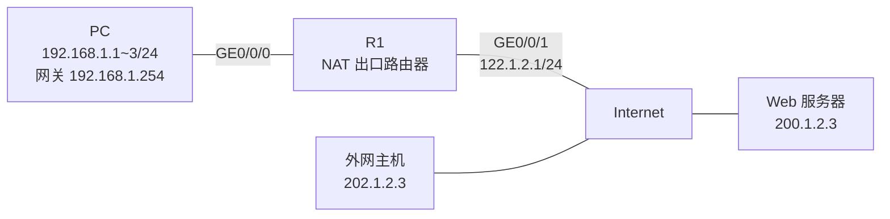
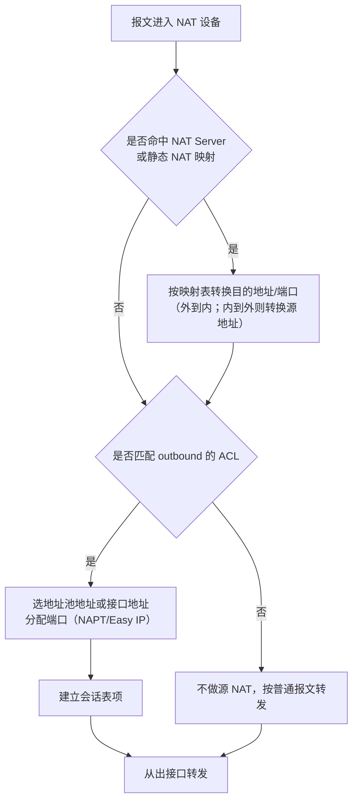

# NAT 配置专题 · 完整笔记

> 内容来源：华为《网络地址转换 NAT》培训讲义（`07_重点3_网络地址转换NAT（必会）`）与《华为配置专题 04_NAT》，两份讲义内容基本一致，后者页码更全；命令、缺省值与参数范围**已按华为 VRP 官方命令参考校正**，讲义转文本中的断行、错字与前后矛盾之处在正文中标注并给出正确写法。
>
> 与 `11.3-ACL、NAT与IPSec VPN配置.md` 的分工：11.3 讲 NAT 的概念体系与分类判读，本文件讲**实验步骤、命令清单与考点提示**；概念细节不再重复，交叉处标注「详见 11.3」。

---

## 1.章节定位与实验环境

### 1.1 讲义结构与考查定位

讲义共 31 页，按“背景 → 原理 → 五类 NAT → 总结”组织，其中五类 NAT 各自配有“原理图 + 转换示例 + 配置示例”三件套，是配置题的直接来源。

| 讲义页码 | 内容 | 考试价值 |
| -------- | ---- | -------- |
| 4~5 | NAT 产生背景、私有地址范围 | 概念题、地址段判断 |
| 6 | NAT 技术原理与部署位置 | 判断题：转换方向 |
| 7~11 | 静态 NAT：原理、双向互访示例、两种配置方式 | 命令题、双向互访分析 |
| 12~17 | 动态 NAT：地址池、转换流程、配置 | 命令题、地址池数量计算 |
| 18~22 | NAPT：端口转换、配置 | 与 No-PAT 的差异判断 |
| 23~24 | Easy IP：原理、配置 | 场景选择题 |
| 25~28 | NAT Server：原理、转换流程、配置 | 案例分析高频 |
| 29~31 | 思考题与总结 | 背诵结论 |

讲义明确的能力目标只有三条：了解 NAT 的技术背景、掌握 NAT 的分类和技术原理、掌握不同场景下如何选用不同类型的 NAT。实际考试中，第三条（选型）出现频率最高。

### 1.2 实验拓扑与地址规划

讲义全部示例共用同一套地址，务必记熟，做题时可直接套用：



| 设备/接口 | 地址 | 说明 |
| --------- | ---- | ---- |
| PC1~PC3 | 192.168.1.1/24 ~ 192.168.1.3/24 | 内网主机，网关指向 192.168.1.254 |
| R1 GE0/0/0 | 192.168.1.254/24 | 内网侧接口 |
| R1 GE0/0/1 | 122.1.2.1/24 | 公网侧接口，NAT 在此接口生效 |
| 公网网关 | 122.1.2.254 | R1 缺省路由的下一跳 |
| NAT 公网地址 | 122.1.2.11 ~ 122.1.2.13 | 供静态映射与地址池使用，避开接口地址 |
| Web 服务器 | 200.1.2.3 | 外部被访问对象 |
| 外网主机 | 202.1.2.3 | 主动访问内网的测试源 |

> 讲义图中的公网侧地址在不同页出现过 `122.1.2.x`、`12.1.2.x`、`202.10.10.1` 等写法，属于排版与 OCR 混用。本文统一采用 `122.1.2.0/24`，接口地址为 `122.1.2.1`，NAT 映射与地址池使用 `122.1.2.11~122.1.2.13`。
>
> 之所以不直接沿用讲义的 `122.1.2.1~122.1.2.3` 作地址池，是因为讲义把接口地址 `122.1.2.1` 同时写进了映射表与地址池，两者会冲突，设备会提示地址重复。实验时把接口地址与 NAT 地址错开，是必须掌握的基本习惯。

### 1.3 配置前的三项准备

NAT 只对**经过设备的转发流量**生效，因此实验必须先把“路走通”，否则无法判断故障在路由还是在 NAT：

| 步骤 | 检查内容 | 命令 |
| ---- | -------- | ---- |
| 1 | 内外网接口地址已配置且物理 Up | `display ip interface brief` |
| 2 | 内网主机网关指向 R1 内网接口 | 主机侧配置，非设备命令 |
| 3 | 出去方向有路由（通常是缺省路由） | `display ip routing-table` |

```
[R1] interface GigabitEthernet0/0/0
[R1-GigabitEthernet0/0/0] ip address 192.168.1.254 24
[R1-GigabitEthernet0/0/0] quit
[R1] interface GigabitEthernet0/0/1
[R1-GigabitEthernet0/0/1] ip address 122.1.2.1 24
[R1-GigabitEthernet0/0/1] quit
[R1] ip route-static 0.0.0.0 0.0.0.0 122.1.2.254
```

> 讲义示例省略了缺省路由，实验时必须补上：NAT 只改地址，不负责找路。

---

## 2.NAT 技术背景与原理

### 2.1 为什么需要 NAT

| 问题 | 说明 |
| ---- | ---- |
| 地址总量不足 | IPv4 公有地址仅约 43 亿个，互联网用户数早已超过该规模 |
| 分配不均 | 早期分配由 IANA 按机构发放，部分地区可用的公有地址严重不足 |
| 过渡手段 | 在 IPv6 全面部署前，用 NAT 作为过渡技术缓解地址短缺 |

NAT（Network Address Translation，网络地址转换）对 IP 报文头中的 IP 地址进行转换，一般部署在**网络出口设备**，例如路由器或防火墙。

NAT 带来两个直接效果：

1. **节约公网地址**：私网内部大量主机共享少量公网地址；
2. **提升内网安全性**：外网无法直接与使用私有地址的内网通信，内网结构被隐藏。

### 2.2 私有地址范围（RFC 1918）

| 类别 | 地址范围 | 等价前缀 | 典型场景 |
| ---- | -------- | -------- | -------- |
| A 类 | 10.0.0.0 ~ 10.255.255.255 | 10.0.0.0/8 | 大型园区、校园网 |
| B 类 | 172.16.0.0 ~ 172.31.255.255 | 172.16.0.0/12 | 企业办公园区 |
| C 类 | 192.168.0.0 ~ 192.168.255.255 | 192.168.0.0/16 | 小型厂房、咖啡厅、家庭网络 |

要点：

- 私有地址**不能**在 Internet 上被路由，必须经 NAT 转换后才能访问公网；
- 不同私网可以重复使用同一段私有地址，互不冲突，这正是 NAT 节约地址的根本原因；
- 讲义图中把 `192.168.1.0/16` 写成网段示例，严格写法应为 `192.168.1.0/24`，属讲义笔误。

### 2.3 NAT 的部署位置与转换方向

| 流量方向 | 转换对象 | 典型技术 |
| -------- | -------- | -------- |
| 从内到外 | 源 IP 地址（可含源端口） | 静态 NAT、动态 NAT、NAPT、Easy IP |
| 从外到内 | 目的 IP 地址（可含目的端口） | 静态 NAT、NAT Server |

讲义原文的表述是：对于“从内到外”的流量，网络设备通过 NAT 将数据包的源地址转换成特定的公有地址；对于“从外到内”的流量，则对数据包的目的地址进行转换。

判断口诀：**出去改源、进来改目的；改完还要能改回来，靠的是 NAT 映射表。**

### 2.4 地址角色与术语

| 术语 | 含义 | 在命令中的位置 |
| ---- | ---- | -------------- |
| `inside` | 内部地址，通常是私有地址 | `nat static ... inside 192.168.1.1` |
| `global` | 全局地址，即转换后的公网地址 | `nat static global 122.1.2.11 ...` |
| 私网地址 | 转换前的地址（local） | 地址池之外的源地址 |
| 公网地址 | 转换后的地址（global） | 地址池中的地址或接口地址 |
| `outbound` | 出方向，内网到外网 | `nat outbound 2000` |
| `inbound` | 入方向，外网到内网 | 静态 NAT 的回程方向 |

概念体系详见 11.3 §5.4，本节只需记住命令里 `global` 永远写公网、`inside` 永远写私网。

### 2.5 一次完整转换的报文流程

以静态 NAT 为例，PC1（192.168.1.1）访问 Web 服务器（200.1.2.3）：

| 步骤 | 位置 | 源 IP | 目的 IP | 动作 |
| ---- | ---- | ----- | ------- | ---- |
| 1 | PC1 发出 | 192.168.1.1 | 200.1.2.3 | 普通 IP 报文 |
| 2 | R1 出口 | 122.1.2.11 | 200.1.2.3 | 源地址被 NAT 转换 |
| 3 | Web 回包 | 200.1.2.3 | 122.1.2.11 | 目的地址是公网地址 |
| 4 | R1 入口 | 200.1.2.3 | 192.168.1.1 | 查映射表，目的地址被转回私网 |

关键点：**回程报文能够被正确还原，完全依赖 NAT 设备上的映射表**。映射表分两类：

| 表项类型 | 生成方式 | 生存期 |
| -------- | -------- | ------ |
| 静态映射表（Server-Map、静态 NAT 表） | 配置命令直接生成 | 永久，除非删除配置 |
| 动态会话表（Session） | 首个报文触发建立 | 有老化时间，无流量后回收 |

### 2.6 五类 NAT 总览

| 类型 | 地址关系 | 是否转换端口 | 公网地址来源 | 能否外网主动访问内网 |
| ---- | -------- | ------------ | ------------ | -------------------- |
| 静态 NAT | 一对一固定 | 否 | 指定的公网地址 | 能（地址级） |
| 动态 NAT（No-PAT） | 一对一临时 | 否 | 地址池 | 不能 |
| NAPT | 一对多（1:n） | 是 | 地址池 | 不能 |
| Easy IP | 一对多（1:n） | 是 | 出接口地址 | 不能 |
| NAT Server | 一对一（含端口） | 是 | 指定公网地址或接口地址 | 能（端口级） |

这张表是本讲义全部内容的骨架。考试中给出需求后，先判断“是否需要外网主动访问”，再判断“公网地址是否固定、是否够用”，即可锁定类型。

---

## 3.静态 NAT

### 3.1 原理

静态 NAT 为每个私有地址配置一个**固定对应**的公有地址，二者是一对一映射。它不转换端口，映射关系长期有效。

适用对象：需要长期稳定对外提供服务或需要固定出口地址的设备，例如服务器、网络设备管理地址。

缺点：即使内网主机长期离线，对应的公有地址也一直被占用，地址利用率低。

### 3.2 双向互访流程

讲义用两组箭头说明“静态 NAT 支持双向互访”，这是它区别于动态 NAT 的关键。

**方向一：内网访问外网**

| 步骤 | 源 IP | 目的 IP |
| ---- | ----- | ------- |
| 1. PC1 发出 | 192.168.1.1 | 200.1.2.3 |
| 2. R1 转换源地址 | 122.1.2.11 | 200.1.2.3 |
| 3. Web 回包 | 200.1.2.3 | 122.1.2.11 |
| 4. R1 转换目的地址 | 200.1.2.3 | 192.168.1.1 |

**方向二：外网主动访问内网**

| 步骤 | 源 IP | 目的 IP |
| ---- | ----- | ------- |
| 1. 外网主机发起 | 202.1.2.3 | 122.1.2.13 |
| 2. R1 转换目的地址 | 202.1.2.3 | 192.168.1.3 |
| 3. 内网主机回包 | 192.168.1.3 | 202.1.2.3 |
| 4. R1 转换源地址 | 122.1.2.13 | 202.1.2.3 |

> [存疑：已二次核实，未定论] 讲义第 9 页下方示意图中，第 3 步标为“源 IP：192.168.1.3、目的 IP：202.1.2.3”，第 4 步标为“源 IP：122.1.2.2”，与文字说明“回包源地址 192.168.1.3 被转换为 122.1.2.3”不一致。按映射表 `192.168.1.3 ↔ 122.1.2.13`，第 4 步应为源 `122.1.2.13`、目的 `202.1.2.3`，图中 `.2` 为错字。

### 3.3 配置：两种视图

**方式一：接口视图下配置映射（`nat static enable` 可省略）**

```
[R1] interface GigabitEthernet0/0/1
[R1-GigabitEthernet0/0/1] ip address 122.1.2.1 24
[R1-GigabitEthernet0/0/1] nat static enable
[R1-GigabitEthernet0/0/1] nat static global 122.1.2.11 inside 192.168.1.1
[R1-GigabitEthernet0/0/1] nat static global 122.1.2.12 inside 192.168.1.2
[R1-GigabitEthernet0/0/1] nat static global 122.1.2.13 inside 192.168.1.3
[R1-GigabitEthernet0/0/1] quit
```

**方式二：系统视图下配置映射，再在接口下使能**

```
[R1] nat static global 122.1.2.11 inside 192.168.1.1
[R1] nat static global 122.1.2.12 inside 192.168.1.2
[R1] nat static global 122.1.2.13 inside 192.168.1.3
[R1] interface GigabitEthernet0/0/1
[R1-GigabitEthernet0/0/1] nat static enable
[R1-GigabitEthernet0/0/1] quit
```

| 命令片段 | 含义 |
| -------- | ---- |
| `nat static global 122.1.2.11 inside 192.168.1.1` | 建立公网地址与私网地址的一对一映射 |
| `global` | 后接公网（全局）地址 |
| `inside` | 后接私网（内部）地址 |
| `nat static enable` | 在接口上使能静态 NAT，缺省为关闭；方式二（系统视图）必须在接口执行，方式一在接口视图直接配置映射时官方步骤不再要求执行该命令 |

地址级映射的官方形式为（接口视图下还可用 `current-interface` 代替 `global-address`，系统视图下则用 `global-address` 或 Loopback 接口）：

```
nat static [ protocol { protocol-number | icmp | tcp | udp } ] global { global-address | current-interface | interface interface-type interface-number } inside host-address [ netmask mask ] [ acl acl-number ] [ description description ]
```

带端口的静态映射形式为：

```
nat static protocol { tcp | udp } global { global-address | current-interface | interface interface-type interface-number } global-port [ global-port2 ] inside host-address [ host-address2 ] [ host-port ] [ netmask mask ] [ acl acl-number ] [ description description ]
```

### 3.4 实验步骤（讲义原序）

| 步骤 | 操作 | 命令 |
| ---- | ---- | ---- |
| 1 | 配置内外网接口地址 | `ip address ...` |
| 2 | 配置内网主机网关 | 主机侧 |
| 3 | 配置缺省路由指向公网 | `ip route-static 0.0.0.0 0 122.1.2.254` |
| 4 | 在公网接口配置三条静态映射 | `nat static global ... inside ...` |
| 5 | 在公网接口使能静态 NAT | `nat static enable`（接口视图方式可省略） |
| 6 | PC 上 ping 200.1.2.3 验证 | 主机侧 |

### 3.5 验证命令

| 命令 | 作用 |
| ---- | ---- |
| `display nat static` | 查看静态 NAT 映射表 |
| `display nat session all` | 查看动态会话表，确认地址已被转换 |
| `display nat outbound` | 查看出方向 NAT 配置（静态 NAT 不显示在此表） |

`display nat session all` 的典型回显字段：

| 字段 | 含义 |
| ---- | ---- |
| `Protocol` | 协议类型，如 TCP(6)、UDP(17)、ICMP |
| `SrcAddr Port Vpn` | 转换前的源地址、端口 |
| `DestAddr Port Vpn` | 转换前的目的地址、端口 |
| `New SrcAddr` / `New SrcPort` | 转换后的源地址、端口 |
| `New DestAddr` / `New DestPort` | 转换后的目的地址、端口 |
| `Time To Live` | 会话剩余生存时间 |

### 3.6 注意点

1. `global` 地址不能与本设备任何接口地址、地址池地址重复，否则命令报冲突。实验时若公网接口地址是 122.1.2.1，就不能再把 122.1.2.1 分配给内网主机做映射。
2. 静态 NAT 不节省公网地址，只解决“地址固定”问题；需要节省地址应改用 NAPT 或 Easy IP。
3. 静态 NAT 的基础形态是**地址级**映射；若只想开放某个端口，通常使用 NAT Server（华为另有 `nat static protocol tcp/udp ...` 的端口级静态映射形态，软考教材与讲义仍按地址级讲解）。
4. 一条 `nat static` 只映射一个地址；需要多台主机对外映射时逐条配置。

---

## 4.动态 NAT（No-PAT）

### 4.1 引入地址池的原因

静态 NAT 严格一对一，内网主机离线时公网地址仍然被占用。动态 NAT 把**所有可用公网地址组成地址池**，主机访问外网时临时分配一个未使用的地址并标记为 `In Use`；不再访问时回收，重新标记为 `Not Use`。

| 状态标记 | 含义 |
| -------- | ---- |
| `In Use` | 该公网地址已被某内网主机占用 |
| `Not Use` | 该公网地址空闲，可被分配 |

动态 NAT 的官方名称是 **Basic NAT**，在 VRP 命令中用 `no-pat` 关键字体现“不做端口转换”。

### 4.2 转换流程

| 步骤 | 动作 |
| ---- | ---- |
| 1 | 收到内网主机访问外网的报文，查地址池 |
| 2 | 选择一个 `Not Use` 的地址，标记为 `In Use`，替换源 IP |
| 3 | 生成临时 NAT 映射表项（私网地址 ↔ 公网地址） |
| 4 | 回程报文到达，按目的地址查映射表，还原为私网地址 |

> [存疑：已二次核实，未定论] 讲义第 14 页示意图中，第 1 步选中了 `122.1.2.2`，但地址池状态图把 `122.1.2.1` 标成 `In Use`，第 2 步报文源地址又是 `122.1.2.2`，图中标记与箭头不一致。按流程应为“选中的那个地址变为 In Use”。

### 4.3 配置三要素

动态 NAT 的配置固定为三步，缺一不可：

| 顺序 | 要素 | 命令 | 作用 |
| ---- | ---- | ---- | ---- |
| 1 | 地址池 | `nat address-group group-index start-address end-address` | 定义可用公网地址范围 |
| 2 | ACL | `acl 2000` + `rule permit source ...` | 指定哪些内网源地址允许被转换 |
| 3 | 接口关联 | `nat outbound acl-number address-group group-index no-pat` | 在出接口把 ACL 与地址池绑定 |

```
[R1] nat address-group 1 122.1.2.11 122.1.2.13
[R1] acl 2000
[R1-acl-basic-2000] rule 5 permit source 192.168.1.0 0.0.0.255
[R1-acl-basic-2000] quit
[R1] interface GigabitEthernet0/0/1
[R1-GigabitEthernet0/0/1] nat outbound 2000 address-group 1 no-pat
[R1-GigabitEthernet0/0/1] quit
```

| 命令片段 | 说明 |
| -------- | ---- |
| `nat address-group 1 122.1.2.11 122.1.2.13` | 创建地址池 1，范围含 3 个地址；起止地址之间**不加 `to`** |
| `acl 2000` | 基本 ACL，只需匹配源地址 |
| `rule 5 permit source 192.168.1.0 0.0.0.255` | 匹配 192.168.1.0/24，反掩码 0.0.0.255 |
| `nat outbound 2000 address-group 1 no-pat` | 出方向 NAT，引用 ACL 2000 与地址池 1，`no-pat` 表示不做端口转换 |

官方命令格式为：

```
nat outbound acl-number [ address-group group-index [ no-pat ] ]
```

`acl-number` 必填，只能是 2000~2999 的基本 ACL 或 3000~3999 的高级 ACL；省略 `address-group` 表示使用出接口地址（即 Easy IP）。

### 4.4 实验步骤与验证

| 步骤 | 操作 | 验证点 |
| ---- | ---- | ------ |
| 1 | 建地址池 | `display nat address-group 1` 能看到起止地址 |
| 2 | 建 ACL 并放通内网网段 | `display acl 2000` 规则命中计数增长 |
| 3 | 接口下 `nat outbound ... no-pat` | `display nat outbound` 中 Type 显示 `no-pat` |
| 4 | PC ping 公网地址 | `display nat session all` 出现一对一会话 |

`display nat outbound` 回显示例：

```
<Huawei> display nat outbound
 NAT Outbound Information:
 --------------------------------------------------------------------------
 Interface                     Acl     Address-group/IP/Interface      Type
 --------------------------------------------------------------------------
 GigabitEthernet0/0/1         2000                              1    no-pat
 --------------------------------------------------------------------------
  Total : 1
```

### 4.5 局限

| 局限 | 说明 |
| ---- | ---- |
| 地址数量受限 | 同时上网的主机数不能超过地址池中的公网地址数 |
| 地址利用率低 | 一台主机占用一个公网地址，空闲时也不释放端口维度的复用能力 |
| 不适合大内网 | 内网主机数通常远大于可用公网地址数 |

这正是 NAPT 要解决的问题。

---

## 5.NAPT

### 5.1 原理

NAPT（Network Address and Port Translation，网络地址端口转换）在转换 IP 地址的同时**转换传输层端口号**，用“地址 + 端口”共同标识一条连接，从而实现公网地址与私网地址的 **1:n** 映射。

| 名称 | 别名 | 是否转换端口 | 映射关系 |
| ---- | ---- | ------------ | -------- |
| No-PAT | 动态 NAT、Basic NAT | 否 | 1:1 |
| NAPT | PAT、端口 NAT、地址端口转换 | 是 | 1:n |

讲义的映射表示例：

| 私有地址:端口 | 公有地址:端口 |
| ------------- | ------------- |
| 192.168.1.1:10321 | 122.1.2.11:1025 |
| 192.168.1.2:17087 | 122.1.2.11:1026 |

两台内网主机共用一个公网地址 `122.1.2.11`，仅靠端口号区分，这就是 NAPT 提高地址利用率的方式。

### 5.2 转换流程

| 步骤 | 动作 | 报文变化 |
| ---- | ---- | -------- |
| 1 | 内网主机发起连接 | 源 192.168.1.1:10321，目的 200.1.2.3:80 |
| 2 | 从地址池选地址，同时改源 IP 与源端口 | 源 122.1.2.11:1025，目的不变 |
| 3 | 生成映射表项 | 记录“私网 IP:端口 ↔ 公网 IP:端口” |
| 4 | 回程报文按“公网 IP:端口”查表 | 目的 122.1.2.11:1025 被还原为 192.168.1.1:10321 |

要点：NAPT 的映射表项必须同时包含地址与端口，否则无法区分共用同一公网地址的多条连接。

### 5.3 配置：与动态 NAT 只差一个关键字

```
[R1] nat address-group 1 122.1.2.11 122.1.2.11
[R1] acl 2000
[R1-acl-basic-2000] rule 5 permit source 192.168.1.0 0.0.0.255
[R1-acl-basic-2000] quit
[R1] interface GigabitEthernet0/0/1
[R1-GigabitEthernet0/0/1] nat outbound 2000 address-group 1
[R1-GigabitEthernet0/0/1] quit
```

与动态 NAT 的唯一差别是**去掉 `no-pat`**。`nat outbound` 在带地址池时缺省执行 PAT，即 NAPT。

| 配置 | 命令尾缀 | 效果 |
| ---- | -------- | ---- |
| 动态 NAT（No-PAT） | `... address-group 1 no-pat` | 1:1，地址池几个地址就支持几台主机 |
| NAPT | `... address-group 1` | 1:n，地址池一个地址即可支持大量主机 |

### 5.4 验证

| 命令 | 观察点 |
| ---- | ------ |
| `display nat outbound` | Type 列显示 `pat` 即表示做端口转换（No-PAT 显示 `no-pat`） |
| `display nat session all verbose` | `New SrcPort` 与原始 `SrcAddr Port` 不同，说明端口被改写 |
| `display nat session number` | 当前会话数量，可判断复用程度 |

### 5.5 与 No-PAT 的对比（讲义思考题 2）

| 比较项 | No-PAT（动态 NAT） | NAPT |
| ------ | ------------------ | ---- |
| 转换内容 | 仅 IP 地址 | IP 地址 + 传输层端口 |
| 地址复用 | 不支持，1:1 | 支持，1:n |
| 公网地址需求 | 与并发主机数相同 | 远少于并发主机数，理论上一地址可承载数万连接 |
| 映射表项 | 地址对地址 | 地址端口对地址端口 |
| 适用场景 | 内网主机少、公网地址充足 | 绝大多数园区出口 |

---

## 6.Easy IP

### 6.1 原理

Easy IP 的实现原理与 NAPT 相同，同样转换 IP 地址和传输层端口，区别只有两点：

1. **没有地址池**，直接使用**出接口的地址**作为转换后的公网地址；
2. 因此公网地址可以是动态获取的（DHCP、PPPoE 拨号），不需要预先规划地址池。

适用场景：不具备固定公网 IP 地址的私网出口，如家庭宽带、拨号上网、小型分支机构。

### 6.2 配置

```
[R1] acl 2000
[R1-acl-basic-2000] rule 5 permit source 192.168.1.0 0.0.0.255
[R1-acl-basic-2000] quit
[R1] interface GigabitEthernet0/0/1
[R1-GigabitEthernet0/0/1] nat outbound 2000
[R1-GigabitEthernet0/0/1] quit
```

命令特征：`nat outbound` 后**只跟 ACL 编号**，既不写 `address-group`，也不写 `no-pat`。

### 6.3 三种源 NAT 的对比

| 比较项 | 动态 NAT（No-PAT） | NAPT | Easy IP |
| ------ | ------------------ | ---- | ------- |
| 是否使用地址池 | 是 | 是 | 否 |
| 转换后的地址 | 地址池地址 | 地址池地址 | 出接口地址 |
| 是否转换端口 | 否 | 是 | 是 |
| 公网地址是否固定 | 固定 | 固定 | 可不固定 |
| 命令特征 | `nat outbound 2000 address-group 1 no-pat` | `nat outbound 2000 address-group 1` | `nat outbound 2000` |
| 典型场景 | 少量主机、地址充足 | 大内网共享少量公网地址 | 拨号、DHCP 动态地址出口 |

记忆方法：**看 `nat outbound` 后面还带什么**——带地址池且带 `no-pat` 是动态 NAT，带地址池不带 `no-pat` 是 NAPT，什么都不带是 Easy IP。

---

## 7.NAT Server

### 7.1 原理与使用场景

NAT Server 指定 **[公网地址:端口] 与 [私网地址:端口] 的一对一映射**，把内网服务器发布到公网。外网主机主动访问公网地址的指定端口，即可访问内网服务器的对应服务。

适用场景：私网中的 Web、FTP、邮件等服务器需要向公网提供服务。

与静态 NAT 的区别：静态 NAT 是“地址对地址”，NAT Server 是“地址端口对地址端口”，因此可以在一个公网地址上发布多台服务器的不同服务。

### 7.2 转换流程

以“公网 122.1.2.12:80 → 内网 192.168.1.10:80”为例：

| 步骤 | 位置 | 源 | 目的 | 动作 |
| ---- | ---- | -- | ---- | ---- |
| 1 | 外网主机发起 | 202.1.2.3:47819 | 122.1.2.12:80 | 访问公网地址 |
| 2 | R1 查映射表 | 202.1.2.3:47819 | 192.168.1.10:80 | 目的地址与端口被转换 |
| 3 | 服务器回包 | 192.168.1.10:80 | 202.1.2.3:47819 | 源为私网地址 |
| 4 | R1 反向转换 | 122.1.2.12:80 | 202.1.2.3:47819 | 源地址与端口被还原为公网 |

要点：

- 第 1 步到第 2 步是**目的 NAT**；
- 第 3 步到第 4 步是**源 NAT**（回程方向的地址还原）；
- 会话建立后，后续报文按会话表转发，不再重复查映射表；
- Server-Map 表项由配置生成，**永久有效**，除非删除 `nat server` 配置。

### 7.3 配置与讲义错误校正

讲义第 28 页文字描述为“将内网服务器 192.168.1.10 的 80 端口映射到公有地址 122.1.2.1 的 8080 端口”，但给出的命令是：

```
nat server protocol tcp global 202.10.10.1 www inside 192.168.1.1 8080
```

该命令与文字描述、地址规划均不符，有三处必须改正：

| 错误点 | 讲义写法 | 正确写法 | 理由 |
| ------ | -------- | -------- | ---- |
| 公网地址不符 | `202.10.10.1` | `122.1.2.12` | 讲义文字写 122.1.2.1，但该地址已被公网接口占用，实验改用 122.1.2.12 |
| 公网端口不符 | `www`（即 80） | `8080` | 文字要求映射到 8080 端口 |
| 私网地址不符 | `192.168.1.1` | `192.168.1.10` | 服务器地址是 .10，.1 是主机 |

> 若现场只有一个公网地址且已配置在接口上，可改用 `global current-interface 8080`，让设备直接取接口地址，避免地址冲突。

按 VRP 官方语法校正后的命令：

```
[R1] interface GigabitEthernet0/0/1
[R1-GigabitEthernet0/0/1] ip address 122.1.2.1 24
[R1-GigabitEthernet0/0/1] nat server protocol tcp global 122.1.2.12 8080 inside 192.168.1.10 80
[R1-GigabitEthernet0/0/1] quit
```

若按讲义配图“公网 80 对私网 80”的映射，则应写：

```
[R1-GigabitEthernet0/0/1] nat server protocol tcp global 122.1.2.12 80 inside 192.168.1.10 80
```

官方命令格式：

```
nat server protocol { tcp | udp } global { global-address | current-interface | interface interface-type interface-number } global-port [ global-port2 ] inside host-address [ host-address2 ] [ host-port ] [ acl acl-number ]
```

| 参数 | 含义 |
| ---- | ---- |
| `protocol tcp` | 指定服务协议，也可写协议号或 `icmp` |
| `global 122.1.2.12 8080` | 公网地址与公网端口 |
| `inside 192.168.1.10 80` | 私网服务器地址与私网端口 |
| `acl 2001` | 只允许 ACL 匹配的源地址访问，省略表示任意源 |
| `current-interface` | 公网地址使用出接口地址（地址不固定时使用） |

### 7.4 常用变体

| 需求 | 写法 |
| ---- | ---- |
| 公网端口与私网端口不同 | `global 122.1.2.12 8080 inside 192.168.1.10 80` |
| 公网地址用出接口地址 | `global current-interface 80 inside 192.168.1.10 80` |
| 只允许指定源访问 | 命令末尾加 `acl 2001`，ACL 中 `permit` 该源 |
| 端口写服务名 | `www` 等价 80，`ftp` 等价 21，`domain` 等价 53 |
| 地址段或端口段映射 | `nat server` 支持 `host-address2`、`global-port2`，但要求公网端口数与私网地址数严格对应，考试以“单地址单端口”为主，了解即可 |

### 7.5 验证

| 命令 | 作用 |
| ---- | ---- |
| `display nat server` | 查看 Server-Map 表项，确认公网地址端口与私网地址端口的对应 |
| `display nat session all` | 查看外网访问产生的会话 |
| 外网主机 `telnet 122.1.2.12 8080` | 快速验证端口是否可达 |

### 7.6 NAT Server 与静态 NAT 对比

| 比较项 | 静态 NAT | NAT Server |
| ------ | -------- | ---------- |
| 映射粒度 | 地址级 | 地址 + 端口级 |
| 是否转换端口 | 否 | 是 |
| 一个公网地址可发布几个服务 | 只能对应一台主机 | 可按不同端口对应多台服务器 |
| 典型用途 | 内网主机使用固定公网地址出网 | 外网用户访问内网服务器 |
| 表项名称 | 静态 NAT 表 | Server-Map |

---

## 8.地址池与转换查表流程

### 8.1 地址池的组成

| 要素 | 说明 |
| ---- | ---- |
| 池编号 `group-index` | 区分多个地址池，取值随型号而定：AR1200 等为 0~7，AR2220/AR2240/AR3200 为 0~255，AR300/AR700（V300）为 0~31 |
| 起始地址 | 池中第一个可用公网地址 |
| 结束地址 | 池中最后一个可用公网地址 |
| 池中地址数量 | 结束地址 − 起始地址 + 1 |
| 地址状态 | `In Use` / `Not Use`，仅对动态分配有意义 |

数量计算是常见考点：`nat address-group 1 122.1.2.10 122.1.2.20` 共有 11 个地址；若使用 `no-pat`，最多支持 11 台内网主机同时上网。

### 8.2 地址池相关命令

| 操作 | 命令 |
| ---- | ---- |
| 创建地址池 | `nat address-group group-index start-address end-address` |
| 删除地址池 | `undo nat address-group group-index` |
| 查看地址池 | `display nat address-group [ group-index ]` |
| 在出接口引用 | `nat outbound acl-number address-group group-index [ no-pat ]` |
| 查看引用关系 | `display nat outbound` |

### 8.3 设备处理顺序

NAT 设备处理一个报文，通常按下列顺序查表：



要点：

- **目的 NAT 先于源 NAT**，这是双向 NAT 能够工作的基础；
- 只有 ACL 中 `permit` 的流量才进入源 NAT；
- 地址池地址不足且未启用端口转换时，新连接会建立失败；
- 会话表建立后，同一连接的正反向报文都按会话表处理，不再重复匹配 ACL。

### 8.4 地址与端口的选择规则

| 场景 | 选择依据 |
| ---- | -------- |
| 地址池中有多个空闲地址 | 依次分配，已被占用的跳过 |
| 地址池地址用尽且为 NAPT | 复用已有地址，依靠不同端口区分 |
| 地址池地址用尽且为 No-PAT | 无法建立新连接 |
| 源端口已被占用 | 重新分配一个空闲端口 |
| 报文已被 NAT Server 转换 | 回程按 Server-Map 反查，不再分配新端口 |

---

## 9.NAT ALG

### 9.1 问题背景

传统 NAT 只修改 IP 报文头中的地址和端口，不解析应用层载荷。但部分协议的**载荷中携带地址或端口**，若不一并修改，后续连接会失败。

| 协议 | 载荷中的地址/端口 | 不做 ALG 的后果 |
| ---- | ----------------- | --------------- |
| FTP | PORT/PASV 命令携带数据连接地址与端口 | 数据连接建立失败，能登录但不能列目录、传文件 |
| SIP | SDP 中携带媒体流地址与端口 | 语音单通或无声 |
| DNS | A 记录、PTR 记录携带地址 | 公网返回的地址不可达 |
| PPTP | 控制连接携带呼叫相关地址 | 隧道建立失败 |
| RTSP | 媒体描述中携带地址与端口 | 视频流无法播放 |

NAT ALG（Application Level Gateway，应用层网关）的作用就是：在转换报文头的同时，**识别并改写应用层载荷中的地址与端口**。

### 9.2 支持协议与命令

华为 AR 设备支持 `dns`、`ftp`、`sip`、`pptp`、`rtsp` 五种协议的 ALG。缺省情况下 NAT ALG **未使能**。

```
[Huawei] nat alg { all | protocol-name } enable
```

```
[Huawei] nat alg ftp enable
[Huawei] nat alg all enable
<Huawei> display nat alg
```

`display nat alg` 回显：

```
<Huawei> display nat alg
NAT Application Level Gateway Information:
----------------------------------
  Application            Status
----------------------------------
  dns                    Disabled
  ftp                    Disabled
  rtsp                   Enabled
  sip                    Disabled
  pptp                   Disabled
----------------------------------
```

> 校正说明：11.3 §6.6 把 ICMP 列入 ALG 支持协议。按 AR V200R010 命令参考，`nat alg` 的可配置协议为 DNS、FTP、SIP、PPTP、RTSP 五种（`all` 即这五种），ICMP 不在可配置清单中；但部分云化 NAT 平台（如 NAT 实例视图）另有缺省使能的 ICMP ALG，属平台/版本差异。软考按 AR 口径答五种，不把 ICMP 计入。

### 9.3 配置与排查

| 步骤 | 操作 |
| ---- | ---- |
| 1 | 确认服务器与客户端之间的基础 NAT 已通 |
| 2 | 在 NAT 设备上使能对应协议的 ALG |
| 3 | 用 `display nat alg` 确认状态为 `Enabled` |
| 4 | 测试应用层功能（FTP 列目录、SIP 通话） |

注意：ALG 与服务器自身的地址修正功能可能冲突。例如 FTP 服务器已开启 PASV 地址修正，NAT 设备再开启 FTP ALG，可能导致数据连接异常，此时应关闭其中一方。

---

## 10.双向 NAT

### 10.1 场景

内网用户使用**内网服务器的公网地址**访问同一内网的服务器。此时报文既要改源地址（出网），又要改目的地址（回到内网），只配源 NAT 或只配 NAT Server 都不够。

典型需求描述：

- 内网主机 192.168.1.100 访问 `122.1.2.12:80`；
- 该地址实际映射到内网服务器 192.168.1.10:80；
- 要求访问成功且回程正确。

### 10.2 报文流程与问题

| 步骤 | 处理 | 问题 |
| ---- | ---- | ---- |
| 1 | 内网主机发出：源 192.168.1.100，目的 122.1.2.12 | 目的地址是公网地址，设备可能直接按路由送出 |
| 2 | 只配源 NAT：源被改为 122.1.2.1 | 目的仍是公网地址，报文回不到内网服务器 |
| 3 | 只配 NAT Server：目的被改为 192.168.1.10 | 源仍是私网地址，服务器回包可能直接二层回给主机，造成路径不一致 |
| 4 | 源 NAT + 目的 NAT 同时生效 | 源与目的都被正确改写，会话表保证回程 |

### 10.3 配置思路

在同一个 NAT 设备上同时配置**源 NAT**与**目的 NAT（NAT Server）**。内网用户访问内网服务器时，报文从内网接口进、又从内网接口出，源 NAT 必须落在内网侧接口：

```
# 1. 匹配内网访问服务器的流量（目的地址按目的 NAT 之后的私网地址匹配）
[Router] acl 3000
[Router-acl-adv-3000] rule 5 permit ip source 192.168.1.0 0.0.0.255 destination 192.168.1.10 0
[Router-acl-adv-3000] quit

# 2. 内网侧接口：目的 NAT + 源 NAT（Easy IP，使用内网接口地址）
[Router] interface GigabitEthernet0/0/0
[Router-GigabitEthernet0/0/0] nat server protocol tcp global 122.1.2.12 80 inside 192.168.1.10 80
[Router-GigabitEthernet0/0/0] nat outbound 3000
[Router-GigabitEthernet0/0/0] quit

# 3. 公网接口：普通上网流量的源 NAT（Easy IP）
[Router] acl 2000
[Router-acl-basic-2000] rule 5 permit source 192.168.1.0 0.0.0.255
[Router-acl-basic-2000] quit
[Router] interface GigabitEthernet0/0/1
[Router-GigabitEthernet0/0/1] nat outbound 2000
[Router-GigabitEthernet0/0/1] quit
```

> 只把 `nat outbound` 配在公网接口不够：内网到内网服务器的报文不会经过公网接口，源地址不会被转换，服务器回包会直接二层送给主机，源地址也与主机访问的公网地址不符。华为 V200R003C01 及以后版本支持在内网接口配置 `nat server`，并要求在同一内网接口补一条 `nat outbound`（ACL 匹配“源为内网网段、目的为服务器私网地址”），使源地址一并转换。

### 10.4 其他方案对比

| 方案 | 做法 | 适用场合 |
| ---- | ---- | -------- |
| 双向 NAT | 源 NAT + 目的 NAT 同时生效（内网互访时两者均落在内网侧接口） | 内网用户通过公网地址访问内网服务器 |
| 域内 NAT | 在内部域内同时做源 NAT 与目的 NAT | 防火墙组网，内网互访需地址转换 |
| NAT Server + 源 NAT | 用 NAT Server 发布服务器，同时为内网用户配源 NAT | 路由器组网最常见 |
| NAT DNS Mapping | `nat dns-map domain-name global-address global-port protocol-name` | 内网用户用域名访问内网服务器，避免解析到公网地址后回不来 |

`nat dns-map` 的作用是把域名、公网地址、端口、协议绑定，使内网用户解析域名时得到可用于内部访问的地址。它不是双向 NAT 的必需项，但常与 NAT Server 配合出现在综合题中。

> 双向 NAT 的概念与应用场景详见 11.3 §6.7；本节只补充实验配置与查表顺序。

---

## 11.命令清单与完整配置脚本

### 11.1 命令总表

| 分类 | 命令 | 视图 | 作用 |
| ---- | ---- | ---- | ---- |
| 地址池 | `nat address-group group-index start-address end-address` | 系统 | 创建公网地址池 |
| 地址池 | `undo nat address-group group-index` | 系统 | 删除地址池 |
| 静态 NAT | `nat static global global-address inside host-address` | 系统/接口 | 建立一对一映射 |
| 静态 NAT | `nat static enable` | 接口 | 使能接口静态 NAT |
| 动态/NAPT | `nat outbound acl-number address-group group-index [ no-pat ]` | 接口 | ACL 与地址池绑定 |
| Easy IP | `nat outbound acl-number` | 接口 | 使用接口地址做源 NAT |
| NAT Server | `nat server protocol tcp global global-address global-port inside host-address host-port` | 接口 | 发布内网服务器 |
| NAT Server | `nat server protocol tcp global current-interface global-port inside host-address host-port` | 接口 | 公网地址用接口地址 |
| NAT Server | `nat server ... acl acl-number` | 接口 | 限制可访问的源 |
| ALG | `nat alg { all \| protocol-name } enable` | 系统 | 使能应用层网关 |
| DNS 映射 | `nat dns-map domain-name global-address global-port protocol-name` | 系统 | 域名与公网地址端口绑定 |
| 查看 | `display nat static` | 任意 | 查看静态映射 |
| 查看 | `display nat outbound` | 任意 | 查看出方向 NAT |
| 查看 | `display nat server` | 任意 | 查看 Server-Map |
| 查看 | `display nat address-group [ group-index ]` | 任意 | 查看地址池 |
| 查看 | `display nat session { all [ verbose ] \| number }` | 任意 | 查看会话表 |
| 查看 | `display nat alg` | 任意 | 查看 ALG 状态 |
| 维护 | `reset nat session all` | 系统 | 清除全部动态会话，使新配置立即生效 |

### 11.2 五种典型配置脚本

**静态 NAT**

```
[R1] interface GigabitEthernet0/0/1
[R1-GigabitEthernet0/0/1] ip address 122.1.2.1 24
[R1-GigabitEthernet0/0/1] nat static enable
[R1-GigabitEthernet0/0/1] nat static global 122.1.2.11 inside 192.168.1.1
[R1-GigabitEthernet0/0/1] nat static global 122.1.2.12 inside 192.168.1.2
[R1-GigabitEthernet0/0/1] nat static global 122.1.2.13 inside 192.168.1.3
[R1-GigabitEthernet0/0/1] quit
```

**动态 NAT（No-PAT）**

```
[R1] nat address-group 1 122.1.2.11 122.1.2.13
[R1] acl 2000
[R1-acl-basic-2000] rule 5 permit source 192.168.1.0 0.0.0.255
[R1-acl-basic-2000] quit
[R1] interface GigabitEthernet0/0/1
[R1-GigabitEthernet0/0/1] nat outbound 2000 address-group 1 no-pat
[R1-GigabitEthernet0/0/1] quit
```

**NAPT**

```
[R1] nat address-group 1 122.1.2.11 122.1.2.11
[R1] acl 2000
[R1-acl-basic-2000] rule 5 permit source 192.168.1.0 0.0.0.255
[R1-acl-basic-2000] quit
[R1] interface GigabitEthernet0/0/1
[R1-GigabitEthernet0/0/1] nat outbound 2000 address-group 1
[R1-GigabitEthernet0/0/1] quit
```

**Easy IP**

```
[R1] acl 2000
[R1-acl-basic-2000] rule 5 permit source 192.168.1.0 0.0.0.255
[R1-acl-basic-2000] quit
[R1] interface GigabitEthernet0/0/1
[R1-GigabitEthernet0/0/1] nat outbound 2000
[R1-GigabitEthernet0/0/1] quit
```

**NAT Server**

```
[R1] interface GigabitEthernet0/0/1
[R1-GigabitEthernet0/0/1] ip address 122.1.2.1 24
[R1-GigabitEthernet0/0/1] nat server protocol tcp global 122.1.2.12 8080 inside 192.168.1.10 80
[R1-GigabitEthernet0/0/1] quit
```

### 11.3 配置检查顺序

| 顺序 | 检查项 | 命令 |
| ---- | ------ | ---- |
| 1 | 接口地址与状态 | `display ip interface brief` |
| 2 | 路由是否可达 | `display ip routing-table` |
| 3 | NAT 配置是否生成 | `display nat outbound` / `display nat server` / `display nat static` |
| 4 | 是否有会话 | `display nat session all` |
| 5 | 会话中地址端口是否正确 | `display nat session all verbose` |

---

## 12.实验验证与故障排查

### 12.1 分类型验证方法

| NAT 类型 | 验证动作 | 预期结果 |
| -------- | -------- | -------- |
| 静态 NAT | 内网 ping 外网；外网 ping 映射后的公网地址 | 双向都能通 |
| 动态 NAT | 多台主机同时 ping 外网，主机数超过地址池 | 超出部分不通 |
| NAPT | 多台主机同时访问同一外网服务 | 全部能通，会话端口不同 |
| Easy IP | 内网主机 ping 外网 | 会话中的新源地址等于出接口地址 |
| NAT Server | 外网 telnet 公网地址端口 | 登录到内网服务器 |
| NAT ALG | FTP 登录后执行 `dir`、`get` | 数据连接正常建立 |

### 12.2 常见故障与原因

| 现象 | 可能原因 | 排查命令 |
| ---- | -------- | -------- |
| 内网完全不能上网 | 未配缺省路由、NAT 未应用到出接口 | `display ip routing-table`、`display nat outbound` |
| 部分主机不能上网 | ACL 未匹配该网段，或 ACL 反掩码写错 | `display acl 2000` |
| 地址池够但仍有个别主机不通 | No-PAT 下地址池被占满 | `display nat session all` |
| NAT 配了但 ping 不通外网 | 公网侧回程路由缺失（运营商侧未回程） | 在公网设备上查路由 |
| NAT Server 外网访问不通 | 公网地址端口写错、ACL 拦截、安全策略未放通 | `display nat server`、`display acl` |
| FTP 能登录不能传文件 | 未使能 FTP ALG | `display nat alg` |
| 静态 NAT 命令报冲突 | 公网地址与接口地址重复 | `display ip interface brief` |
| 内网用公网地址访问内网服务器失败 | 只配了源 NAT，缺目的 NAT | 检查是否配置 `nat server` |
| 会话存在但业务时通时断 | 会话老化时间过短、链路不稳 | `display nat session all verbose` |

### 12.3 排错思路

1. **先看路由，再看 NAT**：NAT 只改地址，不解决可达性；
2. **先看配置是否生成，再看是否命中**：`display nat outbound` 有配置，`display nat session all` 无会话，说明 ACL 未命中或流量未经过该接口；
3. **对比转换前后地址**：用 `verbose` 参数看 `New SrcAddr`、`New SrcPort` 是否符合预期；
4. **注意方向**：`nat outbound` 必须配在**出公网的那个接口**上，配在内网接口不生效。

---

## 13.典型考题

### 13.1 题型一：NAT 类型选择

**题目：某公司内网有 500 台主机，仅申请到 1 个固定公网地址，要求所有主机都能访问 Internet，应配置（ ）。**

A. 静态 NAT

B. 动态 NAT（No-PAT）

C. NAPT 或 Easy IP

D. NAT Server

**答案：C**

解析：

| 选项 | 判断 | 理由 |
| ---- | ---- | ---- |
| A | [错误] | 静态 NAT 一对一，1 个公网地址只能支持 1 台主机 |
| B | [错误] | No-PAT 一对一，1 个地址只能支持 1 台主机同时上网 |
| C | [正确] | 转换端口后 1 个公网地址可支持大量主机；地址固定用 NAPT，地址不固定用 Easy IP |
| D | [错误] | NAT Server 用于外网访问内网服务器，方向相反 |

### 13.2 题型二：命令填空

**题目：补全配置，使 192.168.1.0/24 的内网主机通过地址池 1（122.1.2.11~122.1.2.13）访问 Internet，且不做端口转换。**

```
[R1] nat address-group 1 122.1.2.11 122.1.2.13
[R1] acl 2000
[R1-acl-basic-2000] rule 5 permit source 192.168.1.0 0.0.0.255
[R1-acl-basic-2000] quit
[R1] interface GigabitEthernet0/0/1
[R1-GigabitEthernet0/0/1] ______________________________
```

**答案：**

```
nat outbound 2000 address-group 1 no-pat
```

要点：`no-pat` 是“不做端口转换”的关键字，缺省不带该关键字时执行 PAT。若题目要求“提高公网地址利用率”，则应去掉 `no-pat`。

### 13.3 题型三：NAT Server 配置判读

**题目：将内网 Web 服务器 192.168.1.10 的 80 端口发布到公网地址 122.1.2.12 的 8080 端口，正确的命令是（ ）。**

A. `nat static global 122.1.2.11 inside 192.168.1.10`

B. `nat server protocol tcp global 122.1.2.12 8080 inside 192.168.1.10 80`

C. `nat outbound 2000 address-group 1`

D. `nat server protocol tcp global 192.168.1.10 80 inside 122.1.2.12 8080`

**答案：B**

解析：

| 选项 | 判断 | 理由 |
| ---- | ---- | ---- |
| A | [错误] | 静态 NAT 是地址级映射，不能指定端口 |
| B | [正确] | `global` 后为公网地址与端口，`inside` 后为私网地址与端口 |
| C | [错误] | 这是源 NAT，方向相反 |
| D | [错误] | 公网与私网参数写反了 |

### 13.4 题型四：转换流程分析

**题目：内网主机 192.168.1.1 访问 200.1.2.3，出口配置 `nat outbound 2000`（Easy IP，出接口地址 122.1.2.1）。外网回包的目的地址是什么？由谁转换？**

**答案：** 回包目的地址为 `122.1.2.1`，由出口路由器的 NAT 模块根据会话表将其转换为 `192.168.1.1`。

要点：Easy IP 虽然不配置地址池，但同样会生成会话表；回程还原依据的是会话表，而不是接口地址本身。

### 13.5 讲义思考题解答

| 思考题 | 解答 |
| ------ | ---- |
| 何种 NAT 转换可以让外部网络主动访问内网服务器 | NAT Server；若只需地址级映射也可用静态 NAT，但无法指定端口 |
| NAPT 相比 No-PAT 有哪些优点 | 转换端口实现 1:n 映射，大幅提高公网地址利用率；少量公网地址即可支持大量主机；地址池不足时仍可建立新连接 |

---

## 14.本章小结

| 知识块 | 核心内容 |
| ------ | -------- |
| 1. 技术背景 | IPv4 公有地址短缺且分配不均；私网用 RFC 1918 地址，出口部署 NAT |
| 2. 转换方向 | 出方向改源地址，入方向改目的地址；回程依赖映射表与会话表 |
| 3. 静态 NAT | 一对一固定映射，不转换端口，支持双向互访；命令 `nat static global ... inside ...`，系统视图方式需 `nat static enable` |
| 4. 动态 NAT | 地址池动态分配，`In Use`/`Not Use` 标记；三要素为地址池、ACL、`nat outbound ... no-pat` |
| 5. NAPT | 同时转换地址与端口，1:n 映射；命令去掉 `no-pat` 即为 NAPT |
| 6. Easy IP | 无地址池，用出接口地址，适用于 DHCP/PPPoE 动态地址；命令 `nat outbound acl-number` |
| 7. NAT Server | 公网地址端口与私网地址端口一对一映射；命令 `nat server protocol tcp global ... inside ...` |
| 8. 地址池 | 编号 + 起止地址；地址数 = 末地址 − 首地址 + 1；No-PAT 下决定并发主机上限 |
| 9. 查表流程 | 先目的 NAT（Server/静态映射入方向），再源 NAT（ACL + 地址池），最后建会话表转发 |
| 10. NAT ALG | 改写应用层载荷中的地址端口；支持 dns、ftp、sip、pptp、rtsp，缺省关闭 |
| 11. 双向 NAT | 内网用户用公网地址访问内网服务器；源 NAT 与目的 NAT 同时生效 |
| 12. 验证命令 | `display nat outbound`、`display nat server`、`display nat static`、`display nat address-group`、`display nat session all`、`display nat alg` |

考试重点：

1. **五类 NAT 的判别**：看地址关系（1:1 还是 1:n）、是否转换端口、公网地址来源、能否外网主动访问。
2. **静态 NAT 的命令与生效条件**：`nat static global ... inside ...`；系统视图配置后必须在接口执行 `nat static enable`。
3. **动态 NAT 三要素**：地址池、ACL、`nat outbound ... address-group ... no-pat`；缺一不可。
4. **NAPT 与 No-PAT 的唯一命令差异**：`no-pat` 的有无；缺省执行 PAT。
5. **Easy IP 的命令特征**：`nat outbound acl-number` 后不带地址池，转换后的地址是出接口地址。
6. **NAT Server 参数顺序**：`global` 后是公网地址与端口，`inside` 后是私网地址与端口，顺序写反即错。
7. **地址池容量计算**：`末地址 − 首地址 + 1`；No-PAT 下并发主机数不能超过该值。
8. **转换流程分析**：能写出出方向与回程方向每一步的源/目的地址，是案例题的基本功。
9. **NAT ALG 的适用协议**：只有载荷中携带地址端口的协议才需要，FTP 是典型代表。
10. **双向 NAT 的配置组合**：源 `nat outbound` + 目的 `nat server`，缺一不可；内网互访时源 NAT 也要配在内网侧接口。
11. **命令视图**：`nat address-group`、`nat static`、`nat alg` 在系统视图；`nat outbound`、`nat server`、`nat static enable` 在接口视图。

---

## 15.校验记录

> 校验范围：命令语法与视图、NAT 类型与转换流程、地址池与 NAT Server 写法、NAT 与 ACL/双向 NAT 的配合。仅列改动项与存疑项，未列出的条目核对无误。
>
> 二轮复核：上轮 12 条改动逐条核对，11 条维持，1 条不完整（NAT Server 流程只改第 1 步，第 2 步源地址仍为 `200.1.2.3`）已补正；ALG 协议清单由“以本条为准”收敛为平台差异。本轮新增修正 2 处，剩余存疑 2 处（均为讲义插图与正文不一致）。

| 位置 | 原文 | 改为 | 依据 |
| ---- | ---- | ---- | ---- |
| §3.3 命令表 | `nat static enable` 在“两种配置方式下都必须执行，否则映射不生效” | 系统视图方式必须执行；接口视图直接配置 `nat static` 时官方步骤不再要求执行该命令 | 华为 AR V200R010 配置指南-IP业务《配置静态地址映射》：方式一（接口视图）未列 `nat static enable`，方式二（系统视图）才列；同版《配置静态一对一 NAT》示例仅在接口视图配置 `nat static` 即可生效 |
| §3.3 | “命令的完整官方形式”只给出地址级形态 | 改为“地址级映射的官方形式”，并补 `nat static protocol { tcp \| udp } global ... global-port ... inside ... host-port ...` 端口形态 | 华为 AR V200R010 配置指南-IP业务《配置静态地址映射》命令清单 |
| §3.6 注意点 3 | “静态 NAT 的映射是地址级的，若只想开放某个端口，应使用 NAT Server” | 基础形态是地址级；端口级发布通常用 NAT Server，华为另有 `nat static protocol` 端口形态（教材仍按地址级讲解） | 二轮复核：依据收紧。华为 AR V200R010 配置指南《配置静态地址映射》命令清单：地址级 `nat static` 只转换地址，接口视图/系统视图另提供 `nat static protocol { tcp \| udp } ... global-port ... inside ... host-port` 的端口级静态映射；原引《NAT Server 与 NAT Static 模式的区别》中“NAT Static 同时转换 IP 与端口”仅指带端口的静态 PAT 形态，不能概括地址级静态 NAT |
| §4.3 官方命令格式 | `nat outbound [ acl-number ] [ address-group group-index [ no-pat ] ]`，并称“省略 `acl-number` 表示所有源地址都转换” | `nat outbound acl-number [ address-group group-index [ no-pat ] ]`；`acl-number` 必填 | 华为 AR V200R010 命令参考《nat outbound》：带地址池形式为 `nat outbound acl-number address-group group-index [ no-pat ]`，Easy IP 形式为 `nat outbound acl-number [ interface ... ]`，两种形式均未把 ACL 标为可选 |
| §5.4 验证表 | `display nat outbound` 的 Type 列“为空（不带 `no-pat`）即表示做端口转换” | Type 列显示 `pat` 即表示做端口转换，No-PAT 显示 `no-pat` | 华为 AC V200R025C10《NAT配置举例》回显：同一表中并列出现 `no-pat` 与 `pat` |
| §7.2 转换流程第 1 步 | 外网主机源地址写 `200.1.2.3:47819` | `202.1.2.3:47819`；二轮补正：第 2 步源地址 `200.1.2.3:47819` 同步改为 `202.1.2.3:47819` | 本文 §1.2 地址规划：`200.1.2.3` 是 Web 服务器，外网主机是 `202.1.2.3`；同表第 3 步也用 `202.1.2.3`。上轮只改第 1 步，第 2 步仍沿用服务器地址，属漏改 |
| §8.1 地址池编号 | “AR 系列常见取值 0~7 或 0~255” | 按型号列出：AR1200 等 0~7，AR2220/AR2240/AR3200 0~255，AR300/AR700（V300）0~31 | 华为 AR V200R010 命令参考 `nat outbound` 参数表；AR300/AR700 V300R023 `nat address-group` 参数表 |
| §8.3 流程图 | 命中 Server/静态映射后一律“先做目的地址/端口转换” | 按映射表转换目的地址/端口（外到内）；内到外则转换源地址 | 本文 §3.2 双向互访流程：出方向改源、入方向改目的；静态 NAT 出方向属于源 NAT |
| §10.3 配置 | 内网互访场景把 `nat outbound 2000` 配在公网接口 `GE0/0/1` | 内网接口 `GE0/0/0` 配 `nat server` 后再配 `nat outbound 3000`（ACL 目的为服务器私网地址 `192.168.1.10`），公网接口只保留普通上网的 `nat outbound 2000` | 华为 FAQ EKB1000064011：V200R003C01 及以后支持内网接口配 `nat server`；内网用户与服务器同网段时，必须在内网口补 `nat outbound`，ACL 匹配“源为内网网段、目的为服务器私网地址”。内网到内网的报文不经过公网接口，公网口的源 NAT 不会命中 |
| §10.4 方案表 | 双向 NAT 做法写作“出方向源 NAT + 入方向目的 NAT” | 源 NAT + 目的 NAT 同时生效，内网互访时两者均落在内网侧接口 | 同上；华为 AR《NAT 综合示例》在 LAN 口同时配置 Easy IP 的 `nat outbound` 与 NAT Static |
| §14 考试重点 10 | “出方向 `nat outbound` + 入方向 `nat server`” | 源 `nat outbound` + 目的 `nat server`；内网互访时源 NAT 配在内网侧接口 | 同上 |
| 全文 | 未涉及 NAT 对 IPSec 与分片的影响 | 保留，未改动（记为缺项） | 建议后续补充：AH 校验 IP 头（含地址）与 NAT 不兼容；ESP 需 NAT-T（RFC 3948，UDP 4500 封装）；分片报文仅首片带端口，NAPT 需依赖分片缓存/会话还原 |
| §9.2 ALG 校正说明（二轮） | “ICMP 不在其中……考试若考协议清单，以本条为准” | 改为“AR V200R010 的可配置协议为 DNS、FTP、SIP、PPTP、RTSP；ICMP 不在可配置清单。部分云化 NAT 平台另有缺省使能的 ICMP ALG，属平台/版本差异，软考按 AR 口径答五种” | 华为 AR V200R010 命令参考《nat alg》：缺省未使能，`protocol-name` 取值为 dns、ftp、sip、pptp、rtsp，`all` 即这五种；华为云 NAT 实例文档《nat alg (NAT instance view)》：By default, NAT ALG for ICMP is enabled。两者平台不同，不能互相否定 |
| §3.3 `nat static enable`（二轮复核） | 上轮改为“接口视图方式可省略、系统视图方式必须执行” | 维持上轮改动，并同步修正 11.3 §6.1“必须开启”的表述 | 华为 AR V200R010 配置指南《配置静态地址映射》：方式一（接口视图）只列 `nat static` 命令，方式二（系统视图）才列 `nat static enable`；同版《配置静态一对一 NAT》示例在接口视图配置 `nat static` 后直接生效 |
| §4.3 `nat outbound` ACL 必填（二轮复核） | 上轮改为 `acl-number` 必填 | 维持 | 华为 AR V200R010 命令参考：带地址池形式 `nat outbound acl-number address-group group-index [ no-pat ]`，Easy IP 形式 `nat outbound acl-number [ interface ... ]`，两种形式均未把 ACL 标为可选 |
| §5.4 Type 列（二轮复核） | 上轮改为 Type 显示 `pat` 表示端口转换 | 维持 | 华为 AR 维护宝典《检查 NAT Outbound 是否绑定正确的 ACL》回显：Type 列并列出现 `easyip`、`pat`；No-PAT 示例为 `no-pat` |
| §8.1 地址池编号（二轮复核） | 上轮按型号列出 0~7 / 0~255 / 0~31 | 维持 | 华为 AR V200R010 命令参考 `nat address-group`：AR120/150/160/200/1200 系列 0~7；AR2204/AR2220/AR2220E/AR2240/AR2240C 0~255；AR3200/AR3600 0~255；AR300/AR700 V300 为 0~31 |
| §10.3 双向 NAT（二轮复核） | 上轮改为源 NAT 与目的 NAT 均落在内网侧接口 | 维持 | 华为 FAQ EKB1000064011：V200R003C01 及以后支持内网接口配 `nat server`；内网用户访问同网段服务器时须在内网口补 `nat outbound`，ACL 匹配“源内网网段、目的服务器私网地址”；公网口的源 NAT 不会命中内网互访流量 |

仍存疑（已二次核实，未定论）：

- §3.2 讲义第 9 页回程第 4 步图中源地址写作 `122.1.2.2`，与映射表 `192.168.1.3 ↔ 122.1.2.13` 不符，正文按 `.13` 给出；
- §4.2 讲义第 14 页地址池状态图把 `122.1.2.1` 标为 `In Use`，与第 1 步选中的 `122.1.2.2` 不一致，正文按“选中的地址变为 In Use”给出。

两处均为讲义插图与正文/映射表矛盾，正文已给出可自洽的结论；因无讲义原始矢量图或勘误表，无法确认图中原字符，故不定论。
