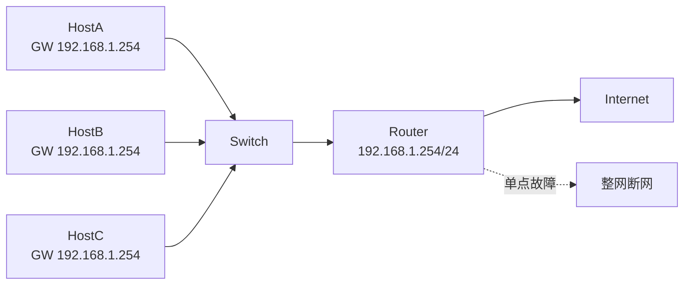
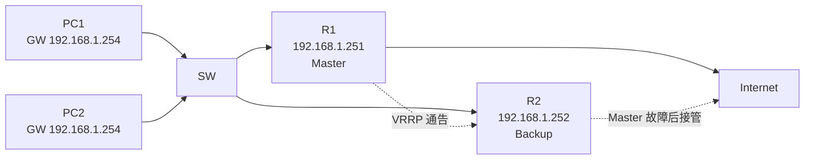
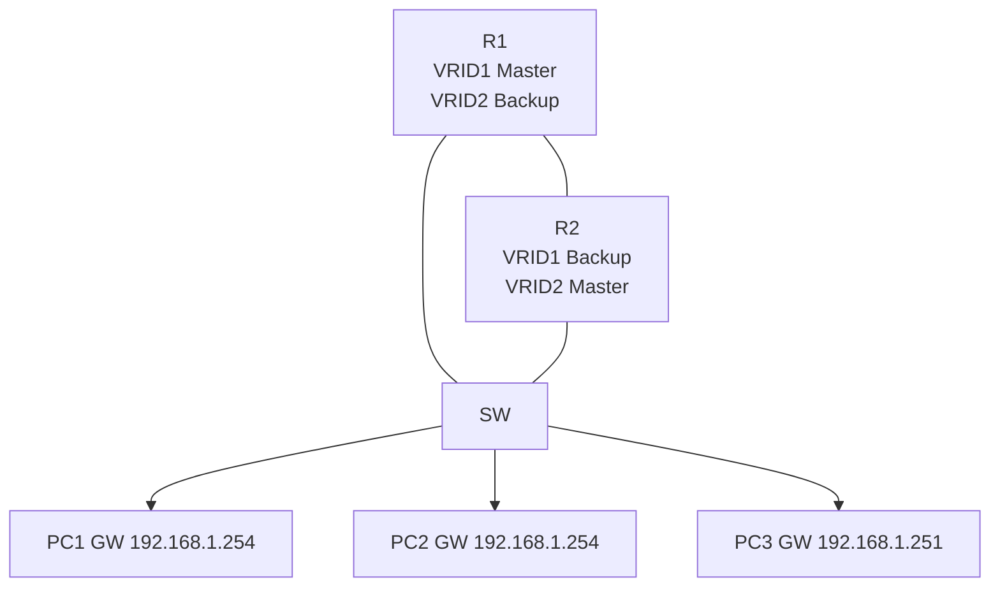
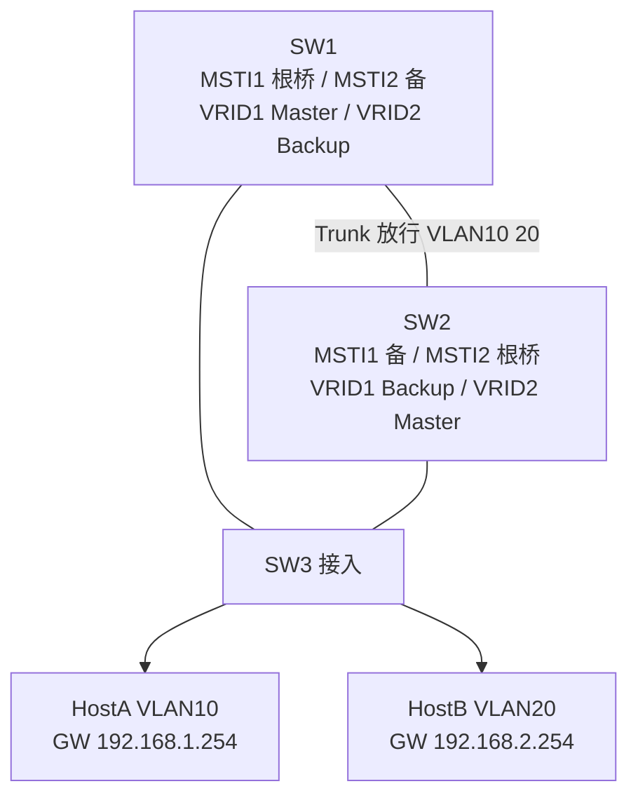
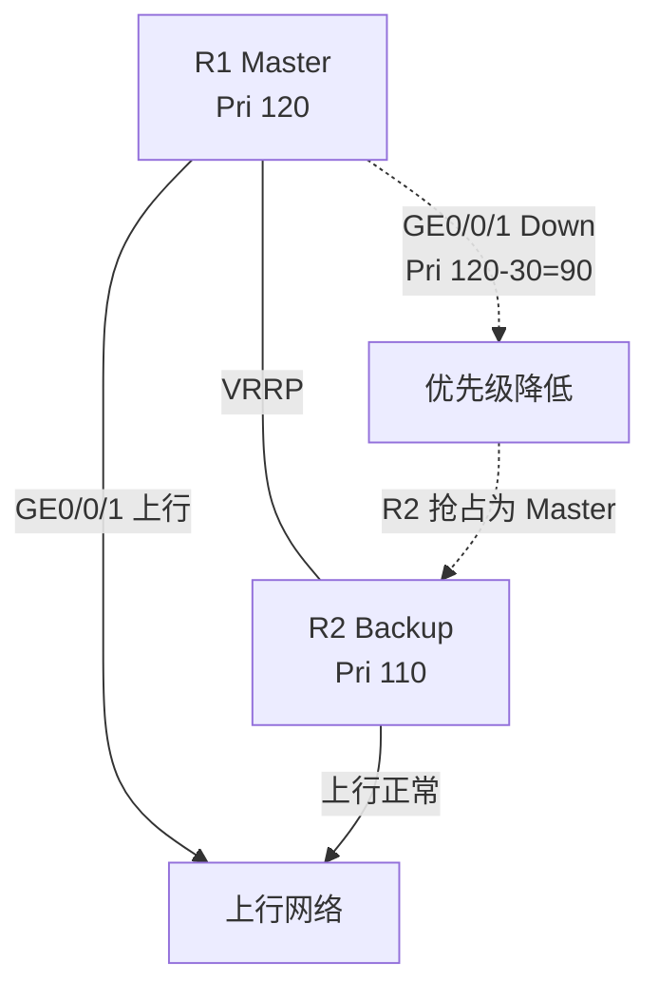
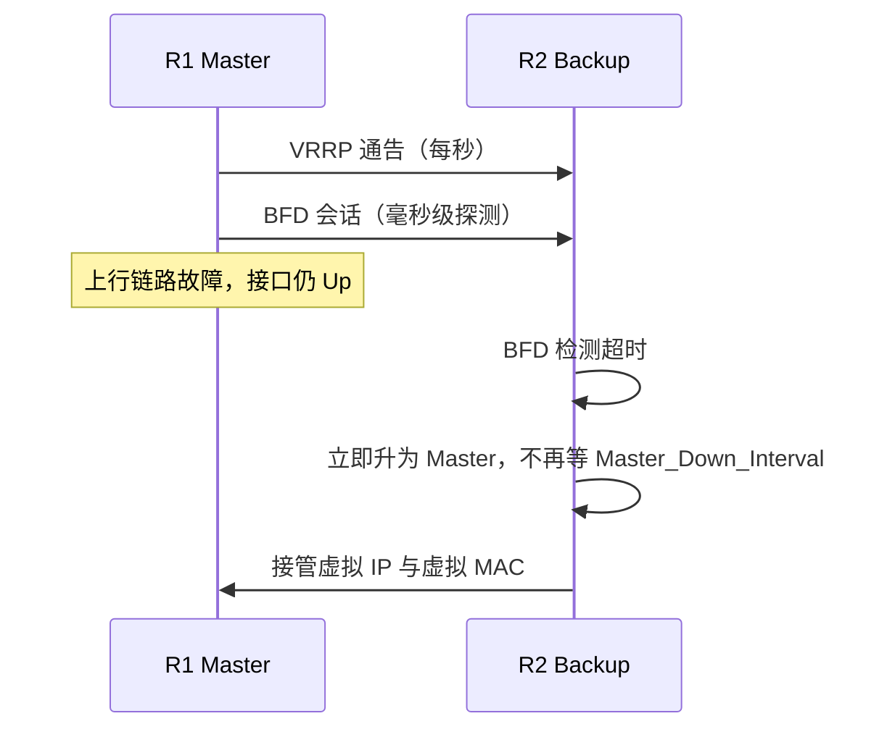

# VRRP 配置专题 · 完整笔记

---

> 内容来源：培训讲义《华为配置专题05 VRRP》（PPT 截图转纯文本，原文标题误写为 "VRPP"）。本笔记已按 **VRRP 标准（RFC 3768 / RFC 5798）与华为 VRP 官方命令**校正命令与术语，校正明细见 §1.3、§5.5。
>
> 定位：18.4 是 VRRP 的**专题强化**，只补讲义独有的术语细节、典型应用组合、命令全参数与回显判读。VRRP 基础概念、主备切换与双主分析、案例题解法已在 11.2 §6 系统讲过，交叉处写"详见 11.2 §6"，不重复展开。

## 1.专题定位与讲义结构

### 1.1 讲义目录与知识衔接

| 讲义小节 | 内容 | 本笔记位置 | 与已有笔记的关系 |
| -------- | ---- | ---------- | ---------------- |
| VRRP 概述与原理 | 技术背景、术语、虚拟路由器、Master/Backup、优先级 | §2、§3 | 概念框架同 11.2 §6.1，本专题补全虚拟 MAC 与报文细节 |
| VRRP 典型应用 | 主备、负载分担、VRRP+MSTP、Track、VRRP+BFD | §4 | 11.2 只讲了负载分担与心跳线，本专题补 MSTP 与 BFD |
| VRRP 基本配置 | 六条配置命令 + 配置实例 + `display vrrp` 回显 | §5、§6 | 11.2 §6.2 给过精简版，本专题给全参数与逐字段解读 |

### 1.2 VRRP 在软考中的位置

| 出现形态 | 典型问法 | 分值 |
| -------- | -------- | ---- |
| 综合知识选择题 | 虚拟 MAC 格式、优先级取值、Master 选举、报文封装 | 1 分 |
| 案例填空 | 补全 `vrid`、`virtual-ip`、`priority`、`preempt-mode timer delay`、`track ... reduced` | 4~6 分 |
| 案例简答 | 为什么要配 track、为什么配抢占延时、主备为什么不切换 | 4~8 分 |
| 方案设计 | 双核心如何同时实现网关冗余与流量负载分担 | 5~10 分 |

近五年真题中，VRRP 与"静态路由 + BFD + ACL""STP + VRRP""堆叠 + VRRP"组合出现，单独考 VRRP 的题几乎没有，答完 VRRP 必须能接上链路/路由那一环。

### 1.3 术语与命令校正

| 序号 | 讲义原文 | 校正后 | 类型 | 依据 |
| ---- | -------- | ------ | ---- | ---- |
| 1 | `VRPP`（标题、目录两次） | `VRRP` | 拼写 | Virtual Router Redundancy Protocol |
| 2 | `Master_Down_Timer` | `Master_Down_Interval` | 术语 | 华为与 RFC 均称 Master_Down_Interval（主备切换超时时间） |
| 3 | `[interface-GigabitEthernet0/0/0]` | `[R1-GigabitEthernet0/0/0]` | 提示符 | 讲义用通用占位符，真实提示符为"设备名-接口名" |

另有版本差异一处，不属于错误：讲义 `track ... reduced 30` 与部分新版本文档的 `track ... reduce 30` 为同一功能的不同版本关键字，考试按讲义与真题答案写 `reduced` 即可，详见 5.5。

---

## 2.VRRP 的技术背景

### 2.1 单网关面临的单点故障

终端要把跨网段流量交给网关，而终端只能配置**一个**默认网关。若全网只部署一台网关路由器，该设备故障时，本网段所有主机都无法访问外部网络。



讲义的结论：当网关 Router 出现故障时，本网段内以该设备为网关的主机都不能与 Internet 通信。

### 2.2 VRRP 的解决思路

VRRP 在同一网段部署**两台及以上**运行 VRRP 的路由器，把它们虚拟成一台逻辑路由器：

- 两台设备各有一个真实接口地址（如 192.168.1.251、192.168.1.252）；
- 对外提供**一个虚拟 IP**（如 192.168.1.254）作为终端网关；
- 其中一台为 Master 负责转发，另一台为 Backup 只监听；
- Master 故障时 Backup 自动升为 Master，虚拟 IP 与虚拟 MAC 不变，终端无感知。



与"双网关 + 手工改终端"相比，VRRP 的关键价值是**网关地址不变**：终端配置一次虚拟 IP，之后的主备切换完全由网络侧完成。

---

## 3.VRRP 的基本术语

### 3.1 术语表

| 术语 | 英文/缩写 | 含义 |
| ---- | --------- | ---- |
| VRRP 路由器 | VRRP Router | 运行 VRRP 协议的路由器或三层交换机，如 R1、R2 |
| 虚拟路由器标识 | VRID（Virtual Router Identifier） | 标识一个 VRRP 备份组，同一组内所有设备 VRID 相同；取值 1~255 |
| VRRP 组 | VRRP Group | 多台协同工作的路由器（的接口）组成，交互 VRRP 报文并产生一台虚拟路由器；一个组中只能有一台 Master |
| 虚拟路由器 | Virtual Router | VRRP 抽象出的逻辑设备，并非真实存在的物理设备；一个组只产生一台 |
| 虚拟 IP 地址 | Virtual IP Address | 管理员配置，通常作为终端网关；一台虚拟路由器可有一个或多个虚拟 IP |
| 虚拟 MAC 地址 | Virtual MAC Address | 虚拟路由器对外使用的 MAC，格式固定，由 VRID 决定 |
| Master 路由器 | Master Router | 承担报文转发任务；组内**只有 Master 响应针对虚拟 IP 的 ARP 请求**；周期性发送 VRRP 通告 |
| Backup 路由器 | Backup Router | 实时侦听 Master 的通告，随时准备接替 |
| 优先级 | Priority | 选举 Master 的依据，取值 0~255，值越大越优先；相等时比较接口 IP，大者优先 |

### 3.2 虚拟 MAC 地址

虚拟 MAC 的格式为：

```text
0000-5e00-01xx        （xx 为 VRID 的十六进制）
```

| 项目 | 取值 | 说明 |
| ---- | ---- | ---- |
| 前 40 位 | `0000-5e00-01` | IANA 分配的 VRRP 专用前缀 |
| 后 8 位 | VRID | 如 VRID 1 → `01`，VRID 10 → `0a` |
| VRID 1 的完整 MAC | `0000-5e00-0101` | 讲义示例，`display vrrp` 回显中可见 |

补充（已核实）：

- 上述格式适用于 **VRRPv2（IPv4）** 与 VRRPv3 的 IPv4 场景；
- VRRPv3 用于 IPv6 时，虚拟 MAC 为 `0000-5e00-02xx`；
- 虚拟 MAC 的作用是让主备切换后**网关 MAC 也不变**，终端 ARP 表无需刷新，切换更快；
- 若把虚拟 IP 配置成某台设备的真实接口地址，该设备为"IP 地址拥有者"，优先级固定为 255。

### 3.3 Master 选举与优先级

选举顺序：

1. 先比优先级，**大者**为 Master；
2. 优先级相同，比接口主 IP 地址，**大者**为 Master；
3. 若某设备是 IP 地址拥有者，优先级 255，直接成为 Master。

优先级取值：

| 取值 | 含义 |
| ---- | ---- |
| 0 | 保留，表示设备停止参与 VRRP，用于主动触发主备切换 |
| 1~254 | 可配置范围，缺省 100 |
| 255 | 保留给 IP 地址拥有者（虚拟 IP 等于接口真实 IP） |

讲义示例：R1 优先级 200、R2 优先级 100，故 R1 为 Master、R2 为 Backup。

| 说法 | 判定 |
| ---- | ---- |
| 优先级数值越大越优先 | [正确] 缺省 100，范围 0~255 |
| 优先级 0 表示最高优先级 | [错误] 0 表示设备停止参与 VRRP |
| 优先级相同时比较 MAC 地址大小 | [错误] 优先级相同时比较接口 IP 地址，大者优先 |

### 3.4 协议报文

| 项目 | 取值 |
| ---- | ---- |
| 封装 | 直接封装在 IP 报文中，IP 协议号 **112** |
| 目的地址 | 组播 **224.0.0.18** |
| 目的 MAC | `00-00-5E-00-01-{VRID}`（VRRP 虚拟 MAC，末字节为 VRID） |
| TTL | **255**，接收端校验 TTL 必须为 255，防止报文被伪造或跨网段转发 |
| 发送周期 | 缺省 **1 秒**，仅 Master 发送 |
| 版本 | VRRPv2（RFC 3768，仅 IPv4）、VRRPv3（RFC 5798，支持 IPv4/IPv6） |

要点：VRRP 报文**不走 TCP/UDP**，因此不能用端口号过滤；ACL 若误拦协议号 112 或组播 224.0.0.18，会直接造成双主，详见 11.2 §6.3。

---

## 4.VRRP 的典型应用

### 4.1 主备备份（单组）

最基本的部署：两台设备组成一个 VRRP 组，一台 Master、一台 Backup，Backup 平时不转发业务流量，只作冗余。

| 项目 | R1 | R2 |
| ---- | -- | -- |
| 接口地址 | 192.168.1.251/24 | 192.168.1.252/24 |
| VRID | 1 | 1 |
| 虚拟 IP | 192.168.1.254 | 192.168.1.254 |
| 优先级 | 200 | 100 |
| 角色 | Master | Backup |

缺点：Backup 的链路与设备能力**长期闲置**，投资利用率低。这就引出了负载分担。

### 4.2 负载分担（多组互为主备）

在一对设备上创建**多个 VRRP 组**，让两台设备在不同组中分别担任 Master，从而把不同网段的流量分摊到两台设备。

| 项目 | R1 | R2 |
| ---- | -- | -- |
| VRID 1 虚拟 IP | 192.168.1.254 | 192.168.1.254 |
| VRID 1 优先级 | 200（Master） | 100（Backup） |
| VRID 2 虚拟 IP | 192.168.1.251 | 192.168.1.251 |
| VRID 2 优先级 | 100（Backup） | 200（Master） |



要点：

- 终端按"网关地址"被分成两组，PC1、PC2 的网关指向 VRID 1 的虚拟 IP，PC3 指向 VRID 2 的虚拟 IP；
- 两台设备同时转发，又互为备份，任一台故障时另一台接管全部流量；
- 这是软考案例题中"既要冗余又要负载分担"的标准答案，配置命令见 11.2 §6.4；
- 注意与"链路聚合/堆叠"区分：VRRP 负载分担是**三层网关**维度的分摊，堆叠是**设备虚拟化**维度的合并。

### 4.3 VRRP 与 MSTP 配合

双核心组网中，二层有 MSTP 阻塞冗余链路，三层有 VRRP 提供网关。两者若不协调，会出现"网关在 A、二层根桥在 B"的绕行：流量先到 B 再穿互联链路到 A，浪费带宽、增加时延。

讲义给出的标准布局：

| 项目 | SW1 | SW2 |
| ---- | --- | --- |
| MSTP 实例 1（VLAN 10） | primary（根桥） | secondary |
| MSTP 实例 2（VLAN 20） | secondary | primary |
| VRRP 组 1（VLAN 10 网关） | Master | Backup |
| VRRP 组 2（VLAN 20 网关） | Backup | Master |



配合原则：

1. **同一 VLAN 的 MSTP 根桥与 VRRP Master 放在同一台设备上**；
2. 两个 VLAN 的根桥/Master 交叉设置，实现二层与三层的双重负载分担；
3. 互联链路必须为 Trunk 且放行两个 VLAN，否则 VRRP 报文与业务流量都无法通过；
4. 若两者错位，业务仍通，但路径次优，案例题常以此设问"网络性能下降的原因"。

### 4.4 监视上行接口（Track）

VRRP 只能感知**自己所在接口**的状态。若 Master 的 VRRP 接口正常、但**上行接口**故障，Master 仍是 Master，会把流量吸引过来却转发不出去，形成"假冗余"。

VRRP 可监视（Track）上行端口状态：当设备感知上行端口或链路故障时，主动**降低 VRRP 优先级**，使上行链路正常的 Backup 通过选举切换为 Master，指导报文转发。



要点：

- 被跟踪的接口**不能是 VRRP 所在接口**（该接口状态本来就被 VRRP 感知）；
- 降低幅度要保证降后**低于 Backup**，否则不切换；
- IP 地址拥有者不能配置 track（其优先级固定 255，无法被超越）；
- 缺省降低值为 10，可配置范围 1~255，优先级最低降到 1。

### 4.5 VRRP 与 BFD 联动

Track 只能跟踪接口的物理/协议状态，若故障发生在**中间链路**而两端接口仍 Up，Track 不会触发。BFD 提供毫秒级链路检测，可在 Master 与 Backup 之间建立 BFD 会话：

- BFD 检测到 Master 侧链路故障后立即通告 Backup；
- Backup 不再等待 `Master_Down_Interval` 超时（缺省约 3 秒多），直接切换为 Master；
- 适用于对中断时间敏感的业务（语音、视频、交易）。



区别记忆：

| 检测手段 | 检测对象 | 速度 | 配置位置 |
| -------- | -------- | ---- | -------- |
| VRRP 自身通告 | Master 整机是否存活 | 秒级（Master_Down_Interval） | 缺省即有 |
| Track 接口 | 指定接口的物理/协议状态 | 接口 Down 即触发 | 接口视图 |
| Track BFD | 端到端链路质量 | 毫秒级 | 接口视图 + BFD 会话 |

---

## 5.VRRP 基本配置命令

### 5.1 命令总表

以下命令均在**接口视图**下执行，`virtual-router-id` 为 VRID，`virtual-address` 为虚拟 IP。

| 序号 | 命令 | 作用 |
| ---- | ---- | ---- |
| 1 | `vrrp vrid virtual-router-id virtual-ip virtual-address` | 创建 VRRP 备份组并指定虚拟 IP |
| 2 | `vrrp vrid virtual-router-id priority priority-value` | 配置优先级，决定 Master/Backup |
| 3 | `vrrp vrid virtual-router-id preempt-mode timer delay delay-value` | 配置抢占模式及抢占延时 |
| 4 | `vrrp vrid virtual-router-id preempt-mode disable` | 关闭抢占 |
| 5 | `vrrp vrid virtual-router-id track interface interface-type interface-number [ increased value-increased \| reduced value-reduced ]` | 跟踪上行接口，状态变化时调整优先级 |
| 6 | `vrrp vrid virtual-router-id track bfd-session { bfd-session-id \| session-name bfd-configure-name } [ increased value-increased \| reduced value-reduced ]` | 跟踪 BFD 会话 |

### 5.2 创建备份组与虚拟 IP

```text
[R1] interface GigabitEthernet0/0/0
[R1-GigabitEthernet0/0/0] vrrp vrid 1 virtual-ip 192.168.1.254
```

- 同一 VRRP 组内，**VRID 与虚拟 IP 必须完全一致**；
- 一台虚拟路由器可以有多个虚拟 IP，重复执行本命令即可追加；
- 虚拟 IP 建议使用独立地址，不要与接口真实 IP 相同；若相同，该设备成为 IP 地址拥有者（优先级 255），主备切换逻辑与普通场景不同；
- 创建后若不配优先级，缺省 100。

### 5.3 配置优先级

```text
[R1-GigabitEthernet0/0/0] vrrp vrid 1 priority 120
```

- 取值 1~254（0 与 255 保留），缺省 100，**数值大者优先**；
- 优先级只影响选举，不影响接口路由；
- 两台都保持缺省 100 时，比较接口 IP，大者为 Master——这会让"谁是主"变得不可控，生产环境应显式配置。

### 5.4 抢占模式与抢占延时

```text
[R1-GigabitEthernet0/0/0] vrrp vrid 1 preempt-mode timer delay 10    //抢占延时 10 秒
[R1-GigabitEthernet0/0/0] vrrp vrid 1 preempt-mode disable           //关闭抢占
```

| 配置 | 行为 | 适用场景 |
| ---- | ---- | -------- |
| 缺省（抢占开启，延时 0） | 优先级更高者立即夺回 Master | 简单主备 |
| 抢占 + 延时 N 秒 | 高优先级设备恢复后等待 N 秒再抢占 | 防抖动，避免链路反复 Up/Down 导致主备来回切换 |
| 关闭抢占 | 即使优先级更高也不夺回，直到当前 Master 故障 | 希望主备角色稳定、不随恢复而回切 |

要点：

- 抢占延时通常配在**优先级更高（原 Master）**的设备上；
- 案例题常写"设置 20s 抢占延时防止震荡"，对应 `preempt-mode timer delay 20`；
- 关闭抢占用 `preempt-mode disable`，恢复用 `undo vrrp vrid 1 preempt-mode disable`。

### 5.5 跟踪上行接口

```text
[R1-GigabitEthernet0/0/0] vrrp vrid 1 track interface GigabitEthernet0/0/1 reduced 30
```

参数说明：

| 参数 | 含义 |
| ---- | ---- |
| `track interface 类型 编号` | 指定被监视的接口，通常是上行/出口接口 |
| `reduced 值` | 被监视接口 Down 时，优先级**降低**该值 |
| `increased 值` | 被监视接口 Down 时，优先级**升高**该值（用于反向场景） |

规则：

1. 被跟踪接口 **Down 时调整优先级，Up 时恢复原优先级**；
2. 降低后的优先级必须低于 Backup，才会触发切换；
3. 缺省降低 10；优先级最低降到 1，最高不超过 254；
4. 支持跟踪二层与三层接口：二层接口看物理状态，三层接口看协议状态；
5. 一个 VRRP 组最多跟踪 16 个接口，多个组可跟踪同一接口；
6. **IP 地址拥有者不能配置 track**。

版本差异：部分新版本文档写作 `track interface ... reduce 30` / `increase 30`，与讲义的 `reduced` / `increased` 为同一功能。软考真题答案与讲义一致，作答写 `reduced`。

### 5.6 跟踪 BFD 会话

```text
[R1-GigabitEthernet0/0/0] vrrp vrid 1 track bfd-session session-name vrrp-bfd reduced 30
[R1-GigabitEthernet0/0/0] vrrp vrid 1 track bfd-session 1 reduced 30
```

两种引用方式：

| 写法 | 含义 | 前提 |
| ---- | ---- | ---- |
| `session-name bfd-configure-name` | 按**名称**引用已配置的 BFD 会话 | 已用 `bfd` 相关命令创建同名会话 |
| `bfd-session-id` | 按**会话 ID**引用 | 已知 BFD 会话的本地标识 |

要点：BFD 会话需先创建并绑定到链路；`reduced` 的作用与接口跟踪相同，只是触发源从"接口状态"换成"BFD 检测结果"。

### 5.7 配置实例

拓扑：R1 与 R2 通过 SW 连接主机，R1 的 GE0/0/1 为上行接口。

```text
# R1（Master）
[R1] interface GigabitEthernet0/0/0
[R1-GigabitEthernet0/0/0] ip address 192.168.1.253 24
[R1-GigabitEthernet0/0/0] vrrp vrid 1 virtual-ip 192.168.1.254
[R1-GigabitEthernet0/0/0] vrrp vrid 1 priority 120
[R1-GigabitEthernet0/0/0] vrrp vrid 1 preempt-mode timer delay 10
[R1-GigabitEthernet0/0/0] vrrp vrid 1 track interface GigabitEthernet0/0/1 reduced 30
[R1-GigabitEthernet0/0/0] quit

# R2（Backup）
[R2] interface GigabitEthernet0/0/0
[R2-GigabitEthernet0/0/0] ip address 192.168.1.252 24
[R2-GigabitEthernet0/0/0] vrrp vrid 1 virtual-ip 192.168.1.254
[R2-GigabitEthernet0/0/0] vrrp vrid 1 priority 110
[R2-GigabitEthernet0/0/0] quit
```

配置分析：

| 项目 | R1 | R2 |
| ---- | -- | -- |
| 接口地址 | 192.168.1.253/24 | 192.168.1.252/24 |
| 虚拟 IP | 192.168.1.254 | 192.168.1.254 |
| 优先级 | 120 | 110 |
| 抢占延时 | 10 秒 | 0 秒（缺省） |
| 跟踪 | GE0/0/1，Down 时降 30 | 无 |
| 初始角色 | Master（120 > 110） | Backup |

切换过程：R1 上行 GE0/0/1 故障 → R1 优先级降为 120−30=90 → 90 < 110 → R2 抢占为 Master → 主机流量改由 R2 转发。若 R1 只是短暂抖动，恢复后优先级回到 120，等待 10 秒抢占延时再夺回，避免来回切换。

---

## 6.状态查看与回显解读

### 6.1 `display vrrp` 回显

```text
[R1] display vrrp
 GigabitEthernet0/0/0 | Virtual Router 1
   State : Master
   Virtual IP : 192.168.1.254
   Master IP : 192.168.1.253
   PriorityRun : 120
   PriorityConfig : 120
   MasterPriority : 120
   Preempt : YES   Delay Time : 10 s
   TimerRun : 1 s
   TimerConfig : 1 s
   Auth type : NONE
   Virtual MAC : 0000-5e00-0101
   Check TTL : YES
   Config type : normal-vrrp
   Track IF : GigabitEthernet0/0/1   Priority reduced : 30
   IF state : UP
```

```text
[R2] display vrrp
 GigabitEthernet0/0/0 | Virtual Router 1
   State : Backup
   Virtual IP : 192.168.1.254
   Master IP : 192.168.1.253
   PriorityRun : 110
   PriorityConfig : 110
   MasterPriority : 120
   Preempt : YES   Delay Time : 0 s
   TimerRun : 1 s
   TimerConfig : 1 s
   Auth type : NONE
   Virtual MAC : 0000-5e00-0101
   Check TTL : YES
   Config type : normal-vrrp
```

### 6.2 字段含义

| 字段 | 含义 | 判读要点 |
| ---- | ---- | -------- |
| `GigabitEthernet0/0/0 \| Virtual Router 1` | 接口与 VRID | 一个接口可有多个 VRID，逐个列出 |
| `State` | 本机在该组中的状态 | Master / Backup / Initialize |
| `Virtual IP` | 虚拟 IP | 同组必须一致 |
| `Master IP` | 当前 Master 的接口真实 IP | Backup 上也能看到，说明它知道主是谁 |
| `PriorityRun` | **运行优先级**（实际参与选举的值） | 配置 track 后接口故障时此值会下降 |
| `PriorityConfig` | **配置优先级**（手工写入的值） | 接口恢复后 `PriorityRun` 回到此值 |
| `MasterPriority` | 当前 Master 的优先级 | Backup 用于比较，判断自己是否有资格抢占 |
| `Preempt` | 是否开启抢占 | YES / NO |
| `Delay Time` | 抢占延时 | 防抖动参数 |
| `TimerRun` / `TimerConfig` | 运行/配置的通告间隔 | 缺省 1 秒 |
| `Auth type` | 认证类型 | 缺省 NONE；VRRPv3 已取消认证 |
| `Virtual MAC` | 虚拟 MAC | `0000-5e00-01` + VRID |
| `Check TTL` | 是否检查 TTL | VRRP 报文 TTL 必须为 255 |
| `Config type` | 备份组类型 | normal-vrrp 为普通主备 |
| `Track IF` / `Priority reduced` / `IF state` | 被跟踪接口、降低值、当前状态 | 只有配置 track 的设备才有此行 |

### 6.3 回显判读三步

1. **看 State**：直接读出主备；
2. **看 PriorityRun 与 PriorityConfig**：两者不等，说明 track 正在生效（被跟踪接口故障）；
3. **看 MasterPriority 与 PriorityRun**：Backup 的 `PriorityRun` 大于 `MasterPriority` 却仍是 Backup，说明抢占被关闭或仍在抢占延时内。

补充：`display vrrp verbose` 显示更完整的统计与配置；`display vrrp statistics` 只显示报文收发计数，不能代替前者看状态，真题中常以此设干扰项。

---

## 7.定时器与切换时间

### 7.1 三个时间参数

| 参数 | 缺省值 | 作用 | 配置命令 |
| ---- | ------ | ---- | -------- |
| 通告间隔 Advertisement_Interval | 1 秒 | Master 发送 VRRP 通告的周期 | `vrrp vrid 1 timer advertise 1` |
| 抢占延时 Preempt_Delay | 0 秒 | 高优先级设备恢复后等待多久再抢占 | `vrrp vrid 1 preempt-mode timer delay 10` |
| 主备切换超时 Master_Down_Interval | 由公式计算 | Backup 多久未收到通告即认为 Master 失效 | 随通告间隔与优先级自动变化 |

### 7.2 Master_Down_Interval 的计算

```text
Master_Down_Interval = 3 × Advertisement_Interval + Skew_Time
Skew_Time = (256 − Priority) / 256   （单位：秒）
```

计算示例（通告间隔 1 秒）：

| Backup 优先级 | Skew_Time | Master_Down_Interval |
| ------------- | --------- | -------------------- |
| 255 | 0.004 s | 约 3.004 s |
| 120 | 0.531 s | 约 3.531 s |
| 110 | 0.570 s | 约 3.570 s |
| 100 | 0.609 s | 约 3.609 s |

结论：

- 通告间隔越大，故障感知越慢，但协议开销越小；
- 优先级越低，Skew_Time 越大，越晚判定主失效——这是为了让高优先级设备优先接管；
- 实际工程中若要求毫秒级切换，应引入 BFD，而不是把通告间隔调到极小（会加重 CPU 与带宽负担）。

### 7.3 切换速度对比

| 场景 | 触发机制 | 大致时间 |
| ---- | -------- | -------- |
| Master 整机断电/宕机 | Backup 等 Master_Down_Interval 超时 | 约 3~4 秒 |
| Master 上行接口故障且配置 track | 优先级立即下降，Backup 比较后抢占 | 亚秒级 |
| 链路中间故障且配置 BFD | BFD 检测超时即通告 | 毫秒~百毫秒级 |
| Master 恢复 | 等抢占延时后回切 | 由 `preempt-mode timer delay` 决定 |

---

## 8.典型故障与考点判断

### 8.1 四类高频故障

| 现象 | 可能原因 | 排查命令 |
| ---- | -------- | -------- |
| 两台都是 Master（双主） | 中间链路中断、VRRP 报文被 ACL/防火墙过滤、VRID 或虚拟 IP 不一致、认证参数不一致 | `display vrrp`、`display vrrp statistics` |
| 主故障后备不切换 | 优先级差过大且未配 track、Backup 未配置相同 VRID/虚拟 IP、Backup 接口 Down | `display vrrp`、`display interface brief` |
| 切换后业务仍不通 | 上行链路未恢复、STP 未收敛、Trunk 未放行对应 VLAN、NAT/路由未同步 | `display stp`、`display port vlan`、`display ip routing-table` |
| 主恢复后不抢回 | 关闭了抢占，或仍在抢占延时内 | 看 `Preempt` 与 `Delay Time` |

### 8.2 判断练习

| 说法 | 判定 |
| ---- | ---- |
| 一个 VRRP 组中可以有多个 Master 同时转发 | [错误] 正常状态只有一个 Master，出现多个即双主故障 |
| 只有 Master 响应虚拟 IP 的 ARP 请求 | [正确] Backup 不响应，避免 MAC 冲突 |
| 虚拟 MAC 由虚拟 IP 计算得出 | [错误] 由 VRID 决定，格式 `0000-5e00-01xx` |
| 优先级范围 0~255，255 保留给 IP 地址拥有者 | [正确] 0 表示停止参与，1~254 可配 |
| 配置 track 后，被跟踪接口 Down 会立即切换 Master | [错误] 只是降低优先级，是否切换取决于降后是否低于 Backup |
| 抢占延时越长，切换越快 | [错误] 延时用于防止频繁回切，越长回切越慢 |
| VRRP 报文使用 UDP 封装 | [错误] 直接封装在 IP 中，协议号 112 |
| VRRP+MSTP 组网中，VRRP Master 应与该 VLAN 的 MSTP 根桥在同一设备 | [正确] 否则流量绕行互联链路 |

### 8.3 案例题答题模板

问"为什么配置 track"：

1. VRRP 只能感知本接口状态，无法感知上行链路故障；
2. 上行故障时 Master 仍是 Master，会吸引流量却无法转发，形成假冗余；
3. 配置 track 后上行接口 Down 时优先级降低，Backup 抢占，业务改由上行正常的设备转发。

问"为什么配置抢占延时"：

1. 防止 Master 恢复或链路抖动时立即回切；
2. 等待上行链路与路由完全收敛后再接管，避免二次中断；
3. 延时值应大于链路与路由的收敛时间。

问"为什么两台设备都配置相同的虚拟 IP"：

1. 虚拟 IP 是终端网关，必须全网一致；
2. 主备切换后网关地址不变，终端无需改配置。

---

## 9.本章小结

| 知识点 | 核心内容 |
| ------ | -------- |
| 1. 技术背景 | 终端只能配一个网关，单网关故障即整网断网；VRRP 用多台设备虚拟出一台逻辑路由器 |
| 2. 核心术语 | VRRP 路由器、VRID（1~255）、虚拟路由器、虚拟 IP、虚拟 MAC、Master/Backup、优先级 |
| 3. 虚拟 MAC | `0000-5e00-01xx`，xx 为 VRID；VRRPv3 IPv6 为 `0000-5e00-02xx`；作用是切换后网关 MAC 不变 |
| 4. 选举 | 优先级大者优先（缺省 100，0 停止参与，255 为 IP 拥有者）；相同时接口 IP 大者优先 |
| 5. 报文 | IP 协议号 112，组播 224.0.0.18，TTL 255，Master 每 1 秒发送一次 |
| 6. 典型应用 | 主备（单组）、负载分担（多 VRID 互为主备）、VRRP+MSTP（根桥与 Master 对齐）、Track 上行、VRRP+BFD |
| 7. 六条命令 | `virtual-ip`、`priority`、`preempt-mode timer delay`、`preempt-mode disable`、`track interface ... reduced`、`track bfd-session ... reduced` |
| 8. 回显判读 | State 看主备；PriorityRun 与 PriorityConfig 不等说明 track 生效；MasterPriority 用于判断抢占资格 |
| 9. 定时器 | 通告 1 秒；Master_Down_Interval = 3×通告间隔 + (256−优先级)/256；BFD 可做到毫秒级 |
| 10. 故障 | 双主三大原因（链路中断、报文被过滤、配置不一致）；不切换看优先级差与 track；切换后不通看 STP/Trunk/路由 |

考试重点：

1. **虚拟 MAC 格式**：`0000-5e00-01xx`，由 VRID 决定，不随虚拟 IP 变化。
2. **优先级语义**：0~255，缺省 100，越大越优先，255 为 IP 地址拥有者，0 表示停止参与。
3. **配置四件套**：`vrid` + `virtual-ip` 必须同组一致，`priority` 区分主备，`preempt-mode timer delay` 防抖动。
4. **Track 的逻辑**：监视上行接口而非 VRRP 接口，Down 时降优先级，降后必须低于 Backup；IP 拥有者不能配 track。
5. **回显判读**：`PriorityRun` 与 `PriorityConfig` 的差值就是 track 扣减量；`MasterPriority` 用来判断能否抢占。
6. **组合场景**：VRRP+MSTP 要求根桥与 Master 同设备；VRRP+BFD 解决"接口 Up 但链路坏"的检测盲区。
7. **答题模板**：问 track 答"假冗余"，问延时答"防震荡、等收敛"，问双主答"链路、过滤、配置"三方向。

---

## 10.校验记录

本次共核对 32 个可核验点（VRID 与优先级取值、虚拟 MAC 格式、报文封装与地址、选举与抢占规则、定时器公式、Track/BFD 联动、命令语法与回显字段），确认正确 29 个，修改 1 处，存疑 2 处。

| 位置 | 原文 | 改为 | 依据 |
| ---- | ---- | ---- | ---- |
| §3.4 目的 MAC 行 | `01-80-C2-00-00-14`（IANA 分配的 VRRP 组播 MAC） | `00-00-5E-00-01-{VRID}`（VRRP 虚拟 MAC，末字节为 VRID） | 该单元格为未渲染的模板占位符；RFC 3768 §7.3 与 RFC 5798：IPv4 VRRP 的虚拟 MAC 为 `00-00-5E-00-01-{VRID}`，通告报文的以太网目的 MAC 即此虚拟 MAC，并非独立的组播 MAC |
| §4.2 表 "VRID 2 虚拟 IP" | 192.168.1.251（同表 R1 优先级 100，Backup） | （不修改）存疑 | §4.1 中 R1 的接口地址同为 192.168.1.251；若两节沿用同一套地址，则该虚拟 IP 属 R1，R1 为 IP 地址拥有者，优先级应为 255 而非 100。但 §5.7 又把 R1/R2 写成 .253/.252，两节地址体系不一致，无法确定原意，故不改 |
| §5.5 规则 5 | "一个 VRRP 组最多跟踪 16 个接口" | （不修改）存疑 | 华为 S 系列/CloudEngine 文档为 16 个，AR1000V V300R024 文档为 8 个，规格随产品与版本而异；考试按题干或对应产品文档作答 |
