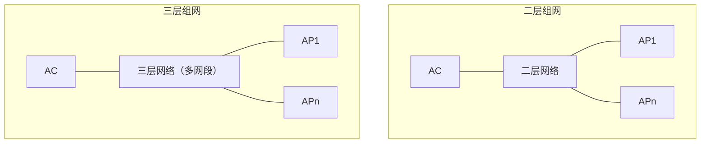
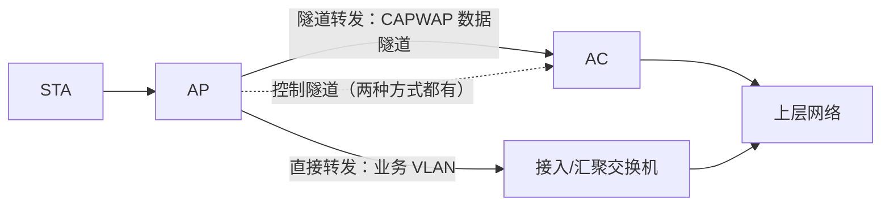
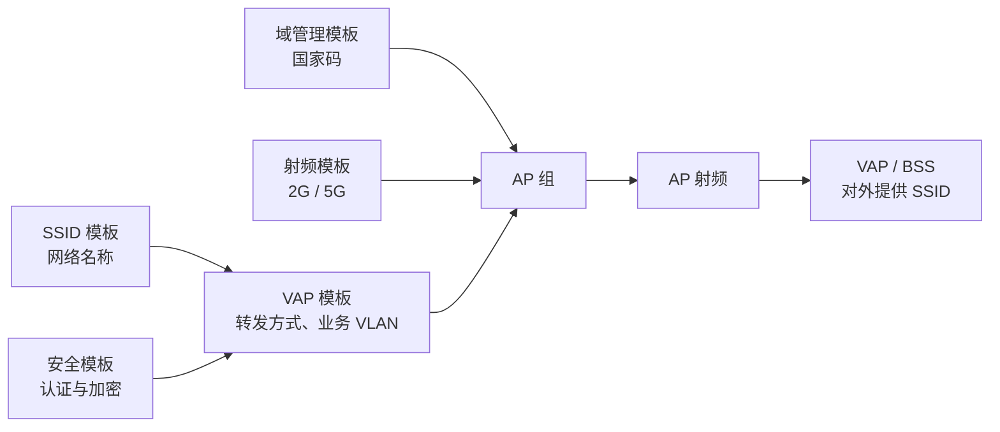
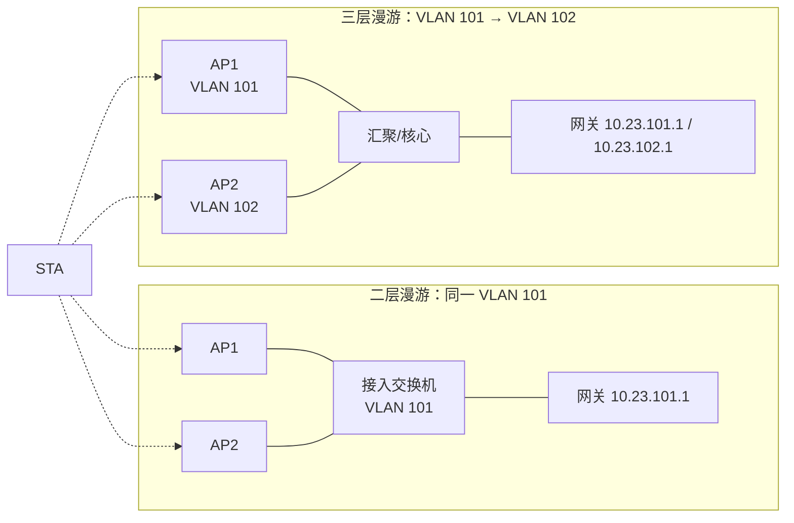
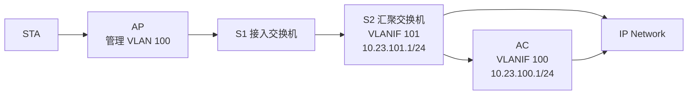

# WLAN 技术与配置 · 完整笔记

---

> 内容来源：华为培训讲义《WLAN 概述》（86 页 PPT 转纯文本，含 AC/AP 组网、AP 上线流程、华为 VRP 配置案例）。
>
> 定位：18.5 是 WLAN 的**组网与配置专题**。WLAN 基本概念、802.11 标准与频段、MAC 层、安全机制等理论已在 `4.1-无线局域网` 系统讲过，本笔记不再重复，交叉处写「详见 4.1 §x」，只补讲义独有的**有线侧组网、AP 上线流程、模板化配置、VLAN 规划、漫游与命令**。

## 1.专题定位与讲义结构

### 1.1 与 4.1 的分工

| 主题 | 4.1 已讲内容 | 本笔记处理方式 |
| ---- | ------------ | -------------- |
| WLAN 定义、Wi-Fi 与 802.11 关系 | 定义、出现原因、IEEE 802 体系 | 只补 Wi-Fi 联盟与代际命名，定义详见 4.1 §2 |
| 802.11 标准、频段、信道 | a/b/g/n/ac/ax/be 参数表、2.4G 与 5G 对比、信道规划 | 不复述参数，只讲标准在组网中的选择依据 |
| 通信技术、MAC 层、安全机制 | 扩频、CSMA/CA、RTS/CTS、IFS、WEP/WPA/WPA2/WPA3 | 只讲安全策略在 AC 上如何落地为模板 |
| 组网结构 | FAT AP 与 FIT AP 对比、旁挂/直连、隧道/直接转发、CAPWAP 概念 | **本笔记重点**：展开二层/三层、VLAN、上线流程、配置命令 |
| 漫游 | 二层/三层漫游定义 | **本笔记重点**：AC 内/AC 间漫游、漫游组、快速漫游 |
| 设备配置 | 未涉及 | **本笔记重点**：华为 VRP 全流程配置与回显判读 |

### 1.2 讲义目录与章节对应

| 讲义小节 | 主要内容 | 本笔记位置 |
| -------- | -------- | ---------- |
| 1. WLAN 概述 | WLAN 与 Wi-Fi、发展历程、802 模型、代际 | §2 |
| 2. WLAN 的基本概念 | 组网架构、有线侧/无线侧概念、BSS/SSID/BSSID/VAP/ESS | §2、§3、§5 |
| 3. WLAN 的组网架构 | FAT AP、AC+FIT AP、敏捷分布式 AP、云管理、智简园区 | §2、§9 |
| 4. WLAN 的工作原理 | AP 上线、配置下发、STA 接入、数据转发 | §4 |
| 5. WLAN 的配置实现 | 上线命令、射频命令、VAP 命令、旁挂二层案例 | §7、§8 |
| 6. 新一代 WLAN 解决方案 | Wi-Fi 6 能力、场景指标、华为方案 | §9 |

### 1.3 考情与题型

| 出现形态 | 典型问法 | 分值 |
| -------- | -------- | ---- |
| 综合知识选择题 | FIT AP 是否需要 DHCP、CAPWAP 作用、隧道/直接转发区分、AC 组网方式 | 1 分 |
| 案例填空 | 补全 `capwap source interface`、`forward-mode`、`service-vlan`、`ap auth-mode` | 3~5 分 |
| 案例简答 | 直连与旁挂的优缺点、AP 无法上线的原因、VLAN 如何规划 | 4~8 分 |
| 方案设计 | 大中型园区选三层组网还是二层组网、选隧道还是直接转发 | 5~10 分 |

WLAN 在 18 章属于“选学/偏门”模块，单独出大题的概率低，但**组网方式判断 + 配置填空**几乎每年在选择题或案例小问中出现，投入产出比高于纯理论背诵。

### 1.4 原文与命令校正

| 序号 | 原文 | 校正 | 类型 | 依据 |
| ---- | ---- | ---- | ---- | ---- |
| 1 | `PoR1l 认证` | Portal 认证 | OCR 错字 | 讲义多处出现，指 Web 认证 |
| 2 | `DCHP 动态发现` | DHCP 动态发现 | 拼写 | 思考题选项 |
| 3 | `CA P W`、`A P 隧道` | CAPWAP | 排版错位 | 拓扑图中的隧道标注 |
| 4 | “服务组合识别码 SSID” | 服务集标识符 SSID | 术语 | Service Set Identifier |
| 5 | `vap-profile rofile-name` | `vap-profile profile-name` | 漏字 | 命令参考 |
| 6 | `option code [ sub-option sub-code ] ...` | `option 43 sub-option 3 ascii ...` | 命令泛化 | 讲义给的是 DHCP 自定义选项通用格式，实际配置见 §4.4 |
| 7 | `eirp` 称为“发射功率” | EIRP 为等效全向辐射功率；该命令以 EIRP 形式配置射频功率（dBm），实际辐射功率还取决于天线增益与馈线损耗 | 概念 | 华为命令参考 |
| 8 | 把 802.11/11b/11a/11g 标为 Wi-Fi 1/2/3 | Wi-Fi 联盟 2018 年才启用 Wi-Fi 4/5/6 命名，Wi-Fi 1/2/3 是业界回溯叫法 | [存疑] | Wi-Fi Alliance 命名规则 |
| 9 | `[AC-wlan-view]` | 新版 VRP 为 `[HUAWEI-wlan-view]`，且入口由 `wlan` 改为 `wlan ac` | 版本差异 | V200R020 之后的部分版本 |

命令约定：

- 全部为**华为 VRP** 语法，提示符按讲义写作 `[AC]`、`[AC-wlan-view]`；实际设备提示符随 `sysname` 与版本变化，考试按讲义写即可。
- `{ a | b }` 表示二选一，`[ ]` 表示可选，`斜体` 表示变量。
- 表格内为节省宽度用 ` / ` 分隔可选项，代码块内保留官方 `|` 语法。

---

## 2.WLAN 在园区网中的位置

### 2.1 WLAN 与 Wi-Fi

| 概念 | 含义 | 关系 |
| ---- | ---- | ---- |
| WLAN | Wireless Local Area Network，用无线电磁波代替有线介质构建的局域网 | 网络形态，广义还包括红外、激光 |
| Wi-Fi | 基于 IEEE 802.11 系列的无线局域网技术 | WLAN 的主流实现 |
| Wi-Fi 联盟 | 1999 年成立，原名 WECA（Wireless Ethernet Compatibility Alliance），2002 年 10 月改名 Wi-Fi Alliance | 负责互操作认证与商标授权 |
| IEEE 802.11 | 无线局域网的 MAC 层与 PHY 标准 | 技术标准本身 |

要点：

- 日常语境把 Wi-Fi 当作 802.11 的同义词，但 **Wi-Fi 是联盟认证品牌，802.11 是 IEEE 标准**，二者不完全等价。
- WLAN 是“有线网络的无线化延伸”，园区网中它替代的是**接入层最后一段**，不是替代整张网络。

### 2.2 发展节点

| 年份 | 事件 | 意义 |
| ---- | ---- | ---- |
| 1971 | 夏威夷大学 ALOHAnet | 无线分组通信的早期原型 |
| 1985 | 美国 FCC 开放 ISM 频段 | 免许可频谱，WLAN 商用的前提 |
| 1990 | Vic Hayes 设计 WaveLAN | 被视为 Wi-Fi 原型，Ad Hoc 形态 |
| 1997 | IEEE 802.11 第一版发布 | 定义 MAC 层与 PHY，速率 1/2Mbps |
| 1999 | 802.11a、802.11b 发布；WECA 成立 | 速率进入 11/54Mbps，互操作认证起步 |
| 2009 | 802.11n | MIMO + 40MHz，600Mbps，Wi-Fi 4 |
| 2013/2015 | 802.11ac Wave 1 / Wave 2 | 5GHz，1.3Gbps / 3.47Gbps |
| 2019 | 802.11ax | OFDMA + MU-MIMO，Wi-Fi 6 |

标准参数、频段与速率的完整对照见 4.1 §3.1，本节不再重复。802.11ac 的速率口径需注意：讲义按 Wave 1（80MHz、3×3）1.3Gbps、Wave 2（160MHz、4×4）3.47Gbps 给出；4.1 §3.1 的 6.93Gbps 是 8×8、160MHz 的理论峰值，两者不矛盾。

802.11ax 的年份口径同理：2019 年是 Wi-Fi 6 认证启动与产品商用年，IEEE 802.11ax-2021 标准于 2021 年正式发布；考试若问“标准发布年”，答 2021。

讲义时间轴还标注了 1973 年梅特卡夫提出以太网、1980 年 DIX 标准与 IEEE 802 项目成立、1990 年 802.11 工作组成立、1996 年 HotSpot 概念等节点；原图年份与事件的对应关系较乱，只需知道 WLAN 由“以太网—ISM 免许可频谱—802.11 标准化—Wi-Fi 联盟认证”四条线汇合而来。

办公场景的演进（讲义用于说明 WLAN 的驱动力）：

| 阶段 | 终端 | 业务 | 协议与定位 |
| ---- | ---- | ---- | ---------- |
| 固定办公 | 台式机 | 数据业务 | 有线为主 |
| 初级移动办公 | 便携机 | 语音 + 数据 | 802.11b/a/g，无线作为有线的补充 |
| 无线办公 | 手机、Pad、超极本 | 视频 + 语音 + 数据，大量实时业务 | 802.11n → 802.11ac，有线无线一体化 |
| 全无线办公 | 多样化终端、VR/AR、4K | 精细化在线服务 | 802.11ax/ad，以无线为中心 |

讲义把 1990 年代初期概括为移动 1.0（固定办公），1990 年代晚期为移动 2.0（BYOD、无线办公），当前为移动 3.0（全无线、VR/AR、4K）。

### 2.3 设备形态

| 设备/架构 | 定义 | 适用场景 | 关键特征 |
| --------- | ---- | -------- | -------- |
| AP | Access Point，为 STA 提供 802.11 无线接入，连接有线网与无线网 | 所有无线覆盖场景 | 射频接口 + 有线上行口 |
| FAT AP | 能独立自治、自我管理的 AP，又称自治式架构 | 家庭、单点部署、小型办公室 | 集成认证、网管、漫游、安全、DHCP、路由 |
| FIT AP | 瘦 AP，只保留 802.11 报文加解密、PHY、空口统计等基本功能 | 企业园区 | 不能独立工作，必须由 AC 管理 |
| AC | Access Controller，接入控制器 | 中大型园区 | 接入控制、转发统计、AP 配置监控、漫游管理、网管代理、安全控制 |
| 云 AP | 由云管理平台统一纳管的 AP | 中小型企业、分支 | 即插即用、自动开局、云端运维 |
| 中心 AP + 敏分 AP | 敏捷分布式 AP，中心 AP 管理多台敏分 AP | 房间密集场景（宿舍、酒店） | 成本低、覆盖好，可用于 FAT/FIT/云三种架构 |
| 随板 AC | AC 功能集成在核心交换机主控板 | 大中型园区 | 与有线网络融合，配合 iMaster NCE |

说明：部分企业 AP（如 AirEngine 5760-10）支持 FAT AP、FIT AP、云 AP 三种工作模式，可按网络规划切换；同一硬件在不同模式下承担的功能不同。

家庭与企业选型：

| 场景 | 主流架构 | 原因 |
| ---- | -------- | ---- |
| 家庭 | FAT AP（家用无线路由器、面板 AP） | 单点、免集中管理、成本低 |
| 中小企业 | AC + FIT AP 或云 AP | 需要统一配置与漫游 |
| 大中型园区 | AC + FIT AP（旁挂或随板 AC） | AP 数量大，需要集中管理与三层漫游 |

### 2.4 AC 与 FIT AP 的功能划分

| 功能 | FIT AP | AC |
| ---- | ------ | -- |
| 802.11 物理层收发 | 承担 | 不承担 |
| 802.11 报文加解密 | 承担 | 下发密钥与策略 |
| 空口统计 | 承担 | 汇总 |
| 接受管理、配置生效 | 承担 | 下发配置 |
| 接入控制、用户认证策略 | 配合 | 决策 |
| AP 配置监控、版本管理 | 配合 | 承担 |
| 漫游管理 | 配合 | 承担 |
| 安全控制、QoS 策略 | 执行 | 制定 |
| DHCP 服务 | **不提供** | 可提供，也可由独立服务器/汇聚交换机提供 |

[正确] FIT AP 不提供 DHCP 服务，DHCP 由 AC、核心/汇聚交换机或独立服务器承担。

[错误] FIT AP 可以独立完成用户认证与漫游——这些功能由 AC 统一决策。

相比 FAT AP，AC+FIT AP 的优点是**配置与部署更容易、安全性更高、更新与扩展更容易**；代价是 AP 不能独立工作，AC 必须做冗余，否则 AC 故障会导致管理面（隧道转发时还包括业务面）中断。

### 2.5 无线侧与有线侧

| 侧别 | 协议 | 组成 | 关注点 |
| ---- | ---- | ---- | ------ |
| 无线侧组网 | IEEE 802.11 | AP 射频、STA、空口 | 频段、信道、功率、SSID、安全 |
| 有线侧组网 | 以太网 | AP 上行口、接入/汇聚交换机、AC | VLAN、PoE、CAPWAP、路由可达 |

无线通信系统的基本模型为：信源 → 信源编码 → 信道编码 → 调制 → 无线信道 → 解调 → 解码 → 信宿，信道中存在噪声源。WLAN 只是把“信道”换成了 2.4GHz/5GHz 的无线电磁波。

无线电磁波指频率在 3Hz~300GHz 之间的电磁波，也称射频电波或射频。WLAN 通过无线电磁波在空间中传输信息。

802.11 标准只聚焦 TCP/IP 对等模型的下两层：数据链路层负责信道接入、寻址、帧校验、错误检测与安全，物理层负责在空口传输比特流并规定频段。上层（IP、TCP/UDP、应用）与有线网络完全一致。

WLAN 当前使用的频段：

| 频段 | 范围 | 对应标准（讲义口径） | 特点 |
| ---- | ---- | -------------------- | ---- |
| 2.4GHz | 2.400~2.4835GHz | 802.11b/g/n/ax | 覆盖大、穿墙强、易干扰 |
| 5GHz | 5.15~5.35GHz、5.725~5.85GHz | 802.11a/n/ac/ax | 速率高、干扰少、覆盖小 |

信道划分、非重叠信道与我国可用频段的细节见 4.1 §4。

PoE 供电标准与功率对照见 4.1 §13.6；组网侧只需记住：AP 通常由 **PoE 交换机**通过网线同时供电与回传数据，无需本地电源。PoE 也称 PoL（Power over LAN，基于局域网的供电）或有源以太网，电功率可通过传输数据的线对或空闲线对送到终端。

---

## 3.有线侧组网架构

### 3.1 二层组网与三层组网

这里的“二层/三层”指 **AP 与 AC 之间网络所在的层次**，与数据转发方式（隧道/直接）是两个独立维度。

| 比较项 | 二层组网 | 三层组网 |
| ------ | -------- | -------- |
| AP 与 AC 的位置 | 同一二层网络（直连或经二层交换互通） | 跨三层网络（不同网段） |
| AP 发现 AC | 同广播域可广播发现；跨 VLAN 仍需 Option 43 或 DNS | 必须 DHCP Option 43 或 DNS，广播不跨网段 |
| 规模 | 小型、临时组网 | 大型组网，一台 AC 可管理几十至几百台 AP |
| 配置复杂度 | 简单、上线快 | 复杂，需要路由可达与 Option 43 |
| 典型场景 | 单栋楼、小型园区 | 多楼栋、多园区、AC 集中部署 |



### 3.2 直连式组网与旁挂式组网

| 比较项 | 直连式组网 | 旁挂式组网 |
| ------ | ---------- | ---------- |
| AC 位置 | 串联在 AP 与上行网络之间 | 旁挂在核心/汇聚旁，不直接连接 AP |
| 数据路径 | 所有数据必须经过 AC | 业务数据可经 AC，也可绕过 AC |
| AC 角色 | AC + 汇聚交换机（部分场景兼网关） | 只做 AC，不承担汇聚 |
| 优点 | 组网简单、路径清晰、集中管控彻底、时延可控 | 转发效率高、扩容灵活、AC 故障对直接转发业务影响小 |
| 缺点 | AC 是性能瓶颈与单点，扩容困难，AC 故障影响全网 | 组网与 VLAN 规划复杂，需保证 AP 到 AC 三层可达 |
| 适用 | 小型园区、临时网络、对集中管控要求高 | 中大型园区主流 |

常见误区：

| 说法 | 判定 |
| ---- | ---- |
| 直连式一定使用隧道转发 | [错误] 直连式只描述 AC 的位置，转发方式仍可配隧道或直接 |
| 旁挂式的业务数据一定经过 AC | [错误] 旁挂 + 直接转发时，业务数据不经过 AC |
| 旁挂式不需要 AC | [错误] 旁挂只是不串联，AC 仍负责管理与控制 |

### 3.3 组网组合矩阵

| 组合 | 数据是否过 AC | 典型用途 | 备注 |
| ---- | ------------- | -------- | ---- |
| 直连 + 隧道转发 | 是 | 小型园区、集中安全管控 | AC 兼汇聚，路径最短 |
| 直连 + 直接转发 | 否（业务报文不做 CAPWAP 封装；直连时物理路径仍经过 AC） | 小型园区、转发性能优先 | AC 仍串联，但业务不经隧道 |
| 旁挂 + 隧道转发 | 是 | 大中型园区主流 | 管理与业务均走 CAPWAP，AC 压力大 |
| 旁挂 + 直接转发 | 否 | 大中型园区、视频/高带宽业务 | 业务走接入—汇聚，AC 只管理 |

讲义结论：**旁挂式组网 + 隧道转发**更有效、更常用；直连式与直接转发使用较少。工程上则要按规模与流量模型选择，不能一概而论。

### 3.4 CAPWAP 协议

CAPWAP（Control And Provisioning of Wireless Access Points Protocol Specification，无线接入点控制和配置协议）定义 AC 如何管理 AP、如何下发业务配置。

| 项目 | 内容 |
| ---- | ---- |
| 传输层 | UDP |
| 控制报文端口 | **5246** |
| 数据报文端口 | **5247** |
| 控制隧道 | 传输 AP 与 AC 之间的管理报文；可启用 DTLS 加密 |
| 数据隧道 | 隧道转发时传输 STA 业务报文；可启用 DTLS 加密 |
| 主要功能 | AP 与 AC 状态维护；AC 通过隧道管理 AP、下发业务配置；隧道转发时承载 STA 数据 |
| 标准 | RFC 5415（协议）、RFC 5416（802.11 绑定） |

要点：

1. CAPWAP 是**应用层协议**，封装在 UDP 之上，因此防火墙放行时要放行 UDP 5246/5247，而不是只放行 IP。
2. 控制隧道**始终建立**；数据隧道只在隧道转发模式下使用，直接转发时不需要数据隧道。
3. DTLS（Datagram Transport Layer Security）为 UDP 提供加密，可分别作用于控制隧道与数据隧道；启用后 CAPWAP 报文经 DTLS 加解密。
4. CAPWAP 隧道的本质与 IPsec VPN 类似：在 AP 与 AC 之间打通一条逻辑通道，报文在其中封装、传输、解封装。

### 3.5 数据转发方式

| 比较项 | 隧道转发（集中转发） | 直接转发（本地转发） |
| ------ | -------------------- | -------------------- |
| 数据路径 | AP → CAPWAP 数据隧道 → AC → 上层网络 | AP → 接入交换机 → 汇聚/核心 → 上层网络 |
| 是否经 AC 转发 | 是 | 否 |
| 封装 | 用户报文加 CAPWAP 头，源/目的为 AP 与 AC 的隧道地址 | 用户报文保持原样，按业务 VLAN 转发 |
| 优点 | 集中管控、安全策略统一、新设备部署对现网改动小 | 转发效率高、减轻 AC 负担、时延低 |
| 缺点 | AC 成为转发瓶颈，报文多一次封装/解封装 | 无法集中管控，新增 AP 对现网 VLAN 改动大 |
| 适用 | 小型网络、对安全与审计要求高 | 大型网络、高带宽业务（视频、VR） |
| VAP 默认 | 需显式 `forward-mode tunnel` | `direct-forward` 为缺省值 |



### 3.6 管理 VLAN 与业务 VLAN

| VLAN | 承载内容 | 配置位置 |
| ---- | -------- | -------- |
| 管理 VLAN | AP 的 IP 地址、CAPWAP 控制报文；隧道转发时还承载封装后的业务报文 | AP 上行口 PVID、AC 源接口、DHCP 管理地址池 |
| 业务 VLAN | STA 的业务报文 | VAP 模板 `service-vlan`、接入/汇聚上行口 |

两种转发方式的 VLAN 规则：

| 项目 | 隧道转发 | 直接转发 |
| ---- | -------- | -------- |
| AP 上行口 | Trunk，PVID = 管理 VLAN，只放行管理 VLAN | Trunk，PVID = 管理 VLAN，同时放行业务 VLAN |
| AP—AC 路径 | 只放行管理 VLAN，**禁止**放行业务 VLAN | 只放行管理 VLAN |
| AC 上行口 | Trunk，放行管理 VLAN + 业务 VLAN（解封装后按业务 VLAN 转发） | 只需管理 VLAN |
| 管理 VLAN 与业务 VLAN | **必须不同**，否则会出现 MAC 地址漂移 | 建议不同；相同会导致业务中断 |
| 交换机连接 AP 的口 | PVID = 管理 VLAN | PVID = 管理 VLAN，Trunk 放行业务 VLAN |

记忆：**隧道转发把业务“藏”进管理 VLAN 里送到 AC；直接转发让业务 VLAN 在接入侧就跑出来。**

---

## 4.AP 上线与业务下发

### 4.1 WLAN 工作流程总览

WLAN 从加电到能转发业务，分四个阶段：


| 阶段 | 完成标志 | 关键协议/报文 |
| ---- | -------- | ------------- |
| AP 上线 | `display ap all` 中 State 为 `nor` | DHCP、CAPWAP Discovery/Join |
| 配置下发 | `display vap ssid` 中 Status 为 `ON` | Configuration Update Request/Response |
| STA 接入 | `display station` 能看到终端 | 802.11 认证/关联、DHCP、Portal/802.1X |
| 数据转发 | 终端可访问网络 | CAPWAP 数据隧道或业务 VLAN |

### 4.2 阶段一：AP 上线的五个步骤

| 步骤 | 动作 | 说明 |
| ---- | ---- | ---- |
| 1 | AP 获取 IP 地址 | 静态配置或 DHCP |
| 2 | AP 发现 AC 并建立 CAPWAP 隧道 | 先 Discovery，再 Join |
| 3 | AP 接入控制 | AC 判断是否允许该 AP 接入 |
| 4 | AP 版本升级（可选） | 版本与 AC 指定版本不一致时升级 |
| 5 | CAPWAP 隧道维持 | Keepalive / Echo 检测 |

说明：讲义把“发现 AC”与“建立隧道”合并为一步，正文按讲义五步作答即可。实际报文顺序为 Discovery（发现）→ DTLS 握手（建立控制隧道）→ Join（接入控制，AC 认证并回应）→ 配置下发；数据隧道在隧道转发模式下建立。接入控制发生在 Join 阶段，不是先 Join 再建控制隧道。

### 4.3 AP 获取 IP 地址

| 方式 | 配置 | 适用 |
| ---- | ---- | ---- |
| 静态 | 登录 AP 手工配置 IP、掩码、网关 | AP 数量少、地址固定 |
| DHCP | AP 作为 DHCP 客户端申请地址 | 生产环境主流 |

DHCP 获取过程：

| 报文 | 方向 | 作用 |
| ---- | ---- | ---- |
| DHCP Discover | AP 广播 | 发现 DHCP 服务器 |
| DHCP Offer | 服务器单播 | 从地址池挑选可用地址 |
| DHCP Request | AP 广播 | 声明选择的地址 |
| DHCP ACK | 服务器单播 | 确认分配 |

DHCP 服务器部署位置：

| 方案 | 说明 | 适用 |
| ---- | ---- | ---- |
| 独立 DHCP 服务器 | 专门设备统一分配 | 大型园区 |
| AC 兼作 DHCP 服务器 | AC 上配置地址池 | 小型园区、分支 |
| 核心/汇聚交换机兼作 | 利用现有三层设备 | 最常见 |

要点：AP 与 STA 的地址池**必须分开**；AP 管理地址池给 AP，业务地址池给 STA，不能共用一个网段。

### 4.4 AP 发现 AC

| 方式 | 类型 | 说明 | 适用 |
| ---- | ---- | ---- | ---- |
| 静态配置 | 静态 | AP 上预先配置 AC 的 IP 地址列表 | 小型、AC 地址固定 |
| DHCP Option 43 | 动态 | DHCP 服务器在 Offer/ACK 中携带 AC 地址 | 三层组网主流 |
| DNS | 动态 | AP 通过域名解析得到 AC 地址 | 跨广域、集中管理 |
| 广播 | 动态 | AP 发送广播 Discovery Request | 二层组网 |

DHCP Option 43 的三种子选项（华为 AP 均支持，任选一种）：

| 子选项 | 命令（AC 作 DHCP 服务器） | 说明 |
| ------ | ------------------------- | ---- |
| 1（十六进制） | `option 43 sub-option 1 hex 0a176401` | 4 字节 IP 的十六进制（示例对应 10.23.100.1） |
| 2（IP 地址） | `option 43 sub-option 2 ip-address 10.23.100.1` | 可跟多个 AC 地址 |
| 3（ASCII） | `option 43 sub-option 3 ascii 10.23.100.1` | 多个地址用逗号分隔，最多 8 个 |

交换机作 DHCP 服务器时，命令前缀为 `dhcp server`：

```text
[S2-ip-pool-ap] dhcp server option 43 sub-option 3 ascii 10.23.100.1
```

注意：

- Option 43 只在 **AP 与 AC 跨网段**时必需；同网段可广播发现，但生产环境仍建议配置，减少广播依赖。
- `option 43` 的子选项格式随厂商与版本差异较大，考试只需答“Option 43 用于把 AC 地址告知 AP”。DHCP 侧细节见 18.1 §6.4。
- AP 收到多个 AC 的 Discovery Response 时，华为文档给出的负载比较顺序为“可接入 AP 数最多 → 可接入 STA 数最多 → AC IP 最小”；AC 优先级也参与选择，不同版本/场景的顺序略有差异，考试按负载顺序作答即可。

### 4.5 CAPWAP 隧道建立

| 阶段 | 报文 | 作用 |
| ---- | ---- | ---- |
| Discovery | Discovery Request / Response | AP 发现可用 AC |
| DTLS 握手 | ClientHello / ServerHello、Certificate 等 | 建立控制隧道（可选用 DTLS 加密），后续控制报文加密传输 |
| Join | Join Request / Response | AP 请求接入，AC 认证并回应 |
| 数据隧道 | CAPWAP Data 报文 | 仅隧道转发时建立，承载 STA 业务报文 |

补充：

- Join Response 中携带 AC 指定的软件版本（Image Identifier）、AC 名称、AC 描述等参数；AC 优先级由 Discovery Response 携带。
- 建立隧道后，AP 与 AC 之间才可传输配置与业务报文。
- 控制隧道与数据隧道可分别启用 DTLS；DTLS 使用 PSK 或证书认证。

### 4.6 AP 接入控制

AC 支持三种 AP 认证方式：

| 方式 | 命令 | 说明 | 安全性 |
| ---- | ---- | ---- | ------ |
| MAC 认证 | `ap auth-mode mac-auth` | 以 AP 的 MAC 地址白名单认证，缺省方式 | 较高 |
| SN 认证 | `ap auth-mode sn-auth` | 以 AP 序列号白名单认证 | 较高 |
| 不认证 | `ap auth-mode no-auth` | 任何 AP 均可上线 | 低，仅限可控环境 |

添加 AP 的三种方式：

| 方式 | 操作 | 适用 |
| ---- | ---- | ---- |
| 离线导入 | AC 上手工 `ap-id ... ap-mac ...` 添加 | AP 未上电、批量规划 |
| 自动发现 | 不认证模式或白名单自动通过 | 小型网络、实验室 |
| 手工确认 | AP 出现在未认证列表后由管理员确认 | 生产环境常用 |

### 4.7 AP 版本升级

| 项目 | 内容 |
| ---- | ---- |
| 触发条件 | Join Response 中的版本与 AP 当前版本不一致 |
| 请求报文 | Image Data Request / Response |
| 升级方式 | AC 模式（从 AC 下载）、FTP 模式、SFTP 模式 |
| 升级后 | AP 自动重启，重新执行“获取 IP → 发现 AC → 接入控制” |
| 自动升级 | AC 上可配置 AP 上线时自动比较版本并升级 |

工程要点：

- 升级会重启 AP，业务中断，应在空闲窗口进行。
- 若 AC 上指定版本与 AP 实际版本长期不一致，AP 会反复重启，表现为“上线—重启—再上线”。
- 大型网络建议使用 SFTP，避免 FTP 明文口令。

### 4.8 CAPWAP 隧道维持

| 隧道 | 检测报文 | 作用 |
| ---- | -------- | ---- |
| 数据隧道 | Keepalive | 检测数据隧道连通性 |
| 控制隧道 | Echo Request / Echo Response | 检测控制隧道连通性 |

隧道超时后，AC 将 AP 置为离线，AP 重新进入发现流程。

### 4.9 AC 侧预配置清单

| 序号 | 配置项 | 是否必需 | 说明 |
| ---- | ------ | -------- | ---- |
| 1 | 创建 AP 组 | 必需 | 每个 AP 只能加入一个组，缺省组为 `default` |
| 2 | 配置网络互通 | 必需 | DHCP 地址池、AP 到 DHCP/AC 的路由、VLAN |
| 3 | 配置国家码（域管理模板） | 必需 | 决定射频可用信道、发射功率 |
| 4 | 配置源接口或源地址 | 必需 | AC 与 AP 建立 CAPWAP 隧道使用的地址 |
| 5 | 配置 AC 网元名称 | 可选 | 便于区分多台 AC |
| 6 | 配置 AP 自动升级 | 可选 | 上线时自动比对版本 |
| 7 | 添加 AP 设备 | 必需 | 离线导入、自动发现或手工确认 |

工程提示：新版 VRP 首次执行 `capwap source interface` 时会检查安全配置，要求先配置 CAPWAP 控制隧道的 DTLS PSK、登录 AP 的用户名/密码、全局离线管理 VAP 的口令等，否则命令会被拒绝。考试与老版本讲义不涉及这一检查，按讲义直接配置即可。

### 4.10 阶段二：业务配置下发

| 步骤 | 报文 | 说明 |
| ---- | ---- | ---- |
| 1 | Configuration Update Request | AC 通知 AP 有配置需要更新 |
| 2 | Configuration Update Response | AP 回应可接收 |
| 3 | 配置下发 | AC 将 AP 组/AP 上引用的模板配置推送到 AP |

触发时机：AP 首次上线、AC 上修改模板并提交、AP 重新加入 AP 组。

### 4.11 阶段三：STA 接入的六个阶段

| 顺序 | 阶段 | 主要动作 | 关键报文/协议 |
| ---- | ---- | -------- | ------------- |
| 1 | 扫描 | 发现周围 AP 与 SSID | Probe Request/Response、Beacon |
| 2 | 链路认证 | 802.11 层的身份确认 | Authentication |
| 3 | 关联 | 协商速率、信道，加入 BSS | Association Request/Response |
| 4 | 接入认证 | 取得在无线链路发送数据的权限 | PSK、802.1X |
| 5 | DHCP | 获取 IP 地址 | DHCP 四报文 |
| 6 | 用户认证 | 取得访问网络的权限 | 802.1X、MAC、Portal |

以下 4.12~4.17 依次展开六个阶段。

### 4.12 扫描

| 方式 | 报文 | 说明 |
| ---- | ---- | ---- |
| 主动扫描（指定 SSID） | Probe Request（SSID=huawei） | STA 在各信道依次发送，只有能提供该 SSID 的 AP 回应 |
| 主动扫描（空 SSID） | Probe Request（SSID=Null） | STA 广播探测，所有 AP 回应可提供的网络信息 |
| 被动扫描 | Beacon | AP 周期性广播（默认约 100ms），STA 被动收听 |

### 4.13 链路认证

| 方式 | 过程 | 安全性 |
| ---- | ---- | ------ |
| 开放系统认证 | STA 发 Authentication Request，AP 直接回 Response | 不认证，任何 STA 均可成功 |
| 共享密钥认证 | Request → Response（Challenge）→ Authentication（加密 Challenge）→ Response（Success） | 校验双方预配置的共享密钥是否一致 |

### 4.14 关联

STA 发送 Association Request，AP 转发给 AC，AC 处理后经 AP 回 Association Response。协商内容包括支持的速率、信道、QoS 等。关联成功后 STA 才拥有 BSS 内的身份。

### 4.15 接入认证

接入认证在**无线侧接口**上执行，决定终端能否在无线链路上发送数据。

| 方式 | 说明 | 适用 |
| ---- | ---- | ---- |
| PSK | 预共享密钥，即 WiFi 密码 | 家庭、中小企业 |
| 802.1X | 由 AAA/RADIUS 服务器校验用户名口令或证书 | 大型企业 |

### 4.16 DHCP

STA 通过 DHCP 获取 IP，才能正常上线。服务器通常为**汇聚交换机**，也可为 AC 或独立服务器。DHCP 报文在隧道转发时经 CAPWAP 数据隧道送到 AC，再由 AC 转交 DHCP 服务器；直接转发时由接入/汇聚网络本地转发。

### 4.17 用户认证

用户认证是“端到端”的安全结构，决定用户能访问哪些资源。

| 方式 | 说明 | 适用 |
| ---- | ---- | ---- |
| 802.1X | 端口级认证，支持 EAP 多种方法 | 办公、研发等高安全区 |
| MAC 认证 | 以终端 MAC 为凭据 | 打印机等哑终端 |
| Portal（Web） | 连网后跳转门户页面认证 | 访客、公共场所 |

三个“认证”的区别：

| 认证 | 层次 | 目的 | 失败后果 |
| ---- | ---- | ---- | -------- |
| 链路认证 | 802.11 | 建立无线链路信任 | 无法关联 |
| 接入认证 | 无线侧接口 | 允许在无线链路发数据 | 关联后不能传业务 |
| 用户认证 | 网络层/NAC | 授权访问范围 | 仅能访问认证页面或被拒绝 |

说明：802.1X 既可作为 WPA/WPA2-Enterprise 的接入认证方式，也可作为 NAC 的用户认证方式，两者可叠加使用。

### 4.18 阶段四：数据转发

控制报文始终走 CAPWAP 控制隧道；用户数据按 VAP 模板的 `forward-mode` 选择隧道转发或直接转发。两种方式的路径与 VLAN 规则见 §3.5、§3.6。

### 4.19 AP 上线失败排查

| 现象 | 可能原因 | 核查点 |
| ---- | -------- | ------ |
| AP 不上电 | PoE 端口功率不足、非 PoE 口、网线故障 | `display ap all` 的 ExtraInfo 是否显示 P（供电不足）；PoE 交换机端口状态 |
| AP 拿不到 IP | 管理 VLAN 未放行、PVID 错、DHCP 未启用 | AP 上行口 Trunk/PVID、DHCP 地址池、VLANIF 状态 |
| AP 有 IP 但不上线 | AC 源接口不可达、缺少 Option 43、路由不通 | `ping AC`、`capwap source interface`、Option 43 |
| AP 处于未认证 | 认证模式与添加方式不匹配、MAC/SN 填错 | `display ap all`、未认证 AP 列表 |
| AP 反复重启 | 版本不一致、升级服务器不可达 | AC 指定版本、FTP/SFTP 配置 |
| VAP 不生效 | 模板未绑定、射频未开启、国家码不匹配 | `display vap`、射频状态、域管理模板 |
| STA 关联但无 IP | 业务 VLAN 未放行、DHCP 地址池错误 | `display station` 的 VLAN 字段、接入交换机 Trunk |
| STA 有 IP 但不能上网 | 安全策略、网关、NAT/路由 | `display station`、AC 上行口、出口设备 |

---

## 5.业务配置模型

### 5.1 模板体系与引用关系

华为 AC 采用“模板 + 引用”的配置模型：参数配在模板里，模板被 AP 组或 AP 引用后才下发。



| 模板 | 作用 | 被谁引用 | 关键参数 |
| ---- | ---- | -------- | -------- |
| 域管理模板 | 标识射频所在国家 | AP 组、AP | `country-code` |
| 射频模板 | 2G/5G 射频的通用参数 | AP 组射频、AP 射频 | 信道、带宽、功率、天线增益、覆盖距离 |
| SSID 模板 | 配置网络名称 | VAP 模板 | `ssid` |
| 安全模板 | 配置认证与加密策略 | VAP 模板 | 安全策略、口令、加密算法 |
| VAP 模板 | 描述一个虚拟 AP 的业务属性 | AP 组、AP、射频 | 转发方式、业务 VLAN、SSID/安全模板引用 |
| AP 组 | 批量管理 AP 的容器 | AC | 成员 AP、上述模板引用 |

### 5.2 域管理模板与国家码

```text
[AC] wlan
[AC-wlan-view] regulatory-domain-profile name default
[AC-wlan-regulate-domain-default] country-code cn
[AC-wlan-regulate-domain-default] quit
[AC-wlan-view] ap-group name ap-group1
[AC-wlan-ap-group-ap-group1] regulatory-domain-profile default
```

| 项目 | 说明 |
| ---- | ---- |
| 作用 | 标识 AP 射频所在国家，决定可用信道、发射功率、天线增益约束 |
| 缺省模板 | `default` |
| 修改影响 | 会清除射频的信道、功率、天线增益配置并重启 AP |
| 考试点 | 国家码不对，可能出现信道不可用、AP 无法正常发射 |

### 5.3 AP 组

| 项目 | 说明 |
| ---- | ---- |
| 作用 | 多个 AP 的通用配置容器，模板引用到组即对全组成员生效 |
| 约束 | 每个 AP 必须且只能加入一个 AP 组 |
| 缺省组 | `default` |
| 命令 | `ap-group name group-name` |
| 典型规划 | 按楼层、区域或业务类型分组 |

### 5.4 射频配置

射频参数分两级：

| 级别 | 配置位置 | 参数 |
| ---- | -------- | ---- |
| 基本参数 | 射频视图（`ap-id` → `radio`） | 工作带宽、信道、天线增益、发射功率、覆盖距离、频段 |
| 通用参数 | 射频模板（`radio-2g-profile` / `radio-5g-profile`） | 需要通过模板批量下发的参数 |

命令：

```text
[AC-wlan-view] ap-id 0
[AC-wlan-ap-0] radio 0
[AC-wlan-radio-0/0] channel 20mhz 6
[AC-wlan-radio-0/0] antenna-gain 3
[AC-wlan-radio-0/0] eirp 20
[AC-wlan-radio-0/0] coverage distance 10
[AC-wlan-radio-0/0] frequency 2.4g
```

| 命令 | 作用 | 说明 |
| ---- | ---- | ---- |
| `channel { 20mhz / 40mhz-minus / 40mhz-plus / 80mhz / 160mhz } channel` | 配置带宽与信道 | 修改会中断业务，需确认 |
| `channel 80+80mhz channel1 channel2` | 配置 80+80MHz 非连续频段 | 部分 AP 支持 |
| `antenna-gain antenna-gain` | 天线增益 | 单位 dB，取值随 AP 型号 |
| `eirp eirp` | 射频发射功率 | 单位 dBm，取值 1~127，缺省 127 表示随型号/国家码取最大 |
| `coverage distance distance` | 覆盖距离参数 | 影响空口超时与接收门限 |
| `frequency { 2.4g / 5g }` | 射频工作频段 | 一般只对 radio 0 可配 |

射频模板：

```text
[AC-wlan-view] radio-2g-profile name radio2g
[AC-wlan-view] ap-group name ap-group1
[AC-wlan-ap-group-ap-group1] radio-2g-profile radio2g radio all
```

信道规划原则（参数细节见 4.1 §4.2）：2.4GHz 用 1/6/11 三组互不重叠信道；5GHz 优先 20/40MHz，高密场景降带宽换容量；相邻 AP 错开信道，避免同频干扰。

### 5.5 SSID 模板

| 项目 | 说明 |
| ---- | ---- |
| 作用 | 配置对外广播的网络名称 |
| 缺省模板 | `default` |
| 缺省 SSID | `HUAWEI-WLAN` |
| 长度 | 最长 32 字节，区分大小写 |
| 隐藏 | 可关闭 SSID 广播，但扫描工具仍可能发现 |

```text
[AC-wlan-view] ssid-profile name wlan-net
[AC-wlan-ssid-prof-wlan-net] ssid wlan-net
```

### 5.6 安全模板

```text
[AC-wlan-view] security-profile name wlan-net
[AC-wlan-sec-prof-wlan-net] security wpa-wpa2 psk pass-phrase a1234567 aes
```

| 安全策略 | 链路认证 | 接入认证 | 数据加密 | 适用场景 |
| -------- | -------- | -------- | -------- | -------- |
| WEP + 开放系统 | Open | 不涉及 | 不加密或 WEP | 不安全，仅兼容老旧终端 |
| WEP + 共享密钥 | Shared-key | 不涉及 | WEP | 不安全，易破解 |
| WPA/WPA2-802.1X | Open | 802.1X（EAP） | TKIP 或 CCMP | 大型企业 |
| WPA/WPA2-PSK | Open | PSK | TKIP 或 CCMP | 中小企业、家庭 |

命令参数：

| 参数 | 含义 | 取值/说明 |
| ---- | ---- | --------- |
| `wpa / wpa2 / wpa-wpa2` | 安全协议版本 | `wpa-wpa2` 表示两者兼容 |
| `psk` | 预共享密钥认证 | 对应 WPA-Personal |
| `dot1x` | 802.1X 认证 | 对应 WPA-Enterprise |
| `pass-phrase` | 口令 | 8~63 个 ASCII 字符 |
| `hex` | 十六进制密钥 | 64 个十六进制字符 |
| `aes` | CCMP 加密 | WPA2 推荐 |
| `tkip` | TKIP 加密 | WPA 使用，安全性弱 |
| `aes-tkip` | 两者兼容 | 混合终端环境 |

缺省安全模板：系统预置 `default`、`default-wds`、`default-mesh`。WEP/WPA/WPA2/WPA3 的算法与密钥细节见 4.1 §11.2。

### 5.7 VAP 模板

VAP（Virtual Access Point）是在一个物理 AP 上虚拟出的多个 AP，每个 VAP 对应一个 BSS、一个 SSID。一个射频可承载多个 VAP，WLAN ID 取值 1~16（部分 AP 型号更少）。

VAP 模板聚合四类参数：

| 参数 | 命令 | 说明 |
| ---- | ---- | ---- |
| 转发方式 | `forward-mode { direct-forward / tunnel }` | 缺省 `direct-forward` |
| 业务 VLAN | `service-vlan { vlan-id vlan-id / vlan-pool pool-name }` | 缺省 VLAN 1 |
| 安全模板 | `security-profile profile-name` | 引用 §5.6 |
| SSID 模板 | `ssid-profile profile-name` | 引用 §5.5 |

```text
[AC-wlan-view] vap-profile name wlan-net
[AC-wlan-vap-prof-wlan-net] forward-mode tunnel
[AC-wlan-vap-prof-wlan-net] service-vlan vlan-id 101
[AC-wlan-vap-prof-wlan-net] security-profile wlan-net
[AC-wlan-vap-prof-wlan-net] ssid-profile wlan-net
```

绑定到 AP 组射频：

```text
[AC-wlan-view] ap-group name ap-group1
[AC-wlan-ap-group-ap-group1] vap-profile wlan-net wlan 1 radio 0
[AC-wlan-ap-group-ap-group1] vap-profile wlan-net wlan 1 radio 1
```

| 参数 | 含义 |
| ---- | ---- |
| `wlan 1` | WLAN ID，即 VAP 编号，同一射频内唯一 |
| `radio 0 / radio 1 / all` | 绑定的射频，2.4G 通常为 radio 0，5G 为 radio 1（随型号） |
| `service-vlan ...` | 绑定时可覆盖 VAP 模板中的业务 VLAN，优先级更高 |

VAP 与相关标识的关系（完整术语见 4.1 §13.1）：

| 标识 | 含义 | 配置中的体现 |
| ---- | ---- | ------------ |
| BSS | 一个 AP（或一个 VAP）的覆盖范围 | 每个 VAP 对应一个 BSS |
| SSID | 无线网络名称，最长 32 字节 | SSID 模板中的 `ssid` |
| BSSID | BSS 的标识，通常为 AP 射频的 MAC | `display vap` 回显中的 BSSID |
| ESS | 多个同 SSID 的 BSS 经 DS 互联 | 同一 SSID 绑定到多个 AP |
| VAP | 物理 AP 上虚拟出的逻辑 AP | VAP 模板 + `wlan wlan-id` 绑定 |

### 5.8 业务 VLAN 与 VLAN pool

单 VLAN 的问题：同一 SSID 的用户集中在某一区域时，该 VLAN 地址耗尽，其他区域地址浪费。

VLAN pool 解决地址利用率问题：

```text
[AC] vlan batch 101 to 104
[AC] vlan pool sta-pool
[AC-vlan-pool-sta-pool] vlan 101 to 104
[AC-vlan-pool-sta-pool] assignment hash
[AC-vlan-pool-sta-pool] quit
[AC] wlan
[AC-wlan-view] vap-profile name wlan-net
[AC-wlan-vap-prof-wlan-net] service-vlan vlan-pool sta-pool
```

| 分配算法 | 行为 | 结果 |
| -------- | ---- | ---- |
| `hash`（缺省） | 按 STA MAC 哈希选 VLAN | 同一 STA 每次上线倾向同一 VLAN、同一 IP |
| `even` | 按上线顺序均匀分配 | 地址分配均匀，但同一 STA 可能每次换 IP |

适用与限制：

| 项目 | 说明 |
| ---- | ---- |
| 适用 | 体育馆、报告厅、食堂等人员流动大、单 VLAN 地址不足 |
| 前提 | VLAN pool 内每个 VLAN 都要有对应的 DHCP 地址池与网关 |
| 限制 | 作为业务 VLAN 后，pool 内 VLAN 不能直接删除 |
| 漫游影响 | 同 pool 内换 VLAN 时，未启用三层漫游会重新获取 IP；应按三层漫游规划 |

### 5.9 配置生效与检查

| 检查项 | 命令 | 正常表现 |
| ------ | ---- | -------- |
| AP 是否上线 | `display ap all` | State 为 `nor` |
| VAP 是否生成 | `display vap ssid wlan-net` | Status 为 `ON` |
| 终端是否在线 | `display station all` | 能看到 STA MAC、VLAN、IP、SSID |
| 模板引用 | `display vap` / `display ap all` | 射频、WLAN ID、BSSID 与规划一致 |

---

## 6.漫游

### 6.1 漫游的定义与条件

漫游：STA 保持同一 SSID，从一个 AP 的覆盖区移动到另一个 AP 的覆盖区，业务不中断或短暂中断后恢复。

| 条件 | 说明 |
| ---- | ---- |
| SSID 相同 | 终端看到的网络名称一致 |
| 安全策略相同 | 认证方式、加密算法、密钥一致，否则需要重新认证 |
| 同属一个 ESS | 多个 BSS 通过 DS 互联 |
| 覆盖区重叠 | 重叠区足够，避免“断崖式”切换 |
| 终端发起 | 漫游由 STA 根据信号质量决定，网络侧只提供辅助 |

### 6.2 二层漫游与三层漫游

| 比较项 | 二层漫游 | 三层漫游 |
| ------ | -------- | -------- |
| 漫游前后子网 | 同一子网（同一 VLAN） | 不同子网（不同 VLAN） |
| STA 的 IP | 不变 | 不变（由 HAP/HAC 作为家乡代理把流量转回原子网，不重新 DHCP） |
| 网关 | 不变 | 逻辑上仍为原子网网关（由 HAP/HAC 代理转发） |
| 实现要求 | AP 同二层域，业务 VLAN 一致 | AC 支持三层漫游并锚定原子网；跨 AC 时两台 AC（HAC 与 FAC）需加入同一漫游组 |
| 中断时间 | 短 | 比二层长（需迁移用户表项、建立 HAP/HAC 转发路径），但不重新 DHCP |
| 典型场景 | 同一楼层、同一楼栋 | 跨楼栋、跨园区 |

HAP/HAC 指 STA 首次接入时关联的家乡 AP/家乡 AC；漫游后关联的 AP/AC 称 FAP/FAC。三层漫游由 HAP/HAC 把流量转回原子网，因此 STA 的 IP 与网关保持不变。



### 6.3 AC 内漫游与 AC 间漫游

| 类型 | 范围 | 配置要求 |
| ---- | ---- | -------- |
| AC 内漫游 | 同一 AC 下的不同 AP | 同 SSID、同安全策略、业务 VLAN 规划正确，缺省支持 |
| AC 间漫游 | 不同 AC 下的 AP | 除上述条件外，AC 必须加入同一漫游组（mobility group） |

AC 间漫游配置：

```text
[AC1] wlan
[AC1-wlan-view] mobility-group name roam-group
[AC1-mc-mg-roam-group] member ip-address 10.23.100.2
[AC1-mc-mg-roam-group] quit

[AC2] wlan
[AC2-wlan-view] mobility-group name roam-group
[AC2-mc-mg-roam-group] member ip-address 10.23.100.1
```

| 命令 | 作用 |
| ---- | ---- |
| `mobility-group name group-name` | 创建漫游组并进入漫游组视图 |
| `member ip-address ipv4-address` | 添加成员 AC 的 IP |
| `display mobility-group { name group-name / all }` | 查看漫游组状态 |
| `inter-ac roam disable` | 在 SSID 模板下禁止 AC 间漫游 |

要求：所有参与漫游的 AC 必须配置**相同的 SSID、相同的安全策略、相同的认证授权策略**；AC 间要路由可达，并放行 CAPWAP 与漫游相关报文。

### 6.4 快速漫游

| 标准 | 名称 | 作用 |
| ---- | ---- | ---- |
| 802.11k | Radio Resource Measurement | AP 向 STA 提供邻居 AP 报告，减少扫描时间 |
| 802.11v | BSS Transition Management | 网络侧建议 STA 切换到更合适的 AP |
| 802.11r | Fast BSS Transition（FT） | 提前完成密钥协商，减少重认证时延 |
| 802.11ai | FILS | 快速初始链路建立，进一步缩短接入时间 |

工程要点：

- 语音、视频对漫游中断敏感，应启用 802.11k/v/r。
- 802.11r 要求所有 AP 的安全配置一致，且通常需要 AC 间漫游组配合。
- 漫游优化不能替代覆盖规划：重叠区不足时，任何协议都无法避免断线。

### 6.5 漫游失败常见原因

| 现象 | 原因 | 处理 |
| ---- | ---- | ---- |
| 漫游后必须重新输入密码 | 安全策略或密钥不一致 | 统一安全模板 |
| 漫游后能连上但不能上网 | 业务 VLAN 不同且未启用三层漫游，原网关/DHCP 不可达 | 规划同 VLAN，或启用三层漫游（IP 不变，流量由 HAP/HAC 转回原子网） |
| 跨 AC 漫游失败 | AC 未加入同一漫游组 | 配置 `mobility-group` 并互相添加 |
| 漫游中断时间长 | 未启用 802.11k/v/r、覆盖重叠不足 | 开启快速漫游、调整功率与信道 |
| 终端“粘”在旧 AP | 终端漫游门限保守 | 调整 AP 功率、启用 802.11v 引导 |

---

## 7.典型配置案例：旁挂二层组网隧道转发

### 7.1 需求与地址规划

| 项目 | 规划 |
| ---- | ---- |
| 组网方式 | AC 旁挂于核心/汇聚，AP 与 AC 二层可达 |
| 转发方式 | 隧道转发（集中转发） |
| AP 管理 VLAN | VLAN 100 |
| STA 业务 VLAN | VLAN 101 |
| AP 网关/AC 源接口 | VLANIF 100：10.23.100.1/24 |
| STA 网关 | VLANIF 101（S2）：10.23.101.1/24 |
| AP 地址池 | 10.23.100.2~10.23.100.254/24（AC 分配） |
| STA 地址池 | 10.23.101.2~10.23.101.254/24（S2 分配） |
| AP 组 | `ap-group1`，引用 VAP 模板 `wlan-net`、域管理模板 `default` |
| 域管理模板 | `default`，国家码 `cn` |
| SSID 模板 | `wlan-net`，SSID `wlan-net` |
| 安全模板 | `wlan-net`，WPA-WPA2 + PSK + AES，口令 `a1234567` |
| VAP 模板 | `wlan-net`，隧道转发，业务 VLAN 101 |

### 7.2 拓扑



### 7.3 步骤一：配置网络互通

```text
# AC 上创建管理 VLAN 与接口，作为 AP 的 DHCP 服务器
[AC] vlan batch 100 101
[AC] dhcp enable
[AC] interface vlanif 100
[AC-Vlanif100] ip address 10.23.100.1 24
[AC-Vlanif100] dhcp select interface

# S2 上创建业务 VLAN 与接口，作为 STA 的 DHCP 服务器和网关
[S2] vlan batch 100 101
[S2] dhcp enable
[S2] interface vlanif 101
[S2-Vlanif101] ip address 10.23.101.1 24
[S2-Vlanif101] dhcp select interface
```

交换机互联端口（要点）：

| 链路 | 配置 |
| ---- | ---- |
| AP—S1 | Trunk，PVID 100，放行 VLAN 100（隧道转发不需要放行 101） |
| S1—S2 | Trunk，放行 VLAN 100 |
| S2—AC | Trunk，放行 VLAN 100 与 VLAN 101（AC 解封装后按业务 VLAN 转发） |
| S2—上层 | 按业务 VLAN 规划放行 |

### 7.4 步骤二：配置 AP 上线

```text
# 1. 创建 AP 组
[AC] wlan
[AC-wlan-view] ap-group name ap-group1
[AC-wlan-ap-group-ap-group1] quit

# 2. 创建域管理模板并配置国家码，再引用到 AP 组
[AC-wlan-view] regulatory-domain-profile name default
[AC-wlan-regulate-domain-default] country-code cn
[AC-wlan-regulate-domain-default] quit
[AC-wlan-view] ap-group name ap-group1
[AC-wlan-ap-group-ap-group1] regulatory-domain-profile default
[AC-wlan-ap-group-ap-group1] quit
[AC-wlan-view] quit

# 3. 配置 CAPWAP 源接口
[AC] capwap source interface vlanif 100

# 4. 离线导入 AP
[AC] wlan
[AC-wlan-view] ap auth-mode mac-auth
[AC-wlan-view] ap-id 0 ap-mac 60de-4476-e360
[AC-wlan-ap-0] ap-name area_1
[AC-wlan-ap-0] ap-group ap-group1
```

说明：

- 修改国家码会清除射频的信道、功率、天线增益配置并重启 AP，设备会给出确认提示。
- `ap-id` 为 AC 内的本地编号，与 AP 的 MAC/SN 绑定；`ap-name` 便于识别。

### 7.5 步骤三：配置 WLAN 业务

```text
# 1. 安全模板
[AC-wlan-view] security-profile name wlan-net
[AC-wlan-sec-prof-wlan-net] security wpa-wpa2 psk pass-phrase a1234567 aes
[AC-wlan-sec-prof-wlan-net] quit

# 2. SSID 模板
[AC-wlan-view] ssid-profile name wlan-net
[AC-wlan-ssid-prof-wlan-net] ssid wlan-net
[AC-wlan-ssid-prof-wlan-net] quit

# 3. VAP 模板：转发方式、业务 VLAN、引用安全与 SSID 模板
[AC-wlan-view] vap-profile name wlan-net
[AC-wlan-vap-prof-wlan-net] forward-mode tunnel
[AC-wlan-vap-prof-wlan-net] service-vlan vlan-id 101
[AC-wlan-vap-prof-wlan-net] security-profile wlan-net
[AC-wlan-vap-prof-wlan-net] ssid-profile wlan-net
[AC-wlan-vap-prof-wlan-net] quit

# 4. AP 组引用 VAP 模板
[AC-wlan-view] ap-group name ap-group1
[AC-wlan-ap-group-ap-group1] vap-profile wlan-net wlan 1 radio 0
[AC-wlan-ap-group-ap-group1] vap-profile wlan-net wlan 1 radio 1
```

### 7.6 结果验证

```text
[AC-wlan-view] display ap all
Total AP information:
nor  : normal          [1]
Extra information:
P    : insufficient power supply
-----------------------------------------------------------------------------------------
ID  MAC            Name    Group       IP            Type        State  STA  Uptime  ExtraInfo
-----------------------------------------------------------------------------------------
0   60de-4476-e360 area_1  ap-group1   10.23.100.254 AP5030DN    nor    0    10S     -
-----------------------------------------------------------------------------------------
Total: 1
```

`State` 为 `nor` 表示 AP 正常上线；`ExtraInfo` 为 `P` 表示 PoE 供电不足。

```text
[AC-wlan-view] display vap ssid wlan-net
WID : WLAN ID
--------------------------------------------------------------------------------
AP ID  AP name  RfID  WID  BSSID             Status  Auth type       STA  SSID
--------------------------------------------------------------------------------
0      area_1   0     1    60DE-4476-E360    ON      WPA/WPA2-PSK    0    wlan-net
0      area_1   1     1    60DE-4476-E370    ON      WPA/WPA2-PSK    0    wlan-net
--------------------------------------------------------------------------------
Total: 2
```

`Status` 为 `ON` 表示射频上的 VAP 创建成功；两个射频各生成一个 BSSID。

### 7.7 变体配置差异

| 变体 | 需要改动的配置 | 额外注意 |
| ---- | -------------- | -------- |
| 改为直接转发 | `forward-mode direct-forward` | AP 上行口 Trunk 放行业务 VLAN 101；AC 上行口不再需要 101 |
| 改为三层组网 | DHCP 服务器加 Option 43；AC 源接口用 Loopback 或管理 VLANIF | AP 与 AC 之间需路由可达；广播发现失效 |
| 改为直连式 | AC 串联在 AP 与上行网络之间，AC 兼汇聚 | 业务数据必经 AC，容量规划要留余量 |
| 改用 VLAN pool | `vlan pool` + `service-vlan vlan-pool` | pool 内每个 VLAN 都要有网关与地址池 |
| 改为 AC 间漫游 | 两台 AC 配置同名 `mobility-group` 并互加成员 | SSID、安全、授权策略必须一致 |

---

## 8.命令速查（华为 VRP）

### 8.1 视图与提示符

| 视图 | 进入命令 | 提示符示例 | 主要配置 |
| ---- | -------- | ---------- | -------- |
| 用户视图 | 登录 | `<AC>` | 查看、保存、重启 |
| 系统视图 | `system-view` | `[AC]` | 全局参数、VLAN、DHCP、CAPWAP 源接口 |
| WLAN 视图 | `wlan`（新版 `wlan ac`） | `[AC-wlan-view]` | AP 组、模板、AP 认证 |
| AP 组视图 | `ap-group name x` | `[AC-wlan-ap-group-x]` | 引用模板 |
| AP 视图 | `ap-id n` | `[AC-wlan-ap-n]` | AP 名称、所属组、射频 |
| 射频视图 | `radio n` | `[AC-wlan-radio-n/n]` | 信道、功率、天线 |
| VAP 模板视图 | `vap-profile name x` | `[AC-wlan-vap-prof-x]` | 转发、VLAN、模板引用 |
| SSID 模板视图 | `ssid-profile name x` | `[AC-wlan-ssid-prof-x]` | SSID |
| 安全模板视图 | `security-profile name x` | `[AC-wlan-sec-prof-x]` | 认证与加密 |
| 域管理模板视图 | `regulatory-domain-profile name x` | `[AC-wlan-regulate-domain-x]` | 国家码 |
| VLAN pool 视图 | `vlan pool x` | `[AC-vlan-pool-x]` | VLAN 列表、分配算法 |

### 8.2 AP 上线命令

| 序号 | 命令 | 视图 | 作用 |
| ---- | ---- | ---- | ---- |
| 1 | `dhcp enable` | 系统视图 | 启用 DHCP |
| 2 | `option 43 sub-option 3 ascii ascii-string` | 地址池视图 | 向 AP 下发 AC 地址 |
| 3 | `regulatory-domain-profile name profile-name` | WLAN 视图 | 创建域管理模板 |
| 4 | `country-code country-code` | 域管理模板视图 | 配置国家码 |
| 5 | `ap-group name group-name` | WLAN 视图 | 创建 AP 组 |
| 6 | `regulatory-domain-profile profile-name` | AP 组视图 | 引用域管理模板 |
| 7 | `capwap source interface { loopback n / vlanif n }` | 系统视图 | 配置 CAPWAP 源接口 |
| 8 | `capwap source ip-address ip-address` | 系统视图 | 配置 CAPWAP 源地址 |
| 9 | `ap auth-mode { mac-auth / sn-auth / no-auth }` | WLAN 视图 | 配置 AP 认证模式，缺省 MAC |
| 10 | `ap-id ap-id [ ap-mac mac / ap-sn sn ]` | WLAN 视图 | 离线添加 AP 或进入 AP 视图 |
| 11 | `ap-name ap-name` | AP 视图 | 配置 AP 名称 |
| 12 | `ap-group group-name` | AP 视图 | 指定 AP 所属组 |
| 13 | `display ap all` | 任意视图 | 查看 AP 上线状态 |

### 8.3 射频命令

| 命令 | 视图 | 作用 |
| ---- | ---- | ---- |
| `radio radio-id` | AP 视图 | 进入射频视图 |
| `channel { 20mhz / 40mhz-minus / 40mhz-plus / 80mhz / 160mhz } channel` | 射频视图 | 带宽与信道 |
| `channel 80+80mhz channel1 channel2` | 射频视图 | 80+80MHz |
| `antenna-gain antenna-gain` | 射频视图 | 天线增益 |
| `eirp eirp` | 射频视图 | 发射功率 |
| `coverage distance distance` | 射频视图 | 覆盖距离 |
| `frequency { 2.4g / 5g }` | 射频视图 | 工作频段 |
| `radio-2g-profile name profile-name` | WLAN 视图 | 创建 2G 射频模板 |
| `radio-2g-profile profile-name radio { radio-id / all }` | AP 组视图 | 引用射频模板 |

### 8.4 业务模板命令

| 命令 | 视图 | 作用 |
| ---- | ---- | ---- |
| `vap-profile name profile-name` | WLAN 视图 | 创建 VAP 模板 |
| `forward-mode { direct-forward / tunnel }` | VAP 模板视图 | 数据转发方式 |
| `service-vlan { vlan-id n / vlan-pool name }` | VAP 模板视图 | 业务 VLAN |
| `security-profile profile-name` | VAP 模板视图 | 引用安全模板 |
| `ssid-profile profile-name` | VAP 模板视图 | 引用 SSID 模板 |
| `security-profile name profile-name` | WLAN 视图 | 创建安全模板 |
| `security { wpa / wpa2 / wpa-wpa2 } psk pass-phrase pwd { aes / tkip / aes-tkip }` | 安全模板视图 | PSK 认证与加密 |
| `security { wpa / wpa2 / wpa-wpa2 } dot1x { aes / tkip / aes-tkip }` | 安全模板视图 | 802.1X 认证与加密 |
| `ssid-profile name profile-name` | WLAN 视图 | 创建 SSID 模板 |
| `ssid ssid` | SSID 模板视图 | 配置 SSID |
| `vap-profile profile-name wlan wlan-id radio { radio-id / all }` | AP 组/AP 视图 | 绑定 VAP 到射频 |
| `vlan pool pool-name` | 系统视图 | 创建 VLAN pool |
| `assignment { even / hash }` | VLAN pool 视图 | VLAN 分配算法 |
| `mobility-group name group-name` | WLAN 视图 | 创建漫游组 |
| `member ip-address ipv4-address` | 漫游组视图 | 添加成员 AC |

### 8.5 查看与维护命令

| 命令 | 作用 |
| ---- | ---- |
| `display ap all` | 查看所有 AP 的上线状态、IP、组、供电信息 |
| `display vap { all / ssid ssid }` | 查看 VAP 的 BSSID、状态、认证方式 |
| `display vap { ap-group x / ap-name x / ap-id n } [ radio n ] [ ssid ssid ]` | 按 AP 或射频查看 VAP |
| `display station { all / ssid ssid / ap-name x / sta-mac mac }` | 查看在线 STA 的 VLAN、IP、RSSI、速率 |
| `display mobility-group { name x / all }` | 查看漫游组成员状态 |
| `display current-configuration` | 查看当前配置 |
| `save` | 保存配置 |

### 8.6 命令易错点

| 易错点 | 正确做法 |
| ------ | -------- |
| 在 AP 视图下配 SSID | SSID 应配在 SSID 模板，再被 VAP 模板引用 |
| `service-vlan` 配在 AP 组 | 应配在 VAP 模板，或在绑定 VAP 时用可选参数覆盖 |
| 忘记 `capwap source interface` | AC 没有源接口，AP 无法建立隧道 |
| AP 认证模式为 MAC，但添加时只填 SN | 改为 `sn-auth` 或补 MAC |
| 隧道转发时 AP 口放行了业务 VLAN | 应只放行管理 VLAN，否则可能 MAC 漂移 |
| 直接转发时 AP 口未放行业务 VLAN | STA 无法获取 IP |
| 国家码改了但没保存 | 修改国家码会重启 AP，配置需 `save` |
| 只配 VAP 模板不绑定 | AP 上不会生成 VAP，`display vap` 无输出 |

---

## 9.新一代 WLAN 解决方案

### 9.1 华为 WLAN 方案的整体能力

| 维度 | 能力 |
| ---- | ---- |
| 全场景 | 园区网、分支网均有完整的 WLAN 部署与管理方案，按场景定制 |
| 大带宽 | 支持 802.11ac Wave 2，双 5G 射频，最高 3.46Gbps；802.11ax 单 5G 速率可达 9.6Gbps |
| 高安全 | 支持 WPA/WPA2/WPA3/WAPI，支持无线入侵检测，支持 Portal 与 802.1X 身份认证 |
| 易部署 | AP 即插即用、自动升级、信道自主选择、速率与功率动态调整、负载均衡；物联网融合 AP、内置高密天线；云管理双栈，本地与云管理平滑切换 |

### 9.2 云管理架构（中小型园区）

| 项目 | 说明 |
| ---- | ---- |
| 组成 | 云管理平台 + 出口网关 + 交换机 + 云 AP + STA |
| 部署 | AP 即插即用，自动注册到云平台，无需本地 AC |
| 优势 | 自动开局、统一运维、云端工具化、降低部署与运维成本 |
| 适用 | 中小型企业、分支办公室、连锁门店 |

### 9.3 智简园区（大中型园区）

| 项目 | 说明 |
| ---- | ---- |
| 组成 | 出口区、核心层（随板 AC）、汇聚层、接入层、网管运维区、iMaster NCE |
| 关键 | AP 由 iMaster NCE 统一管理与配置；随板 AC 与核心交换机融合 |
| 特点 | 有线无线融合、iStack/CSS 堆叠、结合大数据与 AI 实现极简、智慧、安全 |
| 适用 | 大中型企业、园区总部 |

### 9.4 Wi-Fi 6 的关键能力

| 能力 | 技术 | 效果 |
| ---- | ---- | ---- |
| 大带宽 | 1024-QAM、8×8 MU-MIMO、160MHz | 单 5G 射频速率可达 9.6Gbps，带宽提升 4 倍 |
| 高并发 | UL/DL OFDMA、UL/DL MU-MIMO | 每 AP 可接入 1024 个终端，并发提升 4 倍 |
| 低时延 | OFDMA、空间复用（Spatial Reuse） | 业务时延低至 20ms，平均时延降低 30% |
| 低耗电 | TWT（目标唤醒时间）、20MHz-Only | 终端功耗降低约 30% |
| 抗干扰 | BSS Coloring | 同频重叠区域可并行传输，提升密集部署效率 |

Wi-Fi 6 与 Wi-Fi 5 的对比可概括为：**带宽提升 4 倍、并发提升 4 倍、时延降低 30%**。Wi-Fi 标准大约每 4~5 年升级换代一次；Wi-Fi 7（802.11be）的 320MHz、4096QAM、MLO 等特性见 4.1 §6。

各代 Wi-Fi 的承载能力演进（讲义口径）：

| 代际 | 典型标准 | 每用户带宽 | 时延 | 典型应用 |
| ---- | -------- | ---------- | ---- | -------- |
| Wi-Fi 4 | 802.11n | 2~4Mbps | <50ms | 图文社交、无线办公 |
| Wi-Fi 5 | 802.11ac | 4~12Mbps | <30ms | 高清视频、视频会议、电子课堂 |
| Wi-Fi 6 | 802.11ax | >50Mbps | <10ms | 4K 视频会议、互动 VR/AR、3D 诊断 |

### 9.5 典型场景的承载要求

| 场景类别 | 子场景 | 带宽要求 | 端到端时延 | 抖动 | 可靠性 |
| -------- | ------ | -------- | ---------- | ---- | ------ |
| VR/AR | 本地 VR/AR、360 直播 | >20Mbps | <50ms | 5ms | 99.99% |
| VR/AR | 云辅助 VR/AR、互动游戏 | >100Mbps | <15ms | 5ms | 99.99% |
| VR/AR | 强交互超高清、远程控制 | >400Mbps | <10ms | 5ms | 99.99% |
| 园区办公 | 全无线办公、邮件、上网 | >30Mbps | <30ms | 20ms | 99.90% |
| 园区办公 | 4K 云桌面、沉浸式会议、无线投屏 | >50Mbps | <10ms | 10ms | 99.90% |
| 园区办公 | 远程办公协作、全息办公 | >400Mbps | <50ms | 10ms | 99.90% |
| 智能制造 | AGV | >512Kbps | <10ms | 5ms | 99.99% |
| 智能制造 | 资产管理、库存监控（高密） | 连接数 >5000 | — | — | — |
| 智能制造 | 工业传感器 | >512Kbps | <2ms | 1ms | 99.999% |
| 智能制造 | 无线机器人云端控制 | >1Mbps | <2ms | 1µs | 99.999% |
| 智慧城市 | 5G 分流 | >15Mbps（120 高并发） | <20ms | 10ms | 99.90% |
| 智慧城市 | 高清视频监控无线回传 | >1Gbps | <100ms | 20ms | 99.90% |
| 智慧教育 | 电子书包 | >10Mbps | <50ms | 20ms | 99.90% |
| 智慧教育 | 全景电子课堂 | >50Mbps | <10ms | 5ms | 99.99% |
| 智慧医疗 | AI 辅助头盔、远程手术指挥 | >30Mbps | <20ms | 1ms | 99.999% |

工程含义：VR/AR 与工业控制类业务对时延、抖动、可靠性要求远高于普通办公，必须用 Wi-Fi 6/7 + 高密 AP + 独立业务 VLAN/QoS 承载，不能与访客网络混跑。

---

## 10.典型例题

### 10.1 直连式与旁挂式的优势

题目：直连式组网和旁挂式组网各有什么优势？

参考答案：

| 组网 | 优势 | 代价 |
| ---- | ---- | ---- |
| 直连式 | 组网简单、路径清晰，所有数据必经 AC，便于集中安全管控与审计；AC 兼作汇聚，设备数量少 | AC 是单点与性能瓶颈；扩容需更换更高性能 AC；AC 故障影响全网 |
| 旁挂式 | AC 不串联在业务路径上，转发效率高；业务数据可直接转发，减轻 AC 压力；扩容灵活，AC 故障对直接转发业务影响小 | 组网与 VLAN 规划复杂；需保证 AP 到 AC 三层可达；隧道转发时仍需 AC 承载全部业务 |

### 10.2 FIT AP 发现 AC 的方式（多选）

题目：FIT AP 发现 AC 的方式有哪些？

- A. 静态发现
- B. DHCP 动态发现
- C. FTP 动态发现
- D. DNS 动态发现

答案：A、B、D。

解析：静态方式是在 AP 上预配 AC 地址；动态方式包括 DHCP Option 43、DNS、广播。FTP 是 AP 版本升级的方式，不是发现 AC 的方式。

### 10.3 组网方式判断

题目：AP 与 AC 之间跨三层网络，AC 旁挂在核心交换机旁，业务数据经 CAPWAP 隧道送到 AC。该组网属于（ ）。

- A. 直连式二层组网 + 直接转发
- B. 旁挂式三层组网 + 隧道转发
- C. 直连式三层组网 + 直接转发
- D. 旁挂式二层组网 + 隧道转发

答案：B。

解析：AC 不串联为旁挂；AP 与 AC 跨网段为三层；数据经 CAPWAP 隧道为隧道转发。

### 10.4 AP 上线流程排序

题目：将下列步骤排序：①AP 获取 IP 地址；②CAPWAP 隧道维持；③AP 接入控制；④AP 发现 AC；⑤AP 版本升级。

答案：① → ④ → ③ → ⑤ → ②。

解析：先有 IP 才能通信；发现 AC 后 Join；AC 认证通过后才升级版本；升级完成重启后重新上线，最后进入隧道维持。

### 10.5 配置填空

题目：在 AC 上配置旁挂二层隧道转发，补全命令。

```text
[AC] (1) source interface vlanif 100
[AC-wlan-view] vap-profile name wlan-net
[AC-wlan-vap-prof-wlan-net] (2) tunnel
[AC-wlan-vap-prof-wlan-net] (3) vlan-id 101
```

答案：（1）`capwap`；（2）`forward-mode`；（3）`service-vlan`。

### 10.6 判断题

| 说法 | 判定 | 理由 |
| ---- | ---- | ---- |
| FIT AP 可以为 STA 分配 IP 地址 | [错误] | DHCP 由 AC、汇聚交换机或独立服务器提供 |
| CAPWAP 控制报文使用 UDP 5246，数据报文使用 UDP 5247 | [正确] | 华为与 RFC 5415 一致 |
| 直接转发时也需要建立 CAPWAP 数据隧道 | [错误] | 直接转发只建立控制隧道 |
| 二层组网等同于直接转发 | [错误] | 二层/三层描述 AP-AC 网络层次，转发方式独立 |
| 一个 AP 可以加入多个 AP 组 | [错误] | 每个 AP 只能加入一个 AP 组 |
| 隧道转发时管理 VLAN 与业务 VLAN 可以相同 | [错误] | 相同会导致 MAC 地址漂移，必须不同 |
| 跨 AC 漫游要求 AC 加入同一漫游组 | [正确] | 否则无法同步漫游信息 |
| 修改国家码不会影响已配置的信道与功率 | [错误] | 修改国家码会清除射频配置并重启 AP |

---

## 11.本章小结

| 知识点 | 核心内容 |
| ------ | -------- |
| 1. 定位 | WLAN 替代有线接入的最后一段；Wi-Fi 是 802.11 的联盟认证品牌 |
| 2. 设备形态 | FAT AP 自治、FIT AP 依赖 AC、云 AP 云端纳管、中心 AP + 敏分 AP 适用于房间密集、随板 AC 用于大中型园区 |
| 3. 有线侧组网 | 二层组网（二层可达，同广播域可广播发现）与三层组网（跨网段、需 Option 43/DNS）；直连式（AC 串联）与旁挂式（AC 旁挂） |
| 4. CAPWAP | UDP 5246 控制、5247 数据；控制隧道必建，数据隧道仅隧道转发时使用；可启用 DTLS |
| 5. 转发方式 | 隧道转发 = 集中转发，经 AC；直接转发 = 本地转发，不经 AC；VAP 缺省为直接转发 |
| 6. VLAN | 管理 VLAN 承载 AP 管理与 CAPWAP；业务 VLAN 承载 STA 数据；隧道转发时二者必须不同，AP-AC 路径只放行管理 VLAN |
| 7. AP 上线 | 获取 IP → 发现 AC → 接入控制 → 版本升级 → 隧道维持；`display ap all` 的 State 为 `nor` |
| 8. 配置下发 | AC 通过 Configuration Update Request/Response 下发模板配置；`display vap` 的 Status 为 `ON` |
| 9. STA 接入 | 扫描 → 链路认证 → 关联 → 接入认证 → DHCP → 用户认证 |
| 10. 业务模板 | 域管理、射频、SSID、安全、VAP 五类模板；VAP 聚合 SSID + 安全 + 业务 VLAN + 转发方式 |
| 11. 漫游 | 二层漫游同一 VLAN、IP 不变；三层漫游跨 VLAN，IP 仍不变（流量由 HAP/HAC 转回原子网）；跨 AC 需漫游组；快速漫游 802.11k/v/r |
| 12. 新方案 | 云管理面向中小企业；智简园区（iMaster NCE + 随板 AC）面向大中型企业；Wi-Fi 6 带宽/并发各提升 4 倍、时延降低 30% |

考试重点：

1. **FIT AP 不提供 DHCP 服务**，DHCP 由 AC、汇聚交换机或独立服务器提供。
2. **CAPWAP 端口**：控制 5246、数据 5247，均基于 UDP；直接转发不需要数据隧道。
3. **直连/旁挂与二层/三层是两个独立维度**，不要把它们与隧道/直接转发混为一谈。
4. **隧道转发必须管理 VLAN ≠ 业务 VLAN**，AP 到 AC 之间只放行管理 VLAN；直接转发时 AP 口 PVID 为管理 VLAN 并放行业务 VLAN。
5. **AP 上线五步**：获取 IP、发现 AC、接入控制、版本升级、隧道维持；上线成功的标志是 `display ap all` 中 `State = nor`。
6. **AP 发现 AC 的方式**：静态、DHCP Option 43、DNS、广播；跨网段必须用 Option 43 或 DNS。
7. **STA 接入六阶段**：扫描、链路认证、关联、接入认证、DHCP、用户认证；链路认证与接入认证不要混淆。
8. **配置模型**：SSID/安全模板被 VAP 模板引用，VAP 模板被 AP 组引用；少一环 VAP 就不会生成。
9. **漫游判断**：同 VLAN 为二层漫游、IP 不变；跨 VLAN 为三层漫游、IP 仍不变（需 AC 锚定原子网）；跨 AC 要配 `mobility-group`。
10. **国家码影响信道与功率**，修改会清除射频配置并重启 AP，是案例题常见的“改完配置 AP 掉线”原因。

---

## 12.校验记录

核对范围：802.11 代际与频段、CAPWAP 端口与流程、AP 上线、转发方式、安全参数、漫游分类。核对无误的关键点：CAPWAP 控制 5246/UDP、数据 5247/UDP；控制隧道常建、数据隧道仅隧道转发；VAP 缺省 `direct-forward`；2.4GHz 用 1/6/11；SSID 最长 32 字节；WPA/WPA2-PSK 口令 8~63 个 ASCII 字符或 64 个十六进制字符；802.11k/v/r/ai 的名称与作用。802.11a/b/g/n/ac 的完整速率、2.4G 14 信道与中国 1~13、5G DFS 细节本笔记未展开，按 4.1 与标准原文为准。

| 位置 | 原文 | 改为 | 依据 |
| ---- | ---- | ---- | ---- |
| §2.2 发展节点 | 1988 年 802.11 工作组成立 | 1990 年 802.11 工作组成立 | IEEE 802.11 工作组于 1990 年成立（NTT Technical Review；IEEE 802.11 官方沿革） |
| §2.2 表后说明 | 2019 年 802.11ax，未区分认证年与标准发布年 | 补注：2019 年为 Wi-Fi 6 认证启动与商用年；IEEE 802.11ax-2021 于 2021 年正式发布 | Wi-Fi Alliance Wi-Fi CERTIFIED 6（2019-09）；IEEE 802.11ax-2021 |
| §4.2 说明 | Discovery → Join → 隧道建立；隧道在 Join Response 之后建立 | Discovery → DTLS 握手（控制隧道）→ Join（接入控制）→ 配置下发；数据隧道按转发方式建立 | RFC 5415 §2.2 图 3；华为 AP 上线状态为 Discovery → DTLS connect → Join |
| §4.5 表 | “隧道建立”单列，置于 Join 之后 | 增加 DTLS 握手行，数据隧道单列 | RFC 5415 §2.2、§3.1；华为 AP 上线流程 |
| §4.5 补充 | Join Response 携带 AC 优先级 | Join Response 携带 Image Identifier、AC 名称、AC 描述；AC 优先级由 Discovery Response 携带 | RFC 5415 §6.2（Join Response 消息元素）、§4.6.5（AC Name with Priority） |
| §4.4 | 按“可接入 AP 数 → 可接入 STA 数 → AC IP 最小”选择（华为官方规则） | 限定为“负载比较顺序”；AC 优先级也参与选择，版本/场景顺序有差异 | 华为 N+1/双链路备份文档的负载比较顺序；HCIA-Datacom 教材“AC 优先级”参与选择 |
| §4.4 Option 43 表 | `option 43 sub-option 1 hex c0a86401`（对应 192.168.100.1，与本节 10.23.100.1 不一致） | 改为 `0a176401`，并注明对应 10.23.100.1 | 10.23.100.1 的十六进制为 0A176401；华为 Option 43 子选项 1 为 4 字节 IP 的十六进制 |
| §5.8 VLAN pool | 同 pool 内换 VLAN 可能导致 IP 变化 | 未启用三层漫游时会重新获取 IP，应按三层漫游规划 | 华为三层漫游：流量回原子网中转，用户 IP 不变 |
| §6.2 表 | 三层漫游 STA 的 IP 变化，需重新获取；网关可能变化；中断时间涉及 DHCP 与路由收敛 | IP 不变（HAP/HAC 作为家乡代理转回原子网，不重新 DHCP）；网关逻辑上仍为原子网网关；中断较长但不重新 DHCP | 华为《漫游配置注意事项》《WLAN AC 配置指南》；华为 WLAN 设计“保证用户 IP 地址不变” |
| §6.5 | 业务 VLAN 不同、网关/DHCP 不可达 → 规划同 VLAN 或配置三层漫游 | 补充“未启用三层漫游”前提；处理改为启用三层漫游（IP 不变，HAP/HAC 转回原子网） | 同上 |
| §11 小结 | 三层漫游跨 VLAN、IP 变化 | 三层漫游跨 VLAN、IP 仍不变（HAP/HAC 转回原子网） | 同上 |
| §10 考试重点 9 | 跨 VLAN 为三层漫游、IP 变化 | 跨 VLAN 为三层漫游、IP 仍不变（AC 锚定原子网） | 同上 |
| 存疑 §2.5 频段表 | 2.4G 列 b/g/n/ax；5G 列 a/n/ac/ax | 未改：802.11be 也支持 2.4/5/6GHz，本表按“讲义口径”未列 be 与 6GHz；我国未开放 6GHz WLAN | IEEE 802.11be；Wi-Fi 7 三频 |
| 存疑 §6.4 | 802.11r 通常需要 AC 间漫游组配合 | 未改：FT 的核心是在同一 mobility domain 内提前协商密钥，AC 间漫游组不是充要条件 | IEEE 802.11r |
| 存疑 §3.4 | 控制隧道“可启用 DTLS 加密” | 未改：华为实现可配置；RFC 5415 将控制报文默认置于 DTLS 之下，数据报文可选 | RFC 5415 §2、§12.1 |
