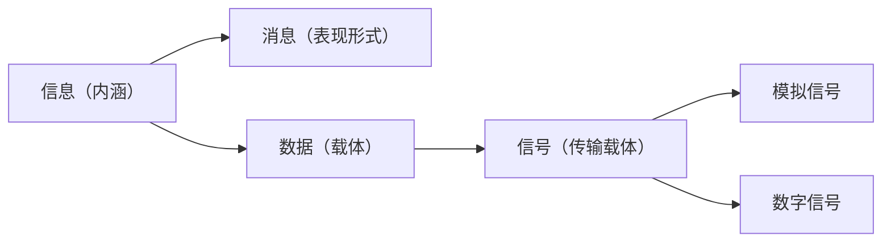
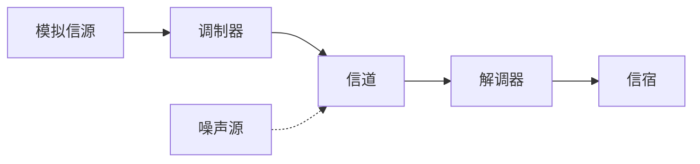
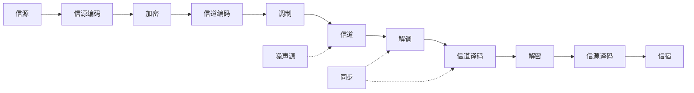
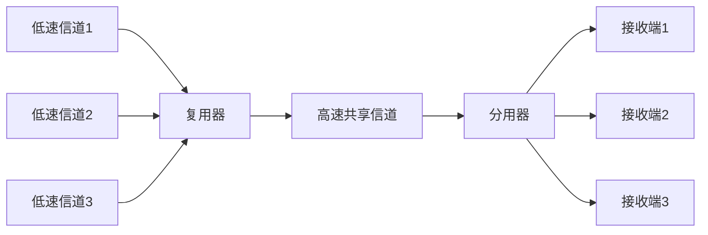
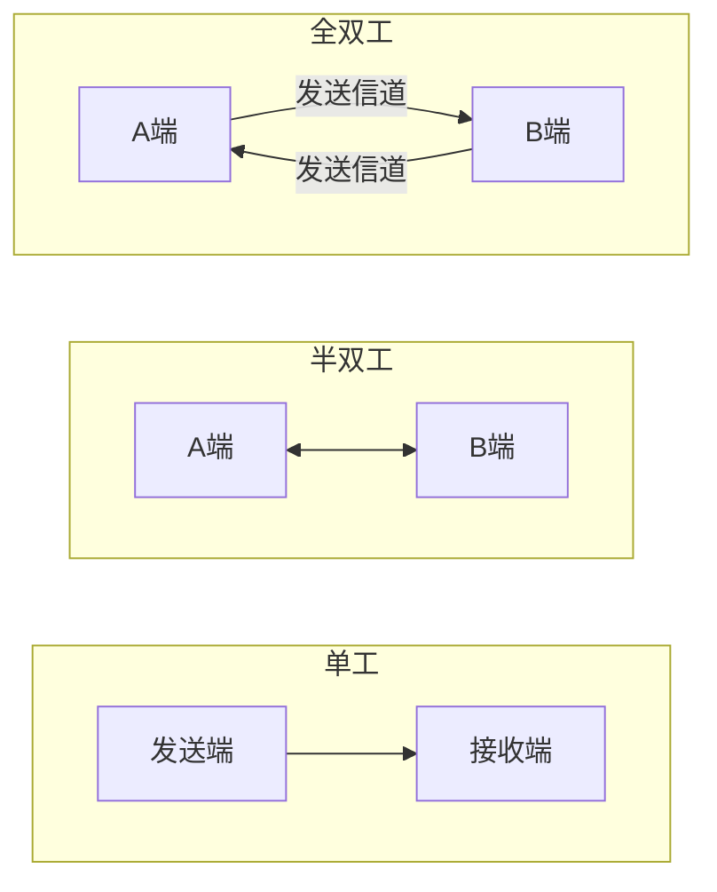

# 通信原理基础 · 完整笔记

---

## 1.数据通信基本概念

### 1.1 通信与信息

通信是指人与人、人与物、物与物之间通过某种媒介和行为进行的信息传递与交流。通信的目的就是传递信息。

| 术语 | 定义 | 相互关系 |
|------|------|---------|
| 信息 | 事物运动状态或存在方式的不确定性描述 | 通信传输的内容，是数据的内涵 |
| 消息 | 信息的载体和表现形式，如语音、文字、图像 | 信息通过消息表现出来 |
| 数据 | 信息的记录或具体表示形式，如数字、文字、图像 | 数据是信息的载体，信息是数据的内涵 |
| 信号 | 数据的物理传输形式 | 信号是数据的传输载体，分为模拟信号与数字信号 |

注意教材中“信息与数据”的表述：信息是内涵，数据是表现形式；不能反过来说“数据是信息的内涵”。

### 1.2 信息、消息、数据与信号的关系

### 1.3 模拟信号与数字信号

| 项目 | 模拟信号 | 数字信号 |
|------|---------|---------|
| 取值 | 连续变化 | 离散取值，只有有限个状态 |
| 典型例子 | 语音原始波形、模拟视频 | 计算机数据、PCM编码后的语音 |
| 传输系统 | 模拟通信系统 | 数字通信系统 |
| 抗干扰能力 | 差，噪声会逐级累积 | 强，可通过再生中继消除噪声 |
| 保密性 | 差，不易加密 | 好，易于加密处理 |
| 频带利用率 | 较高 | 相对较低，但可通过压缩和高效调制弥补 |

基带信号是未经调制的原始电信号，频谱从零频附近开始；频带信号是基带信号经调制后搬到较高频段上的信号。

---

## 2.通信系统的模型与分类

### 2.1 通信系统定义

实现信息传递所需的一切技术设备和传输介质的总和称为通信系统。通信系统一般由信源、发送设备、信道、接收设备和信宿组成，噪声源作用于信道。

### 2.2 模拟通信系统模型

调制器把基带信号搬移到适合信道传输的频段，解调器完成相反的变换。模拟通信系统传输的是连续波形，噪声会直接叠加在信号上。

### 2.3 数字通信系统模型

| 环节 | 主要作用 |
|------|---------|
| 信源编码 | 完成模数转换和数据压缩，提高有效性 |
| 加密 | 保证信息传输的安全性 |
| 信道编码 | 增加冗余，实现差错检测与纠错，提高可靠性 |
| 调制 | 把数字基带信号变换为适合信道传输的频带信号 |
| 信道 | 提供传输通道，同时引入噪声和干扰 |
| 解调 | 从接收信号中恢复数字基带信号 |
| 信道译码 | 检错、纠错，恢复信道编码前的数据 |
| 解密 | 恢复加密前的数据 |
| 信源译码 | 解压缩并完成数模转换，恢复原始信息 |
| 同步 | 为解调、译码提供载波同步、位同步、帧同步 |

数字通信系统模型中，信源编码解决“有效性”，信道编码解决“可靠性”，两者需要折中。

### 2.4 数字通信的优点与缺点

| 项目 | 说明 |
|------|------|
| 优点 | 抗干扰能力强，噪声不累积；便于差错控制；易于加密；便于集成和大规模生产；适合数据、语音、图像综合传输 |
| 缺点 | 占用频带较宽；需要严格的同步；设备相对复杂；模数转换会引入量化噪声 |

### 2.5 通信系统分类

| 分类维度 | 类型 |
|---------|------|
| 按传输介质 | 有线通信系统、无线通信系统 |
| 按信号特征 | 模拟通信系统、数字通信系统 |
| 按工作波段 | 长波、中波、短波、超短波、微波、红外、激光通信系统 |
| 按传送方式 | 基带传输系统、频带（带通或调制）传输系统 |
| 按复用方式 | 频分复用、时分复用、码分复用、波分复用 |
| 按消息方向与时间 | 单工、半双工、全双工通信系统 |
| 按同步方式 | 同步传输系统、异步传输系统 |

---

## 3.传输介质

### 3.1 有线传输介质

| 介质 | 结构 | 特点 | 典型应用 |
|------|------|------|---------|
| 同轴电缆 | 内导体、绝缘层、外导体屏蔽层、绝缘保护套层 | 抗干扰能力较强，带宽较大，但体积大、成本较高 | 早期以太网、有线电视、视频监控 |
| 双绞线 | 两根绝缘铜线按一定节距绞合，多对组成电缆 | 成本低、布线方便，抗干扰能力一般 | 以太网、电话线 |
| 光纤 | 纤芯、包层、涂覆层，外加加强件和护套构成光缆 | 带宽大、损耗低、抗电磁干扰、保密性好 | 骨干网、城域网、长距离传输 |

### 3.2 同轴电缆与双绞线的结构

| 介质 | 由内到外的结构 |
|------|---------------|
| 同轴电缆 | 内导体 → 绝缘层 → 外导体屏蔽层 → 绝缘保护套层 |
| 无屏蔽双绞线UTP | 铜线 → 绝缘层 → 聚氯乙烯套层 |
| 屏蔽双绞线STP | 铜线 → 绝缘层 → 屏蔽层 → 聚氯乙烯套层 |

双绞线将两根导线绞合，使两根导线上的电磁干扰相互抵消，绞距越小抗干扰能力越强。成品网线内部通常有无氧铜导体、抗拉绳、绝缘层和PVC护套，抗拉绳用于增强机械强度。

### 3.3 无线传输介质

| 介质 | 频段或特点 | 传播方式 | 说明 |
|------|-----------|---------|------|
| 微波 | 300MHz~300GHz | 视距传播 | 包括分米波、厘米波、毫米波；方向性强，需天线对准，受雨衰和障碍物影响 |
| 红外 | 红外光波段 | 视距传播 | 短距离、不能穿墙，常用于遥控和室内短距通信 |
| 激光 | 激光波段 | 视距传播 | 方向性极强、带宽高，易受天气和遮挡影响 |

微波通信分为地面微波接力通信和卫星通信。卫星通信单跳传播时延大，适合广播和远距离覆盖，不适合对时延敏感的交互业务。

---

## 4.双绞线

### 4.1 线序标准T568A与T568B

| 引脚 | T568A | T568B |
|------|-------|-------|
| 1 | 白绿 | 白橙 |
| 2 | 绿 | 橙 |
| 3 | 白橙 | 白绿 |
| 4 | 蓝 | 蓝 |
| 5 | 白蓝 | 白蓝 |
| 6 | 橙 | 绿 |
| 7 | 白棕 | 白棕 |
| 8 | 棕 | 棕 |

两端都按同一标准制作的网线为直通线，用于不同类设备互连；一端T568A、另一端T568B制作的为交叉线，用于同类设备互连。现代设备普遍支持端口自动翻转，交叉线的使用已减少。

### 4.2 百兆以太网管脚用途

| 引脚 | 信号 | T568A颜色 | T568B颜色 | 说明 |
|------|------|-----------|-----------|------|
| 1 | TX+ | 白绿 | 白橙 | 发送正信号 |
| 2 | TX- | 绿 | 橙 | 发送负信号 |
| 3 | RX+ | 白橙 | 白绿 | 接收正信号 |
| 4 | 未使用 | 蓝 | 蓝 | 百兆仅用2对 |
| 5 | 未使用 | 白蓝 | 白蓝 | 百兆仅用2对 |
| 6 | RX- | 橙 | 绿 | 接收负信号 |
| 7 | 未使用 | 白棕 | 白棕 | 百兆仅用2对 |
| 8 | 未使用 | 棕 | 棕 | 百兆仅用2对 |

100BASE-TX只使用1、2、3、6四根线；1000BASE-T及2.5G/5G/10GBASE-T使用全部4对8芯。PoE供电可利用空闲对，也可利用数据对，具体取决于供电标准。

### 4.3 双绞线类别

| 类别 | 常见标识 | 支持速率 | 最大距离 | 说明 |
|------|---------|---------|---------|------|
| 1~4类 | CAT1~CAT4 | 语音及低速数据 | — | 已淘汰 |
| 5类 | CAT5 | 100Mbps | 100m | 短距离可支持1000BASE-T |
| 超5类 | CAT5e | 1Gbps | 100m | 可支持2.5GBASE-T |
| 6类 | CAT6 | 1Gbps | 100m | 10GBASE-T时最大55m |
| 超6类 | CAT6A | 10Gbps | 100m | 常用于数据中心 |
| 7类 | CAT7 | 10Gbps | 100m | 必须屏蔽，接口特殊 |
| 8类 | CAT8 | 25Gbps/40Gbps | 30m | 屏蔽线，用于短距服务器连接 |

类别越高并不必然代表实际速率越高，实际速率还受线缆长度、屏蔽接地、施工工艺和两端设备影响。

---

## 5.光纤

### 5.1 结构与原理

光纤利用光的全反射原理传输光信号。纤芯折射率大于包层折射率，光在纤芯与包层界面上发生全反射，从而沿纤芯向前传播。

| 部分 | 作用 |
|------|------|
| 纤芯 | 传输光信号的高纯度玻璃或塑料芯 |
| 包层 | 折射率低于纤芯，与纤芯界面形成全反射 |
| 涂覆层 | 保护纤芯，防止机械损伤和潮气侵入 |
| 加强件与护套 | 构成光缆，提供抗拉、防潮和外部保护 |

光纤的优点：重量轻、体积小、传输距离远、衰减小、容量大、抗电磁干扰、保密性好。缺点是质地脆、机械强度低、连接和分路较困难、施工要求高。

### 5.2 单模光纤与多模光纤

| 项目 | 单模光纤 | 多模光纤 |
|------|---------|---------|
| 纤芯直径 | 8~10μm | 50μm或62.5μm |
| 包层直径 | 125μm | 125μm |
| 光源 | 激光器LD | 发光二极管LED或垂直腔面发射激光器VCSEL |
| 工作波长 | 1310nm、1550nm | 850nm、1300nm |
| 传播方式 | 只有一种模式，光接近沿轴向直线传播 | 多种模式，光在纤芯与包层界面反复全反射 |
| 传输距离 | 几km至几十km，适合长途 | 几百m，千兆典型550m |
| 成本 | 高 | 低 |

单模光纤并非“绝对直线传播”，其束缚机理仍是全反射；考试中常以“直线传播”作为单模相对多模的形象描述。多模光纤通常采用渐变折射率结构，以减小不同模式之间的传播时差（模式色散）。

### 5.3 光模块与光纤接头

| 接头 | 外形 | 特点与用途 |
|------|------|-----------|
| SC | 方形卡扣式 | 配线架、设备端口常用，插拔方便 |
| ST | 卡口式 | 早期配线架常用，旋转卡扣固定 |
| FC | 螺纹式 | 配线架、测试仪表常用，连接牢固 |
| LC | 小方形卡扣式 | 网络设备高密度端口常用，体积约为SC的一半 |
| MPO/MTP | 多芯阵列式 | 40G/100G/400G多芯并行传输 |

| 光模块 | 常见速率 | 说明 |
|--------|---------|------|
| SFP | 1Gbps | 小型可插拔光模块 |
| SFP+ | 10Gbps | 10G光模块 |
| SFP28 | 25Gbps | 25G光模块 |
| QSFP+ | 40Gbps | 四通道 |
| QSFP28 | 100Gbps | 四通道25G |
| QSFP-DD | 400Gbps | 双密度四通道 |

---

## 6.信道复用

### 6.1 复用基本概念

多路复用是把多个低速信道组合成一个高速信道的技术，可以提高数据链路的利用率。发送端复用，接收端分用。

### 6.2 常见复用方式

| 复用方式 | 划分对象 | 特点 | 典型应用 |
|---------|---------|------|---------|
| 频分复用FDM | 频率 | 各路信号占用不同频段，需保护带，可并行传输 | 模拟载波电话、广播电视 |
| 时分复用TDM | 时间 | 各路信号占用不同时间片，时间片固定分配 | E1/T1、SDH |
| 统计时分复用STDM | 时间 | 按需动态分配时间片，提高利用率 | 分组交换、统计复用设备 |
| 码分复用CDM | 码序列 | 用正交码区分用户，抗干扰强，频谱利用率高 | CDMA移动通信 |
| 波分复用WDM | 光波长 | 在一根光纤中同时传输多个波长的光信号 | 光纤骨干网 |
| 密集波分复用DWDM | 光波长 | 波长间隔更小，复用路数更多 | 长距离大容量光传输 |

频分复用适合模拟信号，时分复用适合数字信号。统计时分复用按需分配时隙，为了避免某个高速用户长期独占信道，通常会为每个用户设置最小保证时隙或最大速率限制。

### 6.3 同步时分复用：E1与T1

| 对比 | E1 | T1 |
|------|----|----|
| 载波速率 | 2.048Mbps | 1.544Mbps |
| 子信道数 | 30路话音+2个控制时隙（TS0、TS16） | 24路话音 |
| 帧长 | 8×32=256bit | 24×8+1=193bit |
| 传送一帧的时间 | 125μs，即每秒8000帧 | 125μs，即每秒8000帧 |
| 子信道速率 | 64kbps | 64kbps（56kbps数据+8kbps信令） |
| 控制开销 | 2/32=6.25% | 1/193≈0.518% |

E1的32个时隙中，TS0用于帧同步，TS16用于信令，其余30个时隙传输话音或数据。2.048Mbps=32×64kbps；T1的1.544Mbps=24×64kbps+8kbps帧同步开销。

### 6.4 SONET/SDH

SONET是美国标准，SDH是ITU-T对应的国际标准。PDH（准同步数字体系）按E1、E2、E3、E4等等级逐级复用；SDH在PDH基础上发展，速率等级为STM-1、STM-4、STM-16、STM-64等。STM-1是SDH的基本同步传送模块，速率为155.52Mbit/s。

| 光纤级 | STS级 | SDH对应 | 速率 |
|--------|-------|---------|------|
| OC-1 | STS-1 | — | 51.840Mbps |
| OC-3 | STS-3 | STM-1 | 155.520Mbps |
| OC-12 | STS-12 | STM-4 | 622.080Mbps |
| OC-48 | STS-48 | STM-16 | 2488.320Mbps |
| OC-192 | STS-192 | STM-64 | 9953.280Mbps |
| OC-768 | STS-768 | STM-256 | 39813.120Mbps |

复用关系：3个E1复用进1个TUG-2，7个TUG-2复用进1个TUG-3，3个TUG-3复用进1个VC-4，再加段开销和指针形成STM-1。因此1个STM-1可承载63个E1，STM-4可承载252个E1，STM-16可承载1008个E1。

---

## 7.通信方式

### 7.1 单工、半双工与全双工

| 方式 | 方向 | 同一时刻能否双向 | 典型例子 |
|------|------|-----------------|---------|
| 单工 | 只能单向传输 | 否 | 广播、电视、遥控 |
| 半双工 | 可双向，但不能同时 | 否 | 对讲机、早期集线器 |
| 全双工 | 可同时双向传输 | 是 | 电话、交换机全双工端口 |

全双工可以使用两条独立信道，也可以把一条信道的容量按频率或时间划分成两个方向。

### 7.2 串行传输与并行传输

| 方式 | 特点 | 适用场景 |
|------|------|---------|
| 串行传输 | 逐位传输，只需一条数据线，成本低，适合长距离 | 网络通信、USB、RS-232 |
| 并行传输 | 多位同时传输，速率高，但线间串扰和时钟偏斜明显 | 短距离、设备内部总线、早期打印机接口 |

### 7.3 同步传输与异步传输

| 方式 | 同步单位 | 特点 | 适用场景 |
|------|---------|------|---------|
| 同步传输 | 数据块或帧 | 收发双方时钟同步，效率高，控制开销小 | 高速、大批量数据传输 |
| 异步传输 | 字符 | 每个字符加起始位和停止位，实现简单，开销大 | 低速终端、串口通信 |

---

## 8.交换方式

### 8.1 三种基本交换方式

| 对比 | 电路交换 | 报文交换 | 分组交换 |
|------|---------|---------|---------|
| 传输单位 | 比特流，独占物理通路或时隙 | 整个报文 | 分组 |
| 连接方式 | 面向连接，建立物理通路 | 无连接 | 数据报无连接；虚电路面向连接（逻辑连接） |
| 转发方式 | 直通 | 存储转发 | 存储转发 |
| 时延 | 建立时延大，之后传输时延小且固定 | 存储转发时延大 | 存储转发时延较小 |
| 线路利用率 | 低 | 较高 | 高 |
| 典型网络 | PSTN、ISDN | 电报、早期长报文传输 | Internet、X.25、帧中继、ATM |
| 适用业务 | 实时语音、视频 | 长报文、非实时业务 | 突发性数据业务 |

电路交换适合按时间计费、要求时延稳定的实时业务；报文交换需要较大的存储空间；分组交换兼顾效率和灵活性，是现代数据网的主流。

### 8.2 虚电路与数据报

| 对比 | 虚电路 | 数据报 |
|------|--------|--------|
| 连接建立 | 需要先建立虚电路 | 不需要 |
| 路由选择 | 建立时确定，所有分组沿同一路径 | 每个分组独立选路 |
| 到达顺序 | 通常按序到达 | 可能乱序 |
| 可靠性 | 由网络层负责 | 由端系统负责 |
| 故障影响 | 路径上的链路或节点故障影响较大 | 可绕行，健壮性较好 |
| 典型协议 | X.25、帧中继、ATM | IP |

分组交换中的虚电路虽然不需要独占物理线路，但必须建立逻辑连接，这是与数据报方式的关键区别。

### 8.3 报文交换与分组交换的区别

| 对比 | 报文交换 | 分组交换 |
|------|---------|---------|
| 数据单位 | 整个报文 | 拆分后的分组 |
| 缓存要求 | 需要容纳整个报文，缓存大 | 只需缓存单个分组，缓存小 |
| 时延 | 存储转发时延大 | 流水线转发，时延较小 |
| 差错处理 | 整报文重传 | 只重传出错的分组 |
| 适用场景 | 长报文、非实时 | 交互式数据、突发业务 |

---

## 9.数字通信基础

### 9.1 码元与传输速率

码元是承载信息的基本信号单元。码元速率RB表示每秒传输的码元数，单位为波特（Baud）；信息速率Rb表示每秒传输的比特数，单位为bit/s。

Rb = RB × log2(M)

其中M为一个码元可能取的状态数。例如16QAM中M=16，若码元速率为2400Baud，则信息速率为2400×log2(16)=9600bit/s。

### 9.2 奈奎斯特准则与香农定理

| 定理 | 公式 | 适用条件 | 含义 |
|------|------|---------|------|
| 奈奎斯特准则 | C=2W·log2(M) | 理想无噪声低通信道 | 最高码元速率为2W，对应信道容量为C |
| 香农定理 | C=W·log2(1+S/N) | 有噪声信道 | 给出信道容量的理论上限 |

式中W为信道带宽（Hz），S/N为信噪比，C为信道容量（bit/s）。信噪比常用分贝表示：SNR(dB)=10lg(S/N)。

例如带宽W=3kHz、信噪比30dB时，S/N=1000，C=3000×log2(1001)≈29.9kbit/s。

奈奎斯特准则解决“码间串扰”问题，香农定理解决“噪声背景下能传多少”的问题；实际系统同时受两者约束，容量取较小值。

### 9.3 PCM脉冲编码调制

PCM包括采样、量化、编码三个步骤。

| 步骤 | 作用 | 关键点 |
|------|------|--------|
| 采样 | 把连续时间信号变为离散时间信号 | 采样定理：fs≥2fmax，否则发生频谱混叠 |
| 量化 | 把连续幅度值近似为有限个离散电平 | 量化会引入量化噪声，非均匀量化可改善小信号信噪比 |
| 编码 | 把量化后的电平用二进制码表示 | 码位数n决定量化级数M=2^n |

电话语音PCM：采样频率8kHz，每个样本8bit，故每路速率为8000×8=64kbps。我国和欧洲采用A律13折线压扩，北美和日本采用μ律。

### 9.4 数字调制

| 调制方式 | 改变的载波参数 | 特点 | 典型应用 |
|---------|---------------|------|---------|
| ASK | 幅度 | 实现简单，抗噪能力差 | 早期光纤、短距通信 |
| FSK | 频率 | 抗噪能力较好，频带利用率低 | 低速调制解调器 |
| PSK | 相位 | 抗噪能力好，BPSK/QPSK常用 | 卫星通信、微波通信 |
| QAM | 幅度和相位 | 频带利用率高，阶数越高抗噪越差 | 16/64/256QAM、WiFi、有线电视 |

M-QAM每个码元携带log2(M)个比特，例如256QAM每个码元携带8bit。

### 9.5 误码率

误码率Pe=错误码元数/传输总码元数；误比特率Pb=错误比特数/传输总比特数。误码率是衡量数字通信系统可靠性的重要指标，数值越小说明传输质量越好。

---

## 10.课堂习题巩固

### 10.1 习题（一）

1.以下频率中，属于微波波段的是（ ）。

- A、30Hz
- B、30KHz
- C、30MHz
- D、30GHz [正确]

答案：D。微波频率范围为300MHz~300GHz。

2.在双绞线中STP和UTP分别代表（ ）。

- A、非屏蔽双绞线和屏蔽双绞线
- B、铠装线缆和非铠装线缆
- C、屏蔽双绞线和非屏蔽双绞线
- D、3类线和5类线

答案：C。STP为屏蔽双绞线，UTP为非屏蔽双绞线。

3.光信号在单模光纤中是以（ ）方式传播。

- A、直线传播 [正确]
- B、渐变反射
- C、突变反射
- D、无线收发

答案：A。单模光纤纤芯细，只有一种传播模式，光接近沿轴向直线传播；其束缚机理仍是纤芯与包层界面的全反射。

4.光纤分为单模光纤和多模光纤，这两种光纤的区别是（ ）。

- A、单模光纤的数据速率比多模光纤低
- B、多模光纤比单模光纤传输距离更远
- C、单模光纤比多模光纤的价格更便宜
- D、多模光纤比单模光纤的纤芯直径粗 [正确]

答案：D。单模纤芯约8~10μm，多模纤芯为50μm或62.5μm。

5.以下不属于光纤通信的特点是（ ）。

- A、传输损耗小，中继距离长，对远距离传输特别经济
- B、无串音干扰，保密性好，也不易被窃听或截取数据
- C、抗雷电和电磁干扰性能好，在有较大电流脉冲干扰的环境下通信效果良好
- D、在有效距离内，设备无须对准某个方向，就能进行通信 [正确]

答案：D。光纤方向性强，连接和通信时需要对准；无须对准方向是无线广播式通信的特点。

### 10.2 习题（二）

1.在统计时分多路复用（STDM）中，如果某个用户的帧到达率远高于其他用户，为了防止该用户独占信道，通常会（ ）。

- A、确保每个用户至少有一个最小保证时隙 [正确]
- B、拒绝服务该用户的帧，直到其他用户的帧被传输后再动态分配
- C、强制降低该用户的传输速率
- D、使用缓冲区来存储等待传输的帧，但不调整时隙分配

答案：A。统计时分复用按需分配时隙，为保证公平，通常为每个用户设置最小保证时隙，防止某一用户长期独占信道。

说明：本题按教材答案选A。若只从“防止高速用户独占”的效果看，设置每用户最大速率上限更直接，选项C“强制降低该用户传输速率”也有一定合理性；考试遇到原题仍以教材答案为准。

2.应用于光纤的多路复用技术是（ ）。

- A、FDM
- B、TDM
- C、WDM [正确]
- D、SDMA

答案：C。波分复用WDM按光波长划分信道，是光纤通信常用的复用方式。

3.E1载波的控制开销占（1），E1基本帧的传送时间为（2）。

- （1）A、0.518%
- （1）B、6.25% [正确]
- （1）C、1.25%
- （1）D、25%
- （2）A、100ms
- （2）B、200μs
- （2）C、125μs [正确]
- （2）D、150μs

答案：（1）B；（2）C。E1每帧32个时隙，其中TS0和TS16为控制时隙，开销为2/32=6.25%；每秒8000帧，故每帧125μs。

4.SONET采用的成帧方法是（1），其中最常用的OC-3速率是（2）。

- （1）A、码分复用
- （1）B、空分复用
- （1）C、频分复用
- （1）D、时分复用 [正确]
- （2）A、155Mbps [正确]
- （2）B、622Mbps
- （2）C、2.5Gbps
- （2）D、10Gbps

答案：（1）D；（2）A。SONET采用时分复用成帧，OC-3对应STM-1，速率为155.52Mbps。

### 10.3 习题（三）

1.若双工无线蜂窝系统总的频谱为20MHz，每个单工信道的带宽为25KHz，双工信道的数量是（ ）。

- A、400 [正确]
- B、800
- C、200
- D、100

答案：A。双工信道需要上下行两个单工信道，数量=20MHz/(25kHz×2)=400。

2.下列分组交换网络中，采用的交换技术与其他3个不同的是（ ）。

- A、IP [正确]
- B、X.25
- C、帧中继
- D、ATM

答案：A。IP采用数据报方式，X.25、帧中继和ATM采用虚电路方式。

---

## 11.本章小结

| 知识点 | 核心内容 |
|--------|---------|
| 1. 基本概念 | 信息是内涵，消息和数据是表现形式，信号是传输载体；模拟信号与数字信号 |
| 2. 通信系统模型 | 模拟通信系统与数字通信系统；信源编码提高有效性，信道编码提高可靠性 |
| 3. 传输介质 | 同轴电缆、双绞线、光纤；微波、红外、激光 |
| 4. 双绞线 | T568A/T568B线序；百兆使用1、2、3、6引脚；CAT5e/6/6A/7/8 |
| 5. 光纤 | 单模纤芯8~10μm、LD、1310/1550nm；多模50/62.5μm、LED、850/1300nm |
| 6. 信道复用 | FDM、TDM、STDM、CDM、WDM、DWDM；E1为2.048Mbps、T1为1.544Mbps；STM-1为155.52Mbps |
| 7. 通信方式 | 单工、半双工、全双工；串行与并行；同步与异步 |
| 8. 交换方式 | 电路交换、报文交换、分组交换；虚电路与数据报 |
| 9. 数字通信基础 | 码元速率与比特率；奈奎斯特准则、香农定理；PCM；ASK/FSK/PSK/QAM；误码率 |

考试重点：

1. 微波频段范围、单模与多模光纤的区别、常见光纤接头
2. T568A/T568B线序及百兆以太网管脚用途
3. E1/T1的速率、帧长、时隙数与控制开销
4. STM-1/STM-4/STM-16/STM-64的速率及E1复用关系
5. FDM、TDM、STDM、CDM、WDM的区别与典型应用
6. 电路交换、报文交换、分组交换的对比；虚电路与数据报的区别
7. 奈奎斯特准则与香农定理的公式及简单计算
8. PCM采样定理、量化与64kbps话音编码
9. 码元速率与信息速率的换算
