# 信道特性 · 完整笔记

---

## 1.衡量信息系统的两个方向

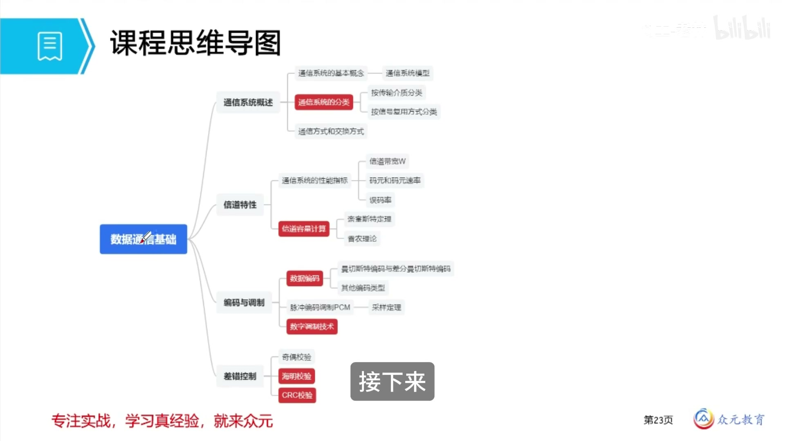

衡量一个信息系统（通信系统）的优劣，主要从两个方向考察，这两个方向始终是**相互矛盾、不可兼得**的。

| 方向 | 通俗理解 | 模拟通信系统的指标 | 数字通信系统的指标 |
| ---- | -------- | ------------------ | ------------------ |
| 有效性 | 传输得快不快 | 带宽（传输频带） | 传输速率、频带利用率 |
| 可靠性 | 传输得准不准 | 信噪比 | 误码率、误信率 |

---

## 2.有效性指标

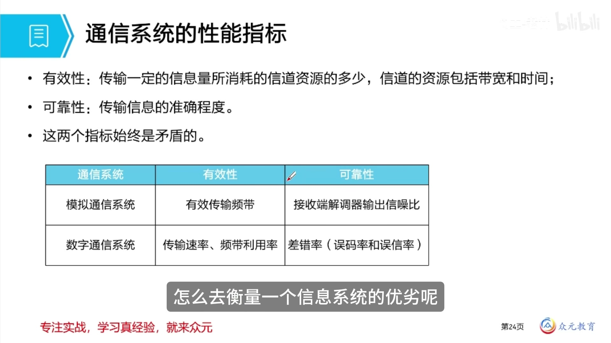

### 2.1 带宽（模拟通信系统）

信道带宽指信道能够通过的频率范围：

```
W = f(最高频率) − f(最低频率)
```

- 单位：**Hz（赫兹）**
- 只表示频率范围的宽度，不表示传输能力

### 2.2 传输速率（数字通信系统）

传输速率有两种，考试中**码元速率是重点**。

| 名称 | 单位 | 含义 |
| ---- | ---- | ---- |
| 比特率（数据传输速率） | bps（比特/秒） | 单位时间内传输的比特数 |
| 码元速率（波特率） | Baud（波特） | 单位时间内传输的码元数量 |

### 2.3 码元与比特的关系

**码元**（也叫符号）：一个固定时长的信号波形，代表不同离散数值的基本波形。在通信中通常以载波的波形来衡量。

- 一个码元可以承载多个比特，其数量由**码元种类数 N** 决定：

```
每个码元携带的比特数 n = log₂ N
```

| 码元种类数 N | 每个码元的比特数 n = log₂N |
| ------------ | -------------------------- |
| 2 | 1 |
| 4 | 2 |
| 8 | 3 |
| 16 | 4 |
| 32 | 5 |
| 64 | 6 |

例如：二进制比特两位一组，共有 00、01、10、11 四种组合，对应 4 种码元形态（三角形、正方形、圆形、五角星各代表一种状态），则每种码元携带 2 比特。

常见调制方式对应的码元种类数：

| 调制方式 | 码元种类数 N | 每码元比特数 |
| -------- | ------------ | ------------ |
| BPSK | 2 | 1 |
| QPSK | 4 | 2 |
| 8PSK | 8 | 3 |
| 16QAM | 16 | 4 |
| 64QAM | 64 | 6 |

### 2.4 频带利用率

在数字通信系统中，仅比较传输速率无法区分信道优劣（传输速率往往是额定值，如 300Mbps），因此引入**频带利用率**。

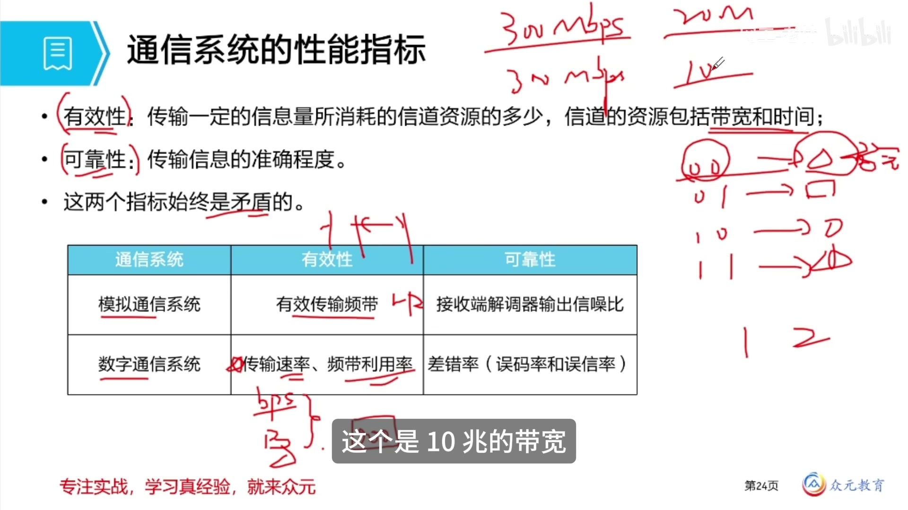

```
频带利用率 = 传输速率 ÷ 带宽
```

- 单位：bit/(s·Hz) 或 Baud/Hz
- 通俗理解：两条马路宽度分别为 20 米和 10 米，若通过的车流量相同，则 10 米宽的马路上利用率更高
- 结论：**同样的传输速率占用更小的带宽，则频带利用率更高**

---

## 3.可靠性指标

### 3.1 信噪比（模拟通信系统）

```
信噪比 S/N = 信号平均功率 ÷ 噪声平均功率
```

- 信噪比本身是一个**比值，无单位**
- 实际中常用**分贝（dB）**表示：

```
dB = 10 × lg(S/N)
```

常用换算关系（考试中直接记结论即可）：

| 分贝值 | 信噪比 S/N |
| ------ | ---------- |
| 10 dB | 10 |
| 20 dB | 100 |
| 30 dB | 1000 |

### 3.2 误码率与误信率（数字通信系统）

| 指标 | 公式 | 含义 |
| ---- | ---- | ---- |
| 误码率 Pe | 出错的码元数 ÷ 传输的总码元数 | 码元出错的比例 |
| 误信率 Pb | 出错的比特数 ÷ 传输的总比特数 | 比特出错的比例 |

此外还有吞吐量、误信率等概念，了解即可，考试中考查较少。

---

## 4.信道容量（考试重点：两个公式）

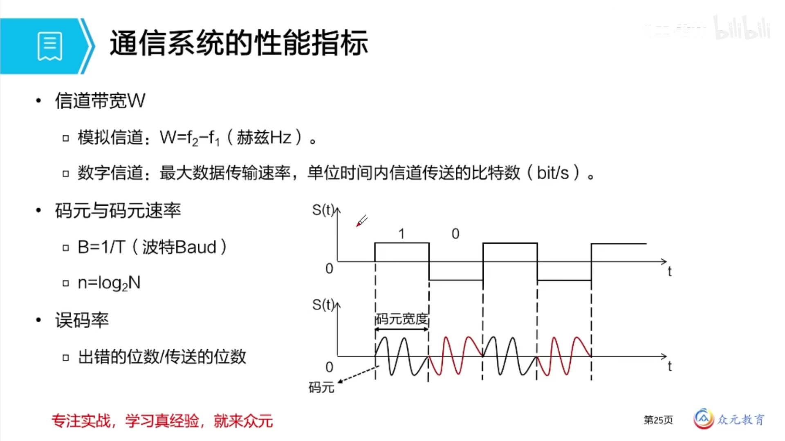

信道容量部分**主要考查两个公式的计算**。

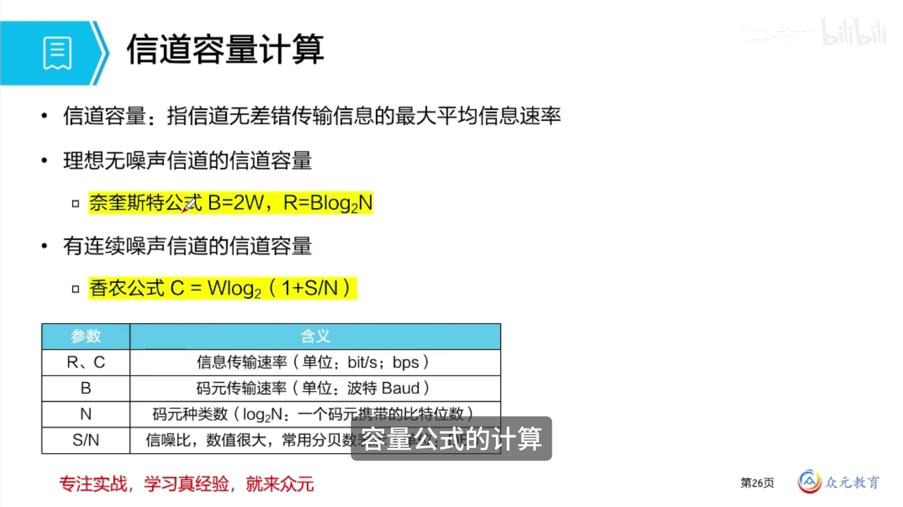

### 4.1 奈奎斯特定理（理想无噪声信道）

前提：**没有噪声的理想环境**，求信道的极限速率。

```
极限码元速率：B = 2W  （Baud）
极限数据速率：R = B · log₂N = 2W · log₂N
```

| 符号 | 含义 | 单位 |
| ---- | ---- | ---- |
| R | 极限数据速率 | bps |
| B | 码元速率（波特率） | Baud |
| W | 信道带宽 | Hz |
| N | 码元种类数（信号状态数） | 个 |

关键点：
- 无噪声信道中，码元速率的理论上限是带宽的 **2 倍**
- 要求解「需要多少个信号状态 / 码元种类数」，用奈奎斯特定理

### 4.2 香农公式（有噪声信道）

前提：**存在噪声干扰**的实际信道，求信道容量。

```
信道容量：C = W · log₂(1 + S/N)
```

| 符号 | 含义 | 单位 |
| ---- | ---- | ---- |
| C | 信道容量（最大数据速率） | bps |
| W | 信道带宽 | Hz |
| S/N | 信噪比 | 无单位 |

关键点：
- 题干给出**分贝（dB）**时，说明有噪声，用香农公式
- `log₂(1 + S/N)` 可看作一个整体，S/N 很大时该值近似等于 log₂(S/N)

### 4.3 两个公式的对比

| 比较项 | 奈奎斯特定理 | 香农公式 |
| ------ | ------------ | -------- |
| 适用环境 | 无噪声的理想信道 | 有噪声的实际信道 |
| 影响速率的因素 | 带宽、码元种类数 | 带宽、信噪比 |
| 公式 | R = 2W · log₂N | C = W · log₂(1 + S/N) |
| 典型用途 | 求码元种类数 / 信号状态数 | 求最大数据速率（信道容量） |
| 结果单位 | bps | bps |

---

## 5.对数运算与单位换算

### 5.1 对数运算

```
log₂ x = n  ⇔  2 的 n 次方 = x
log₁₀ x = n ⇔  10 的 n 次方 = x
```

- 以 2 为底的对数，求的就是「2 的多少次方等于该数」
- 以 10 为底同理

### 5.2 速率与存储的单位换算

| 场景 | 换算基准 |
| ---- | -------- |
| 传输速率 | 以 10 的次方换算（千=10³、兆=10⁶） |
| 存储容量 | 以 2 的次方换算（1K = 2¹⁰ = 1024） |

注意：`10³ = 1000 ≈ 2¹⁰ = 1024`，计算对数时可直接按 10 的次方近似。

---

## 6.典型例题

### 例题1：已知带宽与信噪比，求最大数据速率

设信道带宽为 1000 Hz，信噪比为 30 dB，则信道的最大数据速率为（A）

解答：题干给出分贝，说明有噪声，选用香农公式。

```
C = W · log₂(1 + S/N)
  = 1000 × log₂(1 + 1000)
  ≈ 1000 × 10
  = 10000 b/s = 10 kb/s
```

要点：30 dB 对应 S/N = 1000，log₂(1000) ≈ 10。

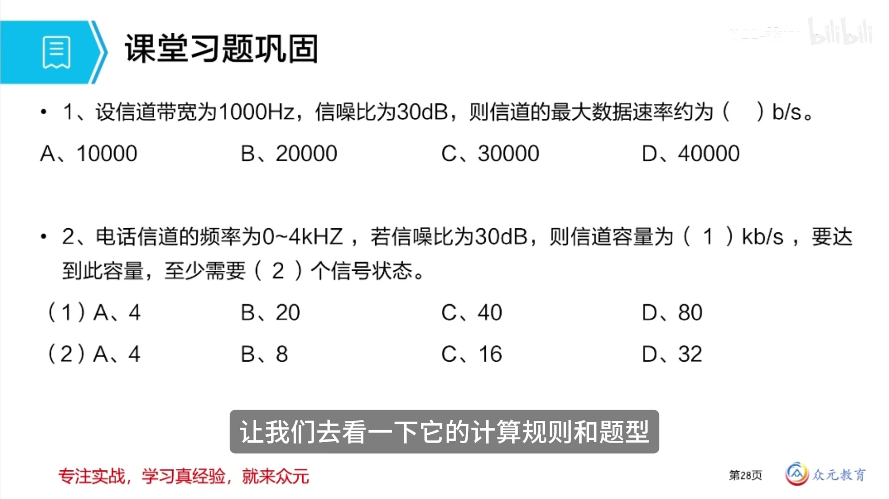

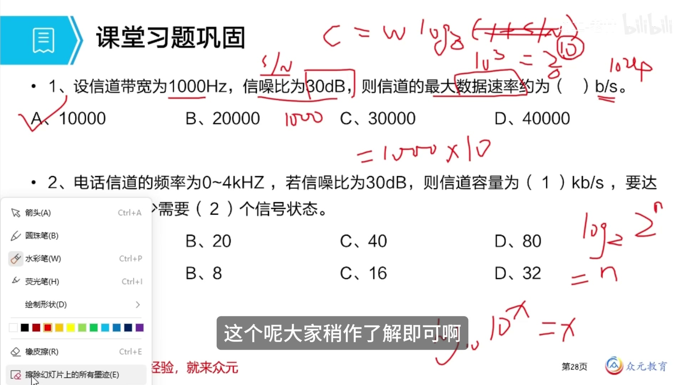

### 例题2：香农公式与奈奎斯特定理综合

电话信道的频率范围为 300 Hz ~ 3400 Hz，信噪比为 30 dB，求信道容量；要达到该容量，需要多少个信号状态（D）

第一步，求信道容量（有噪声，用香农公式）：

```
W = 3400 − 300 = 3100 Hz ≈ 4 kHz
C = W · log₂(1 + S/N)
  = 4 × 10³ × log₂(1 + 1000)
  ≈ 4 × 10³ × 10
  = 40 kb/s
```

第二步，求码元种类数（用奈奎斯特定理）：

```
R = 2W · log₂N
40 × 10³ = 2 × 4 × 10³ × log₂N
log₂N = 5
N = 2⁵ = 32
```

答案：32 个信号状态。

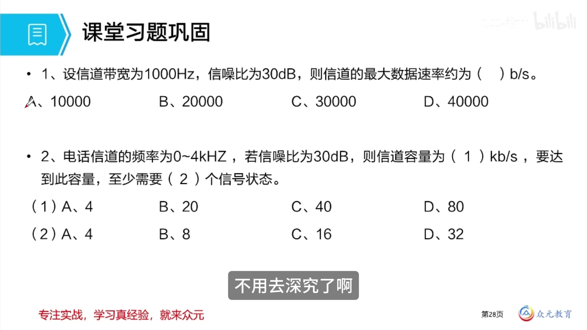

### 例题3：异步传输的有效传输速率

在异步传输中，数据格式为 1 位起始位、7 位数据位、1 位校验位、1 位停止位，每秒传输 200 个字符，其有效传输速率为（B）

解答：有效传输速率只统计**有效的数据位**。

```
有效传输速率 = 7 位 × 200 字符/秒 = 1400 b/s
```

要点：起始位、校验位、停止位属于传输开销，不计入有效速率。

### 例题4：码元速率转换为数据速率

若八进制信号的码元速率为 4800 波特，则其数据速率为（B）

解答：八进制信号表示码元种类数 N = 8。

```
每个码元比特数 = log₂8 = 3
数据速率 = 4800 × 3 = 14400 b/s
```

### 例题5：调制效率的比较

以下调制方式中，调制效率最高的是（D）

- A. BPSK
- B. QPSK
- C. 8PSK
- D. 64QAM（正确）

解答：调制效率的高低取决于**码元种类数 N**，N 越大，每个码元携带的比特数越多，速率越高。

| 调制方式 | 码元种类数 N |
| -------- | ------------ |
| BPSK | 2 |
| QPSK | 4 |
| 8PSK | 8 |
| 64QAM | 64 |

因此 64QAM 的调制效率最高。

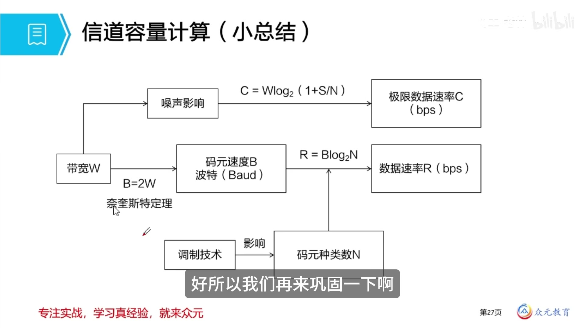

---

## 7.本章小结

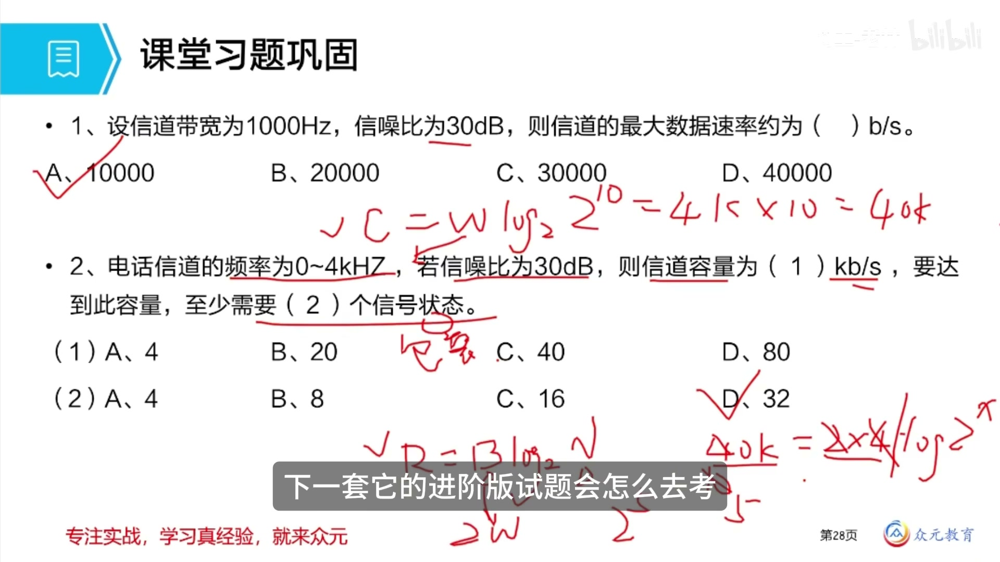

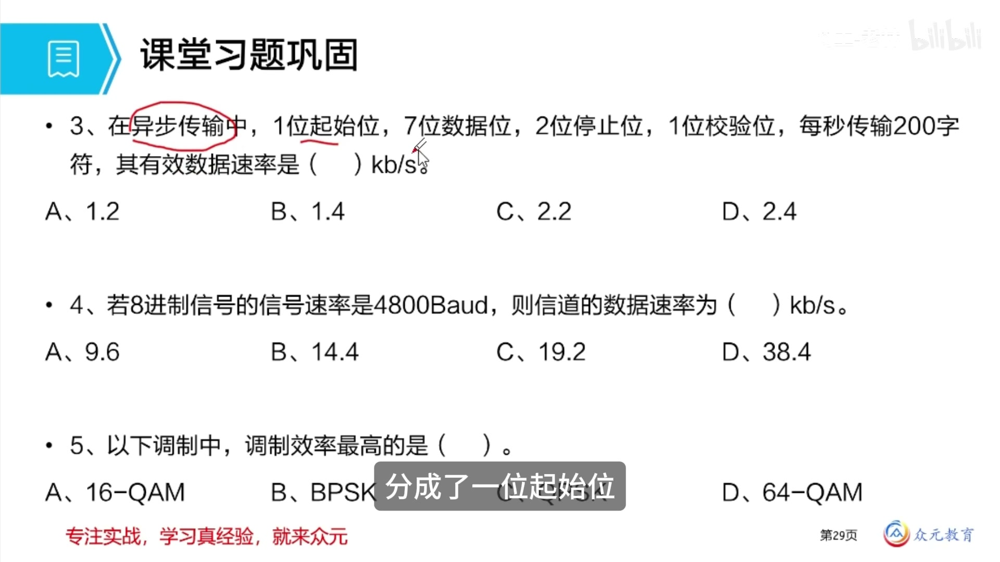

| 知识点 | 核心内容 |
| ------ | -------- |
| 1. 有效性指标 | 模拟通信系统看带宽；数字通信系统看传输速率（比特率、码元速率）与频带利用率 |
| 2. 码元与比特 | 码元种类数为 N 时，每个码元携带 log₂N 个比特 |
| 3. 可靠性指标 | 模拟通信系统看信噪比（dB = 10 lg(S/N)）；数字通信系统看误码率、误信率 |
| 4. 奈奎斯特定理 | 无噪声：B = 2W，R = 2W · log₂N，用于求码元种类数 |
| 5. 香农公式 | 有噪声：C = W · log₂(1 + S/N)，用于求最大数据速率 |
| 6. 对数与单位换算 | 速率按 10 的次方换算；存储按 2 的次方换算 |

考试重点：

1. 判断题目用哪个公式：**给出分贝（dB）即有噪声，用香农公式；问到信号状态数、码元种类数，用奈奎斯特定理**
2. 香农公式的计算：30 dB 对应 S/N = 1000，log₂(1 + S/N) ≈ 10
3. 奈奎斯特定理中码元速率上限为带宽的 2 倍
4. 码元速率与数据速率的换算：数据速率 = 码元速率 × log₂N
5. 异步传输中有效传输速率只统计数据位
6. 调制效率的比较本质是比较码元种类数 N 的大小
