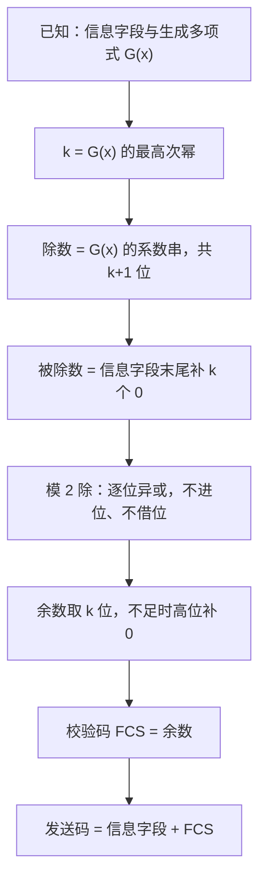

# 差错控制 · 完整笔记

---

## 1.差错控制概述

差错控制是「数据通信基础」章节的最后一个板块，其目的是**提高通信的可靠性**。

从可靠性的角度考察，需要解决两个方面的问题：

| 序号 | 需要解决的问题 | 对应的技术手段 |
| ---- | -------------- | -------------- |
| 1 | 接收端判断收到的数据是否与发送方发出的一致 | 需要有一个**检错标准** |
| 2 | 检查出错误之后如何处理 | 请求**重传**，或直接**定位并纠正**错误位 |

因此差错控制包含**如何检错**与**如何纠错**两类方法。本版块只介绍三种最为典型、考试中最常出现的方案：

- **奇偶校验**
- **海明校验**
- **CRC 循环冗余校验**

除这三种以外还有多种其他校验方法，不在本节的讨论范围内。

---

## 2.奇偶校验

### 2.1 编码规则

奇偶校验是一种简单易实现的校验方法，是**最常用的检错方法**，只能用于检测错误，并且只能对少量的随机性错误进行检测。

| 校验方式 | 编码规则 |
| -------- | -------- |
| 奇校验 | 编码后的码字中「1」的个数为**奇数** |
| 偶校验 | 编码后的码字中「1」的个数为**偶数** |

添加校验位的方法就是**数出信息码中「1」的个数**，再决定末尾补 0 还是补 1，使整个码字中「1」的个数满足约定的奇偶性。

### 2.2 编码示例

**示例1**：若信息码为 `0110101`，在末尾添加校验位数值（ ），能构成奇校验。

解答：

```
信息码 0110101 中「1」的个数 = 4（偶数）
奇校验要求「1」的个数为奇数
故校验位取 1，使「1」的个数变为 5（奇数）
```

答案：校验位为 **1**，编码结果为 `01101011`。

**示例2**：若接收方接收到的数据码为 `10010110`，采用偶校验，该数据是否错误？为什么？

解答：

```
数据码 10010110 中「1」的个数 = 4（偶数）
偶校验要求「1」的个数为偶数
4 为偶数，满足偶校验约定
```

答案：**判断为无错误**。

补充：校验通过只说明「未检出错误」，并不等于绝对无误——若同时有偶数个比特出错，奇偶性不变，仍会判为正确。

### 2.3 检错原理

实际设备并不是通过「数 1 的个数」来完成校验的，而是通过**模 2 加（异或）运算**取得结果：

- 模 2 加运算的符号为 **⊕**
- 运算规则：两个数**相同则为 0，不同则为 1**（本质上仍是考察「1」的个数）
- 将所有码位（含校验位）进行模 2 加运算，得到最终结果：
  - **偶校验运算结果为 0，视为数据无误**
  - **奇校验运算结果为 1，视为数据无误**

做题时为简化，直接判断「1」的个数即可。

### 2.4 检测能力与局限

- 奇偶校验**只能用于检测错误，不能纠错**：它无法找到具体的错误位置，不具备纠错能力。
- 奇偶校验**只能对少量的随机性错误进行检测**，并非任意出现几位错误都能检出：
  - 若码字中**有奇数个比特发生跳变**，则「1」的个数的奇偶性改变，可以被检测出来；
  - 若码字中**有偶数个比特发生跳变**，则「1」的个数的奇偶性不变，校验结果依然「正确」，**无法检出**，接收方会误判为数据无误。
- 从码距看：一位奇偶校验的**最小码距为 2**，按 `d ≥ e + 1` 只能检出 1 位错误，按 `d ≥ 2t + 1` 不具备纠错能力。

---

## 3.海明校验

### 3.1 定义与基本原理

海明校验（汉明校验，由 Hamming 提出，音译差异又称「汉明码」「海明码」）是**用冗余数据位来检测和纠正代码差错的理论和方法**。

- 其基本原理是**信息码元与校验码元通过线性方程式联系起来**；
- 与奇偶校验相比，海明校验**既可以检错，又可以纠错，能够定位到具体的错误位置**；
- 冗余位（校验位）的**存放位置一般为 2 的幂次方位置上**，其余位置依次填入信息码。

### 3.2 海明不等式

设 **m 为信息位长度，k 为校验码长度**，则二者必须满足：

```
2^k − 1 ≥ m + k      等价形式：2^k ≥ m + k + 1
```

- 含义：k 位校验位可以表示 2^k 种组合，其中 **1 种组合表示「没有错误」**，剩余的 **2^k − 1 种组合**用来表示数据中存在的错误，即指出是哪一位（共 m + k 位）出现了问题；
- 对 m 位的数据，增加 k 位冗余位，即组成海明纠错码；
- 只要满足该不等式，k 个校验位在理论上就可以判断出是哪一位出现了问题；
- 应用时取**刚好满足不等式的最小 k 值**。

> 说明：课件页面将不等式写作 `2^(k-1) ≥ m+k`（课件原文如此），按教材与本节例题的实际求解过程，正确形式为 `2^k ≥ m + k + 1`，即 `2^k − 1 ≥ m + k`。以例题与教材公式为准。

### 3.3 海明距离（码距）

- **海明距离（码距）**：两个码字之间不同的比特数，即一个码字要变成另一个码字时必须改变的最小位数。
- 若两个码字不同，意味着其中一个（或两个）发生了错误，其间的组合形式即为有效的标志信息。
- 检错、纠错能力与最小码距 d 的关系：

| 最小码距 d | 能力 |
| ---------- | ---- |
| d ≥ e + 1 | 可检出 e 位错误 |
| d ≥ 2t + 1 | 可纠正 t 位错误 |
| d ≥ e + t + 1 | 可同时检出 e 位错误并纠正 t 位错误（要求 e > t） |

海明码的最小码距为 3：由 `d ≥ 2t + 1` 可知可纠正 1 位错误，由 `d ≥ e + 1` 可知可检出 2 位错误；但**不能同时做到「纠 1 位、检 2 位」**，那要求 `d ≥ 2 + 1 + 1 = 4`。

判断能力的三个常用结论：

| 需求 | 所需最小码距 | 海明码（d = 3）能否满足 |
| ---- | ------------ | ----------------------- |
| 检出 e 位错误 | d ≥ e + 1 | 可检出 2 位 |
| 纠正 t 位错误 | d ≥ 2t + 1 | 可纠正 1 位 |
| 检出 e 位并纠正 t 位（e > t） | d ≥ e + t + 1 | 不满足，纠 1 检 2 需 d ≥ 4 |

### 3.4 计算示例：由信息码生成海明码

**题目**：若信息码为 `1001 110`，采用海明校验，最终生成的数据码为（ ）。

信息码共 7 位，即 **m = 7**。求解过程分四步。

**步骤 1：确定校验位数量 k**

由海明不等式：

```
2^k − 1 ≥ m + k
代入 m = 7：2^k − 1 ≥ 7 + k，即 2^k ≥ k + 8
```

逐步代入 k 值，取刚好满足不等式的最小值：

| k | 2^k | 不等式检验 | 结论 |
| - | --- | ---------- | ---- |
| 3 | 8 | 8 ≥ 3 + 8 = 11 | 不满足 |
| 4 | 16 | 16 ≥ 4 + 8 = 12 | 满足 |

结论：**校验位数量 k = 4**。

**步骤 2：确定校验位位置并填入信息码**

校验位位置取 2 的幂次方位置：`2^0=1`、`2^1=2`、`2^2=4`、`2^3=8`，即**第 1、2、4、8 位为校验位（P1、P2、P4、P8）**，其余位置（3、5、6、7、9、10、11）依次填入信息码。信息码 `1001110` 按顺序填入：

| 位号 | 1 | 2 | 3 | 4 | 5 | 6 | 7 | 8 | 9 | 10 | 11 |
| ---- | - | - | - | - | - | - | - | - | - | -- | -- |
| 内容 | P1 | P2 | 1 | P4 | 0 | 0 | 1 | P8 | 1 | 1 | 0 |

其中位号 1、2、4、8 为校验位（监督位，课件中比喻为「保镖」），其余为信息位（数据位）。

校验位的分布可以直接按位权记忆：

```
   1    2    3    4    5    6    7    8    9   10   11
 +----+----+----+----+----+----+----+----+----+----+----+
 | P1 | P2 | D1 | P4 | D2 | D3 | D4 | P8 | D5 | D6 | D7 |
 +----+----+----+----+----+----+----+----+----+----+----+
   ^    ^         ^                   ^
  2^0  2^1       2^2                 2^3
```

- 校验位只放在 2 的幂次方位（1、2、4、8…），其余位置按顺序填信息位；
- m = 7、k = 4 时总长 n = m + k = 11 位，编码效率为 7 ÷ 11 ≈ 63.6%。

**步骤 3：确定校验关系（分组）**

分组规则：**某一位的位号等于参与校验它的几个校验位位号之和**（在 1、2、4、8 中选取）：

| 位号 | 拆分（1+2+4+8） | 由哪些监督位负责 |
| ---- | ---------------- | ---------------- |
| 3 | 3 = 2 + 1 | P1、P2 |
| 5 | 5 = 4 + 1 | P1、P4 |
| 6 | 6 = 4 + 2 | P2、P4 |
| 7 | 7 = 4 + 2 + 1 | P1、P2、P4 |
| 9 | 9 = 8 + 1 | P1、P8 |
| 10 | 10 = 8 + 2 | P2、P8 |
| 11 | 11 = 8 + 2 + 1 | P1、P2、P8 |

反向看即得到每个校验位监督的位置：

| 监督位 | 监督的数据位置 |
| ------ | -------------- |
| P1（1 号位） | 3、5、7、9、11 |
| P2（2 号位） | 3、6、7、10、11 |
| P4（4 号位） | 5、6、7 |
| P8（8 号位） | 9、10、11 |

**步骤 4：确定校验位数值（采用偶校验）**

约定采用**偶校验**，即每组中「1」的个数为偶数。求某个校验位时，把**该组内所有位（含校验位自身）**一起做模 2 加，令结果为 0：

- **P1**：监督 3、5、7、9、11，即 `P1 ⊕ 1 ⊕ 0 ⊕ 1 ⊕ 1 ⊕ 0 = 0`（「1」的个数为偶数），得 **P1 = 1**
- **P2**：监督 3、6、7、10、11，得 **P2 = 1**
- **P4**：监督 5、6、7，得 **P4 = 1**
- **P8**：监督 9、10、11，得 **P8 = 0**

将各位填入后即得到最终数据码：

| 位号 | 1 | 2 | 3 | 4 | 5 | 6 | 7 | 8 | 9 | 10 | 11 |
| ---- | - | - | - | - | - | - | - | - | - | -- | -- |
| 内容 | 1 | 1 | 1 | 1 | 0 | 0 | 1 | 0 | 1 | 1 | 0 |

```
最终生成的数据码为：1111 0010 110
```

要点：海明校验的计算要使用**海明不等式**与**偶校验**两个工具，核心是理解**监督位**与**数据位**的概念。

### 3.5 接收端的检错与纠错

**问题**：若接收方收到的数据码如下，可检测出数据错误了么？可定位到具体位置么？

设接收到的数据码中第 6 位在传输中由 0 跳变为 1，即收到 `1111 0110 110`。按上述分组重新做偶校验：

| 监督位 | 参与校验的位（含校验位自身） | 该组「1」的个数 | 校验结论 |
| ------ | -------------- | --------------- | -------- |
| P1（1 号位） | 1、3、5、7、9、11 | 4（偶数） | [正确] 本组无错 |
| P2（2 号位） | 2、3、6、7、10、11 | 5（奇数） | [错误] 本组有错 |
| P4（4 号位） | 4、5、6、7 | 3（奇数） | [错误] 本组有错 |
| P8（8 号位） | 8、9、10、11 | 2（偶数） | [正确] 本组无错 |

定位过程：

1. 2 号位与 4 号位所监督的分组同时报错，说明错误一定出现在**两组共同监督的位置**上，即 6 号位或 7 号位；
2. 7 号位同时受 P1 监督，而 P1 组校验结果正常，可排除 7 号位、排除 P1 相关位置；
3. 故确认**第 6 位存在错误**，其原值应为 0，将其取反即可纠正。

**结论**：海明校验**可检错，且一位出错可自动纠错**（既能定位具体错误位置，也能将其纠正）。

---

## 4.CRC 循环冗余校验

### 4.1 特点与适用场合

| 项目 | 内容 |
| ---- | ---- |
| 检错能力 | 检错能力强；校验码由**模 2 除**得到，具有循环移位特性 |
| 典型应用 | **以太网 802.3 中常用的一种差错控制技术**（局域网技术中常用） |
| 检错与纠错 | 理论上可以纠错，但纠错电路复杂、开销大，实际标准用法是**只检错 + 由上层重传** |
| 关键特征 | **信息字段长度可任意选定，校验字段长度由生成多项式最高次幂决定**；标准用法只检错、不纠错；可检测出所有**小于等于校验位长度的突发错** |
| 校验码长度 | **k = 生成多项式的最高次幂 r**（r 次多项式对应 r 位校验码） |
| 校验码数值 | 借助多项式除法（**模 2 除**），其计算结果的**余数**作为校验码的数值，又称**帧检验序列 FCS** |
| 生成多项式要求 | 最高次项与常数项（x⁰）的系数必须为 1；收发双方必须使用同一个生成多项式 |

补充说明：

- **生成多项式**由收、发双方共同约定，相当于双方共有的一把钥匙，便于做检测；做题时一般直接给出。
- **模 2 除即异或运算**：两个数相同得 0，不同得 1（与二进制的加法不进位等价）。

### 4.2 计算示例：求 CRC 校验码

**题目**：若信息字段代码为 `1011001`，生成多项式为 G(x) = X^5 + X^2 + X^1 + 1，求 CRC 校验码。

计算流程可以概括如下（下文按第 1 ~ 4 步展开，最后一步为拼帧发送）：



**第 1 步：确定校验位数量 k**

```
生成多项式最高次的幂值为 5，即 k = 5
```

**第 2 步：确定除数（与生成多项式的系数有关）**

按 X^5 ~ X^0 的位置顺序写出系数，有该项系数取 1，无该项系数取 0：

| 位置 | X^5 | X^4 | X^3 | X^2 | X^1 | X^0 |
| ---- | --- | --- | --- | --- | --- | --- |
| 系数 | 1 | 0 | 0 | 1 | 1 | 1 |

```
除数 = 100111
```

练习：G(x) = X^4 + X^2 + 1 的除数为 `10101`（X^4 有 → 1，X^3 无 → 0，X^2 有 → 1，X^1 无 → 0，X^0 即常数项 1 有 → 1）。

**第 3 步：确定被除数**

被除数 = **信息字段 + 末尾补 k 个 0**（k 即校验位数量）：

```
信息字段 1011001，末尾补 5 个 0
被除数 = 101100100000
```

**第 4 步：做模 2 除，所得余数即校验数值**

- 余数取 k（=5）位；
- 不够数量时**高位补 0**，从低位向高位取。

计算过程（除数为 6 位，每次取相同位数的数值逐位比较）：

```
被除数：101100100000    除数：100111

第1次：取前6位 101100 ⊕ 100111 = 001011
      高位 0 不影响数值，舍去；从被除数取下一位 1 → 010111（最高位为 0，不作异或）
      再取下一位 0 → 101110 ⊕ 100111 = 001001
      再取下一位 0 → 010010（最高位为 0，不作异或）
      再取下一位 0 → 100100 ⊕ 100111 = 000011
      再取下一位 0 → 000110（最高位为 0，不作异或）
      再取下一位 0 → 001100（位数已不足 6 位，比较结束）

余数 = 001100 → 取 5 位（高位补 0）：01100
```

说明：高位补 0 不改变数值（例如 100 在高位再补 0 仍是 100），因此运算过程中高位的 0 可以直接舍去；而在末尾补 0 则会改变数值，不能随意处理。

**最终结果**：

```
校验码 = 01100
发送的数据码 = 信息字段 + 校验码 = 1011001 01100 = 101100101100
```

### 4.3 接收端的校验

接收端收到补齐校验位后的数据码后，做**同样的模 2 除运算**：

```
101100101100 ÷ 100111
```

| 运算结果 | 结论 |
| -------- | ---- |
| 余数为 0（能够除尽） | 数据**没有错误** |
| 余数不为 0 | 数据**存在错误** |

对本例，`101100101100 ÷ 100111` 的余数为 0，说明传输无误。

---

## 5.典型例题

### 5.1 例题1：一位奇校验方法

**题干**：以下关于采用一位奇校验方法的叙述中，正确的是（ ）。

- A、若所有奇数位出错，则可以检测出该错误但无法纠正错误
- B、若所有偶数位出错，则可以检测出该错误并加以纠正
- C、若有奇数个数据位出错，则可以检测出该错误但无法纠正错误
- D、若有偶数个数据位出错，则可以检测出该错误并加以纠正

**解答**：奇偶校验**只能检错、不能纠错**，因此凡涉及「加以纠正」的选项均错误（B、D 错误）；奇偶校验检测错误依据的是出错数据位的**个数**奇偶性，而不是出错数据位的**位置**奇偶性（A 错误）。当有**奇数个数据位出错**时，「1」的个数的奇偶性改变，可以检测出错误，但无法纠正。

**答案：C**

### 5.2 例题2：海明码校验位数量

**题干**：在海明码中，若信息位长度为 7，为了纠正单个错误，至少需要添加（ ）位校验位。

- A、7
- B、14
- C、4
- D、3

**解答**：使用海明不等式，m = 7：

```
2^k − 1 ≥ m + k  →  2^k ≥ k + 8

k = 3：2^3 = 8 ≥ 11？不满足
k = 4：2^4 = 16 ≥ 12？满足
```

**答案：C（即 k = 4）**

### 5.3 例题3：数据位由哪些校验位校验

**题干**：以 10 位数据为例，其海明码表示为 D9 D8 D7 D6 D5 D4 P4 D3 D2 D1 P3 D0 P2 P1，其中 Di（0 ≤ i ≤ 9）表示数据位，Pj（1 ≤ j ≤ 4）表示校验位。数据位 D9 由 P4、P3 和 P2 进行校验，数据位 D5 由（ ）进行校验。

- A、P4P1
- B、P4P2
- C、P4P3P1
- D、P3P2P1

**解答**：海明码从左到右共 14 位，按从右往左编号 1 ~ 14，校验位处在 1、2、4、8 号位置：

| 编号 | 14 | 13 | 12 | 11 | 10 | 9 | 8 | 7 | 6 | 5 | 4 | 3 | 2 | 1 |
| ---- | -- | -- | -- | -- | -- | - | - | - | - | - | - | - | - | - |
| 内容 | D9 | D8 | D7 | D6 | D5 | D4 | P4 | D3 | D2 | D1 | P3 | D0 | P2 | P1 |

- 数据位 D5 所在编号为 **10**，而 `10 = 8 + 2`；
- 编号 8 对应校验位 **P4**，编号 2 对应校验位 **P2**；
- 故 D5 由 P4、P2 校验（题目给定的 D9 编号为 14 = 8 + 4 + 2，对应 P4、P3、P2，与题干一致，可验证编号方式正确）。

**答案：B（P4P2）**

### 5.4 例题4：CRC 帧检验序列

**题干**：在采用 CRC 校验时，若生成多项式为 G(x) = X^4 + X^3 + 1，传输数据为 1011001 时，生成的帧检验序列为（ ）。

- A、1010
- B、1101
- C、0000
- D、1100

**解答**：

第一步，确定校验位数量 k：生成多项式最高次幂为 4，故 **k = 4**。

第二步，确定除数：按 X^4 ~ X^0 写系数，X^4 有 → 1，X^3 有 → 1，X^2 无 → 0，X^1 无 → 0，X^0（常数项 1）有 → 1：

```
除数 = 11001
```

第三步，确定被除数：信息字段末尾补 k = 4 个 0：

```
被除数 = 1011001 0000 = 10110010000
```

第四步，做模 2 除（相同得 0，不同得 1），求余数：

```
被除数：10110010000    除数：11001（5 位）

10110 ⊕ 11001 = 01111
  取下一位 0 → 11110 ⊕ 11001 = 00111
  取下一位 1 → 01111（最高位为 0，不作异或）
  取下一位 0 → 11110 ⊕ 11001 = 00111
  取下一位 0 → 01110（最高位为 0，不作异或）
  取下一位 0 → 11100 ⊕ 11001 = 00101
  取下一位 0 → 01010（最高位为 0，不作异或）

余数 = 1010
```

**答案：A（1010）**

---

## 6.三种校验方法的对比

| 比较项 | 奇偶校验 | 海明校验 | CRC 循环冗余校验 |
| ------ | -------- | -------- | ---------------- |
| 冗余位数量 | 固定 1 位 | k 位，满足 2^k − 1 ≥ m + k | k 位 = 生成多项式最高次的幂值 |
| 核心原理 | 数「1」的个数（模 2 加） | 信息码元与校验码元通过线性方程式联系，分组校验 | 模 2 除（异或），余数作校验码 |
| 最小码距 | 2 | 3 | 由生成多项式决定，随 r 增大而增大 |
| 能否检错 | 能 | 能 | 能 |
| 能否纠错 | **不能** | **能，且一位出错可自动纠错** | **不纠错**（可以纠错但复杂、开销大，故采用重传机制） |
| 检错能力 | 只能检出奇数个位错，偶数个位错会漏检 | 可定位并纠正一位错误 | 可检测出所有**小于等于校验位长度**的突发错 |
| 关键参数 | 校验方式（奇 / 偶） | 信息位长度 m、校验位长度 k、校验位位于 2 的幂次方位 | 生成多项式、除数为系数串、余数高位补 0 取 k 位 |
| 典型应用 | 简单数据的检错 | 信道质量较好的场合 | **以太网 802.3**、局域网 |

---

## 7.补充：差错控制中的重传机制（ARQ）

> 本节课程只讲解了奇偶校验、海明校验、CRC 三种**校验编码**，未展开讲解数据链路层的**重传机制**。以下按考试大纲补充标准定义，供参考，与本节课程的讲解内容相互独立。

差错控制中，**检错编码**只负责发现错误，错误恢复还需要配合**重传机制**。自动重传请求（Automatic Repeat reQuest，ARQ）即接收端检出错后请求发送端重传的方案，常用三种：

| 机制 | 基本做法 | 要点 |
| ---- | -------- | ---- |
| 停等协议（Stop-and-Wait） | 发送端每发一帧就等待确认，超时未收到确认则重传 | 任一时刻只有一帧在途；用 1 位序号即可区分新帧与重传帧；简单但信道利用率低 |
| 后退 N 帧（Go-Back-N） | 采用滑动窗口连续发送，接收端按序接收；某帧出错后，从该帧起将其后已发送的帧全部重传 | 接收窗口大小为 1，不接收失序帧；发送窗口 W ≤ 2^n − 1（n 为序号位数） |
| 选择重传（Selective Repeat） | 只重传出错的那一帧，接收端缓存失序到达的正确帧 | 接收窗口大于 1，效率最高但需要缓存与更大序号空间；窗口 W ≤ 2^(n−1) |

三种机制的窗口上限必须背熟（n 为序号位数）：

| 机制 | 发送窗口 Ws | 接收窗口 Wr | 约束的由来 |
| ---- | ----------- | ----------- | ---------- |
| 停等协议 | 1 | 1 | 只有一帧在途，1 位序号足够 |
| 后退 N 帧 | ≤ 2^n − 1 | 1 | 接收端只按序收帧，窗口过大会使新旧帧序号混淆 |
| 选择重传 | ≤ 2^(n−1) | ≤ 2^(n−1) | 收发窗口之和不得超过序号空间 2^n |

补充：ARQ 属于**反馈重发**的纠错方式，需要反向信道；与之相对的是**前向纠错 FEC**（用纠错码直接在收端纠错，不需要重传），CRC 本身只检错，必须配合 ARQ 才能恢复数据。

---

## 8.本章小结

差错控制部分位于「数据通信基础」章的末尾，属于为后续章节做铺垫的知识点，学习要求是**掌握原理与计算方法**：奇偶校验、海明校验掌握概念和最终结果，CRC 循环冗余校验必须掌握计算（它是以太网中常用的差错控制方式）。

| 知识点 | 核心内容 |
| ------ | -------- |
| 1. 差错控制的目的 | 提高通信可靠性：一是判断收到的数据是否与发送方一致（检错），二是发现错误后重传或纠正（纠错） |
| 2. 奇偶校验 | 奇校验使码字中「1」的个数为奇数，偶校验使「1」的个数为偶数；设备用模 2 加（异或）运算，偶校验结果为 0、奇校验结果为 1 视为无误；只能检错、不能纠错，偶数个位错会漏检 |
| 3. 海明不等式 | 2^k − 1 ≥ m + k（等价 2^k ≥ m + k + 1），m 为信息位长度，k 为校验位长度，取刚好满足的最小 k |
| 4. 海明码构造 | 校验位放在 2^0、2^1、2^2、2^3…（即 1、2、4、8…）位上；某位位号 = 参与校验它的校验位位号之和；按偶校验分组求出各校验位 |
| 5. 海明码能力 | 可检出 2 位错误、纠正 1 位错误（最小码距 3）；一位出错时，由同时报错的校验组取交集定位错误位 |
| 6. 海明距离（码距） | 两个码字之间不同的比特数；d ≥ e+1 可检 e 位错，d ≥ 2t+1 可纠 t 位错；海明码最小码距为 3，可纠 1 位错、检 2 位错（不能同时纠 1 检 2） |
| 7. CRC 校验 | 以太网 802.3 常用；校验码长度为生成多项式最高次幂；除数为多项式系数串；被除数为信息字段末尾补 k 个 0；模 2 除的余数（不够 k 位高位补 0）即校验码；只检错不纠错，可检出所有小于等于校验位长度的突发错 |
| 8. CRC 接收端校验 | 用收到的完整数据码做同样的模 2 除，余数为 0 视为无误，余数不为 0 视为有错 |
| 9. ARQ 重传机制 | 停等（Ws = Wr = 1）、后退 N 帧（Ws ≤ 2^n − 1，Wr = 1）、选择重传（Ws、Wr ≤ 2^(n−1)）；ARQ 需要反向信道，与不需要重传的 FEC 相对 |
| 10. 第二章整体脉络 | 通信系统组成（信源、信道、信宿、发送/接收设备）；传输介质（同轴电缆、双绞线 STP/UTP、单模/多模光纤、微波）；多路复用（FDM 频分、WDM 波分、TDM 时分、CDM 码分，TDM 为主要使用方式）；通信方式（单工、半双工、全双工）；信道容量计算（奈奎斯特 R = 2W·log₂N、香农 C = W·log₂(1+S/N)）；数据编码（曼彻斯特、差分曼彻斯特、4B/5B 等）；采样定理（采样频率应大于等于模拟信号最高频率的 2 倍）；数字调制（ASK/FSK/PSK/2DPSK、QPSK、QAM）；差错控制（奇偶校验、海明校验、CRC） |

考试重点：

1. **奇偶校验的特性**：只能检错不能纠错；出错数据位个数为**奇数**时可检出，为**偶数**时会漏检；判断题中出现「纠正」二字即为错误选项。
2. **海明不等式求校验位数**：`2^k − 1 ≥ m + k`，代入 m 取刚好满足的最小 k（如 m = 7 时 k = 4）。
3. **海明码校验关系的判定**：位号 = 参与校验的校验位位号之和。例：位号 10 = 8 + 2，由 P4、P2 校验，故选 P4P2。
4. **海明码的纠错能力**：可检错且一位出错可自动纠错；根据同时报错的校验组取交集定位错误位。
5. **CRC 校验码的计算**：k = 生成多项式最高次幂；除数 = 系数串（有该项取 1、无该项取 0）；被除数 = 信息字段末尾补 k 个 0；模 2 除余数取 k 位、不足高位补 0。这是本节的**计算必考项**。
6. **CRC 的接收端校验**：用收到的数据码再做一次模 2 除，余数为 0 即无错。
7. **三种方法的区别**：奇偶校验只检错、海明校验可检错纠错、CRC 只检错但检错能力最强（可检出所有小于等于校验位长度的突发错），且是以太网 802.3 常用技术。
8. **易错点**：高位补 0 不改变数值（运算中可舍去），末尾补 0 会改变数值；模 2 除即异或，相同得 0、不同得 1，不进位。
9. **码距与能力**：`d ≥ e + 1` 可检 e 位错，`d ≥ 2t + 1` 可纠 t 位错，`d ≥ e + t + 1` 可检 e 位同时纠 t 位；奇偶码 d = 2，海明码 d = 3（检 2 纠 1）。
10. **ARQ 窗口上限**：停等 Ws = Wr = 1；后退 N 帧 Ws ≤ 2^n − 1、Wr = 1；选择重传 Ws、Wr ≤ 2^(n−1)。
