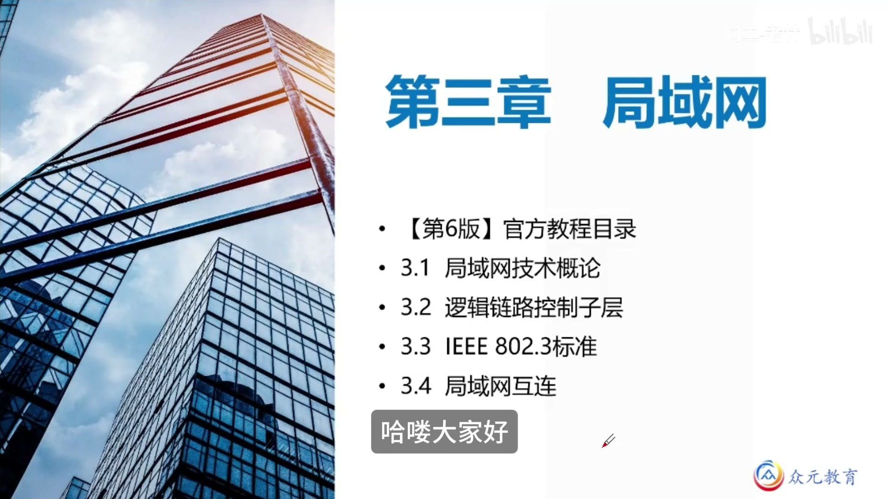
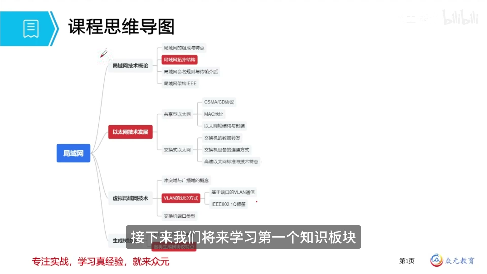
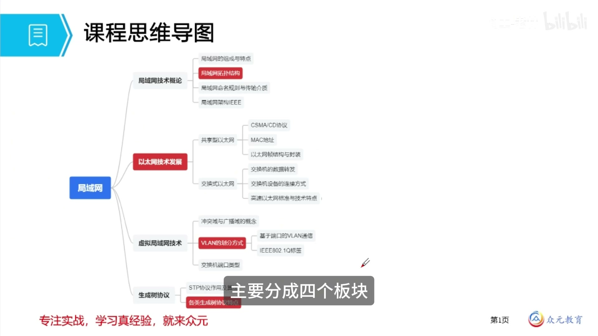
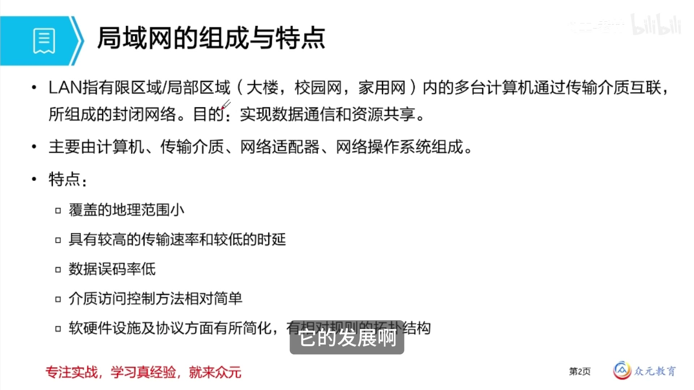
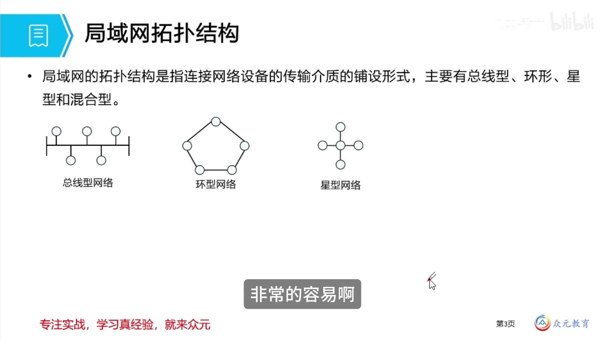
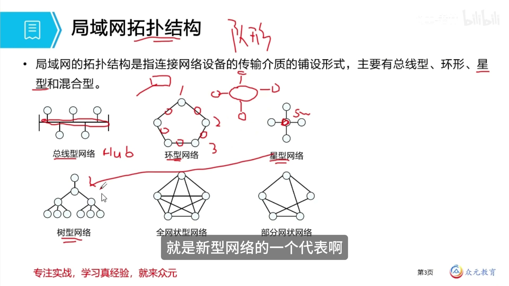
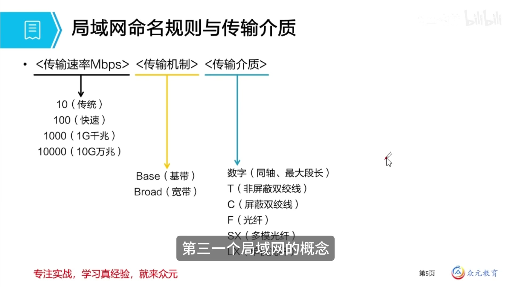
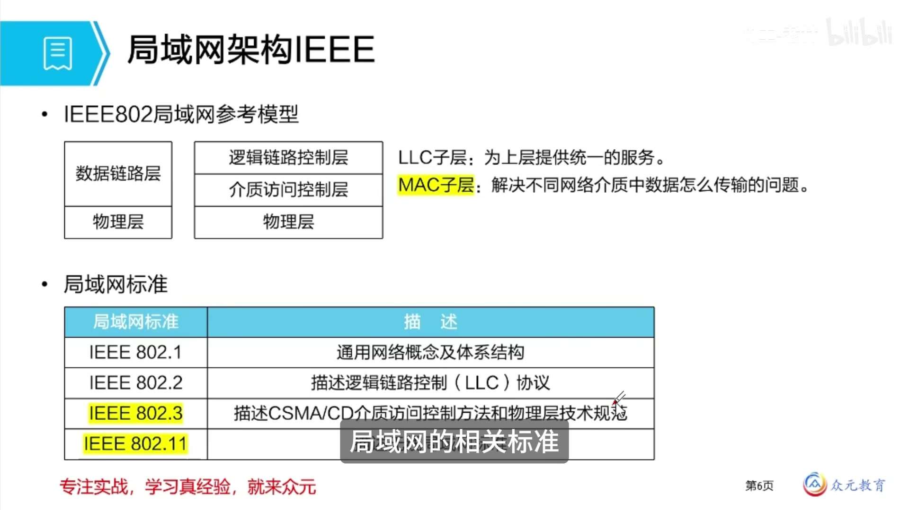
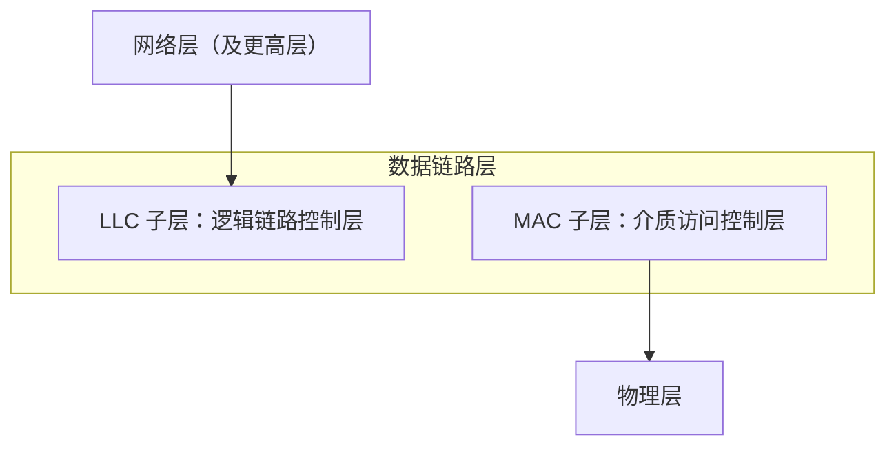

# 局域网技术概论 · 完整笔记

---

## 1.本章知识脉络



第三章为**局域网**。依据官方教程（第 6 版）目录，本章分为四节：

| 节次 | 内容 |
| ---- | ---- |
| 3.1 | 局域网技术概论 |
| 3.2 | 逻辑链路控制子层 |
| 3.3 | IEEE 802.3 标准 |
| 3.4 | 局域网互连 |

与旧版教程目录相比，本章**删除了最后一个小节「城域网」的相关知识**，其余内容没有发生变化。因此本章知识脉络较为清晰。





本章整体分为**四个板块**：

1. **局域网技术概论**：什么是局域网；它有什么特点；它的命名规则以及所采用的标准体系结构。本板块作为铺垫，便于后续学习。
2. **以太网技术发展**（经典局域网的代表，本章考核频率最高的第一个大点，务必重点学习）：
   - **共享型以太网**：早期 10 Mbit/s 以太网的技术特点、组网结构、帧结构；
   - **交换式以太网**：关键核心设备**交换机**及其使用方式，以及由设备更新换代、技术提升带来的百兆、千兆、万兆以太网；
   - **以太网标准的发展**：快速以太网、千兆以太网、万兆以太网的特点与变更、关键指标。
3. **虚拟局域网技术（VLAN）**：二层技术与协议，核心为工作原理与基本概念。
4. **生成树协议（STP）**：在交换机上的应用，解决什么问题、如何工作，以及在设备配置（组网）中如何使用。

---

## 2.局域网的概念、组成与特点



### 2.1 定义与目的

- 局域网又称 **LAN（Local Area Network）**。
- 第一章按**覆盖范围**对计算机网络进行划分，包括**个人网（PAN）、局域网（LAN）、城域网（MAN）、广域网（WAN）**。
- 局域网指覆盖范围在**有限的区域或局部区域**内的网络，通常为**几米到几公里**。
- 常见形态：办公室、楼层、校园网、家庭网络。局域网是网络工程师打交道最多的**组网环境与配网环境**。
- 局域网的目的与计算机网络的目的完全一致：**资源共享**与**数据通信**。

幻灯片给出的定义：LAN 指**有限区域/局部区域**（大楼、校园网、家用网）内的多台计算机通过传输介质互联，所组成的**封闭网络**，目的是实现数据通信和资源共享。

### 2.2 典型结构

| 层次 | 说明 |
| ---- | ---- |
| 终端 | 办公电脑（台式机、笔记本均可）等 |
| 传输介质 | 双绞线，或其它介质 |
| 交换设备 | 终端通过双绞线连接在交换机上；更大的网络会分成若干层进行管理和协调 |
| 出口设备 | 与运营商沟通的入网、出网设备，用于实现访问互联网 |

### 2.3 组成

幻灯片给出的四部分组成为：**计算机、传输介质、网络适配器、网络操作系统**，其中前三项属网络硬件，网络操作系统属网络软件。

视频从硬件角度进一步拆分为：

| 类别 | 内容 |
| ---- | ---- |
| 终端 | 计算机及其系统、上网的网卡 |
| 通信设备 | 传输介质：双绞线、光纤、WiFi 无线、微波等 |
| 交换设备 | 交换机等，用于完成对应的通信 |

### 2.4 特点

| 序号 | 特点 | 说明 |
| ---- | ---- | ---- |
| 1 | 覆盖的地理范围小 | 分类的核心标准，为几米到几千米 |
| 2 | 具有较高的传输速率和较低的时延 | 因是短距离传输 |
| 3 | 数据误码率低 | 传输介质现多采用超五类、六类双绞线和光纤等 |
| 4 | 介质访问控制方法相对简单 | — |
| 5 | 软硬件设施及协议有所简化，有相对规则的拓扑结构 | 相较于广域网等更大的网络，组织结构相对简单 |

- 第 1、2、3 条**考查较多**；简答题也要求会答「局域网具有什么样的特点」。
- 选择题可能考查「以下选项当中不属于局域网特点的是」，需对各项特点有印象。目前此类简单题已很少考查。

---

## 3.局域网拓扑结构





### 3.1 拓扑结构的概念

- 局域网的**拓扑结构**，是指连接网络设备的**传输介质的铺设形式**，可理解为组网的「队形」。
- 拓扑结构不同，网络的机制也会有细微差别。设备与线路如何连接、形成何种状态与特点，即为拓扑结构。
- 基本类型：**总线型、环形、星型、混合型**。
- 延伸类型：由星型延伸出**树型**；为提高可靠性、实现冗余而出现**网状型**。

### 3.2 总线型

- 特征：有一条**共享的传输介质**，因此又称**共享型网络结构**；其它设备都连接在这条共享介质上。
- 经典设备：**集线器（Hub）**。Hub 虽与交换机外形相似，但相当于一根完整的主线，作用是**延长距离**。
- 特点：**共享意味着抢占**，必须合理分配共享介质在什么时间给谁使用，否则容易产生**冲突**。
- 解决手段：**CSMA/CD 协议（载波监听多路访问/冲突检测）**，即后续重点学习的介质访问控制方法。

### 3.3 环形

- 主要应用于**令牌环网**。
- 形态：设备围成一个环（总线型首尾相连即构成环），设备连接在环上。
- 介质访问机制：采用**循环式访问**（而非竞争）——先轮到节点 1，节点 1 无数据则轮到节点 2，节点 2 无数据再轮到节点 3，节点 3 发送消息。
- 缺点：节点数量过多时，需等待好几轮才轮到自己，**时延比较长**；只适用于**节点数很少、短距离**的环境。
- 令牌环网也因该原因被淘汰。

### 3.4 星型

- 目前**主流、应用最广泛**的拓扑结构。
- 特征：有一个**中心节点**，该节点是**交换设备**（一般是**交换机 Switch**，不是终端）；所有设备都连接在中心节点设备上，通信由中心节点设备进行转发和处理。
- 优点：结构非常简单；传输速率快；建网方便；便于控制和管理。
- 缺点：对中心节点设备的性能要求较高；一旦中心节点出现问题，**全网瘫痪**；不便于设备之间的分类和管理。
- 正因上述缺点，延伸出**树型网络**。

### 3.5 树型

- 树型是星型网络的一个代表与延伸，特征是**能分层**。
- 结构：设有**根节点设备**，然后进行分支；分支中容易划分板块、划分结构，便于做管理性操作。
- 优缺点与星型结构相同，其独有特征在于**多了分层**。

### 3.6 网状型

- 目的：在实际网络中增加**冗余、保障安全**，避免线路故障或**单点故障**。
- 应用：一般只用在**关键节点**上，而非所有节点；如**骨干网、核心网**使用较多。
- 按连接程度分为**全网状型**与**部分网状型**（见截图）。
- （补充）网状型结构的用户数据可选择多条路由通过网络，可靠性高，但网络结构和协议比较复杂。

### 3.7 混合型

- 实际组网中更多采用**混合型**：在不同环境选择对应的组网结构来构建整个网络。
- 典型形式：**核心层、汇聚层、接入层**层层结合。
- 拓扑结构主要用于**组网**与**网络规划设计**，需要对其有印象。

### 3.8 五种拓扑结构对比

| 拓扑结构 | 连接与访问特征 | 优点 | 缺点 |
| -------- | -------------- | ---- | ---- |
| 总线型 | 共享一条传输介质，需抢占，采用 CSMA/CD；典型设备为 Hub | 共享介质、结构简单、便于延长距离 | 需抢占共享介质，容易产生冲突 |
| 环形 | 循环式访问（令牌传递），设备围成环 | 访问方式确定，无竞争 | 节点数增多时延时增大，仅适合节点少、短距离环境 |
| 星型 | 中心节点（交换机）集中转发 | 结构简单、传输速率快、建网方便、便于控制和管理 | 中心节点性能要求高，故障则全网瘫痪，不便于分类管理 |
| 树型 | 星型的延伸，可分层，设有根节点设备 | 可分层，便于划分板块结构与管理 | 与星型相同（依赖上层节点） |
| 网状型 | 多路径冗余连接（全网状/部分网状） | 可靠性高，避免单点故障 | 结构与协议相对复杂，一般只用于关键节点 |
| 混合型 | 多种拓扑组合（如核心层、汇聚层、接入层） | 因地制宜，适应不同环境 | — |

重点关注：**总线型的特点**与**星型的特点**。

---

## 4.局域网命名规则与传输介质



### 4.1 传输介质

- 传输介质分**有线**与**无线**两类：
  - 有线：**同轴电缆、双绞线、光纤**；
  - 无线：**微波、红外线、激光**等（第二章已介绍）。
- 局域网中常用的线缆为**双绞线**与**光纤**，需要加以区别。

### 4.2 命名规则

局域网通常采用形如 `100BASE-T` 的名称，用于描述其**物理层规范**。命名由三部分组成：

```
<传输速率 Mbps> <传输机制> <传输介质>
```

各部分取值如下：

| 部分 | 取值 | 含义 |
| ---- | ---- | ---- |
| 传输速率 | 10（传统）、100（快速）、1000（1G 千兆）、10000（10G 万兆） | 单位 Mbit/s |
| 传输机制 | Base（基带）、Broad（宽带） | 基带：未经处理的原始（数字）信号；宽带：经过调制处理的（模拟）信号（也叫频带） |
| 传输介质 | 数字、T、C、F、SX、LX 等 | 见下表 |

传输介质代号及其含义：

| 代号 | 含义 |
| ---- | ---- |
| 数字 | 同轴电缆；数字表示该同轴电缆能传输的最远距离/最大段长（以 100 米为单位向上取整） |
| T | 非屏蔽双绞线（UTP） |
| C | 屏蔽双绞线 |
| F | 光纤 |
| SX | S 为 Short（短波），即**多模光纤** |
| LX | L 为 Long（长波），即**单模光纤** |

说明：
- 目前以太网的传输机制通常都是**基带**，因其更优。
- 「数字表示最大段长」的规则举例：`10BASE5` 的 5 表示 500 米，`10BASE2` 的 2 表示 185 米（约合 200 米），`10BROAD36` 的 36 表示 3600 米。
- 关于代号 `C`：本课幻灯片表述为「屏蔽双绞线」；在 IEEE 802.3 命名体系中，C 亦用于表示铜缆（如 `1000BASE-CX`），学习时以教材表述为准。

### 4.3 命名规则实例分析（例题）

**题干**：下列四个局域网名称（传输速率均为 10 Mbit/s），请分别提取其传输速率、传输机制与传输介质。

| 名称 | 传输速率 | 传输机制 | 传输介质 | 最大段长 |
| ---- | -------- | -------- | -------- | -------- |
| 10BASE5 | 10 Mbit/s | 基带（Base） | 粗同轴电缆 | 500 m |
| 10BASE-T | 10 Mbit/s | 基带（Base） | 非屏蔽双绞线（UTP） | 100 m |
| 10BASE-F | 10 Mbit/s | 基带（Base） | 光纤 | — |
| 10BROAD36 | 10 Mbit/s | 宽带（Broad） | 同轴电缆（CATV，广播电视电缆） | 3600 m |

**解析**：

1. **传输速率**：四者均为 10 Mbit/s，即传统以太网。
2. **传输机制**：`10BASE5`、`10BASE-T`、`10BASE-F` 三个为**基带**（未经处理的原始数字信号）；`10BROAD36` 为**宽带**（调制过的模拟信号）。
3. **传输介质**：
   - `5` 为纯数字，代表**粗同轴电缆**，最大段长 **500 米**（不是 5 米）；
   - `T` 为**非屏蔽双绞线**，最大段长 **100 米**；
   - `36` 亦为同轴电缆，指 **CATV（广播电视）电缆**；
   - `F` 为**光纤**。
4. **考查提示**：以上标准多已淘汰，了解即可；考试中考查频率较高的是 **T（双绞线）** 与**光纤**，尤其是**多模光纤与单模光纤的区别**，注意区分。

---

## 5.局域网体系结构与标准



### 5.1 IEEE 802 参考模型

- 局域网的体系结构标准由 **IEEE**（美国电气和电子工程师协会）制定和描述。
- IEEE 802 参照 OSI 参考模型，主要划分为**三层**：
  1. **逻辑链路控制层（LLC，Logical Link Control）**；
  2. **介质访问控制层（MAC，Medium Access Control）**；
  3. **物理层（PHY）**。
- 其中 **LLC 子层与 MAC 子层共同归属于数据链路层**。



- 将数据链路层进一步细分的原因：把**与硬件相关**和**与硬件无关**的部分区分开来，便于更简单地研究与实现，降低复杂度。
- 现状：目前 **LLC 子层已名存实亡，不再使用**；现在讲到数据链路层，一般指的都是 **MAC**，很少再讲 LLC 子层。学习时仍需了解其结构与变更。

### 5.2 LLC 子层与 MAC 子层

| 子层 | 主要作用 |
| ---- | -------- |
| LLC 子层 | 为上层提供统一的服务，即上下层之间的接口（服务访问点 SAP）；早期为上层提供服务的一个接口 |
| MAC 子层 | 解决不同网络介质中数据怎么传输的问题，即共享介质如何传输、如何分配使用 |

- 幻灯片原文：**LLC 子层：为上层提供统一的服务。MAC 子层：解决不同网络介质中数据怎么传输的问题。**
- 视频以**服务访问点（SAP）**作类比：网络层的服务访问点可理解为 **IP 地址**，数据链路层为 **MAC 地址**。

**本板块重点关注两点**：

1. IEEE 802 局域网模型的工作层次为**下两层**——**物理层与数据链路层**；
2. 在 IEEE 802 体系结构中，**数据链路层又分为两个子层**：**LLC 子层（逻辑链路控制层）**与 **MAC 子层（介质访问控制层）**。后续知识点增多时容易记混，需注意区分。

### 5.3 IEEE 802 标准系列

幻灯片「局域网标准」表：

| 局域网标准 | 描述 |
| ---------- | ---- |
| IEEE 802.1 | 通用网络概念及体系结构 |
| IEEE 802.2 | 描述逻辑链路控制（LLC）协议 |
| IEEE 802.3 | 描述 CSMA/CD 介质访问控制方法和物理层技术规范（重点，考试频度高） |
| IEEE 802.11 | 无线局域网相关标准 |

- IEEE 802 标准是**逐步发展**形成的，并非一次性全部制定好，犹如文献的初稿、第一版、第二版、最终定稿。
- **IEEE 802.1**：提出物理层相关内容、网络的概念、体系结构等。
- **IEEE 802.2**：描述 LLC 的功能与作用。
- **IEEE 802.3**：介绍传统以太网的技术指标，尤其是 **CSMA/CD 协议**（解决介质传输的一种方式手段），是必须重点学习的标准。
- **IEEE 802.11**：无线局域网相关标准，有多个发展、变更版本，如 **802.11g、802.11n、802.11ac** 等；在局域网标准规范中是一张很大、很广泛的表格，不止幻灯片列出的四个。
- **IEEE 802.4（令牌总线）、IEEE 802.5（令牌环网）** 已经淘汰。
- 考试频率较高的即 **802.1、802.2、802.3、802.11** 四个点，需知道其关键内容；其中 **802.3 以太网标准一定要记，考得较多**，**802.11 无线局域网标准一定要认识，包括它的分支项**。

IEEE 802 系列标准对照（补充核实）：

| 标准 | 内容 | 现状 |
| ---- | ---- | ---- |
| IEEE 802.1 | 高层局域网协议、网络互连（桥接）与体系结构 | 现行 |
| IEEE 802.2 | 逻辑链路控制（LLC）子层 | 已名存实亡（工作组已解散） |
| IEEE 802.3 | CSMA/CD 介质访问控制方法与物理层规范，即以太网（Ethernet） | 现行 |
| IEEE 802.4 | 令牌总线（Token Bus） | 已淘汰（工作组已解散） |
| IEEE 802.5 | 令牌环（Token Ring） | 已淘汰（工作组已解散） |
| IEEE 802.11 | 无线局域网（WLAN，Wi-Fi） | 现行 |
| IEEE 802.15 | 无线个域网（WPAN，如蓝牙） | 现行 |
| IEEE 802.16 | 宽带无线接入（BWA，WiMAX） | 现行 |

### 5.4 介质访问控制方法

| 介质访问控制方法 | 对应标准 | 说明 |
| ---------------- | -------- | ---- |
| CSMA/CD | IEEE 802.3 | 载波监听多路访问/冲突检测，用于总线型共享介质以太网 |
| 令牌总线 | IEEE 802.4 | 令牌传递，物理上为总线、逻辑上为环（已淘汰） |
| 令牌环 | IEEE 802.5 | 令牌传递，物理上为环（已淘汰） |
| CSMA/CA | IEEE 802.11 | 载波监听多路访问/冲突避免，用于无线局域网 |

---

## 6.本章小结

| 知识点 | 核心内容 |
| ------ | -------- |
| 1. 本章脉络 | 四个板块：局域网技术概论、以太网技术发展、虚拟局域网技术、生成树协议；第 6 版目录为 3.1~3.4，删除了「城域网」 |
| 2. 局域网概念 | LAN：有限/局部区域（几米到几公里）内多台计算机通过传输介质互联组成的封闭网络；目的为资源共享与数据通信 |
| 3. 局域网组成 | 计算机、传输介质、网络适配器、网络操作系统（网络硬件与网络软件）；典型结构为终端、交换设备、出口设备 |
| 4. 局域网特点 | 覆盖地理范围小；传输速率高、时延低；数据误码率低；介质访问控制方法相对简单；软硬件及协议简化、拓扑结构相对规则 |
| 5. 拓扑结构 | 总线型（共享介质、需抢占、CSMA/CD）、环形（令牌环、循环访问、时延大）、星型（中心节点交换机集中转发）、树型（星型延伸、可分层）、网状型（关键节点冗余）、混合型 |
| 6. 命名规则 | `<速率> <机制> <介质>`；Base 基带、Broad 宽带；数字=同轴最大段长（×100 米）、T=非屏蔽双绞线、C=屏蔽双绞线、F=光纤、SX=多模光纤、LX=单模光纤 |
| 7. IEEE 802 模型 | 三层：LLC、MAC、物理层；LLC 与 MAC 归属数据链路层；LLC 已名存实亡，现一般指 MAC |
| 8. IEEE 802 标准 | 802.1 通用概念及体系结构；802.2 LLC；802.3 CSMA/CD 与物理层（以太网）；802.11 无线局域网；802.4 令牌总线、802.5 令牌环已淘汰 |
| 9. 介质访问控制 | CSMA/CD 对应 802.3；令牌总线对应 802.4；令牌环对应 802.5；CSMA/CA 对应 802.11 |

考试重点：

1. 局域网的**三条核心特点**：覆盖地理范围小、传输速率高且时延低、数据误码率低，简答题也需会答。
2. 重点掌握**总线型**与**星型**拓扑结构的特点：总线型共享介质、需要抢占；星型由中心节点（交换机）集中转发，中心节点故障则全网瘫痪。
3. 命名规则的拆分与识别：`10BASE5`（粗同轴，500 米）、`10BASE-T`（非屏蔽双绞线，100 米）、`10BASE-F`（光纤）、`10BROAD36`（CATV 同轴，3600 米）；尤其掌握 T 与光纤，并区分多模光纤与单模光纤。
4. IEEE 802 局域网参考模型工作于**下两层**（物理层与数据链路层），且数据链路层又分为 **LLC 子层**与 **MAC 子层**。
5. **IEEE 802.3 以太网标准**与 **IEEE 802.11 无线局域网标准**必记；802.11 还需认识其分支项（如 802.11g、802.11n、802.11ac）。
6. 介质访问控制方法与标准的对应关系：CSMA/CD 对应 802.3、令牌总线对应 802.4、令牌环对应 802.5、CSMA/CA 对应 802.11。
