# 以太网技术 · 完整笔记

---

本笔记覆盖以太网技术的两个组成部分：共享式以太网与交换式以太网。共享式以太网的重点是 CSMA/CD、争用期与最小帧长、MAC 地址和以太网帧结构；交换式以太网的重点是交换机自学习、转发/过滤/泛洪、冲突域与广播域、交换机连接方式以及高速以太网标准。

## 1.以太网概述与分类

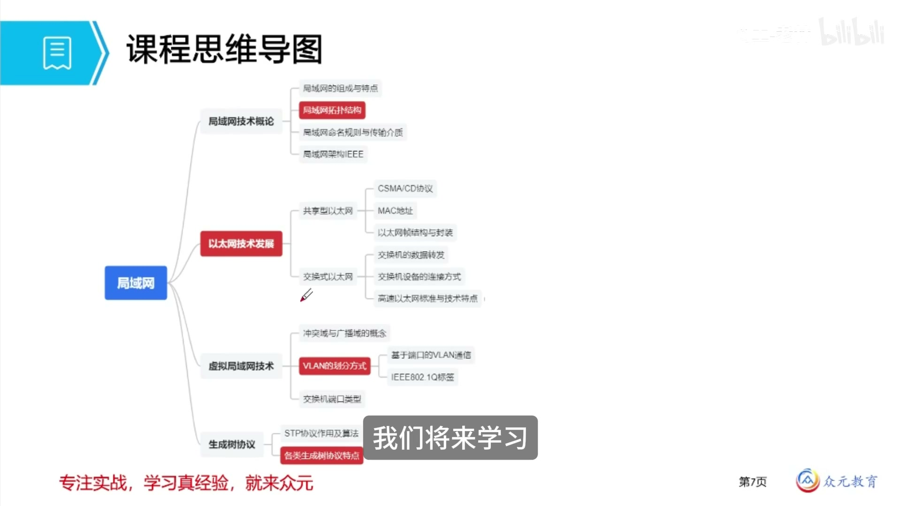

以太网属于局域网技术中的第二个知识板块。局域网整体知识脉络可概括为：

| 分支 | 主要内容 |
| ---- | -------- |
| 局域网技术概论 | 局域网的组成与特点、局域网拓扑结构、局域网命名规则与传输介质、局域网架构与 IEEE 标准 |
| 以太网技术发展 | 共享型以太网：CSMA/CD 协议、MAC 地址、以太网帧结构与封装；交换式以太网：交换机数据转发、交换机设备连接方式、高速以太网标准与技术特点 |
| 虚拟局域网技术 | 冲突域与广播域的概念、VLAN 的划分方式（基于端口的 VLAN 通信、IEEE 802.1Q 标签）、交换机端口类型 |
| 生成树协议 | STP 协议的作用及算法、各类生成树协议的特点 |

本章只讨论“以太网技术发展”这一分支。

### 1.1 以太网的地位与优点

以太网具有**成本低、可靠性高、安装简便、维护和扩展容易**等优点，已经成为局域网的典型代表。

按照组网形态和特点，以太网大致分为两类：

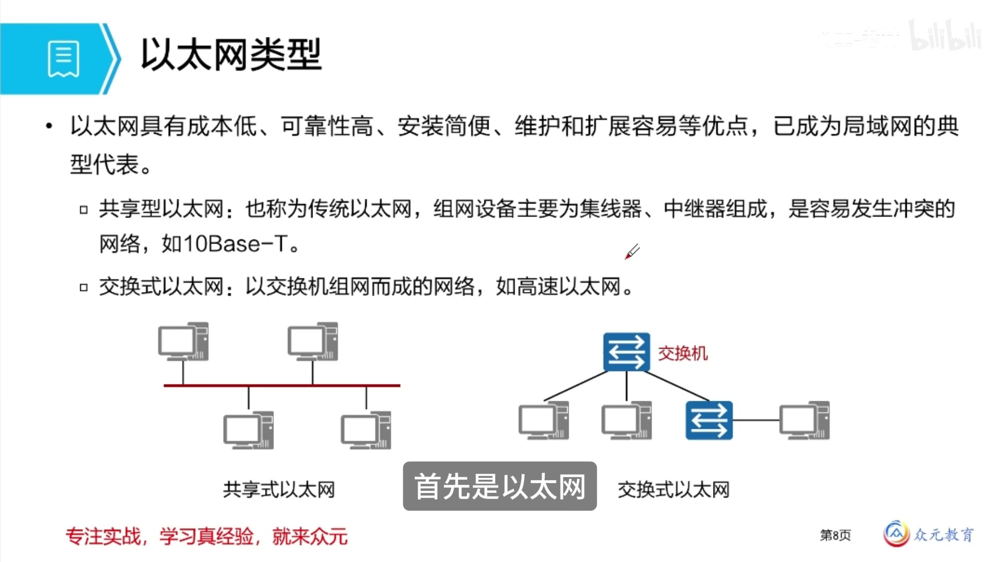

| 类型 | 别称 | 组网设备 | 典型标准 | 主要特点 |
| ---- | ---- | -------- | -------- | -------- |
| 共享型以太网 | 传统以太网、早期以太网、十兆以太网 | 集线器、中继器 | 10Base-T 等 | 总线型组网，共享介质，容易发生冲突 |
| 交换式以太网 | 高速以太网 | 交换机 | 100Base-TX、1000Base-T、10GBASE-T 等 | 以交换机组网，速率更高，端口独享带宽 |

### 1.2 共享式以太网

共享式以太网是早期的以太网形态，其基本特征如下：

- 采用**总线型拓扑**，所有站点连接在同一条共享信道上。
- 关键设备为**集线器（Hub）**和**中继器（Repeater）**，二者主要用于延长传输距离、扩展端口数量。
- 集线器本质上是一条**共享信道**，所有端口处于同一个冲突域。
- 多个站点同时发送时会发生**冲突**，因此需要 CSMA/CD 协议解决共享介质的分配问题。
- 采用**半双工**工作方式，同一时刻只能有一个站点发送。
- 数据以**广播式**发送，所有站点都能收到，再由网卡根据目的 MAC 地址判断是否接收。

### 1.3 交换式以太网

交换式以太网以**交换机**为核心设备。这里的交换机主要指**二层交换机**，即工作在数据链路层、以 MAC 地址表为依据转发数据帧的设备。

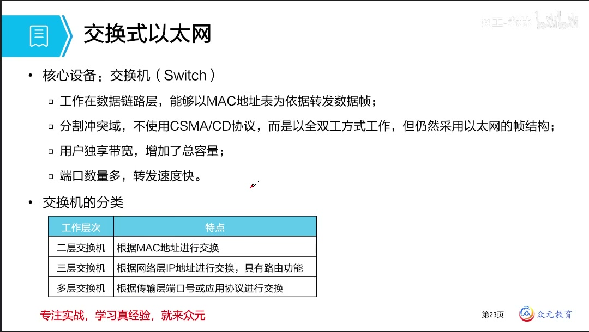

| 特征 | 说明 |
| ---- | ---- |
| 工作层次 | 数据链路层（二层交换机） |
| 转发依据 | MAC 地址表 |
| 冲突域 | **分割冲突域**，每个端口通常是一个独立的冲突域 |
| 介质访问 | 全双工工作时**不使用 CSMA/CD** |
| 帧结构 | 仍然采用以太网帧结构和 MAC 地址 |
| 带宽 | 用户**独享端口带宽**，交换机总容量增加 |
| 端口与速度 | 端口数量多，转发速度快 |

交换机按工作层次可分为：

| 类型 | 工作层次 | 转发依据 | 特点 |
| ---- | -------- | -------- | ---- |
| 二层交换机 | 数据链路层 | MAC 地址 | 本章重点，基于 MAC 地址表交换 |
| 三层交换机 | 网络层 | IP 地址 | 具有路由功能，大型局域网核心层常用 |
| 多层交换机 | 传输层或应用层 | 端口号、应用协议 | 可进行更高层交换 |

工程实践中，大型局域网的核心层常部署三层交换机承担 VLAN 间路由，路由器更多用于广域网或外网出口。

### 1.4 两类以太网对比

| 比较项 | 共享式以太网 | 交换式以太网 |
| ------ | ------------ | ------------ |
| 典型拓扑 | 总线型；使用双绞线时多为星型 | 星型、树型 |
| 核心设备 | 集线器、中继器 | 交换机 |
| 介质访问控制 | CSMA/CD | 全双工下不需要 CSMA/CD |
| 双工方式 | 半双工 | 以全双工为主，也可半双工 |
| 冲突域 | 整个共享介质为一个冲突域 | 每个交换机端口一个冲突域 |
| 带宽 | 所有站点共享 | 每个端口独享 |
| 广播域 | 一个 | 一个（未划分 VLAN 时） |
| 典型速率 | 10 Mbps | 100 Mbps、1000 Mbps、10 Gbps |

## 2.共享式以太网的三个核心问题

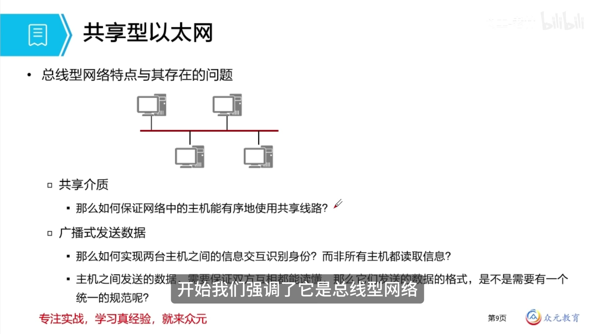

共享式以太网是总线型网络，其核心特征可以归纳为“共享介质”和“广播式发送”。由此产生三个必须解决的问题：

| 问题 | 具体表现 | 解决机制 |
| ---- | -------- | -------- |
| 如何保证主机有序使用共享线路 | 多个站点同时发送会产生冲突 | CSMA/CD 协议 |
| 广播式发送下如何识别身份 | 所有站点都能收到数据，但只有目标站点需要接收 | MAC 地址 |
| 双方如何读懂对方的数据 | 不同上层协议的数据需要统一封装 | 以太网帧格式 |

### 2.1 总线型拓扑与共享介质

总线型拓扑中，所有站点连接在同一条总线上，总线是各站点共用的传输介质。任一站点发送的信号都会沿总线向两端传播，因此：

- 同一时刻只允许一个站点成功发送，否则信号叠加形成冲突。
- 冲突会导致帧损坏，发送方必须能够检测冲突并重发。
- 站点数量越多、流量越大，冲突概率越高，共享式以太网的效率越低。

### 2.2 广播式发送与身份识别

共享式以太网采用广播式发送：一个站点发出的数据，物理上会到达同一共享介质上的所有站点。网卡收到帧后，根据帧中的**目的 MAC 地址**判断：

- 目的地址与本机 MAC 地址相同：接收并上交上层。
- 目的地址为广播地址或本机所属的组播地址：接收。
- 目的地址与本机无关：丢弃。

因此，MAC 地址是共享式以太网实现“广播发送、点对点接收”的身份标识。

### 2.3 统一帧格式

数据在网络中采用分层封装：网络层是 IP 包，传输层是 TCP 段或 UDP 段，数据链路层是以太网帧。以太网帧由头部、数据和尾部组成，头部中包含目的 MAC、源 MAC、类型/长度等字段，尾部包含帧检验序列 FCS。统一帧格式保证不同厂商、不同上层协议的主机能够互相通信。

## 3.CSMA/CD 协议

CSMA/CD 是 IEEE 802.3 定义的一种**竞争型 MAC 子层协议**，由两部分组成：

- **CSMA（Carrier Sense Multiple Access，载波监听多路访问）**：解决“发送前如何判断信道是否空闲”。
- **CD（Collision Detection，冲突检测）**：解决“发送过程中发生冲突怎么办”。

### 3.1 CSMA：先听后发

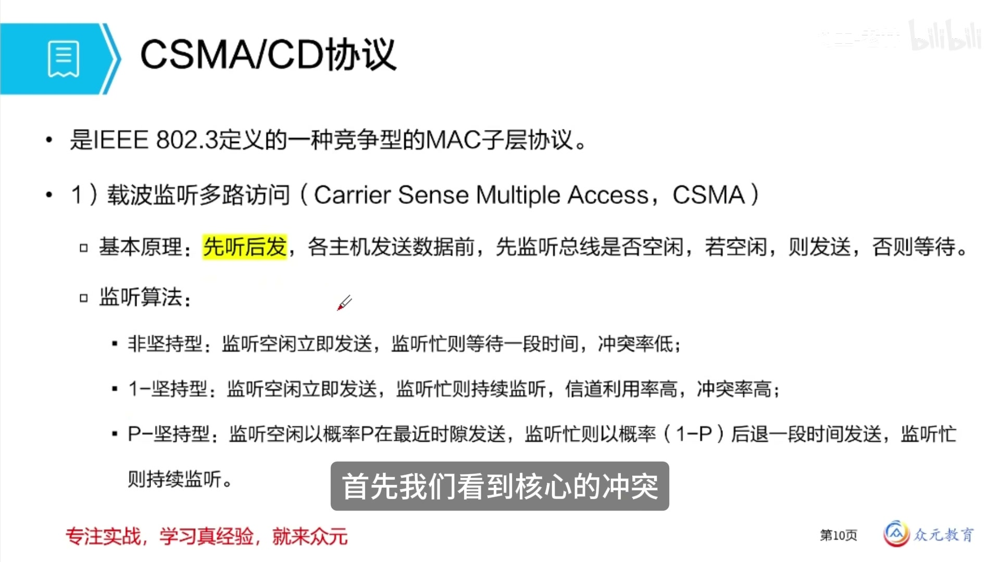

CSMA 的基本原理是**先听后发**：

1. 各主机发送数据前，先监听总线是否空闲。
2. 若总线空闲，则发送数据。
3. 若总线忙，则等待，直到信道空闲后再发送。

“多路访问”表示多个站点共享同一介质，都可以竞争使用信道。

### 3.2 三种监听算法

根据“发现信道忙之后如何等待”，CSMA 分为三种监听算法：

| 算法 | 信道空闲时 | 信道忙时 | 冲突概率 | 信道利用率 | 特点 |
| ---- | ---------- | -------- | -------- | ---------- | ---- |
| 非坚持型 | 立即发送 | 随机等待一段时间后再监听 | 低 | 低 | 退避期间可能错过信道空闲，造成信道浪费 |
| 1-坚持型 | 立即发送 | 持续监听，一旦空闲立即发送 | 高 | 高 | 多个站点同时等待时容易一起抢占，冲突率高 |
| P-坚持型 | 以概率 P 在最近时隙发送，以概率 1−P 推迟 | 持续监听，空闲后按概率 P 发送 | 中等 | 较高 | 非坚持型与 1-坚持型的折中 |

考试结论：

- **冲突率**：1-坚持型最高，非坚持型最低，P-坚持型居中。
- **信道利用率**：1-坚持型最高，非坚持型最低，P-坚持型居中。
- 1-坚持型“立即发送”的关键词是“继续监听、空闲后立即发送”；非坚持型的关键词是“等待一段时间后再监听”。

### 3.3 CD：边发边听

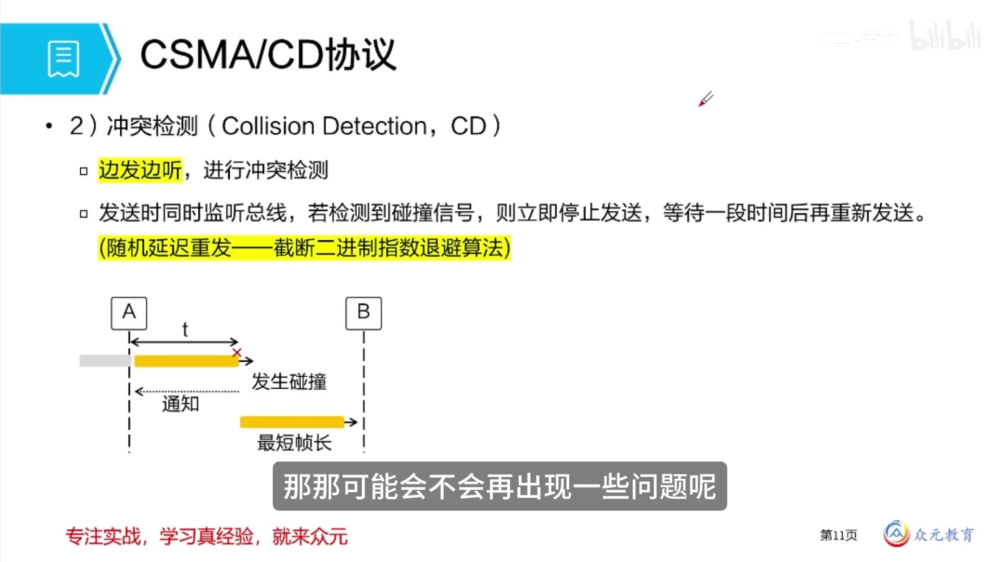

冲突检测的基本原理是**边发边听**：

1. 站点在发送数据的同时，持续监听总线状态。
2. 通过比较发送信号与接收信号，判断是否发生碰撞。
3. 若检测到碰撞信号，立即停止发送，并发送干扰信号（Jam），使所有站点都能确认冲突。
4. 等待一段随机时间后，重新发送；随机延迟重发采用**截断二进制指数退避算法**。

冲突检测的意义在于“及时止损”：一旦发现冲突，立即停止已经无效的发送，避免继续占用信道。

### 3.4 CSMA/CD 的完整工作流程

| 步骤 | 动作 | 说明 |
| ---- | ---- | ---- |
| 1 | 载波监听 | 发送前检测信道是否空闲 |
| 2 | 空闲则发送 | 若空闲，立即发送；若忙，等待 |
| 3 | 边发边听 | 发送过程中持续检测冲突 |
| 4 | 冲突处理 | 检测到冲突后立即停止发送，发送 Jam 信号 |
| 5 | 随机退避 | 按截断二进制指数退避算法等待 |
| 6 | 重传或放弃 | 退避结束后重传；连续 16 次失败则丢弃该帧并向高层报告 |

### 3.5 CSMA/CD 的适用条件

CSMA/CD 适用于**半双工、共享介质的以太网**。在交换式以太网的全双工点对点链路中，发送和接收使用独立的通道，不会发生冲突，因此不需要 CSMA/CD。

| 速率 | 双工与 CSMA/CD |
| ---- | -------------- |
| 10 Mbps | 半双工使用 CSMA/CD；全双工不使用 |
| 100 Mbps | 半双工使用 CSMA/CD；全双工不使用 |
| 1000 Mbps | 保留半双工和 CSMA/CD，但实际极少使用；全双工为主流 |
| 10 Gbps | 只支持全双工，不再使用 CSMA/CD |

## 4.争用期与最小帧长

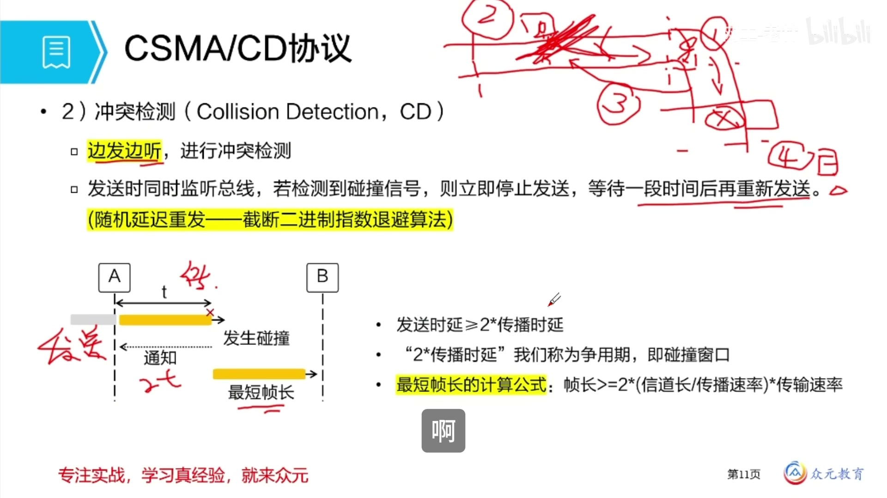

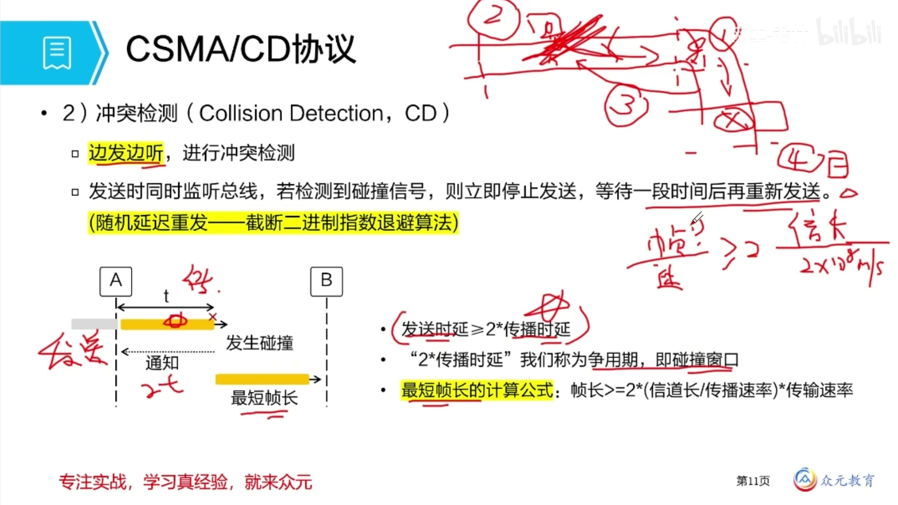

### 4.1 争用期 2τ

设信道两端之间的单程传播时延为 τ，则**争用期**（又称碰撞窗口、冲突窗口）为：

```
争用期 = 2τ = 2 × 传播时延
```

其中：

```
τ = 信道长度 ÷ 信号传播速率
```

争用期的物理含义是：站点发送信号后，最坏情况下冲突发生在信道最远端，冲突信号再传回发送方，需要经过一个往返传播时延 2τ。只有经过 2τ 后仍未检测到冲突，发送方才能确认本次发送没有发生冲突。

### 4.2 最小帧长公式

为了保证发送方在发送完整个帧之前能够检测到冲突，帧的发送时延必须不小于争用期：

```
发送时延 ≥ 2τ
帧长 ÷ 数据传输速率 ≥ 2 × (信道长度 ÷ 传播速率)
帧长 ≥ 2 × (信道长度 ÷ 传播速率) × 数据传输速率
```

即：

```
L_min ≥ 2 × (D ÷ v) × R
```

| 符号 | 含义 | 单位 |
| ---- | ---- | ---- |
| L_min | 最小帧长 | bit |
| D | 信道长度 | m |
| v | 信号传播速率 | m/s |
| R | 数据传输速率 | b/s |
| τ | 单程传播时延 | s |

### 4.3 10 Mbps 下 64 字节与 512 bit 的关系

10 Mbps 以太网的标准争用期为 **51.2 μs**。在 51.2 μs 内，10 Mbps 的发送方能发送的比特数为：

```
10 × 10^6 b/s × 51.2 × 10^-6 s = 512 bit
512 bit ÷ 8 = 64 字节
```

因此，10 Mbps 以太网的最小帧长为 **64 字节（512 bit）**。这个 64 字节包括：

| 字段 | 字节数 |
| ---- | ------ |
| 目的 MAC 地址 | 6 |
| 源 MAC 地址 | 6 |
| 类型/长度 | 2 |
| 数据（含填充） | 46 |
| FCS | 4 |
| 合计 | 64 |

注意：**前导码和帧开始定界符不计入最小帧长**。最小帧长从目的 MAC 地址开始，到 FCS 结束。

### 4.4 不同速率的争用期与最小帧长

| 速率 | 争用期（512 bit 时间） | 最小帧长 | 说明 |
| ---- | ---------------------- | -------- | ---- |
| 10 Mbps | 51.2 μs | 64 字节 | 标准值 |
| 100 Mbps | 5.12 μs | 64 字节 | 速率提高 10 倍，争用期缩短为 1/10 |
| 1000 Mbps | 512 ns（512 bit 时间） | 64 字节 | 半双工采用载波扩展，把争用期扩展到 512 字节；全双工不使用 CSMA/CD |
| 10 Gbps | 不支持半双工 | 64 字节 | 只支持全双工，不使用 CSMA/CD |

100 Mbps 以太网要在 5.12 μs 内完成往返冲突检测，因此其最大网络直径比 10 Mbps 以太网小得多。千兆以太网若仍采用 64 字节最小帧，512 bit 的发送时间只有 512 ns，传播距离太短，因此半双工千兆以太网引入**载波扩展**，把争用期扩展为 512 字节（4096 bit）。

### 4.5 最大帧长与 MTU

| 参数 | 数值 | 含义 |
| ---- | ---- | ---- |
| 最小帧长 | 64 字节 | 保证冲突检测 |
| 最小数据字段 | 46 字节 | 不足时由填充字段补齐 |
| 最大数据字段（MTU） | 1500 字节 | 以太网承载的网络层数据最大长度 |
| 最大帧长 | 1518 字节 | 6 + 6 + 2 + 1500 + 4 |
| 带 802.1Q 标签的最大帧长 | 1522 字节 | 增加 4 字节 VLAN 标签 |

### 4.6 为什么距离越远、速率越高越容易漏检

- **距离越远**：τ 越大，2τ 越大，冲突信号返回发送方所需时间越长。
- **速率越高**：同样长度的帧发送时间越短，发送方可能在冲突信号返回之前就已经发送完毕。
- 若帧在冲突信号返回前发送完毕，发送方不会检测到冲突，也就不会重传，CSMA/CD 失效。

因此，最小帧长、争用期和最大网络直径三者相互制约。

## 5.截断二进制指数退避算法

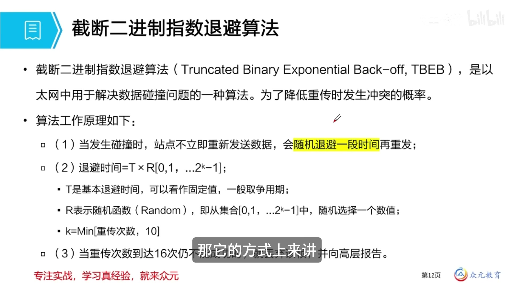

### 5.1 算法目的

截断二进制指数退避算法（Truncated Binary Exponential Back-off，TBEB）用于以太网中解决数据碰撞后的重传问题。其目的是通过随机退避，**降低重传时再次发生冲突的概率**。

发生冲突后，站点不立即重发，而是随机退避一段时间再重发。随机化使同时冲突的站点错开发送时间。

### 5.2 退避时间的计算

```
退避时间 = T × R
R ∈ {0, 1, 2, …, 2^k − 1}
k = min(重传次数, 10)
```

| 符号 | 含义 |
| ---- | ---- |
| T | 基本退避时间，一般取争用期 2τ |
| R | 随机函数，从集合 {0, 1, …, 2^k−1} 中随机选取一个整数 |
| k | 重传次数与 10 的较小值，即 k = min(n, 10) |
| n | 当前重传次数（第 1 次重传时 n=1） |

要点：

- 退避时间以**争用期**为单位，不是以帧发送时间为单位。
- 重传次数越多，退避窗口 2^k 越大，可选等待时间范围越大。
- k 最大取 10，因此最大退避窗口为 2^10 = 1024 个争用期，这就是“截断”的含义。
- 随机退避只能**降低**再次冲突的概率，不能杜绝冲突。

### 5.3 重传次数与失败处理

| 重传次数 | k 取值 | 可选 R 的范围 |
| -------- | ------ | ------------- |
| 1 | 1 | 0～1 |
| 2 | 2 | 0～3 |
| 3 | 3 | 0～7 |
| … | … | … |
| 10 | 10 | 0～1023 |
| 11～15 | 10 | 0～1023 |
| 16 | — | 丢弃该帧，向高层报告 |

当重传次数达到 **16 次**仍不成功时，站点丢弃该帧，并向高层报告。此时通常说明网络存在严重故障、线路质量差或网络拥塞。

### 5.4 再次冲突概率

两个站点在第 n 次冲突后再次冲突，意味着二者从同一个退避窗口中选择到了相同的 R 值。窗口大小为 2^k，因此：

```
两个站点再次冲突的概率 = 1 ÷ 2^k
```

若有 N 个站点同时竞争，则所有站点选到同一个 R 值的概率为：

```
再次冲突概率 = 1 ÷ (2^k)^(N−1)
```

考试中最常见的是两个站点的情况。例如连续冲突 3 次后，k=3，窗口为 8，两个站点再次冲突的概率为 1/8。

### 5.5 计算示例

题目：在 100Base-T 以太网中，若争用时间片为 25.6 μs，某站点在发送帧时已经连续 3 次冲突，则基于二进制指数退避算法，该站点需等待的最短和最长时间分别是多少？再次发生冲突的概率是多少？

计算：

```
T = 25.6 μs
k = min(3, 10) = 3
R ∈ {0, 1, 2, …, 2^3 − 1} = {0, 1, 2, …, 7}
最短退避时间 = 25.6 × 0 = 0 μs
最长退避时间 = 25.6 × 7 = 179.2 μs
再次冲突概率 = 1 ÷ 2^3 = 1/8
```

答案：最短 0 μs，最长 179.2 μs，再次冲突概率 1/8。

说明：100Base-T 的标准争用期是 5.12 μs，本题给定的 25.6 μs 与标准值不一致，可能是题目设定或笔误。考试中应按题干给定值计算，不要擅自替换为标准值。

### 5.6 算法特点与考试结论

| 结论 | 说明 |
| ---- | ---- |
| 退避时间是随机的 | 不是固定值，也不是简单地每次翻倍 |
| 后一次退避时间不一定比前一次长 | 随机数可能取 0，下一次可能立即发送 |
| 冲突次数少的设备优先 | 冲突次数少，退避窗口小，更容易先发送 |
| 不能杜绝冲突 | 只能降低再次冲突的概率 |
| 重传 16 次失败后丢弃 | 向高层报告，不再无限重传 |
| k 最大为 10 | 退避窗口最大为 1024 个争用期 |

## 6.MAC 地址

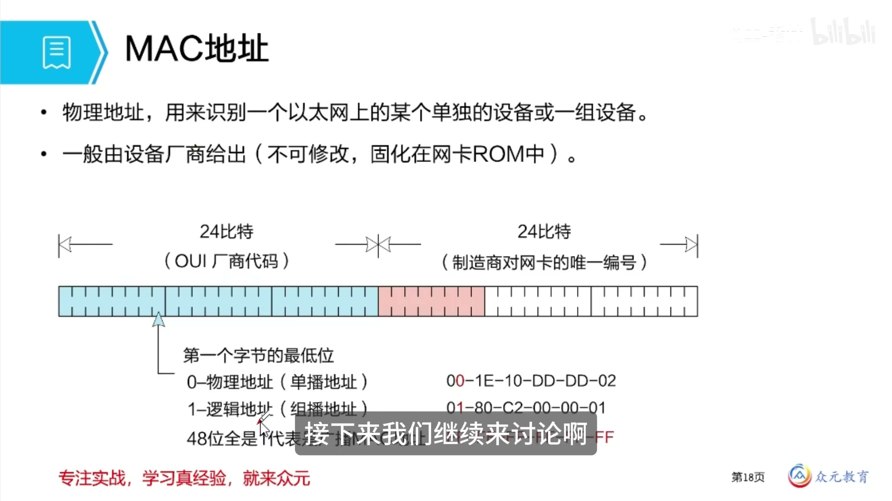

### 6.1 MAC 地址的结构

MAC 地址（物理地址、硬件地址）用于识别以太网上的某个单独设备或一组设备，工作在数据链路层。

| 部分 | 长度 | 含义 |
| ---- | ---- | ---- |
| OUI（组织唯一标识符） | 24 bit（3 字节） | 由 IEEE 分配给设备厂商的厂商代码 |
| 扩展标识 | 24 bit（3 字节） | 制造商对网卡的唯一编号 |
| 总长度 | 48 bit（6 字节） | 通常写成 12 位十六进制数 |

书写格式示例：

```
00-1E-10-DD-DD-02
00:1E:10:DD:DD:02
```

前 3 字节 `00-1E-10` 是厂商代码，后 3 字节 `DD-DD-02` 是厂商分配给该网卡的编号。

### 6.2 单播、组播、广播

MAC 地址的第一个字节的最低位称为 **I/G 位（Individual/Group）**，用于区分单播和组播：

| 类型 | I/G 位 | 含义 | 示例 |
| ---- | ------ | ---- | ---- |
| 单播地址 | 0 | 一对一，标识单个网络接口 | `00-1E-10-DD-DD-02` |
| 组播地址 | 1 | 一对一组，标识一组设备 | `01-80-C2-00-00-01` |
| 广播地址 | 全 1 | 48 位全为 1，即 `FF-FF-FF-FF-FF-FF`，所有站点都接收 | `FF-FF-FF-FF-FF-FF` |

广播地址是组播地址的特例。源 MAC 地址必须是单播地址，目的 MAC 地址可以是单播、组播或广播。

### 6.3 I/G 位与 U/L 位

MAC 地址第一个字节中有两个特殊位：

| 位 | 名称 | 作用 |
| -- | ---- | ---- |
| 最低位（第 0 位） | I/G 位 | 0 表示单播，1 表示组播/广播 |
| 次低位（第 1 位） | U/L 位 | 0 表示全球管理（IEEE 分配），1 表示本地管理 |

按第一个字节的高半字节可快速判断（下表中的 X 表示第一个字节的高半字节）：

| 第一个字节 | I/G | U/L | 地址性质 |
| ---------- | --- | --- | -------- |
| X0、X4、X8、XC | 0 | 0 | 单播、全球管理 |
| X1、X5、X9、XD | 1 | 0 | 组播、全球管理 |
| X2、X6、XA、XE | 0 | 1 | 单播、本地管理 |
| X3、X7、XB、XF | 1 | 1 | 组播、本地管理 |

例如：

- `00-1E-10-DD-DD-02`：第一个字节为 `00`，最低位为 0，是单播地址。
- `01-80-C2-00-00-01`：第一个字节为 `01`，最低位为 1，是组播地址。
- `FF-FF-FF-FF-FF-FF`：48 位全 1，是广播地址。

### 6.4 MAC 地址的书写与识别

MAC 地址通常以十六进制书写，每字节用连字符或冒号分隔。识别地址类型时，只需看**第一个字节的最低位**：

```
第一个字节的最低位数 = 0  →  单播
第一个字节的最低位数 = 1  →  组播或广播
```

注意不要看最后一个字节，也不要看整个地址的最高位。以太网发送时每个字节的最低位先发送，但地址类型的判断依据仍是第一个字节的最低位。

### 6.5 关于“不可修改”的说明

MAC 地址一般由设备厂商在生产时写入网卡 ROM，通常只读，不能随意修改。但在实际系统中，操作系统或驱动可以通过软件方式覆盖网卡地址，使用一个**本地管理地址**（U/L 位为 1）。这属于逻辑上的修改，不是物理改写网卡 ROM。

考试中常见的表述是“MAC 地址一般不可修改，由厂商固化在网卡中”；理解时应区分物理固化与逻辑覆盖。

## 7.以太网帧结构

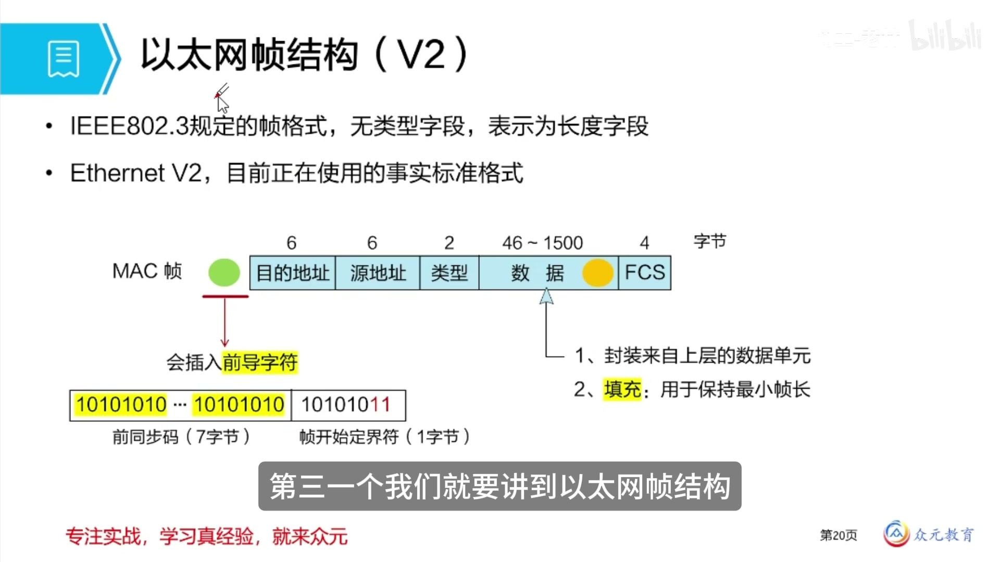

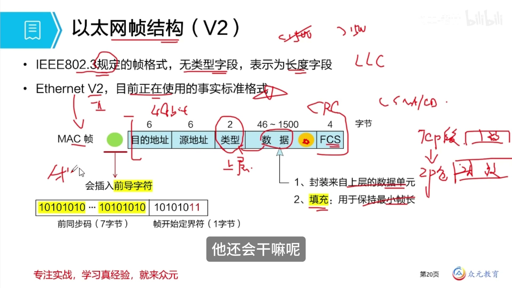

以太网帧结构有两个版本：

- **IEEE 802.3 帧格式**：早期标准，包含 LLC 子层，2 字节字段为长度字段。
- **Ethernet V2（DIX V2.0）**：目前正在使用的事实标准，2 字节字段为类型字段。

### 7.1 Ethernet V2 帧格式

| 字段 | 长度 | 作用 |
| ---- | ---- | ---- |
| 前导码（Preamble） | 7 字节 | 7 个 `10101010`，用于收发双方时钟同步 |
| 帧开始定界符（SFD） | 1 字节 | `10101011`，标志 MAC 帧的开始 |
| 目的 MAC 地址 | 6 字节 | 接收方 MAC 地址 |
| 源 MAC 地址 | 6 字节 | 发送方 MAC 地址 |
| 类型（Type） | 2 字节 | 标识上层协议，如 IPv4、ARP、IPv6 |
| 数据（Data） | 46～1500 字节 | 封装上层数据；不足 46 字节时填充 |
| 帧检验序列（FCS） | 4 字节 | CRC-32 校验 |

说明：

- 前导码和 SFD 共 8 字节，由物理层插入，**不计入 MAC 帧长度**。
- MAC 帧从目的 MAC 地址开始，到 FCS 结束。
- 最小 MAC 帧长 64 字节，最大 1518 字节（不含前导码）。
- 数据字段最大 1500 字节，即通常所说的 MTU。

### 7.2 IEEE 802.3 帧格式

IEEE 802.3 帧的字段布局与 Ethernet V2 基本相同，主要差异在于源 MAC 地址之后的 2 字节字段：

| 字段 | 长度 | 作用 |
| ---- | ---- | ---- |
| 前导码 + SFD | 8 字节 | 同步与帧开始定界 |
| 目的 MAC 地址 | 6 字节 | 接收方 |
| 源 MAC 地址 | 6 字节 | 发送方 |
| 长度（Length） | 2 字节 | 表示其后的 LLC 数据字段长度，最大 1500 |
| LLC 数据 | 可变 | 以 LLC 头开始，包含上层数据和填充 |
| FCS | 4 字节 | CRC-32 校验 |

IEEE 802.3 使用 **LLC（逻辑链路控制）子层**标识上层协议：

| LLC 字段 | 长度 | 作用 |
| -------- | ---- | ---- |
| DSAP | 1 字节 | 目的服务访问点 |
| SSAP | 1 字节 | 源服务访问点 |
| Control | 1 或 2 字节 | 控制字段 |

当需要承载 IP 等协议时，常使用 **SNAP** 扩展：在 LLC 头之后增加 3 字节 OUI 和 2 字节协议类型，共 5 字节，使 802.3 帧也能携带类似 EtherType 的信息。

### 7.3 V2 与 802.3 的字段差异

| 比较项 | Ethernet V2（DIX V2.0） | IEEE 802.3 |
| ------ | ----------------------- | ---------- |
| 源 MAC 后的 2 字节 | 类型（Type/EtherType） | 长度（Length） |
| 取值含义 | ≥1536（0x0600）表示上层协议类型 | ≤1500（0x05DC）表示数据长度 |
| 上层协议标识 | 由类型字段直接标识 | 由 LLC 的 DSAP/SSAP 标识；SNAP 可携带类型 |
| LLC 头 | 无 | 有（3～4 字节） |
| 数据字段 | 46～1500 字节 | 46～1500 字节（含 LLC 头时有效载荷相应减少） |
| 现状 | 事实标准，TCP/IP 网络常用 | 标准格式，现代网络较少使用 |
| 共同点 | 目的/源 MAC 各 6 字节，FCS 4 字节，最小 64 字节，最大 1518 字节 | 同左 |

类型/长度字段的判别规则：

```
字段值 ≤ 1500      →  IEEE 802.3 长度字段
字段值 1501～1535  →  未定义，正常不会出现
字段值 ≥ 1536      →  Ethernet V2 类型字段
```

常见 EtherType：

| 类型值 | 上层协议 |
| ------ | -------- |
| 0x0800 | IPv4 |
| 0x0806 | ARP |
| 0x86DD | IPv6 |
| 0x8100 | IEEE 802.1Q VLAN 标签 |

### 7.4 前导码与帧开始定界符

物理层在 MAC 帧之前插入 8 字节前导字符：

| 字段 | 长度 | 比特模式 | 作用 |
| ---- | ---- | -------- | ---- |
| 前同步码 | 7 字节 | `10101010` 重复 7 次 | 使接收方时钟与发送方同步 |
| 帧开始定界符 SFD | 1 字节 | `10101011` | 标志 MAC 帧的起始位置 |

前导码的作用可以理解为“告诉接收方比特流从哪里开始”。接收方在连续的 `10101010` 中建立同步，检测到末尾的 `10101011` 后，即认为后续比特是 MAC 帧的开始。

### 7.5 填充字段与最小帧长

以太网帧的数据字段最小为 46 字节。若上层数据不足 46 字节，需要在数据字段中填充字节，使整个 MAC 帧达到 64 字节。

| 项目 | 数值 |
| ---- | ---- |
| 最小 MAC 帧长 | 64 字节 |
| 头部（目的 + 源 + 类型/长度） | 14 字节 |
| FCS | 4 字节 |
| 最小数据字段 | 64 − 14 − 4 = 46 字节 |

注意：填充不是独立的帧字段，而是**数据字段的一部分**。它的作用是保证帧长不小于 64 字节，从而使 CSMA/CD 能够在发送完毕前检测到冲突。

### 7.6 帧长、MTU 与封装计算

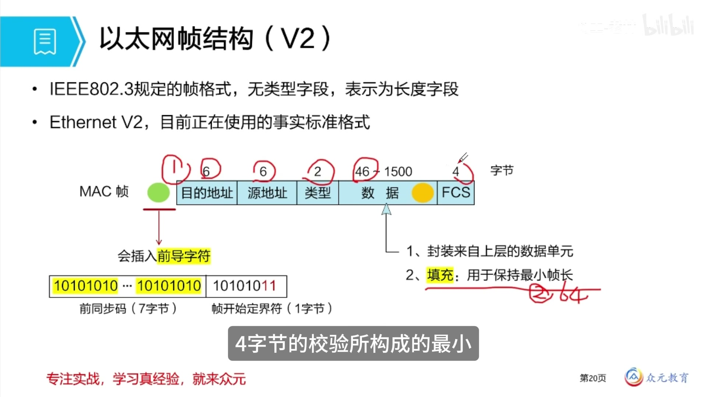

| 参数 | 数值 | 说明 |
| ---- | ---- | ---- |
| 最小帧长 | 64 字节 | 含 FCS，不含前导码 |
| 最大帧长 | 1518 字节 | 含 FCS，不含前导码 |
| MTU | 1500 字节 | 数据字段最大长度，即网络层数据包最大长度 |
| 最小数据字段 | 46 字节 | 不足时填充 |
| 带 VLAN 标签的最大帧长 | 1522 字节 | 增加 4 字节 802.1Q 标签 |

封装计算示例：

```
以太网数据字段最大 1500 字节
IP 头最小 20 字节
IP 数据报中的数据部分最大 = 1500 − 20 = 1480 字节

若再包含 TCP 头 20 字节
TCP 段中的数据部分最大 = 1500 − 20 − 20 = 1460 字节
```

### 7.7 帧格式考试要点

| 考点 | 结论 |
| ---- | ---- |
| 帧的组成 | 目的 MAC、源 MAC、类型/长度、数据（含填充）、FCS |
| 各字段长度 | 6、6、2、46～1500、4 字节 |
| 最小帧长 | 64 字节 |
| 最大帧长 | 1518 字节 |
| MTU | 1500 字节 |
| 前导码 | 7 字节 `10101010` + 1 字节 `10101011`，不计入帧长 |
| 填充 | 保证数据字段至少 46 字节，从而使帧长至少 64 字节 |
| V2 与 802.3 的核心差异 | 2 字节字段是类型还是长度 |
| 类型/长度判别 | ≤1500 为长度，≥1536 为类型 |

## 8.交换式以太网与交换机工作原理

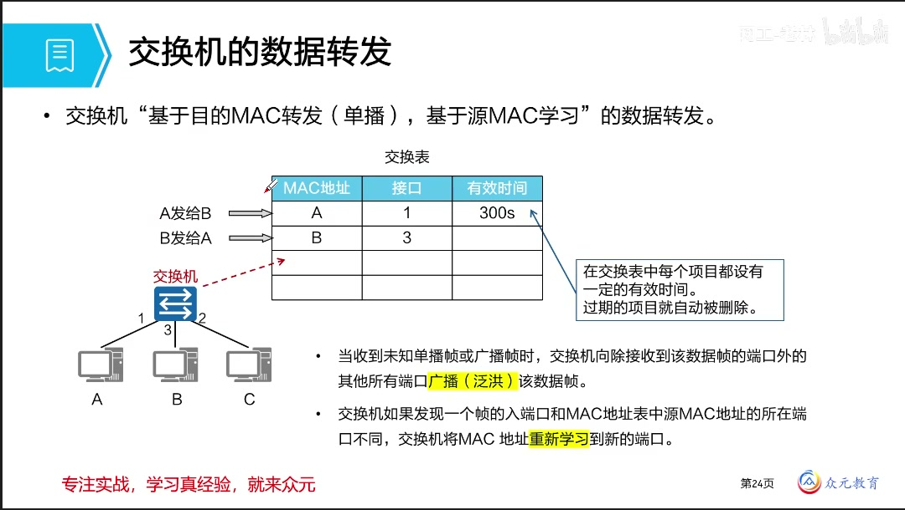

### 8.1 交换机的基本特征

交换机是交换式以太网的核心设备，二层交换机的主要特征如下：

- 工作在**数据链路层**。
- 以 **MAC 地址表**为依据转发数据帧。
- **分割冲突域**：每个端口通常是一个独立的冲突域。
- 全双工工作时**不使用 CSMA/CD**。
- 仍然采用以太网的帧结构和 MAC 地址。
- 用户**独享端口带宽**，交换机总容量增加。
- 端口数量多，转发速度快。

### 8.2 MAC 地址表与自学习

交换机的基本转发原则是：

```
基于目的 MAC 转发（单播），基于源 MAC 学习
```

自学习过程：

1. 交换机启动时，MAC 地址表为空，随着各端口收到帧而逐步建立并收敛。
2. 收到一个帧后，读取帧中的**源 MAC 地址**和该帧进入的**端口号**。
3. 将“源 MAC 地址—入端口—有效时间”写入 MAC 地址表；若表中已有该 MAC 但端口不同，则更新到新端口。
4. 读取帧中的**目的 MAC 地址**，查找 MAC 地址表，决定转发、过滤或泛洪。
5. 表项在有效时间内未刷新则老化删除；默认老化时间常见为 300 s，厂商可配置。

示例：

| MAC 地址 | 接口 | 有效时间 |
| -------- | ---- | -------- |
| A | 1 | 300 s |
| B | 3 | — |
| C | 2 | — |

若 A 向 B 发送数据：

- 交换机先学习到 A 位于端口 1。
- 若 B 的表项未知，则向除端口 1 外的所有端口泛洪。
- B 回复 A 时，交换机学习到 B 位于端口 3。
- 此后 A 与 B 之间的单播帧只在对应端口之间转发。

### 8.3 转发、过滤与泛洪

| 情况 | 处理方式 | 说明 |
| ---- | -------- | ---- |
| 已知单播，目的端口与入端口不同 | **转发（Forwarding）** | 只从目的 MAC 对应的端口发送 |
| 已知单播，目的端口与入端口相同 | **过滤（Filtering）** | 目的站点在同一端口，丢弃该帧，不再转发 |
| 未知单播 | **泛洪（Flooding）** | 向除入端口外的所有端口发送 |
| 广播帧 | **泛洪** | 目的地址为 `FF-FF-FF-FF-FF-FF`，向除入端口外的所有端口发送 |
| 组播帧 | 默认**泛洪** | 未启用 IGMP Snooping 等组播优化时，按广播方式处理 |

泛洪的范围是**同一个广播域**。交换机不会改变广播域的边界；要隔离广播域，需要使用路由器或 VLAN。

### 8.4 老化时间与 MAC 表震荡

- 每个 MAC 表项都有**有效时间（老化时间）**，超时未刷新则自动删除。
- 交换机在转发过程中不断刷新源 MAC 表项，因此表项是动态变化的。
- 若同一 MAC 地址反复出现在不同端口，交换机会不断重新学习，造成 **MAC 表震荡**。
- MAC 表震荡常见于网络环路、链路频繁切换或设备移动，可能导致转发不稳定。

### 8.5 全双工与半双工

| 模式 | 发送与接收 | 是否可能冲突 | 是否使用 CSMA/CD | 典型场景 |
| ---- | ---------- | ------------ | ---------------- | -------- |
| 半双工 | 同一时刻只能单向传输 | 可能 | 使用 | 共享式 Hub、半双工交换机端口 |
| 全双工 | 同时双向传输 | 不会 | 不使用 | 交换机与交换机、交换机与主机之间的点对点链路 |

全双工要求链路两端都支持全双工，通常通过自动协商确定。全双工端口使用独立的发送和接收通道，不再共享介质，因此不需要 CSMA/CD。

### 8.6 交换机与集线器的区别

| 比较项 | 集线器（Hub） | 交换机（Switch） |
| ------ | ------------- | ---------------- |
| 工作层次 | 物理层 | 数据链路层 |
| 转发依据 | 无，向所有端口重发信号 | MAC 地址表 |
| 冲突域 | 所有端口同属一个冲突域 | 每个端口一个冲突域 |
| 广播域 | 一个 | 一个（未划分 VLAN 时） |
| 双工方式 | 半双工 | 全双工或半双工 |
| 带宽 | 所有端口共享 | 每个端口独享 |
| CSMA/CD | 使用 | 全双工时不使用 |
| 典型应用 | 早期 10Base-T 共享式以太网 | 现代交换式以太网 |

## 9.交换机转发方式与连接方式

### 9.1 三种转发方式

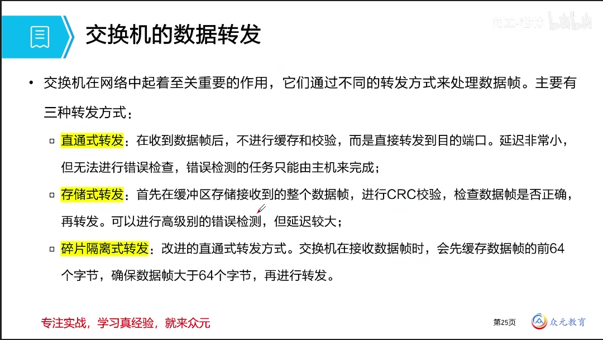

| 转发方式 | 处理过程 | 延迟 | 检错能力 | 缺点 |
| -------- | -------- | ---- | -------- | ---- |
| 直通式转发（Cut-through） | 收到帧后不缓存、不校验，读取目的 MAC 地址后立即转发到目的端口 | 最小 | 无 | 坏帧、冲突碎片也会被转发，错误检测只能由主机完成 |
| 存储式转发（Store-and-forward） | 先把整个帧存入缓冲区，进行 CRC 校验，正确则转发，错误则丢弃 | 最大 | 强 | 延迟较大，占用缓冲资源 |
| 碎片隔离式转发（Fragment-free） | 先缓存帧的前 64 字节，确认帧长不小于 64 字节后再转发 | 介于两者之间 | 中等 | 只能过滤冲突碎片，不能完成完整 CRC 校验 |

对比要点：

- 直通式转发速度快，但存在**坏帧传播风险**。
- 存储式转发可靠性高，但延迟大。
- 碎片隔离式转发是二者的折中，也叫无碎片转发。

### 9.2 级联

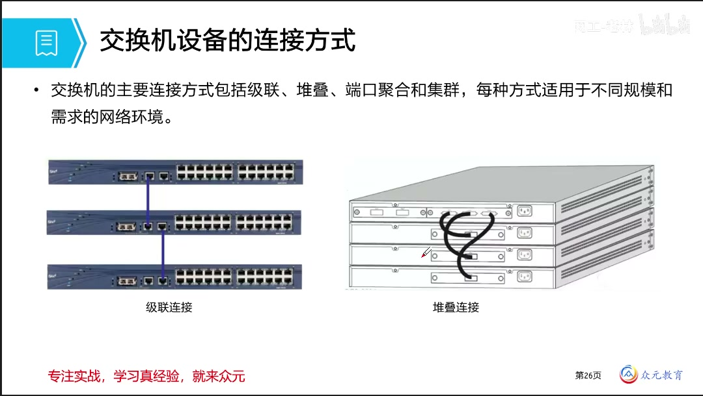

级联（Cascade）是用普通双绞线或光纤将一台交换机的端口与另一台交换机的普通端口或 **uplink** 端口连接起来。

| 项目 | 内容 |
| ---- | ---- |
| 作用 | 扩展端口数量、扩展网络覆盖范围 |
| 连接介质 | 普通双绞线、光纤；可使用 uplink 口 |
| 厂商要求 | 任何厂商均可 |
| 管理方式 | 逻辑上仍是多台设备，分别管理 |
| 优点 | 操作简单、成本低、距离相对灵活 |
| 缺点 | 带宽有限，级联层级过多会增加延迟，通常需要生成树协议防止环路 |
| 适用场景 | 中小型网络、端口扩容 |

### 9.3 堆叠

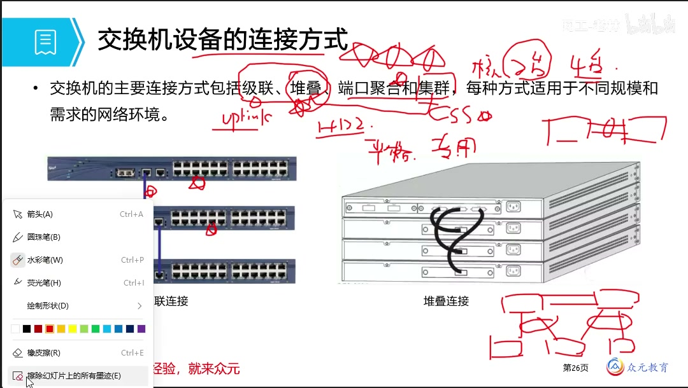

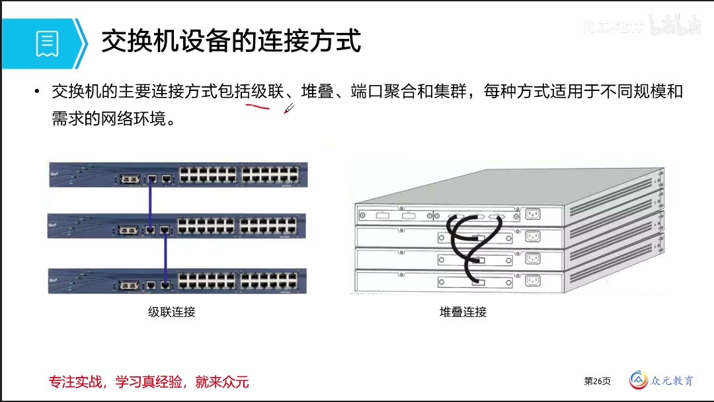

堆叠（Stacking）是通过专用的堆叠模块和堆叠线缆，将多台交换机连接成一个逻辑上的整体。

| 项目 | 内容 |
| ---- | ---- |
| 作用 | 提高端口密度、提高系统带宽和性能 |
| 连接介质 | 专用堆叠模块、专用堆叠线缆 |
| 厂商要求 | 最好使用同一厂商设备，不同厂商可能不兼容 |
| 距离要求 | 堆叠线缆通常很短，设备一般放在同一机架或相邻机架 |
| 管理方式 | 逻辑上是一台设备，统一管理 |
| 优点 | 带宽和性能提升；可实现冗余，单台故障时其他设备接管；端口密度高 |
| 缺点 | 设备型号、模块、线缆要求严格；距离受限；成本较高；厂商锁定 |
| 适用场景 | 大中型企业网络，尤其是核心层、汇聚层 |

堆叠的效果可以概括为“**一加一大于二**”：不仅增加端口数量，还提升背板带宽、转发性能和可靠性。

### 9.4 端口聚合

端口聚合又称**链路聚合**、**以太通道**（EtherChannel）、**Eth-Trunk**，是将多条物理链路绑定为一条逻辑链路。

| 项目 | 内容 |
| ---- | ---- |
| 作用 | 增加链路带宽、提供链路冗余、提高可靠性 |
| 原理 | 多条物理接口捆绑为一条逻辑链路，流量按一定算法分配到各成员链路 |
| 要求 | 两端设备都支持；成员链路速率、双工、VLAN 等配置一致；通常要求点对点连接 |
| 局限 | 单条数据流通常只走一条成员链路，不能使单流速率超过单链路速率 |
| 应用 | 交换机之间、交换机与服务器之间、核心与汇聚之间 |

端口聚合通常与堆叠、集群配合使用，形成高带宽、高可靠的综合组网方案。

### 9.5 集群

集群（Cluster）是将多台交换机作为一个逻辑设备进行统一管理，通常用于核心层或骨干网络。

| 项目 | 内容 |
| ---- | ---- |
| 作用 | 统一管理、简化配置、提高网络可扩展性 |
| 部署位置 | 核心层、骨干网络 |
| 设备数量 | 常见为 2 台；部分厂商（如华为）可支持 4 台 |
| 特点 | 多台设备对外表现为一个管理实体；通常需要厂商专用技术 |
| 与堆叠的关系 | 集群可建立在堆叠基础之上，性能和管理要求更高 |

### 9.6 四种连接方式对比

| 方式 | 主要作用 | 厂商要求 | 连接要求 | 管理方式 | 适用场景 |
| ---- | -------- | -------- | -------- | -------- | -------- |
| 级联 | 扩展端口和覆盖范围 | 任何厂商 | 普通双绞线连接普通端口或 uplink 口 | 多台设备分别管理 | 中小型网络 |
| 堆叠 | 提高端口密度、带宽和性能 | 最好同一厂商 | 专用堆叠模块和堆叠线缆，距离短 | 逻辑上一台设备 | 核心、汇聚、接入 |
| 端口聚合 | 增加链路带宽和冗余 | 两端均支持 | 多条物理链路捆绑为一条逻辑链路 | 一条逻辑链路 | 交换机之间、服务器上联 |
| 集群 | 统一管理和简化配置 | 厂商支持 | 多台设备组成集群 | 一个集群管理实体 | 核心层、骨干网 |

### 9.7 级联与堆叠对比

| 方式 | 作用 | 厂商要求 | 连接要求 | 管理方式 | 最大连接数 |
| ---- | ---- | -------- | -------- | -------- | ---------- |
| 堆叠 | 提高端口密度、提高系统带宽 | 同一厂商 | 专用的堆叠模块和堆叠线缆 | 逻辑上是一台设备 | 厂商有规定 |
| 级联 | 扩展网络覆盖范围 | 任何厂商 | 普通双绞线连接普通端口或 uplink 端口 | 逻辑上仍是多台设备 | 理论上无限制 |

## 10.冲突域与广播域

### 10.1 冲突域

冲突域是指**可能发生冲突的站点集合**。在同一冲突域内，一个站点发送的信号可能与其他站点发送的信号叠加，形成冲突。

| 设备 | 对冲突域的影响 |
| ---- | -------------- |
| 集线器、中继器 | 所有端口属于同一个冲突域，不隔离冲突 |
| 交换机、网桥 | 每个端口是一个独立的冲突域，隔离冲突 |
| 路由器 | 每个接口是一个独立的冲突域 |

### 10.2 广播域

广播域是指**能够收到彼此广播帧的站点集合**。一个站点发送广播帧后，同一广播域内的所有站点都会收到。

| 设备 | 对广播域的影响 |
| ---- | -------------- |
| 集线器 | 所有端口属于同一个广播域 |
| 交换机 | 所有端口默认属于同一个广播域，不隔离广播 |
| 路由器 | 每个接口是一个独立的广播域，隔离广播 |
| VLAN | 每个 VLAN 是一个独立的广播域 |

### 10.3 典型设备的域划分

| 设备 | 工作层次 | 冲突域数量 | 广播域数量 |
| ---- | -------- | ---------- | ---------- |
| 集线器 | 物理层 | 整个设备 1 个 | 整个设备 1 个 |
| 交换机 | 数据链路层 | 每个端口 1 个 | 默认 1 个（未划分 VLAN） |
| 路由器 | 网络层 | 每个接口 1 个 | 每个接口 1 个 |
| 网桥 | 数据链路层 | 每个端口 1 个 | 1 个 |

判断规则：

1. 集线器不隔离冲突域，所有连接在集线器上的设备同属一个冲突域。
2. 交换机每个端口隔离冲突域，但不隔离广播域。
3. 路由器每个接口既隔离冲突域，也隔离广播域。
4. VLAN 可以在一台交换机内部划分多个广播域。

### 10.4 共享式与交换式以太网的冲突差异

| 比较项 | 共享式以太网 | 交换式以太网 |
| ------ | ------------ | ------------ |
| 冲突域 | 整个共享介质为一个冲突域 | 每个交换机端口一个冲突域 |
| 冲突可能性 | 高，多个站点竞争同一信道 | 全双工点对点链路不会冲突 |
| 介质访问 | 必须使用 CSMA/CD | 全双工不使用 CSMA/CD |
| 带宽 | 所有站点共享 | 每个端口独享 |
| 典型设备 | 集线器、中继器 | 交换机 |

共享式以太网的冲突根源在于：信号传播需要时间，两个相距较远的站点可能都检测到信道空闲，于是同时发送，信号在途中相遇形成冲突。CSMA/CD 通过“先听后发、边发边听、冲突退避”解决这一问题；交换机则通过分割冲突域，从根本上减少冲突。

## 11.高速以太网与命名规则

### 11.1 以太网命名规则

以太网标准名称通常由三部分组成：

```
速率 + 信号方式 + 介质/距离标识
```

例如 `1000BASE-T`：

| 部分 | 含义 |
| ---- | ---- |
| 1000 | 传输速率 1000 Mbps |
| BASE | 基带传输 |
| T | 双绞线（Twisted Pair） |

常见后缀含义：

| 标识 | 含义 | 示例 |
| ---- | ---- | ---- |
| 5 | 粗同轴电缆，段长约 500 m | 10BASE5 |
| 2 | 细同轴电缆，段长约 185 m | 10BASE2 |
| T | 双绞线 | 10BASE-T、1000BASE-T |
| T4 | 4 对双绞线 | 100BASE-T4 |
| T2 | 2 对双绞线 | 100BASE-T2 |
| TX | 2 对双绞线，特定编码 | 100BASE-TX |
| F | 光纤 | 100BASE-FX |
| S | 短波（Short wavelength） | 1000BASE-SX、10GBASE-SR |
| L | 长波（Long wavelength） | 1000BASE-LX、10GBASE-LR |
| E | 超长距离（Extended） | 10GBASE-ER |
| C | 屏蔽双绞线/铜缆 | 1000BASE-CX |
| X | 编码或介质相关标识 | 100BASE-TX、1000BASE-SX |

### 11.2 10 Mbps 以太网标准

| 标准 | 传输介质 | 最大段长 | 拓扑 | 说明 |
| ---- | -------- | -------- | ---- | ---- |
| 10BASE5 | 粗同轴电缆（RG-8） | 500 m | 总线 | 早期粗缆以太网 |
| 10BASE2 | 细同轴电缆（RG-58） | 185 m | 总线 | 细缆以太网，名称中的 2 近似表示 200 m |
| 10BASE-T | 2 对 3 类 UTP | 100 m | 星型 | 使用集线器组网，典型共享式以太网 |
| 10BASE-FL | 多模光纤 | 约 2 km | 星型/点对点 | 光纤扩展，实际工程中使用较少 |

### 11.3 快速以太网（100 Mbps）

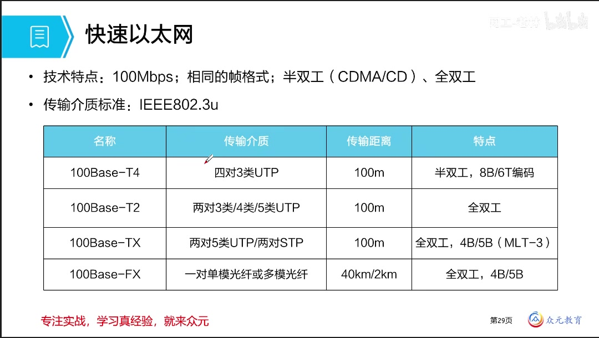

技术特点：

- 速率：**100 Mbps**。
- 帧格式：与 10 Mbps 以太网相同。
- 双工：支持半双工和全双工；半双工使用 CSMA/CD。
- 标准：**IEEE 802.3u**。

| 名称 | 传输介质 | 传输距离 | 特点 |
| ---- | -------- | -------- | ---- |
| 100Base-T4 | 4 对 3 类 UTP | 100 m | 半双工，8B/6T 编码 |
| 100Base-T2 | 2 对 3 类/4 类/5 类 UTP | 100 m | 全双工 |
| 100Base-TX | 2 对 5 类 UTP 或 2 对 STP | 100 m | 全双工，4B/5B 编码 + MLT-3 |
| 100Base-FX | 1 对单模或多模光纤 | 40 km/2 km | 全双工，4B/5B 编码 |

说明：

- 100Base-T4 使用 4 对 3 类线，其中 3 对传输数据、1 对用于冲突检测，因此只支持半双工。
- 100Base-TX 是快速以太网中最常见的铜缆标准，使用 2 对 5 类 UTP 或 2 对 STP。
- 100Base-FX 的课程表标注为 40 km/2 km；通常多模光纤约 2 km，单模光纤配合长距离光模块可达到 40 km。

### 11.4 千兆以太网（1000 Mbps）

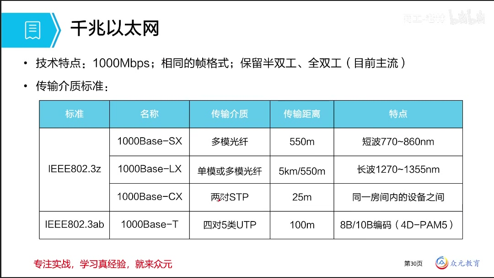

技术特点：

- 速率：**1000 Mbps**。
- 帧格式：与 10 Mbps、100 Mbps 以太网相同。
- 双工：保留半双工，但实际几乎全部使用全双工。
- 标准：**IEEE 802.3z**（光纤、屏蔽双绞线）和 **IEEE 802.3ab**（双绞线）。

| 标准 | 名称 | 传输介质 | 传输距离 | 特点 |
| ---- | ---- | -------- | -------- | ---- |
| IEEE 802.3z | 1000Base-SX | 多模光纤 | 550 m | 短波 770～860 nm |
| IEEE 802.3z | 1000Base-LX | 单模或多模光纤 | 5 km/550 m | 长波 1270～1355 nm |
| IEEE 802.3z | 1000Base-CX | 2 对 STP | 25 m | 同一房间内设备之间 |
| IEEE 802.3ab | 1000Base-T | 4 对 5 类 UTP | 100 m | 4D-PAM5 编码 |

说明：

- 1000Base-SX 使用短波多模光纤，典型波长 850 nm，距离约 550 m。
- 1000Base-LX 使用长波，单模光纤可达 5 km，多模光纤约 550 m。
- 1000Base-CX 使用屏蔽双绞线，距离很短，适合同一机架或相邻设备。
- 1000Base-T 使用 4 对 5 类 UTP，工程上建议 5e 及以上，距离 100 m。
- 课程表把 1000Base-T 的编码写作“8B/10B 编码（4D-PAM5）”。严格来说，1000Base-T 使用 8B1Q4 映射和 4D-PAM5 线路编码；8B/10B 主要用于 1000Base-X（SX/LX/CX）。考试若问 1000Base-T 的编码，应记 4D-PAM5。

千兆半双工以太网为保持 64 字节最小帧长，采用**载波扩展**：把争用期从 512 bit 扩展到 4096 bit（512 字节）。全双工千兆以太网不使用 CSMA/CD，因此不需要载波扩展。

### 11.5 万兆以太网（10 Gbps）

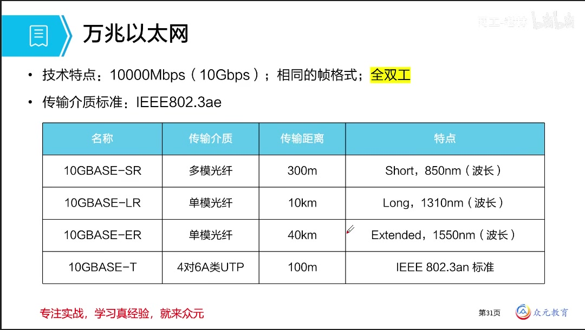

技术特点：

- 速率：**10000 Mbps（10 Gbps）**。
- 帧格式：与低速以太网相同。
- 双工：**只支持全双工**，不再使用 CSMA/CD。
- 标准：**IEEE 802.3ae**（光纤）、**IEEE 802.3an**（10GBASE-T）。

| 名称 | 传输介质 | 传输距离 | 特点 |
| ---- | -------- | -------- | ---- |
| 10GBASE-SR | 多模光纤 | 300 m | Short，850 nm |
| 10GBASE-LR | 单模光纤 | 10 km | Long，1310 nm |
| 10GBASE-ER | 单模光纤 | 40 km | Extended，1550 nm |
| 10GBASE-T | 4 对 6A 类 UTP | 100 m | IEEE 802.3an 标准 |

说明：

- 10GBASE-SR/LR/ER 的 S、L、E 分别表示短距离、长距离、超长距离。
- 10GBASE-T 使用 4 对 6A 类 UTP，距离 100 m；6 类线在部分条件下可支持约 55 m。
- 万兆以太网以光纤为主，双绞线标准出现较晚。

### 11.6 高速以太网标准对比

| 速率 | 标准 | 主要介质 | 典型距离 | 双工与 CSMA/CD |
| ---- | ---- | -------- | -------- | -------------- |
| 10 Mbps | IEEE 802.3 | 同轴、双绞线、光纤 | 100～500 m（铜缆） | 半双工使用 CSMA/CD |
| 100 Mbps | IEEE 802.3u | 双绞线、光纤 | 100 m（铜缆）、2～40 km（光纤） | 半双工使用 CSMA/CD，全双工不使用 |
| 1000 Mbps | IEEE 802.3z/ab | 光纤、STP、UTP | 25 m～5 km | 半双工保留 CSMA/CD，全双工为主 |
| 10 Gbps | IEEE 802.3ae/an | 光纤、6A 类 UTP | 100 m～40 km | 只支持全双工，不使用 CSMA/CD |

### 11.7 命名规则与介质对应技巧

| 题目关键词 | 对应标准 |
| ---------- | -------- |
| 100 Mbps、5 类无屏蔽双绞线 | 100Base-TX |
| 100 Mbps、3 类 UTP、4 对 | 100Base-T4 |
| 100 Mbps、光纤 | 100Base-FX |
| 1000 Mbps、屏蔽双绞线 | 1000Base-CX |
| 1000 Mbps、多模光纤、550 m | 1000Base-SX |
| 1000 Mbps、单模光纤、5 km | 1000Base-LX |
| 1000 Mbps、4 对 5 类 UTP、100 m | 1000Base-T |
| 10 Gbps、多模光纤、300 m | 10GBASE-SR |
| 10 Gbps、单模光纤、10 km | 10GBASE-LR |
| 10 Gbps、单模光纤、40 km | 10GBASE-ER |
| 10 Gbps、6A 类 UTP、100 m | 10GBASE-T |

补充：**1000BASE-ZX** 不是 IEEE 802.3 的基本标准，属于厂商扩展的长距离单模光纤标准，传输距离约 70 km，考试中一般作为拓展知识出现。

### 11.8 双工模式与 CSMA/CD 的关系

| 速率 | 半双工 | 全双工 | CSMA/CD |
| ---- | ------ | ------ | ------- |
| 10 Mbps | 支持 | 支持 | 半双工使用 |
| 100 Mbps | 支持 | 支持 | 半双工使用 |
| 1000 Mbps | 保留但极少使用 | 主流 | 半双工使用，全双工不使用 |
| 10 Gbps | 不支持 | 唯一模式 | 不使用 |

结论：**CSMA/CD 只与共享介质、半双工相关**。交换机全双工端口是点对点链路，发送和接收通道独立，不会发生冲突。

## 12.典型例题

### 12.1 CSMA/CD 概念与介质访问

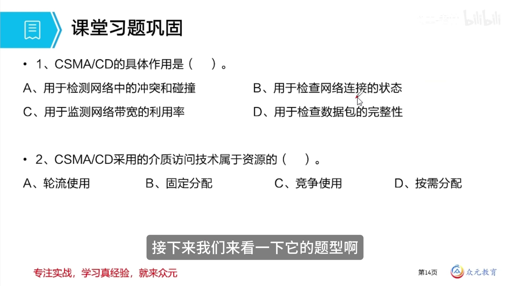

**例题 1**：CSMA/CD 的具体作用是（ ）。

- A、用于检测网络中的冲突和碰撞
- B、用于检查网络连接的状态
- C、用于监测网络带宽的利用率
- D、用于检查数据包的完整性

答案：**A**。

解析：CSMA/CD 的核心是载波监听与冲突检测，用于检测网络中的冲突和碰撞。检查连接状态、监测带宽利用率、检查数据包完整性都不是 CSMA/CD 的职责；数据包完整性由 FCS（CRC 校验）负责。

**例题 2**：CSMA/CD 采用的介质访问技术属于资源的（ ）。

- A、轮流使用
- B、固定分配
- C、竞争使用
- D、按需分配

答案：**C**。

解析：CSMA/CD 是竞争型 MAC 协议，多个站点竞争使用共享介质；令牌环网才是轮流使用。

### 12.2 最小帧长与冲突检测时间

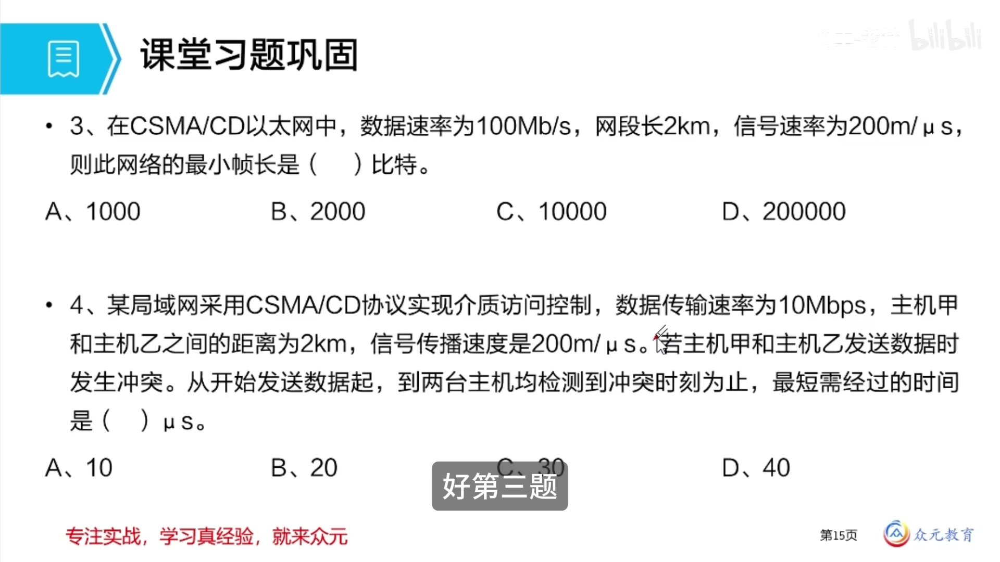

**例题 3**：在 CSMA/CD 以太网中，数据速率为 100 Mb/s，网段长 2 km，信号速率为 200 m/μs，则此网络的最小帧长是（ ）比特。

- A、1000
- B、2000
- C、10000
- D、200000

答案：**B**。

计算：

```
帧长 ≥ 2 × (信道长度 ÷ 传播速率) × 数据传输速率
     = 2 × (2000 m ÷ 200 m/μs) × 100 × 10^6 b/s
     = 2 × 10 μs × 100 × 10^6 b/s
     = 2000 bit
```

要点：单位要统一。2 km = 2000 m，200 m/μs = 2 × 10^8 m/s，100 Mb/s = 100 × 10^6 b/s。

**例题 4**：某局域网采用 CSMA/CD 协议实现介质访问控制，数据传输速率为 10 Mbps，主机甲和主机乙之间的距离为 2 km，信号传播速度是 200 m/μs。若主机甲和主机乙发送数据时发生冲突，从开始发送数据起，到两台主机均检测到冲突时刻为止，最短需经过的时间是（ ）μs。

- A、10
- B、20
- C、30
- D、40

答案：**A**。

计算：

```
单程传播时延 τ = 2 km ÷ 200 m/μs = 10 μs
```

最短情形：两站同时发送，信号在链路中点相撞。每站信号传播 1 km 到达中点用时 5 μs；冲突信号再从终点返回各站用时 5 μs。因此每站检测到冲突的时间为 5 + 5 = 10 μs。

要点：本题问的是“两台主机均检测到冲突”的最短时间，等于单程传播时延 τ，不是 2τ。若问最长时间，则为 2τ = 20 μs。

### 12.3 监听算法与退避概率

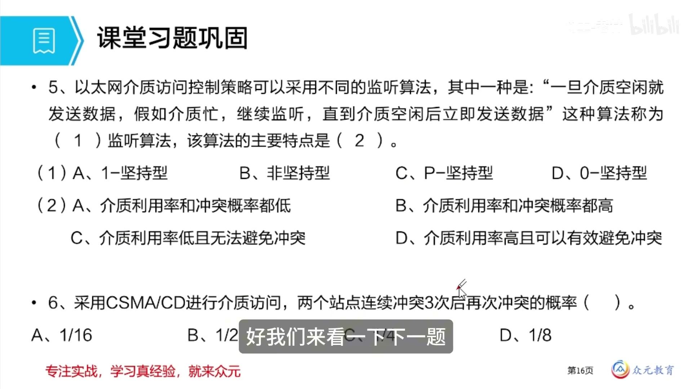

**例题 5**：以太网介质访问控制策略可以采用不同的监听算法，其中一种是：“一旦介质空闲就发送数据，假如介质忙，继续监听，直到介质空闲后立即发送数据。”这种算法称为（1）监听算法，该算法的主要特点是（2）。

（1）A、1-坚持型　B、非坚持型　C、P-坚持型　D、0-坚持型

（2）A、介质利用率和冲突概率都低　B、介质利用率和冲突概率都高　C、介质利用率低且无法避免冲突　D、介质利用率高且可以有效避免冲突

答案：（1）**A**；（2）**B**。

解析：“继续监听，空闲后立即发送”是 1-坚持型的典型特征。多个站点同时等待时，一旦信道空闲会一起发送，因此介质利用率高、冲突概率也高。

**例题 6**：采用 CSMA/CD 进行介质访问，两个站点连续冲突 3 次后再次冲突的概率是（ ）。

- A、1/16
- B、1/2
- C、[选项被字幕遮挡]
- D、1/8

答案：**D**。

计算：

```
连续冲突 3 次 → k = min(3, 10) = 3
退避窗口 = 2^3 = 8
两个站点再次选到同一 R 值的概率 = 1/8
```

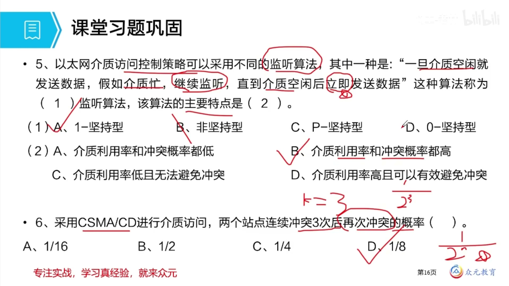

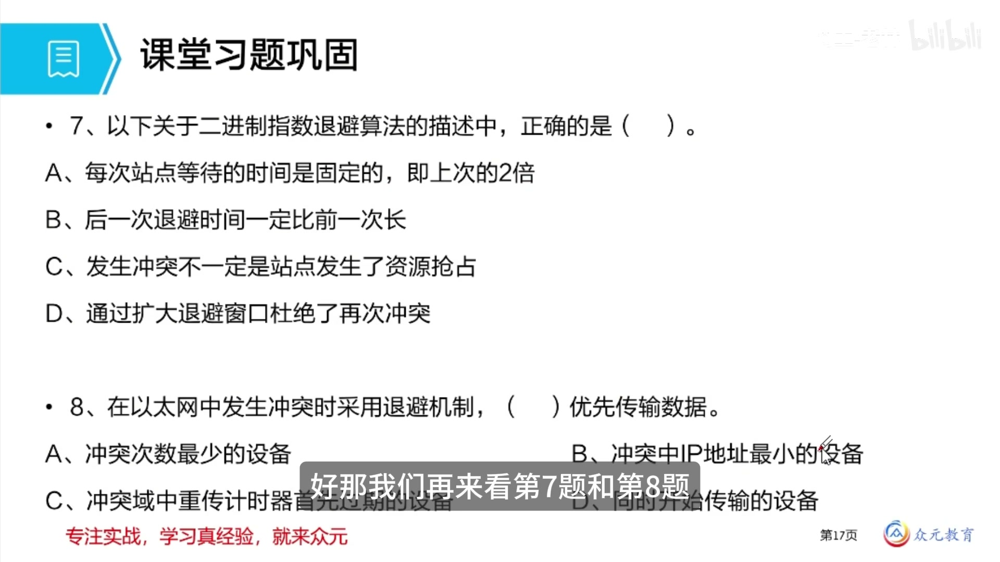

**例题 7**：以下关于二进制指数退避算法的描述中，正确的是（ ）。

- A、每次站点等待的时间是固定的，即上次的 2 倍
- B、后一次退避时间一定比前一次长
- C、发生冲突不一定是站点发生了资源抢占
- D、通过扩大退避窗口杜绝了再次冲突

答案：**C**。

逐项判断：

| 选项 | 判断 | 理由 |
| ---- | ---- | ---- |
| A | [错误] | 退避时间是 T × R，R 是随机数，不是固定值，也不是简单地把上次时间翻倍 |
| B | [错误] | 随机数可能取 0，后一次退避时间不一定比前一次长 |
| C | [正确] | 冲突可能由传播时延、线路故障等引起，不一定是资源抢占 |
| D | [错误] | 扩大退避窗口只能降低再次冲突的概率，不能杜绝 |

**例题 8**：在以太网中发生冲突时采用退避机制，（ ）优先传输数据。

- A、冲突次数最少的设备
- B、冲突中 IP 地址最小的设备
- C、冲突域中重传计时器首先到期的设备
- D、同时开始传输的设备

答案：**A**。

解析：冲突次数越少，k 越小，退避窗口越小，站点越容易选到较小的 R 值，从而更早重传。退避机制与 IP 地址大小无关。

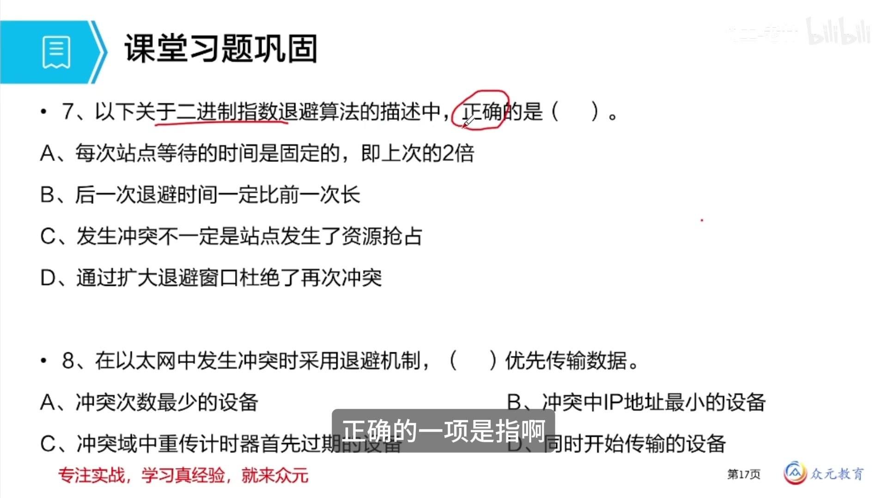

### 12.4 二进制指数退避计算

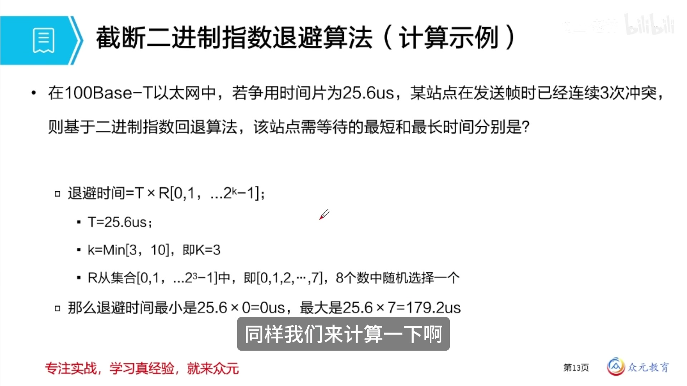

**例题 9**：在 100Base-T 以太网中，若争用时间片为 25.6 μs，某站点在发送帧时已经连续 3 次冲突，则基于二进制指数退避算法，该站点需等待的最短和最长时间分别是多少？再次发生冲突的概率是多少？

计算：

```
T = 25.6 μs
k = min(3, 10) = 3
R ∈ {0, 1, 2, …, 2^3 − 1} = {0, 1, 2, …, 7}
最短等待时间 = 25.6 × 0 = 0 μs
最长等待时间 = 25.6 × 7 = 179.2 μs
再次冲突概率 = 1 ÷ 2^3 = 1/8
```

答案：最短 0 μs，最长 179.2 μs，再次冲突概率 1/8。

说明：标准 100Base-T 的争用期为 5.12 μs，本题给定 25.6 μs，应按题给值计算。若题目改为 10 Mbps 以太网，标准争用期为 51.2 μs，则最长等待时间为 51.2 × 7 = 358.4 μs。

### 12.5 帧结构与封装

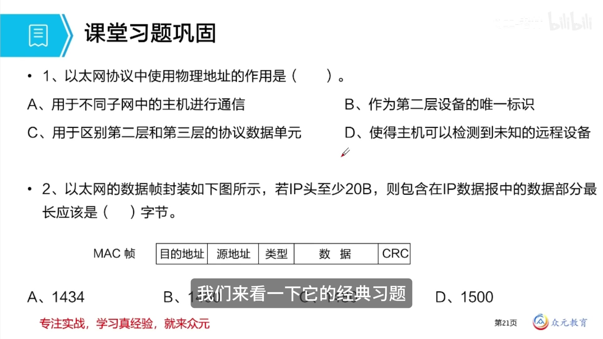

**例题 10**：以太网协议中使用物理地址的作用是（ ）。

- A、用于不同子网中的主机进行通信
- B、作为第二层设备的唯一标识
- C、用于区别第二层和第三层的协议数据单元
- D、使得主机可以检测到未知的远程设备

答案：**B**。

解析：MAC 地址是数据链路层（第二层）设备的唯一标识。跨子网通信依靠 IP 地址和路由器，不是 MAC 地址的职责。

**例题 11**：以太网的数据帧封装如下图所示，若 IP 头至少 20 B，则包含在 IP 数据报中的数据部分最长应该是（ ）字节。

- A、1434
- B、1454
- C、[选项被字幕遮挡]
- D、1500

答案：**1480 字节**（图中 C 选项被字幕遮挡；按计算结果，应选择数值为 1480 的选项）。

计算：

```
以太网数据字段最大 1500 字节
IP 数据报中的数据部分 = 1500 − IP 头 20 = 1480 字节
```

若再封装 TCP，TCP 头至少 20 字节，则 TCP 段中的数据部分最大为：

```
1500 − 20 − 20 = 1460 字节
```

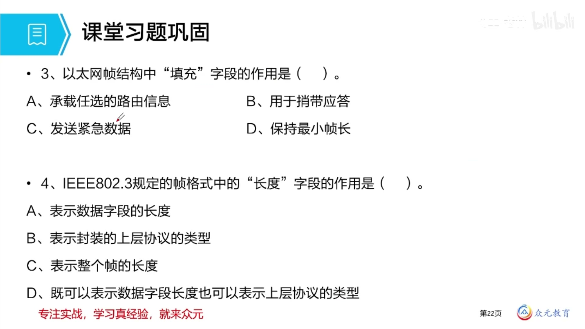

**例题 12**：以太网帧结构中“填充”字段的作用是（ ）。

- A、承载任选的路由信息
- B、用于捎带应答
- C、发送紧急数据
- D、保持最小帧长

答案：**D**。

解析：填充用于保证数据字段不少于 46 字节，从而使整个 MAC 帧不少于 64 字节，确保 CSMA/CD 能够检测冲突。

**例题 13**：IEEE 802.3 规定的帧格式中的“长度”字段的作用是（ ）。

- A、表示数据字段的长度
- B、表示封装的上层协议的类型
- C、表示整个帧的长度
- D、既可以表示数据字段长度也可以表示上层协议的类型

答案：**D**（按课程口径）。

解析：IEEE 802.3 的该字段标准含义是长度，Ethernet V2 的同一位置是类型。由于两种帧共用同一字段位置，接收端根据取值判断：≤1500 为长度，≥1536 为类型。因此考试中常表述为“既可以表示长度，也可以表示类型”。

说明：严格按 IEEE 802.3 标准，该字段只表示长度；“表示类型”是 Ethernet V2 的解释。理解时应把“字段位置的双重解释”和“802.3 标准本身的定义”区分开。

### 12.6 交换机地址学习与转发方式

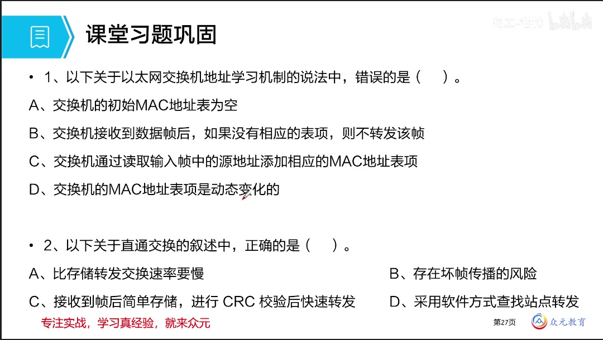

**例题 14**：以下关于以太网交换机地址学习机制的说法中，错误的是（ ）。

- A、交换机的初始 MAC 地址表为空
- B、交换机接收到数据帧后，如果没有相应的表项，则不转发该帧
- C、交换机通过读取输入帧中的源地址添加相应的 MAC 地址表项
- D、交换机的 MAC 地址表项是动态变化的

答案：**B**。

解析：若目的 MAC 表项未知，交换机不会丢弃该帧，而是向除入端口外的所有端口**泛洪**。A、C、D 均正确：初始表为空、基于源 MAC 学习、表项有老化时间且动态变化。

**例题 15**：以下关于直通交换的叙述中，正确的是（ ）。

- A、比存储转发交换速率要慢
- B、存在坏帧传播的风险
- C、接收到帧后简单存储，进行 CRC 校验后快速转发
- D、采用软件方式查找站点转发

答案：**B**。

解析：直通式转发读取目的 MAC 后立即转发，速度快于存储转发；由于不进行 CRC 校验，坏帧会被继续传播。C 描述的是存储式转发。

### 12.7 交换机连接方式案例

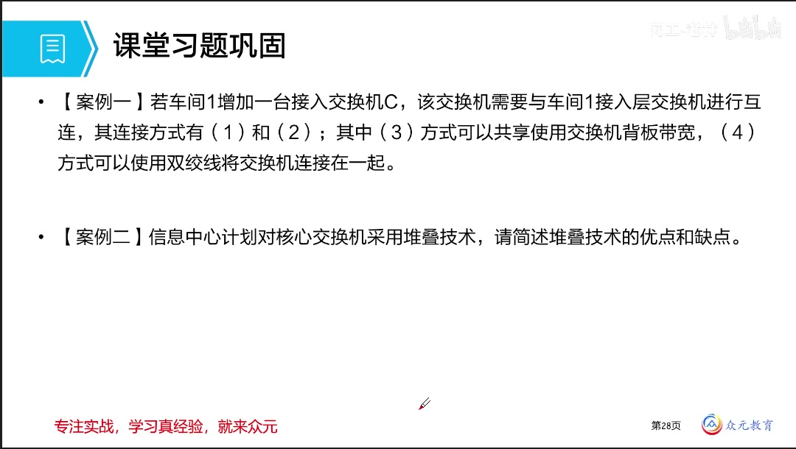

**案例一**：若车间 1 增加一台接入交换机 C，该交换机需要与车间 1 接入层交换机进行互联，其连接方式有（1）和（2）；其中（3）方式可以共享使用交换机背板带宽，（4）方式可以使用双绞线将交换机连接在一起。

答案：

- （1）**级联**
- （2）**堆叠**
- （3）**堆叠**
- （4）**级联**

解析：级联使用普通双绞线连接普通端口或 uplink 端口，简单、成本低；堆叠使用专用堆叠模块和线缆，将多台交换机逻辑上合并为一台，可共享背板带宽、提高端口密度和性能。

**案例二**：信息中心计划对核心交换机采用堆叠技术，请简述堆叠技术的优点和缺点。

答案：

| 优点 | 缺点 |
| ---- | ---- |
| 提高端口密度和系统带宽 | 要求同一厂商设备，兼容性受限 |
| 逻辑上是一台设备，统一管理、简化配置 | 需要专用堆叠模块和堆叠线缆，成本较高 |
| 提高转发性能和可靠性 | 堆叠线缆短，设备距离受限，通常在同一机架 |
| 单台设备故障时可由其他设备接管，实现冗余 | 厂商锁定，扩展受厂商规格限制 |

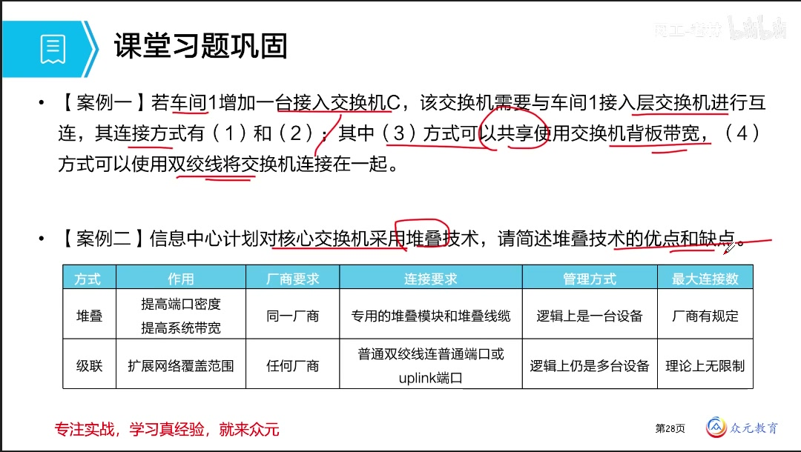

### 12.8 快速以太网标准

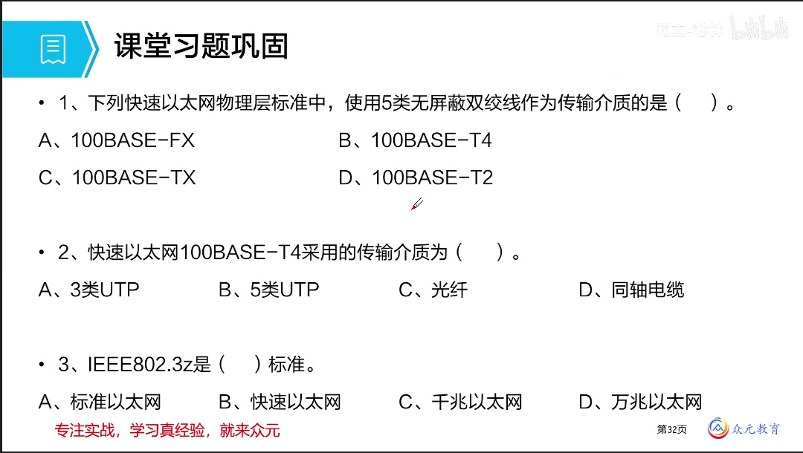

**例题 16**：下列快速以太网物理层标准中，使用 5 类无屏蔽双绞线作为传输介质的是（ ）。

- A、100BASE-FX
- B、100BASE-T4
- C、100BASE-TX
- D、100BASE-T2

答案：**C**。

解析：100BASE-TX 使用 2 对 5 类 UTP 或 2 对 STP；100BASE-T4 使用 4 对 3 类 UTP；100BASE-T2 使用 2 对 3/4/5 类 UTP；100BASE-FX 使用光纤。

**例题 17**：快速以太网 100BASE-T4 采用的传输介质为（ ）。

- A、3 类 UTP
- B、5 类 UTP
- C、光纤
- D、同轴电缆

答案：**A**。

解析：100BASE-T4 使用 4 对 3 类 UTP，采用 8B/6T 编码，只支持半双工。

**例题 18**：IEEE 802.3z 是（ ）标准。

- A、标准以太网
- B、快速以太网
- C、千兆以太网
- D、万兆以太网

答案：**C**。

解析：IEEE 802.3z 是千兆以太网标准，主要覆盖光纤和屏蔽双绞线；IEEE 802.3ab 是千兆双绞线标准；IEEE 802.3u 是快速以太网标准；IEEE 802.3ae 是万兆光纤标准。

### 12.9 千兆与万兆以太网标准

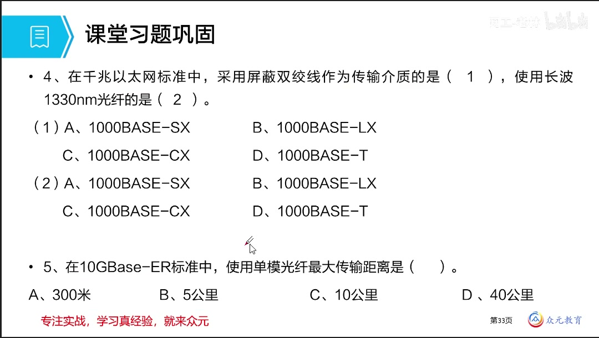

**例题 19**：在千兆以太网标准中，采用屏蔽双绞线作为传输介质的是（1），使用长波 1330 nm 光纤的是（2）。

（1）A、1000BASE-SX　B、1000BASE-LX　C、1000BASE-CX　D、1000BASE-T

（2）A、1000BASE-SX　B、1000BASE-LX　C、1000BASE-CX　D、1000BASE-T

答案：（1）**C**；（2）**B**。

解析：1000BASE-CX 使用 2 对 STP，距离 25 m；1000BASE-LX 使用长波光纤，标准波长范围 1270～1355 nm，常用 1310 nm。题目写 1330 nm，仍对应 1000BASE-LX。

**例题 20**：在 10GBase-ER 标准中，使用单模光纤最大传输距离是（ ）。

- A、300 米
- B、5 公里
- C、10 公里
- D、40 公里

答案：**D**。

解析：10GBASE-ER 使用 1550 nm 单模光纤，最大传输距离 40 km；300 m 对应 10GBASE-SR，10 km 对应 10GBASE-LR。

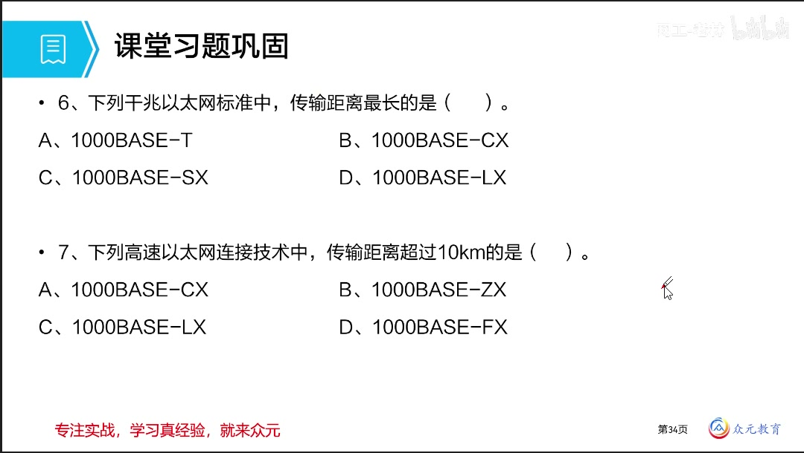

**例题 21**：下列千兆以太网标准中，传输距离最长的是（ ）。

- A、1000BASE-T
- B、1000BASE-CX
- C、1000BASE-SX
- D、1000BASE-LX

答案：**D**。

解析：1000BASE-T 为 100 m，1000BASE-CX 为 25 m，1000BASE-SX 为 550 m，1000BASE-LX 单模可达 5 km，距离最长。

**例题 22**：下列高速以太网连接技术中，传输距离超过 10 km 的是（ ）。

- A、1000BASE-CX
- B、1000BASE-ZX
- C、1000BASE-LX
- D、1000BASE-FX

答案：**B**。

解析：1000BASE-ZX 是厂商扩展的长距离单模光纤标准，传输距离约 70 km；1000BASE-CX 为 25 m，1000BASE-LX 为 5 km。选项 D 的 1000BASE-FX 并非 IEEE 802.3 的正式千兆标准名称（千兆光纤标准为 1000BASE-SX/LX 等），按题意可理解为千兆光纤的泛称，距离约 2 km，仍小于 10 km。该题属于拓展题，常见考试重点仍是表中的标准距离。

## 13.本章小结

| 知识模块 | 核心内容 |
| -------- | -------- |
| 以太网分类 | 共享式以太网以集线器、中继器组网，共享介质、半双工、易冲突；交换式以太网以交换机组网，端口独享带宽、全双工为主 |
| CSMA/CD | 先听后发、边发边听；检测到冲突立即停止、发送 Jam、随机退避后重传；重传 16 次失败则丢弃并报告高层 |
| 监听算法 | 非坚持型冲突低、利用率低；1-坚持型利用率高、冲突高；P-坚持型为折中 |
| 争用期 | 2τ = 2 × 单程传播时延；10 Mbps 为 51.2 μs，100 Mbps 为 5.12 μs |
| 最小帧长 | 10 Mbps/100 Mbps 为 64 字节 = 512 bit；10 Mbps 下 512 bit 的发送时间正好是 51.2 μs |
| 退避算法 | 退避时间 = T × R，R ∈ {0,…,2^k−1}，k = min(重传次数, 10)；再次冲突概率（两站）为 1/2^k |
| MAC 地址 | 48 bit，前 24 bit 为 OUI，后 24 bit 为厂商编号；第一个字节最低位 I/G：0 单播、1 组播；全 1 为广播 |
| 以太网帧 | 目的 MAC 6 B、源 MAC 6 B、类型/长度 2 B、数据 46～1500 B、FCS 4 B；最小 64 B，最大 1518 B，MTU 1500 B |
| V2 与 802.3 | V2 的 2 字节字段为类型（≥1536）；802.3 为长度（≤1500）；1501～1535 未定义 |
| 交换机自学习 | 基于源 MAC 学习，基于目的 MAC 转发；未知单播、广播、组播泛洪；同端口目的过滤；表项老化 |
| 转发方式 | 直通式速度快但不校验；存储式完整 CRC 校验但延迟大；碎片隔离式缓存前 64 B，折中 |
| 连接方式 | 级联扩展端口/距离；堆叠提高端口密度、带宽和性能；端口聚合增加链路带宽和冗余；集群统一管理 |
| 冲突域与广播域 | 集线器一个冲突域；交换机每端口一个冲突域；路由器每接口一个广播域；VLAN 划分广播域 |
| 高速以太网 | 100 Mbps：802.3u；1000 Mbps：802.3z/ab；10 Gbps：802.3ae/an；10 Gbps 只支持全双工 |

考试重点：

1. **争用期与最小帧长**：掌握 `帧长 ≥ 2 × (信道长度 ÷ 传播速率) × 数据传输速率`，记住 10 Mbps 下 2τ = 51.2 μs、64 字节 = 512 bit。
2. **冲突检测时间**：区分“单程传播时延 τ”和“往返争用期 2τ”；两台主机均检测到冲突的最短时间为 τ，最长时间为 2τ。
3. **二进制指数退避**：k = min(重传次数, 10)，R ∈ {0,…,2^k−1}，等待时间 = T × R；两站再次冲突概率为 1/2^k。
4. **帧结构**：牢记 6、6、2、46～1500、4 的字段长度，最小 64 字节、最大 1518 字节、MTU 1500 字节。
5. **V2 与 802.3 的差异**：2 字节字段是类型还是长度；≤1500 为长度，≥1536 为类型。
6. **MAC 地址**：48 bit、OUI 24 bit；第一个字节最低位 I/G 判断单播/组播；全 1 为广播。
7. **冲突域与广播域**：集线器不隔离冲突域；交换机隔离冲突域但不隔离广播域；路由器两者都隔离；VLAN 隔离广播域。
8. **交换机自学习**：基于源 MAC 学习、基于目的 MAC 转发；未知单播泛洪、同端口过滤、表项老化。
9. **转发方式与连接方式**：直通式、存储式、碎片隔离式的优缺点；级联与堆叠的区别及适用场景。
10. **高速以太网标准**：100Base-T4/TX、1000Base-SX/LX/CX/T、10GBASE-SR/LR/ER/T 的介质、距离和标准编号要能一一对应。
