# 虚拟局域网与生成树协议 · 完整笔记

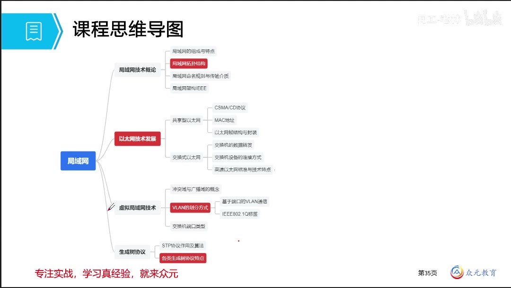

本章属于"局域网"板块的后半部分，包含两块内容：**虚拟局域网（VLAN）**与**生成树协议（STP）**。二者的共同点是：都工作在二层（数据链路层），都在**交换机**上通过软件/协议手段解决"物理拓扑与逻辑需求不匹配"的问题——VLAN 用逻辑划分代替物理隔离，STP 用逻辑阻塞代替物理断线。

| 分支 | 子知识点 | 说明 |
| ---- | -------- | ---- |
| 局域网技术概论 | 组成与特点、**拓扑结构**、命名规则与传输介质、架构 IEEE | 学习的前提 |
| 以太网技术发展 | **共享型以太网**：CSMA/CD、MAC 地址、帧结构与封装 | 解决冲突 |
| 以太网技术发展 | **交换式以太网**：交换机数据转发、设备连接方式、高速以太网标准 | 提升速率 |
| 虚拟局域网技术 | 冲突域与广播域的概念 | 引入背景 |
| 虚拟局域网技术 | **VLAN 的划分方式**：基于端口的 VLAN 通信、IEEE 802.1Q 标签 | 核心考点 |
| 虚拟局域网技术 | 交换机端口类型 | 配置基础 |
| 生成树协议 | STP 协议作用及算法 | 核心考点 |
| 生成树协议 | **各类生成树协议特点**（STP / RSTP / MSTP） | 关键词记忆 |

---

## 1.冲突域与广播域

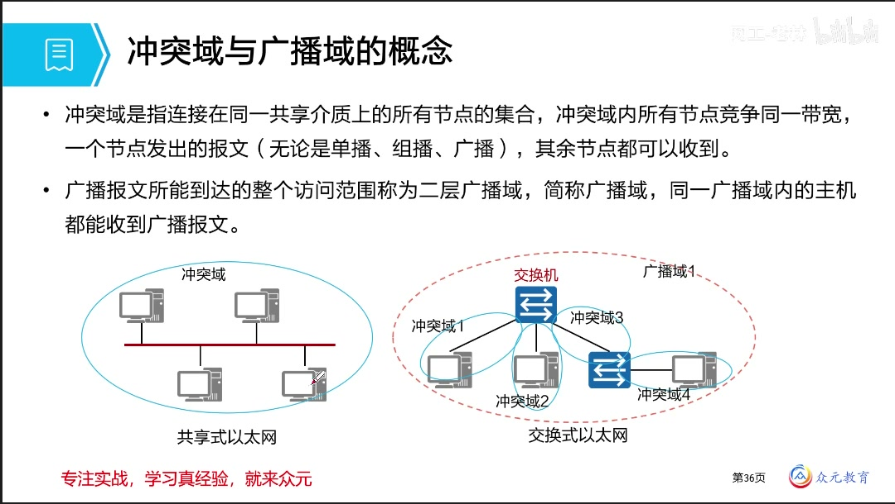

### 1.1 冲突域

**定义**：连接在同一共享介质上的所有节点的集合。冲突域内所有节点竞争同一带宽，一个节点发出的报文（无论是单播、组播还是广播），其余节点都可以收到。

- 冲突域的本质问题是**介质共享导致的信号碰撞**，由 CSMA/CD 协议负责解决
- 早期以太网设备**集线器、中继器不能分割冲突域**
- **交换机的每个端口就是一个独立的冲突域**

### 1.2 广播域

**定义**：广播报文所能到达的整个访问范围称为二层广播域，简称广播域。同一广播域内的主机都能收到广播报文。

- **交换机不分割广播域**，其所有端口处于同一个广播域内
- 分割广播域必须使用**三层设备**（路由器、三层交换机）

### 1.3 分割能力与设备对应关系（考点）

| 设备 | 所属层次 | 分割冲突域 | 分割广播域 |
| ---- | -------- | ---------- | ---------- |
| 集线器、中继器 | 物理层 | 否 | 否 |
| 网桥、二层交换机 | 数据链路层 | 是（每端口一个冲突域） | 否 |
| 路由器、三层交换机 | 网络层 | 是 | 是 |

要点：

1. 二层交换机"分冲突域、不分广播域"，这是最常设陷阱的一句话
2. 网桥是交换机的前身，同属二层设备，能力与交换机一致
3. 三层交换机按 VLAN（子网）划分广播域，因此既分冲突域也分广播域

---

## 2.VLAN 技术概述

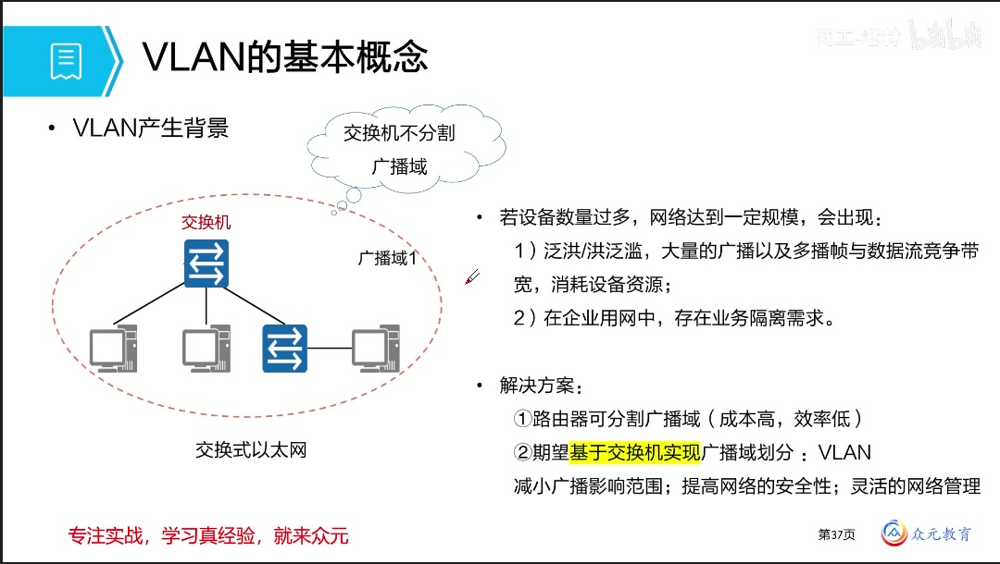

### 2.1 产生背景

交换式以太网中，若设备数量过多、网络达到一定规模，会出现两类问题：

1. **泛洪（广播风暴）**：大量广播帧、多播帧与正常数据流竞争带宽，消耗设备资源；严重时导致交换机死机
2. **业务隔离需求**：企业网络中不同部门、不同业务需要相互隔离

原因在于：交换机收到**未知单播帧**时采用广播方式泛洪转发，广播帧会充斥整个广播域。

### 2.2 两种解决方案

| 方案 | 做法 | 评价 |
| ---- | ---- | ---- |
| ① 增加路由器 | 用三层设备分割广播域 | 成本高、转发效率低（路由器主要做寻址和外网出口） |
| ② 划分 VLAN | **基于交换机实现广播域的逻辑划分** | 成本低、效率高，是主流方案 |

### 2.3 VLAN 的作用

| 作用 | 说明 |
| ---- | ---- |
| 分割广播域 | **逻辑上**分割，不是物理上分割，减小广播报文的影响范围，抑制广播风暴 |
| 提高安全性 | 不同 VLAN 之间二层隔离，未经三层设备无法互访 |
| 灵活的网络管理 | 按部门/业务分组，不受物理位置限制，人员移动后重新分组方便 |

关键结论：**VLAN 是逻辑隔离，不是物理隔离**。物理隔离是空间上的切割（如两套独立布线），VLAN 中设备在物理上仍连在同一台交换机、同一套布线上，只是逻辑上被分开。

---

## 3.VLAN 的划分方式

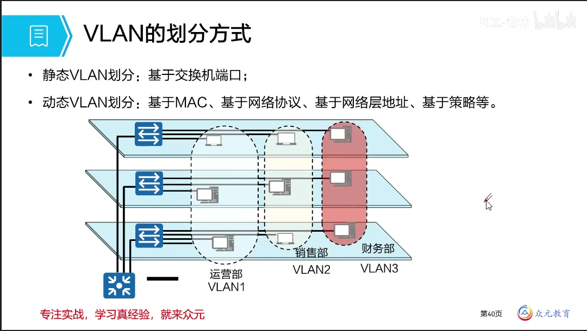

VLAN 的划分分为**静态**与**动态**两大类。静态划分基于交换机端口，动态划分基于终端的属性（MAC、协议、网络层地址、策略等）。

图中示意：三层办公楼中，运营部、销售部、财务部的终端在物理上分布在不同楼层、接在不同交换机上，但通过 VLAN 分别归入 VLAN1、VLAN2、VLAN3，实现"跨楼层同组"。

### 3.1 静态划分：基于交换机端口

- 通过配置命令把某些端口划归 VLAN 10、另一些划归 VLAN 20
- 优点：配置简单、转发效率最高
- 缺点：**端口固定、不可移动**，终端换位置就要改配置
- 适用：**固定办公环境**（台式机、网线固定不动）

### 3.2 动态划分

| 划分依据 | 判据 | 特点 |
| -------- | ---- | ---- |
| 基于 MAC 地址 | 终端的物理网卡地址 | 设备移动到任何端口、插上网线仍属原 VLAN；**适合移动办公** |
| 基于网络协议 | 网络层协议类型（IP、IPX 等） | 灵活，但需检查更高层内容，**时延增大、效率较低** |
| 基于网络层地址（IP 子网） | 终端 IP 所在网段 | 切换 IP 地址即可切换所属 VLAN |
| 基于策略 | 管理员自定义的组合策略 | 最灵活，效率最低 |
| 基于用户/用户授权 | 用户身份 | 了解即可 |

### 3.3 划分方式对比

| 比较项 | 基于端口 | 基于 MAC | 基于 IP 子网 | 基于协议/策略 |
| ------ | -------- | -------- | ------------ | ------------- |
| 分类 | 静态 | 动态 | 动态 | 动态 |
| 处理层次 | 一层（端口） | 二层 | 三层 | 三层及以上 |
| 移动性 | 差 | 好 | 好 | 好 |
| 处理速度 | 最快 | 较快 | 较慢 | 最慢 |
| 典型场景 | 固定办公 | 移动办公 | 按网段划分 | 特殊需求 |

规律：**判断依据所在的层次越深，灵活性越高，处理速度越慢、时延越大**。

---

## 4.IEEE 802.1Q 帧格式与 VLAN 标签

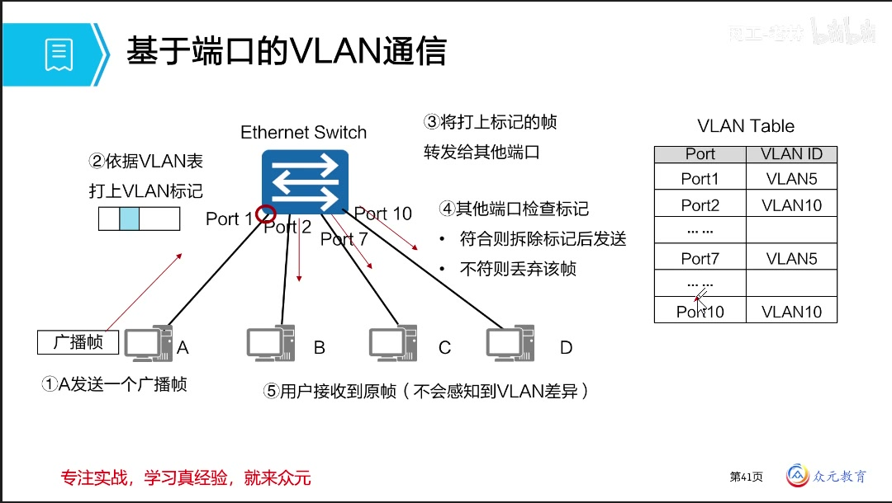

### 4.1 基于端口的 VLAN 通信流程

交换机内部维护一张 **VLAN 表（VLAN Table）**，记录每个端口所属的 VLAN，这个值称为 **PVID（Port VLAN ID，端口 VLAN 标识）**。

| Port | VLAN ID |
| ---- | ------- |
| Port 1 | VLAN 5 |
| Port 2 | VLAN 10 |
| …… | …… |
| Port 7 | VLAN 5 |
| Port 10 | VLAN 10 |

通信过程分为五步：

| 步骤 | 动作 |
| ---- | ---- |
| ① | A 发送一个广播帧（未带标记的原始帧） |
| ② | 依据 VLAN 表，在入端口为该帧**打上 VLAN 标记**（Tag），VID 与端口 PVID 一致 |
| ③ | 交换机查表，把带标记的帧转发给同属该 VLAN 的其他端口 |
| ④ | 其他端口**检查标记**：符合则拆除标记后发送；不符合则丢弃该帧 |
| ⑤ | 用户接收到原始帧，**不会感知到 VLAN 差异** |

关键结论：

- 打标签与拆标签都在交换机上完成，对用户**透明**
- 判断能否通过的关键是 **VID 与 PVID 是否能对上**，核心在 **Tag**

### 4.2 标记帧与未标记帧

| 名称 | 含义 |
| ---- | ---- |
| 未标记帧（Untagged 帧） | 原始的以太网帧，终端发出的帧 |
| 标记帧（Tagged 帧） | 在源 MAC 地址与长度/类型字段之间插入 802.1Q 标记后的帧 |

### 4.3 802.1Q 帧格式

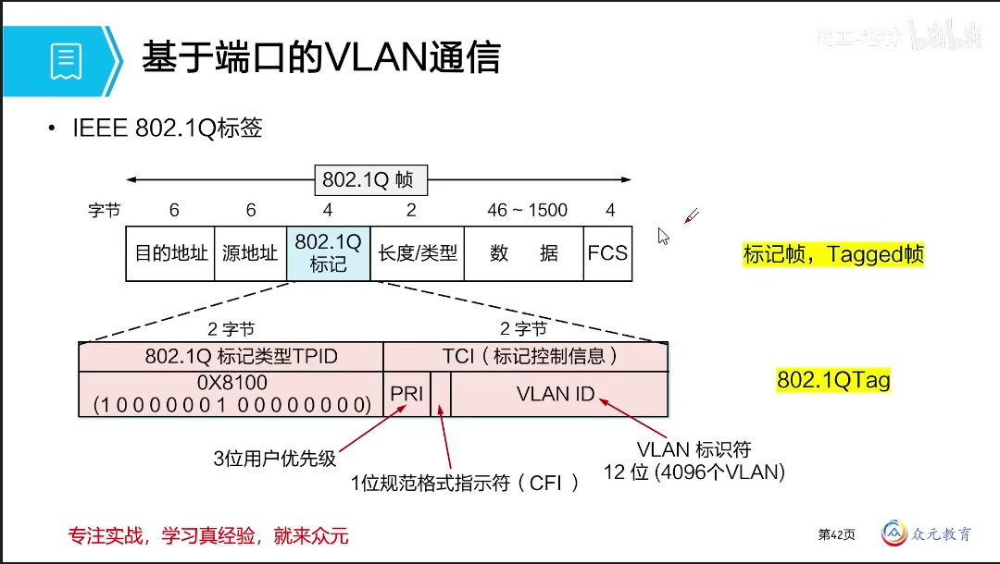

| 字段 | 长度（字节） | 说明 |
| ---- | ------------ | ---- |
| 目的地址 | 6 | 目的 MAC 地址 |
| 源地址 | 6 | 源 MAC 地址 |
| **802.1Q 标记（Tag）** | **4** | TPID（2 字节）+ TCI（2 字节） |
| 长度/类型 | 2 | 标记帧中该位置之后仍为原以太网类型 |
| 数据 | 46 ~ 1500 | 带标记时最小数据字段可缩至 42 字节 |
| FCS | 4 | 帧校验序列，插入标记后需重新计算 |

帧长结论：

- **最小帧长 64 字节**（与普通以太网帧一致）
- **最大帧长 1522 字节**（普通以太网帧为 1518 字节，插入 4 字节标记后增加 4 字节）

### 4.4 Tag 字段结构（重点）

| 字段 | 位宽 | 含义 |
| ---- | ---- | ---- |
| TPID（标记协议标识符） | 16 位（2 字节） | 固定值 **0x8100**，用于标识这是 802.1Q 标记帧 |
| PRI（Priority，用户优先级） | 3 位 | 对应 IEEE 802.1p，取值 0 ~ 7，共 8 个优先级，用于区分转发优先顺序 |
| CFI（规范格式指示符） | 1 位 | 以太网中恒为 0；为 1 表示 MAC 地址为非规范格式（用于以太网与令牌环互通），考得较少 |
| **VID（VLAN 标识符）** | **12 位** | 标识该帧所属的 VLAN，是 VLAN 的核心标志 |

### 4.5 VLAN ID 的取值范围

```
编号总数 = 2^12 = 4096 个
```

| 编号 | 用途 |
| ---- | ---- |
| 0 | 保留（表示帧只带优先级、不带 VLAN ID，称为优先级标签） |
| 1 | **默认 VLAN（默认管理 VLAN）**，未做任何配置时所有端口都属于 VLAN 1 |
| 2 ~ 4094 | 可正常使用 |
| 4095 | 保留，不得配置和发送 |

结论：**4096 个编号中，0 与 4095 保留，实际可用的 VLAN 共 4094 个**。注意"4096 个都能随意使用"是错误说法。

---

## 5.交换机端口类型

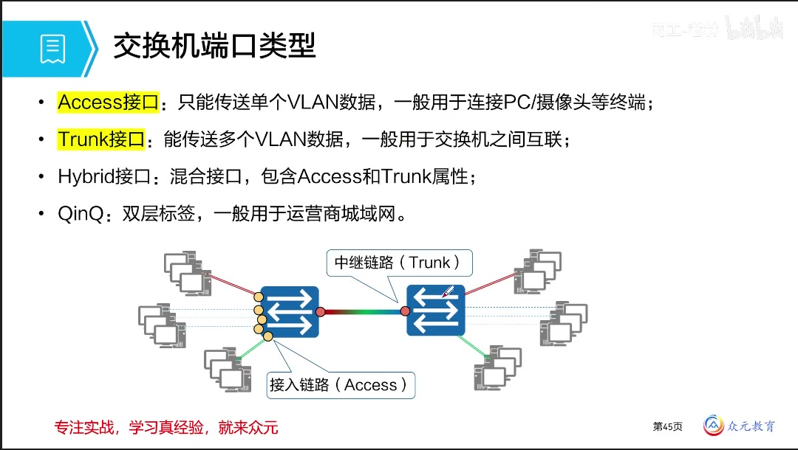

单台交换机内部按端口划分 VLAN 很简单，但多台交换机互联时，若两台交换机之间只用一条链路且该链路只能属于一个 VLAN，则相同 VLAN 的跨交换机通信无法实现，为每个 VLAN 单独拉一条链路又会浪费端口和成本。解决方式是定义**端口类型**，让一条链路承载多个 VLAN。

| 端口类型 | 可承载 VLAN 数 | 标签处理 | 典型用途 |
| -------- | -------------- | -------- | -------- |
| **Access（接入）接口** | 单个 | 入方向打上本端口 PVID 的标签；出方向**拆除标签**后发给终端 | 连接 PC、摄像头等终端 |
| **Trunk（中继）接口** | 多个 | 出方向**带标签通过**（Native VLAN，即 PVID 对应的 VLAN 不打标签）；只检查、不拆除 | 交换机与交换机之间互联 |
| **Hybrid（混合）接口** | 多个 | 可按 VLAN 分别指定 Tagged / Untagged，兼具 Access 与 Trunk 属性 | 灵活组合；**华为设备默认端口类型** |
| **QinQ** | 双层标签 | 内外两层 802.1Q 标签 | 运营商城域网 |

### 5.1 Access 与 Trunk 的区别（考点）

| 比较项 | Access 接口 | Trunk 接口 |
| ------ | ----------- | ---------- |
| 承载 VLAN | 只能承载 1 个 VLAN | 可承载多个 VLAN |
| 是否打标签 | 入方向打标签，出方向拆标签 | 带标签通过 |
| 连接对象 | 终端设备 | 交换设备之间 |
| 链路名称 | 接入链路（Access Link） | 中继链路（Trunk Link） |

形象理解：Access 口相当于"检票并收走票"，终端始终看到的是原始帧；Trunk 口相当于"验票但不收票"，帧带着标签穿过骨干链路，直到最后出口才被拆掉。

### 5.2 QinQ（双层标签）

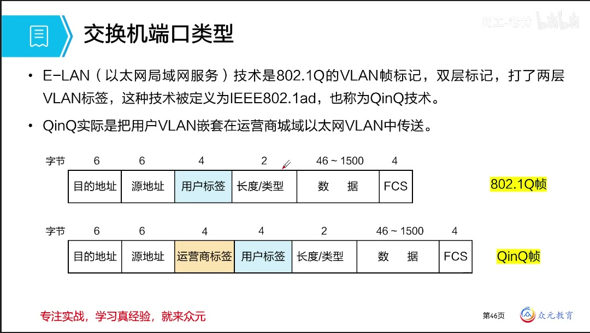

- **E-LAN（以太网局域网服务）**技术使用 802.1Q 的 VLAN 帧标记，打两层 VLAN 标签，该技术被定义为 **IEEE 802.1ad**，也称为 **QinQ** 技术
- QinQ 实际上是把**用户 VLAN 嵌套在运营商城域以太网 VLAN 中**传送

| 帧类型 | 字段序列（字节） |
| ------ | ---------------- |
| 802.1Q 帧 | 目的地址 6 + 源地址 6 + **用户标签 4** + 长度/类型 2 + 数据 46~1500 + FCS 4 |
| QinQ 帧 | 目的地址 6 + 源地址 6 + **运营商标签 4** + **用户标签 4** + 长度/类型 2 + 数据 46~1500 + FCS 4 |

要点：

- 外层为**运营商标签（公网 VLAN）**，内层为**用户标签（私网 VLAN）**
- 出用户网络后按公网规则查看 VLAN，进入用户网络后按私网规则查看 VLAN，相当于"隧道"
- 作用：扩展 VLAN 数量、隔离不同用户的 VLAN、提高安全性与灵活性
- 考查形式仅为选择题，掌握"双层标记、802.1ad、QinQ、运营商城域网"四个关键词即可

### 5.3 GVRP（补充）

**GVRP（GARP VLAN Registration Protocol，GARP VLAN 注册协议）**是基于 GARP 的一个应用，用于在 Trunk 链路上**动态注册与注销 VLAN**，实现 VLAN 的动态创建与传播。

- 若不使用 GVRP，同一 VLAN 需在每台交换机上逐台手工配置，工作量大且易出错
- 使用 GVRP 后，交换机与相邻交换机交换 VLAN 配置信息，自动创建和管理 VLAN
- 属于"动态 VLAN"的一种实现手段，与"基于 MAC/协议/子网"的动态划分不是同一分类维度

---

## 6.VLAN 间通信

VLAN 在二层实现了隔离，同时也切断了 VLAN 之间的通路：**不同 VLAN 之间必须经过三层设备才能通信**。有两种典型实现方式。

### 6.1 单臂路由（Router-on-a-Stick）

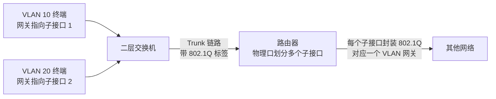

原理：

1. 路由器的一个物理接口划分为多个**子接口**
2. 每个子接口封装 802.1Q，对应一个 VLAN，作为该 VLAN 的网关
3. 交换机与路由器之间使用 **Trunk** 链路，一条物理链路承载多个 VLAN 的标签帧
4. 数据流：终端 → 交换机（打标签）→ 路由器子接口（拆标签、三层转发、重新封装另一 VLAN 标签）→ 交换机 → 目标终端

| 优点 | 缺点 |
| ---- | ---- |
| 只需一台路由器、一条物理链路，成本低 | 所有 VLAN 流量共用一条物理链路，**易形成带宽瓶颈** |
| 配置直观，便于实验验证 | 子接口数量受限，配置相对繁琐，转发性能依赖路由器 |

### 6.2 三层交换（VLANIF / SVI）

原理：在三层交换机上为每个 VLAN 创建**虚接口（VLANIF，Cisco 称 SVI）**并配置 IP 地址作为网关，VLAN 间的三层转发由交换机内部硬件完成。

| 优点 | 缺点 |
| ---- | ---- |
| 硬件 ASIC 转发，性能远高于单臂路由 | 设备成本较高 |
| 不受单条物理链路带宽限制，可跨多链路 | 需三层交换机支持 |
| 网关与二层设备合一，组网简洁 | 大型网络仍需路由协议配合 |

### 6.3 两种方式对比

| 比较项 | 单臂路由 | 三层交换 |
| ------ | -------- | -------- |
| 转发主体 | 路由器 | 三层交换机 |
| 转发方式 | 软件转发为主 | 硬件转发 |
| 链路瓶颈 | 存在（单链路承载全部 VLAN） | 基本不存在 |
| 成本 | 低 | 较高 |
| 适用规模 | 小型网络、实验环境 | 中大型园区网 |

---

## 7.STP 的作用与产生背景


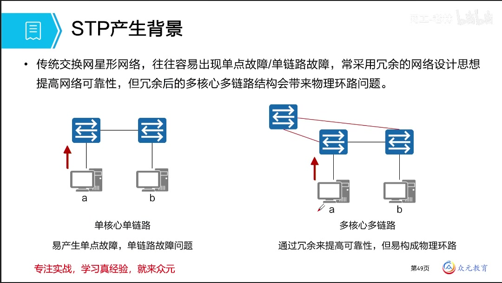

### 7.1 单点故障与冗余设计

传统交换网多为星形结构，容易出现**单点故障、单链路故障**：一旦核心设备或某段链路出现问题，网络即瘫痪。

解决办法是采用**冗余**的网络设计思想提高可靠性：增加备用设备、备用链路，主路径故障时可走备用路径。但冗余后的**多核心、多链路结构会带来物理环路问题**。

### 7.2 环路带来的三大危害（简答题考点）

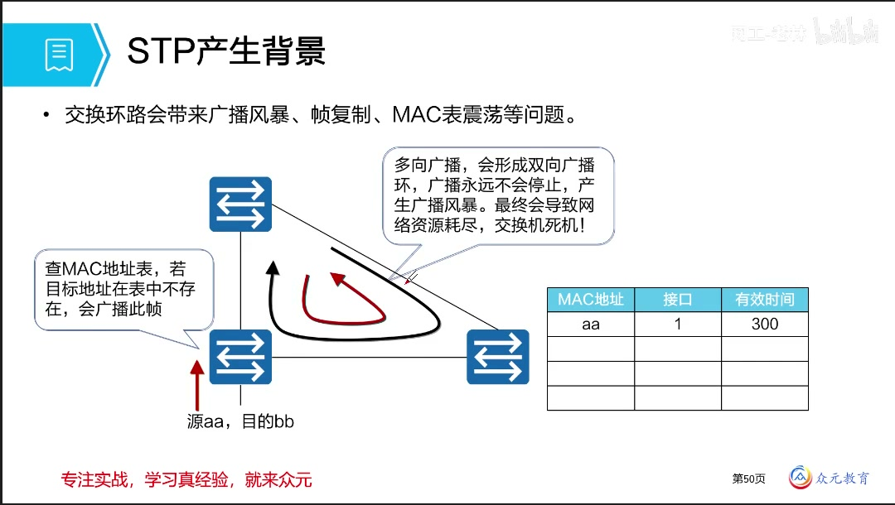

| 危害 | 成因 | 后果 |
| ---- | ---- | ---- |
| **广播风暴** | 广播帧沿环路双向、多向循环转发，永不停息 | 广播帧不断被复制，耗尽链路带宽与设备资源，最终交换机死机 |
| **帧复制** | 同一帧从多条路径到达目的站 | 目的站收到多个副本，上层协议处理异常 |
| **MAC 地址表震荡** | 同一源 MAC 的帧从不同端口反复到达，交换机不断改写表项 | MAC 表项在多个端口间来回跳变，转发混乱 |

以三台交换机成环为例：主机 A（源 MAC 为 aa）向 B 发送帧，交换机查表未命中则泛洪；帧沿环路两个方向传播后从另一端口回到同一交换机，源 MAC 仍是 aa、入端口却变了，交换机按"后到覆盖"原则更新表项，表项在端口 1 与端口 2 之间反复翻转，即 MAC 表震荡。

### 7.3 STP 的定义与作用

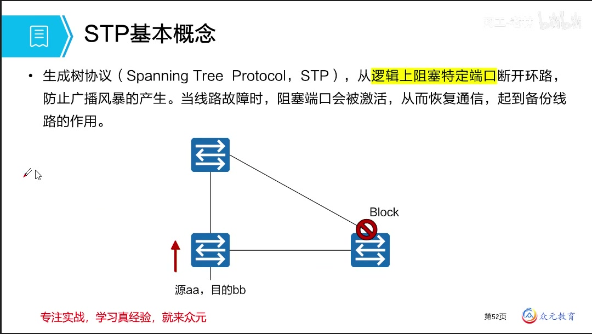

**生成树协议（Spanning Tree Protocol，STP）**：从**逻辑上阻塞特定端口**来断开环路，防止广播风暴的产生；当线路故障时，阻塞端口会被激活，从而恢复通信，起到**备份线路**的作用。

要点：

1. STP **不做物理断开**，拔线等于放弃冗余，可靠性无从保障，因此必须是**逻辑阻塞**
2. 阻塞后网络逻辑上成为**树形结构**（无环）
3. 主链路故障时阻塞端口被激活，形成第二条备份路径
4. STP 的提出早于 VLAN；后续 RSTP、MSTP 的发展正是为了在 VLAN 环境下更好地应用 STP

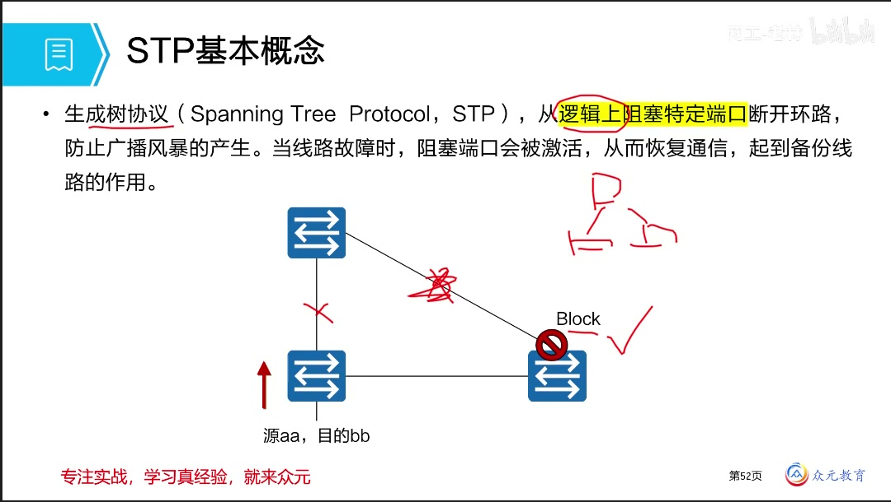

---

## 8.STP 的选举过程

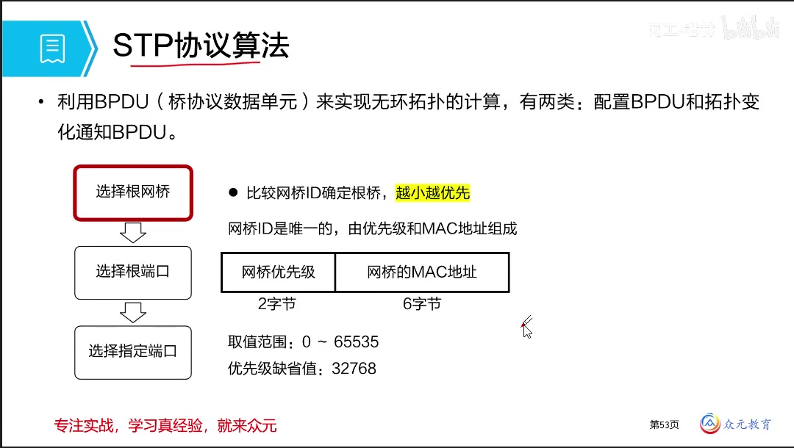

STP 通过交换机之间交换 **BPDU（Bridge Protocol Data Unit，桥协议数据单元）** 完成无环拓扑的计算与选举。选举在数据转发之前完成，用于确定"哪个端口可以转发、哪个端口被阻塞"。

### 8.1 BPDU 的两类

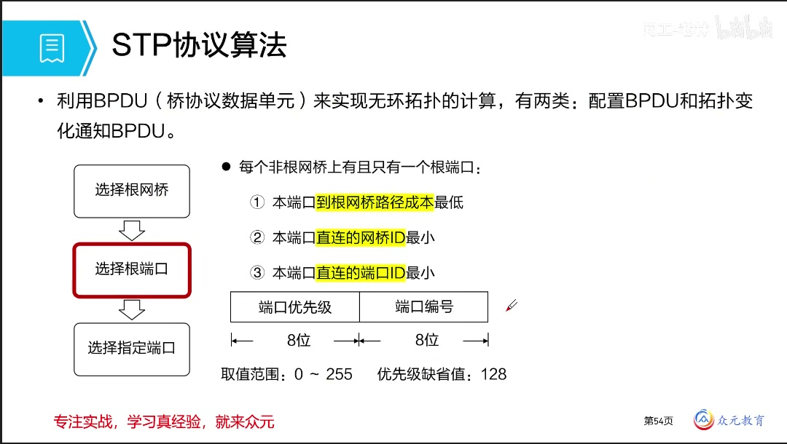

| 类型 | 英文 | 作用 |
| ---- | ---- | ---- |
| 配置 BPDU | Configuration BPDU | 初始选举、拓扑计算；由根桥周期性发出（默认 2 秒），非根桥收到后转发 |
| 拓扑变化通知 BPDU | TCN BPDU（Topology Change Notification） | 拓扑发生变化时，由发现变化的交换机向上游（根桥方向）通报 |

配置 BPDU 的主要字段：

| 字段 | 长度（字节） | 说明 |
| ---- | ------------ | ---- |
| 协议 ID | 2 | 固定值 |
| 版本 | 1 | STP 为 0 |
| BPDU 类型 | 1 | 0x00 配置 BPDU，0x80 TCN BPDU |
| 标志 | 1 | 置位表示拓扑变化等 |
| **根桥 ID** | 8 | 当前根桥的桥 ID |
| **根路径开销** | 4 | 发送方到根桥的路径成本 |
| **发送者桥 ID** | 8 | 发送该 BPDU 的交换机桥 ID |
| **发送者端口 ID** | 2 | 发送该 BPDU 的端口 ID |
| 消息年龄（Message Age） | 2 | BPDU 从根桥发出后经过的时间，每经一跳 +1 |
| 最大年龄（Max Age） | 2 | 默认 20 秒 |
| Hello 时间 | 2 | 默认 2 秒 |
| 转发延迟（Forward Delay） | 2 | 默认 15 秒 |

合计 35 字节。选举所需的四要素为：**根桥 ID、根路径开销、发送者桥 ID、发送者端口 ID**。

### 8.2 网桥 ID（Bridge ID）

| 组成 | 长度 | 说明 |
| ---- | ---- | ---- |
| 网桥优先级 | 2 字节（高 16 位） | 取值范围 0 ~ 65535，**默认 32768**，调整时必须以 **4096** 为步长 |
| 网桥 MAC 地址 | 6 字节（低 48 位） | 交换机自身的 MAC 地址 |

- 网桥 ID 全网唯一，**数值越小越优先**
- 优先级为何按 4096 递增：优先级字段高 4 位是增量位，最低位对应 2^12 = 4096，因此每加 1 级即加 4096
- 实际比较时通常只看 MAC 地址，因为未做配置时优先级都是默认的 32768

### 8.3 第一步：选择根桥（Root Bridge）

- 比较所有交换机的**网桥 ID**，最小者当选根桥
- 全网**有且只有一个**根桥
- 根桥上**没有根端口**，其所有端口都是指定端口

### 8.4 第二步：选择根端口（Root Port）

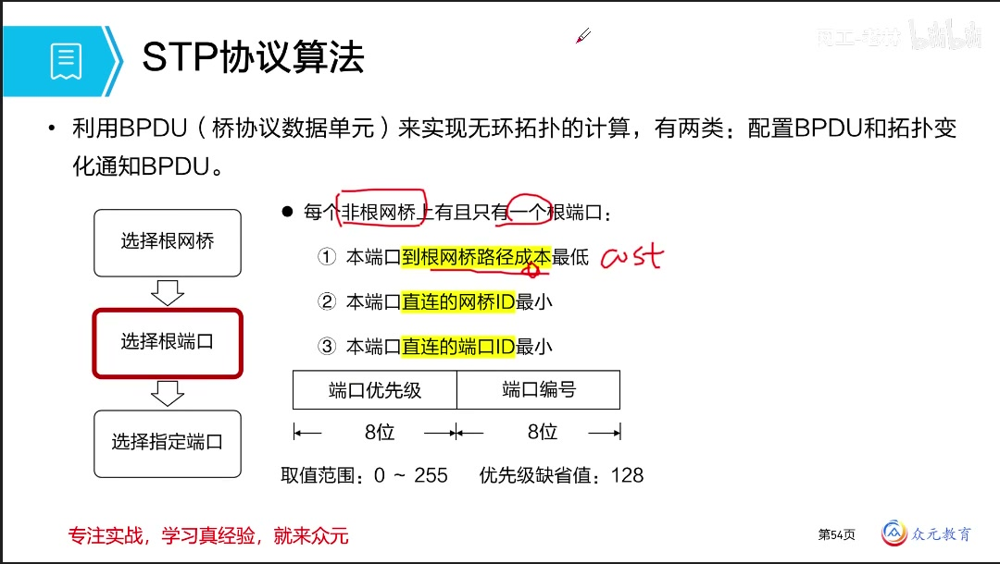

根端口只在**非根网桥**上选择，**每个非根网桥上只有一个**根端口。判断顺序如下，前一条能分出胜负就不再往下比较：

| 顺序 | 判据 | 要点 |
| ---- | ---- | ---- |
| ① | 本端口到根桥的**根路径成本最低** | 求的是到根桥的累计总成本 |
| ② | 本端口**直连的网桥 ID 最小** | 比较的是对端（直连）网桥的 ID，不是本机 |
| ③ | 本端口**直连的端口 ID 最小** | 比较的是对端（直连）端口 ID，不是本机端口 |

端口 ID 的组成：

| 组成 | 长度 | 说明 |
| ---- | ---- | ---- |
| 端口优先级 | 8 位 | 取值范围 0 ~ 255，**默认 128**，调整步长为 16 |
| 端口编号 | 8 位 | 设备面板上的接口编号（如 G0/1） |

### 8.5 路径成本（Path Cost）

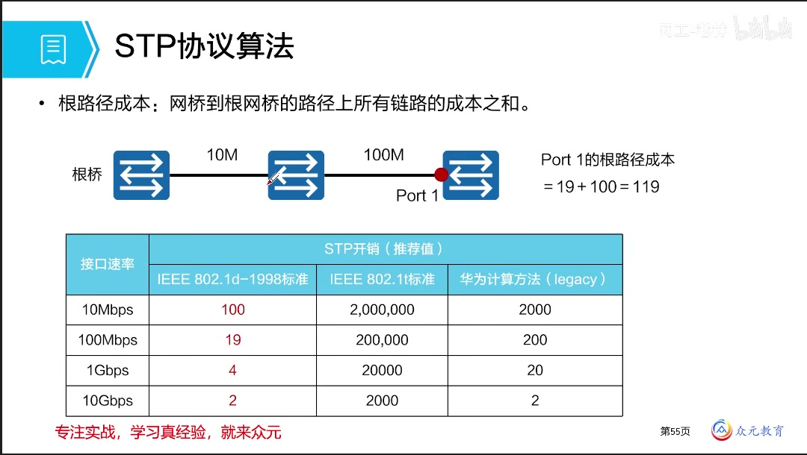

**根路径成本**：网桥到根网桥的路径上所有链路的成本之和。

示例：根桥 —100M— 中间交换机 —10M— 目标交换机，则目标交换机上 Port 1 的根路径成本 = 19 + 100 = 119。

| 接口速率 | IEEE 802.1d-1998 标准 | IEEE 802.1t 标准 | 华为计算方法（legacy） |
| -------- | --------------------- | ---------------- | ---------------------- |
| 10 Mbps | **100** | 2000000 | 2000 |
| 100 Mbps | **19** | 200000 | 200 |
| 1 Gbps | **4** | 20000 | 20 |
| 10 Gbps | **2** | 2000 | 2 |

考试以 **IEEE 802.1d-1998** 一列为准（10M=100、100M=19、1G=4、10G=2），课件中标红的四个数值需牢记；现已很少考成本计算。

### 8.6 第三步：选择指定端口（Designated Port）

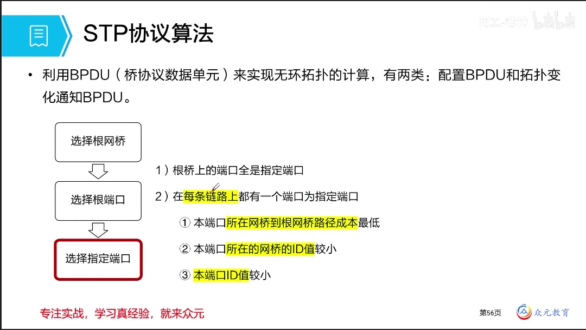

判断规则：

1. **根桥上的所有端口都是指定端口**
2. **每条链路上有且只有一个指定端口**（注意是按"链路"划分，不是按"网桥"划分）
3. 若一条链路上两个端口都尚未确定角色，依次比较：

| 顺序 | 判据 | 与根端口规则的区别 |
| ---- | ---- | ------------------ |
| ① | 本端口**所在网桥**到根桥的路径成本最低 | 比的是"网桥"的成本，不是端口 |
| ② | 本端口**所在网桥**的 ID 值较小 | 比的是本机网桥 ID |
| ③ | 本端口的 ID 值较小 | 比的是本机端口 ID |

实用推论：**根端口的对端端口一定是指定端口**。

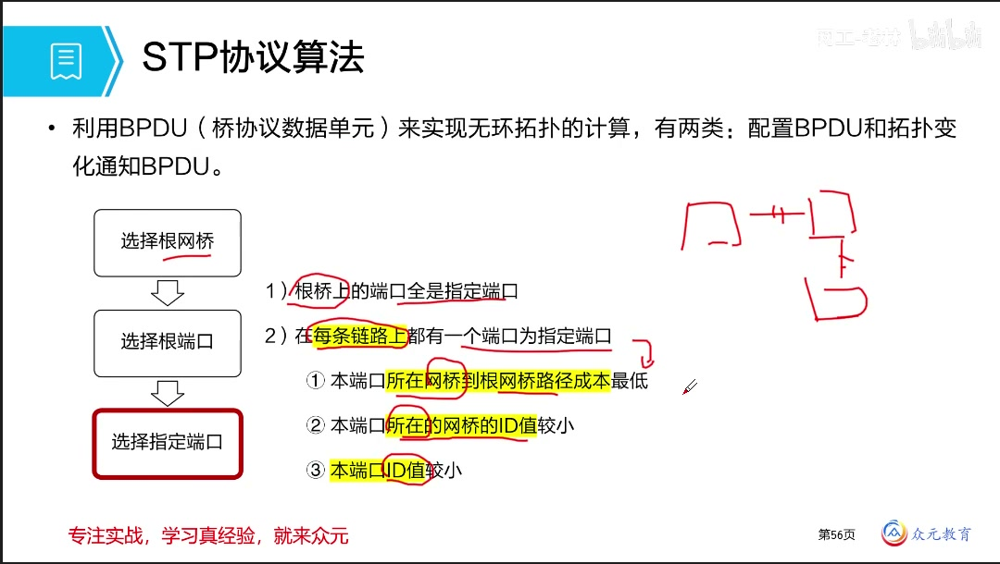

### 8.7 第四步：剩余端口阻塞

既不是根端口、也不是指定端口的端口，进入**阻塞状态**，不转发数据。

### 8.8 选举流程与记忆口诀

选举顺序：**选择根网桥 → 选择根端口 → 选择指定端口 → 剩余端口阻塞**。

| 角色 | 数量 | 判据核心 |
| ---- | ---- | -------- |
| 根桥 | 全网 1 个 | 网桥 ID 最小 |
| 根端口 | 每个非根网桥 1 个 | 到根桥成本 → 直连网桥 ID → 直连端口 ID |
| 指定端口 | 每条链路 1 个 | 所在网桥到根桥成本 → 所在网桥 ID → 本端口 ID |
| 阻塞端口 | 剩余全部 | 无角色即为阻塞 |

记忆要点：**"根桥看桥 ID，根端口看别人（对端），指定端口看自己（本端）"**。

### 8.9 STP 的局限：带宽浪费

STP 通过阻塞端口消除环路，代价是被阻塞链路完全不能转发数据。若两条链路本意是"拓宽道路、分担流量"，STP 只会用其中一条，另一条只在故障时启用，链路利用率并未提高。

这种情况应改用**链路聚合（端口聚合，Eth-Trunk）**：

- 基本原理：将多条以太网物理链路捆绑成一条逻辑链路
- 作用：提高链路带宽、提高链路可靠性（容错）、实现负载均衡、节约成本
- 交换机的主要连接方式：**级联、堆叠、端口聚合、集群**（集群是堆叠与链路聚合的结合）

---

## 9.端口状态与计时器

### 9.1 三个计时器

| 计时器 | 默认值 | 作用 |
| ------ | ------ | ---- |
| Hello Time | **2 秒** | 根桥发送配置 BPDU 的间隔 |
| Forward Delay（转发延迟） | **15 秒** | 侦听状态、学习状态各自的停留时间 |
| Max Age（最大年龄） | **20 秒** | 端口保存的 BPDU 信息的最长有效时间，超时则认为链路故障 |

此外还有 Message Age（消息年龄），不是固定值，表示 BPDU 自根桥发出后经过的时间，每经过一台交换机加 1。

### 9.2 五个端口状态

| 状态 | 转发数据 | 学习 MAC 地址 | 收发 BPDU | 停留时间 |
| ---- | -------- | ------------- | --------- | -------- |
| 禁用（Disabled） | 否 | 否 | 否 | 端口 down 时 |
| 阻塞（Blocking） | 否 | 否 | 只接收 | 最长 20 秒（Max Age） |
| 侦听（Listening） | 否 | 否 | 收发 | 15 秒（Forward Delay） |
| 学习（Learning） | 否 | 是 | 收发 | 15 秒（Forward Delay） |
| 转发（Forwarding） | 是 | 是 | 收发 | 稳定状态 |

状态迁移：**禁用 → 阻塞 → 侦听 → 学习 → 转发**；转发状态遇到链路故障或拓扑变化后回到阻塞。其中"阻塞 → 侦听"需等待 Max Age 超时，其余两次迁移各等待一个 Forward Delay。

说明：侦听、学习两个状态主要起过渡作用，用于收齐 BPDU 完成选举、并提前学习 MAC 地址，避免转发瞬间大量泛洪。

### 9.3 收敛时间（考点）

| 场景 | 计算 | 收敛时间 |
| ---- | ---- | -------- |
| 端口直接 UP（从侦听开始） | 15 + 15 | **30 秒**（最快） |
| 阻塞端口被唤醒（需等 Max Age 超时） | 20 + 15 + 15 | **50 秒**（最慢） |

结论：**STP 的拓扑收敛时间为 30 ~ 50 秒，收敛速度很慢**。原因是选举需要逐步推进，且每个状态都要等待固定计时器超时。

---

## 10.RSTP 与 MSTP

### 10.1 各类生成树协议特点（考点表格）

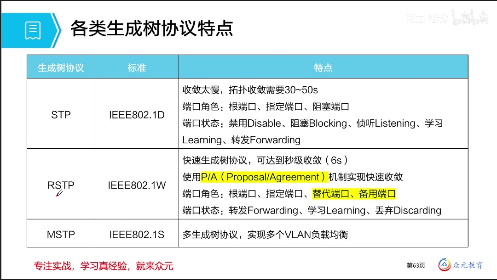

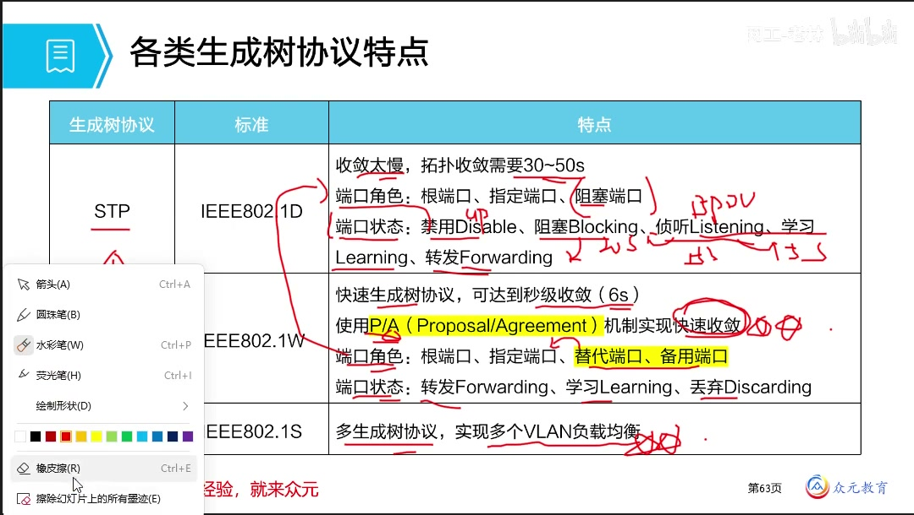

| 生成树协议 | 标准 | 特点 |
| ---------- | ---- | ---- |
| **STP** | IEEE 802.1D | 收敛太慢，拓扑收敛需要 30~50s；端口角色：根端口、指定端口、阻塞端口；端口状态：禁用 Disable、阻塞 Blocking、侦听 Listening、学习 Learning、转发 Forwarding（共 5 个） |
| **RSTP** | IEEE 802.1W | 快速生成树协议，可达到**秒级收敛（6s）**；使用 **P/A（Proposal/Agreement）机制**实现快速收敛；端口角色：根端口、指定端口、**替代端口、备用端口**；端口状态：转发 Forwarding、学习 Learning、丢弃 Discarding（共 3 个） |
| **MSTP** | IEEE 802.1S | 多生成树协议，实现**多个 VLAN 负载均衡** |

### 10.2 RSTP 的改进

RSTP（Rapid Spanning Tree Protocol，快速生成树协议，IEEE 802.1w）在 STP 基础上做了三方面改进。

**改进一：端口角色细分**

| 角色 | 含义 |
| ---- | ---- |
| 根端口（Root） | 到根桥最优的端口 |
| 指定端口（Designated） | 链路上负责转发的端口 |
| 替代端口（Alternate） | 作为**根端口**的备份（从其他网桥收到更优 BPDU） |
| 备用端口（Backup） | 作为**指定端口**的备份（从本网桥收到更优 BPDU） |

原来 STP 中的"阻塞端口"被拆成替代端口与备用端口。好处是故障时无需重新选举：根端口一旦失效，替代端口立即顶上；指定端口失效，备用端口顶上。

**改进二：端口状态精简**

| STP 的 5 个状态 | RSTP 的 3 个状态 |
| --------------- | ---------------- |
| 禁用 Disabled | 丢弃 Discarding |
| 阻塞 Blocking | 丢弃 Discarding |
| 侦听 Listening | 丢弃 Discarding |
| 学习 Learning | 学习 Learning |
| 转发 Forwarding | 转发 Forwarding |

注意：**Discarding 状态不能转发流量**，能转发的是 Forwarding。

**改进三：P/A 快速收敛机制**

指定端口在 Discarding / Learning 状态下发送带 **Proposal（提议）** 置位的 BPDU；下游收到后立即把对应端口确定为根端口，并对其余端口做同步（Sync）——把非边缘、非阻塞的端口置为 Discarding，同步完成后回复 **Agreement（同意）**，根端口随即直接进入 Forwarding，不再等待 15 秒 + 15 秒。

一句话概括：RSTP 依靠**握手机制**而非**计时器超时**完成状态迁移，因此能秒级收敛。

### 10.3 边缘端口（Edge Port）

- 直连终端的端口不会构成环路，可配置为**边缘端口**
- 边缘端口链路 UP 后**直接进入转发状态**，跳过侦听、学习两个阶段
- 边缘端口状态变化**不触发拓扑变化通知**
- 边缘端口一旦收到 BPDU，会**立即失去边缘端口属性**，变成普通生成树端口（防止误接交换机造成环路）

### 10.4 MSTP 的改进

MSTP（Multiple Spanning Tree Protocol，多生成树协议，IEEE 802.1s）：

- 背景：STP 提出时还没有 VLAN，因此没有考虑多 VLAN 环境下的二层防环需求；若每个 VLAN 单独跑一棵树，实例过多、开销过大
- 做法：把多个 VLAN 映射到同一个**实例（MSTI，Multiple Spanning Tree Instance）**，每个实例独立计算一棵生成树
- 效果：不同 VLAN 的流量可以沿不同路径转发，实现**多个 VLAN 的负载均衡**，同时兼有 RSTP 的快速收敛能力

### 10.5 三代协议对比

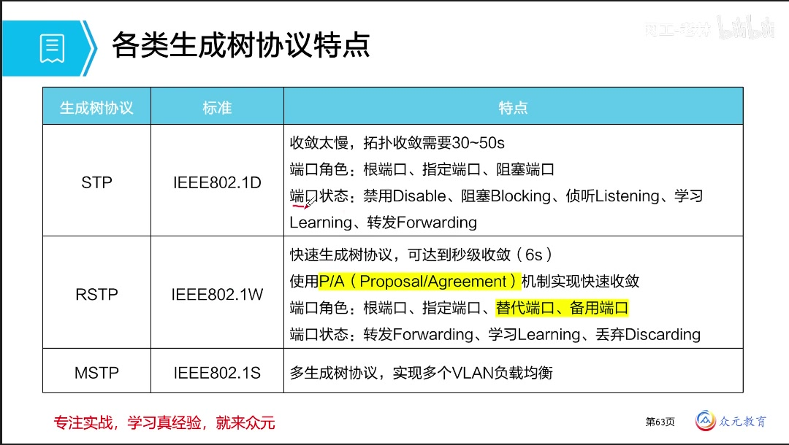

| 比较项 | STP | RSTP | MSTP |
| ------ | --- | ---- | ---- |
| 标准 | 802.1D | 802.1W | 802.1S |
| 收敛速度 | 30 ~ 50 秒 | 秒级（约 6 秒） | 秒级 |
| 端口角色数 | 3 | 4 | 4 |
| 端口状态数 | 5 | 3 | 3 |
| 快速收敛机制 | 计时器超时 | P/A 握手 | P/A 握手 |
| 多 VLAN 支持 | 无（所有 VLAN 共用一棵树） | 无 | 有（按实例负载均衡） |
| 关键词 | 收敛慢 | 快速收敛 | VLAN 负载均衡 |

---

## 11.典型例题

### 11.1 冲突域与广播域

**例题1** 能隔离局域网中广播风暴、提高带宽利用率的设备是（ ）。

- A、网桥
- B、集线器
- C、路由器 [正确]
- D、交换机

解答：本题问的是"设备"。集线器既不分割冲突域也不分割广播域；网桥与交换机同属二层设备，只分割冲突域、不分割广播域；只有路由器这类三层设备能分割广播域。VLAN 是交换机上的一项**技术**，不能把交换机本身当作答案，此处为常见陷阱。

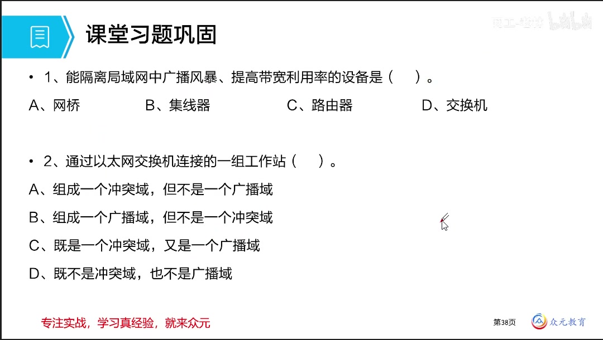

**例题2** 通过以太网交换机连接的一组工作站（ ）。

- A、组成一个冲突域，但不是一个广播域
- B、组成一个广播域，但不是一个冲突域 [正确]
- C、既是一个冲突域，又是一个广播域
- D、既不是冲突域，也不是广播域

解答：交换机每个端口连接一台设备，每个端口是独立的冲突域，因此不构成"一个"冲突域；而所有端口同属一个广播域。

**例题3** 当网络中充斥着大量广播包时，可以采取（ ）措施解决问题。

- A、客户端通过 DHCP 获取 IP 地址
- B、增加接入层交换机
- C、创建 VLAN 来划分更小的广播域 [正确]
- D、网络结构修改为仅有核心层和接入层

解答：增加交换机只能分割冲突域，广播域大小不变；只有划分 VLAN（或串接路由器）才能缩小广播域范围。

**例题4** 下列关于 VLAN 分割网络的说法中，错误的是（ ）。

- A、抑制广播
- B、物理隔离 [正确]
- C、设计具有灵活性
- D、简化网络管理

解答：VLAN 是**逻辑隔离**，设备在物理上仍连在一起；物理隔离是空间上的实际切割。其余三项均为 VLAN 的真实作用。

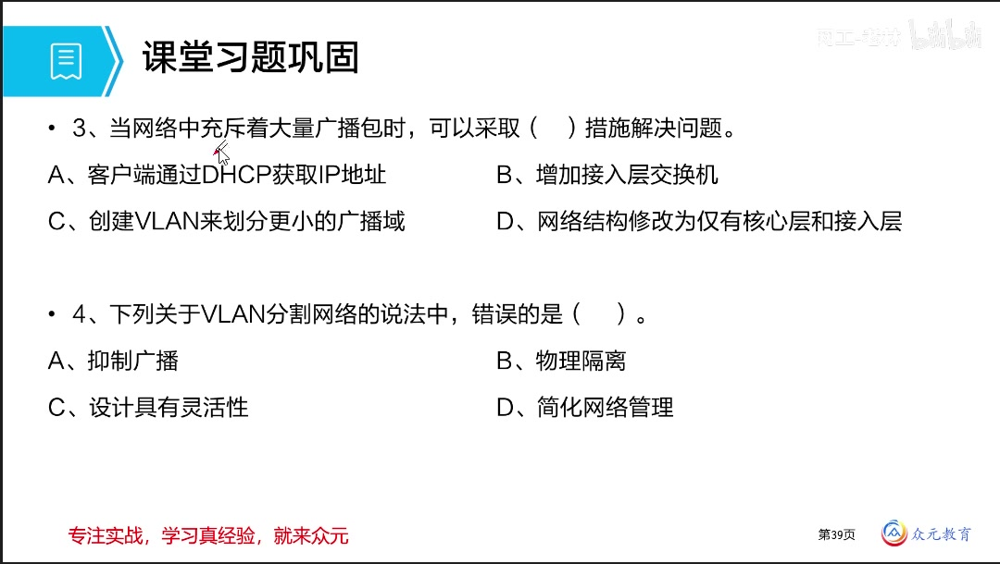

### 11.2 VLAN 划分与标签

**例题5** 用于生成 VLAN 标记的协议是（ ）。

- A、IEEE 802.1Q [正确]
- B、IEEE 802.3
- C、IEEE 802.5
- D、IEEE 802.1D

解答：802.3 为以太网标准，802.5 为令牌环，802.1D 为生成树协议，只有 802.1Q 定义 VLAN 标记。

**例题6** 默认管理 VLAN 是（ ）。

- A、VLAN 0
- B、VLAN 1 [正确]
- C、VLAN 10
- D、VLAN 100

解答：VLAN 0 与 VLAN 4095 保留，未做任何配置时所有端口都属于 VLAN 1。

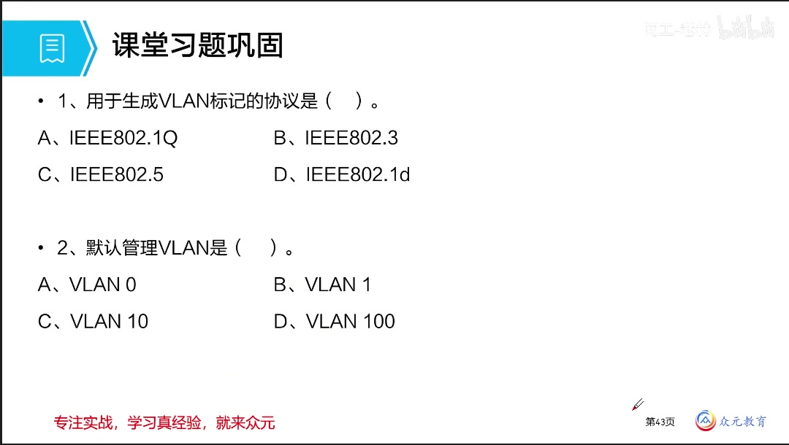

**例题7** 要实现 PC 机切换 IP 地址后，可以访问不同的 VLAN，需采用基于（ ）技术划分 VLAN。

- A、接口
- B、子网 [正确]
- C、协议
- D、策略

解答：基于 IP 子网划分时，终端的 VLAN 归属由 IP 地址所在网段决定，改 IP 即改归属；基于端口/接口划分则与 IP 无关。

**例题8** VLAN 帧的最小帧长是（1）字节，其中表示帧优先级的字段是（2）。

（1）A、60　B、64　C、1518　D、1522
（2）A、Type　B、PRI　C、CFI　D、VID

解答：

- （1）选 **B、64**。VLAN 帧本质仍是 MAC 帧，插入 4 字节标记后最小帧长仍为 64 字节（数据字段最小可降至 42 字节）；最大帧长则由 1518 增至 1522 字节
- （2）选 **B、PRI**。PRI 为 3 位用户优先级（对应 802.1p，取值 0~7）；CFI 为规范格式指示符；VID 为 VLAN 标识符

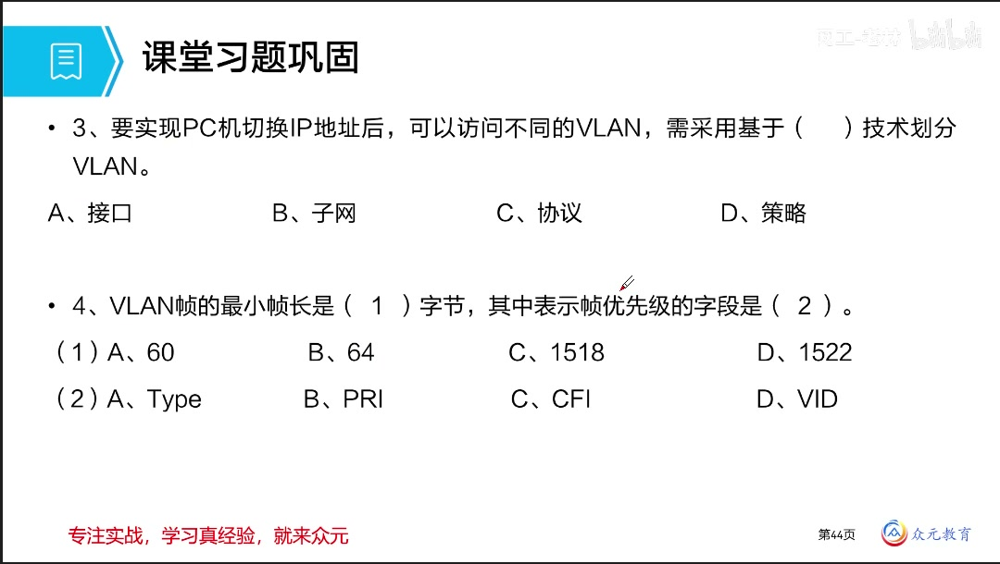

**例题9** 在局域网中划分 VLAN，不同交换机相同 VLAN 之间必须通过（1）连接才能互相通信。属于各个 VLAN 的数据帧必须打上不同的（2）。

（1）A、中继端口　B、动态端口　C、接入端口　D、静态端口
（2）A、VLAN 优先级　B、VLAN 标记　C、用户标识　D、用户密钥

解答：（1）选 **A、中继端口**，只有 Trunk 链路能承载多个 VLAN；Access 口只能承载单个 VLAN。（2）选 **B、VLAN 标记**，用户标识、运营商标识是区分私网与公网的概念，核心仍是 VLAN 标记。

### 11.3 端口类型与 QinQ

**例题10** 城域以太网在各个用户以太网之间建立多点第二层连接，IEEE 802.1ad 定义运营商网桥协议提供的基本技术是在以太网帧中插入（1）字段，这种技术被称为（2）技术。

（1）A、运营商 VLAN 标记　B、运营商虚电路标识　C、用户 VLAN 标记　D、用户帧类型标记
（2）A、Q-in-Q　B、IP-in-IP　C、NAT-in-NAT　D、MAC-in-MAC

解答：（1）选 **A、运营商 VLAN 标记**，即外层标签。（2）选 **A、Q-in-Q**，含义是"802.1Q 帧中再套一个 802.1Q 帧"，双层标签。

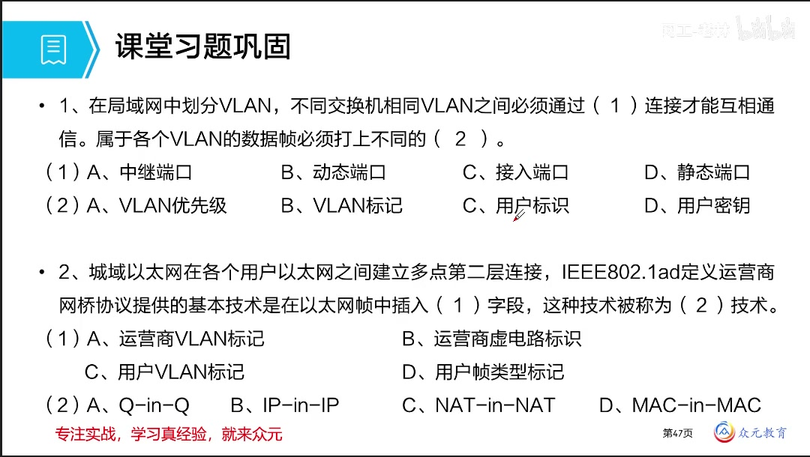

### 11.4 STP 基础

**例题11** 交换机二层环路后可能产生的故障现象不包括（ ）。

- A、远程管理口无法登录
- B、交换机命令行操作变得卡顿
- C、交换机下连接的终端访问网络很慢或者无法访问网络
- D、交换机的接口指示灯由绿灯变为黄灯 [正确]

解答：环路导致广播风暴、CPU 与带宽资源耗尽，表现为管理口无法登录、命令行卡顿、终端访问缓慢或不通。接口指示灯变黄只表示协商速率低于接口速率、单工模式等链路状态信息，不是环路故障现象。

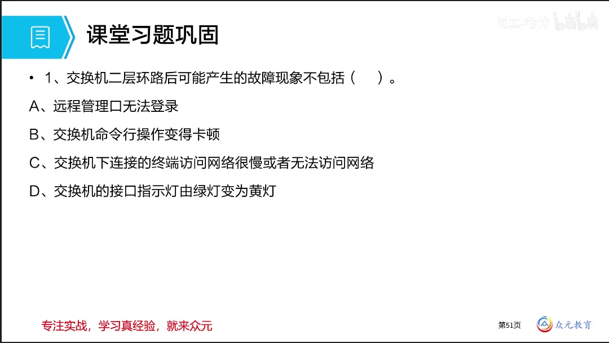

**例题12** STP 协议的作用是（ ）。

- A、防止二层环路 [正确]
- B、以太网流量控制
- C、划分逻辑网络
- D、基于端口的认证

解答：STP 在二层通过逻辑阻塞端口消除环路；划分逻辑网络是 VLAN 的作用。

**例题13** 根据 STP 协议，网桥 ID 最小的交换机被选举为根网桥，网桥 ID 由（1）字节的优先级和 6 字节的（2）组成。

（1）A、2　B、4　C、6　D、8
（2）A、用户标识　B、MAC 地址　C、IP 地址　D、端口号

解答：（1）选 **A、2**；（2）选 **B、MAC 地址**。网桥 ID 共 8 字节 = 2 字节优先级 + 6 字节 MAC 地址。

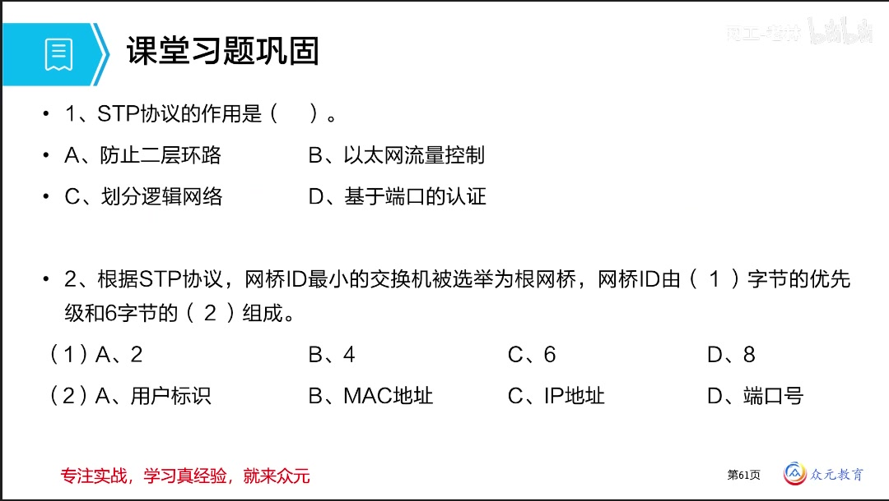

**例题14（案例）** STP（Spanning Tree Protocol）协议用来发现和消除网络中的环路。运行该协议的设备通过相互之间发送（1）报文，在交换网络中选举根桥，通过依次比较该报文中包含的各自的（2）、MAC 地址信息，来确定根桥，优先级值越（3），优先级越高，MAC 地址亦然，交换机默认的优先级值为（4）。

解答：

| 空号 | 答案 | 依据 |
| ---- | ---- | ---- |
| （1） | 配置 BPDU（桥协议数据单元） | 选举依据的是配置 BPDU，不是 TCN BPDU |
| （2） | 优先级（网桥优先级） | 网桥 ID 先比优先级，再比 MAC |
| （3） | 小 | 数值越小优先级越高 |
| （4） | 32768 | 默认优先级，调整步长 4096 |

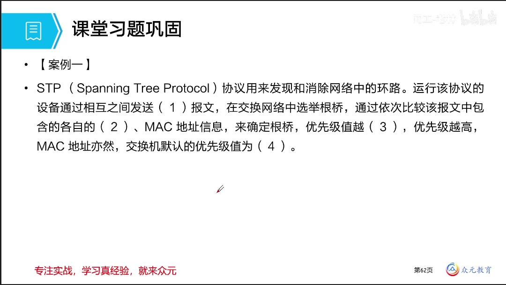

### 11.5 STP 选举案例

**案例示例1** 请分析下图中的根桥、根端口、指定端口、阻塞端口。

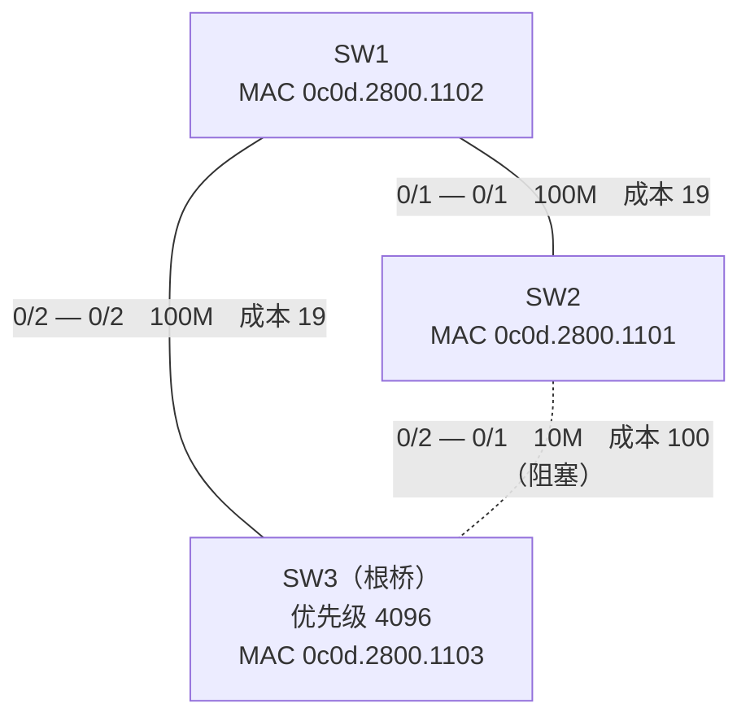

解题步骤：

| 步骤 | 分析 | 结论 |
| ---- | ---- | ---- |
| ① 根桥 | SW1、SW2 未写优先级，取默认 32768；SW3 优先级 4096，数值最小 | **SW3 为根桥** |
| ② SW1 的根端口 | 0/2 直达根桥，成本 19；0/1 经 SW2 绕行，成本 19 + 100 = 119 | **0/2 为根端口**（19 < 119） |
| ③ SW2 的根端口 | 0/1 经 SW1 到根桥，成本 19 + 19 = 38；0/2 直达根桥，成本 100 | **0/1 为根端口**（38 < 100） |
| ④ 指定端口 | 根桥 SW3 的 0/1、0/2 全为指定端口；根端口的对端 0/1（SW1）、0/2（SW3）为指定端口；SW2 与 SW3 之间 10M 链路上，SW3 的 0/1 已为指定端口 | 指定端口：SW3 的 0/1、0/2，SW1 的 0/1 |
| ⑤ 阻塞端口 | 既非根端口也非指定端口 | **SW2 的 0/2 阻塞** |

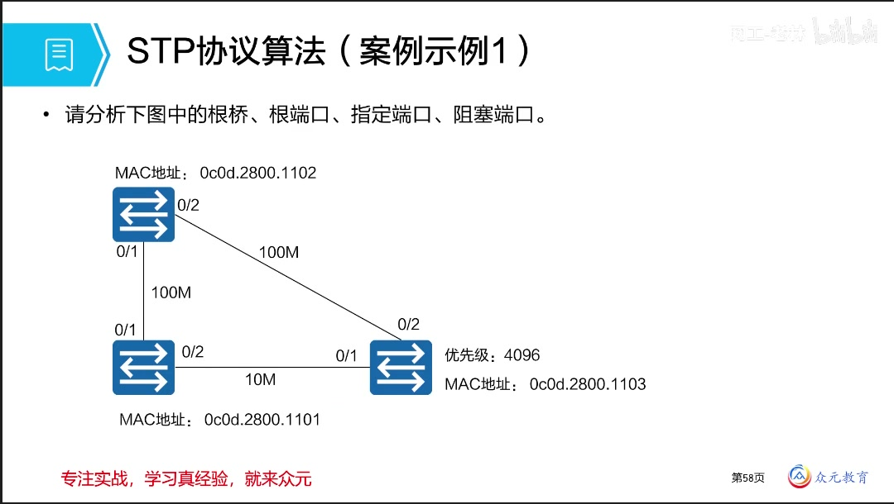

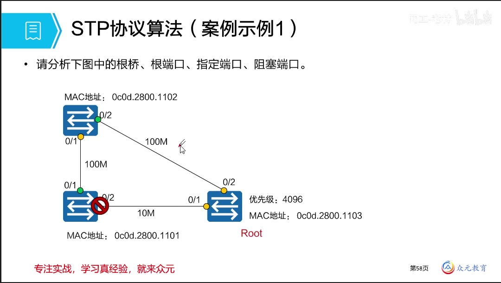

**案例示例2** 三台交换机 SW1（MAC 0c0d.2800.1101）、SW2（0c0d.2800.1102）、SW3（0c0d.2800.1103），优先级均为默认值，链路均为千兆（成本 4）。

分析：

1. 根桥：优先级相同，比 MAC，最小者为 **SW1（1101）**
2. 根端口：某交换机两个端口分别直连 SW3（路径成本 4 + 4 = 8）与 SW2（4 + 4 = 8），两者成本相同
3. 成本相同则比较**直连网桥 ID**：连接 SW2 的端口（G0/2）优于连接 SW3 的端口（G0/1），因为 1102 < 1103，故 **G0/2 为根端口**
4. 指定端口：比较端口所在网桥到根桥的路径成本，直连根桥者为 4、绕行者为 8，成本小者当选指定端口，另一端口阻塞

本例的考点是：**根路径成本相同时，转入第二判据"直连网桥 ID 最小"**。

**案例示例3** 两台交换机通过两条链路互连，请分析各端口角色。

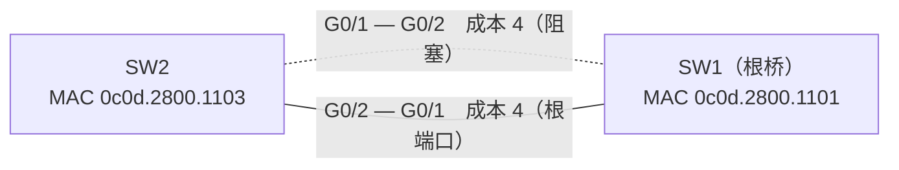

分析：

1. 根桥：两台均未标优先级（默认 32768），比 MAC，1101 < 1103，**SW1 为根桥**
2. 根端口（SW2 上二选一）：两条链路成本均为 4，相同；直连网桥都是 SW1，相同；比较**直连端口 ID**——G0/1 对端是 G0/2，G0/2 对端是 G0/1，G0/1 更小，故 **SW2 的 G0/2 为根端口**
3. 指定端口：根桥 SW1 的 G0/1、G0/2 均为指定端口
4. 阻塞：**SW2 的 G0/1 阻塞**

本例说明 STP 的缺陷：两条链路本意是分担流量，STP 却阻塞一条，链路利用率没有提升。此类拓扑应使用**链路聚合（Eth-Trunk）**：把多条物理链路捆绑为一条逻辑链路，同时获得带宽提升、容错、负载均衡与成本节约。

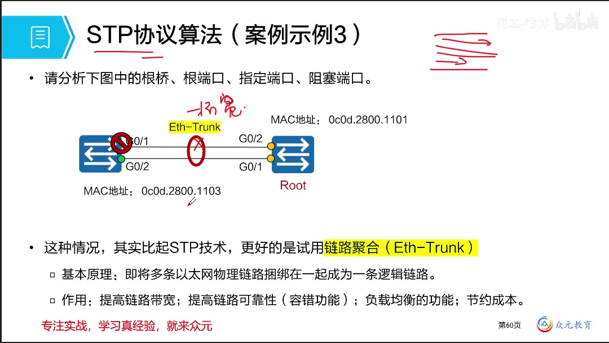

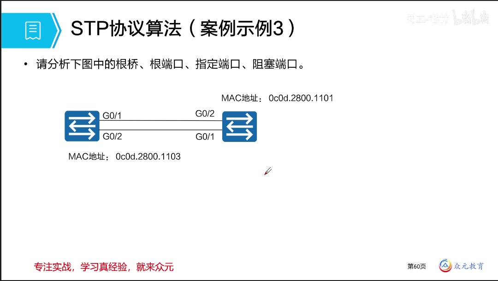

### 11.6 RSTP 与 MSTP

**例题15** 由 IEEE 制定得最早的 STP 标准是（ ）。

- A、IEEE 802.1D [正确]
- B、IEEE 802.1Q
- C、IEEE 802.1W
- D、IEEE 802.1S

解答：802.1D 为 STP；802.1W 为 RSTP；802.1S 为 MSTP；802.1Q 为 VLAN 标记。（该题在课件中出现两次）


**例题16** 下列关于 RSTP 的说法中正确的是（ ）。

- A、交换机端口处于 Discarding 状态即可进行流量转发
- B、依靠计时器超时机制确定根端口和指定端口
- C、采用 P/A 机制实现快速收敛 [正确]
- D、优先级数值大的交换机会被选为根桥

解答：Discarding 为丢弃状态，不能转发；RSTP 恰恰**不再依赖计时器超时**，而用 P/A 握手快速迁移状态；根桥选举仍是数值小者优先，与 STP 一致。

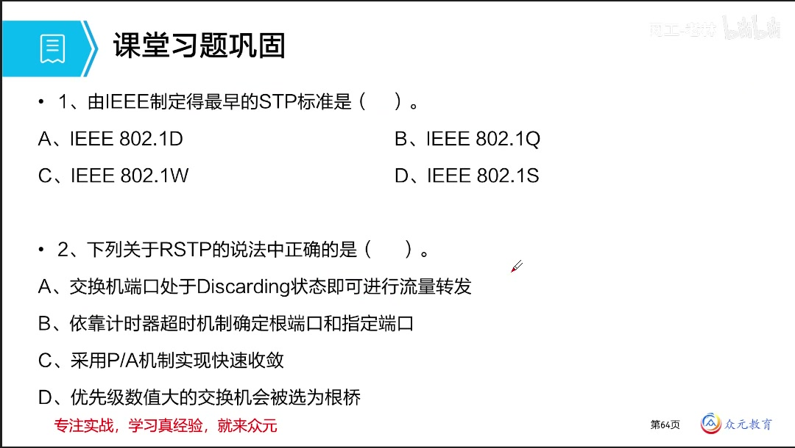

**例题17（案例）** RSTP（Rapid Spanning Tree Protocol）在 STP 基础上进行了改进，实现了网络拓扑（1）。但它们均是通过阻塞某个端口来实现环路消除的，存在浪费带宽的缺点，MSTP 在 STP 和 RSTP 的基础上进行了改进，既可以快速收敛，又提供了数据转发的多个冗余路径，在数据转发过程中实现 VLAN 数据的（2）。

解答：（1）**快速收敛**；（2）**负载均衡**。这两个词分别是 RSTP 与 MSTP 的标签式关键词。

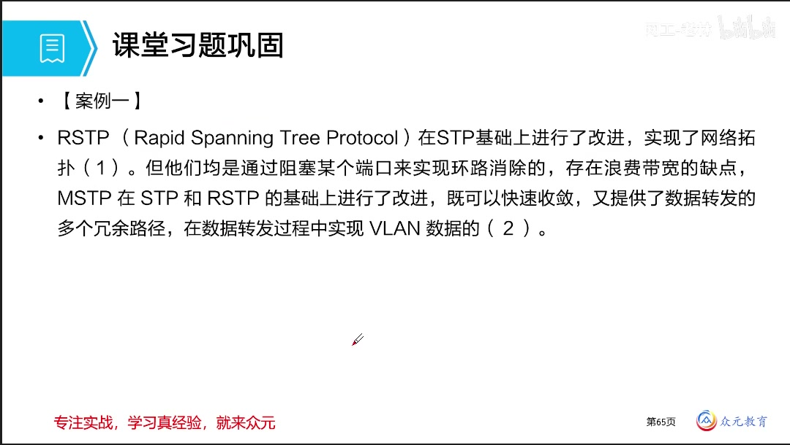

---

## 12.本章小结

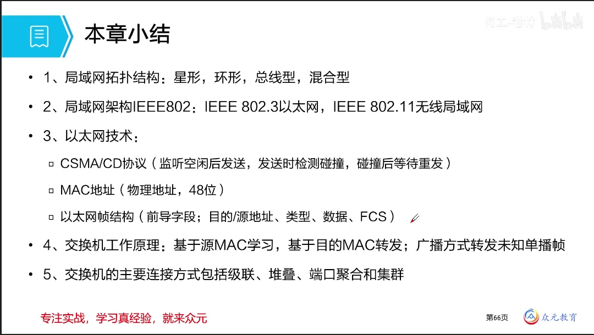

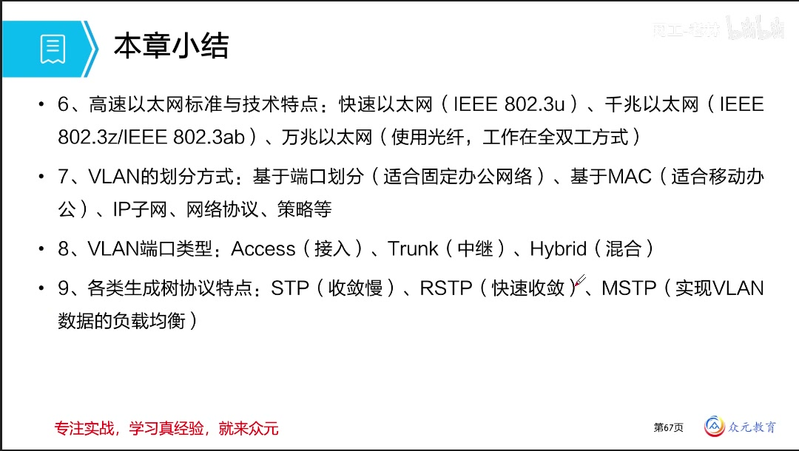

| 序号 | 知识点 | 核心内容 |
| ---- | ------ | -------- |
| 1 | 局域网拓扑结构 | 星形、环形、总线型、混合型 |
| 2 | 局域网架构 IEEE 802 | IEEE 802.3 以太网、IEEE 802.11 无线局域网 |
| 3 | 以太网技术 | CSMA/CD（监听空闲后发送、发送时检测碰撞、碰撞后等待重发）；MAC 地址（物理地址，48 位）；以太网帧结构（前导字段、目的/源地址、类型、数据、FCS） |
| 4 | 交换机工作原理 | 基于源 MAC 学习、基于目的 MAC 转发；未知单播帧以广播方式泛洪 |
| 5 | 交换机连接方式 | 级联、堆叠、端口聚合、集群 |
| 6 | 高速以太网 | 快速以太网（802.3u）、千兆以太网（802.3z / 802.3ab）、万兆以太网（使用光纤、全双工） |
| 7 | VLAN 划分方式 | 基于端口（适合固定办公）、基于 MAC（适合移动办公）、IP 子网、网络协议与策略等 |
| 8 | VLAN 端口类型 | Access（接入）、Trunk（中继）、Hybrid（混合），另有 QinQ 双层标签 |
| 9 | 各类生成树协议 | STP 收敛慢；RSTP 快速收敛；MSTP 实现 VLAN 数据负载均衡 |

补充汇总（本节核心数据）：

| 类别 | 关键数据 |
| ---- | -------- |
| 冲突域 / 广播域 | 集线器、中继器都不分割；二层交换机分冲突域不分广播域；路由器、三层交换机都分割 |
| VLAN 标签 | IEEE 802.1Q；Tag 共 4 字节；TPID = 0x8100（2 字节）；TCI = PRI 3 位 + CFI 1 位 + VID 12 位；VID 12 位共 4096 个编号，0 与 4095 保留，可用 4094 个；VLAN 1 为默认 |
| 帧长 | VLAN 帧最小 64 字节，最大 1522 字节 |
| 端口类型 | Access 单 VLAN、拆标签；Trunk 多 VLAN、带标签；Hybrid 灵活；QinQ = 802.1ad 双层标签 |
| 网桥 ID | 2 字节优先级（0~65535，默认 32768，步长 4096）+ 6 字节 MAC，越小越优先 |
| 端口 ID | 8 位优先级（0~255，默认 128，步长 16）+ 8 位端口号 |
| 路径成本 | 802.1D-1998：10M=100、100M=19、1G=4、10G=2 |
| 计时器 | Hello 2s、Forward Delay 15s、Max Age 20s |
| 收敛时间 | STP 30~50s；RSTP 秒级（约 6s） |
| 标准对应 | 802.1D→STP、802.1W→RSTP、802.1S→MSTP、802.1Q→VLAN 标记、802.1ad→QinQ |

考试重点：

1. **冲突域与广播域的设备对应关系**是必考判断：交换机"分冲突域、不分广播域"，只有路由器/三层交换机分割广播域
2. VLAN 的作用是**逻辑上**分割广播域，不是物理隔离；划分方式中"基于端口=固定办公、基于 MAC=移动办公、基于 IP 子网=改 IP 即改 VLAN"要能对号入座
3. **802.1Q 标签**：4 字节、TPID 固定 0x8100、VID 占 12 位、共 4096 个编号、0 与 4095 保留、可用 4094 个、VLAN 1 为默认，这些数字必须记牢
4. **Trunk 与 Access 的区别**：Trunk 承载多个 VLAN、带标签通过，用于交换机互联；Access 承载单个 VLAN、拆标签，用于连接终端
5. VLAN 间通信必须经过三层设备：单臂路由（成本低、有瓶颈）与三层交换（硬件转发、性能高）
6. STP 的三大危害（广播风暴、帧复制、MAC 表震荡）与作用（逻辑阻塞端口、防二层环路、故障时激活备份链路）常以简答或选择出现
7. **STP 选举四步**：选根桥（网桥 ID 最小）→ 选根端口（成本 → 直连网桥 ID → 直连端口 ID）→ 选指定端口（所在网桥成本 → 所在网桥 ID → 本端口 ID）→ 剩余阻塞
8. **计时器与收敛时间**：Hello 2s、Forward Delay 15s、Max Age 20s；最快 30s、最慢 50s
9. **RSTP 三改进**：端口角色增加替代/备用、端口状态精简为 3 个、P/A 机制快速收敛；关键词是"快速收敛"
10. **MSTP 的关键词是"多 VLAN 负载均衡"**，标准 802.1S；遇到"既快速收敛又提供多个冗余路径、实现 VLAN 数据负载均衡"的描述即指 MSTP
