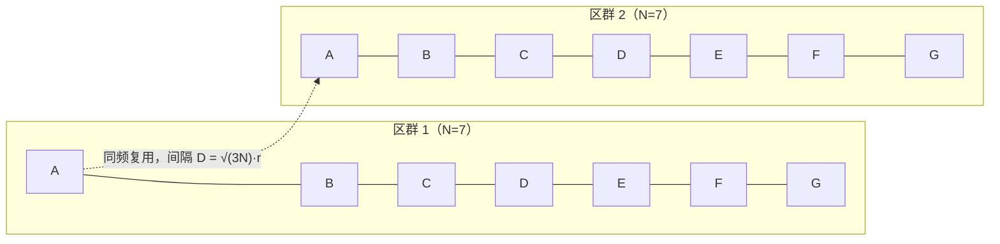
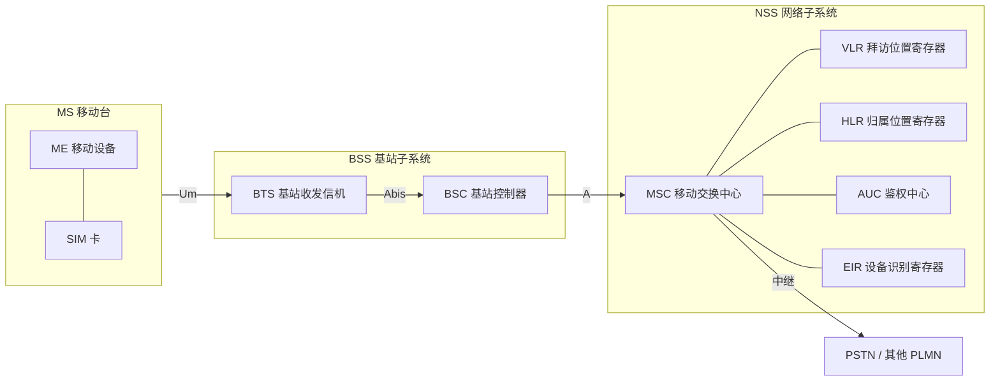

# 蜂窝移动通信系统 · 完整笔记

---

## 1.本节在无线通信网中的位置

无线通信网分为三部分，本节讲授第一部分“蜂窝移动通信系统”。

| 模块 | 主要内容 | 课件标注的重点 |
| ---- | -------- | -------------- |
| 蜂窝移动通信系统 | 移动通信系统基本概念、移动通信系统类型、蜂窝移动通信系统发展 | 系统发展（1G~5G） |
| 无线局域网 WLAN | 基本概念；WLAN 标准（Wi-Fi 标准的工作频段、WLAN 通信技术、Wi-Fi 7）；组网结构（网络拓扑类型、不同 AP 类型与组网方式）；无线网与有线网的区别（隐藏站与暴露站问题）；IEEE 802.11 安全特性（MAC 层、认证与加密技术、WLAN 安全机制） | WLAN 标准、不同 AP 类型与组网方式、802.11 MAC 层、WLAN 安全机制 |
| 无线个域网 WPAN | 蓝牙、ZigBee | — |

蜂窝移动通信系统内部的知识脉络：

| 层次 | 内容 |
| ---- | ---- |
| 基本概念 | 移动通信的定义、五个特点、基本组成 |
| 系统类型 | 蜂窝移动通信、集群移动通信、卫星移动通信 |
| 系统发展 | 1G、2G、3G、4G、5G；重点为 4G 标准、4G 关键技术、5G 关键技术 |

本节考核重点在“系统发展”部分：**4G 标准（TD-LTE-Advanced）、4G 关键技术（OFDMA、MIMO）、5G 三大应用场景与关键技术（SDN、NFV）**。对具体工程实现不作要求，掌握代际特征、标准名称、关键技术和名词概念即可。

---

## 2.移动通信系统基本概念

### 2.1 移动通信的定义

移动通信是指**通信双方或至少一方在移动中进行信息交换**的通信。

与固定通信的根本区别在于**用户可移动**。由此带来三个层面的差异：

| 差异层面 | 具体表现 |
| -------- | -------- |
| 传播信道 | 无线电波传播环境复杂、变化剧烈，存在衰落、多径与遮挡 |
| 覆盖范围 | 覆盖随用户位置变化，需按小区/区域规划 |
| 组网结构 | 需支持位置更新、切换、漫游与移动计费 |

### 2.2 移动通信的五个特点

| 特点 | 具体表现 | 对网络设计的影响 |
| ---- | -------- | ---------------- |
| 信道特性差 | 传播环境复杂、传播条件恶劣；用户可能从郊区移动到城区，信道特性随之剧变 | 需考虑覆盖、抗衰落与均衡 |
| 干扰复杂 | 存在同频干扰、邻频干扰、互调干扰等，干扰随位置和时间变化 | 需进行频率规划、功率控制 |
| 有限的频谱资源 | 频谱按业务和运营商划分，某一频段内的频点数量有限，无法覆盖所有区域 | 必须采用**频率复用** |
| 用户终端设备要求高 | 终端可移动，要求小巧轻便、续航长、可靠性高、适应性强 | 终端与网络需协同设计 |
| 系统和网络结构复杂 | 用户位置不断变化，需解决位置确定、位置变更管理、计费等问题 | 引入 MSC、HLR、VLR 等移动性管理实体 |

**关于“有限的频谱资源”**：频谱不能无限扩展，因此把一段频谱划分给若干频点后，在相隔较远的区域重复使用同一组频点。距离足够远时，同频干扰已足够小，可以安全复用。这是蜂窝移动通信的核心思想，详见第 7.2 节。

### 2.3 移动通信系统的基本组成

移动通信系统由三部分组成：**移动交换中心（MSC）、无线接入网、移动台（MS）**。

| 组成部分 | 主要设备 | 主要功能 |
| -------- | -------- | -------- |
| 移动台 MS | 移动终端 + SIM 卡 | 用户接入、呼叫接续；SIM 卡是合法入网标识 |
| 无线接入网 | 基站 BS + 基站控制器 | 提供无线覆盖，管理无线资源，连接 MS 与核心网 |
| 移动交换中心 MSC | MSC 及配套设备 | 交换、计费、移动性管理，并连接核心网/PSTN |

课件拓扑：**MS —（无线链路）— BS —（中继线）— MSC —（市话局）— PSTN（市话网）**。

要点说明：

1. **移动台不等于手机硬件**。移动台由移动终端和 SIM 卡共同构成，SIM 卡提供合法入网标识，相当于终端的“网卡”。
2. **无线接入网**在不同代际名称不同，但本质都是“基站 + 控制器”：

| 代际 | 基站 | 控制器 |
| ---- | ---- | ------ |
| 2G | BTS（基站收发信机） | BSC（基站控制器） |
| 3G | NodeB | RNC（无线网络控制器） |
| 4G | eNodeB（eNB） | 功能并入 eNB/EPC |
| 5G | gNB | 功能并入 gNB/5GC |

3. **MSC 一般部署在中心机房或局端**，承担交换、计费、移动管理等功能，并作为移动网与核心网的连接点。
4. **核心网随代际演进**：3G 以前主要连接电话网（PSTN，电路交换）；4G 仅保留 IP 分组网；5G 进一步采用全 IP 的 5GC。代际更新主要发生在**核心网**和**无线接入网**两个板块。

---

## 3.移动通信系统类型

常用的移动通信系统分为三类：蜂窝移动通信、集群移动通信、卫星移动通信。移动通信属于电信业务范畴，电信业务又分为基础电信业务和增值电信业务；本课程讨论的蜂窝移动通信，是其中与大众日常生活关系最密切的一类。

| 类型 | 覆盖与组网 | 工作方式 | 典型应用 |
| ---- | ---------- | -------- | -------- |
| 蜂窝移动通信 | 基站覆盖区呈正六边形，可构成无缝覆盖；采用频率复用 | 全双工；通话不限时长，话费多少决定通信时长 | 公众移动通信，面向大众用户 |
| 集群移动通信 | 特定行业专用网，频率共用 | 半双工；单次通话限制 15~60 秒 | 酒店、铁路、公安、调度等专业场景 |
| 卫星移动通信 | 由卫星覆盖，不依赖地面有线网络 | 视系统而定 | 海上、空中、地形复杂或偏远地区 |

### 3.1 蜂窝移动通信

- 基站覆盖范围理想化为**正六边形**，多个正六边形拼接可实现无缝覆盖，形似蜂窝，故称“蜂窝移动通信”。
- 正六边形最接近圆形覆盖，在同样半径下所需基站数最少，具有较好的经济性，因而得到广泛发展和持续更新。
- 采用**频率复用**技术，这是蜂窝移动通信最关键的技术基础。
- 工作方式为**全双工**，通话不限制时长，费用由通话时长决定。

### 3.2 集群移动通信

- 面向特定行业的**专用网**，不是公众网。
- 使用类似对讲机的终端，但“集群”不等于“对讲机”，它是一个系统概念。
- 采用频率共用手段，**半双工**工作，按下发话键后单次通话限制在 15~60 秒。
- 典型场景：酒店、铁路等需要统一调度的单位。

### 3.3 卫星移动通信

适用于海上、空中以及地形复杂、无法接入有线网络的区域。

| 类别 | 轨道高度 | 主要特点 | 典型代表 |
| ---- | -------- | -------- | -------- |
| 高轨卫星 GEO | 约 35786 km（地球同步轨道） | 三颗即可覆盖除两极外的全球；地面—卫星—地面单跳时延约 240~280 ms（单程约 120 ms）；终端可固定指向 | 国际海事卫星 Inmarsat |
| 中轨卫星 MEO | 约 2000~20000 km | 时延与覆盖折中，需一定数量的星座 | GPS（约 20200 km） |
| 低轨卫星 LEO | 约 500~2000 km | 时延小、路径损耗小；单星覆盖时间短，需星座组网 | 铱星、Starlink |

**说明**：视频口述以“1500 km”作为高轨与低轨的分界，与通用的轨道分类不符，疑为口误或语音识别误差。备考时按上表的 GEO/MEO/LEO 分类记忆；若题目只区分“高轨/低轨”，则以“高轨时延大、低轨时延小、低轨需星座”为判断依据。

---

## 4.蜂窝移动通信系统的发展

蜂窝移动通信经历了 **1G → 2G → 3G → 4G → 5G** 五个阶段。代际演进的主线是：

| 阶段 | 技术主线 | 业务主线 | 核心网 |
| ---- | -------- | -------- | ------ |
| 1G | 模拟调频 + FDMA | 模拟话音 | 电话网 |
| 2G | 数字传输 + TDMA/CDMA | 数字语音 + 低速数据 | 电路交换为主 |
| 2.5G/2.75G | 分组交换（GPRS/EDGE） | 移动数据 | 电路域 + 分组域 |
| 3G | CDMA | 多媒体业务 | 电路域 + 分组域，仍以 PSTN 为主 |
| 4G | OFDMA + MIMO | 全 IP 数据业务 | 全 IP 分组网（EPC） |
| 5G | 大规模 MIMO、毫米波、SDN/NFV 等 | 万物互联 | 全 IP/云化 5GC |

### 4.1 第一代移动通信（1G）

| 项目 | 内容 |
| ---- | ---- |
| 主要技术特征 | 模拟调频（FM）、频分多址（FDMA） |
| 典型移动通信系统 | 公用移动通信系统、专用移动通信系统、无绳电话 |
| 主要业务 | 模拟话音业务 |
| 缺点 | 保密性差、标准不互联互通、抗干扰性差 |

补充说明：

- 1G 即“大哥大”时代，终端体积大、功耗高。
- **保密性差**：模拟信号易被窃听、易串音。
- **标准不互联互通**：存在多个互不兼容的模拟制式，典型代表有北美的 AMPS、英国的 TACS、北欧的 NMT。
- **抗干扰性差**：模拟调制对干扰和噪声的容忍度低。
- 通信距离有限、时延较大，覆盖与容量均受限。
- FDMA 为每个用户分配一个独立频段，用户独占频带，频谱利用率低。

### 4.2 第二代移动通信（2G）与 2.5G/2.75G

**2G 的基本特征**

| 项目 | 内容 |
| ---- | ---- |
| 主要技术特征 | 数字传输、时分多址（TDMA）或码分多址（CDMA） |
| 典型移动通信系统 | 数字蜂窝系统、数字无绳电话系统、数字集群系统 |
| 主要业务 | 数字语音业务和低速数据业务（网页访问、电子邮件等） |
| 两大标准 | GSM（欧洲）、CDMA（美国，IS-95） |
| 缺点 | 存在伪基站安全漏洞 |
| 电路域数据速率 | 9.6 kbps |

2G 是通信的**第一次数字化革命**：

- 语音由模拟转为数字编码，保密性、抗干扰能力和频谱效率明显提升。
- 在话音之外引入低速数据业务，出现短信、WAP 网页、电子邮件等应用。
- 当时计费仍以话费为主，尚未形成大流量套餐模式。
- 终端形态包括早期小灵通、小型移动电话等。

**GSM 与 IS-95 CDMA 的对比**

| 项目 | GSM | IS-95 CDMA |
| ---- | --- | ---------- |
| 多址方式 | FDMA + TDMA | CDMA |
| 起源 | 欧洲 ETSI 主导 | 美国 Qualcomm 提出 |
| 国内运营商对应 | 中国移动、中国联通 | 中国电信 |
| 载波带宽 | 200 kHz | 1.25 MHz |
| 主要特点 | 标准化程度高、全球漫游成熟 | 容量大、支持软切换、功率控制要求高 |

**伪基站漏洞的成因**

2G 时代只实现了**网络对移动台的单向鉴权**：网络验证 SIM 卡是否合法，但移动台不验证基站身份。因此私人可架设“伪基站”冒充合法基站，向用户发送垃圾短信、诈骗信息。3G 引入**双向鉴权**，既验证移动台，也验证基站身份，补上了这一漏洞。

**2.5G 与 2.75G**

2G 到 3G 之间并非一步跨越，中间经历了引入**分组交换**的过渡阶段。

| 阶段 | 技术 | 峰值速率 | 说明 |
| ---- | ---- | -------- | ---- |
| 2.5G | GPRS（通用分组无线业务） | 171.2 kbps | 在 GSM 上叠加分组域，支持永远在线、按流量计费 |
| 2.75G | EDGE（增强数据速率 GSM 演进） | 384 kbps（峰值 473.6 kbps） | 采用 8PSK 调制，又称 EGPRS，可复用 GSM 频段 |

手机信号栏早期出现的 **G、E、T** 等标识，即对应 GPRS、EDGE、TD-SCDMA 等不同网络状态，速率依次不同。2.5G/2.75G 为 3G 的分组化核心网和多媒体业务打下了基础。

### 4.3 第三代移动通信（3G）

| 项目 | 内容 |
| ---- | ---- |
| 主要技术特征 | 码分多址（CDMA） |
| 主要业务 | 2~10 Mb/s 的多媒体业务 |
| 三大标准 | WCDMA、CDMA2000、TD-SCDMA |
| 优点 | 相比 2G 支持更多用户、实现更高传输速率；安全性提高（双向鉴权） |
| 核心网 | 电路域（CS）+ 分组域（PS），仍以 PSTN 电话网为主 |

**3G 三大标准**

| 标准 | 制定方/阵营 | 多址与双工 | 国内运营商 |
| ---- | ----------- | ---------- | ---------- |
| WCDMA | 3GPP，欧洲/日本主导 | DS-CDMA，FDD | 中国联通 |
| CDMA2000 | 3GPP2，美国主导 | CDMA，FDD | 中国电信 |
| TD-SCDMA | 中国提出，被 ITU/3GPP 接纳 | TD-SCDMA，TDD | 中国移动 |

三大标准**均以 CDMA 为核心多址技术**，区别在于带宽、双工方式和码片速率等具体实现。

**TD-SCDMA 的地位与命名**

- 全称：**时分同步码分多址**（Time Division-Synchronous Code Division Multiple Access）。
- 我国自主研发并产业化的 3G 国际标准，是我国首次提出的完整移动通信标准。
- 采用 **TDD** 方式，上下行使用同一频率的不同时隙；带宽 1.6 MHz，码片速率 1.28 Mcps。
- 关键技术：智能天线（空分多址 SDMA）、联合检测、上行同步、接力切换、动态信道分配。
- 名称可拆解记忆：**TD（时分）+ S（同步）+ CDMA（码分多址）**；技术上综合了 FDMA、TDMA、CDMA、SDMA 的思想，并非单一复用方式。

**3G 的速率口径**

课件标注 3G 业务速率为 **2~10 Mb/s**，这是 3G 及增强型（HSPA/HSPA+）的量级。IMT-2000 的基础目标为：室内 2 Mb/s、步行 384 kb/s、车载 144 kb/s。答题时以题干给出的口径为准。

**3G 的时代意义**

- 多媒体业务全面铺开，微信、QQ、飞信等移动互联网应用开始普及。
- 安全性提升：实现网络与终端的双向鉴权。
- 核心网仍保留电路域，语音主要走 PSTN，数据走分组域，尚未实现全 IP。
- 中国移动、中国联通、中国电信三足鼎立的竞争格局在 3G 时代形成。

### 4.4 第四代移动通信（4G）

**（1）总体特征**

| 项目 | 内容 |
| ---- | ---- |
| 核心特征 | **取消电路域，仅有数据业务，全网 IP 化** |
| 技术路线 | 专注 LTE 研究与开发，采用 OFDM 和多天线（MIMO）等新技术 |
| 速率 | 向用户提供 100 Mb/s 甚至 1 Gb/s 的数据速率 |
| 语音实现 | 语音业务基于 IP 承载，即 VoIP（Voice over IP）；商用实现为 VoLTE，由 IMS 提供呼叫控制 |
| 定位 | “4G 改变生活”，实现高速率上网自由 |

“全 IP 化”是 4G 的关键词：核心网不再保留电路交换域，语音、短信、视频、数据全部作为 IP 分组承载。这与 3G 的“电路域 + 分组域”双域结构有本质区别。

**（2）4G 标准**

4G 家族的主要标准如下（LTE 常被称为 3.9G，LTE-Advanced 为其升级版，单列一行便于对照）：

| 标准 | 全称 | 制定方 | 技术路线与说明 |
| ---- | ---- | ------ | -------------- |
| LTE | Long Term Evolution，长期演进 | 3GPP（以欧洲电信为首） | 沿 GSM → W-CDMA → HSPA → 4G 路线发展；OFDMA + MIMO；全 IP |
| LTE-Advanced | 长期演进增强 | 3GPP | LTE 的升级版，满足 IMT-Advanced 要求；**TD-LTE-Advanced 是我国拥有自主知识产权的 4G 标准** |
| WiMAX II | 全球微波互联接入第二版 | IEEE 802.16m | 宽带无线接入，适合低成本广覆盖 |
| UMB | Ultra Mobile Broadband，超移动宽带 | 3GPP2 | 由 CDMA2000 演进，空口改用 OFDMA/SC-FDMA + MIMO；属 4G 候选但未商用部署，软考一般不计入 4G 主流标准 |

说明：严格按 IMT-Advanced 口径，**LTE-Advanced 与 WirelessMAN-Advanced（WiMAX II，802.16m）** 才是 4G 标准；LTE 常被称为 3.9G，是 4G 的过渡与基础版本。软考教材把 LTE 一并列入 4G 家族，答题时按“4G 标准包含 LTE/LTE-Advanced、WiMAX II”掌握即可。

LTE 与 WiMAX 的部署分工：

| 场景 | 选用标准 | 原因 |
| ---- | -------- | ---- |
| 城市密集区、核心城区 | LTE | 速率高，适合视频流、物联网等接入 |
| 农村、地广人稀区域 | WiMAX | 成本低、覆盖广，便于快速组网 |

**LTE 的两种双工方式**：

| 双工方式 | 上下行频率 | 资源划分维度 | 典型制式 | 特点 |
| -------- | ---------- | ------------ | -------- | ---- |
| FDD | 成对频率（上下行各一段） | 频率 | FDD-LTE | 上下行互不干扰，适合对称业务 |
| TDD | 同一频率 | 时间（时隙） | TD-LTE | 频谱利用灵活，适合非对称业务；我国主导 |

说明：日常所说的“TD-LTE”是简称，标准全称为 **TD-LTE-Advanced**。它是我国主导提出、拥有自主知识产权的 4G TDD 制式，也是当前国内主流的 4G 形态。

**（3）4G 关键技术**

| 技术 | 全称 | 原理 | 作用与特点 |
| ---- | ---- | ---- | ---------- |
| OFDMA | 正交频分多址 | 将无线信道划分为多个正交子信道（子载波），按需分配给不同用户 | 实现多用户并行传输；高频谱效率、低功耗、抗干扰能力强、支持多用户 |
| MIMO | 多入多出 | 使用多个天线同时发送和接收数据 | 显著提高无线信道容量和数据传输速率 |
| SDR | 软件定义无线电 | 硬件与软件分离，通过软件可编程实现无线电通信 | 提高灵活性和可靠性，便于移植扩展，降低成本和维护难度 |
| VoIP | 基于 IP 的语音传输 | 将语音转换为数字信号，以 IP 分组传输 | 语音与数据在同一网络传输，提高通信效率和资源利用率 |

**OFDM 与 OFDMA 的区分**：

- **OFDM**（正交频分复用）是一种多载波传输/调制技术：把高速数据分散到多个相互正交的子载波上，子载波频谱重叠但不互相干扰，可有效对抗多径衰落。
- **OFDMA**（正交频分多址）在 OFDM 基础上加入**多址**能力：把子载波划分为资源块，按用户需求动态分配，从而支持多个用户并行传输。
- 一句话记忆：**OFDM 解决“怎么传”，OFDMA 解决“传给谁”**。
- 4G 下行采用 OFDMA，上行采用 SC-FDMA（单载波频分多址），以降低终端发射的峰均功率比。

**MIMO 与 SDR 的补充**：

- MIMO 通过空间复用和空间分集提高容量与可靠性；天线数越多，理论容量越大，但受终端尺寸和信道相关性限制。
- SDR 的核心是“软硬件解耦”：底层基础功能固化，新增功能和升级由软件实现，类似“基础平台不变、应用层持续迭代”。

**（4）4G 运营商频段划分**

| 运营商 | 商用频段（MHz） | 合计 |
| ------ | --------------- | ---- |
| 中国移动 | 1880~1900、2320~2370、2575~2635 | 130 MHz |
| 中国联通 | 2300~2320、2555~2575 | 40 MHz |
| 中国电信 | 2370~2390、2635~2655 | 40 MHz |

要点：

- 三家运营商均获得 TD-LTE 牌照。
- 中国移动获得的频谱资源最多（130 MHz），远高于中国联通和中国电信（各 40 MHz）。
- 具体频段数值不要求背诵，但“移动 130 MHz、联通/电信各 40 MHz”的对比可作为选择题考点。
- 后续中国联通、中国电信另获 FDD-LTE 牌照，形成 TD-LTE/FDD-LTE 混合组网。

### 4.5 第五代移动通信（5G）

**（1）总体特征与三大应用场景**

5G 相比 4G 是**全方位提升**，可用三个关键词概括：

| 关键词 | 含义 | 对应场景 |
| ------ | ---- | -------- |
| 高性能（高带宽） | 峰值速率大幅提升 | eMBB |
| 低时延、高可靠 | 用户面时延低至毫秒级 | uRLLC |
| 海量终端互联（万物互联） | 单位面积连接数极大 | mMTC |

ITU IMT-2020 定义的三大应用场景及关键指标：

| 场景 | 全称 | 关键指标 | 典型应用 |
| ---- | ---- | -------- | -------- |
| eMBB | 增强移动宽带 | 峰值速率 20 Gbps（下行）、10 Gbps（上行） | 4K/8K 视频、VR/AR、高速上网 |
| mMTC | 海量机器类通信 | 连接密度 100 万连接/平方公里 | 物联网、智慧城市、环境监测 |
| uRLLC | 低时延高可靠通信 | 用户面时延 1 ms | 车联网、工业控制、远程医疗 |

总体描述：5G 实现海量连接、万物互联，具有**高性能、低延迟、高容量**特性，组网包含 **NSA/SA** 两种方式。

**（2）组网方式：SA 与 NSA**

| 组网方式 | 全称 | 核心网 | 无线接入网 | 特点 |
| -------- | ---- | ------ | ---------- | ---- |
| SA | Standalone，独立组网 | 5GC（全新 5G 核心网） | gNB | 端到端 5G，速率与时延性能最优；建设成本高 |
| NSA | Non-Standalone，非独立组网 | 4G EPC | 4G eNB 作为锚点 + 5G gNB | 依托现有 4G 快速部署，成本低；是过渡方案，部分 5G 能力受限 |

建设逻辑：5G 建设初期不可能一夜之间淘汰全部 4G 网络，需要过渡。新建区域先部署 5G，并与原有 4G 网络互联互通；待 5G 覆盖完善后，再逐步过渡到独立组网。这一过程类似 IPv6 与 IPv4 的长期共存。

**（3）5G 关键技术**

| 技术 | 要点 | 作用 |
| ---- | ---- | ---- |
| 超密集异构无线网络 | 5G 使用较高频段，覆盖范围相对较小；密集部署宏基站、微基站、室分等不同架构 | 满足热点容量与连续覆盖需求 |
| 大规模输入输出（Massive MIMO） | 在 4G MIMO 基础上扩展为大规模天线阵列 | 有效提升网络带宽、容量和频谱效率 |
| 毫米波通信 | 使用 FR2 频段（24.25~52.6 GHz），带宽大、波长短、穿透与绕射能力差、覆盖小 | 以毫米波小基站增强高速环境下的用户体验，提升组网灵活性 |
| SDN（软件定义网络） | 实现**控制层面与数据层面分离** | 提升网络灵活性、可管理性和可扩展性 |
| NFV（网络功能虚拟化） | 实现**软件与硬件解耦**，网元功能运行在通用服务器上 | 大幅降低网络建设和维护成本 |
| F-OFDM（滤波正交频分复用） | 在 OFDM 基础上加入子带滤波 | 适配 5G 多样化业务，支持灵活参数集，降低带外泄漏 |
| 新型编码 | 数据信道采用 LDPC，控制信道采用 Polar | 提高传输效率与可靠性（了解即可） |

**5G 频率范围（FR）**：

| 频率范围 | 频率区间 | 特点 | 典型部署 |
| -------- | -------- | ---- | -------- |
| FR1（Sub-6GHz） | 410 MHz~7.125 GHz（常用 2.6/3.5/4.9 GHz） | 覆盖好、穿透较强，带宽相对小 | 广覆盖与容量层 |
| FR2（毫米波） | 24.25~52.6 GHz | 带宽大、覆盖小、穿透与绕射差 | 热点增强、室分 |

**SDN 与 NFV 的区分（高频考点）**：

| 比较项 | SDN | NFV |
| ------ | --- | --- |
| 核心动作 | 控制平面与数据平面**分离** | 软件与硬件**解耦** |
| 直接效果 | 网络可编程、灵活、易管理、易扩展 | 网元功能虚拟化，通用硬件承载 |
| 主要收益 | 提升灵活性与可管理性 | 降低建设与维护成本 |
| 典型位置 | 网络架构层面 | 网元实现层面 |

两者常配合使用，但**不可混为一谈**：题目出现“控制平面与数据平面分离”选 SDN；出现“软硬件解耦、降低建设和维护成本”选 NFV。

---

## 5.技术标准总结

| 标准 | 技术 | 主要业务 |
| ---- | ---- | -------- |
| 1G | 模拟时代 | 只能传语音 |
| 2G | GSM（欧洲，移动/联通）<br>IS-95 CDMA（美国，电信） | 主语音业务，数字通信初步发展 |
| 3G | WCDMA（欧洲，联通）<br>CDMA2000（美国，电信）<br>TD-SCDMA（自主研发，移动） | 语音 + 数据业务；安全进一步提升，广泛运用 CDMA 技术、分组交换技术，数据业务开始发展 |
| 4G | LTE/LTE-Advanced（TD-LTE-Advanced 是我国自主知识产权的），WiMAX II | 仅数据业务，全网 IP |
| 5G | 统一技术标准，包含 NSA/SA 组网 | 大带宽、低时延、支持物联网海量接入 |

记忆主线：

| 代际 | 一句话记忆 |
| ---- | ---------- |
| 1G | 模拟话音，FDMA，保密差 |
| 2G | 数字语音，GSM/CDMA，伪基站漏洞 |
| 3G | CDMA 多媒体，三大标准，TD-SCDMA 自主研发 |
| 4G | 全 IP，LTE/WiMAX，TD-LTE-Advanced 自主 |
| 5G | 三大场景，SA/NSA，SDN/NFV |

考试频度：

- **3G、4G 考查频度较高，当前更侧重 4G**。
- 2G 考查较少，掌握两大标准与伪基站即可。
- 5G 重点为三大应用场景、SA/NSA 和 SDN/NFV。
- 1G 了解“模拟、FDMA、保密性差”即可。

运营商与代际对应关系（按课件口径）：

| 运营商 | 2G | 3G | 4G |
| ------ | -- | -- | -- |
| 中国移动 | GSM | TD-SCDMA | TD-LTE |
| 中国联通 | GSM | WCDMA | TD-LTE（后续另有 FDD-LTE） |
| 中国电信 | CDMA（IS-95） | CDMA2000 | TD-LTE（后续另有 FDD-LTE） |

---

## 6.课堂习题巩固

### 6.1 例题1：5G 中实现控制面与数据面分离的技术

在 5G 关键技术中，将传统互联网控制平面与数据平面分离，使网络的灵活性、可管理性和可扩展性大幅提升的是（ ）。

- A、软件定义网络（SDN）
- B、大规模多输入多输出（MIMO）
- C、网络功能虚拟化（NFV）
- D、长期演进（LTE）

**答案：A**

解答：

- **SDN（软件定义网络）**的核心特征就是控制平面与数据平面分离，控制逻辑集中、转发设备简化，从而提升网络的灵活性、可管理性和可扩展性，符合题干。
- NFV（网络功能虚拟化）的核心是软件与硬件解耦，把网元功能运行在通用服务器上，主要收益是降低建设和维护成本，不是“控制面与数据面分离”。
- MIMO 是多天线收发技术，用于提高容量和速率，不涉及控制面/数据面架构。
- LTE 是 4G 的无线接入标准，不是 5G 的网络架构技术。

### 6.2 例题2：我国拥有自主知识产权的 4G 标准

我国拥有自主知识产权的 4G 标准是（ ）。

- A、TD-LTE-Advanced
- B、WCDMA
- C、TD-SCDMA
- D、FDD-LTE

**答案：A**

解答：

| 选项 | 判断 | 理由 |
| ---- | ---- | ---- |
| A、TD-LTE-Advanced | [正确] | 我国主导提出、拥有自主知识产权的 4G TDD 标准 |
| B、WCDMA | [错误] | 欧洲主导的 3G 标准，国内由联通使用 |
| C、TD-SCDMA | [错误] | 我国自主研发的 **3G** 标准，不是 4G |
| D、FDD-LTE | [错误] | 4G 标准之一，但并非我国自主知识产权 |

**易错点**：题目问“4G”时选 **TD-LTE-Advanced**；问“3G”时才选 **TD-SCDMA**。二者同属 TDD 体系，但代际不同。

---

## 7.教材补充：蜂窝组网与 GSM 体系

本节视频以概念、类型和代际演进为主，未展开蜂窝组网的定量计算与 GSM 内部结构。以下内容依据移动通信教材与 3GPP/ETSI 标准补充，用于应对选择题与案例题中的相关考点。

### 7.1 大区制与小区制

| 比较项 | 大区制 | 小区制（蜂窝制） |
| ------ | ------ | ---------------- |
| 覆盖方式 | 一个基站覆盖整个服务区 | 服务区划分为许多小区，每小区设基站 |
| 小区半径 | 约 30~50 km | 约 1~20 km（城区可更小） |
| 发射功率 | 大，约 50~200 W | 小，降低干扰与功耗 |
| 频率复用 | 不进行或很有限 | 核心特征，显著提高频谱利用率 |
| 系统容量 | 小，仅适合小容量网络 | 大，可通过小区分裂持续扩容 |
| 网络结构 | 简单、成本低，可借助市话交换设备 | 复杂，需切换、位置管理 |
| 主要问题 | 边缘信号质量差、时延大、频谱利用率低 | 同频干扰、切换与移动性管理复杂 |

结论：**大区制是小容量、广覆盖的早期方案；小区制是大容量、频率复用的现代蜂窝方案**。蜂窝移动通信属于小区制。

### 7.2 频率复用、区群与同频干扰

**基本概念**

| 概念 | 含义 |
| ---- | ---- |
| 小区（Cell） | 一个基站覆盖的基本区域，理想化为正六边形 |
| 区群/簇（Cluster） | 由 N 个小区组成，区群内各小区使用不同频率，合起来恰好用完全部可用频段；区群在空间上重复出现 |
| 区群大小 N | 一个区群包含的小区数，亦称簇大小 |
| 频率复用 | 相隔足够距离的不同区群重复使用同一组频率 |
| 同频复用距离 D | 两个使用相同频率的小区中心之间的最小距离 |
| 同频复用比 Q | Q = D / r，r 为小区半径 |

**区群大小 N 的取值**

正六边形蜂窝结构中，区群大小必须满足：

```
N = i² + i·j + j²    （i、j 为非负整数，i ≥ j）
```

因此 N 只能取特定值：

```
N = 1, 3, 4, 7, 9, 12, 13, 16, 19, 21, ...
```

常见取值：N = 3、4、7、12。N = 7 是最典型的规划方案。

**同频复用距离**

```
D = √(3N) · r
```

其中 r 为小区半径（基站到小区顶点的距离）。等价地：

```
D / r = √(3N)
Q = D / r = √(3N)
```

常用数值：

| N | √(3N) | D/r |
| --- | ----- | --- |
| 3 | 3.000 | 3.00 |
| 4 | 3.464 | 3.46 |
| 7 | 4.583 | 4.58 |
| 9 | 5.196 | 5.20 |
| 12 | 6.000 | 6.00 |
| 13 | 6.245 | 6.24 |
| 19 | 7.550 | 7.55 |

例：N = 7、r = 2 km，则 D = √21 × 2 ≈ 4.58 × 2 = 9.17 km。

注意半径口径：r 是小区中心到顶点的距离（外接圆半径），相邻基站间距为 √3·r；若题目给的是中心到边的距离（内切圆半径），不能直接代入 D = √(3N)·r。D 始终指两个同频小区中心之间的距离。

**频率复用示意**（同字母表示使用同一组频率，图中不表示实际相邻顺序）：



每个区群把全部可用频段分成 7 组，A~G 各用一组；下一个区群按同样方式重复，A 组在相隔 D 的另一小区再次使用。

**频率复用因子**

一个区群使用全部可用频段，区群内每个小区分得总频段的 **1/N**，因此：

```
频率复用因子 = 1 / N
```

含义：N 越大，每个小区分到的频段越少，但同频小区间隔越远、同频干扰越小；N 越小，每小区频段越多、容量越大，但同频干扰越严重。部分教材把 N 本身称为“复用因子”，做题时以“每小区可用全部频段的 1/N”这一实质判断即可。CDMA 系统相邻小区同频，相当于 N = 1、复用因子为 1。

**同频干扰与邻频干扰**

| 干扰类型 | 成因 | 抑制措施 |
| -------- | ---- | -------- |
| 同频干扰 | 同频小区复用同一组频率，信号叠加 | 增大 N（增大 D）、扇区化/定向天线、降低发射功率、功率控制、天线倾角调整 |
| 邻频干扰 | 相邻频道频谱泄漏、滤波器不理想 | 留保护带、提高滤波器选择性、优化信道分配 |
| 互调干扰 | 多个强信号在非线性器件中产生组合频率 | 提高器件线性度、合理分配频率 |

核心权衡：**N 增大 → D 增大 → 同频干扰减小，但容量下降；N 减小 → 容量增大，但同频干扰加剧**。频率规划就是在容量与干扰之间取平衡。

### 7.3 多址方式

| 多址方式 | 区分维度 | 典型系统 | 基本特点 |
| -------- | -------- | -------- | -------- |
| FDMA 频分多址 | 频率 | 1G | 每用户独占一个频段，连续传输，需双工器 |
| TDMA 时分多址 | 时间 | 2G GSM | 同一载波划分为多个时隙，用户轮流发送，需严格同步 |
| CDMA 码分多址 | 码型 | 3G | 同频、同时传输，用正交码区分用户，需扩频与功率控制 |
| OFDMA 正交频分多址 | 子载波 | 4G、5G | 子载波划分为资源块，按用户调度，频谱效率高 |
| SDMA 空分多址 | 空间 | 智能天线、大规模 MIMO | 利用空间波束隔离，实现空间复用 |

补充：

- GSM 实际采用 **FDMA + TDMA 混合**：25 MHz 上行频段划分为 124 个 200 kHz 载频，每个载频再分为 8 个时隙，每时隙承载一个用户；124 × 8 = 992 个物理信道。
- CDMA 的频率复用系数为 1，即相邻小区可以使用同一频率，靠码字区分用户，因此容量规划方式与 FDMA/TDMA 不同。
- 4G 下行采用 OFDMA、上行采用 SC-FDMA（单载波 FDMA），以降低终端峰均比；5G 下行用 CP-OFDM，上行可用 CP-OFDM 或 DFT-s-OFDM。考试若笼统问“4G 多址”，答 OFDMA 即可。

### 7.4 CDMA 码分原理

**基本模型**

每个用户 k 分配一个唯一的扩频码 c_k(t)，发送信号为：

```
s_k(t) = b_k(t) · c_k(t)
```

其中 b_k(t) 为信息比特，c_k(t) 为高速率的码片序列。接收端用同一码字做相关运算：

```
∫ y(t) · c_k(t) dt = b_k   （其他用户的贡献因正交而积分为 0）
```

**正交性**

码字满足：

```
∫ c_i(t) · c_j(t) dt = 0    （i ≠ j）
∫ c_i(t) · c_i(t) dt = 1    （归一化）
```

理想正交时，多用户信号互不干扰。实际信道中难以完全正交，形成**多址干扰（MAI）**。

**常用码字**

| 码字 | 作用 | 特点 |
| ---- | ---- | ---- |
| Walsh 码 | 前向链路信道化，区分不同用户/信道 | 完全正交，长度取 2 的幂（IS-95 为 64 阶） |
| PN 短码 | 区分小区/基站，便于同步 | 周期较短，不同基站相位偏移不同 |
| PN 长码 | 反向链路区分用户、扰码 | 周期长，保密性好 |

**扩频与扩频增益**

```
扩频增益 Gp = 10 · lg(码片速率 / 信息速率)   （dB）
```

扩频将窄带信息扩展到宽带传输，单位频带功率降低，因而具有抗窄带干扰、低截获概率和保密性好的特点。

**优缺点**

| 优点 | 说明 |
| ---- | ---- |
| 容量大且为“软容量” | 同频复用，用户数增加时质量平滑下降，而非硬阻塞 |
| 抗干扰、保密性强 | 扩频降低功率谱密度，需知道码字才能解扩 |
| 支持软切换 | 先建立新链路再断开旧链路，切换不中断 |
| 频率规划简单 | 相邻小区可同频，复用系数为 1 |

| 缺点 | 说明 |
| ---- | ---- |
| 远近效应 | 近处用户强信号淹没远处用户弱信号，必须进行功率控制 |
| 多址干扰 | 码字不完全正交及多径导致自干扰，容量受限于干扰 |
| 同步要求高 | 扩频码同步、相位对齐要求精确 |

### 7.5 切换、漫游与位置管理

**三组概念的区别**

| 概念 | 发生时机 | 核心动作 | 目的 |
| ---- | -------- | -------- | ---- |
| 切换（Handover） | 通话/连接过程中 | 将连接从一个小区/基站转移到另一个小区/基站，信道随之更换 | 保证业务不中断 |
| 漫游（Roaming） | 用户离开归属网络 | 在拜访地网络接入并使用业务 | 扩大服务范围 |
| 位置管理 | 空闲或漫游过程中 | 位置登记/更新 + 寻呼 | 让网络随时知道用户大致位置，便于被叫接入 |

**切换**

- 触发依据：移动台对相邻基站信号的测量报告、当前链路质量、功率电平等，由 BSC/MSC 综合判决。
- **硬切换**：先断开旧链路，再建立新链路（break-before-make），FDMA/TDMA 系统采用。
- **软切换**：先建立新链路，确认后再断开旧链路（make-before-break），CDMA 系统采用，可避免切换瞬断。
- 按管辖范围分为三类：

| 类型 | 管辖关系 | 参与实体 |
| ---- | -------- | -------- |
| 同一 BSC 内小区间切换 | 同一 BSC | BTS、BSC |
| 同一 MSC、不同 BSC 间切换 | 同一 MSC | BTS、BSC、MSC |
| 不同 MSC 间切换 | 跨 MSC | 新旧 BSC、新旧 MSC，可能经 PSTN 建立连接 |

**漫游**

用户离开归属 PLMN，在拜访 PLMN 中使用移动业务。前提是两家运营商签署漫游协议。漫游时，拜访地 VLR 为该用户建立临时记录，并向归属地 HLR 更新位置信息。

**位置管理**

| 环节 | 内容 |
| ---- | ---- |
| 位置区 LA | 若干小区组成的位置登记单元，用 LAI 标识 |
| 位置更新 | 空闲终端跨越位置区时，向网络发起登记，更新 VLR/HLR |
| 寻呼 | 有呼叫到达时，在终端登记的位置区范围内寻呼，而不必全网寻呼 |
| 登记层次 | VLR 保存终端当前所在位置区；HLR 保存终端当前所属的 VLR 地址 |

设计思想：以“位置区”为单位折中——位置区越小，寻呼范围越小但位置更新越频繁；位置区越大，更新越少但寻呼开销越大。

### 7.6 GSM 系统组成与接口

**三大组成部分**

| 部分 | 全称 | 主要网元 | 功能 |
| ---- | ---- | -------- | ---- |
| MS | 移动台 | ME（移动设备）+ SIM 卡 | 用户终端与入网标识 |
| BSS | 基站子系统 | BTS + BSC | 无线传输、无线资源管理 |
| NSS | 网络与交换子系统 | MSC、VLR、HLR、AUC、EIR、GMSC | 交换、鉴权、移动性管理、连接外部网络 |

说明：部分教材另列 **OSS（操作支持子系统）**，负责网管、计费、维护与运营支撑；软考通常按 MS、BSS、NSS 三部分作答，遇到“四部分”选项时再把 OSS 计入。

**主要网元功能**

| 网元 | 全称 | 功能 |
| ---- | ---- | ---- |
| BTS | 基站收发信机 | 负责一个小区内的无线收发，提供 Um 接口 |
| BSC | 基站控制器 | 管理一个或多个 BTS，负责无线资源分配、切换判决 |
| MSC | 移动交换中心 | 呼叫接续、交换、计费、移动性管理，连接 BSS 与外部网络 |
| VLR | 拜访位置寄存器 | 存放当前拜访用户的临时数据与位置信息 |
| HLR | 归属位置寄存器 | 存放归属用户的签约数据、业务信息及当前 VLR 地址 |
| AUC | 鉴权中心 | 生成鉴权参数，完成用户身份认证与加密密钥管理 |
| EIR | 设备识别寄存器 | 存储 IMEI，识别非法/被盗终端 |
| GMSC | 网关移动交换中心 | 作为移动网与 PSTN/其他 PLMN 的网关 |

**接口**

| 接口 | 连接对象 | 说明 |
| ---- | -------- | ---- |
| Um | MS — BTS | 无线空中接口 |
| Abis | BTS — BSC | 基站与控制器之间的接口 |
| A | BSC — MSC | 基站子系统与核心网的接口 |
| B、C、D、E、F、G | NSS 内部各网元之间 | 基于 No.7 信令的 MAP 协议 |

**结构示意**



**GSM 空中接口主要参数（了解）**

| 参数 | 数值 |
| ---- | ---- |
| 频段（GSM900） | 上行 890~915 MHz，下行 935~960 MHz |
| 双工间隔 | 45 MHz |
| 载频间隔 | 200 kHz |
| 载频数 | 124 个 |
| 每载频时隙数 | 8 个 |
| 空中接口速率 | 270.833 kbps |
| 语音编码速率 | 13 kbps |
| 电路域数据速率 | 9.6 kbps |
| 调制方式 | GMSK |
| 多址方式 | FDMA + TDMA |

### 7.7 GPRS 与 EDGE

| 项目 | GPRS | EDGE |
| ---- | ---- | ---- |
| 代际定位 | 2.5G | 2.75G |
| 核心改进 | 在 GSM 电路域之外增加分组域 | 在 GPRS 基础上改进调制与编码 |
| 新增网元 | SGSN、GGSN | 沿用 GPRS 分组域，升级无线侧 |
| 调制方式 | GMSK | 8PSK（每符号 3 bit） |
| 峰值速率 | 171.2 kbps | 473.6 kbps（典型 384 kbps） |
| 业务特点 | 永远在线、按流量计费、支持多时隙绑定 | 速率更高，可复用 GSM 频段，又称 EGPRS |

补充：

- **SGSN**（服务 GPRS 支持节点）负责分组业务的移动性管理、会话管理和路由转发。
- **GGSN**（网关 GPRS 支持节点）作为 GPRS 网络与外部数据网（Internet）的网关。
- GPRS 的 171.2 kbps 由 8 个时隙 × 每时隙 21.4 kbps（CS-4 编码）得出，是理论峰值。
- EDGE 通过 8PSK 调制提高每符号承载的比特数，并引入 MCS-1~MCS-9 九种编码方案，按信道质量自适应选择。

---

## 8.本章小结

| 知识点 | 核心内容 |
| ------ | -------- |
| 1. 移动通信定义 | 通信双方或至少一方在移动中进行信息交换 |
| 2. 五个特点 | 信道特性差、干扰复杂、频谱资源有限、终端要求高、网络结构复杂 |
| 3. 基本组成 | 移动交换中心 MSC、无线接入网（BS + 控制器）、移动台 MS（终端 + SIM 卡） |
| 4. 系统类型 | 蜂窝（正六边形、频率复用、全双工）、集群（专用网、半双工、限时 15~60 s）、卫星（海上/空中/复杂地形） |
| 5. 1G | 模拟调频 + FDMA，模拟话音，保密性差、标准不互通、抗干扰差 |
| 6. 2G | 数字传输 + TDMA/CDMA，GSM（欧洲）与 IS-95 CDMA（美国），9.6 kbps，伪基站漏洞 |
| 7. 2.5G/2.75G | GPRS 171.2 kbps；EDGE 384 kbps（峰值 473.6 kbps） |
| 8. 3G | CDMA，2~10 Mb/s 多媒体；WCDMA、CDMA2000、TD-SCDMA；双向鉴权 |
| 9. 4G | 全 IP、取消电路域、仅数据业务；LTE/LTE-Advanced、WiMAX II；OFDMA + MIMO；100 Mb/s~1 Gb/s |
| 10. 4G 自主标准 | TD-LTE-Advanced 是我国拥有自主知识产权的 4G 标准 |
| 11. 5G | eMBB 20 Gbps、mMTC 100 万连接/km²、uRLLC 1 ms；SA/NSA |
| 12. 5G 关键技术 | 超密集异构网络、大规模 MIMO、毫米波、SDN、NFV、F-OFDM |
| 13. 蜂窝组网 | N = i² + ij + j²；D/r = √(3N)（r 为外接圆半径）；复用因子 1/N；同频干扰随 N 增大而减小 |
| 14. GSM 体系 | MS（ME + SIM）、BSS（BTS + BSC）、NSS（MSC/VLR/HLR/AUC/EIR）；Um、Abis、A 接口 |

考试重点：

1. **4G 自主标准**：我国拥有自主知识产权的 4G 标准是 **TD-LTE-Advanced**，不是 TD-SCDMA（3G）。
2. **SDN 与 NFV 的区分**：控制面与数据面分离选 SDN；软硬件解耦、降低建设维护成本选 NFV。
3. **5G 三大场景与指标**：eMBB 20 Gbps、mMTC 100 万连接/平方公里、uRLLC 1 ms。
4. **4G 的标志词**：全 IP 化、取消电路域、仅数据业务、VoIP。
5. **OFDM 与 OFDMA**：OFDM 是多载波传输技术，OFDMA 增加了多址能力；4G 关键技术为 OFDMA 与 MIMO。
6. **蜂窝频率复用**：N = i² + ij + j²，D/r = √(3N)，N 越大同频干扰越小但容量越低。
7. **GSM 三大组成与接口**：MS、BSS（BTS + BSC）、NSS（MSC/VLR/HLR/AUC/EIR）；Um、Abis、A。
8. **代际速率节点**：GSM 9.6 kbps、GPRS 171.2 kbps、EDGE 384 kbps、3G 2~10 Mb/s、4G 100 Mb/s~1 Gb/s。
9. **1G~5G 主线**：模拟 → 数字 → 码分多媒体 → 全 IP → 万物互联。
10. **常见干扰**：同频干扰靠增大 N/扇区化抑制；邻频干扰靠保护带与滤波器抑制。
