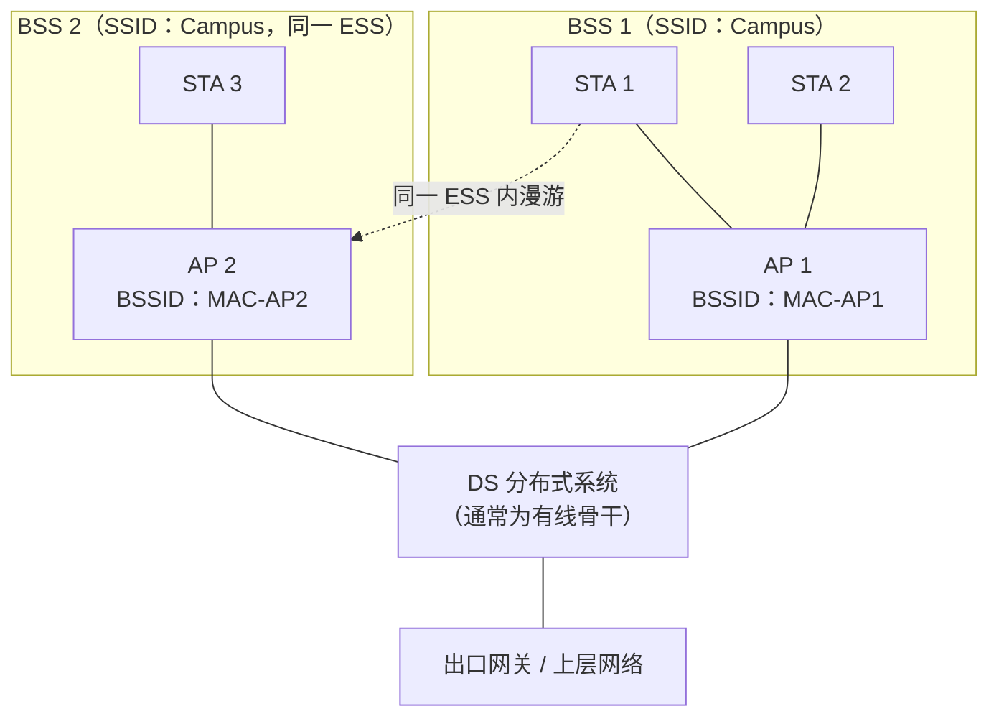
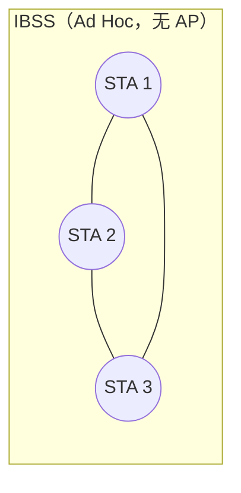

# 无线局域网 · 完整笔记

---

## 1.本节在无线通信网中的位置

无线通信网分为三部分，本节讲授第二部分“无线局域网（WLAN）”。

| 模块 | 主要内容 | 课件标注的重点 |
| ---- | -------- | -------------- |
| 蜂窝移动通信系统 | 移动通信系统基本概念、移动通信系统类型、蜂窝移动通信系统发展 | 系统发展（4G 标准与关键技术、5G 关键技术） |
| 无线局域网 WLAN | WLAN 基本概念、WLAN 的标准、WLAN 的组网结构、无线网与有线网的区别、IEEE 802.11 的安全特性 | WLAN 的标准、不同 AP 类型与组网方式、802.11 的 MAC 层、WLAN 的安全机制 |
| 无线个域网 WPAN | 蓝牙、ZigBee | — |

本节内部知识脉络：

| 层次 | 内容 |
| ---- | ---- |
| 基本概念 | 无线局域网的定义、无线接入标准、IEEE 802 体系中的位置 |
| WLAN 的标准 | WiFi 标准的工作频段、WLAN 的通信技术、WiFi 7 |
| 组网结构 | 网络拓扑类型、不同 AP 类型与组网方式 |
| 无线网与有线网的区别 | 优势、存在的问题（隐藏终端与暴露终端） |
| 安全特性 | 802.11 的 MAC 层、认证与加密技术、WLAN 的安全机制 |

本节是本章考试频度最高、最侧重考核的板块，重点为 **WLAN 的标准（频段、通信技术、数据速率对应关系）、802.11 的 MAC 层、WLAN 的安全机制**三部分。

---

## 2.无线局域网基本概念

### 2.1 定义

所谓无线局域网，指应用无线通信技术，将计算机设备连接起来，构成可以互相通信和实现资源共享的网络通信体系。

无线局域网出现的原因：

- 随着互联网技术发展，网络更多地向无线化和移动化演进。
- 传统网络借助有线线路连接，铺设成本较高。
- 部分地理位置上无法支撑有线部署，如展会、客户演示会议等临时区域。

### 2.2 无线接入标准与 IEEE 802 体系

无线接入标准主要来自 IEEE 802 委员会体系，其中：

| 标准 | 名称 |
| ---- | ---- |
| IEEE 802.2 | 逻辑链路控制 LLC |
| IEEE 802.3 | 以太网 Ethernet |
| IEEE 802.4 | 令牌总线 Token Bus |
| IEEE 802.5 | 令牌环 Token Ring |
| IEEE 802.11 | 无线局域网 WLAN |
| IEEE 802.15 | 无线个域网 WPAN（蓝牙） |
| IEEE 802.16 | 宽带无线 BWA |

WLAN 的分层结构与有线网络一致，均包括**逻辑链路控制（LLC）子层、MAC 子层和物理层（PHY）**，对应 OSI 参考模型的第二层与第一层。注意：无线网络的 MAC 子层与有线网络存在差别，有线网络中的部分技术不能直接沿用。

无线接入标准除 IEEE 802.11 外，还有：

- 蓝牙（IEEE 802.15）。
- HIPERLAN（高性能无线局域网），欧洲提出的标准，性能与能力类似于美国的 IEEE 802.11，工作在 5GHz 频段，但频段未统一。

国际性组织一直致力于推动全球范围内无线局域网统一频谱分配。

---

## 3.WLAN 的标准

### 3.1 IEEE 802.11 系列标准对照表

下表为考试核心，考查标准、运行频段、通信技术、信道带宽与数据速率的对应关系。

| 标准 | 运行频段 | 通信技术 | 最大信道带宽 | 理论峰值速率 | 代际 |
| ---- | -------- | -------- | ------------ | ------------ | ---- |
| 802.11 | 2.4GHz 的 ISM 频段 | DSSS／FHSS 扩频 | 22MHz（DSSS 占用） | 1Mbps 和 2Mbps | — |
| 802.11b | 2.4GHz 的 ISM 频段 | HR-DSSS（CCK） | 22MHz（DSSS 占用） | 11Mbps | — |
| 802.11a | 5GHz U-NII 频段 | OFDM 调制 | 20MHz | 54Mbps | — |
| 802.11g | 2.4GHz 的 ISM 频段 | OFDM（兼容 DSSS/CCK） | 20MHz | 54Mbps | — |
| 802.11n | 2.4GHz 和 5GHz | OFDM + MIMO | 40MHz | 600Mbps（4×4） | WiFi 4 |
| 802.11ac | 5GHz | OFDM + DL MU-MIMO | 160MHz | 6.93Gbps（8×8）；课程记 1Gbps | WiFi 5 |
| 802.11ax | 2.4GHz、5GHz、6GHz | OFDMA + UL/DL MU-MIMO | 160MHz | 9.6Gbps（5GHz、8×8）；2.4GHz 约 2.3Gbps | WiFi 6／6E |
| 802.11be | 2.4GHz、5GHz、6GHz | OFDMA + 4096QAM + MLO | 320MHz | 46Gbps | WiFi 7 |

要点：

- 802.11n 的理论最高速率为 600Mbps，实际产品多为 300Mbps，两个数值都可对应。
- 802.11ax 的 9.6Gbps 是 5GHz、160MHz、8×8 条件下的理论峰值，也常表述为约 10Gbps。
- 802.11ac 的 1Gbps 为课程给出的目标速率，其理论峰值可达 6.93Gbps（160MHz、8×8）。
- 802.11 原标准同时定义了 FHSS 与 DSSS 两种扩频方式；802.11b 只沿用 DSSS 并加以高速化。
- 6GHz 频段自 WiFi 6E（802.11ax 的 6GHz 扩展）起投入商用，并非 WiFi 7 才提出的概念。

### 3.2 WiFi 世代与演进

| 标准 | 商用代际 | 备注 |
| ---- | -------- | ---- |
| 802.11n | WiFi 4 | 引入 MIMO 与 OFDM，双频段 |
| 802.11ac | WiFi 5 | 5GHz 单频段，DL MU-MIMO（Wave 2） |
| 802.11ax | WiFi 6／6E | 2.4GHz/5GHz；6E 扩展至 6GHz；OFDMA、UL/DL MU-MIMO |
| 802.11be | WiFi 7 | 2.4GHz/5GHz/6GHz，详见第 6 节 |

WiFi 4、WiFi 5、WiFi 6 的考察频度最高，WiFi 7 为新增内容，考察频度较低。

课件手写批注汇总：

- 手写批注：802.11n 旁注“WiFi 4”；2.4GHz、5GHz 被圈出并在其上方标注序号，表示双频段。
- 手写批注：802.11ac 旁注“兼容 5GHz”“及格”，表示其向下兼容 5GHz 并满足速率要求。
- 手写批注：802.11ax 旁注“大型”“改”，表示引入了 MU-MIMO 与 OFDMA 的重大改进。
- 手写批注：对 802.11n/ac/ax 三行加括号，旁列“802.11n WiFi4”“802.11ac 兼容 5GHz 及格”“802.11ax (WiFi 6)”“WiFi7 2024”。
- 手写批注：802.11b 的“HR-DSSS”旁注“为……直扩”，即 HR-DSSS 为高速直接序列扩频。
- 手写批注：802.11 行的“扩频通信技术”、802.11a 行的“U-NII”、802.11b 的“ISM”均被红笔圈注。
- 手写批注：802.11n 数据速率 600Mbps 被框出，旁注“300Mbps”。

说明：课件列出的是双频段与单频段标准。802.11a 与 802.11ac 本身只工作在 5GHz；市面上的双频无线路由器之所以能同时提供 2.4GHz，是因为其另配了一个 2.4GHz 射频模块（由 802.11n 提供），并非该标准本身工作在 2.4GHz。

---

## 4.WiFi 标准的工作频段

### 4.1 ISM 与 U-NII

| 名称 | 含义 | 主要频段 |
| ---- | ---- | -------- |
| ISM | 各国划出的免许可频段，名称源于工业、科学、医学三类用途（Industrial Scientific Medical） | 902~928MHz（工业）、2.4~2.4835GHz（科学）、5.725~5.875GHz（医学，常称 5.8GHz 频段） |
| U-NII | 未经许可的国家信息基础设施无线电波段（Unlicensed National Information Infrastructure） | 5GHz |

ISM 是各国预留的公共频段，三段并非按业务严格分割，而是历史形成的免许可频段统称；2.4GHz 与 5.8GHz 两段最常用。U-NII 是美国对 5GHz 频段的划分方式，与 ISM 的 5.8GHz 有重叠。

### 4.2 2.4GHz 频段与信道划分

- 2.4GHz 频段范围为 2.4~2.4835GHz 的公共频段。
- 共划分 **14 个信道**（信道 1~13 中心频率 2412~2472MHz、间隔 5MHz；信道 14 为 2484MHz）；中国采用欧洲标准，**使用 1~13 信道**（信道 14 仅日本等地区使用）。
- DSSS 信号占用带宽约 **22MHz**；OFDM 信道为 **20MHz**。信道 1~13 的中心间隔为 5MHz，因此相邻信道必然重叠。
- 互不干扰的信道间隔**至少为 5**（即中心频率相差 25MHz 以上）。
- 常用 3 个互不重合（无重叠）的信道为 **1、6、11**，相邻区域基站按此组合进行信道规划（如 2、7、12 等）。

### 4.3 5GHz 频段

- 5GHz 属于高频，频段范围为 5.15~5.85GHz（不同国家划分不同）。
- 覆盖范围明显小于 2.4GHz，速率高、抗干扰能力强。
- 我国 5GHz 可用频段为 5150~5350MHz（限室内）与 5725~5850MHz；按 20MHz 信道计，共 13 个非重叠信道（36~64 共 8 个，149/153/157/161/165 共 5 个）。
- 课件所说“5 个非重叠信道（149、153、157、161、165）”指 5.8GHz 段，中心间隔 20MHz。
- 相比之下，2.4GHz 信道划分清晰、便于记忆，5GHz 复杂程度更高，考试涉及较少。

### 4.4 2.4GHz 与 5GHz 对比

| 对比维度 | 2.4G | 5G |
| -------- | ---- | --- |
| 工作设备 | 单/双频无线路由器 | 双频无线路由器 |
| 802.11 协议支持 | 802.11b、g、n、ax、be | 802.11a、n、ac、ax、be |
| 传输速率 | 低 | 高 |
| WiFi 6 下理论最大速率 | 2.3Gbps | 9.6Gbps |
| 覆盖范围 | 大 | 小 |
| 穿墙能力 | 强 | 弱 |
| 抗干扰能力 | 弱 | 强 |

核心结论：**2.4GHz 穿墙性能好、覆盖范围大；5GHz 速率高、抗干扰能力强。**

---

## 5.WLAN 通信技术

### 5.1 扩频技术

| 技术 | 原理 | 特征 |
| ---- | ---- | ---- |
| 跳频技术 FH | 通过“伪随机码”调制，使载波工作的中心频率不断跳跃改变，而噪声和干扰信号的中心频率不会改变 | 不断切换信道，减少干扰并有利于通信保密；不扩大通信范围 |
| 直接序列扩频 DSSS | 将要发送的信息用伪随机码扩展到一个很宽的频带上去，接收端用相同的伪随机码进行相关处理，恢复出原始信息 | 每一位的码片用 N 个位来传输（一变 N） |

补充：

- 802.11b 采用 HR-DSSS（高速直接序列扩频），即直扩技术。
- 跳频技术主要用于蓝牙。

### 5.2 窄带技术

数据基带信号的频谱不做任何扩展即被直接搬移到射频发送出去，即直接做频谱搬移（载波技术），在调制解调中较为常见。

### 5.3 红外技术

采用红外线作为传输媒体，频率非常高，有较强的方向性；容易被阻挡，传输路径上不宜出现遮挡物。

---

## 6.WiFi 7（802.11be）

最新一代无线局域网标准，旨在显著提高 WiFi 的性能和效率。

| 关键特性 | 内容 |
| -------- | ---- |
| 更高的吞吐量 | 支持 320MHz 超宽频信道，理论峰值约 46Gbps（320MHz、16×16）；常见 2×2 终端约 5.7Gbps |
| 增强的调制方式 | 采用 4096QAM，较 WiFi 6 的 1024QAM 每符号多 2 bit，理论速率提升约 20% |
| 多链路操作 MLO | 支持更高效的链路间负载均衡，提高吞吐量与可靠性 |
| 改进的延迟特性 | 改进对确定性延迟的支持，在 AR/VR/XR 等高交互应用中表现更佳 |
| 频谱效率 | 允许多个资源单元（RU）分配给单个 STA（Multi-RU），提高频谱资源调度的灵活性与效率 |
| 工作频段 | 2.4GHz、5GHz、6GHz 三频段；6GHz 自 WiFi 6E 起已投入商用 |
| 发布情况 | IEEE 802.11be 修正案于 2024 年发布，WiFi 联盟同步启动 WiFi 7 认证 |

WiFi 7 能够提供更高的带宽、更低的延迟和更高的可靠性，适用于超高清视频流、沉浸式 3D 训练和 AR/VR/XR 等场景。

调制方式与速率的关系：码元种类数 N 越大，每个码元携带的比特数越多（每个码元比特数 n = log₂N），可传输的数据类型更丰富，速率更高。

---

## 7.WLAN 的组网结构

### 7.1 网络拓扑：无中心与有中心

WLAN 的网络拓扑结构可归结为两类：

- 无中心的对等网络（Ad Hoc 结构，又称自组织网络）。
- 有中心的结构化网络（Infrastructure 结构）。

有中心网络拓扑（ESS = 多个 BSS 经 DS 互联）：



图中 BSS 是基本服务集（一个 AP 及其关联 STA），ESS 是扩展服务集（多个 BSS 经 DS 连接，使用同一 SSID），DS 是连接各 AP 的分布式系统，BSSID 是 AP 的 MAC 地址。

无中心网络拓扑（IBSS，Ad Hoc）：



无中心的对等网络中，各通信设备直接互相通信，拥有自己的路由协议与交流方式，建网容易、费用低、抗毁性好；某台设备故障后，其余设备通过自身路由协议可重新构建网络状态。常用于智能家居（如 ZigBee 网络部署）等场景。

### 7.2 三类划分

课件还给出另一种划分，将网络拓扑分为三类：

| 类别 | 组成 | 特点 |
| ---- | ---- | ---- |
| 基础无线网络 | 只有 AP | 即家庭网络，对应 FAT AP 模式 |
| 分布式无线系统 | AP + AC | 由 AC 统一管理，规模更大 |
| Ad Hoc 网络 | 无中心 | 临时组网，自组织 |

### 7.3 不同 AP 类型与组网方式

| 项目 | FAT AP（胖 AP） | FIT AP（瘦 AP）+ AC |
| ---- | --------------- | ------------------- |
| 适用场景 | 家庭网络 | 大、中型企业 |
| 功能 | 集无线接入、认证、网管、漫游、安全、DHCP、拨号、路由等功能于一体 | 仅保留基本功能（无线接入、信号基础处理、加密、标准封装），其余管理功能由 AC 实现 |
| 操作系统 | 带有完整的操作系统，可独立工作 | 功能被“阉割”，无法独立工作 |
| 配置管理 | 每台独立配置，可能互不兼容 | 由 AC 统一管理、统一配置 |
| 漫游 | 跨 AP 切换可能断线，需要重新连接认证 | AC 可提供跨 AP 的二层（L2）和三层（L3）漫游 |
| 容错 | 一台 AP 故障，其他 AP 无法接管 | 某 AP 故障时，其他 AP 可加大功率补上 |

**AC 与 AP 的组网方式**

| 组网方式 | 说明 |
| -------- | ---- |
| 旁挂式组网 | AC 旁挂在核心交换机旁，AP 的管理信息经 CAPWAP 隧道分流至 AC；用户数据可不经过 AC，直接走交换机线路，也可经 AC 转发 |
| 直连式组网 | AC 位于数据必经之路上（如 AP—AC—交换机），数据必须经过 AC，即直接转发 |

**AC 与 AP 之间的转发方式**

| 转发方式 | 说明 |
| -------- | ---- |
| 隧道转发 | 数据经 CAPWAP 隧道封装后，由 AC 转发，属于集中转发；控制信息与用户数据均被封装 |
| 直接转发 | 数据不经 AC 封装，由 AP 经接入交换机到核心交换机，直接上传至上层网络 |

常用方案：**旁挂式组网 + 隧道转发**，被认为更有效、更常用；直连式与直接转发使用较少。

**CAPWAP 协议**（Control And Provisioning of Wireless Access Points，无线接入点控制和配置协议）：AC 与 AP 之间的通信协议，用于 AC 对其所关联 AP 的集中管理和控制，包括状态维护、业务配置信息下发等。CAPWAP 使用 UDP 传输，控制报文用 5246 端口、数据报文用 5247 端口；控制隧道与数据隧道可以分离。隧道转发的原理与 IPsec VPN 类似，即打通一条直连通道，信息通过该通道完成数据的封装与传输。

---

## 8.无线网与有线网的区别

| 项目 | 内容 |
| ---- | ---- |
| 优势 | 移动性、灵活性、成本低、容易扩充 |
| 存在的问题 | 多径传播，信号强度衰减快；抗干扰性差，传输速率不如有线；存在隐藏终端、暴露终端问题；易窃听，低安全性 |

因此，无线网络的介质访问控制与安全问题尤为关键。

---

## 9.隐蔽站和暴露站问题

WLAN 的 MAC 层需要解决两类由“公开的共享信道”带来的问题。

### 9.1 隐蔽站问题

隐蔽站问题：指在无线传输时，因为与竞争者之间的距离过大，导致工作站无法侦测到传输的竞争对手。

- 例如 A 的覆盖范围只能监测到 B，看不到 C、D；C 的覆盖范围只能监测到 B、D，看不到 A。
- 此时 A 与 C 都认为信道空闲、都向 B 发送数据，可能在 B 处发生碰撞。

### 9.2 暴露站问题

暴露站问题：指工作站侦测到相邻工作站的数据传输信号，导致其不敢向其他相邻工作站发送数据。

- 例如 B 正在向 A 发送数据，实际并不影响 C 向 D 发送数据；但 C 监测到 B 在占用信道，于是等待，实际上该信道是空闲的。
- 即“该检测到的检测不到，不该检测到的却检测到了”。

两类问题的位置关系：


由于存在隐蔽终端与暴露终端问题，有线网络的 CSMA/CD（带冲突检测的载波监听多路访问）协议不能直接用于无线局域网，必须进行改进。

---

## 10.IEEE 802.11 的 MAC 层

### 10.1 CSMA/CA（支持竞争访问）

将 CSMA/CD 的“冲突检测（CD）”改进为“冲突避免（CA）”，即不做冲突检测，而是主动避开冲突，采用**延迟等待（随机退避）**机制解决冲突问题。

| 要点 | 内容 |
| ---- | ---- |
| 基本流程 | 发送前监听信道；空闲后等待 DIFS，再进入随机退避倒计时；信道持续空闲至计数为 0 时发送；接收方回 ACK |
| 公平性 | 各站平等竞争，退避值小者先获得信道；不保证先来先服务，也不保证绝对公平 |
| 关键参数 | 随机退避时间、竞争窗口 CW、倒计时；CW 随失败次数增大，降低再次碰撞概率 |

无线站点**不能做冲突检测**的原因：射频收发通常为半双工，发送时难以同时可靠接收；存在隐蔽终端时，站点根本听不到远处的碰撞；无线信道衰落也使冲突信号难以辨别。因此 802.11 改为“避免冲突 + ACK 确认”，由缺少 ACK 推断发送失败并重传。

### 10.2 RTS/CTS 信道预约

- 用于解决隐蔽终端问题。
- 发送前先“打报告”（发送 RTS 请求发送帧，接收方回应 CTS 允许发送帧），RTS/CTS 帧中携带本次传输的持续时间；其他终端据此设置 **NAV（网络分配向量）**，在 NAV 倒计时内保持退避，从而避免数据冲突。
- 代价：需要先打报告，占用信道一段时间，带来额外开销，时延增大。
- 因此设定门限值（阈值）：只有当报文（数据帧）长度超过该阈值时，才启用信道预约机制；普通小报文直接按 DCF 竞争方式发送。

说明：课件口述阈值为 1400 字节；多数设备的出厂默认 RTS 阈值为 2346/2347 字节（相当于关闭 RTS/CTS）。

### 10.3 PCF 点协调功能（可选）与 DCF 分布式协调

IEEE 802.11 的 MAC 子层结构包括两部分：

| 子层 | 全称 | 访问方式 | 是否可选 | 说明 |
| ---- | ---- | -------- | -------- | ---- |
| DCF | 分布式协调功能 | 竞争式（争用） | 必选，即 CSMA/CA | 各终端竞争信道 |
| PCF | 点协调功能 | 无争用 | 可选 | 由 AP 集中轮询所有终端，将发送权限轮流交给各终端，类似令牌；拿到令牌的终端可发送数据，没有令牌的终端等待 |

点协调功能（PCF）比分布式协调（DCF）优先级更高，但为可选项，并非一定存在。

### 10.4 停止等待协议

IEEE 802.11 使用 CSMA/CA 协议，与此同时还增加使用停止等待协议。

停止等待协议：为应对数据发送的意外（无线通信质量远不如有线信道），发送方发出一个数据包后，必须收到接收方的 ACK 确认，才发送下一个数据包。

### 10.5 帧间间隔 IFS 与后退计时器

IEEE 802.11 定义了帧间间隔（IFS 间隔），另外还有后退计时器，其基本操作如下：

1. 如果一个站有数据要发送并监听到信道忙，则产生一个随机的后退时间，并坚持监听。
2. 听到空闲后，等待一个 IFS 时间，然后开始倒计时，最先计完的站开始发送。
3. 其他站在听到有新的站发送数据后暂停计数，待其发完后，再等一个 IFS 时间继续计数。

IFS 时间长度与优先级：

- 时间长度为 **SIFS < PIFS < DIFS**。
- 时间越短，优先级越高。
- 采用不同优先级进行不同业务的区分，使重要信息能被及时发送。

四种 IFS 类型：

| 类型 | 全称 | 用途 | 优先级 |
| ---- | ---- | ---- | ------ |
| SIFS | Short IFS（短帧间间隔） | ACK 应答、RTS/CTS 等需要立即确认与预约的帧 | 最高（时间最短） |
| PIFS | PCF IFS（点协调帧间间隔） | 点协调功能 PCF（无争用）操作 | 次高 |
| DIFS | DCF IFS（分布式协调帧间间隔） | 分布式协调功能 DCF（竞争访问）的等待时间 | 低 |
| EIFS | Extended IFS（扩展帧间间隔） | 帧出现错误后需要更长时间处理的情形 | 最低（时间最长） |

说明：课件时间轴图只画出 SIFS、PIFS、DIFS 三个，并标注“SIFS < PIFS < DIFS”；EIFS 为扩展等待时间，长度约为 SIFS + DIFS + ACK 传输时间，用于错误帧后的恢复，不属于正常的业务优先级划分。

---

## 11.IEEE 802.11 的安全特性

安全保障主要从两个方面入手：**用户访问控制**与**数据加密**。

### 11.1 用户访问控制与认证

用户访问控制：保证敏感数据只能由授权用户进行访问。

| 认证方式 | 说明 |
| -------- | ---- |
| 开放系统认证 | 无认证，均可入网；一般不使用，公共网络环境下需谨慎接入 |
| MAC 地址认证 | 在 AC/AP 中写入合法用户的 MAC 地址（黑白名单），企业网常用 |
| IEEE 802.1X 认证 | 提交用户名和密码，由 AAA（RADIUS）服务器检验；WLAN 中由 AP/AC 充当认证者，有线场景由交换机端口认证 |
| PSK 认证 | 预共享密钥，即无线密码（WiFi 密码） |
| Portal 认证（Web 认证） | 连入后跳转到 Web 页面填写信息，多用于公共场所，具有商业价值 |

802.1X 认证流程概述：客户端（Supplicant）与认证者（Authenticator，WLAN 中为 AP/AC，有线场景为交换机）建立 EAP 会话，认证者把凭据转交 AAA（RADIUS）服务器核验；认证通过后端口/关联才允许转发业务数据。可与 MAC 地址黑白名单、SSID 隐藏等配合使用。

### 11.2 数据加密

数据加密：保证发送的数据只能被所期望的用户所接收和理解。

| 加密方式 | 认证 | 加密算法 | 密钥 | 安全性 |
| -------- | ---- | -------- | ---- | ------ |
| WEP（有线等效加密） | 开放系统认证或共享密钥认证（PSK） | RC4 流加密 | 秘密密钥 40 位或 104 位；加 24 位 IV 后，帧中表现为 64 位或 128 位；入网用户共用同一静态密钥；用 CRC-32 校验保证数据正确性 | 弱密钥、IV 空间小且可能重复，容易被破解，安全性低 |
| WPA（WiFi 保护接入） | WPA-PSK 或 IEEE 802.1X | RC4（增强）+ TKIP | TKIP 为每个数据包生成动态密钥，并对密钥做定期更新 | 本质上仍基于 RC4 流加密，安全性有限 |
| WPA2（第二代 WPA 标准） | WPA2-PSK 或 IEEE 802.1X + EAP | CCMP（基于 AES） | CCMP 使用 128 位 AES 密钥；AES 算法本身支持 128/192/256 位 | 提供更高强度的对称加密与数据完整性验证，能有效抵御暴力破解、中间人攻击、重放攻击 |
| WPA3（第三代 WPA 标准） | WPA3-Personal 用 SAE；WPA3-Enterprise 用 802.1X/EAP | CCMP-128；192 位模式用 GCMP-256 | SAE 基于口令协商出独立会话密钥，支持前向保密 | 抵抗离线字典攻击；开放网络可用 OWE 加密；企业 192 位模式满足更高等级要求 |

WPA 是 Wi-Fi 联盟基于 IEEE 802.11i 早期草案推出的认证方案，并非 IEEE 标准本身；其核心是 IEEE 802.1X 与暂时密钥完整协议（TKIP）。

2004 年 6 月，802.11 工作组正式发布了 IEEE 802.11i。WPA2 的要点：

- 基于 IEEE 802.1X + EAP 认证，或使用 WPA2-PSK 预共享密钥；支持预验证，即在用户对延迟毫无察觉的情况下实现安全快速漫游。
- 采用 CCMP 加密包替代 TKIP。
- 加密算法采用 AES，CCMP 实际使用 128 位密钥；AES 算法本身支持 128/192/256 位。
- 提供更高强度的对称加密与数据完整性验证，能有效抵御暴力破解与中间人攻击、重放攻击。

### 11.3 WLAN 安全机制汇总

| 机制 | 说明 |
| ---- | ---- |
| WEP 认证和加密 | 开放系统或共享密钥认证，RC4 加密 |
| WPA | WPA-PSK 或 IEEE 802.1X 认证，加密 RC4（增强）+ TKIP（临时密钥完整协议，动态改变密钥），支持完整性认证和防重放攻击 |
| WPA2 | 针对 WPA 优化，加密协议由 RC4 变为基于 AES 的 CCMP；分 WPA2-PSK 与 WPA2-Enterprise 两种模式 |
| WPA3 | 个人版用 SAE 取代 PSK 四次握手认证，提供前向保密；企业版支持 192 位模式；开放网络用 OWE |
| SSID 访问控制 | 隐藏 SSID，让不知道的人搜索不到 |
| 物理地址过滤 | 在无线路由器设置 MAC 地址黑白名单 |
| 无线认证技术 | 对安全性要求高的（研发、办公）采用 802.1X；对便捷性要求高的（访客）采用 Portal 认证；哑终端（如打印机）采用 MAC 认证 |

额外机制：

- AP 隔离：在特定场所临时组建的无线网络中保护用户隐私，使同一无线接入点上的设备无法直接通信。
- SSID 隐藏可被专门的扫描工具发现，各类防护手段均存在相应的破解手段。

---

## 12.典型例题

### 12.1 例题1：IEEE 802.11 的工作频段

IEEE 802.11 标准采用的工作频段是（D）。

- A、900MHz 和 800MHz
- B、900MHz 和 2.4GHz
- C、5GHz 和 800MHz
- D、2.4GHz 和 5GHz

解答：IEEE 802.11 系列工作在 2.4GHz 的 ISM 频段与 5GHz 的 U-NII 频段，故选择 D。

### 12.2 例题2：IEEE 802.11n 的最高速率

无线局域网的新标准 IEEE 802.11n 提供的最高数据速率可达到（D）Mb/s。

- A、54
- B、100
- C、200
- D、300

解答：802.11n 理论最高速率为 600Mb/s，实际产品多为 300Mb/s，选项取 300，故选择 D。

### 12.3 例题3：WiFi 6 的传输速率

WiFi 6 的传输速率可以达到（A）。

- A、9.6Gbps
- B、1Gbps
- C、2Gbps
- D、5Gbps

解答：802.11ax（WiFi 6）的传输速率为 9.6Gbps，故选择 A。

### 12.4 例题4：中国 2.4GHz 频段的信道数

在中国区域内，2.4GHz 无线频段分为（C）个信道。

- A、11
- B、12
- C、13
- D、14

解答：2.4GHz 频段共 14 个信道，我国使用 1~13 共 13 个信道，故选择 C。

### 12.5 例题5：2.4GHz 信道间干扰最小

某无线路由器在 2.4GHz 频段上配置了 2 个信道，使用（D）信道间干扰最小。

- A、1 和 3
- B、4 和 7
- C、6 和 10
- D、7 和 12

解答：互不干扰的信道间隔至少为 5，选项中 7 与 12 间隔为 5，干扰最小，故选择 D。

### 12.6 例题6：IEEE 802.11b 的扩频技术

在 IEEE 802.11b 标准中使用的扩频通信技术是（A）。

- A、直扩（DSSS）
- B、跳频（FH）
- C、跳时（TH）
- D、线性调频（Chirp）

解答：802.11b 采用 HR-DSSS（高速直接序列扩频），跳频技术主要用于蓝牙，故选择 A。

### 12.7 例题7：跳频扩频技术的描述

以下关于跳频扩频技术的描述中，正确的是（A）。

- A、扩频通信减少了干扰并有利于通信保密 [正确]
- B、用不同频率传播信号扩大了通信的范围 [错误]
- C、每一个信号比特编码成 N 个码片比特来传输 [错误]
- D、信号散布到更宽的频带上增加了信道阻塞的概率 [错误]

解答：跳频通过不断变换信道来减少干扰、利于通信保密，但不扩大通信范围；选项 C 是直接序列扩频（一变 N）的特征；选项 D 应为减小拥塞概率。故选择 A。

### 12.8 例题8：WiFi 7 的最大信道带宽

WiFi 7 标准将最大信道带宽扩展到（A）MHz，其最大吞吐率将超过 30Gbps。

- A、320
- B、240
- C、160
- D、180

解答：WiFi 7 支持 320MHz 超宽频信道，故选择 A。

### 12.9 案例一：2.4GHz 信道间隔

学校的新一代无线网络采用 WiFi 6 技术，要求兼容仍工作在 2.4G 的老旧终端；WiFi 6 AP 的部署密度较大，为减少无线 AP 在 2.4G 模式下信道之间的干扰，信道之间至少应间隔（5）个信道。

解答：2.4GHz 频段互不干扰的信道间隔至少为 5，常用 1、6、11 信道组合。

### 12.10 例题9：AC+FIT AP 无线组网

下列 AC+FIT AP 无线组网的说法中错误的是（C）。

- A、AC 可为无线接入终端提供跨 AP 的 L2 和 L3 漫游
- B、适合大中规模网络应用场景
- C、FIT AP 为无线接入终端提供 DHCP 服务 [错误]
- D、AC 通过 CAPWAP 隧道与 AP 建立连接并统一管理

解答：DHCP 服务由单独的 DHCP 服务器、核心交换机或 AC 提供，不由 FIT AP 提供；FIT AP 只完成接入和数据的加密等基本操作。此外，漫游需求由用户侧（移动终端）提出，而非由控制器发起。故选择 C。

### 12.11 案例题一：转发模式

数据业务流量通过 AC 与 AP 建立的隧道进行转发时，该转发模式为（1）；不经过 AC 转发，由 AP 经接入交换机到核心交换机传输至上层网络时，该转发模式为（2）。

解答：（1）隧道转发（集中转发）；（2）直接转发。

### 12.12 例题10：不采用 CSMA/CD 的原因

IEEE 802.11 采用了类似于 802.3 CSMA/CD 协议的 CSMA/CA 协议，之所以不采用 CSMA/CD 协议的原因是（B）。

- A、CSMA/CA 协议的效率更高
- B、解决隐蔽终端问题
- C、CSMA/CD 协议的开销更大
- D、为了引进其他业务

解答：无线环境中存在隐蔽终端与暴露终端问题，站点无法保证都能监听到对方，也无法进行冲突检测，因此把冲突检测改为冲突避免，故选择 B。

### 12.13 例题11：最低优先级的 IFS

在 802.11 中采用优先级来进行不同业务的区分，优先级最低的是（C）。

- A、服务访问点轮询
- B、服务访问点轮询的应答
- C、分布式协调功能竞争访问
- D、分布式协调功能竞争访问帧的应答

解答：分布式协调功能（DIFS）的时间最长，优先级最低；帧的应答（ACK）采用 SIFS，优先级最高。故选择 C。

### 12.14 例题12：802.11i 的加密协议与算法

IEEE 802.11i 标准制定的无线网络加密协议（1）是一个基于（2）算法的加密方案。

- （1）A、RC4　B、CCMP　C、WEP　D、WPA
- （2）A、RSA　B、DES　C、TKIP　D、AES

解答：（1）B、CCMP；（2）D、AES。IEEE 802.11i（WPA2）采用 CCMP 加密包，基于 AES 算法。故为一组对应关系。

### 12.15 例题13：WLAN 接入安全控制

WLAN 接入安全控制中，采用的安全措施不包括（B）。

- A、SSID 访问控制
- B、CA 认证
- C、物理地址过滤
- D、WPA2 安全认证

解答：CA 认证（数字证书认证）用于网页的身份鉴别，不属于 WLAN 接入安全控制措施，故选择 B。

### 12.16 例题14：WEP 无线加密技术

下列 WEP 无线加密技术的说法中错误的是（C）。

- A、WEP 密钥的最长为 128 位 [正确]
- B、WEP 使用 RC4 加密算法 [正确]
- C、WEP 密钥由初始向量 + 用户指定字符串 + 校验值组成 [错误]
- D、WEP 的初始向量在特定情况下可能会出现重复值 [正确]

解答：WEP 密钥由初始向量 + 用户指定字符串组成，不含校验值（数据的正确性由 CRC-32 校验保证）；初始向量在特定情况下可能重复，故容易被破解。故选择 C。

---

## 13.考点拓展

以下内容为原视频未展开、但属于本节考试范围的补充考点。

### 13.1 WLAN 的组成与相关标识

| 术语 | 含义 |
| ---- | ---- |
| STA（Station） | 站点，带有无线网卡的终端设备 |
| AP（Access Point） | 接入点，提供无线覆盖、连接 STA 与分布式系统 |
| BSS（Basic Service Set） | 基本服务集，由**一个 AP（或一个 VAP）及其关联的 STA** 构成的集合；其覆盖范围称为 BSA（Basic Service Area，基本服务区域），二者不是同一概念 |
| IBSS（Independent BSS） | 独立基本服务集，即无中心的 Ad Hoc 网络 |
| ESS（Extended Service Set） | 扩展服务集，由多个 BSS 通过分布式系统连接而成，ESS 内可实现漫游 |
| DS（Distribution System） | 分布式系统，通常为有线骨干网络，用于连接多个 BSS 与 AP |
| SSID（Service Set Identifier） | 服务集标识，即无线网络名称，最长 32 字节、区分大小写；ESS 内的 SSID 也称为 ESSID |
| BSSID | 基本服务集标识，48 位，通常为该 BSS 中 AP 射频接口的 MAC 地址；多射频 AP 可对应多个 BSSID |

### 13.2 802.11 的帧类型

802.11 的 MAC 帧分为三类，由帧控制字段中的类型（Type）字段标识：

| 帧类型 | 功能 | 典型子类型 |
| ------ | ---- | ---------- |
| 管理帧 | 负责无线网络的管理，包括网络信息通告、加入或退出无线网络、射频管理等 | Beacon（信标帧）、Probe Request/Response（探测请求/响应）、Authentication（认证）、Association/Reassociation（关联/重关联）、Disassociation（去关联） |
| 控制帧 | 用于竞争期间的介质访问控制与可靠传输 | RTS（请求发送）、CTS（允许发送）、ACK（确认）、PS-Poll |
| 数据帧 | 承载上层数据 | 数据帧、QoS 数据帧、空数据帧等 |

说明：RTS/CTS/ACK 是 802.11 中实现介质访问控制与传输可靠性的核心控制帧；Beacon 由 AP 周期性广播（默认约 100ms 一次），用于通告 SSID、支持的速率与安全参数。

### 13.3 漫游

漫游指无线客户端连接到同一个 SSID，从一个 AP 切换到另一个 AP 的过程；其需求由用户侧移动终端发起。要求相关 AP 使用相同的 SSID，并处于同一 ESS 内。

| 类型 | 判断依据 | 说明 |
| ---- | -------- | ---- |
| 二层漫游 | 漫游前后 STA 仍处于同一子网（同一 VLAN） | STA 的 IP 地址保持不变 |
| 三层漫游 | 漫游前后 STA 处于不同子网（不同 VLAN） | STA 的 IP 地址**保持不变**：由 HAP（家乡 AP）/ HAC（家乡 AC）作为家乡代理，把流量经隧道转回原子网，网关逻辑上仍是原网关，无需重新 DHCP |

说明：三层漫游要求 AC 支持并启用三层漫游功能（AC 内或 AC 间漫游组）；未启用时 STA 会重新获取地址，业务中断，这属于"跨子网切换但未实现三层漫游"的情况，不要与三层漫游本身混淆。

### 13.4 WPA3

WPA3 于 2018 年推出，用于弥补 WPA2 的不足：

- 采用 **SAE**（Simultaneous Authentication of Equals，同时认证对等实体，又称 Dragonfly）替代 WPA2-PSK 的预共享密钥认证方式，提供**前向保密**，即使口令泄露也无法解密此前已建立的会话流量；SAE 完成认证与密钥协商后，仍通过四次握手确认并派生会话密钥。
- 企业版新增可选的 **192 位安全模式**（WPA3-Enterprise 192bit，基于 Suite-B）。
- 对开放网络引入 **OWE**（Opportunistic Wireless Encryption，机会性无线加密），为无需密码的公共网络提供加密保护。

### 13.5 天线增益与 EIRP

| 概念 | 含义 | 单位 |
| ---- | ---- | ---- |
| 天线增益 | 天线在特定方向上辐射（或接收）能力的相对度量，是相对于理想全向天线的比值 | dBi（全向参考）/ dBd（偶极子参考，1 dBd = 2.15 dBi） |
| 发射功率 | 射频模块输出的功率绝对值 | dBm（以 1mW 为参考的对数值） |
| 馈线损耗 | 天线与发射机之间线缆引入的功率损耗 | dB |
| EIRP | 等效全向辐射功率，衡量天线在特定方向上辐射能力的重要指标 | dBm 或 dBW |

计算公式：

```
EIRP(dBm) = 发射功率(dBm) + 天线增益(dBi) − 馈线损耗(dB)
```

功率与 dBm 的换算：dBm = 10 × lg(P / 1mW)，如 1mW 对应 0dBm。

### 13.6 PoE 供电

PoE（Power over Ethernet，以太网供电）在网线上同时传输数据与电力，省去 AP、IP 电话、摄像头等设备的专用电源线和电源插座。

| 标准 | 名称 | PSE（供电端）最大功率 | PD（受电端）可用功率 |
| ---- | ---- | --------------------- | -------------------- |
| IEEE 802.3af | PoE | 15.4W | 12.95W |
| IEEE 802.3at | PoE+ | 30W | 25.5W |
| IEEE 802.3bt | PoE++ | 60W（Type 3）/ 90W（Type 4） | 51W / 71.3W |

---

## 14.本章小结

| 知识点 | 核心内容 |
| ------ | -------- |
| 1. 基本概念 | 无线局域网应用无线通信技术实现互联与资源共享；属于 IEEE 802.11 体系，分层为 LLC、MAC、PHY |
| 2. WLAN 标准 | 掌握 802.11a/b/g/n/ac/ax/be 的频段、通信技术与数据速率对应关系；802.11n=WiFi 4、802.11ac=WiFi 5、802.11ax=WiFi 6/6E、802.11be=WiFi 7 |
| 3. 工作频段 | ISM（2.4GHz）与 U-NII（5GHz）；2.4GHz 共 14 个信道，我国用 1~13，DSSS 占用约 22MHz、OFDM 信道 20MHz，互不干扰间隔至少 5（1、6、11） |
| 4. 通信技术 | 扩频（跳频 FH、直接序列扩频 DSSS）、窄带、红外；802.11b 用直扩，蓝牙用跳频 |
| 5. WiFi 7 | 802.11be，320MHz 超宽频信道，理论峰值约 46Gbps，4096QAM，MLO，支持 2.4/5/6GHz |
| 6. 组网结构 | 无中心（Ad Hoc/IBSS）与有中心（Infrastructure）；BSS、ESS、DS、SSID、BSSID；FAT AP（家庭）与 FIT AP+AC（大中型企业）；旁挂/直连、隧道转发/直接转发；CAPWAP 协议 |
| 7. 安全特性 | 用户访问控制（开放系统、MAC、802.1X、PSK、Portal）与数据加密（WEP、WPA、WPA2、WPA3）；SSID 隐藏、物理地址过滤、AP 隔离 |
| 8. MAC 层 | CSMA/CA（冲突避免、随机退避）、RTS/CTS 信道预约、PCF/DCF、停止等待协议、IFS（SIFS<PIFS<DIFS） |

考试重点：

1. **标准与频段、技术、速率的对应**：802.11a（5GHz、OFDM、54Mbps）、802.11b（2.4GHz、HR-DSSS、11Mbps）、802.11g（2.4GHz、OFDM、54Mbps）、802.11n（双频、MIMO+OFDM、600Mbps）、802.11ac（5GHz、6.93Gbps）、802.11ax（双频/三频、MU-MIMO+OFDMA、9.6Gbps）、802.11be（三频、320MHz、46Gbps）。
2. **2.4GHz 信道划分**：14 个信道、我国用 1~13、DSSS 占用约 22MHz、OFDM 信道 20MHz、互不干扰间隔至少 5、常用 1/6/11。
3. **CSMA/CA 与 CSMA/CD 的区别**：无线不采用 CD 的原因是半双工难以检测冲突，且存在隐蔽终端与暴露终端问题。
4. **IFS 优先级**：SIFS < PIFS < DIFS，时间越短优先级越高；ACK 用 SIFS，DCF 竞争访问用 DIFS；EIFS 更长，用于错误恢复。
5. **组网与转发**：FIT AP 不提供 DHCP 服务；CAPWAP 为 AC 与 AP 的通信协议；隧道转发与直接转发的区分。
6. **安全机制**：WEP（RC4、弱密钥）、WPA（RC4/TKIP）、WPA2（AES/CCMP）、WPA3（SAE、OWE、192 位模式）；802.11i 的加密协议为 CCMP、基于 AES。
7. **WEP 密钥组成**：初始向量 + 用户指定字符串，不含校验值；校验由 CRC-32 完成。
8. **组网标识**：BSS 为一个 AP 及其 STA，ESS 为多个 BSS 经 DS 互联，SSID 是网络名，BSSID 是 AP 射频的 MAC 地址。
