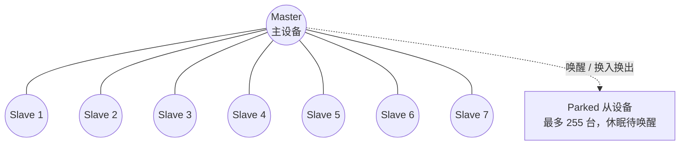
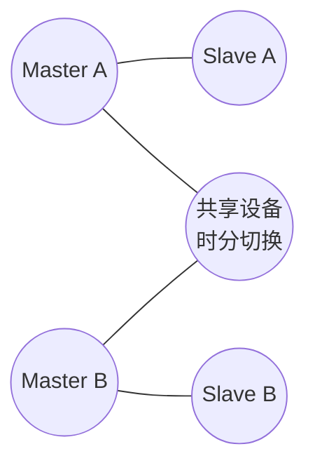

# 无线个域网 · 完整笔记

---

## 1.本节定位与学习要求

无线通信网一章分为三个板块，本节讲授第三板块“无线个域网（WPAN）”，即计算机网络按覆盖范围划分时所说的“个域网（PAN）”。

| 模块 | 主要内容 | 课件标注的重点 |
| ---- | -------- | -------------- |
| 蜂窝移动通信系统 | 移动通信系统基本概念、移动通信系统类型、蜂窝移动通信系统发展 | 系统发展（4G 标准与关键技术、5G 关键技术） |
| 无线局域网 WLAN | WLAN 基本概念、WLAN 的标准、WLAN 的组网结构、无线网与有线网的区别、IEEE 802.11 的安全特性 | WLAN 的标准、不同 AP 类型与组网方式、802.11 的 MAC 层、WLAN 的安全机制 |
| 无线个域网 WPAN | 蓝牙和 ZigBee 技术 | 两个经典代表的标准、组网方式与应用场景 |

本节的考核定位与学习深度：

| 项目 | 要求 |
| ---- | ---- |
| 考试频度 | 网工（中级）考试频度**很低**，目前尚未出现专门题型；网规（高级）中侧重点略高、出现频率略多 |
| 掌握范围 | 只需掌握两个经典代表（蓝牙、ZigBee）的**标准编号、组网方式、应用场景** |
| 不要求 | 物理层帧结构、基带实现、路由协议细节等深层内容 |
| 学习目的 | 与“按覆盖范围划分网络”的知识点对应，能区分个域网、局域网、城域网、广域网；防止概念型选择题出现时失分 |

本节内部知识脉络：

| 层次 | 内容 |
| ---- | ---- |
| 概述 | 无线个域网的定义、覆盖范围、技术路线（低速／高速） |
| 标准体系 | IEEE 802.15 系列：802.15.1 蓝牙、802.15.3 高速 WPAN、802.15.4 低速 WPAN（ZigBee） |
| 代表技术 | 蓝牙（频段、跳频、速率、微微网与散射网）、ZigBee（低功耗、低速率、自组网、Mesh） |
| 其他技术 | IrDA 红外、NFC、RFID、UWB 超宽带 |

---

## 2.无线个域网概述

### 2.1 定义

无线个域网（Wireless Personal Area Network，WPAN）指在**个人工作与生活半径内**（典型覆盖半径约 **10 m**），把属于同一个人的信息设备——手机、耳机、键鼠、打印机、可穿戴设备、传感器等——以无线方式互联，实现点对点或点对多点通信的短距离无线网络。

其核心特征可归纳为四点：

| 特征 | 含义 |
| ---- | ---- |
| 覆盖范围小 | 半径约 10 m 量级，围绕“人”而非“建筑”组织网络 |
| 面向个人设备 | 解决设备间的线缆替代与临时互联，不承担骨干传输 |
| 低功耗、低成本 | 终端多为电池供电，协议栈追求轻量与省电 |
| 自组织 | 无需预先布设基础设施，设备靠近即可建链（蓝牙、ZigBee 均属此类） |

### 2.2 在“按覆盖范围划分”中的位置

| 网络类型 | 英文缩写 | 典型覆盖范围 | 代表标准／技术 |
| -------- | -------- | ------------ | -------------- |
| 个域网 | PAN | 约 10 m | IEEE 802.15（蓝牙、ZigBee）、IrDA、NFC、UWB |
| 局域网 | LAN | 约 10 m ~ 1 km | IEEE 802.3 以太网、IEEE 802.11 无线局域网 |
| 城域网 | MAN | 约 1 km ~ 100 km | IEEE 802.16（宽带无线接入）、城域以太网 |
| 广域网 | WAN | 100 km 以上 | PSTN、X.25、帧中继、ATM、蜂窝移动通信网 |

注意：个域网与无线局域网的分界不只看距离，更看**是否以“个人”为中心、是否由个人设备自组织成网**。WLAN 以接入点为中心提供共享接入，WPAN 以个人设备之间的对等互联为主。

### 2.3 两条技术路线与本节核心课件

IEEE 802.15 体系按“速率—功耗”把 WPAN 分为两条技术路线：

| 路线 | 标准 | 速率量级 | 设计目标 | 代表技术 |
| ---- | ---- | -------- | -------- | -------- |
| 中速（线缆替代） | IEEE 802.15.1 | 1~3 Mbps（3.0+HS 达 24 Mbps） | 替代周边设备线缆，支持话音与音频 | 蓝牙 |
| 高速 | IEEE 802.15.3 | 11~55 Mbps（毫米波版本达 Gbps） | 多媒体、图像传输 | 高速 WPAN、UWB |
| 低速 | IEEE 802.15.4 | 20~250 kbps | 极低功耗、极低成本、长待机 | ZigBee、Thread、6LoWPAN |

本节只需重点掌握其中的**蓝牙（802.15.1）**与 **ZigBee（802.15.4）**两个经典代表。

---

## 3.IEEE 802.15 系列标准

### 3.1 标准族总表

IEEE 802.15 是 IEEE 802 委员会下设的无线个域网工作组所制定的一系列标准，各任务组（TG）分别针对不同的速率、距离、功耗与业务类型：

| 标准 | 名称／方向 | 关键技术指标 | 典型技术 |
| ---- | ---------- | ------------ | -------- |
| IEEE 802.15.1 | 无线个域网／蓝牙 | 2.4 GHz ISM 频段，基本速率 1 Mbps，跳频扩频 FHSS | 蓝牙（Bluetooth） |
| IEEE 802.15.2 | 共存（Coexistence） | 规定 802.15.1 与 802.11 在 2.4 GHz 频段的共存机制，如自适应跳频 AFH、时分协调 | 蓝牙与 WLAN 共存 |
| IEEE 802.15.3 | 高速 WPAN | 2.4 GHz 频段，速率 **11~55 Mbps**；802.15.3c 改用 57~66 GHz 毫米波，速率达 Gbps 级 | 高速多媒体、无线视频 |
| IEEE 802.15.4 | 低速 WPAN | 2.4 GHz／915 MHz／868 MHz，速率 250／40／20 kbps，支持星型、树型、Mesh | ZigBee、Thread、6LoWPAN、WirelessHART |
| IEEE 802.15.4a／4z | 低速测距 UWB | 以超宽带脉冲实现厘米级测距与定位 | UWB 定位 |
| IEEE 802.15.5 | Mesh 组网 | 基于 802.15.4 的网状网组网规范 | 无线传感器网络 |
| IEEE 802.15.6 | 体域网 WBAN | 面向穿戴式、植入式设备的近身通信 | 医疗监护 |
| IEEE 802.15.7 | 光无线通信 | 可见光通信 VLC | 室内定位、照明通信 |

说明：802.15.1 的 IEEE 版本于 2002 年、2005 年发布，此后相关标准化工作移交蓝牙技术联盟（Bluetooth SIG）持续推进，因此蓝牙的版本演进（2.0、3.0、4.0、5.x）由 SIG 发布，而非新的 IEEE 编号。

### 3.2 两个经典代表的标准对应关系

| 技术 | 对应标准 | 中文别称 | 一句话定位 |
| ---- | -------- | -------- | ---------- |
| 蓝牙 | IEEE 802.15.1 | 蓝牙 | 中速、短距的线缆替代技术，个人音频与外设互联的主流方案 |
| ZigBee | IEEE 802.15.4 | 紫蜂（口述中常误作“紫峰”） | 低速、极低功耗的自组织网状网技术，物联网与智能家居的主流方案 |

命名由来：ZigBee 一词取自蜜蜂归巢后跳的“摇摆舞”（waggle dance），用以比喻节点之间以多跳方式传递信息，故中文亦称“紫蜂”。

---

## 4.蓝牙技术

### 4.1 标准与工作频段

| 项目 | 参数 |
| ---- | ---- |
| 标准 | IEEE 802.15.1（后续版本由 Bluetooth SIG 维护） |
| 工作频段 | **2.4~2.4835 GHz 的 ISM 频段**（工业、科学、医疗频段，免许可） |
| 信道划分 | 经典蓝牙：79 个射频信道，信道间隔 1 MHz（采用自适应跳频 AFH 时可减少可用信道）；BLE：40 个信道，间隔 2 MHz，其中 3 个广播信道、37 个数据信道 |
| 调制方式 | 基本速率 BR 用 GFSK；增强数据率 EDR 增用 π/4-DQPSK、8DPSK |
| 双工方式 | TDD 时分双工，时隙长度 625 μs，主从设备交替收发 |
| 扩频方式 | **跳频扩频 FHSS**，跳速 1600 跳／秒 |
| 基本速率 | 1 Mbps（BR） |
| 传输距离 | Class 2 约 10 m；Class 1 约 100 m |

要点：蓝牙与 802.11b/g 同处 2.4 GHz ISM 频段，二者的区别在于**蓝牙用跳频（FHSS）、802.11b 用直接序列扩频（DSSS）**，这也是概念题最常设置的互换陷阱。

### 4.2 跳频扩频与时分双工

跳频扩频（Frequency Hopping Spread Spectrum，FHSS）指收发双方按同一伪随机序列，在 79 个 1 MHz 信道之间高速跳变载频：

| 环节 | 说明 |
| ---- | ---- |
| 跳频序列 | 由主设备的蓝牙地址与时钟共同决定，同一微微网内所有设备同步跳变 |
| 跳速 | 1600 跳／秒，即每个 625 μs 时隙换一个频点 |
| 抗干扰机理 | 窄带干扰只影响个别频点，被干扰的时隙重传即可，整体通信不中断 |
| 与 AFH 的关系 | 自适应跳频 AFH 剔除被 WLAN、微波炉等占用的频点，降低与 802.11 的互扰，属 802.15.2 共存范畴 |
| 双工实现 | 主设备在偶数时隙发送、奇数时隙接收，从设备相反，构成 TDD |

与直接序列扩频（DSSS）的对比：

| 比较项 | FHSS（蓝牙） | DSSS（802.11b） |
| ------ | ------------ | --------------- |
| 扩频手段 | 载频按伪随机序列跳变 | 用伪随机码把信号扩展到宽频带 |
| 抗干扰特点 | 躲避窄带干扰，某频点受扰只丢失个别时隙 | 以处理增益对抗窄带干扰 |
| 典型速率 | 1~3 Mbps | 1／2／5.5／11 Mbps |

### 4.3 网络拓扑：微微网与散射网

蓝牙的基本组网单元是**微微网（Piconet，也称皮可网）**：

| 项目 | 说明 |
| ---- | ---- |
| 结构 | 1 台主设备（Master，也称 Central）＋若干从设备（Slave，也称 Peripheral） |
| 容量 | 同一物理信道内最多 **7 台活跃从设备**（3 位活动成员地址 AM_ADDR 决定） |
| 扩展 | 最多另有 255 台从设备处于休眠（Park）状态，需要时由主设备唤醒并换入换出 |
| 信道 | 全微微网共用一条跳频序列与同一个主设备时钟，容量由主设备统一调度 |
| 拓扑实质 | 以主设备为中心的点对多点（星型）结构，主从之间可直接通信，从设备之间一般需经主设备转发 |

**微微网拓扑**：

图中 7 台从设备共享主设备的跳频序列与时钟，同一时刻只有被轮询的从设备收发；从设备之间不直接通信。

**散射网（Scatternet，也称分散网）**指两个或多个微微网通过**共享设备**相互连接而成的网络：

| 项目 | 说明 |
| ---- | ---- |
| 形成方式 | 某台设备同时作为 A 网的主设备与 B 网的从设备，或分别作为两个网的从设备 |
| 参与方式 | 共享设备以**时分复用**方式在不同微微网之间切换，同一时刻只在一个网内工作 |
| 同步要求 | 各微微网使用各自的跳频序列，**彼此不同步**，因此跨网切换需重新同步 |
| 意义 | 突破单微微网 7 台活跃设备的限制，扩展覆盖范围与组网规模，是蓝牙自组织组网的基础 |

**散射网拓扑**：

共享设备可同时是 A 网的从设备与 B 网的从设备（也可在一个网中当主设备），它在两网之间按时间片切换，两个微微网各自保持独立的跳频序列与时钟。

### 4.4 版本演进与速率

| 版本 | 发布年份 | 主要改进 | 峰值速率 |
| ---- | -------- | -------- | -------- |
| 1.0／1.1 | 1999／2001 | 首个商用版本，规定 2.4 GHz、FHSS、TDD 基本框架 | 约 723 kbps（有效） |
| 1.2 | 2003 | 自适应跳频 AFH，改善与 WLAN 共存 | 1 Mbps |
| 2.0+EDR | 2004 | 引入增强数据率 EDR，增用 π/4-DQPSK、8DPSK | 3 Mbps（有效约 2.1 Mbps） |
| 2.1+EDR | 2007 | 安全简易配对 SSP、降低待机功耗 | 3 Mbps |
| 3.0+HS | 2009 | 引入 AMP，用蓝牙建链、借 802.11 传数据 | 24 Mbps |
| 4.0 | 2010 | 引入低功耗蓝牙 BLE，面向纽扣电池设备（2009 年 12 月公布，2010 年 7 月正式采纳） | 1 Mbps（BLE） |
| 4.1 | 2013 | 物联网优化、与 LTE 共存 | 1 Mbps（BLE） |
| 4.2 | 2014 | 支持 IPv6／6LoWPAN，提升隐私保护 | 1 Mbps（BLE） |
| 5.0 | 2016 | LE 2M PHY，速率翻倍；距离约提升 4 倍；广播容量提升 | 2 Mbps（BLE） |
| 5.1 | 2019 | 引入测向（AoA／AoD），可实现米级以内的室内定位 | 2 Mbps（BLE） |
| 5.2 | 2020 | LE Audio、LC3 编码、同步信道 | 2 Mbps（BLE） |
| 5.3 | 2021 | 连接子速率、周期性广播间隔、信道分类增强 | 2 Mbps（BLE） |
| 5.4 | 2023 | 带响应的周期性广播 PAwR、加密广播 | 2 Mbps（BLE） |
| 6.0 | 2024 | 信道探测（Channel Sounding），提升测距精度 | 仍为 LE 2 Mbps 量级 |

校注：讲授中提出“蓝牙 5.3 的速率可达 48 Mbps”，与蓝牙规范不符：蓝牙 5.x 的 LE 最高为 2 Mbps，经典蓝牙 EDR 为 3 Mbps，3.0+HS 依靠 802.11 才达到 24 Mbps；48 Mbps 属于 IEEE 802.15.3 高速 WPAN 的量级（11~55 Mbps）。考试作答以 1 Mbps（基本速率）为准，遇到版本速率题按上表核对。（存疑）

补充：Bluetooth SIG 于 2017 年发布 **Bluetooth Mesh**，基于 BLE 广播的泛洪式网状网，主要用于智能照明、楼宇与传感器网络；它与经典蓝牙的微微网/散射网是两套不同的组网模型。

### 4.5 功率等级与传输距离

| 等级 | 最大发射功率 | 典型距离 | 典型用途 |
| ---- | ------------ | -------- | -------- |
| Class 1 | 100 mW（20 dBm） | 约 100 m | 工业场景、长距适配器 |
| Class 2 | 2.5 mW（4 dBm） | 约 10 m | 手机、耳机、键鼠（最常见） |
| Class 3 | 1 mW（0 dBm） | 约 1 m | 极短距设备 |

### 4.6 应用与局限

| 项目 | 内容 |
| ---- | ---- |
| 典型应用 | 蓝牙耳机与手机互联、手机与车机互联、无线键鼠、文件与联系人传输、BLE 信标、可穿戴设备数据回传 |
| 优势 | 免许可频段、低功耗（BLE）、芯片成本低、生态成熟、支持话音与音频通道 |
| 局限 | 单微微网活跃节点仅 7 台；经典蓝牙功耗偏高；2.4 GHz 频段拥挤，与 WLAN、微波炉互扰；传输距离短 |

---

## 5.ZigBee 技术

### 5.1 标准与频段速率

| 项目 | 参数 |
| ---- | ---- |
| 标准 | **IEEE 802.15.4**（规定物理层与 MAC 层），网络层与应用层由 ZigBee 联盟（现 Connectivity Standards Alliance）定义 |
| 定位 | 速率更低、距离更近、更省电的无线个人网 |
| 工作频段 | 2.4 GHz ISM 频段（全球通用）；915 MHz（北美）；868 MHz（欧洲）；779~787 MHz（中国） |
| 调制与扩频 | 2.4 GHz 采用 O-QPSK 与直接序列扩频 DSSS |
| 传输距离 | 典型 10~100 m，借助 Mesh 多跳可大幅延伸 |
| 网络规模 | 16 位短地址理论上可容纳约 6.5 万个节点；工程上常以数百至数千节点计，受路由开销与流量限制 |

各频段的信道与速率：

| 频段 | 信道数 | 数据速率 | 说明 |
| ---- | ------ | -------- | ---- |
| 2.4~2.4835 GHz | 16（信道间隔 5 MHz） | **250 kbps** | 全球通用，考试默认取值 |
| 902~928 MHz | 10 | 40 kbps | 北美、澳洲 |
| 868~868.6 MHz | 1 | 20 kbps | 欧洲 |
| 779~787 MHz | — | — | 中国专用短距频段 |

校注：课件写“通信速率可以低至 9.6 kbps”。按 IEEE 802.15.4 的规定，最低空口速率为 868 MHz 频段的 20 kbps；9.6 kbps 并非标准定义的空口速率，可理解为部分教材对含协议开销后的有效吞吐或极低速应用场景的量级描述。考试若问 ZigBee 的速率，答 **250 kbps（2.4 GHz）** 或“20 kbps~250 kbps”区间最稳妥。（存疑）

补充：ZigBee 3.0（2016 年）统一了此前分散的应用层（ZigBee Home Automation、Light Link 等），采用统一的应用层与设备描述；其底层仍基于 IEEE 802.15.4。

### 5.2 自组织与 Mesh 组网

ZigBee 是典型的**自组织网络（Ad Hoc 网络）**，其“自组织”体现在四个能力上：

| 能力 | 说明 |
| ---- | ---- |
| 自发现 | 节点上电后扫描信道，发现已有网络并申请加入，无需人工配置链路 |
| 自配置 | 协调器自动选择信道与网络号（PAN ID），并为入网节点分配 16 位短地址 |
| 自愈合 | 节点或链路失效后，路由表重新收敛，数据改由其他路径多跳转发 |
| 自扩展 | 路由器节点可随时加入，扩展覆盖范围，形成 Mesh 网状结构 |

Mesh（网状）组网的意义：每个路由器节点都可为其他节点转发数据，网络不存在单点瓶颈，任意两节点之间往往有多条路径，因而具备较强的鲁棒性；代价是路由开销与转发时延高于星型网络。

### 5.3 设备角色与网络拓扑

| 设备角色 | 英文缩写 | 职责 | 供电要求 |
| -------- | -------- | ---- | -------- |
| 协调器 | ZC（ZigBee Coordinator） | 全网的唯一发起者，负责建网、选信道与 PAN ID、分配地址、充当信任中心；也是树型／Mesh 的根 | 持续供电 |
| 路由器 | ZR（ZigBee Router） | 加入网络后为其他节点转发数据、扩展覆盖，可自身挂接子节点 | 持续供电 |
| 终端设备 | ZED（ZigBee End Device） | 只与父节点通信，不转发数据，可长时间休眠 | 电池供电 |

三种网络拓扑：

| 拓扑 | 结构 | 特点 |
| ---- | ---- | ---- |
| 星型（Star） | 所有节点直连协调器 | 结构最简单、时延最小，覆盖受协调器半径限制 |
| 树型（Tree） | 协调器为根，路由器分层挂接 | 支持多级扩展，路径唯一，局部链路故障影响子树 |
| 网状（Mesh） | 路由器之间任意互连 | 多路径、自愈合，覆盖与可靠性最好，路由开销最大 |

### 5.4 安全机制（与 WPA2 的异同）

| 比较项 | ZigBee（IEEE 802.15.4） | WLAN（WPA2） |
| ------ | ----------------------- | ------------ |
| 加密算法 | 高级加密标准 **AES-128** | 高级加密标准 AES |
| 工作模式 | **CCM\***（CCM 星号，CCM 的裁剪变体，可只加密或只认证） | **CCMP**（基于 CCM 的封装协议） |
| 密钥 | 128 位对称密钥，含网络密钥与链路密钥 | 成对临时密钥 PTK、组临时密钥 GTK |
| 认证 | 信任中心分发密钥，支持帧级完整性校验 | 802.1X／PSK 四次握手 |

要点：二者的共同点是**都用 AES 加密、都基于 CCM 认证加密模式**；区别在于 ZigBee 使用 CCM\*（可按需省略加密或认证字段），WPA2 使用打包好的 CCMP 协议。口述中“ZigBee 的安全机制类似 WPA2”的实质即指此。

### 5.5 应用

| 场景 | 具体应用 |
| ---- | -------- |
| 智能家居 | 灯控、窗帘、空调伴侣、门窗与人体传感器、智能音箱联动 |
| 医疗监护 | 可穿戴体征采集、病房呼叫、药品与设备管理 |
| 工业与楼宇 | 无线传感网、能耗抄表、环境监测、楼宇自控 |
| 农业与环境 | 土壤墒情、温湿度采集等低速率、长待机的传感业务 |

ZigBee 与蓝牙的对比：

| 比较项 | 蓝牙 | ZigBee |
| ------ | ---- | ------ |
| 标准 | IEEE 802.15.1 | IEEE 802.15.4 |
| 频段 | 2.4 GHz ISM | 2.4 GHz／868 MHz／915 MHz |
| 速率 | 1 Mbps（BR）、2~3 Mbps（EDR） | 250 kbps（2.4 GHz） |
| 距离 | 10 m（Class 2）、100 m（Class 1） | 10~100 m，Mesh 可延伸 |
| 拓扑 | 微微网、散射网 | 星型、树型、Mesh |
| 单网节点数 | 7 台活跃从设备 | 数量级更大，适合大规模传感网 |
| 功耗 | 经典蓝牙较高，BLE 较低 | 极低，电池可支撑数月到数年 |
| 典型业务 | 音频、外设、文件传输 | 传感、控制、抄表 |

---

## 6.其他无线个域网技术

### 6.1 红外 IrDA

| 项目 | 参数 |
| ---- | ---- |
| 名称 | IrDA（Infrared Data Association，红外数据协会）所制定的红外通信标准 |
| 介质 | 850~900 nm 波段的近红外光 |
| 传播方式 | 视距（Line of Sight）直射，发射角约 30° 锥角 |
| 距离 | 典型 0~1 m（低功耗模式约 20~30 cm） |
| 拓扑 | 点对点，早期为半双工 |
| 速率等级 | SIR 115.2 kbps；MIR 1.152 Mbps；FIR 4 Mbps；VFIR 16 Mbps |

| 优点 | 缺点 |
| ---- | ---- |
| 无需频率许可，不受无线电频谱管制 | 必须视距对准，遮挡即中断 |
| 不产生射频干扰，适合电磁敏感环境 | 传输距离极短，无法穿墙 |
| 光束不穿透墙壁，天然具备保密性 | 速率与易用性不及蓝牙，已被蓝牙取代 |

现状：IrDA 在手机、笔记本上已被蓝牙与 Wi-Fi 取代，协会标准工作基本停滞，仅用于少数遥控、电表抄读等场景。考试中多作为“红外传输、视距、点对点”的概念点出现。

### 6.2 NFC 近场通信

| 项目 | 参数 |
| ---- | ---- |
| 标准 | ISO/IEC 18092（NFCIP-1）、ISO/IEC 14443（近距卡）、ISO/IEC 21481，由 NFC Forum 推广并制定 NDEF 数据交换格式 |
| 工作频率 | **13.56 MHz**（属 HF 高频 RFID 频段） |
| 通信距离 | 约 4 cm 以内（工程上常表述为 10 cm 内） |
| 速率 | 106／212／424 kbps（后续扩展至 848 kbps） |
| 耦合方式 | 磁场感应耦合（变压器耦合），非电磁波辐射 |
| 工作模式 | 卡模拟模式、读写器模式、点对点模式 |

典型应用：手机支付与公交卡、门禁考勤、电子票务、设备一碰配对（蓝牙／Wi-Fi 快速配网）、电子身份证件读取。

### 6.3 RFID 与 NFC 的区别

RFID（Radio Frequency Identification，射频识别）是利用射频信号非接触地读取标签信息的自动识别技术，按频段分为低频、高频、超高频与微波四类：

| 频段 | 典型频率 | 读取距离 | 典型应用 |
| ---- | -------- | -------- | -------- |
| 低频 LF | 125／134 kHz | 几厘米 | 动物耳标、门禁卡、汽车防盗钥匙 |
| 高频 HF | 13.56 MHz | 约 1 m 以内 | 公交卡、图书管理、NFC |
| 超高频 UHF | 860~960 MHz | 数米至十余米 | 物流仓储、服装盘点、资产管理 |
| 微波 | 2.45／5.8 GHz | 数米至数十米 | 高速公路 ETC、远距离识别 |

NFC 与 RFID 的对比：

| 比较项 | NFC | RFID |
| ------ | --- | ---- |
| 频段 | 仅 13.56 MHz | LF／HF／UHF／微波多频段 |
| 距离 | 约 4 cm（10 cm 内） | 几厘米至数十米 |
| 通信方向 | 双向对等通信，两台设备可互发数据 | 通常为读写器到标签的单向识别 |
| 标准体系 | ISO/IEC 18092、14443、21481 与 NFC Forum | ISO/IEC 14443、15693、18000-6C 等 |
| 是否可主动发起 | 可主动发起并完成双向交互 | 标签多为被动应答，无主动组网能力 |
| 典型应用 | 手机支付、门禁、一碰配对 | 物流追溯、仓储盘点、ETC、防伪 |

一句话区分：**NFC 是 RFID 高频（13.56 MHz）家族中强调“双向、极近距、可交互”的一个子集**，二者不是并列关系。

### 6.4 UWB 超宽带

| 项目 | 参数 |
| ---- | ---- |
| 定义 | 发射信号带宽大于 500 MHz，或大于中心频率的 20% 的无线技术（FCC 与 ITU-R 定义） |
| 频段 | 3.1~10.6 GHz（FCC 于 2002 年开放民用） |
| 实现方式 | 以极窄脉冲（脉冲无线电）或 MB-OFDM 方式占用极宽频谱 |
| 速率 | 短距离可达 100~480 Mbps |
| 功率谱密度 | 极低，可与窄带系统共用频段而不造成明显干扰 |
| 标准归属 | 802.15.3a（MB-OFDM 与 DS-UWB 两派未达成一致，2006 年撤销）；测距定位由 802.15.4a／4z 规定 |
| 核心优势 | 厘米级测距与定位精度、强抗多径能力、低功耗 |

典型应用：室内高精度定位与人员/资产追踪、手机与汽车的**数字钥匙**、无线 USB 与高清视频短距传输、雷达感知。

### 6.5 无线个域网技术特性总表

| 技术 | 标准 | 频段 | 速率 | 距离 | 拓扑／特点 |
| ---- | ---- | ---- | ---- | ---- | ---------- |
| 蓝牙 | IEEE 802.15.1 | 2.4 GHz ISM | 1 Mbps（BR），2~3 Mbps（EDR），24 Mbps（3.0+HS），2 Mbps（BLE 5.x） | 10 m／100 m | 微微网（1 主 7 从）、散射网，FHSS |
| ZigBee | IEEE 802.15.4 | 2.4 GHz／868／915／780 MHz | 250／20／40 kbps | 10~100 m（可 Mesh 延伸） | 星型、树型、Mesh，自组织、极低功耗 |
| 高速 WPAN | IEEE 802.15.3 | 2.4 GHz；3c 用 57~66 GHz | 11~55 Mbps；毫米波达 Gbps | 10 m 内 | 多媒体流、类 TDMA 的中心调度 |
| UWB | IEEE 802.15.4a／4z 等 | 3.1~10.6 GHz | 100~480 Mbps（短距） | 数米至十余米 | 极宽带宽、厘米级定位 |
| IrDA 红外 | IrDA 系列 | 近红外光（850~900 nm） | 115.2 kbps~16 Mbps | 0~1 m | 视距点对点、保密性好 |
| NFC | ISO/IEC 18092 等 | 13.56 MHz | 106~424 kbps（可扩展至 848 kbps） | 约 4 cm | 双向、卡模拟／读写器／点对点 |
| RFID | ISO/IEC 14443、18000-6C 等 | LF／HF／UHF／微波 | 依频段而定 | 厘米至数十米 | 标签识别为主，可无源 |

---

## 7.无线通信网技术指标的三层划分（本章回顾）

本章小结时以“一条道路、多个门店、多位顾客”的类比，把蜂窝移动通信（尤其 5G）的技术指标归为三个层次。理解这三层，可避免把 FDD、FDM、FDMA 等相近缩写混为一谈。

| 层次 | 解决的问题 | 典型技术 | 判断依据 |
| ---- | ---------- | -------- | -------- |
| 上行与下行的区分 | 同一频段内两个传输方向如何分开 | TDD、FDD | 看“方向” |
| 信道复用 | 同一方向上如何划分出多条子信道 | SDM、TDM、FDM、WDM、CDM | 看“子信道” |
| 多址接入 | 同一子信道内如何区分多个用户 | FDMA、TDMA、CDMA、SDMA | 看“用户”，带地址概念 |

### 7.1 双工方式：TDD 与 FDD

| 方式 | 全称 | 区分手段 | 特点 |
| ---- | ---- | -------- | ---- |
| FDD | 频分双工 | 上行、下行各占一段对称频率 | 收发可同时进行，需成对频谱，适合对称业务 |
| TDD | 时分双工 | 上下行共用同一频率，按时间片轮流收发 | 无需成对频谱，可按业务比例调整上下行时隙配比 |

### 7.2 信道复用：把一条链路切成多条子信道

| 复用方式 | 全称 | 划分依据 |
| -------- | ---- | -------- |
| SDM | 空分复用 | 空间（不同天线、不同波束、不同地理区域） |
| FDM | 频分复用 | 频率 |
| TDM | 时分复用 | 时间片 |
| WDM | 波分复用 | 光的波长（光纤通信） |
| CDM | 码分复用 | 正交码型 |

### 7.3 多址方式：在子信道内区分用户

| 多址方式 | 全称 | 用户区分依据 |
| -------- | ---- | ------------ |
| FDMA | 频分多址 | 不同用户占用不同频点 |
| TDMA | 时分多址 | 不同用户占用不同时隙 |
| CDMA | 码分多址 | 不同用户使用不同地址码，可同时同频通信 |
| SDMA | 空分多址 | 不同用户由不同空间波束服务 |

类比：门店相当于基站，顾客相当于用户，先领号再叫号即“多址”；把一条信道划成若干子信道即“复用”；而收银与售后走不同通道即“双工”。

### 7.4 OFDM 与 OFDMA 的区别

| 项目 | OFDM | OFDMA |
| ---- | ---- | ----- |
| 全称 | 正交频分复用 | 正交频分多址 |
| 服务对象 | 单个用户占用全部子载波 | 多个用户各分得部分子载波（子信道化） |
| 归属层次 | 复用技术 | 多址技术 |
| 典型应用 | 802.11a/g/n、DVB、4G 下行 | 802.11ax（Wi-Fi 6）、4G/5G 上下行 |

要点：二者调制解调原理相同，差别只在“给一个用户用”还是“给多个用户分着用”，名称后缀 A（Access，接入）即多址之意。考试只要求区分名称与用途，不要求推导实现。

---

## 8.易错点与自测

### 8.1 常见判断

| 判断 | 结论 | 说明 |
| ---- | ---- | ---- |
| 蓝牙工作在 2.4 GHz 的 ISM 频段，采用跳频扩频 | [正确] | 79 个 1 MHz 信道，1600 跳／秒 |
| 蓝牙采用直接序列扩频，802.11b 采用跳频扩频 | [错误] | 二者恰好相反 |
| 一个微微网中最多可有 7 台活跃从设备 | [正确] | 其余从设备可处于休眠（Park）状态，最多 255 台 |
| 散射网由多个微微网通过共享设备连接而成 | [正确] | 共享设备以时分方式在不同微微网间切换 |
| ZigBee 基于 IEEE 802.15.4，属于低速、低功耗的自组织网络 | [正确] | 2.4 GHz 下速率 250 kbps，支持 Mesh |
| ZigBee 的传输速率高于蓝牙 | [错误] | 250 kbps 远低于蓝牙的 1~3 Mbps |
| 蓝牙 4.0 引入了低功耗蓝牙 BLE | [正确] | 2009 年公布、2010 年正式采纳，面向纽扣电池设备 |
| 蓝牙 5.x 的 LE 最高速率为 2 Mbps | [正确] | 3.0+HS 的 24 Mbps 依靠 802.11 AMP，不是 LE |
| ZigBee 的最低空口速率为 9.6 kbps | [错误] | IEEE 802.15.4 最低为 868 MHz 的 20 kbps |
| ZigBee 采用 AES-128 与 CCM\* 认证加密 | [正确] | 与 WPA2 的 AES-CCMP 同源但不同封装 |
| NFC 工作在 13.56 MHz，通信距离约 4 cm | [正确] | 属 HF 频段 RFID 的双向交互子集 |
| NFC 与 RFID 是并列的两种技术 | [错误] | NFC 是 RFID 高频家族中强调双向、极近距的子集 |
| UWB 以大于 500 MHz 的带宽传输，主要用于高速率与高精度定位 | [正确] | 3.1~10.6 GHz，厘米级测距 |
| 红外通信可穿墙传输，适合组建室内覆盖网络 | [错误] | 红外为视距传输，不能穿墙 |
| 蓝牙 5.3 的速率可达 48 Mbps | [错误] | 蓝牙 LE 最高 2 Mbps，3.0+HS 才达 24 Mbps |

### 8.2 自测题（依据本节知识点自拟）

**题目 1** 下列标准中，与 ZigBee 直接相关的是（ ）

- A. IEEE 802.15.1
- B. IEEE 802.15.3
- C. IEEE 802.15.4
- D. IEEE 802.11

解答：ZigBee 的物理层与 MAC 层由 IEEE 802.15.4 规定，选 **C**。A 为蓝牙，B 为高速 WPAN，D 为无线局域网。

**题目 2** 蓝牙技术采用的工作频段与扩频方式是（ ）

- A. 5 GHz，DSSS
- B. 2.4 GHz，FHSS
- C. 2.4 GHz，DSSS
- D. 5 GHz，FHSS

解答：蓝牙工作在 2.4~2.4835 GHz 的 ISM 频段，采用跳频扩频 FHSS，选 **B**。

**题目 3** 关于蓝牙组网，下列说法正确的是（ ）

- A. 一个微微网中可有多个主设备
- B. 一个微微网中最多有 7 台活跃从设备
- C. 散射网中各微微网必须频率同步
- D. 从设备之间可直接通信而无需主设备转发

解答：微微网只有 1 台主设备，故 A 错；各微微网有各自的跳频序列、彼此不同步，故 C 错；从设备之间一般需经主设备转发，故 D 错。选 **B**。

**题目 4** 某智能家居系统要求节点由电池供电、可连续工作数年，并能通过多跳扩展覆盖，最适宜采用的无线技术是（ ）

- A. 蓝牙
- B. ZigBee
- C. NFC
- D. UWB

解答：低功耗、低速率、自组织 Mesh 是 ZigBee 的典型特征，选 **B**。NFC 距离仅数厘米且需贴近，UWB 功耗与成本偏高，经典蓝牙不适合大规模多跳组网。

---

## 9.附：第五章“网络互联”知识脉络（素材衔接）

说明：本段素材为下一章（第五章 网络互联）的导学内容，与无线个域网无直接知识关联，为保持素材完整而附录于此，阅读本节时可略过。

### 9.1 教程目录的变化

第 6 版官方教程将原“广域网通信”“下一代互联网”两章合并进“网络互联与互联网”一章，并对知识点重新梳理、规整与删除，形成新的知识脉络。第五章目录为：

| 节次 | 内容 |
| ---- | ---- |
| 5.1 | 广域网技术 |
| 5.2 | IP 协议 |
| 5.3 | 从 IPv4 向 IPv6 的过渡 |
| 5.4 | IP 组播技术 |
| 5.5 | TCP 和 UDP 协议 |
| 5.6 | 路由协议与路由器技术 |

该章是承上启下的核心章节：基础知识在此落地合并，同时与后续的网络设备配置、组网技术、网络规划设计联合出综合案例题，属于“学不好则考试难以通过”的章节。

### 9.2 知识脉络

整章以**因特网与互联网技术**为核心，基于 TCP/IP 体系结构展开，分为三大板块：

| 板块 | 子项 | 主要内容 | 课件标注重点 |
| ---- | ---- | -------- | ------------ |
| 路由协议 | 路由技术概述 | 路由基本概念、路由寻址、路由汇聚 | 路由寻址、路由汇聚 |
| 路由协议 | 静态路由与默认路由 | 特点、等价路由与浮动路由 | 静态路由与默认路由 |
| 路由协议 | 路由协议 | 基本原理、分类、经典路由协议 | 分类 |
| 广域网技术 | 基本概念 | 广域网的定义与特征 | — |
| 广域网技术 | 网络类型 | PSTN、X.25、帧中继 FR、ISDN 与 ATM | — |
| 广域网技术 | 相关协议 | HDLC、PPP | — |
| Internet 协议 | 应用层 | 网页访问、文件传输、电子邮件、远程登录、DHCP、互联网新技术（云计算、大数据、区块链） | 网页访问、DHCP |
| Internet 协议 | 传输层 | 传输层概述、UDP 与 TCP 报文格式、TCP 数据传输、TCP 拥塞控制、端口号 | 拥塞控制、端口号 |
| Internet 协议 | 网络层 | 网络层概述、IP 地址、IP 数据包格式、ICMP、ARP | IP 地址、IP 数据包格式 |

学习提示：本章概念密集且名词众多，若需深挖某个技术点（如路由协议的收敛过程），应结合华为认证资料进一步展开；课程本身只作入门梳理。

### 9.3 TCP/IP 四层结构回顾

第五章只讨论高三层，网络接口层的内容已在前面的局域网章节讲完（依据以太网技术）。四层结构与数据单元、地址的对应关系如下：

| 层次 | 主要协议 | 数据单元 | 地址／标识 |
| ---- | -------- | -------- | ---------- |
| 应用层 | HTTP、FTP、SMTP、DNS、DHCP、Telnet 等 | 数据（Data） | 端口号（部分应用） |
| 传输层 | TCP、UDP | 段（Segment）／数据报 | 端口号 |
| 网络层 | IP、ICMP、IGMP、ARP、RARP | 包（Packet） | IP 地址 |
| 网络接口层 | 以太网、PPP 等 | 帧（Frame） | MAC 地址 |
| 物理层（物理硬件） | 传输介质与信号 | 位（Bit） | — |

第五章的展开顺序与上表一致：应用层看“协议作用＋承载于哪个传输层协议＋端口号”，传输层以 TCP 为主、UDP 侧重与 TCP 的对比，网络层重点为 IP 地址、IP 数据报格式以及 IPv4 与 IPv6 的区别和过渡技术；广域网技术因多已淘汰，仅需了解定义。

---

## 10.本章小结

| 知识点 | 核心内容 |
| ------ | -------- |
| 1. 蜂窝移动通信系统的发展 | 1G（模拟）→2G（GSM/CDMA）→3G（WCDMA/CDMA2000/TD-SCDMA）→4G（全网 IP，LTE/LTE-Advanced、WiMAX II）→5G（高带宽、低时延、海量互联）；重点为 3G 与 4G 的对比、5G 的三大特征 |
| 2. WLAN 的标准 | IEEE 802.11x 系列标准及其频段、技术、速率的对应关系；2.4 GHz 穿墙性能好，5 GHz 传输速率高 |
| 3. WLAN 的组网结构 | 有接入点 AP（基础设施网络）与无接入点（Ad Hoc 网络）；胖 AP 与瘦 AP＋AC、CAPWAP 协议、旁挂与直连、隧道转发与直接转发 |
| 4. IEEE 802.11 的 MAC 层 | CSMA/CA 协议；由冲突检测改为冲突避免，以随机退避等待降低冲突；存在隐蔽站与暴露站问题；IFS 优先级 SIFS＜PIFS＜DIFS |
| 5. IEEE 802.11 的安全特性 | 认证技术与加密技术（WEP、WPA、WPA2、WPA3）、SSID 隐藏、接入点隔离等；当前 WPA2 与 WPA3 并存 |
| 6. 无线个域网 WPAN | 两个经典代表：蓝牙（IEEE 802.15.1，2.4 GHz ISM、FHSS、1 Mbps BR／2~3 Mbps EDR／24 Mbps 3.0+HS／2 Mbps BLE、微微网与散射网）与 ZigBee（IEEE 802.15.4，低速率、低功耗、自组织、Mesh、AES-128/CCM\*）；另有 IrDA、NFC、RFID、UWB |
| 7. 技术指标的三层划分 | 双工方式（TDD／FDD）区分方向；信道复用（SDM／TDM／FDM／WDM／CDM）划分子信道；多址方式（FDMA／TDMA／CDMA／SDMA）区分用户 |

考试重点：

1. **标准编号不能互换**：蓝牙是 IEEE 802.15.1，ZigBee 是 IEEE 802.15.4，高速 WPAN 是 IEEE 802.15.3；这是本节唯一的高频陷阱。
2. **蓝牙四项基本特征**：2.4 GHz ISM 频段、跳频扩频 FHSS、基本速率 1 Mbps、微微网 1 主 7 从。与 802.11b 的“2.4 GHz＋DSSS”必须分清。
3. **微微网与散射网**：微微网是基本单元，散射网由多个微微网经共享设备互联而成，各网跳频序列不同步。
4. **ZigBee 的四个关键词**：低功耗、低速率（2.4 GHz 下 250 kbps）、自组织、Mesh；安全上采用 AES-128＋CCM\*。
5. **近场技术辨析**：NFC 工作在 13.56 MHz、距离约 4 cm、支持双向交互；RFID 覆盖 LF/HF/UHF/微波、以标签识别为主；IrDA 为视距红外、点对点；UWB 以大于 500 MHz 的带宽换取高速率与厘米级定位。
6. **考试频度**：无线个域网在网工（中级）中出现极少，尚无固定题型，按概念辨析准备即可，不必深究协议实现；网规（高级）中考查概率略高。
7. **蓝牙版本速率**：BR 1 Mbps、EDR 3 Mbps、3.0+HS 24 Mbps（借 802.11）、BLE 5.x 2 Mbps；不存在 48 Mbps 的蓝牙制式。
8. **本章主线**：蜂窝移动通信看代际演进，WLAN 看标准表、MAC 层与安全机制，WPAN 看两个代表的标准与组网方式。
