# 网页访问服务 · 完整笔记

> 来源：软考中级网络工程师速成教程 p21【软考入门-20】网页访问服务（网工-老林，时长 41:30）
> 说明：本笔记整理自该节全部 15 张课件截图。凡原文口语化表达均已转写为书面语；带「补充」标记的内容为本节视频未展开、但属同章常见考点，已联网核实后列出。

---

## 1.网页访问服务概述

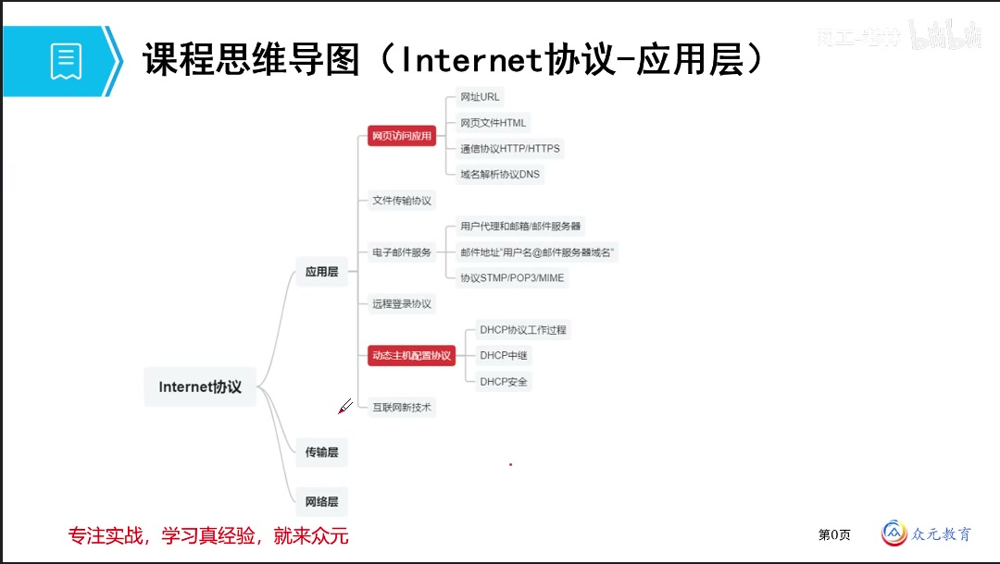

Internet 协议体系内容多、分值高，是必考项核心部分。学习时按**应用层、传输层、网络层**三个层次逐一展开，本节讨论最贴近用户的应用层。应用层的核心任务是掌握**有哪些常考的应用服务、其协议是什么、工作原理是什么、常考点在哪里**。

学习过程中需要**留出缺口**：应用层讲解必然会牵出对下层的依赖以及安全与防护手段，这些知识点在后续章节补充，届时需回看并做综合理解。

### 1.1 应用层知识脉络（思维导图）

| 应用服务 | 主要考点（子节点） | 备注 |
| -------- | ------------------ | ---- |
| 网页访问应用 | 网址 URL、网页文件 HTML、通信协议 HTTP/HTTPS、域名解析协议 DNS | 本节重点，图中以红框标出 |
| 文件传输协议 | —— | 图中未展开 |
| 电子邮件服务 | 用户代理和邮箱/邮件服务器；邮件地址「用户名@邮件服务器域名」；协议 SMTP/POP3/MIME | 图中未展开 |
| 远程登录协议 | —— | 图中未展开 |
| 动态主机配置协议 DHCP | DHCP 协议工作过程、DHCP 中继、DHCP 安全 | 图中以红框标出 |
| 互联网新技术 | —— | 图中未展开 |

### 1.2 万维网 WWW 与 B/S 模型

WWW（万维网）为用户提供了一个基于**浏览器/服务器模型**和多媒体技术的图形化信息查询界面，即浏览器访问，也称作 **B/S 架构**：B 即浏览器（Browser），S 即服务器（Server）。

万维网的组成要素（完成一次网页访问所需的基本条件）：

| 组成要素 | 作用 |
| -------- | ---- |
| Web 浏览器 | 客户端用户代理，负责发起请求并渲染页面 |
| Web 服务器 | 存放并提供网页文件，负责响应请求 |
| HTML | 超文本标记语言，描述网页内容 |
| URL | 统一资源定位器，指明要访问的资源位置 |
| HTTP/HTTPS | 超文本传输协议，规定双方的信息传输规则 |

### 1.3 网页访问的工作流程

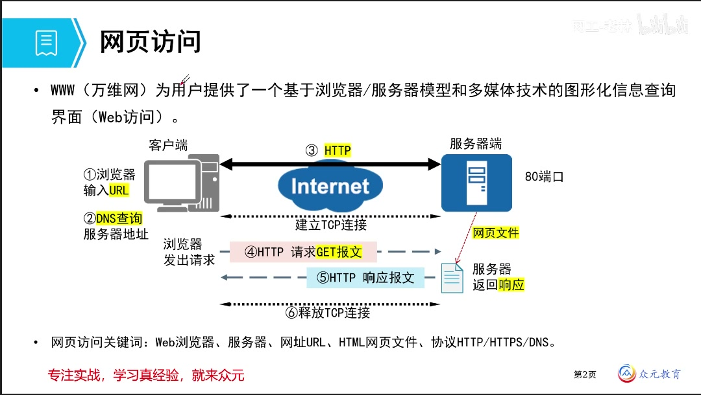

用户双击浏览器，在地址栏输入网址（URL），或通过默认主页上的网址信息访问。界面内容并非本地生成，而是由**服务器端找到对应的网页文件后加载返回**。

| 序号 | 步骤 | 说明 |
| ---- | ---- | ---- |
| ① | 浏览器输入 URL | 用户提供要访问的资源地址 |
| ② | DNS 查询服务器地址 | 把域名解析为服务器的 IP 地址 |
| ③ | 依据 IP 地址路由寻址 | 客户端与服务器通过 Internet 互通 |
| —— | 建立 TCP 连接 | HTTP 基于传输层 TCP 的可靠服务 |
| ④ | HTTP 请求 GET 报文 | 客户端向服务器发出请求 |
| ⑤ | HTTP 响应报文 | 服务器找到对应网页文件后返回 |
| ⑥ | 释放 TCP 连接 | 一次网页访问完成 |

图中同时标出：客户端「浏览器发出请求」，服务器端工作在 **80 端口**，服务器端「服务器返回响应」，服务器图标与下方「网页文件」文档图标之间有红色虚线箭头指向。

**网页访问关键词**：Web 浏览器、服务器、网址 URL、HTML 网页文件、协议 HTTP/HTTPS/DNS。

上述关键词即考试核心集中点：

1. 基于什么样的模型——**浏览器/服务器模型（B/S）**
2. 用哪一个协议完成工作——**HTTP 或 HTTPS**
3. 用到的是哪一类文件——**网页 HTML 文件**
4. 用哪一类命令获取——**HTTP 的 GET（读取）、POST（上传）等**
5. 网址是什么样的形态——它不是数据链路层的 MAC 地址，而是另有体系

---

## 2.网页文件与 HTTP/HTTPS 协议

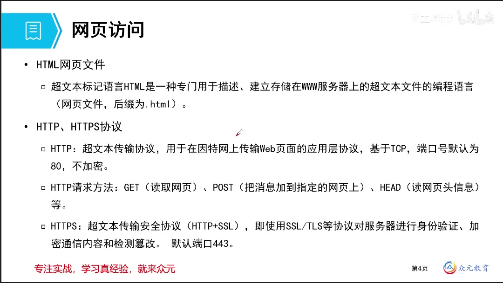

### 2.1 HTML 网页文件

**超文本标记语言 HTML**是一种专门用于描述、建立存储在 WWW 服务器上的超文本文件的编程语言，即网页文件，后缀一般为 `.html`。

- 类比：如同记事本编辑的 `.txt` 文件
- HTML 是常见且常考的一类，此外还有其他网页相关语言，可结合其历史发展认识
- 记忆要点：**文件后缀名**是第一个要点

### 2.2 HTTP 协议

**HTTP（超文本传输协议）**是用于在因特网上传输 Web 页面的**应用层协议**。

| 项目 | 内容 |
| ---- | ---- |
| 中文名 | 超文本传输协议 |
| 层次 | 应用层 |
| 承载协议 | 基于 TCP |
| 默认端口 | **80** |
| 传输方式 | **明文传输、不加密**，安全性不强 |

**HTTP/1.0 的效率问题**：每传输一个文件就断开 TCP 连接。形象地说，每讲一句话都要重新拨一次电话、讲完立刻挂断，下一次再重新拨打。因此 HTTP 协议必须不断改进，它也经历了若干版本的演进。

### 2.3 HTTP 请求方法

| 方法 | 作用 | 考试频度 |
| ---- | ---- | -------- |
| GET | 读取网页，获取资源 | 高频，常与 POST 作对比 |
| POST | 把消息加载到指定网页上，即向服务器提交数据 | 高频，常与 GET 作对比 |
| HEAD | 读取网页头部信息 | 了解即可 |

注意区分 **POST** 与其他形近词（如 SET），二者含义不同。

### 2.4 HTTPS 协议

在效率问题解决之后，还需解决安全问题：在 HTTP 之上增加一个**安全套接层**，即 **SSL 协议**，其升级版本称为 **TLS 协议**，两者的组合构成了 **HTTPS**，也是当前网页访问中最常见的形式。

- 主要功能：**身份认证**、**加密通信**，以及对篡改的检测
- **HTTPS = HTTP + SSL/TLS**
- 默认端口：**443**

HTTPS 与 HTTP 的对比是常考对比项：

| 对比项 | HTTP | HTTPS |
| ------ | ---- | ----- |
| 端口号 | 80 | 443 |
| 安全性 | 明文传输，不加密 | 使用 SSL/TLS 加密传输 |
| 适用场景 | 一般网页 | 电子支付等对安全要求高的网站 |

**关于端口号的细节**：端口号是可以修改的。若服务器修改了默认端口，则访问时必须显式指定端口号（形式为「主机名:端口号」），否则将使用默认端口号而找不到对应服务。

### 2.5 HTTP 版本演进

| 版本 | 关键特性 | 局限 |
| ---- | -------- | ---- |
| HTTP/1.0 | 基础请求-响应模型；**非持久连接**，每次请求新建 TCP 连接、响应后即关闭 | 连接建立与慢启动开销大，页面资源多时效率低 |
| HTTP/1.1 | 建立**持久连接**，在完成所有服务项之前 TCP 通道保持打开；新增管道化、分块传输，强制 Host 首部 | 管道化仍受**队头阻塞**限制 |
| HTTP/2.0 | 二进制分帧、**多路复用**、头部压缩、服务器推送 | 仍依赖 TCP，TCP 层队头阻塞依旧存在 |
| HTTP/3.0 | 基于 **QUIC（UDP）**，各流相互独立，无 TCP 层队头阻塞，建连更快 | 生态与中间件兼容性仍在完善 |

一句话概括演进方向：**1.0 发一个断一个，1.1 建立持久连接、效率提升，2.0 与 3.0 不断优化与进步**。考试考查最频繁的仍是 HTTP 本身，尤其是与 HTTPS 的对比。

---

## 3.网址 URL

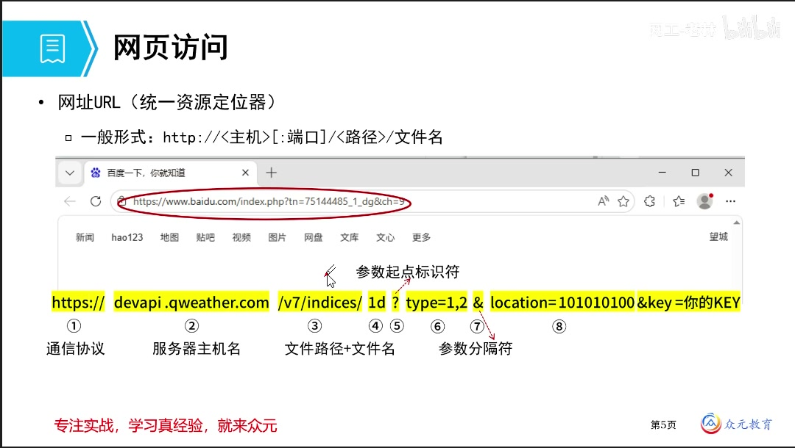

### 3.1 URL 的定义

**URL（Uniform Resource Locator）**，中文名**统一资源定位器**（也称统一资源定位符）。

### 3.2 URL 的组成

一般形式：

```
http://<主机>[:端口]/<路径>/文件名
```

| 组成部分 | 作用 | 说明 |
| -------- | ---- | ---- |
| 通信协议 | 指明使用哪种协议（如 http、https） | 位于开头，后接「冒号 + 双斜杠」 |
| 服务器主机名（域名） | 找到对应的服务器 | 相当于设备的身份标识 |
| 端口 | 找到服务器上对应的服务 | 省略时使用协议默认端口 |
| 文件路径 + 文件名 | 指明服务器上的文件位置 | 相当于在电脑上找文件的访问路径 |
| 参数 | 指定展示或提取的内容 | 以特定符号分隔，参数不同则组合出的信息不同 |

URL 的工作原理是：**先找到对应的服务器，再从服务器上选取文件拉取过来**，因此其结构对应「找到服务器 → 找到服务 → 找到文件 → 附加参数」。

**常见形式由三部分组成**：通信的协议、找到服务器（域名/端口）、服务器上的文件路径与文件名。此外还可以携带各式各样的指定参数，这与网页编辑有关——选择不同的按钮、不同的展示类型，页面提取与组合出的信息就会不同。

### 3.3 URL 实例解析

课件给出了一个和风天气（QWeather）的访问实例：

```
https://devapi.qweather.com/v7/indices/1d?type=1,2&location=101010100&key=你的KEY
```

| 序号 | 片段 | 含义 |
| ---- | ---- | ---- |
| ① | `https://` | 通信协议 |
| ② | `devapi.qweather.com` | 服务器主机名 |
| ③ | `/v7/indices/1d` | 文件路径 + 文件名 |
| ④ | `?` | **参数起点标识符** |
| ⑤ | `type=1,2` | 参数项（如指定展示类型：穿衣、风速等） |
| ⑥ | `,` | **参数分隔符** |
| ⑦ | `&` | **参数分隔符** |
| ⑧ | `location=101010100&key=你的KEY` | 其余参数，如城市地址、访问密钥 |

可以看出：带明显符号的分割用于标识「从何处开始是参数」。当出现这样一串较长的域名字段时，能够识别其结构即可；**考试常考的是前端部分**（协议、主机名、路径）。

---

## 4.DNS 域名解析

### 4.1 DNS 的作用

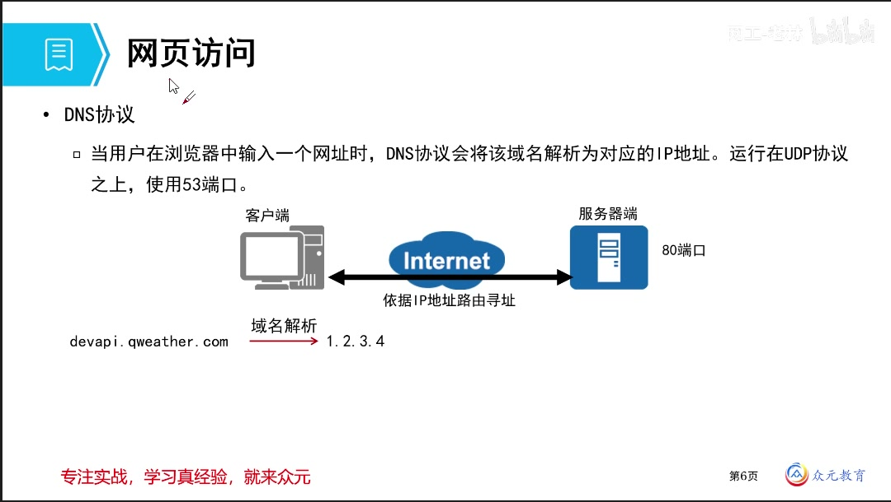

**域名解析协议 DNS**：当用户在浏览器中输入一个网址时，DNS 协议会将该域名解析为对应的 IP 地址。

| 项目 | 内容 |
| ---- | ---- |
| 作用 | 将域名解析为对应的 IP 地址 |
| 承载协议 | 运行在 **UDP** 之上 |
| 端口 | **53** |
| 可靠性要求 | 不需要很可靠的服务，故采用 UDP |

实例：域名 `devapi.qweather.com` 经域名解析后，对应到 IP 地址（课件示例为 `1.2.3.4`），再依据 IP 地址路由寻址访问到服务器（80 端口）。

**与 ARP 的衔接**：DNS 完成「域名 → IP」的解析；若要由 IP 找到对应的设备 MAC 地址，则由后续介绍的 **ARP 协议**完成。二者不要混淆。

### 4.2 网络设备的身份标识

要找一台主机或服务器，如同找人一样，可以依据多种信息。网络中设备（应用设备、终端设备）的身份标识如下：

| 标识 | 层次 | 特点 |
| ---- | ---- | ---- |
| MAC 地址 | 数据链路层（局域网） | 由厂家给出、固定不可改，不易记忆和识别 |
| IP 地址 | 网络层 | 逻辑地址，比 MAC 更灵活、更易编辑 |
| 域名 / 主机名 | 应用层 | 便于记忆与辨识的字符串 |
| 端口号 | 传输层 | 标识同一台主机上的不同服务 |

MAC 固定但难以记忆，因此出现了更灵活、更好辨识的 IP 地址与域名。**域名与 IP 之间需要一一对应的寻找（寻址）关系**，这正是 DNS 要解决的问题：把主页上便于记忆的字符串（如 `baidu.com`）解析为底层实际传输所用的 IP 地址。

### 4.3 域名空间结构

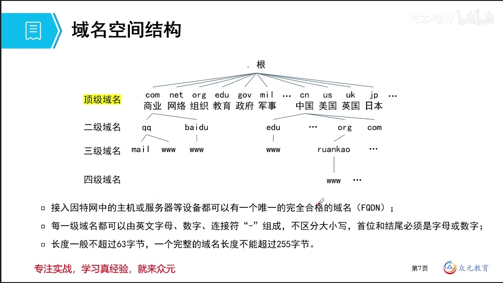

域名不能任意命名，因为网页极多、企业极多，**统一的管理和分配**必然出现。

域名结构呈**竖型（层次树形）**，逐级向下：

| 层级 | 说明 |
| ---- | ---- |
| 根域 | 最高级别，位于**最右手边**，实际是一个点「.」，现在默认省略显示 |
| 顶级域 | 细分出的第一层，分两类（见下表） |
| 二级域、三级域…… | 中间可以有很多级，可**自主定义**，一般描述其功能 |
| 主机名（最低级） | 位于**最左手边**，一般是主机名/服务器名称，也可用作服务类型 |

顶级域常用的两类：

| 类型 | 举例 | 含义 |
| ---- | ---- | ---- |
| 以机构性质命名 | com、net、org、edu、gov、mil | 依次为商业组织、网络、组织、教育、政府、军事 |
| 以国家/地区代码命名 | cn、us、uk、jp | 依次为中国、美国、英国、日本，多取自英文单词缩写 |

课件给出的层次树示例（自顶向下）：

- 根域 `.`
- 顶级域 `com` → 二级域 `qq`、`baidu`；顶级域 `cn` → 二级域 `edu`、`org`、`com`；顶级域 `org` → 二级域 `ruankao`
- 二级域 `qq` → 三级域 `mail`、`www`；二级域 `baidu` → 三级域 `www`
- 二级域 `edu.cn` → 三级域 `www`；二级域 `ruankao` → 三级域 `www` → 四级域……

主机名可以体现服务类型：服务器主要提供 WWW 网页服务则命名为 `www`，主要提供电子邮件服务则命名为 `mail`（如 `mail.qq.com`、`mail.163.com`）。

**命名规则与长度限制**：

| 规则 | 内容 |
| ---- | ---- |
| 字符组成 | 每一级域名可由英文字母、数字、连接符 `-` 组成 |
| 大小写 | **不区分大小写** |
| 首尾限制 | 首位和结尾必须是字母或数字，**连接符不能出现在首尾**，只能出现在中间 |
| 单级长度 | 长度一般不超过 **63 字节** |
| 完整域名长度 | 一个完整的域名（FQDN）长度不能超过 **255 字节** |
| 唯一性 | 接入因特网的主机或服务器等设备都可以有一个唯一的完全合格域名（FQDN） |

域名越短越好：过长会失去灵活记忆的效果，除非发生冲突、必须增加后缀。

本节关键词复述：**网页文件、常见协议、网址、B/S 结构**。

### 4.4 域名解析过程

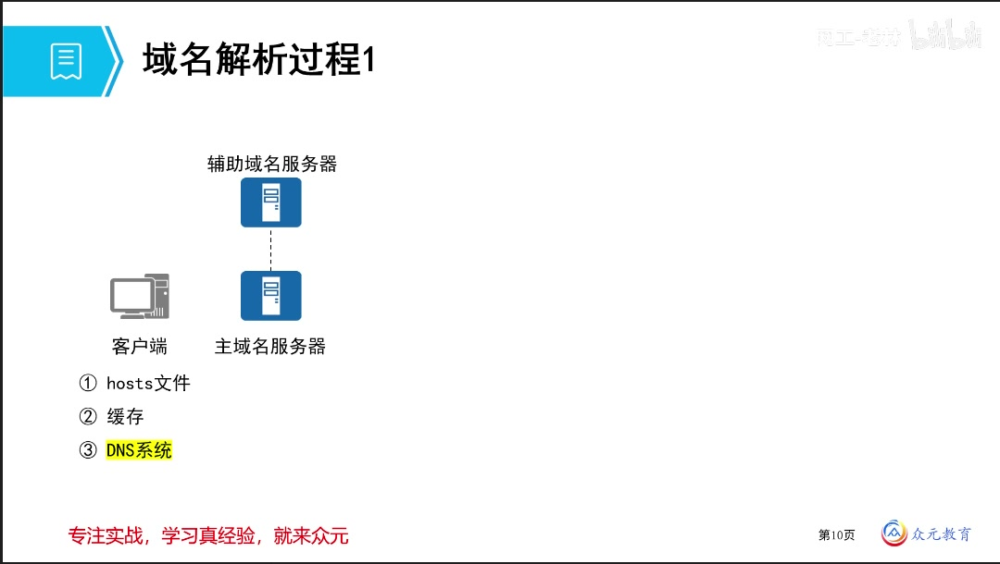

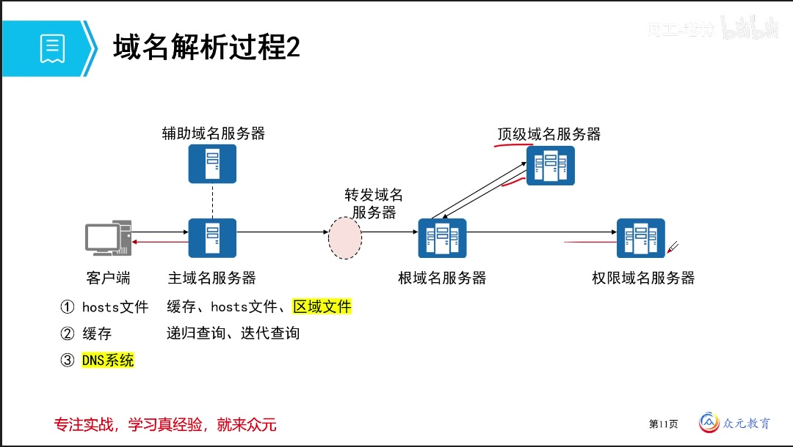

域名解析在近几年考试中考查频率比较低，了解即可。拿到一个网址后，解析过程分为两大板块：

| 顺序 | 环节 | 说明 |
| ---- | ---- | ---- |
| ① | **hosts 文件** | 本地文件，保存在客户端本机，可手动编辑和书写 |
| ② | **缓存** | 本地缓存记录，曾查询过的结果可留存 |
| ③ | **DNS 系统** | 本地查不到时，交由专门的 DNS 体系协助查询 |

- 客户端本身先查本地：**有 hosts 文件或缓存就可以直接在本地完成解析**。Windows、Linux 系统中都存在 hosts 文件，Linux 下一般位于 `/etc` 配置目录中。
- 本地无法完成时，才向 **DNS 系统**求助。DNS 系统同样是**树形结构**，与域名的根域—顶级域—二级/三级结构对应，包括根域名服务器、顶级域名服务器、区域域名服务器等，各自负责各自的板块。
- DNS 服务器查询时的数据来源包括：**缓存、hosts 文件、区域文件**。区域文件中包含各种各样的**资源记录**条目（这是需要掌握的点），例如域名与 IP 的对应关系、IPv6 的对应关系等，具体取决于服务搭建时的配置。

**主域名服务器与辅助域名服务器**：

| 角色 | 说明 |
| ---- | ---- |
| 主域名服务器（本地域名服务器） | 距本机最近、由运营商提供，设备上网信息中配置的默认 DNS，也叫主域名服务器，负责维护本区域的所有域名信息 |
| 辅助域名服务器 | 主域名服务器的备份，用于冗余、提高可靠性；主域名服务器正常工作时不起作用，主服务器故障时替代其提供服务 |

**递归查询与迭代查询**：

| 查询方式 | 特征 | 判断方法 |
| -------- | ---- | -------- |
| 递归查询 | 由被请求者**代替请求者**去完成后续查询，并最终把**解析结果**返回给请求者 | 是否直接给出了结果 |
| 迭代查询 | 被请求者不返回最终结果，只**告知请求者下一步应该去找谁** | 是否有「一来一回、再次询问」的往返拉扯过程 |

- 主域名服务器并不一定直接返回查询结果，它可能也需要进一步查询。
- 若配置了**转发域名服务器**，则后续请求交由转发域名服务器处理；若没有配置，则交由**根域名服务器**处理。
- 根域名服务器主要不是把解析结果拿回来，而是回答「这个域名由谁负责」，再由各级服务器层层向下查询，直至找到该域名所属的归属方。

课件以 `A.b.com` 为例演示两种查询：

1. 先找到根，根告知 `com` 在哪里；
2. 到 `com` 的顶级域名服务器询问其下是否有 `b` 的记录；
3. 区域域名服务器若有相应信息，再由其向下一级询问，逐级得到结果后统一回复——这种逐级传递、最终拿到结果的方式称为**递归查询**；
4. 如果某一级只是告诉你「你去找某个人」并把地址给你，由你自己再去联系下一级，形成一次次的往返，这种方式称为**迭代查询**。

**缓存与缓存域名服务器**：

- 本地查不到、必须去别处查询时，必然带来时延问题。
- 查询一次之后会产生**查询记录**（如同浏览器浏览记录），这就是**缓存**；缓存会定期清除。
- DNS 服务器的存储空间很小，若查询量很大、访问非常多，可以额外设置一台**缓存域名服务器**，专门存放查询过的大量结果，下一次查询时先问缓存域名服务器，命中则直接返回，未命中再继续下一个环节，从而提高查询效率。
- **缓存域名服务器上不存在区域文件**，因为它主要负责缓存。

### 4.5 域名解析方法

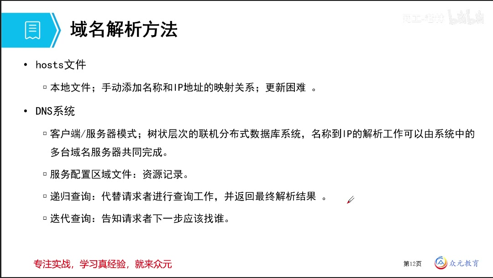

| 方法 | 说明 |
| ---- | ---- |
| hosts 文件 | 本地文件；**手动添加**名称和 IP 地址的映射关系；更新困难（各人各自的文件相互独立、没有关联，别人有而自己不一定有） |
| DNS 系统 | 客户端/服务器模式；**树状层次的联机分布式数据库系统**，名称到 IP 的解析工作可以由系统中的多台域名服务器共同完成；服务配置中涉及**区域文件、资源记录**；提供**递归查询**（代替请求者进行查询工作并返回最终解析结果）与**迭代查询**（告知请求者下一步应该找谁） |

两者最需要注意的区分点：**递归查询直接给出结果，迭代查询只告诉你下一步去找谁。**

### 4.6 DNS 服务器类型

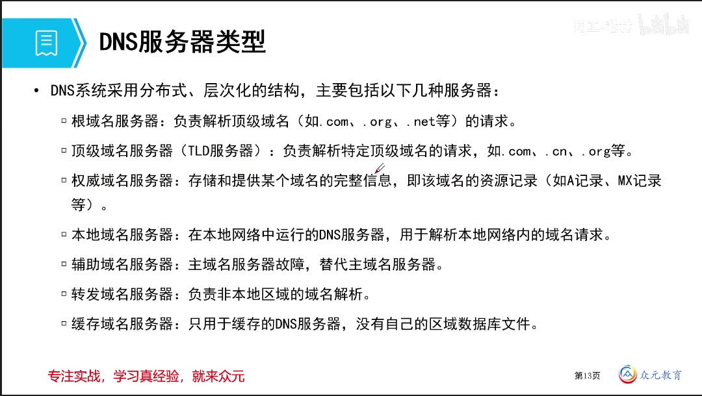

DNS 系统采用**分布式、层次化**的结构，主要包括以下几种服务器：

| 服务器类型 | 说明 |
| ---------- | ---- |
| 根域名服务器 | 负责解析顶级域名（如 `.com`、`.org`、`.net` 等）的请求 |
| 顶级域名服务器（TLD 服务器） | 负责解析特定顶级域名的请求，如 `.com`、`.cn`、`.org` 等 |
| 权威域名服务器 | 存储和提供某个域名的完整信息，即该域名的资源记录（如 A 记录、MX 记录等）；即经过**授权**、可信任的服务器，区域域名服务器属于其中，地位高于本地域名服务器 |
| 本地域名服务器 | 在本地网络中运行的 DNS 服务器，用于解析本地网络内的域名请求；是区域中的一种角色 |
| 辅助域名服务器 | 主域名服务器故障时，替代主域名服务器 |
| 转发域名服务器 | 负责**非本地**区域的域名解析 |
| 缓存域名服务器 | 只用于缓存的 DNS 服务器，**没有自己的区域数据库文件** |

记忆线索：自上而下依次为**根域名 → 顶级域名 → 权威域名**（含区域、本地角色）→ **本地、辅助、转发、缓存**。

### 4.7 DNS 资源记录类型

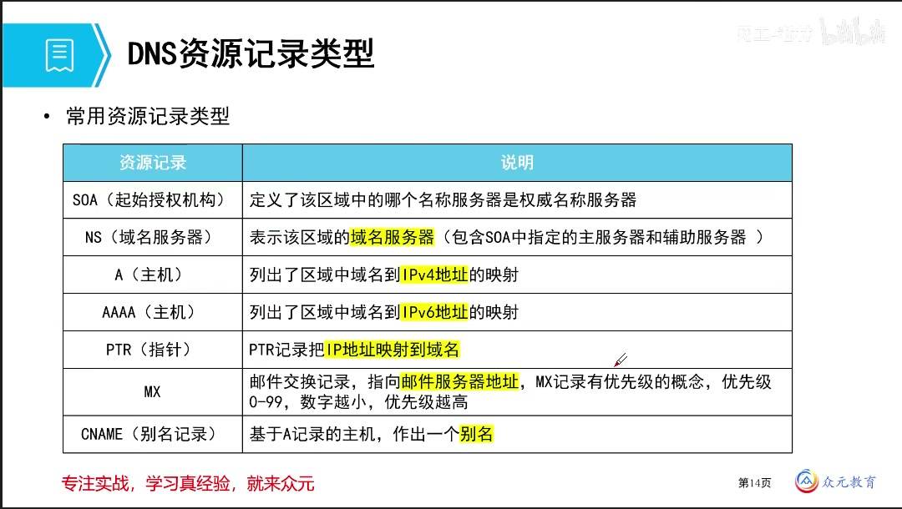

近些年此类题目考查力度不大（过去因服务配置类题目较多而常考，现在更多考网络配置、组网优化类案例题），但需稍作了解：题目可能给出一张配置截图，要求判断属于哪一种资源记录。

| 资源记录 | 说明 |
| -------- | ---- |
| SOA（起始授权机构） | 定义了该区域中的哪个名称服务器是权威名称服务器 |
| NS（域名服务器） | 表示该区域的**域名服务器**（包含 SOA 中指定的主服务器和辅助服务器） |
| A（主机） | 列出了区域中域名到 **IPv4** 地址的映射 |
| AAAA（主机） | 列出了区域中域名到 **IPv6** 地址的映射 |
| PTR（指针） | 把 **IP 地址映射到域名**，即反向解析 |
| MX | 邮件交换记录，指向**邮件服务器地址**；MX 记录有**优先级**的概念，数字越小优先级越高 |
| CNAME（别名记录） | 基于 A 记录的主机，作出一个**别名** |

**负载均衡的用法**：利用**别名**记录与**多主机 IP 地址映射**的关系即可实现负载均衡。

- 多个 IP 指向同一域名（一台主机对应多个 IP）
- 多个域名指向同一 IP（别名，例如多个域名指向同一个 IP）

这类「一对多、多对多」的指定关系可用于负载均衡的实现。此类内容主要在服务配置（如 Linux 下配置 DNS 服务、修改区域文件）中出现，本节只需认识类别即可。

---

## 5.视频未展开的常见考点（联网核实补充）

以下内容本节视频未展开，但属于「网页访问服务」的常见配套考点，按 RFC/IANA 等资料核实后列出，供综合复习时对照。

### 5.1 HTTP 请求报文与响应报文格式

| 报文 | 组成（顺序固定） |
| ---- | ---------------- |
| 请求报文 | 请求行（方法 + 请求目标 + HTTP 版本）、请求头、空行、请求体（可选） |
| 响应报文 | 状态行（HTTP 版本 + 状态码 + 状态短语）、响应头、空行、响应体（可选） |

- 请求行示例：`GET /index.html HTTP/1.1`
- 状态行示例：`HTTP/1.1 200 OK`
- 头部字段为 `key: value` 形式，不区分大小写，顺序任意，可用自定义字段扩展
- 请求头与响应头之后**必须有一个空行**（CRLF）分隔头部与主体；报文可以没有主体，但必须有头部和空行
- HTTP/1.1 中唯一要求必须提供的头字段是 **Host**

### 5.2 HTTP 请求方法的完整语义

| 方法 | 语义 | 是否安全 | 是否幂等 | 是否有请求体 |
| ---- | ---- | -------- | -------- | ------------ |
| GET | 获取目标资源的当前表示 | 是 | 是 | 通常无 |
| HEAD | 与 GET 相同，但只返回状态行与头部，不返回消息体 | 是 | 是 | 无 |
| POST | 由目标资源处理请求载荷（创建/修改数据、提交表单） | 否 | 否 | 有 |
| PUT | 用请求载荷替换目标资源的全部当前表示 | 否 | 是 | 有 |
| DELETE | 删除目标资源的全部当前表示 | 否 | 是 | 通常无 |
| OPTIONS | 描述目标资源的通信选项 | 是 | 是 | 无 |
| TRACE | 回显收到的请求报文 | 是 | 是 | 无 |
| CONNECT | 建立到目标资源的隧道 | 否 | 否 | 无 |

要点：

- 通用服务器**必须支持 GET 与 HEAD**，其余方法均为可选
- **幂等**指多次相同请求对服务器产生的效果与一次相同；PUT、DELETE 以及安全方法（GET、HEAD、OPTIONS、TRACE）是幂等的，POST 不幂等
- GET 请求参数位于 URL 中，长度受 URL 长度限制；POST 请求参数位于请求体中，通常不受此限制
- GET 请求可被收藏为书签、可被缓存、会保留在浏览器历史记录中；POST 请求否则（相对而言）

### 5.3 HTTP 状态码

| 分类 | 含义 |
| ---- | ---- |
| 1xx | 信息性状态码，请求已被接受，需要请求者继续操作 |
| 2xx | 成功，请求已被成功接收、理解并接受 |
| 3xx | 重定向，需要进一步操作才能完成请求 |
| 4xx | 客户端错误，请求包含语法错误或无法完成 |
| 5xx | 服务器错误，服务器处理请求时发生错误 |

常见状态码：

| 状态码 | 英文 | 含义 |
| ------ | ---- | ---- |
| 200 | OK | 请求成功，一般用于 GET 与 POST |
| 301 | Moved Permanently | 永久重定向，资源已被永久移到新 URI |
| 302 | Found | 临时重定向，资源只是临时被移动 |
| 304 | Not Modified | 资源未修改，命中协商缓存，不返回资源本体 |
| 400 | Bad Request | 客户端请求语法错误，服务器无法理解 |
| 403 | Forbidden | 服务器理解请求但拒绝执行 |
| 404 | Not Found | 服务器找不到请求的资源 |
| 500 | Internal Server Error | 服务器内部错误，无法完成请求 |
| 503 | Service Unavailable | 服务器因超载或维护暂时无法处理请求 |

补充说明：**502 错误网关**与 **504 网关超时**均与网关/代理有关——502 指作为网关或代理的服务器从上游收到无效响应，504 指网关或代理未及时从上游取得响应。

### 5.4 Cookie 与 Session

HTTP 是**无状态**协议，每次请求-响应相互独立，多次请求之间不能共享数据，因此引入会话技术加以弥补。

| 技术 | 存储位置 | 说明 |
| ---- | -------- | ---- |
| Cookie | **客户端**（浏览器） | 服务器通过响应头 `Set-Cookie` 把少量数据写入浏览器，浏览器后续请求通过 `Cookie` 请求头自动带回；可设置有效期 |
| Session | **服务器端** | 服务器为每个会话分配唯一的 Session ID，该 ID 通常借助 Cookie 传递给客户端，会话数据本身保存在服务器 |

- 优点与代价：无状态使 HTTP 速度快、实现简单；缺点是多次请求间无法共享数据，故需 Cookie/Session 等会话技术
- Cookie 存放在客户端，可被用户查看与篡改，安全性较低；Session 数据存放在服务器，相对安全

### 5.5 代理服务器与网关

| 概念 | 含义 | 区别 |
| ---- | ---- | ---- |
| 代理服务器（Proxy） | 位于客户端与服务器之间，代替客户端或服务器转发请求与响应；可提供缓存、访问控制、隐藏真实地址、内容过滤等功能 | 侧重**中转、缓存与控制** |
| 网关（Gateway） | 连接两个使用不同协议的网络或应用，完成**协议转换**，使异构系统能够互通 | 侧重**协议转换** |

- 正向代理面向客户端，反向代理面向服务器
- 两者都可以作为中间节点转发报文，关键区别在于网关承担协议转换职责，代理主要承担中转与缓存职责
- 使用代理时，请求行中的请求目标可采用完整 URL 的绝对形式；此时请求行中的 URL 与 Host 头字段的取值可能不一致

### 5.6 Web 缓存

| 层次 | 说明 |
| ---- | ---- |
| 浏览器本地缓存 | 缓存已访问过的资源，再次访问时优先使用本地副本 |
| 代理服务器缓存 | 由代理服务器保存响应，多个客户端可共享，减少回源 |
| CDN 缓存 | 内容分发网络边缘节点缓存，缩短用户访问距离 |

- 缓存命中则直接返回副本，未命中则回源获取
- 与缓存相关的首部字段：`Cache-Control`、`Expires`、`Last-Modified`（配合 If-Modified-Since）、`ETag`（配合 If-None-Match）
- 协商缓存命中时，服务器返回 **304 Not Modified**，不返回资源本体，客户端继续使用本地缓存

### 5.7 HTML 与超链接

- HTML 通过**标记（标签）**描述网页的结构与内容，例如 `<a href="目标地址">链接文字</a>` 即为一个超链接
- **超链接**是「超文本」的核心：用户点击链接文字即可跳转到另一个资源，正是超文本可从一个文档跳转到另一个文档的含义
- 网页中除文字外还可嵌入图片、音视频等多媒体内容，因此 WWW 提供的是多媒体技术的图形化信息查询界面

---

## 6.课堂习题巩固

### 例题1：URL 中主机名的判断

在浏览器的地址栏中输入 `123.abc.com.cn`，该 URL 中（ **A** ）是要访问的主机名。

- A、123
- B、abc
- C、com
- D、cn

解答：本题考查域名结构。域名自左向右层级依次升高，**最左侧为最低级的主机名或服务名**，最右侧为顶级域名。故 `123` 为主机名，`abc` 为三级域名，`com` 为二级域名，`cn` 为国家/地区代码顶级域名。

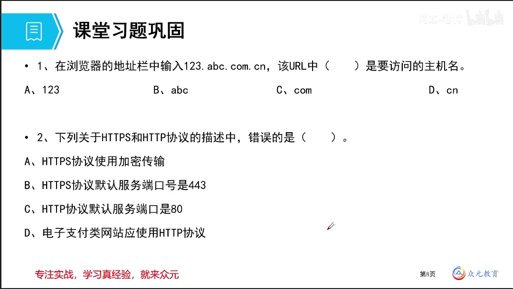

### 例题2：HTTPS 与 HTTP 的对比

下列关于 HTTPS 和 HTTP 协议的描述中，错误的是（ **D** ）。

- A、HTTPS 协议使用加密传输
- B、HTTPS 协议默认服务端口号是 443
- C、HTTP 协议默认服务端口是 80
- D、电子支付类网站应使用 HTTP 协议

解答：本题从两个差异点切入——**端口号差异**与**安全性质差异**。HTTPS 使用加密传输，默认端口 443；HTTP 默认端口 80，均为正确描述。电子支付类网站对安全要求很高，应当使用 HTTPS 而非 HTTP，因此 D 错误。

延伸：端口号可以修改。若修改了默认端口，访问时必须显式指明端口号（如「主机名:端口号」），否则会按默认端口号访问而无法找到对应服务。

### 例题3：GET 与 POST 的描述辨析

以下关于 HTML 方法的描述中，错误的是（ **B** ）。

- A、GET 方法用于向服务器请求页面，该请求可被收藏为标签
- B、GET 请求没有长度限制
- C、POST 方法用于将数据发送到服务器以创建或者修改数据
- D、POST 请求不会被保留在浏览器的历史记录中

解答：GET 用于获取页面，POST 用于向服务器提交数据以创建或修改资源，二者分别对应「获取」与「上传」。**GET 请求是有长度限制的**——请求参数放在 URL 中，而 URL 长度以及网络路径上可承载的报文大小都是有限的，不可能把所有内容都丢到网络路径上，因此 B 错误。

课件在该页对 D 选项中的「不会」二字有手写批注标记：[手写批注] 对「不会」二字有对勾与叉的标记。

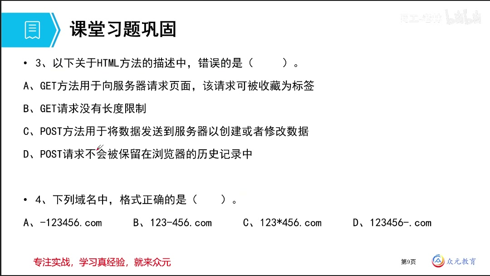

### 例题4：域名格式的正确性

下列域名中，格式正确的是（ **B** ）。

- A、-123456.com
- B、123-456.com
- C、123*456.com
- D、123456-.com

解答：域名可由英文字母、数字、连接符 `-` 组成，**连接符只能出现在中间，不能出现在首尾**，且不区分大小写。

- A 错：以连接符开头
- C 错：含有非法字符 `*`
- D 错：以连接符结尾
- B 正确：连接符位于中间

### 例题5：Windows 系统中协助域名解析的文件

在 Windows 操作系统中，（ **C** ）文件可以帮助域名解析。

- A、cookie
- B、Index
- C、Hosts
- D、default

解答：本地域名解析的第一站就是 **hosts 文件**，其中手动记录了名称与 IP 地址的映射关系，可帮助完成域名解析。

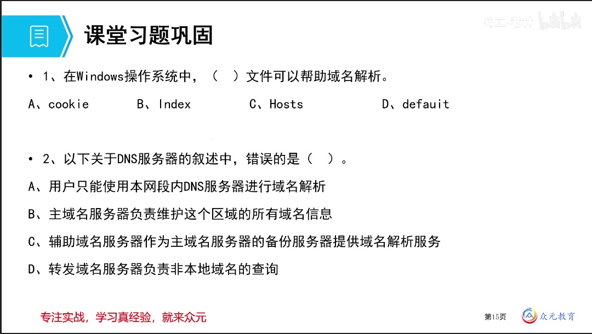

### 例题6：DNS 服务器叙述的辨析

以下关于 DNS 服务器的叙述中，错误的是（ **A** ）。

- A、用户只能使用本网段内 DNS 服务器进行域名解析
- B、主域名服务器负责维护这个区域的所有域名信息
- C、辅助域名服务器作为主域名服务器的备份服务器提供域名解析服务
- D、转发域名服务器负责非本地域名的查询

解答：本机上网配置中会指定一个默认 DNS（本地域名服务器），解析时**优先**找它，但并非「只能」使用本网段内的 DNS 服务器。若本地 DNS 告知应去找谁，本机也可以继续访问其他服务器，这正是迭代查询的过程。因此 A 错误，B、C、D 均为正确描述。

### 例题7：主域名服务器查找不到 IP 地址时的处理

在进行域名解析过程中，当主域名服务器查找不到 IP 地址时，由（ **D** ）负责域名解析。

- A、本地缓存
- B、辅助域名服务器
- C、根域名服务器
- D、转发域名服务器

解答：主域名服务器查不到时，下一步先交由**转发域名服务器**处理；若没有配置转发域名服务器，则交由**根域名服务器**继续查询。

课件说明：本题 C、D 两个选项存在一定争议，两者在原理上都可能承担后续解析工作，但在同时给出两个选项的题目中应选择 **D（转发域名服务器）**；只有在没有转发域名服务器的情况下，才交由根域名服务器处理。

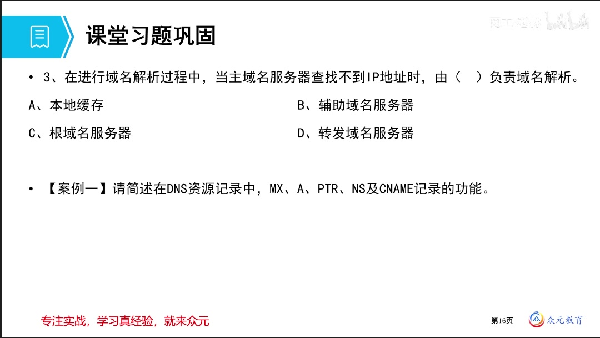

### 案例一：简述 DNS 资源记录的功能

**【案例一】**请简述在 DNS 资源记录中，MX、A、PTR、NS 及 CNAME 记录的功能。

解答：

| 记录 | 功能 |
| ---- | ---- |
| MX | 邮件交换记录，指向邮件服务器地址，与邮箱、邮件有关；带有优先级，数字越小优先级越高 |
| A | 主机记录，列出域名到 **IPv4** 地址的映射 |
| PTR | 指针记录，把 **IP 地址反向映射到域名**，用于反向解析 |
| NS | 域名服务器记录，表示该区域的域名服务器（包含 SOA 中指定的主服务器与辅助服务器）的名称 |
| CNAME | 别名记录，为已有主机取另一个名称；可用于负载均衡，如多个域名指向同一 IP、或一个名称对应多个 IP |

答题要点：组织语言时要突出关键词——MX 对应「邮件」、PTR 对应「反向/指针」、NS 对应「区域/域名服务器名称」、CNAME 对应「别名/负载均衡」。

**本节考试力度**：网页访问应用的考查力度较大，因为会涉及服务配置，信息量也较多，需要逐项梳理。

---

## 7.本章小结


| 知识点 | 核心内容 |
| ------ | -------- |
| 1. WWW 与 B/S 模型 | WWW 提供基于浏览器/服务器模型和多媒体技术的图形化信息查询界面，即 B/S 架构；组成要素为浏览器、服务器、HTML、URL、HTTP |
| 2. 网页访问工作流程 | 输入 URL → DNS 查询服务器地址 → 依据 IP 路由寻址 → 建立 TCP 连接 → HTTP 请求（GET）→ HTTP 响应 → 释放 TCP 连接 |
| 3. HTML | 超文本标记语言，描述并建立存储在 WWW 服务器上的超文本文件，后缀 `.html` |
| 4. HTTP | 超文本传输协议，应用层，基于 TCP，默认端口 80，明文不加密；HTTP/1.0 每次请求断开连接，HTTP/1.1 建立持久连接 |
| 5. HTTP 请求方法 | GET（读取网页）、POST（把消息加到指定网页上）、HEAD（读网页头信息）等；GET 与 POST 是考查重点 |
| 6. HTTPS | HTTP + SSL/TLS，进行身份认证、加密通信、检测篡改，默认端口 443 |
| 7. URL | 统一资源定位器，一般形式 `http://<主机>[:端口]/<路径>/文件名`；组成含协议、主机名、端口、路径与文件名、参数 |
| 8. DNS 作用与参数 | 把域名解析为 IP 地址；运行在 UDP 之上，使用 53 端口；IP 找 MAC 由 ARP 完成 |
| 9. 域名空间结构 | 层次树形，自右向左为根域、顶级域、二级/三级域名，最左为主机名；不区分大小写，连接符不得位于首尾，单级不超过 63 字节，完整域名不超过 255 字节 |
| 10. 域名解析过程 | 先查本地 hosts 文件与缓存，再由 DNS 系统解析；DNS 系统中可能使用递归查询或迭代查询 |
| 11. 递归与迭代查询 | 递归查询代替请求者查询并返回最终结果；迭代查询只告知请求者下一步去找谁 |
| 12. DNS 服务器类型 | 根域名服务器、顶级域名服务器、权威域名服务器、本地域名服务器、辅助域名服务器、转发域名服务器、缓存域名服务器 |
| 13. DNS 资源记录 | SOA、NS、A、AAAA、PTR、MX、CNAME；CNAME 与多 IP 映射可实现负载均衡 |

考试重点：

1. 网页访问的模型与角色：**B/S 架构**，两个角色为浏览器与服务器，关键词为 URL、HTML、HTTP/HTTPS、DNS
2. 协议与端口的对应：**HTTP 默认 80、HTTPS 默认 443、DNS 使用 53（UDP）**；修改端口后必须显式指定端口号访问
3. HTTP 与 HTTPS 的对比：**HTTP + SSL/TLS = HTTPS**，加密传输且做身份认证；电子支付类网站应使用 HTTPS
4. HTTP 请求方法：**GET 读取、POST 上传**，注意 GET 存在长度限制；GET 与 POST 在是否可收藏、是否保留于历史记录等方面的差异
5. URL 组成：协议 + 主机名 [ + 端口 ] + 路径/文件名 + 参数；参数以特定符号分隔，参数起点标识符为 `?`，分隔符为 `,`、`&` 等
6. 域名结构判断：**最左侧是主机名/服务名，最右侧是顶级域名**，如 `123.abc.com.cn` 中 `123` 为主机名
7. 域名命名规范：不区分大小写、连接符只能在中间、单级不超过 63 字节、完整域名不超过 255 字节
8. DNS 查询方式辨析：**递归查询给结果，迭代查询给下一个对象**；主域名服务器查不到时先找转发域名服务器，无转发则找根域名服务器
9. DNS 服务器类型职责：辅助域名服务器作备份、转发域名服务器负责非本地区域、缓存域名服务器无区域数据库文件
10. DNS 资源记录辨析：能根据配置截图判断记录类型，重点为 **MX（邮件，数字越小优先级越高）、A/AAAA（IPv4/IPv6 映射）、PTR（反向解析）、NS（域名服务器）、CNAME（别名，可做负载均衡）**
11. Windows 系统协助域名解析的文件为 **hosts**
