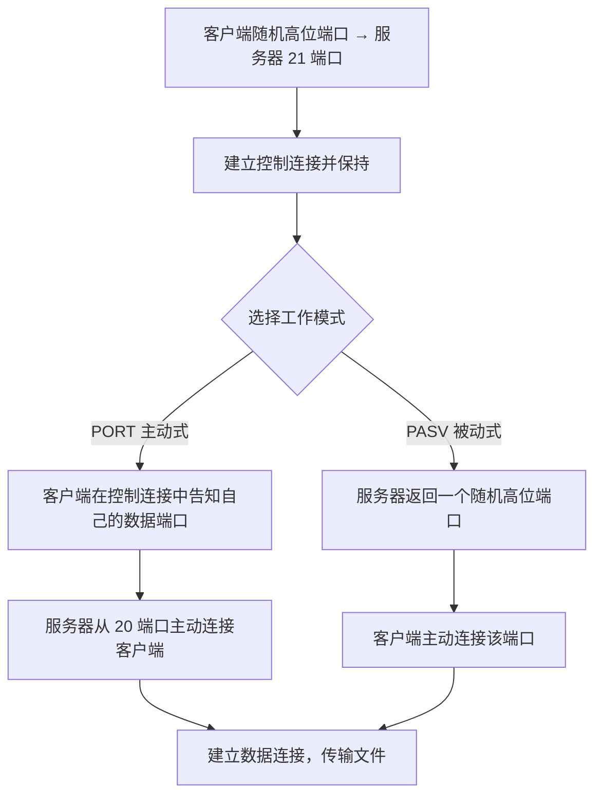
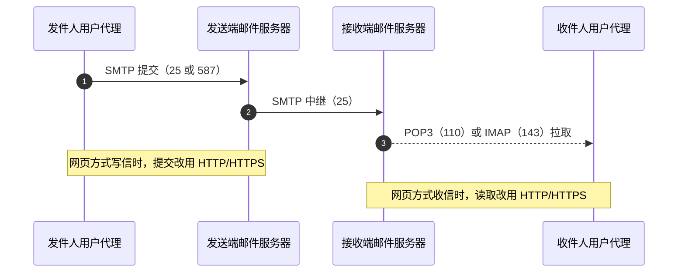

# 文件传输、电子邮件与远程登录服务 · 完整笔记

---

## 1.文件传输协议 FTP

### 1.1 FTP 的功能与定位

- 功能：用于在**远程服务器和本地主机之间传输文件**。
- 与 HTTP 最主要的一个区别是所面向的文件不同：
  - HTTP 面向**网页文件**；
  - FTP 面向**普通文件**，即文本文件、视频文件、音频文件这一类。
- FTP 采用**明文传输**，用户名、口令与文件内容都可被嗅探，现网多以 SFTP、FTPS 替代。

### 1.2 客户端访问方式与匿名访问

| 项目 | 内容 |
| ---- | ---- |
| 访问方式 | 浏览器或 Windows 地址栏输入 `ftp://IP地址`，也可以使用域名 |
| 域名解析 | 使用域名访问时，**必然会用到 DNS 服务** |
| 匿名访问 | 支持匿名访问，无需专属账号，默认用户名为 `anonymous`，口令一般填写任意邮箱地址 |
| 默认端口 | 控制连接 **21** |

与 HTTP 的访问方式（`http://` 双斜杠加服务器域名）对照记忆：FTP 只是更换了通信协议，访问形式大体相同。

### 1.3 C/S 架构与两条 TCP 连接

FTP 采用 **C/S（客户机/服务器）架构**，注意是 C/S 而不是 B/S。客户端与服务器端的内部结构对称，均包含三个部分：

| 层次 | 客户端 | 服务器端 |
| ---- | ------ | -------- |
| 上层 | 用户界面 | 用户界面 |
| 中层 | 控制进程 | 控制进程 |
| 下层 | 数据传送进程 | 数据传送进程 |

FTP 与 HTTP 的第二个区别是**TCP 连接的数量**：

| 协议 | TCP 连接数 | 连接类型 |
| ---- | ---------- | -------- |
| HTTP | 1 条 | 单条连接 |
| FTP | 2 条 | 控制连接 + 数据连接 |

| 连接类型 | 端口 | 作用 |
| -------- | ---- | ---- |
| 控制连接 | **21** | 传输 FTP 命令与应答，在整个会话期间一直保持 |
| 数据连接 | **20**（主动式） | 完成文件的上传与下载 |

工作顺序：**先建立控制连接，控制连接建立完成之后，再建立数据连接**，随后完成文件的上传与下载。

常用命令：

| 命令 | 作用 | 说明 |
| ---- | ---- | ---- |
| `get` | 下载文件 | 从服务器取回文件到本地，协议命令为 `RETR` |
| `put` | 上传文件 | 将本地文件传送到服务器，协议命令为 `STOR` |

在 Windows 与 Linux 系统中，所用的命令会有一定差别，但上传与下载文件的功能大体一致。

与 HTTP 命令对照：HTTP 中获取资源用 `GET`，提交数据用 `POST`。

### 1.4 两种工作模式：主动式（PORT）与被动式（PASV）

FTP 协议有两种工作方式，即 **PORT 方式（主动式）** 与 **PASV 方式（被动式）**。



**主动式（PORT）**

1. 客户端使用**随机高位端口**，主动向服务器端的 **21 端口**发起服务请求，建立控制连接；
2. 客户端在控制连接中**携带自己的端口信息**，即告知服务器“请连接我的某个端口”；
3. 服务器返回应答消息；
4. 服务器端**主动从 20 端口**连接客户端所告知的高位端口，建立数据连接，进行数据传输。

**被动式（PASV）**

1. 客户端仍先向服务器端的 **21 端口**发起请求，建立控制连接；
2. 服务器在返回的消息中**告知客户端一个随机高位端口**；
3. 由**客户端主动**发起数据连接，连接服务器所告知的那个随机高位端口；
4. 数据连接端口由服务器随机分配，会发生变化。

两种工作模式的对比：

| 比较项 | 主动式 PORT | 被动式 PASV |
| ------ | ----------- | ----------- |
| 控制连接端口 | 21 | 21 |
| 数据连接发起方 | 服务器端 | 客户端 |
| 数据连接端口 | 服务器固定 20 端口 | 服务器随机高位端口 |
| 数据连接端口是否固定 | 固定 | 随机变化 |
| 适用场景 | 客户端无防火墙限制 | 客户端位于 NAT 或防火墙之后 |

补充：两种模式的数据连接均由**客户端随机高位端口**作为另一端。主动式之所以在实践中逐渐少用，是因为服务器回连客户端高位端口时容易被客户端防火墙或 NAT 拦截；被动式由客户端向外发起连接，穿透性更好，但服务器需要开放一段高位端口范围。

### 1.5 端口选择原则与传输模式

- **21 端口始终存在**，它是控制连接端口，任何情况下都使用 21。
- 数据连接端口会发生变化（存在两种工作方式），因此在题目同时给出 21 与 20 时，**默认选择 21**。
- 之所以往往需要由客户端发起数据连接，是出于安全性考虑：客户端可能部署有防火墙，为防范未知连接（类似“不接未知来电”），通常要求由客户端主动发起数据连接请求。

**传输模式**（常与 FTP 一起考查）：

| 模式 | 命令 | 适用文件 | 说明 |
| ---- | ---- | -------- | ---- |
| ASCII 模式 | `TYPE A` | 文本文件 | 传输时按两端系统习惯转换换行符 |
| 二进制模式 | `TYPE I` | 程序、压缩包、图片、音视频 | 逐字节原样传输，不做任何转换 |

要点：二进制文件若误用 ASCII 模式传输，会因换行符转换而损坏；实际客户端通常按扩展名自动选择模式。

### 1.6 FTP 的安全替代

| 方案 | 端口 | 说明 |
| ---- | ---- | ---- |
| FTP | 21（控制）、20（主动数据） | 明文传输，不安全 |
| FTPS | 21（显式 `AUTH TLS`）、990（隐式） | FTP 加 SSL/TLS，对控制与数据连接加密 |
| SFTP | **22** | 基于 SSH 的文件传输子系统，并非 FTP 的加密版本，而是另一种协议 |

---

## 2.简单文件传输协议 TFTP

TFTP 是 FTP 早期的简化版本，其特点如下：

| 比较项 | FTP | TFTP |
| ------ | --- | ---- |
| 全称 | 文件传输协议 | 简单文件传输协议 |
| 传输层协议 | **TCP** | **UDP** |
| 端口 | 20（数据）/ 21（控制） | **69** |
| 特点 | 功能较完整 | 传输的文件类型与方法都更简单 |

要点：**FTP 基于 TCP，TFTP 基于 UDP**，这是二者最核心的区别。

补充要点：

- TFTP 服务器在 **69 端口**接收读请求（RRQ）与写请求（WRQ），后续数据传输改用新分配的临时端口（TID）。
- 数据按**默认 512 字节**分块，采用停止等待方式，每收到一个 DATA 块回应一个 ACK，效率低但实现简单。
- 只有五种报文：RRQ、WRQ、DATA、ACK、ERROR；不支持认证、目录列表与断点续传。
- 典型用途：设备引导加载镜像、网络设备备份与升级配置文件。

---

## 3.电子邮件服务

### 3.1 关键词与系统组成

关键字：**用户代理**和**邮箱/邮件服务器**、邮件地址 `用户名@邮件服务器域名`、协议 **SMTP/POP3/MIME** 等。

电子邮件系统是非常经典的 **C/S 架构**，其整体过程类似“发快递”：

| 组成部分 | 说明 |
| -------- | ---- |
| 发送方 | 使用**用户代理**（客户端程序）撰写并提交邮件 |
| 发送端邮件服务器 | 邮件被提交到“快递站”，服务器中为每个用户划分出存储空间，即**邮箱**；邮箱内有多个格子 |
| Internet | 邮件在收发两端邮件服务器之间经互联网传输 |
| 接收端邮件服务器 | 目的地的邮件服务器，同样为收件人设有邮箱 |
| 接收方 | 从接收端邮件服务器下载、拉取邮件 |

### 3.2 邮件地址格式

```
邮件地址 = 用户名@邮件服务器域名
```

| 组成 | 作用 |
| ---- | ---- |
| 用户名 | 在同一台服务器上区分不同的用户（如 QQ 邮箱使用 QQ 号，其他场景可能使用电话号码等） |
| 邮件服务器域名 | 指明该用户位于哪一台服务器之上 |

### 3.3 发送邮件协议 SMTP

| 项目 | 内容 |
| ---- | ---- |
| 全称 | Simple Mail Transfer Protocol，简单邮件传输协议 |
| 用途 | **发送**邮件，以及邮件服务器之间的**中继转发** |
| 传输层协议 | TCP |
| 默认端口 | **25**（服务器间中继）；客户端提交常用 **587**（STARTTLS）；**465** 为隐式 TLS（SMTPS，仍广泛使用） |

SMTP 邮件原本采用 **ASCII 编码的文本（Text）文件**，非 ASCII 内容与附件由 MIME 扩展承载。

补充：SMTP 的基本会话过程为 `EHLO`（或 `HELO`）→ `MAIL FROM` → `RCPT TO` → `DATA` → `.` → `QUIT`；服务器用三位数字应答码回应，如 250 成功、354 可以开始发送数据、221 服务关闭。

### 3.4 接收邮件协议 POP3 与 IMAP

| 协议 | 全称 | 用途 | 传输层 | 端口 | 特点 |
| ---- | ---- | ---- | ------ | ---- | ---- |
| SMTP | Simple Mail Transfer Protocol，简单邮件传输协议 | 发送邮件 | TCP | 25 | 将邮件传送到目的地 |
| POP3 | Post Office Protocol Version 3，第三版邮局协议 | 接收邮件 | TCP | 110（加密 995） | 将邮件拉取、下载到本地 |
| IMAP | **Internet Message Access Protocol**，互联网消息访问协议 | 接收邮件 | TCP | 143（加密 993） | **支持邮件同步**，可只取首部 |

IMAP 的核心特点：

- 名称中的“**交互式**”意味着本地操作与服务器操作相互联动：在本地所做的动作可以**同步**回服务器，有来有回；
- 邮件与文件夹保存在**服务器**上，客户端只维护副本，可在多台设备间保持一致；
- 相比 POP3 的“拉取到本地”，IMAP 更适合**移动端**，以及需要**同步信息、动态变动**的场景；
- 版本方面了解 **IMAP4**（现行规范为 IMAP4rev1）即可。

补充：POP3 会话分授权、事务、更新三个阶段，常用命令为 `USER`、`PASS`、`LIST`、`RETR`、`DELE`、`QUIT`；默认在 `QUIT` 后删除已标记邮件，客户端可设置为下载后保留副本，并用 `UIDL` 判断某封邮件是否已经下载过。IMAP 则分未认证、已认证、已选择、注销四个状态。

### 3.5 用户代理与网页访问方式

用户代理不一定是专门的 APP 或客户端，也可以通过**浏览器**以网页方式访问邮箱。一旦采用网页方式访问服务器，所用的协议即为 **HTTP**。因此，凡涉及网页，就要把 HTTP 一并考虑进来（邮件体系图中，接收端邮件服务器与接收方之间同时列出 POP3、HTTP、IMAP 三种可能方式）。

### 3.6 MIME：邮件格式扩展

| 项目 | 内容 |
| ---- | ---- |
| 全称 | Multipurpose Internet Mail Extensions，多用途互联网邮件扩展 |
| 关注点 | **邮件内容/文件的格式** |
| 早期情况 | 邮件只能传输 **ASCII 编码的文本（西文字符串）** |
| 扩展之后 | 可以传输音频文件、视频文件以及各类附件等多媒体内容 |

要点：**MIME 与文件格式相关**，其作用是使邮件在内容格式上支持多媒体。

MIME 主要通过以下首部实现扩展：

| 首部 | 作用 |
| ---- | ---- |
| `MIME-Version` | 标明使用的 MIME 版本，通常为 1.0 |
| `Content-Type` | 指明媒体类型与子类型，如 `text/html`、`image/png`、`multipart/mixed` |
| `Content-Transfer-Encoding` | 指明传输编码，如 `base64`、`quoted-printable` |
| `Content-Disposition` | 指明是内联显示还是作为附件，并可给出文件名 |

### 3.7 邮件安全：PGP 与 S/MIME

在完成邮件传输的过程中还需要保护措施，即对邮件进行安全保护。

| 方案 | 说明 |
| ---- | ---- |
| PGP | 基于公钥密码的邮件加密与签名方案；正文用一次性**对称会话密钥**加密，会话密钥再用收件人**公钥**加密，签名则用发件人**私钥**生成 |
| S/MIME | **Secure/Multipurpose Internet Mail Extensions**，在 MIME 基础上借助 **PKI 证书**（CMS/PKCS#7）实现数字签名与加密，可提供认证、完整性、不可否认与保密性 |

要点与纠偏：

- PGP 的密钥关系是“**对称会话密钥 + 收件人公钥 + 发件人私钥**”，并非三把非对称密钥。
- **S/MIME 不是“MIME 加 SSL”**：它不依赖 SSL/TLS 建立安全通道，而是对邮件内容本身做数字签名与加密，证书由 CA 体系签发。
- 两者都只保护邮件内容，不保护 SMTP 传输链路；链路加密需另用 SMTPS/STARTTLS。

### 3.8 邮件收发流程小结



| 阶段 | 所用协议 |
| ---- | -------- |
| 发送方用户代理提交邮件到发送端邮件服务器 | **SMTP**（网页方式则用 HTTP） |
| 发送端邮件服务器经 Internet 传输到接收端邮件服务器 | **SMTP** |
| 接收方从接收端邮件服务器获取邮件 | **POP3**、**IMAP**（网页方式则用 HTTP） |

即：**发邮件用 SMTP，收邮件用 POP3 或 IMAP**，两者配合完成整个邮件服务过程。二者的工作位置与类型存在差异，须注意区分。

### 3.9 邮件报文格式与投递失败

一封邮件由**信封**、**首部**与**正文**三部分组成：信封是 SMTP 会话中 `MAIL FROM`、`RCPT TO` 携带的信息，首部是用户可见的 `From`、`To`、`Subject` 等字段，正文是邮件内容。

| 首部 | 含义 |
| ---- | ---- |
| `From` | 发件人地址 |
| `To` / `Cc` / `Bcc` | 收件人、抄送、密送 |
| `Subject` | 主题 |
| `Date` | 发信时间 |
| `Message-ID` | 邮件唯一标识 |
| `Received` | 经手过的邮件服务器逐跳添加的传递记录 |

投递失败时，邮件系统会向发件人**退回邮件（退信）并给出无法送达的原因**，常见原因包括收件人不存在、邮箱已满、被黑名单或内容过滤拦截、对方服务器拒收等。SMTP 用 4xx 表示临时失败（可重试），5xx 表示永久失败（直接退信）。

---

## 4.远程登录服务

远程登录服务主要用于**网络配置**，是网络管理员使用较多的一类服务。通过 Telnet 可以远程登录并管理设备，完成信息的控制、传输和编辑。

### 4.1 Telnet

| 项目 | 内容 |
| ---- | ---- |
| 用途 | 远程登录管理设备 |
| 传输层协议 | TCP |
| 默认端口 | **23** |
| 安全性 | **明文传输，不安全** |

补充：Telnet 使用网络虚拟终端（NVT）统一不同终端的字符编码，只负责传送字节流，不提供加密与完整性保护，口令可被直接抓包获取。

### 4.2 SSH

| 项目 | 内容 |
| ---- | ---- |
| 全称 | Secure Shell，安全外壳协议 |
| 用途 | 远程登录管理设备，也可传输文件、做端口转发 |
| 传输层协议 | TCP |
| 默认端口 | **22** |
| 安全性 | **加密传输** |

补充：SSH 通过密钥交换建立会话密钥，提供服务器认证、用户认证、数据加密与完整性校验；现行版本为 SSH-2。基于 SSH 还可运行 SFTP、SCP 与端口转发（隧道）。

### 4.3 命令格式

```
telnet IP地址/域名
ssh IP地址/域名
```

- 设备名、域名、IP 地址均可作为远程登录的目标。
- 只要使用了域名，就必然用到 **DNS 服务**。
- 当 `telnet` 连接不通时，需要排查原因：除命令本身的问题外，还可能是**域名解析服务失败**或其他原因。

### 4.4 Windows 环境下的变化（近年考试重点）

近两年的考试涉及 Windows 系统升级之后的命令变更：

- 在 Windows 操作系统中，`telnet` 客户端默认处于**关闭（未安装/未启用）状态**；
- 默认使用的是安全的**安全外壳协议 SSH**（Windows 10 1809 起内置 OpenSSH 客户端）。

命令提示符实测结果（Microsoft Windows 版本 10.0.19045）：

```
C:\Users\atz>telnet www.baidu.com
'telnet' 不是内部或外部命令，也不是可运行的程序
或批处理文件。

C:\Users\atz>ssh www.baidu.com
ssh: connect to host www.baidu.com port 22: Connection timed out
```

结论：在较新的 Windows 系统中，`telnet` 命令默认不可用，而 `ssh` 命令可以执行并成功发起连接（示例中因目标主机限制而超时，属于正常现象）。因此，题目若限定“Windows 操作系统”且要求选用默认可用、安全的远程登录命令，应选择 SSH。

### 4.5 Telnet 与 SSH 对比

| 比较项 | Telnet | SSH |
| ------ | ------ | --- |
| 全称 | Telnet 协议 | Secure Shell，安全外壳协议 |
| 默认端口 | 23 | 22 |
| 传输层协议 | TCP | TCP |
| 是否加密 | 否，**明文传输** | 是，**加密传输** |
| 身份认证 | 仅口令，明文传送 | 口令或公钥 |
| 安全性 | 不安全 | 安全 |
| 典型考察点 | 是否安全、端口号 | 是否安全、端口号 |

---

## 5.典型例题

### 5.1 文件传输协议例题

**例题1** 在浏览器地址栏输入 `ftp://123.edu.cn/` 进行访问时，下列操作中浏览器不会执行的是（ ）。

- A、域名解析
- B、建立TCP连接
- C、发送HTTP请求报文
- D、发送FTP命令

解答：访问 `ftp://` 地址时逐项判断浏览器会执行的操作：

| 选项 | 判断 | 理由 |
| ---- | ---- | ---- |
| A | 会执行 | `123.edu.cn` 是域名，必然进行域名解析 |
| B | 会执行 | FTP 基于 TCP，必然建立 TCP 连接 |
| C | **不会执行** | 访问的是 FTP 服务，不涉及 HTTP 协议，**不会发送 HTTP 请求报文** |
| D | 会执行 | 访问 FTP 服务发送的是 FTP 命令 |

答案：**C**。要点：该题考查 FTP 与 HTTP 的区别，容易出错，须牢记访问 FTP 地址时不发送 HTTP 请求报文。

**例题2** 用户使用 `ftp://yff.com` 访问某文件服务，默认通过目标端口为（1）的请求建立（2）链接。

（1）A、20　B、21　C、22　D、23

（2）A、TCP　B、UDP　C、HTTP　D、FTP

解答：FTP 的**控制端口一定存在**，而数据端口可能会变更，因此默认目标端口为控制端口 **21**；FTP 建立在 **TCP** 连接之上。

答案：（1）**B（21）**；（2）**A（TCP）**。

### 5.2 电子邮件服务例题

**例题3** 电子邮件 SMTP 协议传输，在（ ）的支持下，确保内容包括但不限于文字。

- A、MIMO
- B、MIME
- C、HTML
- D、ASCII

解答：题干强调“内容不限于文字”，即与**邮件内容的格式**相关。能够扩展邮件格式、使其支持多媒体（音频、视频、附件等）的协议是 **MIME（多用途互联网邮件扩展）**。

答案：**B（MIME）**。

**例题4** 使用电子邮件客户端从服务器下载邮件，能实现邮件的移动、删除等操作在客户端和邮箱上更新同步，所使用的电子邮件接收协议是（ ）。

- A、SMTP
- B、POP3
- C、IMAP4
- D、MIME

解答：题干的关键词是“**更新同步**”，即本地操作与服务器联动同步，这正是 **IMAP（互联网消息访问协议）** 的特点；SMTP 用于发送邮件，POP3 用于将邮件拉取到本地但不进行同步，MIME 是邮件格式扩展而非接收协议。

答案：**C（IMAP4）**。

**例题5** POP3 协议采用（ ）模式为用户服务。

- A、P2S
- B、C/S
- C、B/S
- D、P2P

解答：POP3 是典型的**客户端/服务器（C/S）**模式协议，应优先选择 C/S。网页方式访问邮箱才与 HTTP、B/S 相关；P2P 为对等模式，即没有明确的身份标识，在某种情形下既可以是服务端、又可以是客户端，是未来发展中最经典的一类模型，此处仅需了解概念。

答案：**B（C/S）**。

**例题6** 当一封电子邮件发送失败时（ ）。

- A、邮件系统会删除邮件并返回无法送达原因
- B、邮件系统会一直投递直至送达
- C、邮件系统会退回邮件但无法给出不能送达的原因
- D、邮件系统会退回邮件并给出无法送达的原因

解答：结合电子邮件“可以离线（不需要有一方一直在线）、邮件可长期保存并可访问”的特点逐项判断：

| 选项 | 判断 | 理由 |
| ---- | ---- | ---- |
| A | [错误] | 发送失败时并不会直接删除邮件 |
| B | [错误] | 不会无限期反复投递直至送达 |
| C | [错误] | 退回邮件时应当一并给出不能送达的原因 |
| D | [正确] | 邮件系统会退回邮件，并给出无法送达的原因 |

答案：**D**。补充：成功送达之后才会由收件方进行删除等操作；此外，垃圾邮件、黑名单、内容过滤等配置也会拦截邮件。

### 5.3 远程登录服务例题

**例题7** 在 Windows 操作系统中，可以使用（ ）命令登录到远程主机进行系统管理。

- A、shell
- B、telnet
- C、TTL
- D、SSH

解答：注意题干的限定条件是“**Windows 操作系统**”。在较新的 Windows 系统中 `telnet` 命令默认处于关闭状态，默认使用的是安全的 **SSH**；该题是近年考查的题目，须按 Windows 10 环境来判断。

答案：**D（SSH）**。

**例题8** Telnet 是用于远程访问服务器的常用协议。下列关于 Telnet 的描述中，不正确的是（ ）。

- A、可传输数据和口令
- B、默认端口号是 23
- C、一种安全的通信协议
- D、用 TCP 作为传输层协议

解答：逐项判断：

| 选项 | 判断 | 理由 |
| ---- | ---- | ---- |
| A | [正确] | Telnet 可传输数据和口令 |
| B | [正确] | Telnet 默认端口号为 23 |
| C | [错误] | Telnet 为**明文传输**，**不是**一种安全的通信协议 |
| D | [正确] | Telnet 用 TCP 作为传输层协议 |

答案：**C**。

---

## 6.本章小结

| 服务 / 协议 | 默认端口 | 传输层 | 作用 | 关键点 |
| ----------- | -------- | ------ | ---- | ------ |
| FTP 控制连接 | 21 | TCP | 传输 FTP 命令与应答 | 始终存在，题目同时给出 20 与 21 时选 21 |
| FTP 数据连接 | 20（主动式） | TCP | 文件上传与下载 | 被动式改用服务器随机高位端口 |
| TFTP | 69 | UDP | 简单文件传输 | 基于 UDP，512 字节分块，功能与文件类型都更简单 |
| SMTP | 25（提交 587） | TCP | 发送邮件 | 简单邮件传输协议，服务器之间中继 |
| POP3 | 110（加密 995） | TCP | 接收邮件 | 第三版邮局协议，将邮件拉取到本地 |
| IMAP | 143（加密 993） | TCP | 接收邮件 | 互联网消息访问协议，支持同步，适用于移动端 |
| Telnet | 23 | TCP | 远程登录管理设备 | 明文传输，不安全 |
| SSH | 22 | TCP | 远程登录管理设备 | 加密传输，安全 |

考试重点：

1. **FTP 的两条连接**：控制连接使用 21 端口且始终存在，数据连接默认使用 20 端口但仅用于主动式；题目同时给出 20 与 21 时选 **21**。
2. **主动式与被动式的区别**：主动式由服务器从 20 端口发起数据连接；被动式由客户端发起数据连接，服务器使用随机高位端口。
3. **FTP 与 HTTP 的区别**：浏览器访问 `ftp://` 地址时不会发送 HTTP 请求报文，会进行域名解析、建立 TCP 连接并发送 FTP 命令；二者一个面向普通文件，一个面向网页文件。
4. **邮件收发协议分工**：发邮件用 SMTP（25），收邮件用 POP3（110）或 IMAP（143）；题干出现“**同步**”关键词时选 IMAP。
5. **MIME 与邮件格式**：MIME 使邮件支持多媒体内容；S/MIME 在 MIME 基础上用证书实现签名与加密（不是加 SSL）；PGP 用会话密钥加公钥体系实现加密与认证。
6. **Telnet 与 SSH 的对比**：Telnet 端口 23、明文不安全；SSH 端口 22、加密安全；较新的 Windows 默认不启用 `telnet`、内置 `ssh`。
7. **TFTP 的定位**：基于 UDP、端口 69、512 字节分块，与基于 TCP 的 FTP 相区别。
