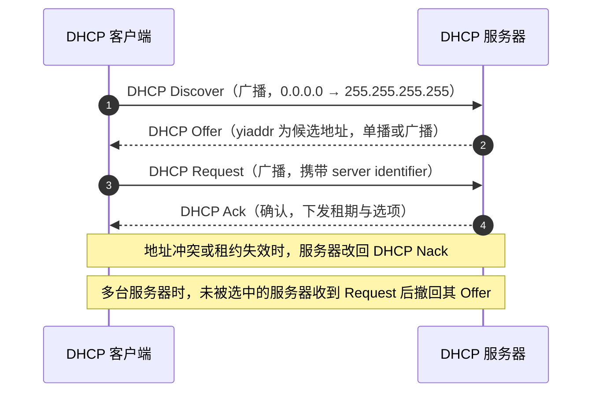
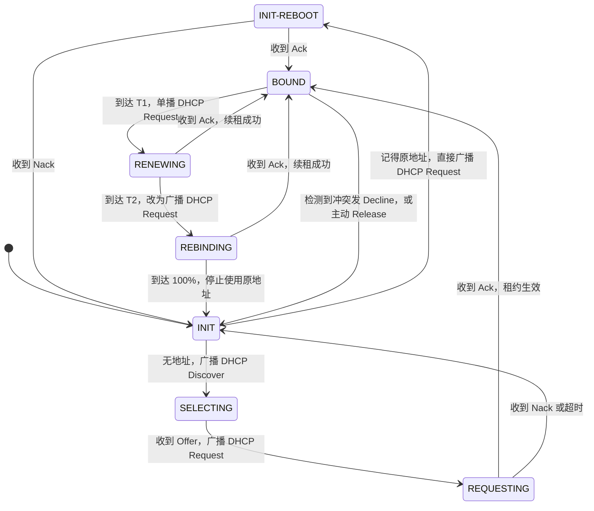

# DHCP协议与互联网新技术 · 完整笔记

---

## 1.DHCP协议概述

### 1.1 什么是 DHCP

DHCP 全称**动态主机配置协议**（Dynamic Host Configuration Protocol），用于为需要上网的主机自动提供网络参数配置。

早期上网需要手工逐项配置 IP 地址、网关、DNS 等参数后主机才能联网。随着联网设备数量不断增长，逐台手工配置费时、费力且枯燥。DHCP 提供了一种**自动化机制**，实现“**即插即联网**”，为上网提供便利。

### 1.2 DHCP 的作用

| 项目 | 内容 |
| ---- | ---- |
| 核心作用 | 自动为主机分配上网所需的全部网络参数 |
| 自动分发的参数 | **IP 地址、子网掩码、网关地址、DNS 地址**等 |
| 主要优势 | 减轻手工配置压力；在某种程度上**避免 IP 地址重复** |
| 客户端侧要求 | 需要在客户端上**启用 DHCP 服务**（即设置为自动获取） |

要点：**凡是与上网相关的参数，都通过 DHCP 集中下发**，而不止于 IP 地址一项。

通俗类比：DHCP 的过程类似于初到陌生城市租房的流程——先广撒网询问“有没有房源”，得到回应后确认房源能否使用，最后签订合同。对应到协议即为“请求、提供、确认、认可”的交互。

### 1.3 角色与端口

| 角色 | 监听端口 | 说明 |
| ---- | -------- | ---- |
| DHCP 客户端（Client） | **68** | 用于接收与发送 DHCP 报文 |
| DHCP 服务器（DHCP Server） | **67** | 用于接收与发送 DHCP 报文 |

- DHCP 基于 **UDP** 传输。
- 客户端与服务器之间的交互在**二层广播域**内进行。
- 补充：DHCPv6 使用 UDP **546**（客户端）与 **547**（服务器/中继），客户端以组播地址 `ff02::1:2` 寻找服务器，与 DHCPv4 的广播方式不同。

### 1.4 三种地址分配方式

| 方式 | 含义 | 特点 |
| ---- | ---- | ---- |
| 动态分配 | 分配有租期的地址，到期可回收再分配 | 最常用，适合临时接入与地址复用 |
| 自动分配 | 首次分配后永久绑定给该客户端 | 不设租期，适合固定终端 |
| 手工分配 | 由管理员指定地址，DHCP 只负责下发 | 与静态绑定配合，适合服务器、打印机 |

---

## 2.DHCP报文与工作过程

### 2.1 基本流程（DORA）

DHCP 获取 IP 地址的基本流程可记为 **DORA**，即四个报文依次交互：

| 步骤 | 报文 | 方向 | 含义 |
| ---- | ---- | ---- | ---- |
| 1 | **DHCP Discover** | 客户端 → 服务器 | IP 租用请求 |
| 2 | **DHCP Offer** | 服务器 → 客户端 | 分配一个有效 IP |
| 3 | **DHCP Request** | 客户端 → 服务器 | 确认选定的服务器与地址 |
| 4 | **DHCP Ack** | 服务器 → 客户端 | 确认，租约生效 |
| 4（替代） | **DHCP Nack** | 服务器 → 客户端 | 拒绝 / 地址已失效 |

### 2.2 各报文细节

**DHCP Discover（IP 租用请求）**

- 由客户端**广播发送**。
- 广播的原因：客户端此时尚无 IP 地址，也不确定网络中的 DHCP 服务器是谁，只能“广撒网”询问。
- 广播只在**二层**范围内传播：二层设备不分割广播域，**路由器不会转发广播**，因此 Discover 只能在同一个广播网（同一广播域）内发送。
- 报文源 IP 为 `0.0.0.0`，目的 IP 为 `255.255.255.255`，目的 MAC 为全 F 广播地址。

**DHCP Offer（分配一个有效 IP）**

- 同一网络内可能存在**多台 DHCP 服务器**，它们收到 Discover 后都会回应。
- 客户端的选取原则：**谁先响应就用谁**（按响应先后顺序决定）。
- Offer 报文**既可以是单播，也可以是广播**：
  - 客户端在 Discover 的 `flags` 字段中未置广播标志位时，服务器可按 `chaddr` **单播**回应；
  - 客户端不能接收单播（未配置协议栈）或置了广播标志位时，服务器以**广播**方式回应。
- 服务器从**地址池**中挑选一个**尚未被使用**的 IP 地址分配给客户端。

地址池示意（课堂示例）：

| Pool-No | Total Address | Used Address |
| ------- | ------------- | ------------ |
| 1 | 255 | 4 |

其中 Total Address 为地址池容量，Used Address 为已被使用的 IP 数量。

**DHCP Request（确认）**

- 客户端可能收到多个 Offer，它选择其中一个，并以**广播**方式发送 Request。
- Request 中携带 `server identifier`（选中的服务器）与 `requested IP address`（选中的地址）；其余服务器据此**撤回**自己的 Offer，避免地址被重复占用。
- 续租与开机重新确认（INIT-REBOOT）时同样使用 Request 报文。

**DHCP Ack / DHCP Nack（最终确认或拒绝）**

- 服务器确认地址可用后回复 **DHCP Ack**，其中携带租期与网关、DNS 等选项，租约自此生效。
- 若地址已被占用或客户端网段已变更，服务器回复 **DHCP Nack**，客户端需重新开始 Discover 流程。
- 客户端收到 Ack 后还应做**最终冲突检测**：用**免费 ARP**（Gratuitous ARP）探测该地址是否已被他人使用；若发现冲突，发送 **DHCP Decline** 并重新申请。
- 为便于对比记忆：Ack 表示“没问题，成交”；Nack 表示“来晚了，已经失效”。

补充（顺序纠偏）：按 RFC 2131，地址冲突的最终检测与 Decline 发生在收到 **Ack 之后**；教材与部分课程把“免费 ARP 检测”画在 Offer 与 Request 之间，属于简化讲法，考试作答时以“客户端用免费 ARP 检测冲突、冲突则发 Decline”这一结论为准。

### 2.3 DHCP 报文格式

DHCP 报文沿用 BOOTP 格式，固定首部 236 字节，其后为可变长选项字段：

| 字段 | 长度 | 含义 |
| ---- | ---- | ---- |
| `op` | 1 字节 | 报文类型：1 为请求（BOOTREQUEST），2 为应答（BOOTREPLY） |
| `htype` / `hlen` | 各 1 字节 | 硬件地址类型与长度，以太网为 1 与 6 |
| `hops` | 1 字节 | 经过的中继跳数，客户端置 0 |
| `xid` | 4 字节 | 事务标识，客户端随机生成，用于匹配请求与应答 |
| `secs` | 2 字节 | 客户端开始获取地址后经过的秒数 |
| `flags` | 2 字节 | 最高位为广播标志位 B |
| `ciaddr` | 4 字节 | 客户端已有 IP，处于 BOUND、RENEWING、REBINDING 时填写 |
| `yiaddr` | 4 字节 | 服务器分配给客户端的 IP 地址 |
| `siaddr` | 4 字节 | 下一个引导服务器地址 |
| `giaddr` | 4 字节 | **中继代理地址**，服务器据此判断客户端所在网段 |
| `chaddr` | 16 字节 | 客户端硬件地址 |
| `sname` / `file` | 64 / 128 字节 | 服务器名与引导文件名 |
| `options` | 可变 | 选项字段，含报文类型、租期、网关、DNS 等 |

### 2.4 地址池与排除地址

| 概念 | 说明 |
| ---- | ---- |
| 地址池（IP Pool） | DHCP 服务器可供分配的 IP 地址集合，服务器从中选取空闲地址下发 |
| 地址池统计 | Total Address（池容量）与 Used Address（已用数量）；示例中为 255 与 4 |
| 排除地址 | 地址池中**不参与自动分配**的 IP 地址或地址范围，用于保留给网关、服务器等需要固定 IP 及静态绑定的设备 |

补充（设备配置相关，非视频原文）：华为设备在全局地址池视图下使用 `excluded-ip-address` 命令、在接口地址池下使用 `dhcp server excluded-ip-address` 命令配置不参与自动分配的地址范围。

### 2.5 DHCP 报文类型汇总

| 报文 | 发起方 | 含义 |
| ---- | ------ | ---- |
| DHCP Discover | 客户端 | IP 租用请求，广播发送 |
| DHCP Offer | 服务器 | 提供一个可用 IP，可单播可广播 |
| DHCP Request | 客户端 | 确认选定的地址（续租时亦使用该报文） |
| DHCP Ack | 服务器 | 确认分配成功 |
| DHCP Nack | 服务器 | 拒绝 / 地址已失效 |
| DHCP Decline | 客户端 | 客户端检测到地址不可用（如冲突），通知服务器禁用该地址 |
| DHCP Release | 客户端 | 客户端主动释放地址，租约直接废弃 |
| DHCP Inform | 客户端 | 客户端**已获得 IP 地址**，用它向服务器请求**其他网络配置参数**（如网关地址、DNS 服务器地址） |

补充：常用 DHCP 选项包括 Option 1（子网掩码）、Option 3（默认网关）、Option 6（DNS 服务器）、Option 15（域名）、Option 51（租期）、Option 58（T1）、Option 59（T2）、Option 82（中继代理信息）。

---

## 3.租期、续租与异常处理

### 3.1 地址租期

- 服务器分配给客户端的 IP 地址有**租期**（租约期）概念，并非永久占用。
- 租期可在服务器上配置。**软考教材与 Windows Server 的默认值为 8 天**；华为 VRP、H3C Comware 等网络设备默认值为 **1 天**，不同厂商与型号可能不同。
- 租期的意义：在能继续使用原 IP 的前提下优先沿用原 IP，同时保证地址可被回收再利用。

### 3.2 续租的三个阶段（考试重点）

| 阶段 | 时间点 | 客户端的动作 | 通信方式 |
| ---- | ------ | ------------ | -------- |
| 阶段一 | 租约期 **50%（T1）** | 自动发送 **DHCP Request** 报文，请求更新 IP 地址租期 | **单播**发往原 DHCP 服务器 |
| 阶段二 | 租约期过 **87.5%（T2）** | 仍未收到服务器应答，则再次发送 **DHCP Request** 报文请求更新租期 | **广播**发送 |
| 阶段三 | 租约期 **100%（到期）** | 仍未收到服务器应答，客户端**停止使用该 IP 地址**并归还，**重新发送 DHCP Discover** 报文 | **广播**发送，请求新的 IP 地址 |

要点说明：

- 阶段一采用单播，是因为此时客户端已明确原 DHCP 服务器身份，可以直接一对一沟通。
- 阶段二改为广播，是因为单播未获回应，需要向同一广播域内所有服务器重新请求续租（REBINDING）。
- 阶段三到期仍未获回应，则归还地址、重新寻找其他 DHCP 服务器，请求分配新的 IP 地址。
- T1、T2 的缺省值分别为租期的 50% 与 87.5%；服务器可用 Option 58、Option 59 显式下发，未下发时由客户端按此缺省值计算（华为 VRP 地址池只配置租期，不配置 T1/T2）。

### 3.3 客户端状态机

| 状态 | 含义 | 客户端行为 |
| ---- | ---- | ---------- |
| INIT | 初始化 | 尚无地址，准备广播 Discover |
| SELECTING | 选择中 | 等待并比较各服务器的 Offer |
| REQUESTING | 请求中 | 广播 Request 确认所选地址 |
| BOUND | 已绑定 | 正常使用地址，租期计时 |
| RENEWING | 续租中 | T1 到达，单播向原服务器续租 |
| REBINDING | 重绑定中 | T2 到达，广播向任意服务器续租 |
| INIT-REBOOT | 重新启动 | 客户端记得原地址，直接广播 Request 确认 |

### 3.4 主动释放：DHCP Release

客户端也可以**主动放弃**已租用的 IP 地址。此时客户端发起 **DHCP Release** 报文，**租约直接废弃**。

### 3.5 分配过程中的异常

**异常一：客户端检测到地址冲突（DHCP Decline）**

- 客户端通过**免费 ARP** 检测发现服务器所分配的地址不可用（如 IP 地址冲突）时，不再使用该地址。
- 客户端发出 **DHCP Decline** 报文，通知服务器**禁止使用该 IP 地址**，并要求重新分配。

**异常二：服务器或线路故障（APIPA）**

- 当 DHCP 服务器故障或线路故障时，客户端**重发 4 次 DHCP Discover 报文**后仍始终无响应。
- 此时由**主机操作系统自身**为自己分配一个 **169.254.0.0/16** 网段的地址，即在地址池中选取一个地址，子网掩码为 `255.255.0.0`。
- 该机制称为**自动专用 IP 寻址（APIPA，Automatic Private IP Addressing）**，属于 DHCP 的**故障转移机制**。
- 该地址为链路本地地址，仅能“先让你用着”，**不能上网通信**，只能在**同一局域网内**、**相同操作系统之间**进行通信。

---

## 4.DHCP中继

### 4.1 引入原因

DHCP 报文以**广播**方式发送，而**广播不能跨网段**。若某个子网内没有 DHCP 服务器、服务器位于其他网段，则该网段的主机无法直接获得地址分配。

为解决该问题，在**边界位置的路由器**上开启**中继服务**。中继的角色相当于“中介”：网段内的客户端发出询问时，由开启了中继功能的路由器代为联络远端的 DHCP 服务器。

### 4.2 工作原理与角色

- DHCP 中继可实现**为不同网段的主机分配 IP 地址**。
- 路由器负责**在 DHCP 服务器与 DHCP 客户机之间转发 DHCP 报文**。
- 交互方式：
  - 客户端与中继之间为**广播交互**（该网络内所有主机都能收到）；
  - 中继与 DHCP 服务器之间为**单播交互**（一对一沟通）。
- 中继把接收报文的接口地址填入 `giaddr` 字段，服务器据此判断客户端所属网段，从对应地址池中选地址。

DHCP 组网中的三种角色：

| 角色 | 职责 |
| ---- | ---- |
| DHCP 客户端 | 发送 DHCP 请求报文，请求获取 IP 地址等网络参数 |
| DHCP 服务器 | 负责从地址池中选择 IP 地址分配给客户端，并可提供其他网络参数 |
| DHCP 中继 | 负责转发客户端与服务器之间的 DHCP 报文 |

要点：**DHCP 组网中若出现第三个角色，一定是 DHCP 中继。**

### 4.3 DHCP 中继与 Option 82

- 中继在网络中的标识作用依赖于 **giaddr**（网关地址）字段，服务器据此判断应当从哪个网段的地址池中分配地址。
- 中继在转发客户端报文时，可在 DHCP 报文中插入**中继代理信息选项 Option 82（Relay Agent Information Option）**，携带如客户端接入的电路/端口等信息，供服务器据此实现更精细的地址分配策略与用户定位。
- 补充（协议出处）：Option 82 由 RFC 3046 定义，是承载中继代理所提供子选项的“容器”选项；中继在转发客户端发往服务器的报文时插入该选项，服务器可将该选项原样回送，中继在转发给客户端前将其剥离。

---

## 5.DHCP安全

### 5.1 三类典型 DHCP 攻击

| 类型 | 描述 |
| ---- | ---- |
| DHCP 服务器仿冒者攻击 | 假冒、非法的 DHCP 服务器（服务器角色身份不统一）向客户端下发 IP 地址。由于客户端“**谁先响应就用谁**”，仿冒服务器可抢先响应，导致客户端从非法服务器获得地址 |
| 非 DHCP 用户攻击 | 非法 DHCP 用户发起 DHCP 请求，需要借助绑定关系进行限制 |
| 假冒 DHCP 报文攻击（拒绝服务攻击） | 通过大量伪造的 DHCP 报文抢占地址池资源，造成资源耗尽 |

### 5.2 DHCP Snooping

**DHCP Snooping 是 DHCP 的一种安全特性**，用于保证 DHCP 客户端**从合法的 DHCP 服务器获取 IP 地址**，并记录 DHCP 客户端 **IP 地址与 MAC 地址**等参数的对应关系。

DHCP Snooping 的三项能力：

| 配置项 | 作用 |
| ------ | ---- |
| DHCP Snooping 绑定表 | 防止非 DHCP 用户攻击 |
| 设备或接口允许接入的最大 DHCP 用户数 | 防止 DHCP Server 服务拒绝攻击 |
| 配置设备接口的“信任 / 非信任”工作模式 | 防止 DHCP Server 仿冒者攻击 |

信任与非信任模式的部署位置：

- 连接**合法 DHCP 服务器**的接口配置为 **trust（信任）**；
- 其余接口（含连接非法/伪造 DHCP 服务器方向）配置为 **untrust（非信任）**，丢弃其发来的 DHCP Offer/Ack 等服务器报文。

### 5.3 记忆要点（三个信息）

1. 安全机制的经典代表：**DHCP Snooping**（许多具体功能都是在其基础上开启）。
2. 经典攻击行为：**假冒的服务器**、**假冒的用户**、**假冒的 DHCP 报文（拒绝服务攻击、提高服务请求）**。
3. 常见防护手段：**DHCP Snooping 绑定表**、**信任 / 非信任工作模式**、**允许接入的用户数量**等。

说明：更完整的安全特性将在网络安全章节进一步展开，此处先建立整体印象。

---

## 6.DHCP典型例题

### 6.1 例题1

**例题1** 某网络上 MAC 地址为 `00-FF-78-ED-20-DE` 的主机，可首次向网络上的 DHCP 服务器发送（1）报文以请求 IP 地址配置的信息，报文的源 MAC 地址和源 IP 地址分别是（2）。

（1）

- A、Dhcp discover
- B、Dhcp request
- C、Dhcp offer
- D、Dhcp ack

（2）

- A、`0:0:0:0:0:0:0:0`；`0.0.0.0`
- B、`0:0:0:0:0:0:0:0`；`255.255.255.255`
- C、`00-FF-78-ED-20-DE`；`0.0.0.0`
- D、`00-FF-78-ED-20-DE`；`255.255.255.255`

解答：首次请求 IP 地址配置信息，交互顺序为 discover → offer → request → ack，因此（1）选择 **DHCP Discover**（按 DORA 顺序，首先是 D）。

源 MAC 地址就是主机**自己的 MAC 地址**，即 `00-FF-78-ED-20-DE`；源 IP 地址此时**尚未分配**，属于未知信息，在数据链路层尚不需要用到 IP（IP 在网络层使用），因此源 IP 采用**零比特填充**，为 `0.0.0.0`。

答案：（1）**A**；（2）**C**。

补充：若要询问目的 MAC 地址，由于报文采用**广播**形式“广撒网”，目的 MAC 地址为**全 F 字段（全 1）**，即广播地址。

### 6.2 例题2

**例题2** DHCP 服务器设置了 C 类私有地址作为地址池，某 Windows 客户端获得的地址是 `169.254.107.100`，出现该现象可能的原因是（ ）。

- A、该网段存在多台 DHCP 服务器
- B、DHCP 服务器为客户端分配了该地址
- C、DHCP 服务器停止工作
- D、客户端 TCP/IP 协议配置错误

解答：`169.254.0.0/16` 网段是 **APIPA** 自动专用 IP 寻址所分配的地址段，只有在 **DHCP 服务器故障或线路故障**、客户端多次请求无响应时，才会由操作系统自行分配。

答案：**C**。

### 6.3 例题3

**例题3** 以下关于 DHCP 协议的描述中，错误的是（ ）。

- A、DHCP 客户机可以从外网段获取 IP 地址
- B、DHCP 客户机只能收到一个 dhcp offer
- C、DHCP 不会同时租借相同的 IP 地址给两台主机
- D、DHCP 分配的 IP 地址默认租约期为 8 天

解答：逐项判断：

| 选项 | 判断 | 理由 |
| ---- | ---- | ---- |
| A | [正确] | 只要配置了 **DHCP 中继**，客户端就可以从外网段获取 IP 地址 |
| B | [错误] | 若网络中存在多台 DHCP 服务器，客户端可以收到**多个** Offer，并按“谁先响应就用谁”的原则选取 |
| C | [正确] | DHCP 不会把同一个 IP 地址同时租借给两台主机，否则会产生 IP 地址冲突 |
| D | [正确] | 软考教材口径的默认租约期为 **8 天**（华为 VRP 默认 1 天，见 3.1 节说明） |

答案：**B**。

### 6.4 案例一

**案例一** DHCP 组网中，包括以下三种角色：（1）负责从地址池中选择 IP 地址分配至 DHCP 客户端，还可以为 DHCP 客户端提供其他网络参数，如（2）、（3）和 WINS 服务器地址。（4）则会发送 DHCP 请求报文请求获取 IP 地址等网络参数的设备。（5）则负责转发前两者之间的 DHCP 报文。

解答：

| 填空 | 答案 |
| ---- | ---- |
| （1） | **DHCP 服务器** |
| （2）（3） | **网关地址**、**DNS 服务器地址**（两者位置可互换） |
| （4） | **DHCP 客户端** |
| （5） | **DHCP 中继** |

要点：除 IP 地址外，DHCP 常分配的参数为**网关地址**与 **DNS 服务器地址**——网关决定“出门该往哪走”，DNS 服务器则是域名解析所必需。

### 6.5 案例二

**案例二** 某公司局域网使用 DHCP 动态获取 `10.10.10.1/24` 网段的 IP 地址，某天公司大量终端获得了 `192.168.1.0/24` 网段的地址，可能是受到了（1）攻击，可在接入交换机上配置（2）功能杜绝该问题再次出现。

解答：终端所获地址与正常网段**明显不同**，说明其 DHCP 地址池也不相同，即网络中出现了**一台伪造的 DHCP 服务器**在抢先下发地址，故（1）为**仿冒（假冒）DHCP 服务器攻击**，或表述为假冒 DHCP 报文带来的**拒绝服务攻击**；解决手段为在交换机上配置（2）**DHCP Snooping**（在其基础上配置端口信任 / 非信任模式）。

答案：（1）**仿冒 DHCP 服务器攻击（假冒的 DHCP 报文/拒绝服务攻击）**；（2）**DHCP Snooping**。

要点：DHCP 服务是**案例分析题的必考内容**，设备配置中涉及**地址池、租约以及相关命令**，须重点掌握。

---

## 7.互联网新技术

本节主要解释各类新技术的**概念与名词**，属于**认识性内容**：目前仅在**选择题**中考查，在案例分析中可能作为背景出现，需要对名词与功能特征有印象。

| 名称 | 关键词 |
| ---- | ------ |
| 大数据 Big Data | 海量数据、数据处理与分析、4V 特征 |
| 云计算 Cloud Computing | 强计算能力、分布式、虚拟化、按需服务、按量计费 |
| 物联网 IoT（Internet of Things） | 物物相连、全面感知（自动识别、传感器）、可靠传输、智能处理 |
| 区块链 | 去中心化的分布式账本数据库、共识机制、智能合约 |
| 软件定义网络 SDN | 转控分离、集中控制、开放可编程接口、OpenFlow |

### 7.1 大数据（Big Data）

- 功能：进行**海量数据的存储、处理与分析**操作。
- 核心作用：**挖掘**——在大量数据信息中挖掘出**有价值的、有含义的信息点**。
- 应用价值：协助进行下一步判断，或提升用户体验，例如**个性化界面设计**等均基于大数据。
- 定位：大数据可以理解为其他技术的一项**基础**。
- 典型特征（4V）：**Volume 大量、Velocity 高速、Variety 多样、Value 价值**（亦有加入 Veracity 真实性称为 5V 的说法）。

### 7.2 云计算（Cloud Computing）

- 早期概念：一种**分布式计算**功能——由多个人（多台机器）分工合作、将计算结果合并，从而处理更庞大的信息，突破单台设备的处理能力限制。
- 主要技术：**分布式**与**虚拟化**。
- 虚拟化的含义：将各种各样的**物理资源虚拟化**，而非固定使用。例如物理上存在多块硬盘，对外只通告一个总容量（如 30T），用户需要多少就切分多少，无需关心数据具体存储在哪块硬盘上。
- 优势：**按需服务、按量计费**，简化操作与管理；更便于初创公司搭建自己的服务，无需先自行购买物理设备。

三种服务模式：

| 模式 | 全称 | 用户获得的内容 | 典型例子 |
| ---- | ---- | -------------- | -------- |
| IaaS | 基础设施即服务 | 计算、存储、网络等基础资源 | 云主机、云硬盘 |
| PaaS | 平台即服务 | 开发运行环境与中间件 | 数据库服务、应用托管平台 |
| SaaS | 软件即服务 | 可直接使用的应用软件 | 在线邮箱、在线办公套件 |

补充：按部署方式还可分为公有云、私有云与混合云；其核心特征是按需自服务、资源池化、弹性伸缩、可计量服务。

### 7.3 物联网（IoT，Internet of Things）

- 定义：发展得比较成熟的**万物互联相连**的网络。
- 通信范围：除**人与人**之间的沟通外，还实现**人与物**的信息交流以及**物与物**之间的信息交流，如智能家居等。
- 核心特征：
  - **感知**：物体本身无法“说话”，需要通过**感知**操作来提取物体想描述的信息；
  - 借助**自动识别**、**传感器**等手段获取信息；
  - 对获取的信息进行**传输与处理**。
- 典型三层架构：

| 层次 | 作用 | 典型技术 |
| ---- | ---- | -------- |
| 感知层 | 采集物理世界的数据 | 传感器、RFID、二维码、摄像头 |
| 网络层 | 把数据可靠传回平台 | NB-IoT、LoRa、以太网、5G |
| 应用层 | 数据处理与行业应用 | 智能家居、智慧交通、工业互联网 |

- 经典代表：**NB-IoT**，其特色为**广覆盖、大连接、低功耗、低带宽**（或低速率）。该内容在网络规划中可能涉及考查，对网络工程师而言多为背景描述，考试力度不大，有印象即可。

### 7.4 区块链

- 核心特点：**去中心化**。
- 含义：以往账目可能由单方说了算，而单方不一定可信；区块链希望由**多个人共同管理、相互制衡**，谁轮到谁处理、**互相监督**。
- 起源：**比特币**。
- 本质：**去中心化的分布式账本数据库**（重点记忆“去中心化”“分布式”）。
- 技术手段：采用**加密算法、哈希算法**等实现；数据按时间顺序以哈希指针串联成链，一经写入难以篡改。
- 补充概念：

| 概念 | 说明 |
| ---- | ---- |
| 共识机制 | 各节点对账本内容达成一致的方法，常见 PoW（工作量证明）、PoS（权益证明） |
| 智能合约 | 部署在链上、满足条件即自动执行的程序 |
| 公有链 / 联盟链 / 私有链 | 按参与节点的开放程度划分，联盟链多见于企业间协作 |

### 7.5 软件定义网络（SDN）

- 与 5G 技术相关联，此前在移动通信相关内容中已提及。
- 核心思想：**转控分离**——将**控制平面**与**数据平面**（数据转发平面）进行**分割**，基础数据网络与其功能实现分离。
- 作用：实现网络流量的**灵活控制**，使网络作为管道变得更加智能、更便于操作；支持**集中控制**与**开放可编程接口**。
- 代表协议：**OpenFlow**，用于完成控制器与转发设备之间的交互。
- 优势：有效**降低对硬件资源的要求**，更好地进行扩容、移植新技术，也更方便进行运营管理。

补充架构：

| 平面 | 职责 | 接口 |
| ---- | ---- | ---- |
| 应用平面 | 各类网络应用与业务策略 | 北向接口（常见 REST API） |
| 控制平面 | 控制器掌握全局拓扑，计算转发策略 | 南向接口（OpenFlow 等） |
| 数据平面 | 交换机按流表转发报文 | —— |

补充：SDN 强调控制与转发分离，NFV（网络功能虚拟化）强调把防火墙、路由器等功能软件化并运行在通用服务器上，二者常配合使用但概念不同。

---

## 8.互联网新技术典型例题

### 8.1 例题1

**例题1** 以下关于云计算的叙述中，不正确的是（ ）。

- A、云计算将所有客户的计算都集中在一台大型计算机上进行
- B、云计算是基于互联网的相关服务的增加、使用和交付模式
- C、云计算支持用户在任意位置使用各种终端获取相应服务
- D、云计算的基础是面向服务的架构和虚拟化的系统部署

解答：云计算的特征是**分布式**与**虚拟化**；选项 A 中的“**集中**在一台大型计算机上”与分布式特征明显矛盾，且云计算在**地理位置上是不固定的**。

答案：**A**。

### 8.2 例题2

**例题2** 某电商平台根据用户消费记录分析用户消费偏好，预测未来消费倾向，这是（ ）技术的典型应用。

- A、物联网
- B、区块链
- C、云计算
- D、大数据

解答：题干描述的是对数据的**存储、处理、分析**，并从中挖掘出未来的价值，符合**大数据**的典型应用。

答案：**D**。

要点：此类题难度不高，主要考查对新技术名词及功能特征的理解与判断。

---

## 9.本章小结

| 知识点 | 核心内容 |
| ------ | -------- |
| DHCP 定义与作用 | 动态主机配置协议；自动分配 IP 地址、子网掩码、网关、DNS 等上网参数，即插即联网；减轻手工配置压力，避免 IP 重复 |
| 端口与传输层 | 客户端 **68**、服务器 **67**，基于 **UDP**；DHCPv6 为 546/547 |
| 分配方式 | 动态分配（有租期，最常用）、自动分配（永久绑定）、手工分配（管理员指定） |
| 基本流程 DORA | Discover（IP 租用请求，广播）→ Offer（分配有效 IP，单播或广播）→ Request（确认，广播）→ Ack（确认）/ Nack（拒绝、失效） |
| 冲突检测 | 客户端使用**免费 ARP** 检测地址是否冲突；冲突时发送 **DHCP Decline** 并重新申请 |
| 地址池 | 服务器从地址池选取空闲地址；示例 Total Address 255、Used Address 4；排除地址不参与自动分配 |
| 续租三阶段 | T1（50%）单播 DHCP Request → T2（87.5%）广播 DHCP Request → 100% 停止使用并广播 DHCP Discover |
| 客户端状态 | INIT、SELECTING、REQUESTING、BOUND、RENEWING、REBINDING、INIT-REBOOT |
| 租期默认值 | 软考教材与 Windows Server 为 **8 天**；华为 VRP、H3C 默认为 **1 天**，可配置 |
| 主动释放 | 客户端发送 **DHCP Release**，租约直接废弃 |
| 异常处理 | 服务器/线路故障、重发 4 次 Discover 无响应时，操作系统分配 **169.254.0.0/16**（**APIPA**），不能上网、仅限局域网内同系统通信 |
| DHCP 中继 | 解决广播不能跨网段的问题；边界路由器开启中继；客户端与中继间为广播交互、中继与服务器间为单播交互；用 **giaddr** 标识网段，可插入 **Option 82** |
| DHCP 三种角色 | 客户端、服务器、中继（出现第三个角色一定是中继） |
| DHCP 安全 | 三类攻击：假冒服务器、非 DHCP 用户、假冒报文（拒绝服务）；典型机制 **DHCP Snooping**（绑定表、最大用户数、信任/非信任模式） |
| 大数据 | 海量数据的存储、处理与分析；核心是挖掘有价值的信息；4V 特征；其他技术的基础 |
| 云计算 | 分布式与虚拟化；按需服务、按量计费；服务模式 IaaS/PaaS/SaaS；地理位置上不固定，并非集中在一台大型计算机 |
| 物联网 | 物物相连、全面感知（自动识别、传感器）、可靠传输、智能处理；感知层/网络层/应用层；代表技术 NB-IoT（广覆盖、大连接、低功耗、低带宽） |
| 区块链 | 去中心化的分布式账本数据库；起源比特币；哈希链、共识机制、智能合约；公有链/联盟链/私有链 |
| SDN | 转控分离（控制平面与数据平面分离）、集中控制、开放可编程接口；南向 OpenFlow、北向 REST；代表协议 OpenFlow |

考试重点：

1. **DHCP 报文的四种基本类型与顺序为 DORA**：Discover、Offer、Request、Ack（另有 Nack 表示拒绝/失效），端口为**服务器 67、客户端 68**，传输层为 **UDP**。
2. **源与目的地址**：首次 Discover 报文源 MAC 为自身 MAC、源 IP 为 `0.0.0.0`（零比特填充）；目的 IP 为 `255.255.255.255`，目的 MAC 为**全 F 广播地址**。
3. **续租的两个时间点**：租期 **50%（T1）单播**、**87.5%（T2）广播**；到期（100%）仍未获应答则停止使用原地址并**重新广播 Discover**。
4. **169.254.0.0/16 必为 DHCP 故障**（APIPA 故障转移机制），此时无法上网。
5. **DHCP Decline** 由**客户端**发出（地址冲突）；**DHCP Release** 亦由**客户端**发出（主动释放）；续租与确认使用的是 **DHCP Request**。
6. **多台服务器时可收到多个 Offer**，客户端按“谁先响应就用谁”选取，“只能收到一个 Offer”的说法是**错误**的。
7. **DHCP 中继**是 DHCP 组网的第三个角色，负责跨网段转发报文（广播 ⇄ 单播），用 **giaddr** 标识客户端网段，其可选信息选项为 **Option 82**。
8. **DHCP Snooping 是 DHCP 安全的经典代表机制**，配置**端口信任/非信任模式**可防止假冒 DHCP 服务器攻击；出现“大量终端获得异常网段地址”的案情，答案通常是**仿冒 DHCP 服务器攻击 + DHCP Snooping**。
9. **地址池与排除地址**：地址池提供可分配地址，网关、服务器等需固定地址的设备应通过排除地址/静态绑定保留，例题中“网关地址与 DNS 服务器地址”是除 IP 外最常考查的分发参数。
10. **租期口径**：软考题目默认按 **8 天**作答；若题目明确给出华为/华三设备，注意其默认为 **1 天**，以题干配置命令为准。
11. **新技术名词辨识**：题干出现“挖掘价值、预测倾向”选**大数据**；出现“虚拟化、按需服务、地理位置不固定”选**云计算**（“集中在一台计算机”为错误表述）；出现“去中心化、分布式账本”选**区块链**；出现“转控分离、OpenFlow”选 **SDN**；出现“物物相连、感知”选**物联网**。
