# TCP可靠传输、拥塞控制与端口号 · 完整笔记

> 本文由 p28《TCP的数据传输》、p29《TCP拥塞控制》、p30《传输层端口号》三讲课件的截图与语音转写稿整理而成，截图已按来源重命名（`p28_*`、`p29_*`、`p30_*`）并存于 `image/6.1-TCP可靠传输、拥塞控制与端口号/`。

---

## 1.TCP数据传输概述

TCP 的数据传输过程分为**三个阶段**，本讲围绕三个阶段各自的工作字段、状态变化与考点展开。

| 阶段 | 主要动作 | 关键字段 | 关键过程名 |
| ---- | -------- | -------- | ---------- |
| 建立连接 | 协商序号、确认双方收发能力 | SYN、seq、ACK | **三次握手** |
| 传输数据 | 按字节编号、缓存收发、窗口通知 | seq、ACK、win | 面向字节流、可变大小滑动窗口 |
| 拆除连接 | 双方分别关闭各自方向 | FIN、ACK | **四次挥手** |

TCP 是**面向连接的、可靠的、面向字节流**的传输层协议，上述三阶段是它区别于 UDP（无连接）的核心特征。

---

## 2.三次握手建立连接

### 2.1 三次握手的报文交互

| 次序 | 方向 | 报文关键字段 | 含义 |
| ---- | ---- | ------------ | ---- |
| 第 1 次 | 客户 → 服务器 | **SYN=1，seq=x** | 客户端请求建立连接，并告知本端发送数据的**初始序号为 x** |
| 第 2 次 | 服务器 → 客户 | **SYN=1，ACK=1，seq=y，ack=x+1** | 服务器同意建立连接，告知本端初始序号为 y，并确认已收到 x，**期望下一个字节为 x+1** |
| 第 3 次 | 客户 → 服务器 | **ACK=1，seq=x+1，ack=y+1** | 客户端确认收到服务器的序号 y，**期望下一个字节为 y+1**，连接正式建立 |

三条报文各自使用的关键字段为 **SYN、seq、ACK（标志位）与 ack（确认号）**，其中小写的确认号 ack 表示"期望收到的下一个字节编号"。

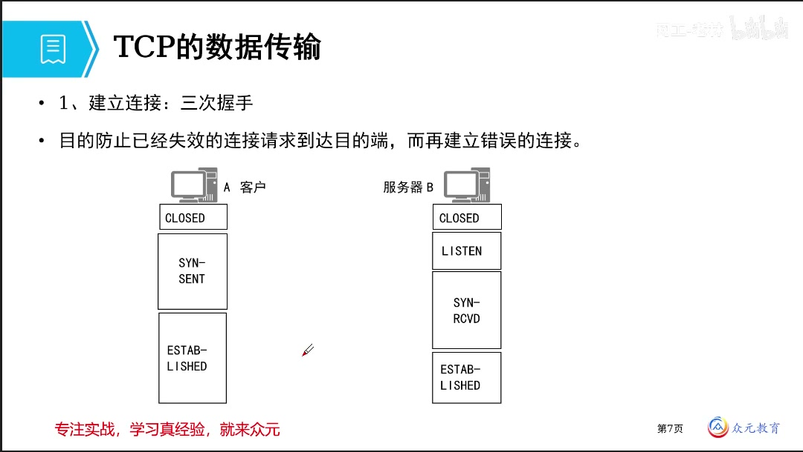

**图 2-1　三次握手的报文交互与状态迁移（p28，第 7 页）**

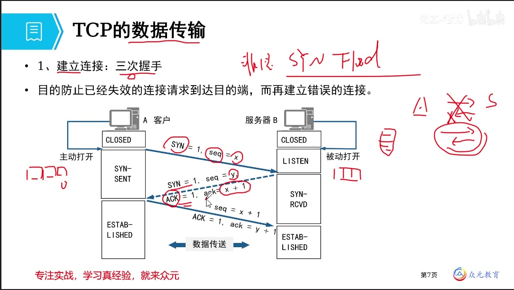

**图 2-2　三次握手字段批注版：SYN=1、seq=x、seq=y、ack=x+1 均被标注（p28）**

[手写批注] 非法 SYN Flood

### 2.2 三次握手的状态迁移

| 主机 | 状态变化 |
| ---- | -------- |
| 客户 A（主动打开） | CLOSED → **SYN-SENT** → **ESTABLISHED** |
| 服务器 B（被动打开） | CLOSED → **LISTEN** → **SYN-RCVD** → **ESTABLISHED** |

- 服务器在 **LISTEN**（监听）状态等待连接请求；
- 客户发出 SYN 后进入 **SYN-SENT**；
- 服务器收到 SYN 并发出 SYN+ACK 后进入 **SYN-RCVD**；
- 双方收到对方的确认后均进入 **ESTABLISHED**（连接已建立），此后才能开始数据传送。

TCP 状态迁移可用下图概括（主动/被动打开、四次挥手的状态亦并入同一张图）：

```mermaid
stateDiagram-v2
    [*] --> CLOSED
    CLOSED --> SYN-SENT: 主动打开 / 发SYN
    CLOSED --> LISTEN: 被动打开 / 等待请求
    LISTEN --> SYN-RCVD: 收到SYN / 发SYN+ACK
    SYN-SENT --> ESTABLISHED: 收到SYN+ACK / 发ACK
    SYN-RCVD --> ESTABLISHED: 收到ACK
    ESTABLISHED --> FIN-WAIT-1: 主动关闭 / 发FIN
    FIN-WAIT-1 --> FIN-WAIT-2: 收到ACK
    FIN-WAIT-2 --> TIME-WAIT: 收到FIN / 发ACK
    TIME-WAIT --> CLOSED: 等待2MSL
    ESTABLISHED --> CLOSE-WAIT: 收到FIN / 发ACK
    CLOSE-WAIT --> LAST-ACK: 应用关闭 / 发FIN
    LAST-ACK --> CLOSED: 收到ACK
```

### 2.3 为什么需要三次握手

采用三次握手而非两次握手，主要有两个原因：

1. **防止已失效的连接请求到达目的端而再建立错误的连接**：旧的、滞留在网络中的连接请求到达服务器后，若只握手两次，服务器会误认为客户端要建立连接并保留资源；第三次确认可以让服务器清理掉多余的连接请求，只保留一条有效连接。
2. **抵御非法连接请求（SYN Flood 泛洪攻击）**：攻击者伪造大量非法 SYN 请求，服务器需将其排队处理，数量过大时会占满排队队列，导致无法响应正常用户。增加一次确认可提高连接建立的可靠性，减少无效连接占用资源。

- 三次握手是连接建立阶段的核心考点，重点记忆**工作字段（SYN、seq、ACK、ack）**与**状态变化（SYN-SENT、LISTEN、SYN-RCVD、ESTABLISHED）**。

---

## 3.四次挥手拆除连接

### 3.1 四次挥手的报文交互

| 次序 | 方向 | 报文关键字段 | 含义 |
| ---- | ---- | ------------ | ---- |
| 第 1 次 | 客户 → 服务器 | **FIN=1，seq=u** | 客户端（主动关闭方）发送连接释放报文，表示本端数据已发完 |
| 第 2 次 | 服务器 → 客户 | **ACK=1，seq=v，ack=u+1** | 服务器确认收到 FIN，此时连接进入**半关闭**状态（客户端→服务器方向已关闭，服务器→客户端方向仍可传数据） |
| 第 3 次 | 服务器 → 客户 | **FIN=1，ACK=1，seq=w，ack=u+1** | 服务器数据也发完，发送自己的连接释放报文 |
| 第 4 次 | 客户 → 服务器 | **ACK=1，seq=u+1，ack=w+1** | 客户端确认收到服务器的 FIN，双方连接完全关闭 |

- 四次挥手中，双方**各自关闭自己方向的通道**，因此需要四次交互；第二次与第三次之间服务器仍可继续发送数据，这一段称为**半连接（半关闭）模式**。

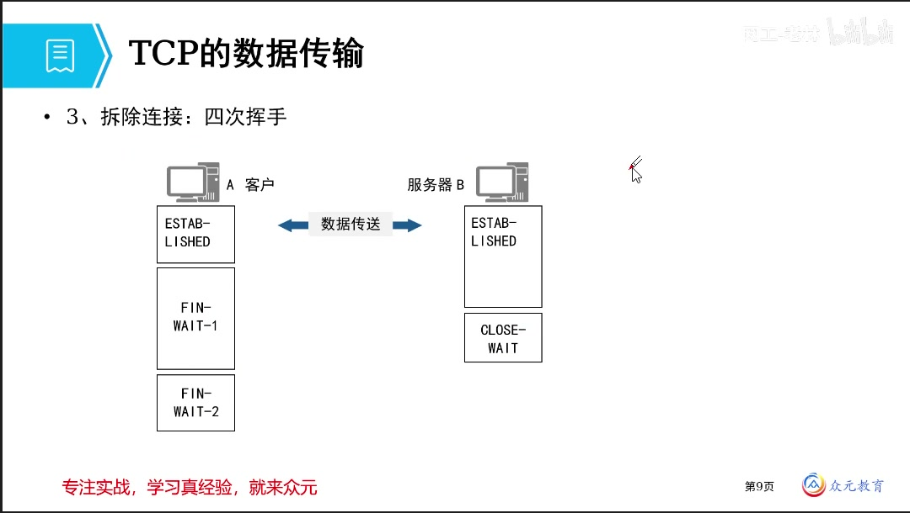

**图 3-1　四次挥手前半段：客户端 ESTABLISHED→FIN-WAIT-1→FIN-WAIT-2，服务器 ESTABLISHED→CLOSE-WAIT（p28，第 9 页）**

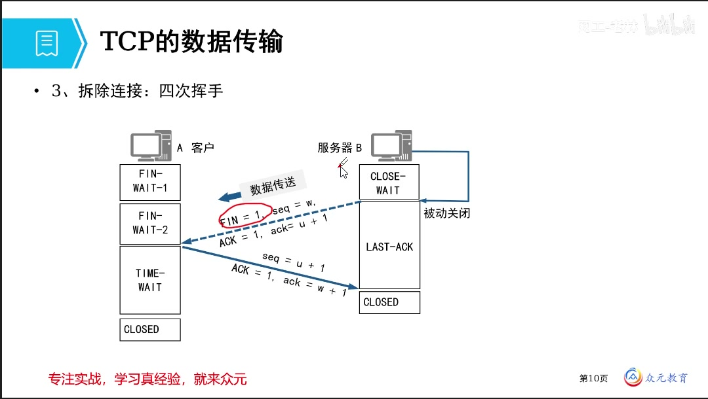

**图 3-2　四次挥手完整状态迁移：含 TIME-WAIT 与 CLOSED（p28，第 10 页）**

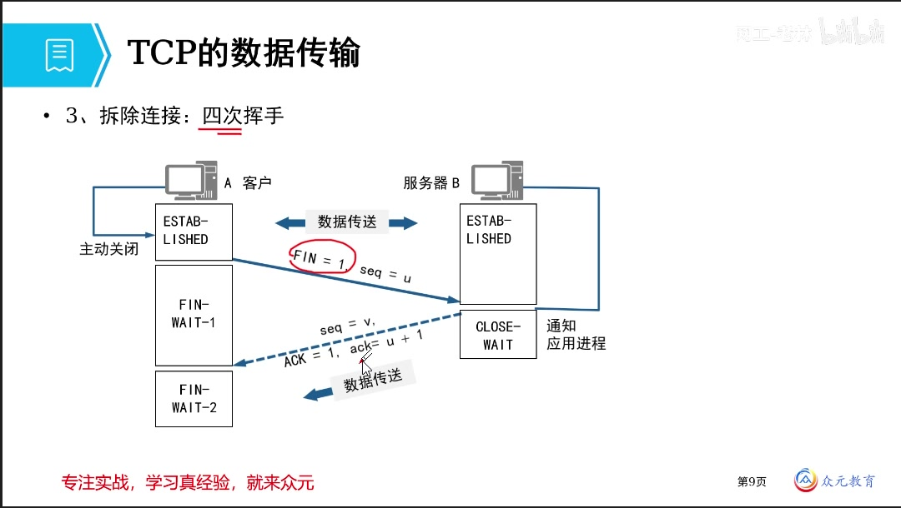

**图 3-3　四次挥手批注版：主动关闭、通知应用进程（p28）**

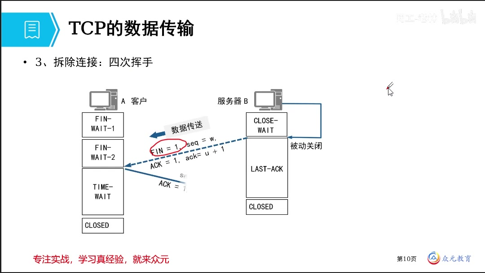

**图 3-4　四次挥手批注版：被动关闭（p28，第 10 页）**

### 3.2 四次挥手的状态迁移

| 主机 | 状态变化 |
| ---- | -------- |
| 客户 A（主动关闭） | ESTABLISHED → **FIN-WAIT-1** → **FIN-WAIT-2** → **TIME-WAIT** → CLOSED |
| 服务器 B（被动关闭） | ESTABLISHED → **CLOSE-WAIT** → **LAST-ACK** → CLOSED |

状态命名中带有多个 **wait**，需要区分各自等待的对象：

| 状态 | 等待的内容 |
| ---- | ---------- |
| FIN-WAIT-1 | 等待对方的 ACK，或对方的 FIN |
| FIN-WAIT-2 | 等待对方的 FIN |
| CLOSE-WAIT | **等待本端应用程序关闭端口**（应用进程释放连接） |
| LAST-ACK | 等待对方对本报文 FIN 的最终确认 |
| TIME-WAIT | 等待 **2MSL** 后进入 CLOSED |

### 3.3 TIME-WAIT 与 2MSL

主动关闭方在发送最后一个 ACK 后并不立即进入 CLOSED，而是进入 **TIME-WAIT** 状态，等待 **2MSL（两倍报文最大生存时间）** 后才真正关闭。

**为什么需要等待 2MSL：**

1. **保证最后一个 ACK 能够到达对方**：若该 ACK 丢失，服务器会超时重传 FIN，客户端在 TIME-WAIT 期间仍能重新发送 ACK 并刷新计时器；若客户端立即关闭，将无法重发，服务器会一直停留在 LAST-ACK。
2. **让本次连接中的旧报文段在网络中彻底消失**：等待 2MSL 可避免上一个连接的延迟报文段干扰下一个使用相同端口的新连接。

[补充] RFC 9293 中 MSL 取 **2 分钟**（属工程选择，可变）。因此典型 TIME-WAIT 等待时间约为 **4 分钟**；实际操作系统中 Windows 默认约 4 分钟、Linux 约 60 秒，具体实现不同。

---

## 4.TCP可靠传输机制

TCP 传输数据称为**面向字节流**：把要发送的数据按**字节**为单位编号，报文段首部的 seq 字段记录**本报文段数据的第一个字节编号**。序号为 32 位，即编号范围为 **0 ~ 2³²−1**。

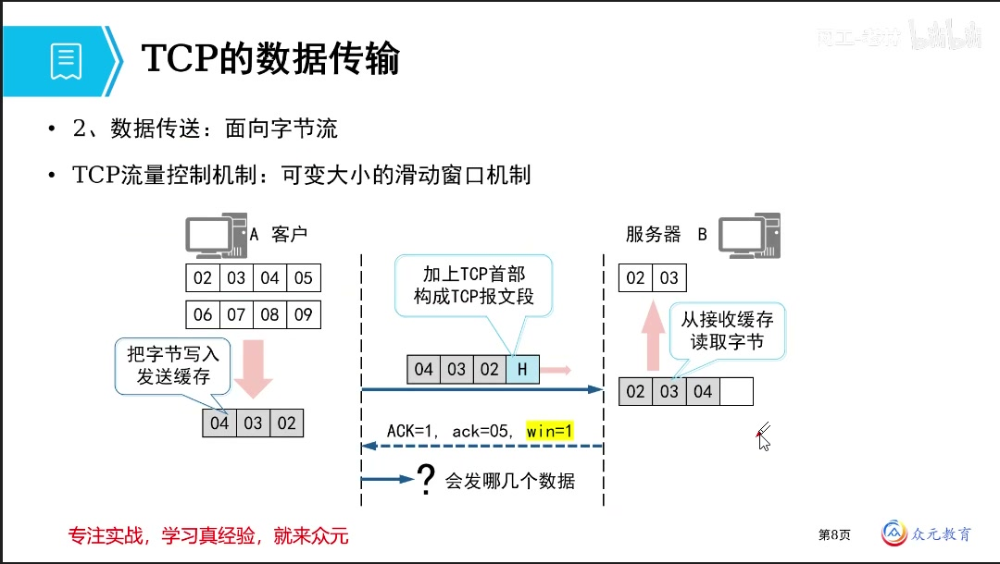

**图 4-1　面向字节流、发送缓存/接收缓存与可变大小的滑动窗口机制（p28，第 8 页）**

### 4.1 面向字节流的发送与接收过程

1. 应用进程把字节写入**发送缓存**；
2. 发送方按窗口大小取出若干字节，**加上 TCP 首部构成 TCP 报文段**，首部的 seq 只写该报文段**第一个字节**的编号；
3. 数据经网络送达接收方，接收方先存入**接收缓存**；
4. 接收方再按序从接收缓存向上交付给应用进程。

### 4.2 可靠传输的四个关键机制

| 机制 | 作用与要点 |
| ---- | ---------- |
| 累计确认 | ACK 的确认号 ack 表示"**该编号之前的全部字节都已正确收到、期望下一个字节**"，一次 ACK 可确认多个连续报文段；采用**累积确认**可减少确认开销 |
| 超时重传 | 发送方为每个已发送报文段设置**超时计时器**；在超时时间（RTO）内未收到确认，则**重传该报文段**，并动态调整超时时间 |
| 快速重传 | 接收方每收到一个**失序报文段**立即发出**重复确认 ACK**；发送方**一连收到 3 个重复确认（冗余 ACK）**即认定报文段丢失，**立即重传**，而不等待超时计时器到期，从而减少延迟 |
| 选择确认（SACK） | 通过 TCP 首部的 **SACK 选项**（RFC 2018），接收方可以告知发送方"已经收到哪些不连续的报文段"，使发送方**只重传真正丢失的部分**，避免把已收到的数据重复发送 |

[补充] 除上述机制外，TCP 还依靠**首部校验和**（检测比特差错）与**序号/确认号**（检测丢失、失序、重复）共同实现可靠性。快速重传的触发条件是**收到 3 个重复 ACK**，RFC 5681 表述为"the arrival of 3 duplicate ACKs"，即**恰好 3 个重复 ACK**（此后每多收一个重复 ACK 还会继续放大拥塞窗口，见第 6 章）。

### 4.3 与握手/挥手相关的首部字段

下列字段在三次握手与四次挥手中直接使用（报文格式详见 6.1 之前的 UDP/TCP 报文格式一讲）：

| 字段 | 位数 | 作用 |
| ---- | ---- | ---- |
| 序号 seq | 32 | 本报文段数据第一个字节的编号 |
| 确认号 ack | 32 | 期望收到的下一个字节编号 |
| 窗口 win | 16 | 本端接收窗口大小（rwnd） |
| 校验和 | 16 | 检验首部与数据的完整性 |
| SYN | 1 | 连接建立请求/同意标志 |
| ACK | 1 | 确认号字段有效标志 |
| FIN | 1 | 连接释放标志 |
| RST | 1 | 连接复位标志 |
| 数据偏移 | 4 | 首部长度 |

---

## 5.流量控制与滑动窗口

### 5.1 接收窗口值 rwnd 与流量控制

- 接收方为接收缓存设有一个**窗口值 win（rwnd，接收窗口）**，表示**当前还能一次接收多少数据**；
- 接收方在回复报文中携带 win，告知发送方"我目前还剩多大的空闲"，发送方据此调整发送量，**避免接收方来不及处理而丢包**；
- 随着接收方应用进程从缓存读取数据，窗口会**不断空闲出来**，因此窗口值是**动态变化的**；
- 这种机制称为**可变大小的滑动窗口机制**（窗口"框"住可发送的数据区间，并随确认逐步向下滑动）。

例如：接收窗口值为 4 时，一次可接收 4 个报文段；若一次连续到达 5 个，则可能因溢出而丢弃 1 个。为避免该冲突，接收方会在回复中携带 win，告知"当前还剩几个空位、下一次只发几个"。

### 5.2 流量控制的适用范围

| 项目 | 说明 |
| ---- | ---- |
| 流量控制 | **端到端**，只在通信双方 A、B 两个端点之间进行 |
| 拥塞控制 | 在 A、B **以及所有中间网络节点**中进行（见第 6 章） |

[要点] TCP 的流量控制机制是**可变大小的滑动窗口机制**，TCP 首部中与之相关的字段是**窗口（window）字段**。

### 5.3 发送窗口 = min(rwnd, cwnd)

发送方实际能够发送的数据量由**接收窗口 rwnd** 与**拥塞窗口 cwnd** 共同决定：

```
发送窗口 = min(rwnd, cwnd)
```

- rwnd 由接收方通告，体现**接收能力**（流量控制）；
- cwnd 由发送方根据网络拥塞状况维护，体现**网络承载能力**（拥塞控制）；
- 两者取较小值，既不能超过接收方的处理能力，也不能超过网络的承受能力。

---

## 6.TCP拥塞控制

### 6.1 拥塞控制与流量控制的区别

- **拥塞控制**：**防止过多的数据流入到网络中**，避免中间网络节点（路由器）因过载而丢包；
- 流量控制在**两个端点**之间进行，拥塞控制在**端点与所有网络节点**中进行。
- 常见拥塞控制方法有四种：**慢启动、拥塞避免、快重传、快速恢复**；本讲介绍的是 **TCP Reno** 版本的标准（早期还有 Tahoe 等标准，手段不同）。

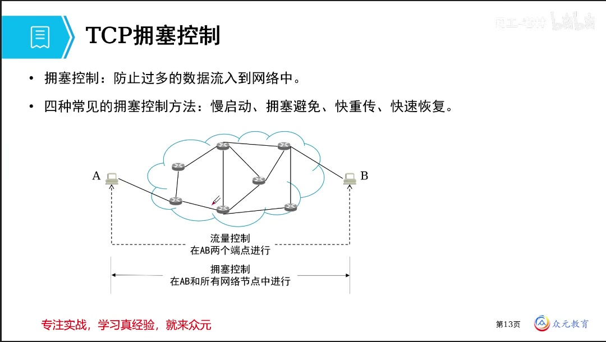

**图 6-1　流量控制（A、B 两端点）与拥塞控制（A、B 及所有网络节点）的作用范围（p29，第 13 页）**

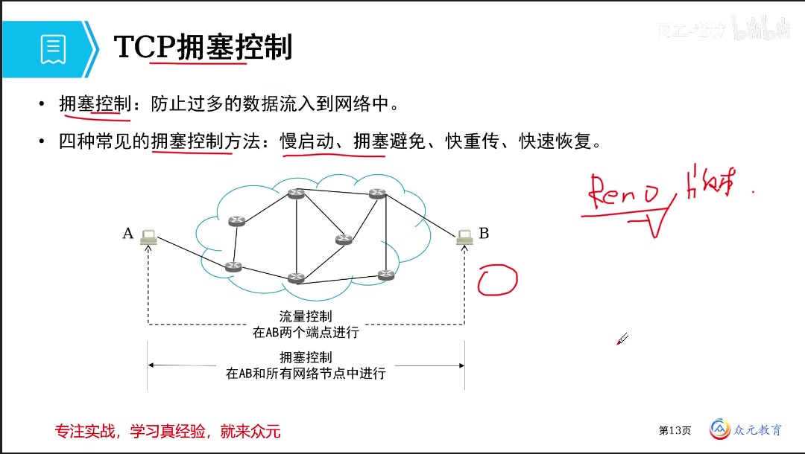

**图 6-2　拥塞控制概述批注版：四种方法与 Reno 标准（p29，第 13 页）**

### 6.2 慢启动与拥塞避免

| 阶段 | 触发条件 | cwnd 变化规则 | 效果 |
| ---- | -------- | ------------- | ---- |
| 慢启动 | **cwnd < ssthresh** | 每收到一个 ACK，cwnd 增大，**呈指数增长**（每经过一个传输轮次翻倍） | 加快初始传输速度 |
| 拥塞避免 | **cwnd ≥ ssthresh** | 进入**线性增长**模式，每经过一个传输轮次 cwnd **加 1** | 降低拥塞风险 |

- **慢启动门限值（ssthresh）**：发送方**预先设定**的一个阈值上限，用于避免慢启动无限翻倍；一旦 cwnd 达到或超过 ssthresh，就停止翻倍、改为每轮 +1，进入拥塞避免。
- 慢启动的"慢"指**初始窗口很小**（从 1 个报文段起步），而非增长速度慢。

[补充] 严格地说，RFC 5681 规定慢启动期间"**每收到一个确认新数据的 ACK，cwnd 至多增加 1 个 SMSS**"，因此**每经过一个 RTT 才翻倍**；课件"每收到一个 ACK 就翻倍"属于简化表述，考试按"**每轮翻倍、指数增长**"理解即可。

### 6.3 出现拥塞时的 cwnd 与 ssthresh 变化

| 场景 | cwnd 新值 | ssthresh 新值 | 后续动作 |
| ---- | --------- | ------------- | -------- |
| **超时（可能拥塞）** | 回退到 **1**（1 个报文段） | **减半**（= 当前 cwnd 的 1/2） | 重新执行**慢启动**（指数增长） |
| **收到 3 个重复 ACK** | 直接置为 **ssthresh** | **减半**（= 当前 cwnd 的 1/2） | 跳过慢启动，**直接执行拥塞避免**（线性增长） |

- 超时对应"**乘法减小 + 从头再来**"：把参数减半后，cwnd 回到最小值 1，重新指数增长，到新的 ssthresh 后转为线性增长。
- 快重传/快恢复对应"**乘法减小 + 不从头开始**"：cwnd 不回退到 1，而是直接取减半后的 ssthresh，立即进入拥塞避免。

[补充] RFC 5681 中阈值按 `ssthresh = max(FlightSize/2, 2*SMSS)` 计算（FlightSize 为已发送未确认的数据量），快恢复时 cwnd 先置为 `ssthresh + 3*SMSS` 再收敛到 `ssthresh`；课件简化为"**当前 cwnd 除以 2**"与"**cwnd = ssthresh**"，软考按课件简化结论作答即可。

### 6.4 快重传与快速恢复

| 方法 | 定义 | 要点 |
| ---- | ---- | ---- |
| 快重传 | 接收方每收到一个**失序报文段**就立即发出**重复确认 ACK**；发送方**一连收到 3 个重复确认**，就**立即重传**对方尚未收到的报文段，而不等待超时 | 减少等待超时带来的延迟 |
| 快速恢复 | 发送方连续收到 **3 个重传确认 ACK** 时，执行**乘法减小**：设 `ssthresh = 当前 cwnd / 2`，并设 `cwnd = ssthresh`，**直接执行拥塞避免算法** | 不回到 cwnd=1，不重新慢启动 |


**图 6-3　慢启动与拥塞避免：ssthresh 初始为 16，超时后减半为 12，cwnd 回退后重新增长（p29，第 14 页）**

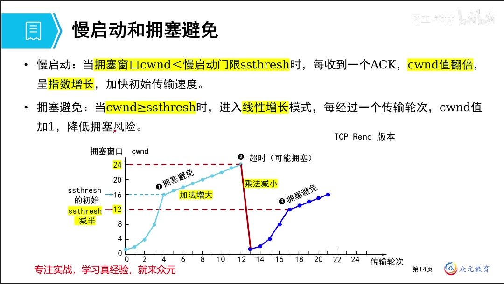

**图 6-4　慢启动与拥塞避免批注版：加法增大、乘法减小（p29，第 14 页）**

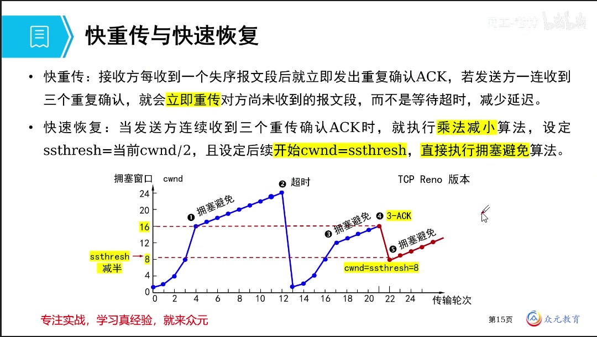

**图 6-5　快重传与快速恢复：图中第 4 段（收到 3-ACK）cwnd 由 16 减半为 8，随后线性增长（p29，第 15 页）**

Reno 版本拥塞窗口在一个完整周期内的变化可概括为：

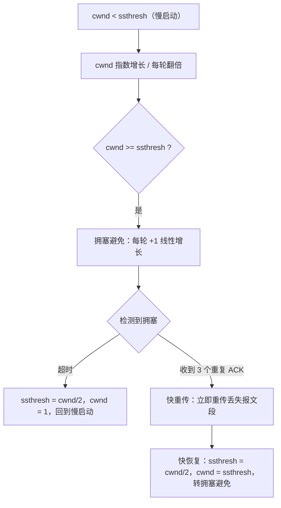

---

## 7.传输层端口号

传输层基于**端口**进行寻址，并通过端口号与上层应用进程交付数据，因此端口号的分类是重点。

### 7.1 端口号的分类

| 类别 | 范围 | 用途与特点 |
| ---- | ---- | ---------- |
| **熟知端口**（公开端口/常用端口） | **0 ~ 1023** | 固定分配给常用服务，**用于服务器**监听固定服务；如同固定电话号码，方便客户端查找 |
| **登记端口** | **1024 ~ 49151** | 用于**新应用/新服务**，可向对应管理组织申请登记 |
| **客户端端口**（随机端口/临时端口） | **49152 ~ 65535** | 客户端随机选取，**用完即释放**，可重复使用，每次可能不同 |

- 分界线为 **1024**：小于 1024 为熟知端口，大于等于 1024 为高端口（登记端口与客户端端口）。
- 1024 本身被保留，一般不直接使用。
- [手写批注] 公开 / `<1024` 服；商 / `>1024`；临时

### 7.2 端口号的查询与 netstat

Windows 下可用 `netstat -n` 查看本机 TCP/UDP 连接，其输出包含**协议、本地地址、目的地址、状态**等信息，可与应用层端口号知识结合考查。

### 7.3 常见端口与服务对应表

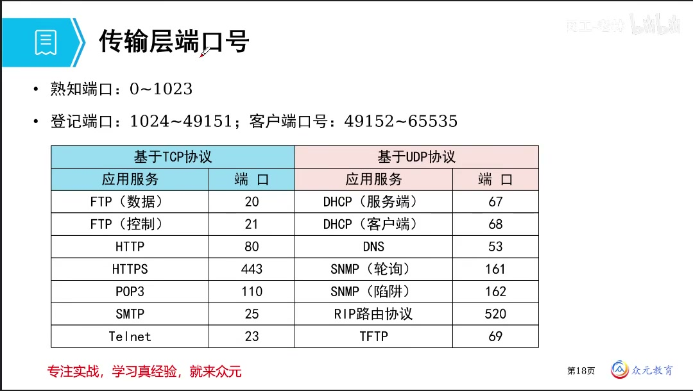

**图 7-1　端口号分类与常见端口总表（p30，第 18 页）**

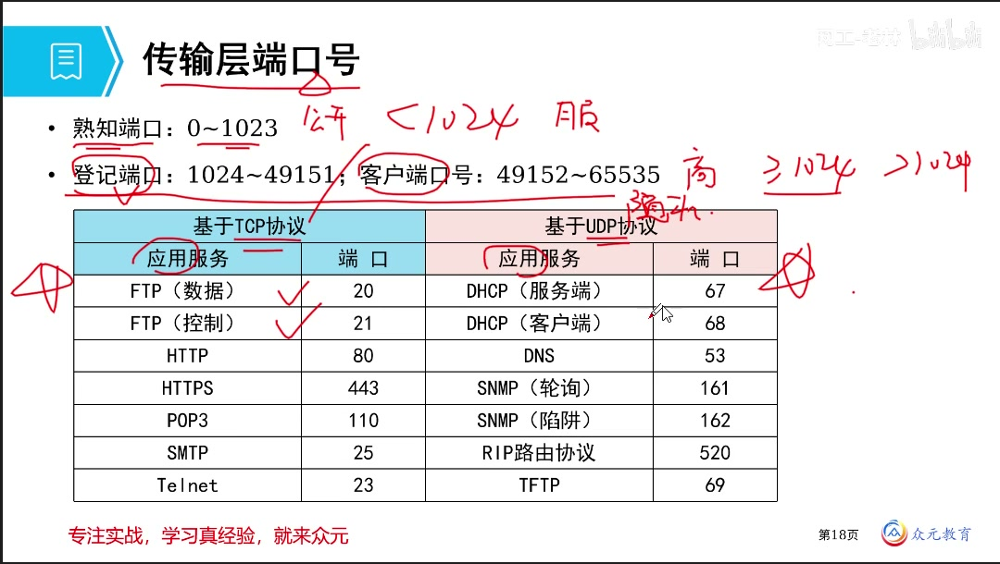

**图 7-2　端口号总表批注版：公开/熟知端口、登记端口与临时端口标注（p30，第 18 页）**

课件给出的常见端口如下（**需能区分基于 TCP 与基于 UDP 的服务**）：

| 基于 TCP 协议 | 端口 | 基于 UDP 协议 | 端口 |
| ------------- | ---- | ------------- | ---- |
| FTP（数据） | 20 | DHCP（服务端） | 67 |
| FTP（控制） | 21 | DHCP（客户端） | 68 |
| HTTP | 80 | DNS | 53 |
| HTTPS | 443 | SNMP（轮询） | 161 |
| POP3 | 110 | SNMP（陷阱） | 162 |
| SMTP | 25 | RIP 路由协议 | 520 |
| Telnet | 23 | TFTP | 69 |

[补充] p29 片尾也曾出现同一张端口号总表，内容与上图一致。

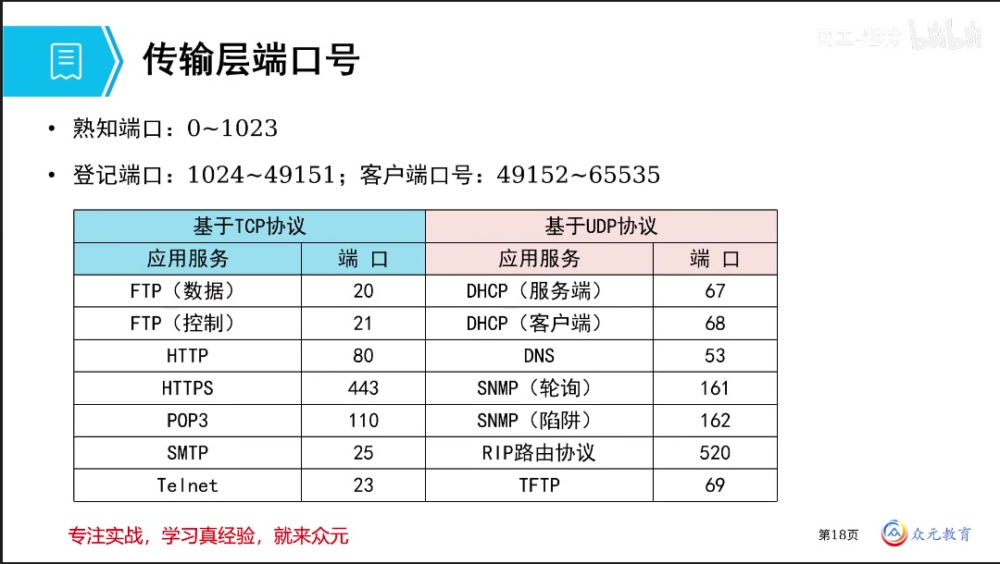

**图 7-3　端口号总表（p29 片尾亦出现，内容与图 7-1 相同）**

[补充] 其他常考端口（需记忆）：

| 服务 | 端口 | 传输层协议 |
| ---- | ---- | ---------- |
| SSH | 22 | TCP |
| IMAP | 143 | TCP |
| DNS（域名解析） | 53 | **UDP 与 TCP 兼用** |
| NTP（网络时间） | 123 | UDP |
| BGP（边界网关协议） | 179 | TCP |
| Syslog | 514 | UDP |

[注意] 域名服务 DNS 的 53 端口**同时使用 UDP 和 TCP**：普通查询用 UDP，区域传送与超长响应使用 TCP，课件表中把 DNS 归入 UDP 一栏属于简化。

---

## 8.典型例题

### 8.1 TCP流量控制与状态判断（p28）

**例题 1**　TCP 使用的流量控制协议是（1），TCP 头中与之相关的字段是（2）。

（1）A、停等应答　B、可变大小的滑动窗口协议　C、固定大小的滑动窗口协议　D、选择重发 ARQ 协议

（2）A、端口号　B、偏移　C、窗口　D、紧急指针

解答：TCP 采用**可变大小的滑动窗口机制**做流量控制，对应首部中的**窗口（window）字段**。

答案：（1）**B**；（2）**C**。

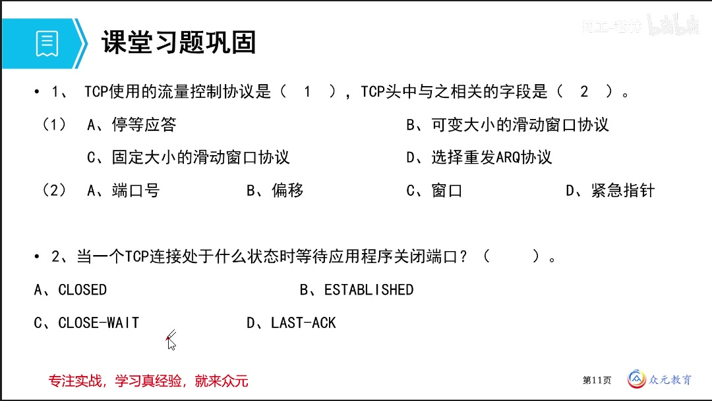

**图 8-1　p28 课堂习题第 1、2 题（第 11 页）**

**例题 2**　当一个 TCP 连接处于什么状态时等待应用程序关闭端口？（　）

A、CLOSED　B、ESTABLISHED　C、CLOSE-WAIT　D、LAST-ACK

解答：**CLOSE-WAIT** 表示被动关闭方已收到对方的 FIN 并发出 ACK，正在**等待本端应用程序关闭端口**。ESTABLISHED 表示连接已建立（正常数据传送），LAST-ACK 表示等待对方对本报文 FIN 的最终确认。

答案：**C**。

**例题 3**　如图所示，从输出的信息中可以确定的是（　）。

```
C:> nestat -n

Active Connections

Proto   Local Address          Foreign Address        Sate
TCP     192.168.0.200:2011     202.100.112.12:443     ESTABUSHED
TCP     192.168.0.200:2038     100.29.200.110:110     TIME_WAIT
TCP     192.168.0.200:2052     128.105.129.30:80      ESTABUSHED
```

[原文拼写如此，正确拼写应为：`netstat`、`State`、`ESTABLISHED`]

A、本地主机正在使用的端口号是公共端口号
B、192.168.0.200 正在与 128.105.129.30 建立连接
C、本地主机与 202.100.112.12 建立了安全连接
D、本地主机正在与 100.29.200.110 建立连接

解答：

| 选项 | 分析 | 结论 |
| ---- | ---- | ---- |
| A | 本地端口 2011、2038、2052 均属于 **1024~49151 登记端口**，不是 0~1023 的熟知（公共）端口 | [错误] |
| B | 与 128.105.129.30:80 的状态为 **ESTABLISHED**，表示连接**已经建立**，而非"正在建立"（正在建立是 SYN 阶段） | [错误] |
| C | 与 202.100.112.12:**443** 的状态为 **ESTABLISHED**，443 为 **HTTPS** 端口，即已建立**安全连接** | [正确] |
| D | 与 100.29.200.110:110 的状态为 **TIME_WAIT**，属于**拆除连接**阶段，并非正在建立 | [错误] |

答案：**C**。

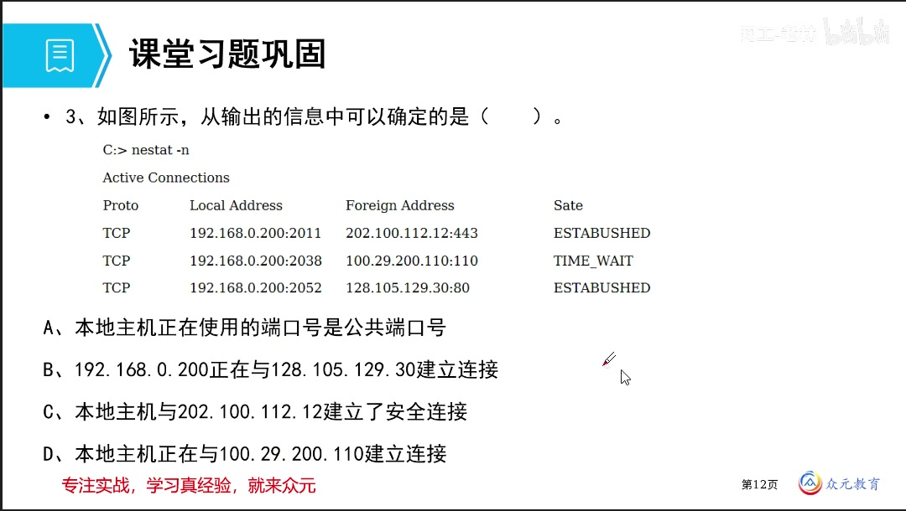

**图 8-2　p28 课堂习题第 3 题：netstat -n 输出分析（第 12 页）**

### 8.2 TCP拥塞控制（p29）

**例题 1**　在 TCP 拥塞控制机制中，快速重传的目的是让主机在计时器超时前快速恢复，其触发条件是（　）。

A、计时器超时　B、拥塞窗口超过阈值　C、收到该报文的 ACK　D、收到 3 个冗余 ACK

解答：快速重传是"不等超时"的补救手段，触发条件为**收到 3 个重复（冗余）ACK**。

答案：**D**。

**例题 2**　以下关于 TCP 拥塞控制机制的说法中，错误的是（　）。

A、慢启动阶段将拥塞窗口值设置为 1
B、慢启动算法执行时拥塞窗口指数增长，直到拥塞窗口值达到慢启动门限值
C、在拥塞避免阶段，拥塞窗口线性增长
D、当网络出现拥塞时，慢启动门限值恢复为初始值

解答：出现拥塞时，慢启动门限值应**减半**（= 当前 cwnd 的 1/2），而不是恢复为初始值。

答案：**D**。

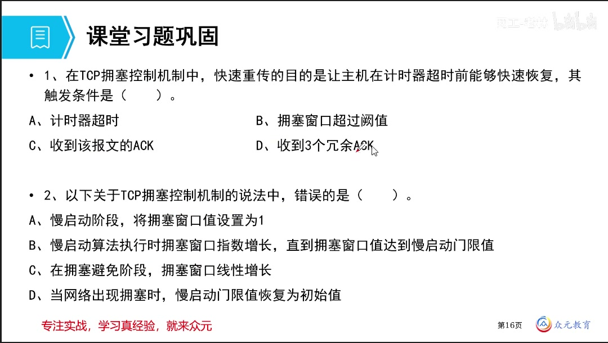

**图 8-3　p29 课堂习题第 1、2 题（第 16 页）**

**例题 3**　当一个 TCP 连接的拥塞窗口为 4000 字节，每个往返时间为 0.2 秒，丢包率为 0.05 时，该连接的快恢复拥塞窗口新值是（　）。

A、2000 字节　B、1800 字节　C、2100 字节　D、1900 字节

解答：快速恢复执行**乘法减小**，把拥塞窗口减半：

```
新 cwnd = 4000 ÷ 2 = 2000 字节
```

题干中的往返时间（0.2 秒）与丢包率（0.05）均为干扰条件。

答案：**A**。

**例题 4**　TCP 采用慢启动进行拥塞控制，若 TCP 在某轮拥塞窗口为 8 时出现拥塞，经过 4 轮均成功收到应答，此时拥塞窗口为（　）。

A、5　B、6　C、7　D、8

解答：拥塞（超时）发生时 cwnd=8，则：

```
ssthresh = 8 ÷ 2 = 4
cwnd = 1
```

随后逐轮变化（每轮 = 一个传输轮次）：

| 轮次 | 变化 | 轮末 cwnd |
| ---- | ---- | --------- |
| 第 1 轮 | 慢启动，翻倍 1 → 2 | 2 |
| 第 2 轮 | 慢启动，翻倍 2 → 4（达到 ssthresh） | 4 |
| 第 3 轮 | 拥塞避免，加 1：4 → 5 | 5 |
| 第 4 轮 | 拥塞避免，加 1：5 → 6 | 6 |

因此经过 4 轮后，拥塞窗口为 **6**。

答案：**B**。

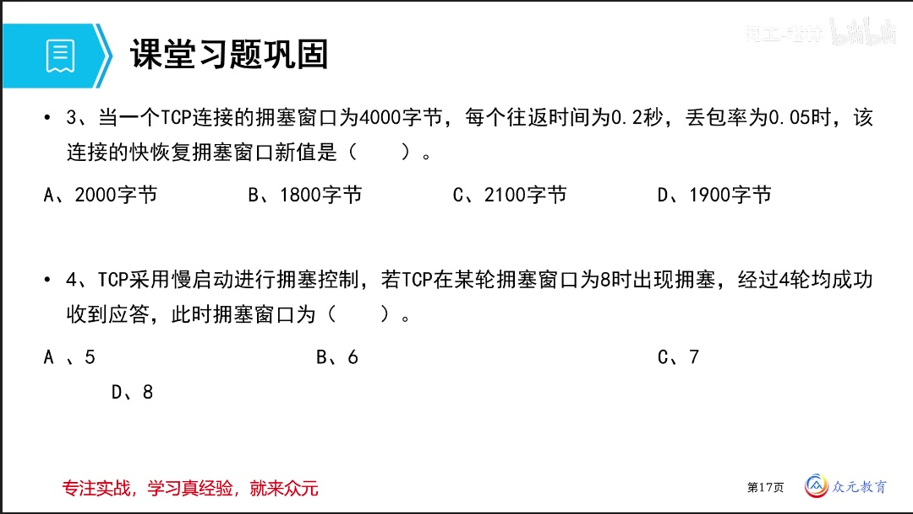

**图 8-4　p29 课堂习题第 3、4 题（第 17 页）**

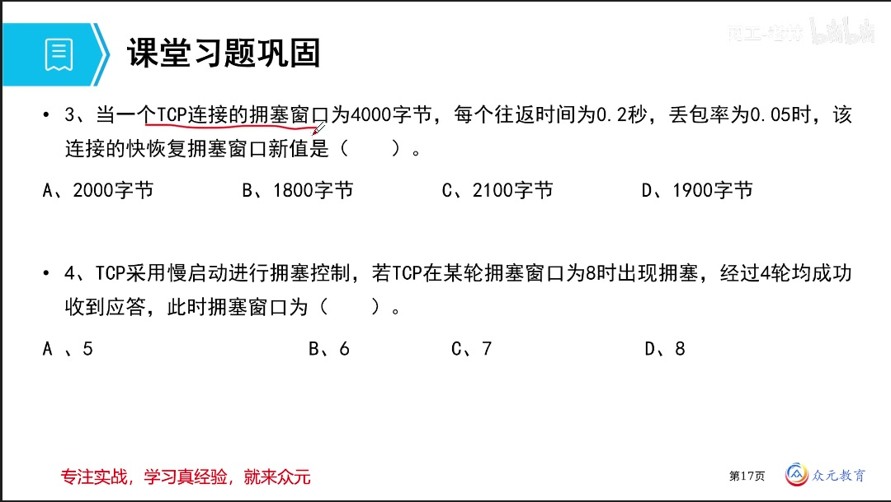

**图 8-5　p29 课堂习题第 3、4 题批注版（第 17 页）**

### 8.3 传输层端口号（p30）

**例题 1**　下面的应用层协议中通过 UDP 传送的是（　）。

A、SMTP　B、TFTP　C、POP3　D、HTTP

解答：**TFTP（简单文件传输协议，端口 69）基于 UDP**；SMTP（25）、POP3（110）、HTTP（80）均基于 TCP。

答案：**B**。

**例题 2**　用户在登录 FTP 服务器的过程中，建立 TCP 连接时使用的默认端口号是（　）。

A、20　B、21　C、22　D、23

解答：FTP 使用 20（数据连接）与 21（控制连接）两个端口；登录、建立 TCP 连接使用的是**控制连接端口 21**。22 为 SSH，23 为 Telnet。

答案：**B**。

**例题 3**　访问 HTTP 和 HTTPS 连接分别使用的端口是（　）。

A、443 和 80　B、80 和 443　C、80 和 80　D、443 和 443

解答：HTTP 默认端口 **80**，HTTPS 默认端口 **443**。

答案：**B**。

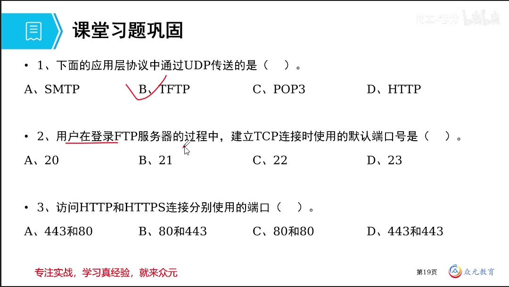

**图 8-6　p30 课堂习题第 1~3 题（批注版，第 19 页）**


**图 8-7　p30 课堂习题第 1~3 题（第 19 页）**

---

## 9.本章小结

| 知识点 | 核心内容 |
| ------ | -------- |
| 1. 三次握手 | 报文序列 `SYN=1,seq=x` → `SYN=1,ACK=1,seq=y,ack=x+1` → `ACK=1,seq=x+1,ack=y+1`；状态 CLOSED→SYN-SENT→ESTABLISHED（客户）、CLOSED→LISTEN→SYN-RCVD→ESTABLISHED（服务器） |
| 2. 三次握手的目的 | 防止失效的连接请求造成错误连接；抵御 SYN Flood 非法请求、避免资源被无效连接占用 |
| 3. 四次挥手 | 报文序列 `FIN=1,seq=u` → `ACK=1,ack=u+1` → `FIN=1,ACK=1,seq=w,ack=u+1` → `ACK=1,ack=w+1`；存在半关闭模式 |
| 4. 四次挥手状态 | 客户 ESTABLISHED→FIN-WAIT-1→FIN-WAIT-2→TIME-WAIT→CLOSED；服务器 ESTABLISHED→CLOSE-WAIT→LAST-ACK→CLOSED；CLOSE-WAIT 的含义是等待本端应用关闭端口 |
| 5. TIME-WAIT 与 2MSL | 主动关闭方等待 2MSL 才关闭：保证最后的 ACK 到达、避免旧报文段干扰新连接；MSL 典型取值 2 分钟，TIME-WAIT 约 4 分钟 |
| 6. 面向字节流 | 按字节编号，序号 32 位（0~2³²−1）；报文段首部 seq 记录第一个字节编号；经发送缓存—加首部—接收缓存—向上交付 |
| 7. 可靠传输机制 | 累计确认、超时重传、快速重传（收到 3 个重复 ACK 立即重传）、选择确认 SACK、校验和 |
| 8. 流量控制 | 可变大小的滑动窗口机制；接收窗口 rwnd 由接收方通告；相关字段为首部窗口（window）字段 |
| 9. 发送窗口 | `发送窗口 = min(rwnd, cwnd)` |
| 10. 拥塞控制四方法 | 慢启动、拥塞避免、快重传、快速恢复（Reno 标准） |
| 11. 慢启动与拥塞避免 | cwnd < ssthresh 时指数增长（每轮翻倍）；cwnd ≥ ssthresh 时线性增长（每轮 +1） |
| 12. 拥塞时的参数变化 | 超时：cwnd=1、ssthresh 减半、重新慢启动；收到 3 个重复 ACK：ssthresh 减半、cwnd=ssthresh、直接拥塞避免 |
| 13. 端口号分类 | 熟知端口 0~1023；登记端口 1024~49151；客户端（随机/临时）端口 49152~65535 |
| 14. 常见端口 | FTP 20/21、Telnet 23、SMTP 25、DNS 53、DHCP 67/68、TFTP 69、HTTP 80、POP3 110、SNMP 161/162、HTTPS 443、RIP 520 |

考试重点：

1. **三次握手与四次挥手的工作字段与状态迁移**：牢记 SYN、seq、ACK、ack、FIN 的使用，以及 SYN-SENT、LISTEN、SYN-RCVD、ESTABLISHED、FIN-WAIT-1/2、CLOSE-WAIT、LAST-ACK、TIME-WAIT 的含义。
2. **TIME-WAIT 与 2MSL**：主动关闭方等待 2MSL 的两个原因。
3. **流量控制协议与字段**：可变大小的滑动窗口机制，对应首部窗口字段；发送窗口 = min(rwnd, cwnd)。
4. **拥塞控制四阶段的计算**：判断题目处于慢启动还是拥塞避免；出现超时或 3 个重复 ACK 时 cwnd 与 ssthresh 的不同变化（关键在于是否"从头再来"）。
5. **拥塞窗口例题计算**：先由 `ssthresh = 当前 cwnd/2`、`cwnd = 1` 重置，再逐轮推演（慢启动翻倍至门限，之后每轮加 1）。
6. **端口号分类边界**：以 1024 为界，牢记 0~1023、1024~49151、49152~65535 三段。
7. **常见端口与协议**：能准确判断服务基于 TCP 还是 UDP（TFTP/DHCP/SNMP/RIP 基于 UDP；FTP/HTTP/HTTPS/POP3/SMTP/Telnet 基于 TCP；DNS 兼用 UDP 与 TCP）。
