# IPv6编址与过渡技术 · 完整笔记

---

## 1.IPv6编址概述

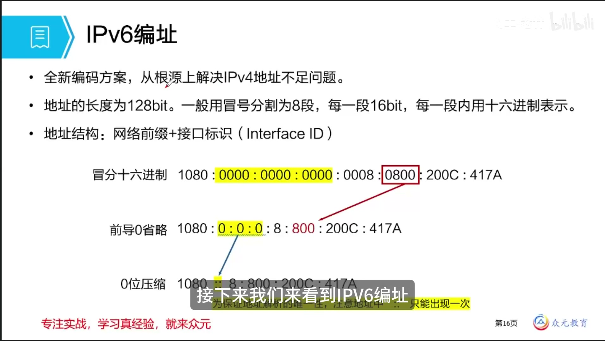

IPv6 是一种**全新的编码方案**，其根本目的是从根源上解决 IPv4 地址不足的问题。IPv4 地址长度为 32 位，地址总数为 `2^32 ≈ 43 亿`；IPv6 直接把地址长度扩容到 **128 位**，地址总数为 `2^128`，从数量上彻底解决问题。

### 1.1 提出背景

- IPv6 的提出时间很早，但受**用户、设备制造商、服务平台三方**的约束，长期未能有效推进；
- 普通用户不感知网络层 IP 地址的差异，只要求能上网；设备制造商升级 IPv6 耗费大、动力不足；服务平台认为用户不感知，缺乏采用 IPv6 的需求；
- 直到 IPv4 地址真正枯竭、由国家层面推动，IPv6 才大规模落地。

### 1.2 IPv4 与 IPv6 的主要差异

| 比较项 | IPv4 | IPv6 |
| ------ | ---- | ---- |
| 地址长度 | 32 位 | **128 位** |
| 表示方法 | 点分十进制 | **冒号十六进制（冒分十六进制）** |
| 分段方式 | 4 段，每段 8 位 | 8 段，每段 16 位 |
| 广播地址 | 有广播 | **无广播**，改用组播与任播 |
| 首部长度 | 变长（20 ~ 60 字节） | **固定 40 字节** |
| 地址配置 | 静态、DHCP | 静态、SLAAC、DHCPv6 |
| 地址解析 | ARP | NDP（基于 ICMPv6） |

---

## 2.IPv6地址结构与压缩规则

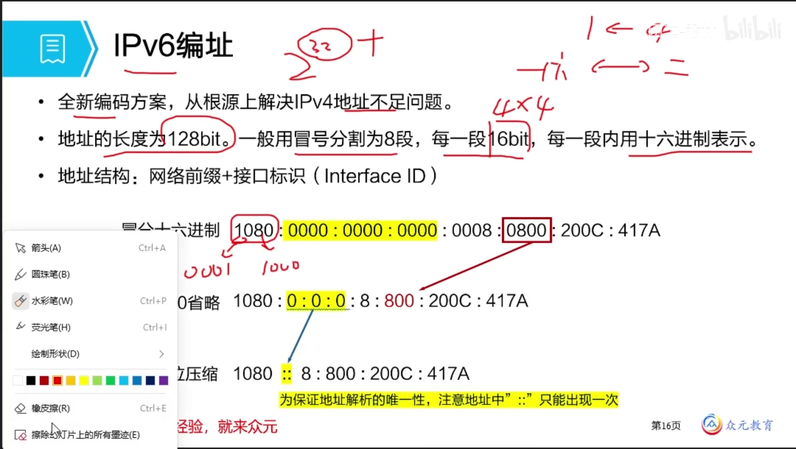

### 2.1 冒号十六进制表示

IPv6 地址长度为 **128 bit**。若仍沿用点分十进制表示，128 位地址的可读性极差，因此改用**冒号十六进制（冒分十六进制）**：

- 用**冒号**把地址分割为 **8 段**；
- 每一段 **16 bit**（4 位十六进制数字）；
- 每一段内用**十六进制**表示。

```
1080:0000:0000:0000:0008:0800:200C:417A
 └8 段，每段 16 bit，共 128 bit┘
```

### 2.2 十六进制与二进制的转换

转换规则：**每 4 位二进制转换为 1 位十六进制**。按 8421 码权值（8、4、2、1）相加即可：

| 十六进制 | 二进制 | 说明 |
| -------- | ------ | ---- |
| 1 | 0001 | 权值 1 |
| 8 | 1000 | 权值 8 |
| 2 | 0010 | 权值 2 |
| 0 | 0000 | 全 0 |

一个十六进制数字代表 4 位二进制，一段 4 个十六进制数字正好 16 位。

### 2.3 地址结构：网络前缀与接口标识

IPv6 地址由两部分构成：

```
IPv6 地址 = 网络前缀 + 接口标识（Interface ID）
```

| 部分 | 位数 | 含义 |
| ---- | ---- | ---- |
| 网络前缀 | 前 64 位 | 网络位，标识设备所在网络 |
| 接口标识 | 后 64 位 | 主机位，标识网络中的具体接口 |

要点：

- **接口标识依据接口的 MAC 地址转换而来**，转换为 **64 bit**，常用规则为 **EUI-64 扩展标准**；
- 网络前缀与接口标识分别对应 IPv4 中的**网络位与主机位**；
- 若需要划分子网，可以在网络前缀与接口标识之间的位置**加入子网 ID**，因此 IPv6 同样可以划分子网（软考中会出现此类题目，注意辨别）。

### 2.4 前导零省略

规则：**每一段内高位的 0 可以省略，但不能省略整个字段**。

- 省略的是“每段内部的高位零”，称为**前导零省略**；
- 全零字段**至少保留一个 0**，不能把整段删掉；
- 不能省略有效数字前的“非高位零”，否则数值会改变。

示例：

```
0800 -> 800     （省略高位的 0，段仍保留）
0000 -> 0       （全零段保留一个 0）
```

### 2.5 零位压缩（双冒号）

当出现**连续的全零字段**时，可用**双冒号 `::`** 一次性压缩。

- 双冒号表示“这里有一段连续的 0”，压缩的字段数量由总段数 8 反推；
- 为保证地址书写的**唯一性**，**`::` 在整个地址中只能出现一次**；
- 如果已经压缩了前面的连续零，后面即使还有连续零也不能再压缩。

### 2.6 压缩规则汇总与示例

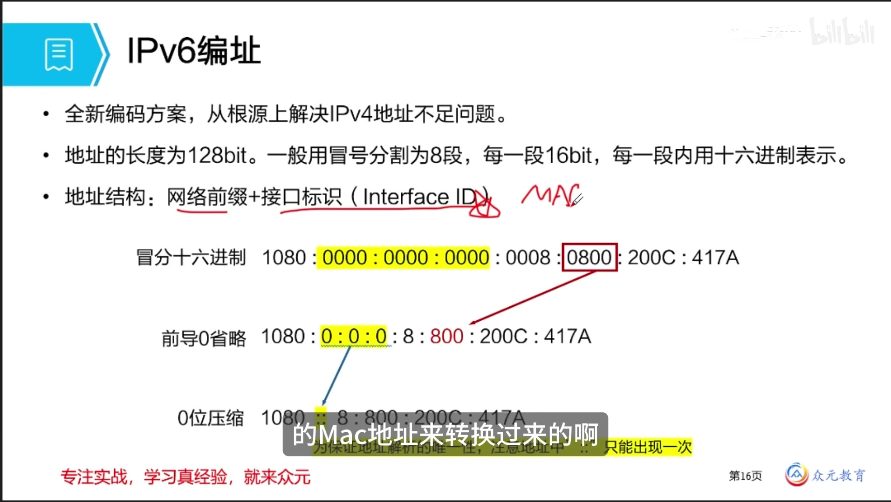

以 `1080:0000:0000:0000:0008:0800:200C:417A` 为例，逐级压缩：

| 步骤 | 结果 | 说明 |
| ---- | ---- | ---- |
| 冒号十六进制（完整） | `1080:0000:0000:0000:0008:0800:200C:417A` | 8 段完整书写 |
| 前导零省略 | `1080:0:0:0:8:800:200C:417A` | 各段去掉高位 0，全零段保留一个 0 |
| 零位压缩 | `1080::8:800:200C:417A` | 连续零段用 `::` 压缩 |

压缩规则小结：

| 规则 | 内容 |
| ---- | ---- |
| 前导零省略 | 每段高位 0 可省，全零段至少保留一个 0 |
| 零位压缩 | 连续全零段用 `::` 表示 |
| 唯一性 | `::` 在整条地址中**只能出现一次** |
| 段数守恒 | 压缩后加上被 `::` 代表的段数，仍必须是 8 段 |

**零压缩的口诀：省的是“高位零”，压的是“连续零”，`::` 只用一次。**

---

## 3.IPv6地址类型

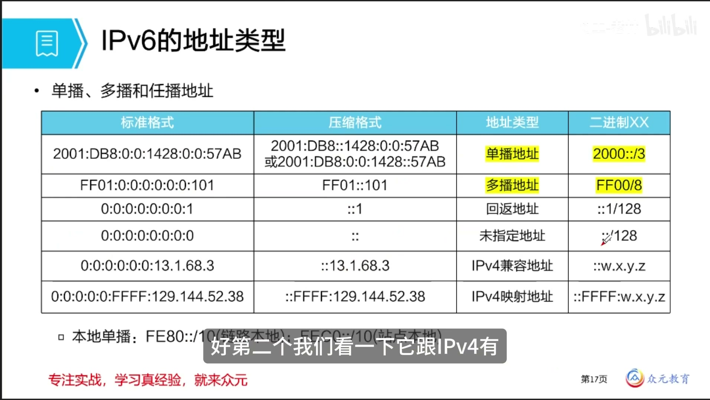

### 3.1 三种地址类型

IPv6 的地址类型与 IPv4 有相同点也有差异：

| 类型 | 通信关系 | 说明 |
| ---- | -------- | ---- |
| 单播 | 一对一 | 标识单个接口，送至该接口 |
| 多播（组播） | 一对一组 | 送至加入该组播组的所有接口 |
| 任播 | 一对“最近的一个” | 从单播地址空间中选取，送至最近的一个接口 |

关键区别：

- IPv6 **没有广播地址**（取消广播），改用**组播**与**任播**；
- **任播地址取自单播地址空间**，与单播地址在书写上无法区分。

### 3.2 单播地址

单播地址分为全球单播地址与本地单播地址：

| 类别 | 前缀 | 位数特征 | 说明 |
| ---- | ---- | -------- | ---- |
| 全球单播地址（公网地址） | **2000::/3** | 最高三位为 `001` | 由提供商指定给一个组织机构，通常全球前缀至少 48 位；以“2”开头 |
| 链路本地地址 | **FE80::/10** | 前 10 位固定 `1111111010` | 应用范围受限，用于**邻居发现、地址自动配置**，网络启动即生成，只在本链路有效 |
| 站点本地地址 | **FEC0::/10** | 前 10 位固定 | 无法访问 Internet 的本地网络使用，相当于 IPv4 私有单播地址（**已被废弃，见存疑点**） |
| 唯一本地地址（ULA） | **FC00::/7** | 前 7 位固定 | 站点本地地址的现行替代方案，本地位址、不可全球路由 |

全球单播地址的结构：

```
| 全球路由前缀（n 位） | 子网 ID（m 位） | 接口标识（128−n−m 位） |
```

注意：全球单播地址**以 2 开头**，是因为其最高三位固定为 `001`（`2000` 的二进制前三位即 `001`）。

### 3.3 组播地址

- 组播地址的**高 8 位全为 1**，即 **`FF` 开头**，地址块为 **FF00::/8**；
- 组播地址只能作为目的地址，不能作为源地址。

例如组播地址 `FF01:0:0:0:0:0:0:101`，压缩写法为 `FF01::101`。

### 3.4 任播地址

- 任播地址从单播地址空间中选取，**代表一组接口**；
- 数据送往该组中**“最近的一个”**接口（依据路由度量）；
- 典型用途是作为**目标地址**，一般配置在**路由器**上，而**不用于主机**；
- 记忆：任播就是“一对最近的一个”，像宣布通知时“离我最近的那个人”代为转达。

### 3.5 特殊地址

| 标准格式 | 压缩格式 | 地址类型 | 前缀/记法 | 说明 |
| -------- | -------- | -------- | --------- | ---- |
| `0:0:0:0:0:0:0:1` | `::1` | 环回地址 | `::1/128` | 相当于 IPv4 的 `127.0.0.1`，用于测试 TCP/IP 协议栈是否正常 |
| `0:0:0:0:0:0:0:0` | `::` | 未指定地址 | `::/128` | 相当于 IPv4 的 `0.0.0.0`，表示“本网络上的本主机” |
| `0:0:0:0:0:0:13.1.68.3` | `::13.1.68.3` | IPv4 兼容地址 | `::w.x.y.z` | 前 80 位全 0、后 32 位为 IPv4 地址，曾用于 IPv6 与 IPv4 通信、隧道场景（**已废弃**） |
| `0:0:0:0:0:FFFF:129.144.52.38` | `::FFFF:129.144.52.38` | IPv4 映射地址 | `::FFFF:w.x.y.z` | 前 80 位全 0、第 81~96 位为全 1，后 32 位为 IPv4 地址，用于双栈中表示 IPv4 节点 |

说明：

- **IPv4 兼容地址与 IPv4 映射地址的区别**在于前 96 位：兼容地址前 96 位全 0；映射地址前 80 位为 0、中间 16 位为 `FFFF`。二者后 32 位都用 IPv4 地址表示，主要用于 IPv6 与 IPv4 网络的兼容与隧道通信；
- 课件将环回地址写作“回返地址”，标准术语为**环回地址**。

### 3.6 地址类型识别（二进制前缀）

依据地址的高位比特即可判定类型：

| 地址类型 | 二进制前缀 | IPv6 记法 |
| -------- | ---------- | --------- |
| 未指定 | 全 0（128 位） | `::/128` |
| 环回 | 全 0……1（128 位） | `::1/128` |
| 组播 | `11111111` | `FF00::/8` |
| 链路本地单播 | `1111111010` | `FE80::/10` |
| 全球单播 | 除上述以外的范围 | `2000::/3`（当前分配范围） |

### 3.7 课堂习题

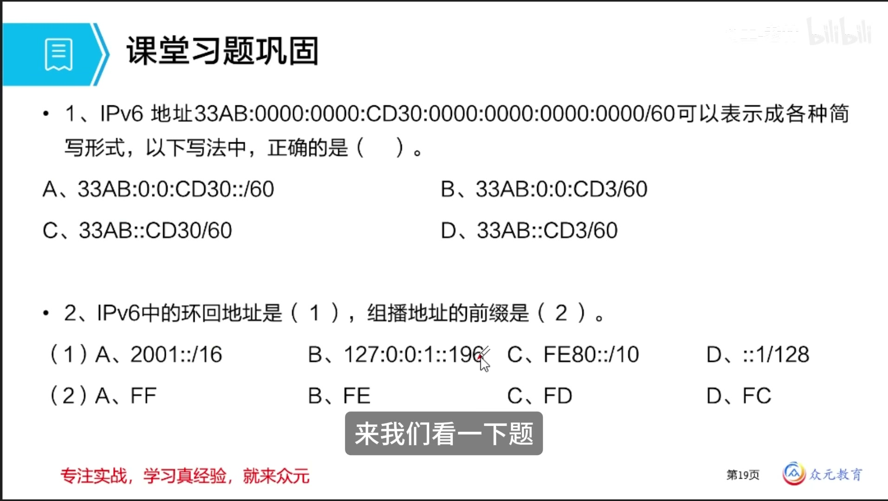

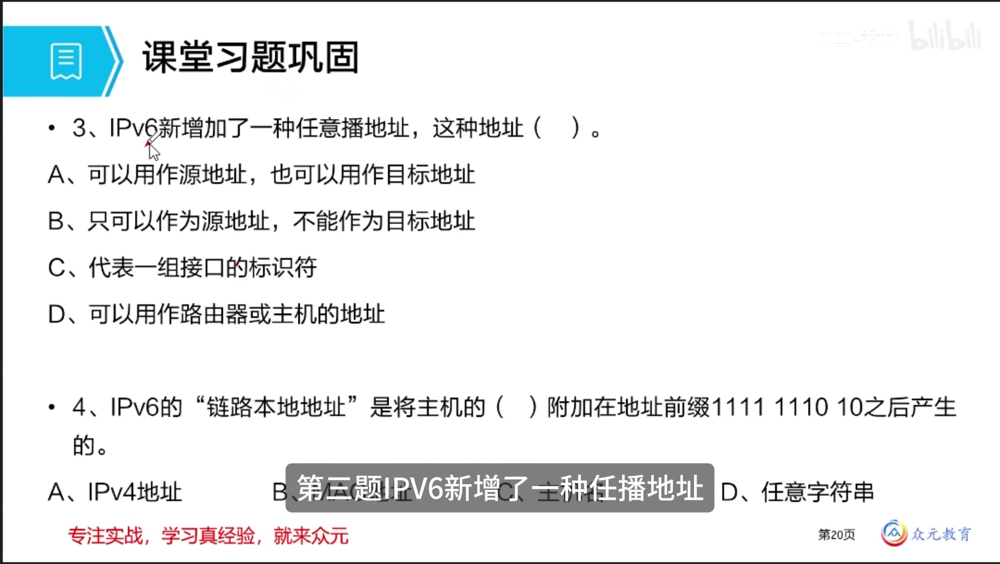

#### 例题1：IPv6 地址的简写形式判断

**题干**：IPv6 地址 `33AB:0000:0000:CD30:0000:0000:0000:0000/60` 可以表示成各种简写形式，以下写法中，正确的是（ ）。

- A、`33AB:0:0:CD30::/60`
- B、`33AB:0:0:CD3/60`
- C、`33AB::CD30/60`
- D、`33AB::CD3/60`

**解答**：

- 前导零省略时，每段**至少要保留一个 0**，且**不能省略有效数字**；B、D 把 `CD30` 写成 `CD3`，改变了数值，故 [错误]；
- 零位压缩 `::` **只能用一次**，且压缩后必须仍能还原为 8 段。C 写作 `33AB::CD30`，`::` 只能代表中间连续的 0 段，展开后无法还原原有的 `CD30:0000:0000:0000:0000`，故 [错误]；
- A 写作 `33AB:0:0:CD30::/60`，`::` 代表末尾连续的全零段，展开即为 `33AB:0000:0000:CD30:0000:0000:0000:0000`，与原地址一致，故 [正确]。

**答案：A**

#### 例题2：环回地址与组播前缀

**题干**：IPv6 中的环回地址是（1），组播地址的前缀是（2）。

（1）
- A、`2001::/16`
- B、`127:0:0:1::196`
- C、`FE80::/10`
- D、`::1/128`

（2）
- A、`FF`
- B、`FE`
- C、`FD`
- D、`FC`

**解答**：

| 空 | 选项 | 判断 |
| -- | ---- | ---- |
| （1） | D、`::1/128` | 环回地址，相当于 `127.0.0.1` | 
| （1） | A、`2001::/16` | 全球单播范围，[错误] |
| （1） | B、`127:0:0:1::196` | 非法 IPv6 地址，[错误] |
| （1） | C、`FE80::/10` | 链路本地地址，[错误] |
| （2） | A、`FF` | 组播地址高 8 位全 1，前缀 `FF00::/8`，[正确] |
| （2） | B、`FE` | 链路本地（`FE80::/10`），[错误] |
| （2） | C、`FD` | 唯一本地地址范围（`FC00::/7`），[错误] |
| （2） | D、`FC` | 唯一本地地址范围（`FC00::/7`），[错误] |

**答案：（1）D；（2）A**

#### 例题3：任播地址的特点

**题干**：IPv6 新增加了一种任意播地址，这种地址（ ）。

- A、可以用作源地址，也可以用作目标地址
- B、只可以作为源地址，不能作为目标地址
- C、代表一组接口的标识符
- D、可以用作路由器或主机的地址

**解答**：任播地址从单播地址空间中选取，**代表一组接口的标识符**，数据被送往其中“最近的一个”接口；它典型用作**目标地址**，一般用于路由器而非主机。

| 选项 | 判断 |
| ---- | ---- |
| A | 任播不用于源地址，[错误] |
| B | 任播主要用作目标地址，[错误] |
| C | 代表一组接口的标识符，[正确] |
| D | 一般用于路由器，不是“路由器或主机”通用，[错误] |

**答案：C**

#### 例题4：链路本地地址的生成依据

**题干**：IPv6 的“链路本地地址”是将主机的（ ）附加在地址前缀 `1111 1110 10` 之后产生的。

- A、IPv4 地址
- B、[文字被遮挡]
- C、[文字被遮挡]
- D、任意字符串

**解答**：链路本地地址前缀为 `1111 1110 10`（即 `FE80::/10`），后缀是**接口标识**，由主机的 **MAC 地址**经 EUI-64 扩展生成。

**答案：B（MAC 地址）**

---

## 4.IPv6地址配置方式

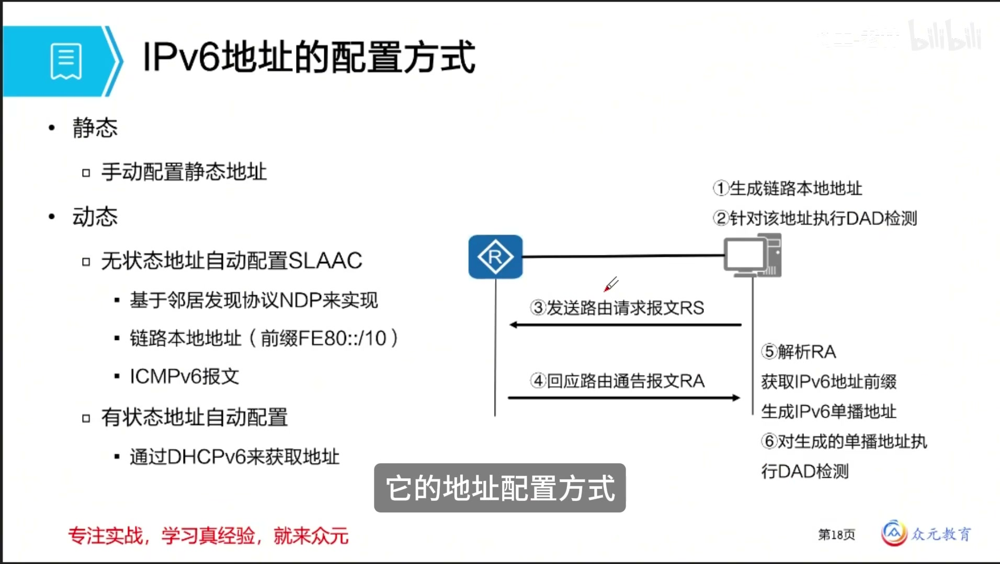

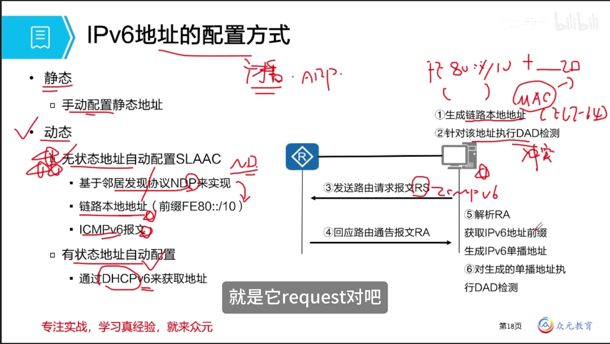

IPv6 的地址配置方式与 IPv4 大体相似，但因其**没有广播**，需要借助其它手段完成地址分配。

| 配置方式 | 细分 | 说明 |
| -------- | ---- | ---- |
| 静态 | 手动配置静态地址 | 与 IPv4 静态配置一致；地址很长、配置麻烦，除非做实验，一般很少使用 |
| 动态 | 无状态地址自动配置（SLAAC） | 目前较常用，基于**邻居发现协议 NDP** 实现 |
| 动态 | 有状态地址自动配置 | 通过 **DHCPv6** 获取地址，本质是 DHCP 的 IPv6 版本 |

### 4.1 静态配置

- 手动为主机接口配置完整的 IPv6 地址；
- 优点是不依赖服务器，缺点是地址长、易错、维护成本高。

### 4.2 动态配置

IPv6 无广播，无法使用 ARP 在本链路进行地址解析，因此动态配置改由**邻居发现协议（NDP）**完成。SLAAC 主要用到两个要素：

- **链路本地地址**：前缀固定为 `FE80::/10`；
- **ICMPv6 报文**：承载邻居发现与地址配置的交互消息。

### 4.3 无状态地址自动配置（SLAAC）工作流程

主机与路由器之间的交互分为六步：

| 步骤 | 动作 | 说明 |
| ---- | ---- | ---- |
| 1 | 生成链路本地地址 | 前缀 `FE80::/10` + 由 MAC 地址经 EUI-64 生成的接口标识，拼成链路本地地址 |
| 2 | 对该地址执行 DAD 检测 | 重复地址检测（DAD），检查地址是否冲突、能否使用 |
| 3 | 发送路由请求报文 RS | 主机向路由器发送 ICMPv6 的**路由请求（Router Solicitation）**报文 |
| 4 | 回应路由通告报文 RA | 路由器回应**路由通告（Router Advertisement）**报文，携带网络前缀等信息 |
| 5 | 解析 RA | 获取 IPv6 地址前缀，用“前缀 + 接口标识”生成 IPv6 单播地址 |
| 6 | 对生成的单播地址执行 DAD 检测 | 再次检查该单播地址是否冲突；无冲突则启用 |

要点：**无状态**指主机不需要 DHCP 服务器记录地址分配状态，地址的主机位由主机自己根据 MAC 地址生成，路由器只提供前缀。

### 4.4 EUI-64 接口标识的生成

EUI-64 把 48 位 MAC 地址扩展为 64 位接口标识：

| 步骤 | 操作 |
| ---- | ---- |
| 1 | 取接口的 48 位 MAC 地址 |
| 2 | 在 OUI（前 24 位）与厂商扩展标识（后 24 位）**中间插入 16 位 `FFFE`** |
| 3 | 将第 1 个字节的**第 7 位（U/L 位，universal/local）取反** |
| 4 | 得到 64 位接口标识，拼接到网络前缀之后 |

示例：MAC 地址为 `00-1A-2B-3C-4D-5E`：

```
MAC：       00  1A  2B  3C  4D  5E
插入 FFFE： 00  1A  2B  FF  FE  3C  4D  5E
第 7 位取反：02  1A  2B  FF  FE  3C  4D  5E
接口标识：  021A:2BFF:FE3C:4D5E
```

第一字节 `00`（`0000 0000`）的第 7 位由 0 取反为 1，得到 `0000 0010` 即 `02`。

---

## 5.IPv6报文格式的简化（补充）

> 本节为备考补充内容，源视频未展开讲解。IPv6 首部按 RFC 8200 整理，用于对比 IPv4 报文，帮助理解“IPv6 报文更简单、转发更快”的原因。

IPv6 **基本首部固定为 40 字节**，相比 IPv4 报文做了多处简化：

| 简化点 | 说明 |
| ------ | ---- |
| 固定首部长度 | 基本首部固定 40 字节，**取消 IPv4 的“首部长度（IHL）”字段** |
| 取消首部检验和 | IPv4 的首部校验和取消，差错检测交由链路层与上层协议负责 |
| 取消分片相关字段 | 取消标识、标志、片偏移；**分片只在源端进行**，中间路由器不再分片 |
| 选项改扩展首部 | 取消“选项”字段，改用**扩展首部（Extension Header）**，按需插入、不在基本首部内 |
| 取消广播 | 用**组播与任播**替代广播 |
| 地址字段加长 | 源地址、目的地址各 **128 位** |
| 下一首部字段 | 用“下一首部（Next Header）”替代 IPv4 的“协议”字段，标识上层协议或下一个扩展首部 |
| 跳数限制字段 | 用“跳数限制（Hop Limit）”替代 IPv4 的“生存时间（TTL）” |

IPv6 基本首部字段：

| 字段 | 位数 | 作用 |
| ---- | ---- | ---- |
| 版本（Version） | 4 | 版本号，IPv6 取 6 |
| 流量类别（Traffic Class） | 8 | 区分不同服务类别 |
| 流标签（Flow Label） | 20 | 标识同一数据流，便于流处理 |
| 载荷长度（Payload Length） | 16 | IPv6 首部之后的数据长度 |
| 下一首部（Next Header） | 8 | 标识上层协议或下一个扩展首部 |
| 跳数限制（Hop Limit） | 8 | 每经过一个节点减 1，为 0 时丢弃 |
| 源地址 | 128 | 发送方地址 |
| 目的地址 | 128 | 接收方地址 |

补充：IPv6 用 **NDP（基于 ICMPv6）**取代 IPv4 中的 ARP 与 IGMP 功能。

---

## 6.IPv4到IPv6过渡技术

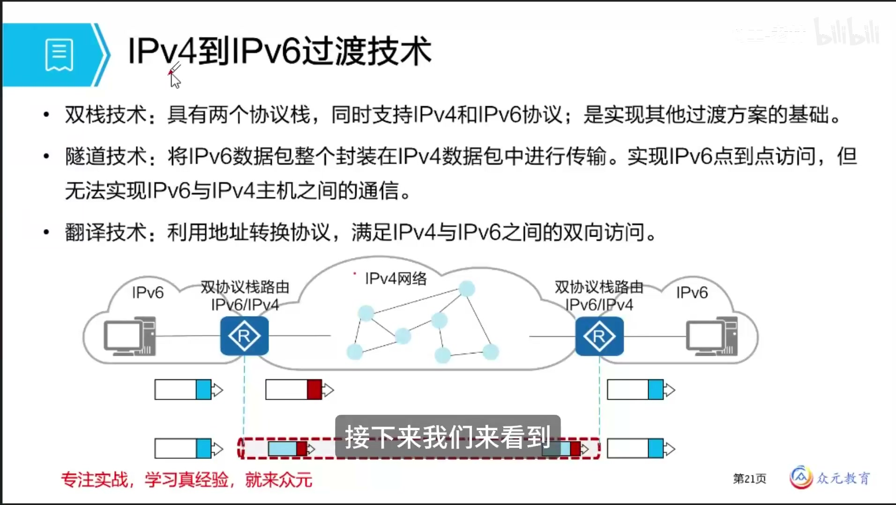

### 6.1 兼容性问题与三类过渡方案

IPv6 能从根源解决 IPv4 地址不足问题，但推广缓慢，主要原因是**两种技术不兼容**：报文格式、地址长度、数据都不同，无法直接互通。过渡期间需要兼顾新旧网络，因此采用三类技术：

| 过渡技术 | 核心思想 | 能力与限制 |
| -------- | -------- | ---------- |
| 双栈 | 设备同时具备两个协议栈，支持 IPv4 与 IPv6 | 是**实现其它过渡方案的基础**，一般在网络边界路由器上配置 |
| 隧道 | 把整个 IPv6 数据包封装进 IPv4 数据包传输 | 实现 **IPv6 到 IPv6 的点到点访问**，但**无法实现 IPv6 与 IPv4 主机之间的直接通信** |
| 翻译 | 用地址转换协议在 IPv4 与 IPv6 之间转换报文 | 满足 **IPv4 与 IPv6 之间的双向访问** |

### 6.2 双栈技术

- 边界网关/路由器**同时支持 IPv4 与 IPv6 两个协议栈**；
- 若两侧只有一种协议，两种网络就无法互通，必须由支持双协议栈的关键设备充当“翻译者”；
- **双栈是实现其它过渡方案的基础**，其它方案都要以双栈设备为前提。

### 6.3 隧道技术

- 骨干网仍以 IPv4 为主，若要实现 IPv6 通信，可**借用 IPv4 骨干网**；
- 做法是**在骨干网中打通一条隧道**，把整个 IPv6 数据包（含 IPv6 源地址、目的地址、报文格式）**整体封装进 IPv4 数据包的载荷**，用 IPv4 首部传输；
- 到达隧道的对端后，再**拆解（解封装）**出 IPv6 数据包。

```
| IPv4 首部 | IPv6 数据包（IPv6 首部 + 数据） |
     ^ 封装                          ^ 隧道内载荷
```

要点：隧道实现的是 **IPv6 点到点访问**，两端都必须是 IPv6 网络；它**不能实现 IPv6 与 IPv4 主机之间的通信**。

### 6.4 翻译技术

- 利用**地址转换协议 NAT** 的另一种形态 **NAT-PT**，把 IPv6 报文**直接翻译转换成 IPv4 报文**（反向亦然）；
- 翻译时地址字段、报文格式都要做一次转换；
- 由于两种报文并非一一对应，翻译会**丢失部分字段与信息**，无法完美一对一转换，因此实际中**使用较少**；
- 现行标准中对应的主流技术为 **NAT64** 与 **DNS64**（配合使用，可实现纯 IPv6 客户端访问纯 IPv4 服务器）。

### 6.5 隧道技术分类

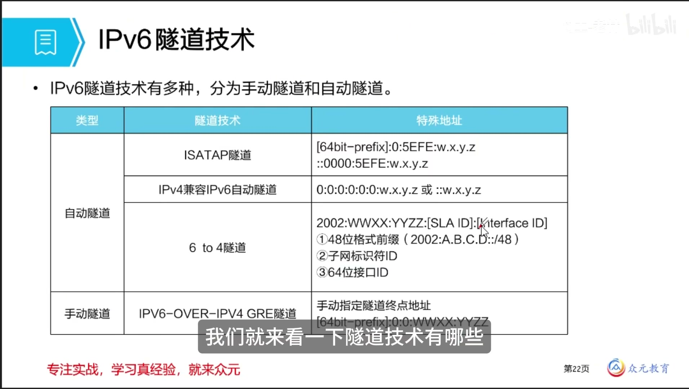

IPv6 隧道分为**手动隧道**与**自动隧道**，主要区别在于目的地址的确定方式，可通过地址形式加以辨别。

| 类型 | 隧道技术 | 特殊地址 |
| ---- | -------- | -------- |
| 自动隧道 | ISATAP 隧道 | `[64bit-prefix]:0:5EFE:w.x.y.z` 或 `::0000:5EFE:w.x.y.z` |
| 自动隧道 | IPv4 兼容 IPv6 自动隧道 | `0:0:0:0:0:0:w.x.y.z` 或 `::w.x.y.z` |
| 自动隧道 | 6 to 4 隧道 | `2002:WWXX:YYZZ:[SLA ID]:[Interface ID]` |
| 手动隧道 | IPv6-over-IPv4 GRE 隧道 | 手动指定隧道终点地址；`[64bit-prefix]:0:0:WWXX:YYZZ` |

6 to 4 隧道地址的组成：

1. 48 位格式前缀（`2002:A.B.C.D::/48`）；
2. 子网标识符 ID；
3. 64 位接口 ID。

要点：

- 自动隧道依据**地址类型**自动确定隧道终点，因此可通过地址形式判断隧道类型；
- 6 to 4 使用 `2002::/16` 前缀，并把 IPv4 地址（写为十六进制）嵌入到前 48 位的站点前缀中；
- ISATAP 的接口标识为 `0000:5EFE:` 后接 IPv4 地址（`00-00-5E` + `0xFE` 构成 `5EFE`）；
- **IPv4 兼容地址**（`::w.x.y.z`）与**IPv6-over-IPv4（6in4）** 形式相近，容易混淆，注意区分；
- 手动隧道需要**手动指定隧道终点地址**，典型为通用型 GRE 隧道。

### 6.6 课堂习题

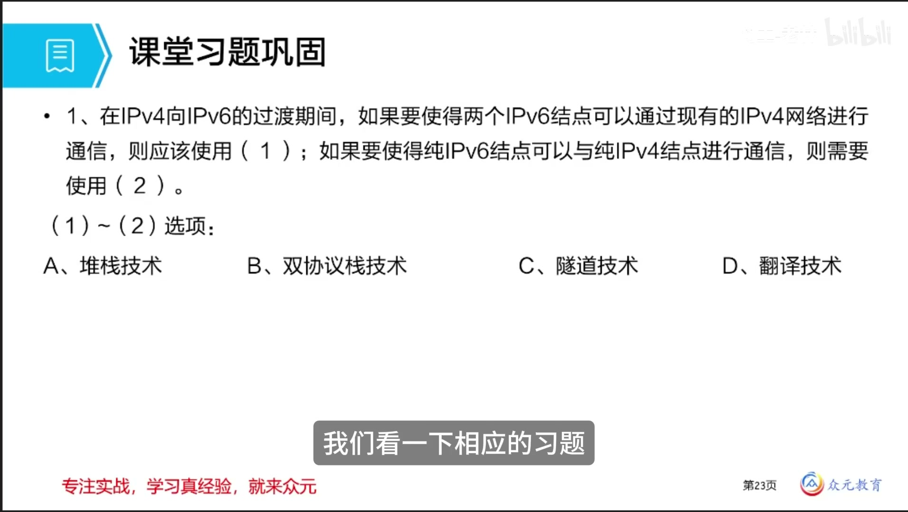

#### 例题5：跨 IPv4 网络通信与纯节点互通

**题干**：在 IPv4 向 IPv6 的过渡期间，如果要使得两个 IPv6 结点可以通过现有的 IPv4 网络进行通信，则应该使用（1）；如果要使得纯 IPv6 结点可以与纯 IPv4 结点进行通信，则需要使用（2）。

（1）~（2）选项：

- A、堆栈技术
- B、双协议栈技术
- C、隧道技术
- D、翻译技术

**解答**：

| 空 | 场景分析 | 采用技术 |
| -- | -------- | -------- |
| （1） | 两端都是 **IPv6 结点**，中间经过 **IPv4 网络**，属于 IPv6 到 IPv6 通信，需把 IPv6 报文封装后在 IPv4 骨干网中传输 | **C、隧道技术** |
| （2） | 一端是**纯 IPv6**、一端是**纯 IPv4**，两种报文需转换后才能互通 | **D、翻译技术** |

补充：无论使用隧道还是翻译，其**实现基础都是双协议栈技术**。

**答案：（1）C；（2）D**

---

## 7.本章小结

| 知识点 | 核心内容 |
| ------ | -------- |
| 1. IPv6 编址概述 | 128 位地址，从根源解决 IPv4 地址不足；冒号十六进制表示、8 段每段 16 位 |
| 2. 地址结构 | 网络前缀（前 64 位）+ 接口标识（后 64 位）；接口标识可基于 MAC 地址经 EUI-64 生成 |
| 3. 压缩规则 | 前导零省略（每段高位 0 可省、全零段保留一个 0）；连续零用 `::` 压缩，且**只用一次** |
| 4. 地址类型 | 单播、组播（多播）、任播；**无广播**；任播取自单播地址空间，代表一组接口，送最近的一个 |
| 5. 单播地址 | 全球单播 `2000::/3`；链路本地 `FE80::/10`；站点本地 `FEC0::/10`（废弃）；唯一本地 `FC00::/7` |
| 6. 组播地址 | 高 8 位全 1，`FF` 开头，`FF00::/8` |
| 7. 特殊地址 | 环回 `::1/128`、未指定 `::/128`、IPv4 兼容 `::w.x.y.z`、IPv4 映射 `::FFFF:w.x.y.z` |
| 8. 配置方式 | 静态（手动）；动态分无状态（SLAAC，基于 NDP）与有状态（DHCPv6） |
| 9. SLAAC 流程 | 生成链路本地地址 -> DAD 检测 -> 发送 RS -> 回应 RA -> 解析 RA 生成单播地址 -> 再次 DAD 检测 |
| 10. EUI-64 | MAC 中间插入 `FFFE`，并将第 7 位（U/L 位）取反，扩展为 64 位接口标识 |
| 11. 报文简化 | 固定 40 字节、取消 IHL 与首部校验和、取消分片字段、选项改扩展首部、取消广播 |
| 12. 过渡技术 | 双栈（基础）、隧道（IPv6 over IPv4，点到点）、翻译（NAT-PT / NAT64+DNS64，双向访问） |
| 13. 隧道分类 | 自动：ISATAP、IPv4 兼容、6 to 4（`2002::/16`）；手动：IPv6-over-IPv4 GRE |
| 14. 过渡例题结论 | 两个 IPv6 结点经 IPv4 网络互通用**隧道**；纯 IPv6 与纯 IPv4 互通用**翻译**；基础均为**双栈** |

考试重点：

1. **地址长度与表示**：IPv6 为 128 位，用冒号十六进制表示，分 8 段、每段 16 位；每 4 位二进制对应 1 位十六进制。
2. **压缩规则是高频考点**：前导零省略时每段至少保留一个 0、不能省略有效数字；`::` 压缩连续零段且**全程只能出现一次**；判断简写是否合法时，要能还原为 8 段。
3. **地址类型**：记住 IPv6 **没有广播**，新增**任播**；任播代表一组接口、送最近的一个、多用于路由器、主要作目标地址。
4. **常见地址前缀必须背熟**：环回 `::1/128`、未指定 `::/128`、链路本地 `FE80::/10`、唯一本地 `FC00::/7`、全球单播 `2000::/3`、组播 `FF00::/8`。
5. **全球单播地址最高三位为 `001`**，对应 `2000::/3`，因此全球单播地址以“2”开头；全球前缀通常至少 48 位。
6. **地址结构**：网络前缀 + 接口标识；接口标识可依据 MAC 地址经 **EUI-64**（插入 `FFFE` 并将第 7 位取反）生成。
7. **配置方式**：掌握**无状态地址自动配置（SLAAC）**与**有状态（DHCPv6）**的区别；SLAAC 基于 **NDP**，用到链路本地地址与 ICMPv6 报文，核心报文为 **RS/RA**，并有 **DAD** 重复地址检测。
8. **三类过渡技术**：双栈是基础；隧道实现 IPv6 到 IPv6 点到点访问，不能实现 IPv6 与 IPv4 主机互通；翻译（NAT-PT / NAT64+DNS64）实现 IPv4 与 IPv6 双向访问。
9. **隧道类型辨别**：依据地址形式——ISATAP（`0:5EFE:w.x.y.z`）、IPv4 兼容（`::w.x.y.z`）、6 to 4（`2002::/16`）；手动隧道为 IPv6-over-IPv4 GRE。
10. **报文简化**：基本首部固定 40 字节；取消首部长度字段、首部校验和、分片相关字段；选项改为扩展首部；用 NDP 取代 ARP。
