# IP报文格式、ICMP与ARP协议 · 完整笔记

---

## 1.IPv4数据报格式

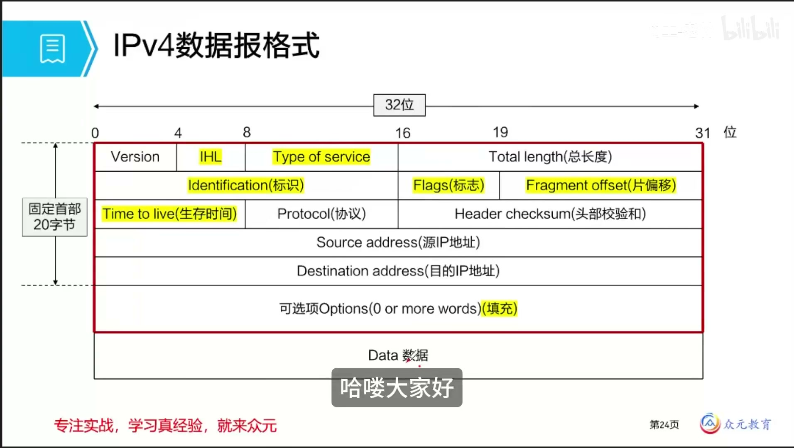

IPv4 数据报由**首部**与**数据**两部分组成，首部长度可变，其原因在于可选项的存在。

| 组成部分 | 长度 | 说明 |
| -------- | ---- | ---- |
| 固定首部 | **20 字节** | 每个 IPv4 数据报都必须携带，字段位置固定 |
| 可选项 | 0 ~ 40 字节 | 按需使用，用于扩展功能 |
| 填充 | 0 ~ 3 字节 | 保证首部长度为 4 字节（32 位）的整数倍 |
| 数据 | 可变 | 上层协议交付的数据 |

首部总长度为 **20 ~ 60 字节**，并且必须是 **4 字节（32 位）的整数倍**。首部按 32 位（4 字节）为一个字（word）进行排版，这正是"填充"字段存在的根本原因——可选项的长度不一定是 4 字节的整数倍，必须补足。

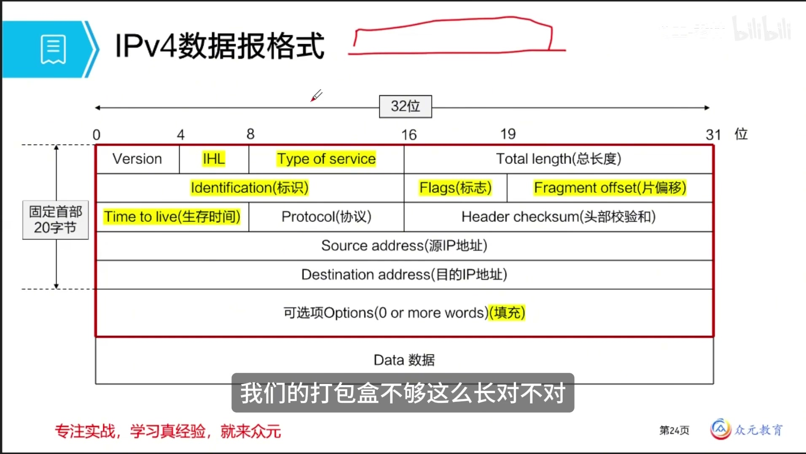

### 1.1 首部字段排布

固定首部共 5 行，每行 32 位：

| 行 | 字段划分（自左至右） |
| -- | -------------------- |
| 第 1 行 | 版本（4 位）+ 首部长度（4 位）+ 区分服务（8 位）+ 总长度（16 位） |
| 第 2 行 | 标识（16 位）+ 标志（3 位）+ 片偏移（13 位） |
| 第 3 行 | 生存时间（8 位）+ 协议（8 位）+ 首部校验和（16 位） |
| 第 4 行 | 源 IP 地址（32 位） |
| 第 5 行 | 目的 IP 地址（32 位） |
| 第 6 行 | 可选项（0 ~ 40 字节）+ 填充 |
| 其后 | 数据 |

### 1.2 固定首部字段

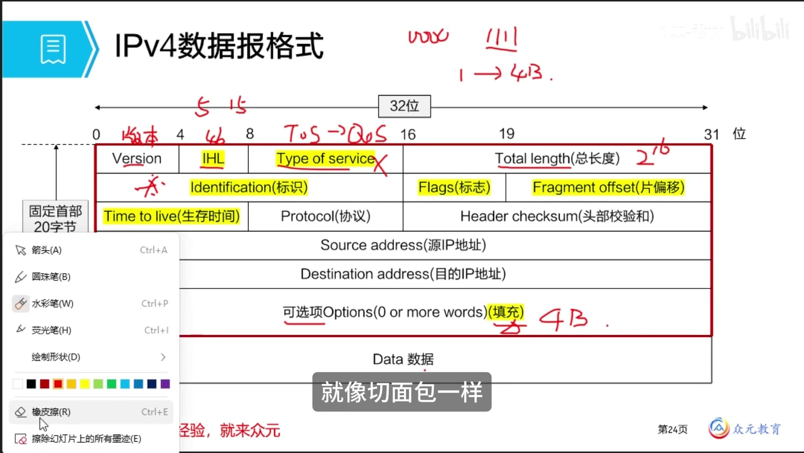

| 字段 | 长度 | 含义 | 关键要点 |
| ---- | ---- | ---- | -------- |
| 版本 Version | 4 位 | 标识 IP 协议版本 | IPv4 填写 **4**，IPv6 填写 **6** |
| 首部长度 IHL | 4 位 | 首部长度，以 **4 字节**为单位 | 取值 5 ~ 15，对应 **20 ~ 60 字节**；最小值为 5 |
| 区分服务 TOS | 8 位 | 区分服务字段，与 QoS 相关 | 用于标识流量是否需要优先转发；IPv4 中实际**未真正使用**，IPv6 才有效利用 |
| 总长度 Total Length | 16 位 | **首部 + 数据**的总长度 | 最大为 2¹⁶ − 1 = **65535 字节** |
| 标识 Identification | 16 位 | 数据报的编号 | 同一数据报的所有分片具有**相同的标识值**，用于重组时区分不同数据报 |
| 标志 Flags | 3 位 | 分片控制标志 | 高 1 位保留不用，实际有效为低 2 位：**DF** 与 **MF** |
| 片偏移 Fragment Offset | 13 位 | 本片数据在原数据报中的位置 | 以 **8 字节**为单位，表示相对首部的偏移量 |
| 生存时间 TTL | 8 位 | 数据报在网络中的寿命 | 以跳数计，每经过一个路由器减 1，减至 0 即丢弃；防止数据报在网络中无限制转发 |
| 协议 Protocol | 8 位 | 指明上层协议 | **TCP = 6，UDP = 17，ICMP = 1** |
| 首部校验和 | 16 位 | 对首部做差错检测 | **只校验首部**，不校验数据部分；每经过一个路由器都要重新计算 |
| 源 IP 地址 | 32 位 | 发送方地址 | — |
| 目的 IP 地址 | 32 位 | 接收方地址 | — |
| 可选项 | 0 ~ 40 字节 | 扩展功能 | 长度不固定，需填充对齐 |
| 填充 | 0 ~ 3 字节 | 对齐用 | **确保首部为 32 比特（4 字节）的整数倍** |

### 1.3 分片相关字段

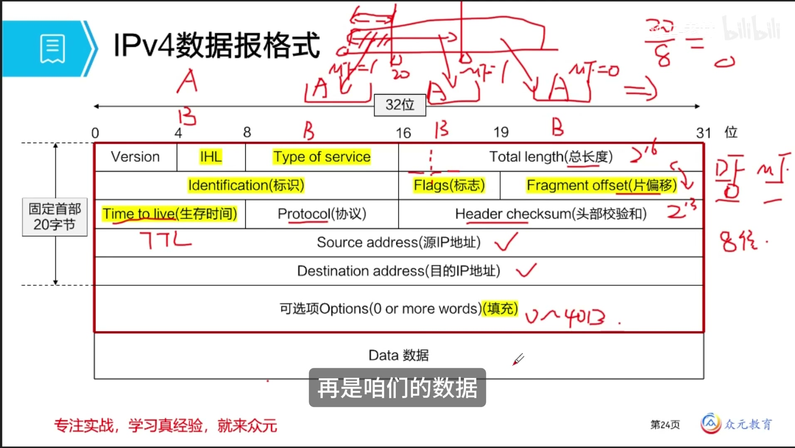

分片与重组依赖三个字段：**标识、标志、片偏移**。其中计算题只涉及**片偏移**与**标志中的 MF、DF**。

**标识（Identification）**：若多台主机同时发送数据，各数据报被切割后仍须能区分归属。发送方为每个数据报分配一个标识值，属于同一数据报的所有分片使用同一标识，重组时据此归类。

**标志（Flags）**：共 3 位，高 1 位保留未用，低 2 位有效。

| 标志位 | 全称 | 取值与含义 |
| ------ | ---- | ---------- |
| DF | Don't Fragment，不允许分片 | DF = 1 表示该数据报不允许分片，若超出下层 MTU 则被**丢弃**；DF = 0 表示允许分片，为**默认值** |
| MF | More Fragments，还有更多分片 | MF = 1 表示后续还有分片，即**不是最后一片**；MF = 0 表示**最后一片** |

**片偏移（Fragment Offset）**：指明本片数据的起始位置距离原数据报首部有多远，用于按序重组。

- 片偏移以 **8 字节**为单位，字段仅 13 位，最大值为 2¹³ − 1 = 8191，直接以字节为单位无法覆盖 65535 字节的总长度，故必须换算；
- 换算关系：**片偏移 = 该片数据起始字节位置 ÷ 8**；
- 第一片的起始位置为 0，故片偏移为 0。

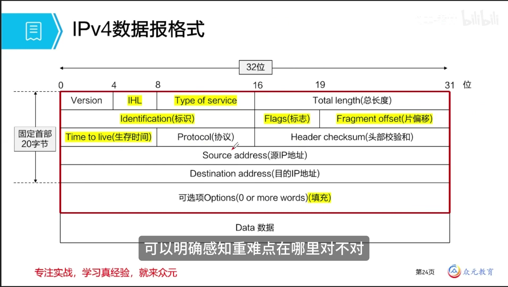

### 1.4 分片与重组

| 项目 | IPv4 的处理方式 |
| ---- | --------------- |
| 分片位置 | **源主机与沿途各路由器**均可分片 |
| 分片依据 | 出接口所在网络的 **MTU**（最大传输单元） |
| 重组位置 | **仅在目的主机**进行 |
| 重组依据 | 标识（归类）、片偏移（排序）、MF（判断末片） |

要点：

- 数据报每经过一个 MTU 较小的网络，都可能被再次切割。例如前一网段 MTU 为 1500，下一网段 MTU 为 1420，则 1500 字节的数据报到达该路由器后仍需进一步分片；
- 分片后的每一片都必须**重新加上 20 字节首部**，因此分片会增加额外开销；
- 路由器不做重组，重组统一在目的主机完成，这与 IPv6 的设计不同。

### 1.5 分片计算示例（MTU = 1500 字节）

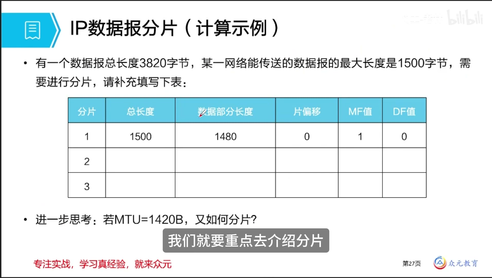

题目：有一个数据报总长度为 **3820 字节**，某一网络能传送的数据报的最大长度为 **1500 字节**，需要进行分片，请补充填写下表。

分析：

```
数据部分长度 = 总长度 − 固定首部 = 3820 − 20 = 3800 字节
每片可携带的数据 = MTU − 首部 = 1500 − 20 = 1480 字节
```

按 1480 字节尽量装满：

```
第 1 片数据：1480 字节，剩余 3800 − 1480 = 2320 字节
第 2 片数据：1480 字节，剩余 2320 − 1480 = 840 字节
第 3 片数据：840 字节（不足 1480，全部装入）
```

| 分片 | 总长度 | 数据部分长度 | 片偏移 | MF 值 | DF 值 |
| ---- | ------ | ------------ | ------ | ----- | ----- |
| 1 | 1500 | 1480 | 0 | 1 | 0 |
| 2 | 1500 | 1480 | 1480 ÷ 8 = **185** | 1 | 0 |
| 3 | 860 | 840 | 2960 ÷ 8 = **370** | 0 | 0 |

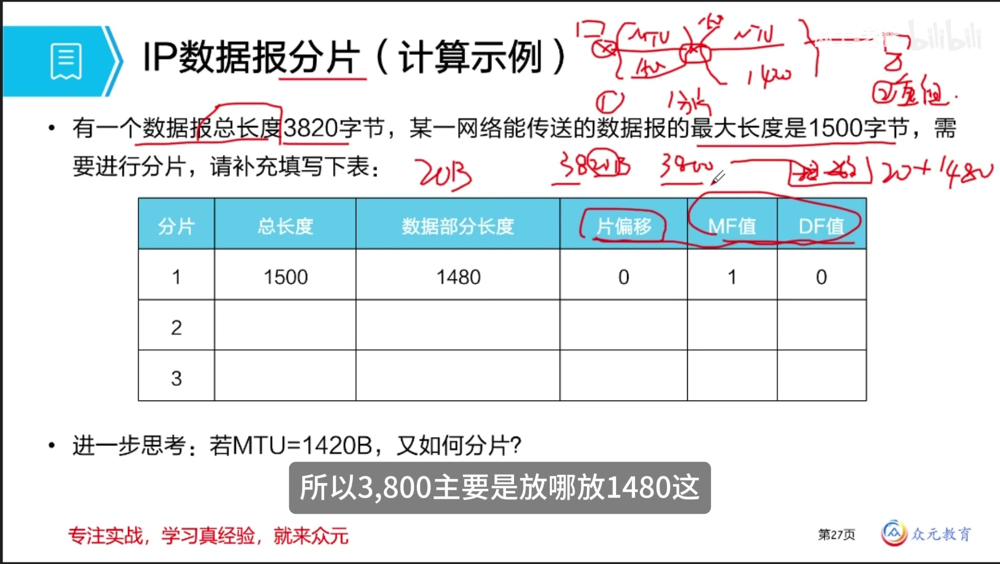

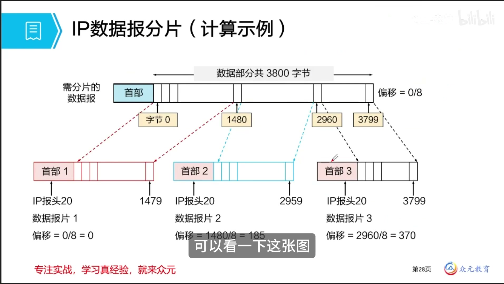

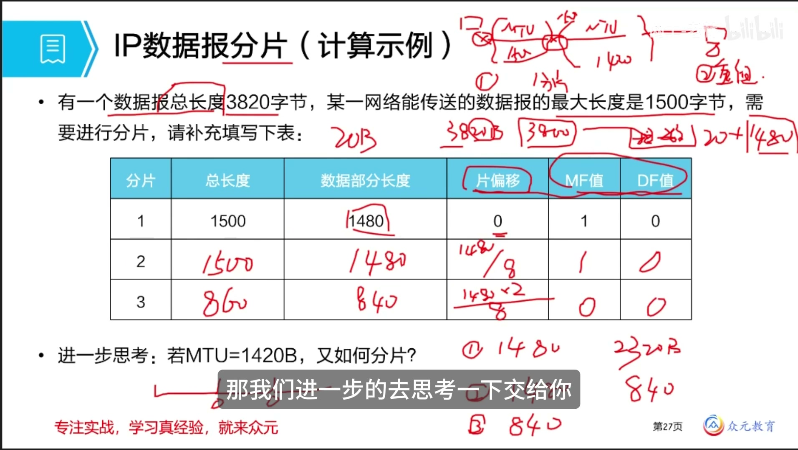

计算要点：

1. **总长度 = 首部 + 数据**，每一片都要加上 20 字节首部，故第 3 片总长度为 840 + 20 = 860；
2. **片偏移按数据起始字节位置除以 8**：第 2 片起始于第 1480 字节，1480 ÷ 8 = 185；第 3 片起始于 2960 字节，2960 ÷ 8 = 370；
3. **MF 只有最后一片为 0**，其余为 1；
4. **DF 默认为 0**（允许分片），若置 1 则该数据报不允许切割，超出 MTU 时会被丢弃。

### 1.6 进一步思考：MTU = 1420 字节

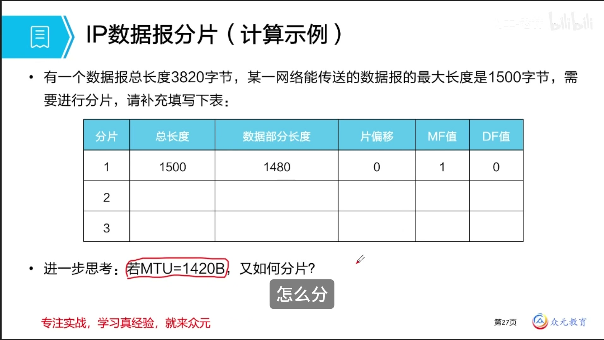

```
每片可携带的数据 = 1420 − 20 = 1400 字节
3800 = 1400 + 1400 + 1000
```

| 分片 | 总长度 | 数据部分长度 | 片偏移 | MF 值 | DF 值 |
| ---- | ------ | ------------ | ------ | ----- | ----- |
| 1 | 1420 | 1400 | 0 | 1 | 0 |
| 2 | 1420 | 1400 | 1400 ÷ 8 = **175** | 1 | 0 |
| 3 | 1020 | 1000 | 2800 ÷ 8 = **350** | 0 | 0 |

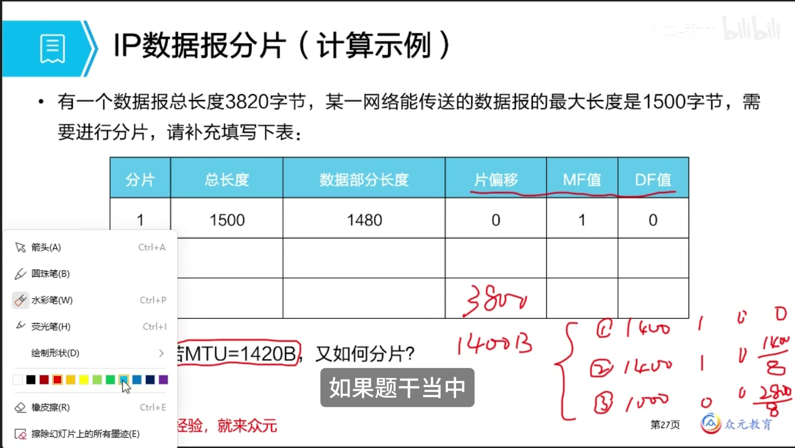

### 1.7 片偏移不能被 8 整除的处理

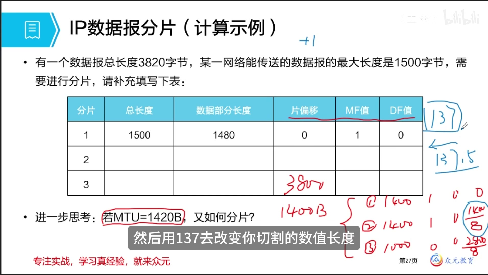

片偏移字段以 8 字节为单位，其取值只能是整数，不可能出现小数。若按 MTU 计算出的数据长度除以 8 不能整除，则**向下取整**，并以取整后的结果反推实际切割长度：

```
假设可切数据长度为 1100 字节：1100 ÷ 8 = 137.5
取整：137
实际切割长度：137 × 8 = 1096 字节
```

即"宁可少切，不可多切"，以保证片偏移为整数。最后一片的数据长度不受 8 的整数倍限制。

---

## 2.服务质量（QoS）

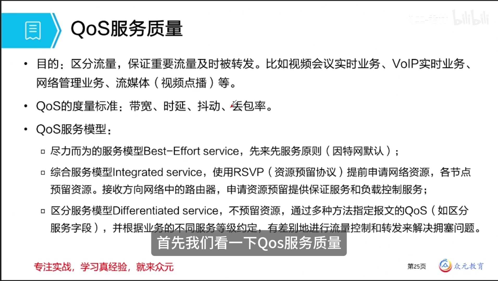

### 2.1 QoS 的目的与度量标准

**目的**：区分流量，保证重要流量及时被转发。典型场景包括视频会议实时业务、VoIP 实时业务、网络管理业务、流媒体（视频点播）等。

**QoS 的四个度量标准**：

| 度量指标 | 含义 |
| -------- | ---- |
| 带宽 | 业务所需的传输速率 |
| 时延 | 报文从源到目的的传输延迟 |
| 抖动 | 时延的变化程度，实时业务对抖动最敏感 |
| 丢包率 | 传输过程中丢失报文的比例 |

### 2.2 各类业务的 QoS 要求

| 业务类型 | 典型应用 | 带宽 | 时延 | 抖动 | 丢包率 | 优先级 |
| -------- | -------- | ---- | ---- | ---- | ------ | ------ |
| 实时交互类 | 视频会议、VoIP 语音 | 较高 | 低 | 低 | 低 | 最高 |
| 网络管理类 | 网络管理与相关协议 | 要求不高 | 较低 | — | 较低 | 较高（网络设备通常优先转发） |
| 流媒体与大量数据类 | 视频点播、备份、FTP 访问、文件存储 | 较大 | 相对宽松 | 相对宽松 | 可容忍少量丢包 | 较低 |
| 基础业务（普通业务） | 网页浏览等 | 无特殊要求 | 无特殊要求 | 无特殊要求 | 无特殊要求 | 最低（尽力而为） |

要点：语音与视频会议等实时业务的要求最严格，通常单独设定更高的优先级；网络管理类业务虽然对带宽要求不高，但设备一般会优先转发其报文。案例分析题中常给出甲方的业务需求，要求据此安排流量与访问路径，需要能够按上表辨别业务等级。

### 2.3 三种 QoS 服务模型

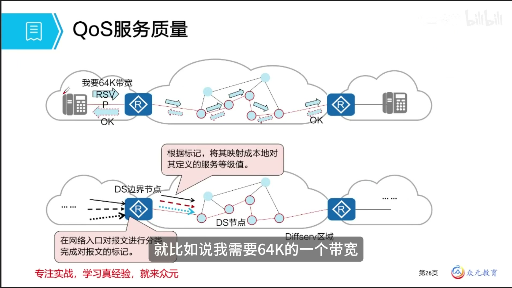

| 服务模型 | 资源预留 | 工作方式 | 特点 |
| -------- | -------- | -------- | ---- |
| 尽力而为模型 Best-Effort Service | 不预留 | 先来先服务，谁先到达就先为谁服务 | **因特网默认**的服务模型，绝大多数业务采用此方式 |
| 综合服务模型 Integrated Service | **预留** | 使用 **RSVP（资源预留协议）** 提前向网络申请资源，沿途各节点均预留资源并维持状态 | 可扩展性差；相邻节点需周期性交换状态信息，协议报文开销大，**不适合大型网络** |
| 区分服务模型 Differentiated Service | **不预留** | 在网络入口对报文**分类并标记**（如使用区分服务字段），各节点按标记映射为本地服务等级，有差别地进行流量控制与转发 | 无需维持每流状态，可扩展性好；是实际网络中解决拥塞的主要方案 |

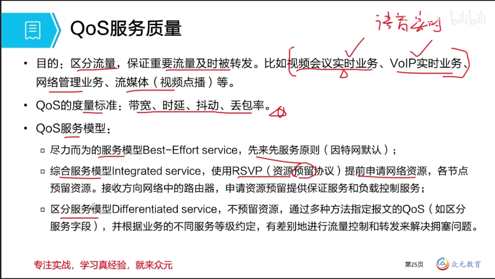

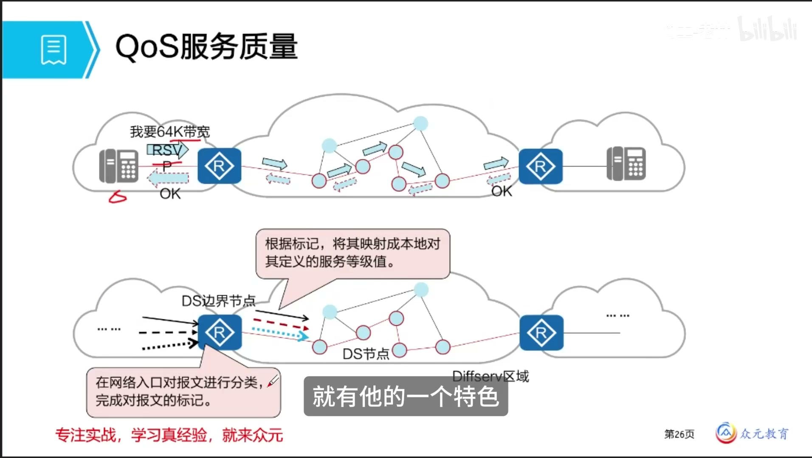

理解要点：

- 综合服务模型类似"提前预约"：先声明所需带宽（例如 64 Kbit/s），由 RSVP 在沿途每个节点预约并保持，未被使用的预留会被浪费，规模大时无法为每个用户逐一预约；
- 区分服务模型类似"按会员等级分流"：不预约资源，只在入口按业务等级打标记，沿途设备依据标记给予不同的转发待遇；
- **RSVP 的资源预留由接收方向网络中的路由器发起申请**，用于提供保证服务与负载控制服务。这是常考的方向性细节，容易设置干扰项。

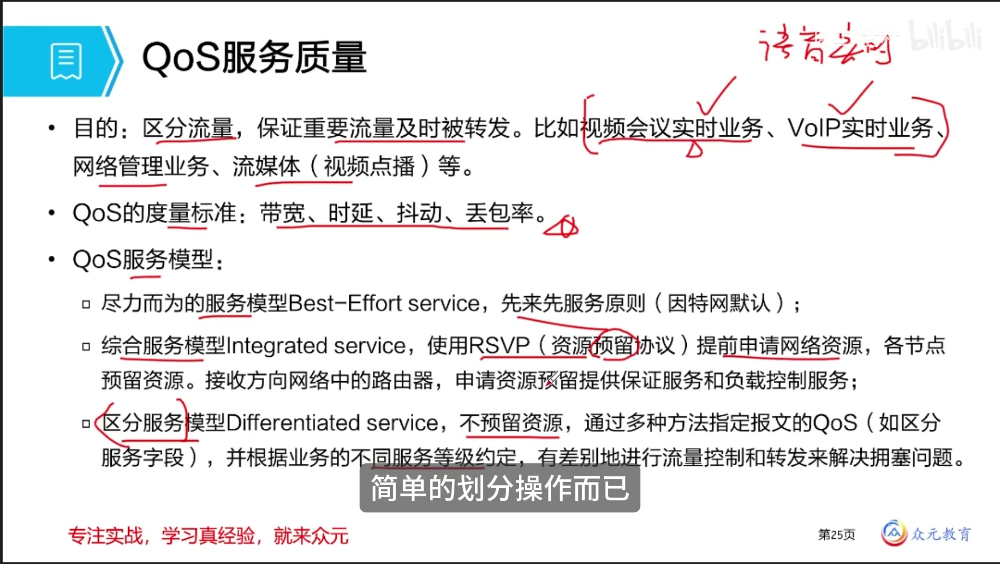

### 2.4 IPv4 与 IPv6 对 QoS 的支持

| 项目 | IPv4 | IPv6 |
| ---- | ---- | ---- |
| 承载字段 | 区分服务（TOS）字段，8 位 | 通信类别（Traffic Class）字段，8 位 |
| 流标识 | 无 | 流标签（Flow Label），20 位 |
| 实际部署 | 该字段在 IPv4 中基本未使用 | 支持区分服务与流标签，流标签与资源预分配相关 |

---

## 3.IPv6数据报格式

### 3.1 IPv6 的优点

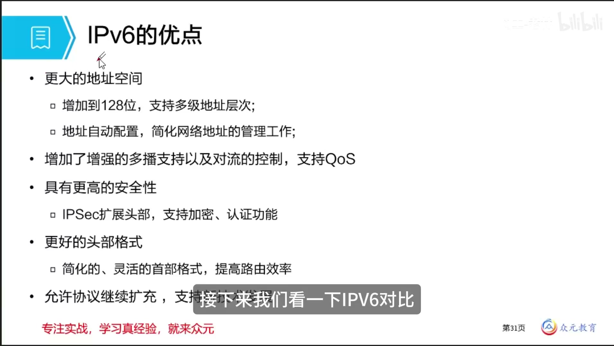

| 优点 | 具体表现 |
| ---- | -------- |
| 更大的地址空间 | 地址长度增加到 **128 位**，支持多级地址层次（网络前缀、子网、接口标识）；支持地址自动配置，简化网络地址管理工作 |
| 增强的多播支持与流控制 | 支持组播与流标签，**支持 QoS** |
| 更高的安全性 | 通过 **IPSec 扩展头部**支持加密、认证功能 |
| 更好的头部格式 | 首部格式简化、灵活，提高路由处理效率；引入扩展首部机制 |
| 允许协议继续扩充 | 新功能通过扩展首部实现，便于未来技术的移植与接入 |

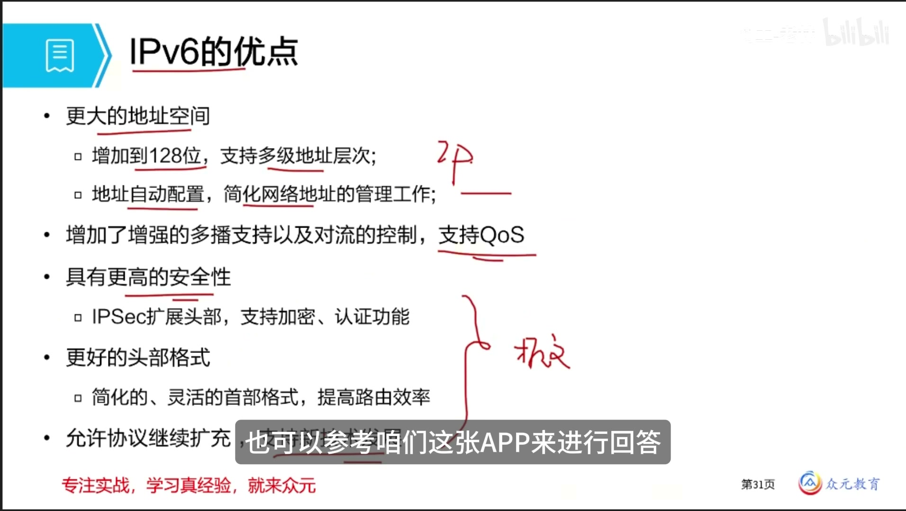

回答"IPv6 相比 IPv4 有哪些优势"这类简答题时，应同时从**地址层面**（128 位、多级层次、自动配置）与**报文格式层面**（固定首部、扩展首部、取消校验和、支持 QoS）两个方面组织答案。

### 3.2 数据报的总体结构

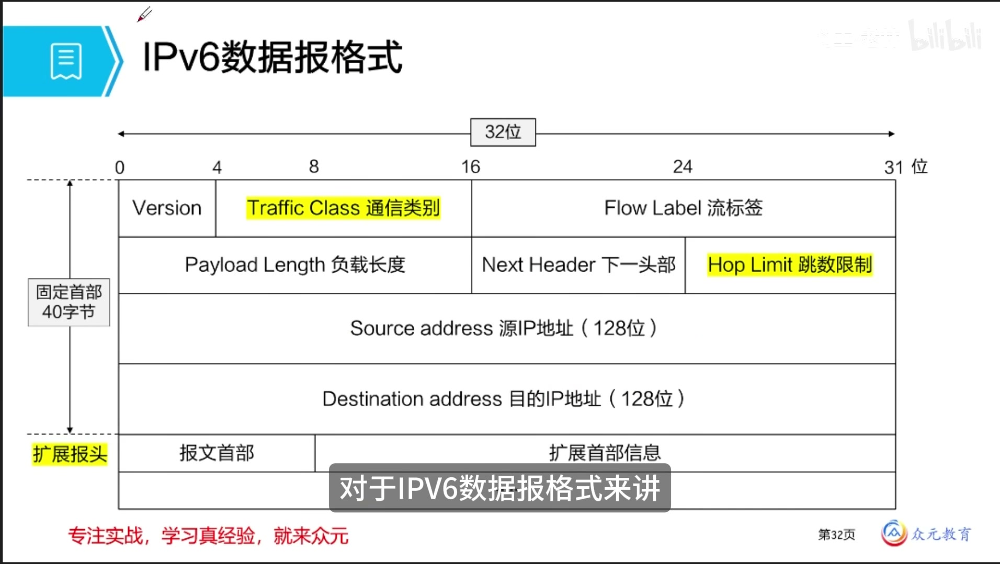

IPv6 数据报由三部分组成：

| 组成部分 | 长度 | 说明 |
| -------- | ---- | ---- |
| 固定首部 | **40 字节** | 所有 IPv6 数据报必须携带的基本字段 |
| 扩展报头与选项 | 可变 | 按需添加，用于实现分片、路由、安全等扩展功能 |
| 数据（负载） | 可变 | 上层协议数据 |

设计思路：把分片、安全、上层协议标识等内容**移入扩展报头**，固定首部只保留转发所必需的信息，使首部字段大幅精简，路由器处理更快、更灵活；同时扩展机制便于未来新技术的接入。

### 3.3 固定首部字段

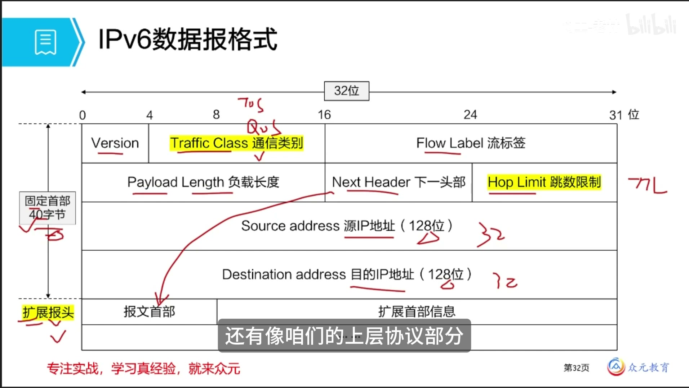

固定首部同样按 32 位一行排版，共 40 字节：

| 字段 | 长度 | 含义 | 与 IPv4 的对应关系 |
| ---- | ---- | ---- | ------------------ |
| 版本 Version | 4 位 | 协议版本号 | 填写 **6** |
| 通信类别 Traffic Class | 8 位 | 流量类型，用于支持 QoS | 对应 IPv4 的**区分服务（TOS）字段** |
| 流标签 Flow Label | 20 位 | 标识同一数据流，与**资源预分配**相关 | **IPv4 无对应字段** |
| 负载长度 Payload Length | 16 位 | **除固定首部以外**的长度，包括扩展报头与数据 | 对应 IPv4 的总长度，但**不含基本首部**，含义不同 |
| 下一头部 Next Header | 8 位 | 指明紧接其后的扩展报头或上层协议类型 | 对应 IPv4 的协议字段，但可级联 |
| 跳数限制 Hop Limit | 8 位 | 报文可经过的最大跳数 | 对应 IPv4 的 **TTL 字段** |
| 源 IP 地址 | 128 位 | 发送方地址 | IPv4 为 32 位 |
| 目的 IP 地址 | 128 位 | 接收方地址 | IPv4 为 32 位 |

要点：

- 固定首部为 **40 字节定长**，没有首部长度字段（IHL），也没有首部校验和，路由器无需逐跳校验，转发效率更高；
- 固定首部之所以仍有 40 字节，主要原因是源、目的地址各占 128 位，而字段数量本身已大幅精简；
- **负载长度不包含 40 字节固定首部**，这是与 IPv4 总长度最易混淆之处。

### 3.4 扩展报头

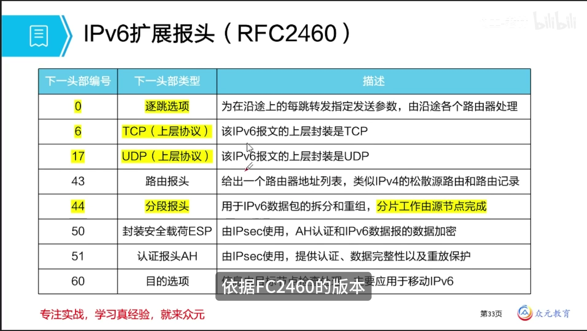

IPv6 将原来位于 IPv4 首部内的选项、分片、安全等功能移入扩展报头，由"下一头部"字段串联成链。RFC 2460 定义了六种扩展报头，其下一头部编号如下：

| 下一头部编号 | 类型 | 描述 |
| ------------ | ---- | ---- |
| 0 | 逐跳选项 | 为沿途每一跳的转发指定发送参数，**由路径上每个路由器读取并处理** |
| 6 | TCP（上层协议） | 该 IPv6 报文的上层封装为 TCP |
| 17 | UDP（上层协议） | 该 IPv6 报文的上层封装为 UDP |
| 43 | 路由报头 | 给出一个路由器地址列表，**仅列表中指定的节点处理**，类似 IPv4 的松散源路由与路由记录 |
| 44 | 分段报头 | 用于 IPv6 数据报的拆分与重组，**分片工作由源节点完成**，中间路由器不参与 |
| 50 | 封装安全载荷 ESP | 由 IPsec 使用，提供**数据加密**（并可提供认证） |
| 51 | 认证报头 AH | 由 IPsec 使用，提供**认证、数据完整性以及重放保护**，但**不提供加密** |
| 60 | 目的选项 | 由目的节点专门处理，主要应用于**移动 IPv6** |

要点：

1. **逐跳选项必须是第一个扩展报头**（编号 0），因为路径上每个路由器都要读取；若存在多个扩展报头，第一个一定是逐跳选项；
2. **TCP（6）、UDP（17）是上层协议编号**，本身并非扩展报头，写在表中用于说明"下一头部"取值的含义；
3. **路由报头**只要求部分节点处理，因此需要显式给出节点列表，这一点与逐跳选项"每跳都处理"形成对比；
4. **分段报头**体现了 IPv6 分片机制的根本变化：源节点事先查询路径上各段 MTU，取其中的最小值作为分片依据，一次分片到位，路径上的路由器不再分片，重组仍在目的节点完成；
5. **ESP 可加密，AH 只认证**，两者均属 IPsec 体系，是安全部分的常考对比点；
6. 目的选项供目的节点处理，移动 IPv6 是其主要应用场景。

### 3.5 IPv4 与 IPv6 报文头对比

| 比较项 | IPv4 | IPv6 |
| ------ | ---- | ---- |
| 首部长度 | 变长，**20 ~ 60 字节** | **定长 40 字节** |
| 首部长度字段 | 有（IHL） | 无 |
| 首部校验和 | **有** | **无** |
| 分片执行者 | 源主机与沿途路由器均可 | **仅源节点**，路由器不分片 |
| 分片相关字段 | 首部内的标识、标志、片偏移 | 移入**分段报头** |
| 选项 | 首部内的可选项（0 ~ 40 字节） | 移入**扩展报头** |
| 服务类型 | 区分服务（TOS）字段 | 通信类别（Traffic Class）字段 |
| 生存时间 | TTL | 跳数限制（Hop Limit） |
| 上层协议标识 | 协议字段 | 下一头部（Next Header） |
| 流标识 | 无 | 流标签（Flow Label） |
| 地址长度 | 32 位 | 128 位 |

---

## 4.ICMP协议

### 4.1 概述

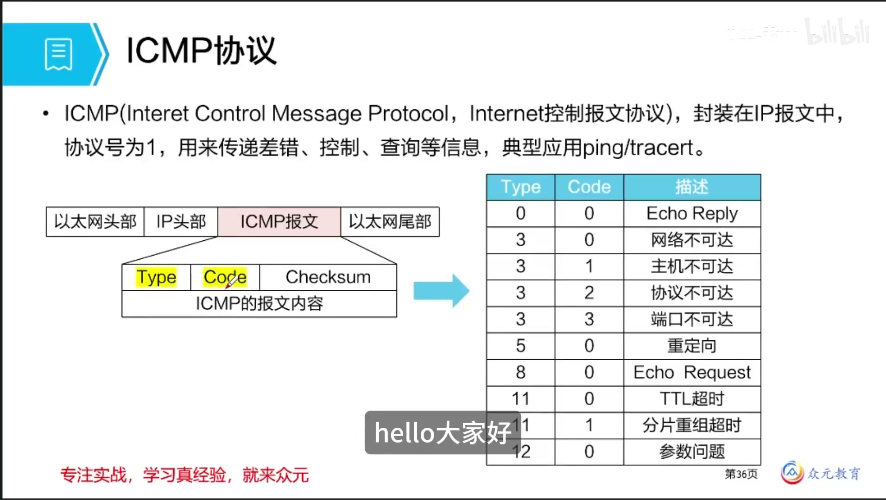

ICMP（Internet Control Message Protocol，网际控制报文协议）：

| 项目 | 内容 |
| ---- | ---- |
| 层次 | 网络层协议 |
| 封装 | **封装在 IP 报文中**，IP 首部的协议号字段取值为 **1** |
| 作用 | 传递**差错、控制、查询**等信息，提高 IP 数据报成功交付的概率 |
| 典型应用 | **ping、tracert / traceroute** |

IP 协议本身无连接、尽最大努力交付，不提供可靠性保证；ICMP 通过差错报告与查询应答进行辅助，使网络层具备基本的差错反馈与连通性检测能力。

ICMP 报文在以太网帧中的封装位置为：以太网头部 + IP 头部 + **ICMP 报文** + 以太网尾部。

### 4.2 报文格式

ICMP 报文首部共 **8 字节**，其后为数据部分：

| 字段 | 长度 | 作用 |
| ---- | ---- | ---- |
| 类型 Type | 8 位 | 指示报文类型 |
| 代码 Code | 8 位 | 对同一类型作进一步细分 |
| 校验和 Checksum | 16 位 | 对整个 ICMP 报文做差错检测 |
| 首部其余部分 | 32 位 | 内容随类型变化，如回送报文中的标识符与序号 |
| 数据 | 可变 | 差错报文中通常携带原 IP 首部及部分数据 |

ICMP 报文分为两大类：

| 类别 | 作用 | 典型类型 |
| ---- | ---- | -------- |
| 差错控制报文 | 路径上的路由器或主机发现无法交付时，向源站报告问题 | 3、4、5、11、12 |
| 询问报文 | 由源站主动发起，请求某节点回答当前状态 | 0/8、13/14 |

### 4.3 差错控制报文

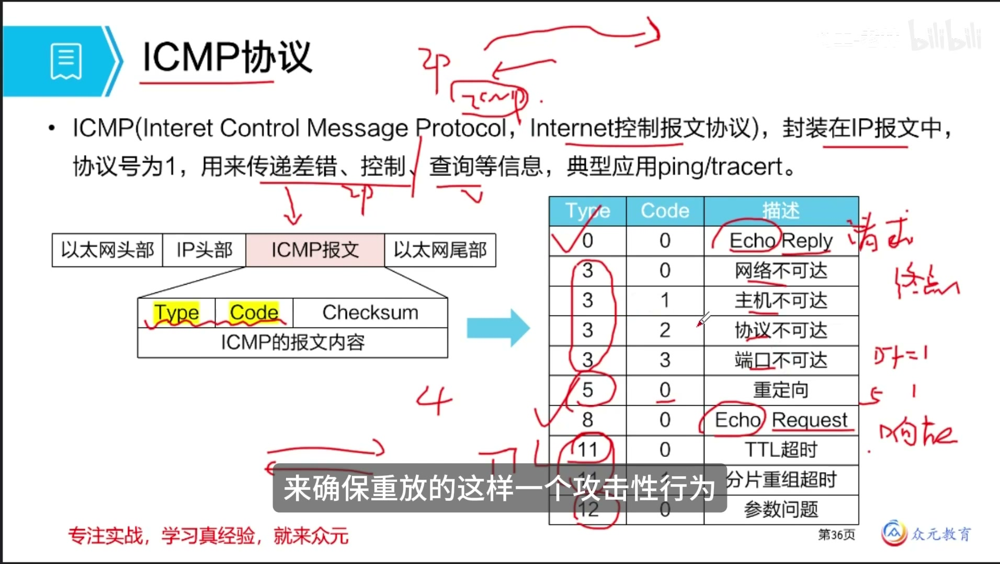

| 类型 Type | 代码 Code | 名称 | 说明 |
| --------- | --------- | ---- | ---- |
| 3 | 0 | 网络不可达 | 路由器或主机无法交付数据报 |
| 3 | 1 | 主机不可达 | 目的主机不可达 |
| 3 | 2 | 协议不可达 | 目的端不支持该上层协议 |
| 3 | 3 | 端口不可达 | 目的端对应端口未开放 |
| 3 | 4 | 需要分片但 DF 置位 | 数据报超过 MTU 且不允许分片 |
| 3 | 5 | 源路由失败 | 源路由选项中指定的路径不可用 |
| 3 | 9 / 10 | 管理禁止 | 目的网络 / 主机被管理策略禁止通信 |
| 4 | 0 | 源点抑制 Source Quench | 网络出现拥塞、数据报被丢弃时，通知发送方**降低发送速率** |
| 5 | 0 | 重定向 Redirect | 路由器发现到达某目的地址存在**更优路径**，通知主机改走该路径 |
| 11 | 0 | TTL 超时 | 数据报的 TTL 减至 0，被路由器丢弃 |
| 11 | 1 | 分片重组超时 | 分片未能在规定时间内全部到达，重组失败 |
| 12 | 0 | 参数问题 | IP 首部字段存在错误（首部损坏等），无法处理 |

说明：

- 类型 3 的多种代码统称为"**终点不可达**"，含义是源站无法获得目的端的服务；
- 类型 5 重定向的含义是"存在更短的路"，主机下一次发送时改走新路径；
- 类型 11 含 TTL 超时与分片重组超时两种代码，是 tracert 工作的基础；
- 类型 12 参数问题表示报文格式本身有误，相当于"证件不合格，无法通行"。

### 4.4 询问报文

| 类型 Type | 名称 | 说明 |
| --------- | ---- | ---- |
| 8 | 回送请求 Echo Request | 由源站发出，请求目的站回应 |
| 0 | 回送应答 Echo Reply | 目的站对回送请求的响应 |
| 13 | 时间戳请求 Timestamp Request | 请求某主机或路由器回答当前的日期和时间 |
| 14 | 时间戳应答 Timestamp Reply | 对时间戳请求的响应 |

要点：

- 回送请求（8）与回送应答（0）**成对出现**，是 ping 命令的基础；
- 时间戳请求与应答（13/14）用于获取对端时间，可用于测量往返时延；
- 类型 4 源点抑制虽属差错控制类，但已在标准中被废弃，软考教材仍按 RFC 792 保留该知识点。

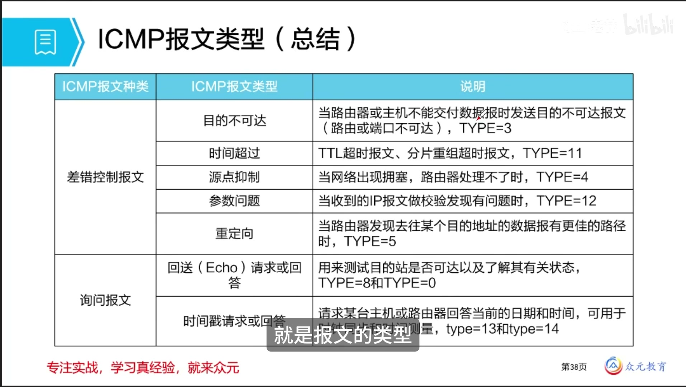

### 4.5 典型应用

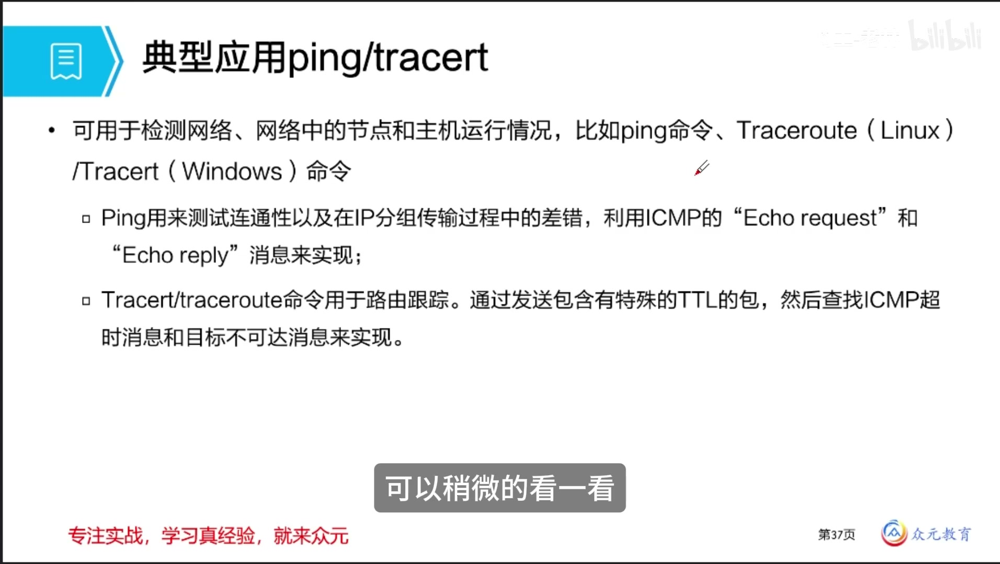

ICMP 可用于检测网络、网络中的节点与主机的运行情况，典型命令为 ping 与 Traceroute（Linux）/ Tracert（Windows）。

| 命令 | 作用 | 依赖的 ICMP 报文 |
| ---- | ---- | ---------------- |
| ping | 测试连通性，以及在 IP 分组传输过程中的差错 | **Echo Request（8）与 Echo Reply（0）** |
| tracert / traceroute | 路由跟踪，逐跳发现到达目的所经过的路由器 | 发送 **TTL 逐次递增**的报文，依据返回的 **ICMP 超时报文（11）** 与**终点不可达报文（3）** 判断路径 |

tracert 工作原理：

1. 首先发送 TTL = 1 的报文，第一台路由器将 TTL 减为 0，返回 **ICMP 超时（type 11）** 报文，从而获知第一跳地址；
2. 随后依次发送 TTL = 2、3……的报文，逐跳获得路由器地址；
3. 当报文到达目的主机时，目的主机不再转发，而是返回应答：Windows 的 tracert 使用 ICMP Echo 请求，目的主机返回 **Echo Reply（type 0）**；Linux 的 traceroute 默认使用 UDP 高端口，目的主机返回 **端口不可达（type 3，code 3）**。无论哪种方式，程序据此判断跟踪结束。

### 4.6 ICMPv6

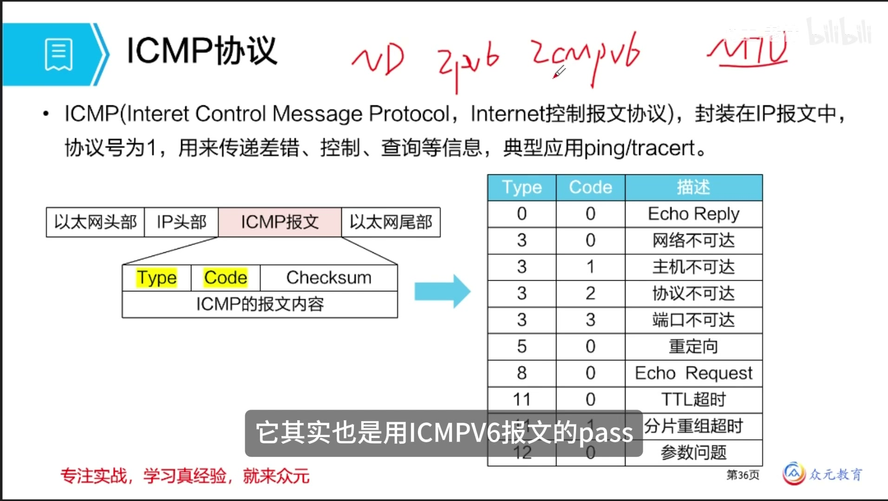

ICMPv6 除承担 IPv4 中 ICMP 的差错报告与查询功能外，还承载了 IPv6 的多项关键机制：

| 应用 | 说明 |
| ---- | ---- |
| 邻居发现 NDP | 地址解析、重复地址检测（DAD）、路由器发现等，替代 IPv4 中的 ARP |
| 路径 MTU 发现 | 通过 ICMPv6 报文测量路径上的最小 MTU，源节点据此预先分片，避免路由器分片 |
| 差错报告 | 目的不可达、超时、参数问题等，与 ICMPv4 对应 |

NDP 通过 ICMPv6 的**邻居请求（NS）与邻居通告（NA）**完成地址解析与重复地址检测（DAD），通过**路由器请求（RS）与路由器通告（RA）**完成路由器发现与前缀发现；回送请求与回送应答则用于连通性测试。地址解析功能由 NDP 承担，这正是 IPv6 不需要 ARP 的根本原因。

---

## 5.ARP协议

### 5.1 ARP 的作用

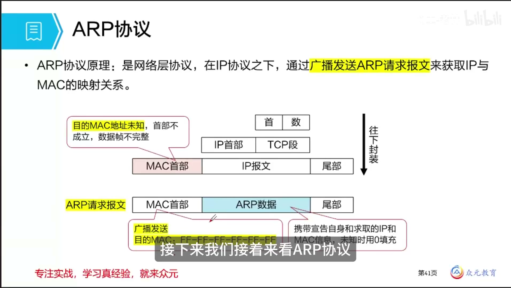

**ARP（Address Resolution Protocol，地址解析协议）**：网络层协议，位于 IP 协议之下，通过**广播发送 ARP 请求报文**来获取 **IP 地址与 MAC 地址的映射关系**，即由 IP 地址求 MAC 地址。

引入 ARP 的原因：数据链路层封装以太网帧时，MAC 首部必须填写目的 MAC 地址与源 MAC 地址。用户通常只配置 IP 地址，目的 MAC 地址未知，MAC 首部不完整，数据帧无法发送。因此必须先通过 ARP 取得目的 MAC 地址，才能完成封装。

| 项目 | 内容 |
| ---- | ---- |
| 协议层次 | **网络层协议**，封装在数据链路层的帧中传输 |
| 解析方向 | **由 IP 地址求 MAC 地址** |
| 以太网类型字段 | 0x0806 |
| 工作范围 | **仅在当前广播域内**，广播不跨越路由器 |
| 反向协议 | RARP（Reverse ARP，反向地址解析协议），由 MAC 求 IP |

IPv6 中没有 ARP，因为 IPv6 不设广播；地址解析由**邻居发现协议（NDP）**基于 ICMPv6 完成。

### 5.2 ARP 请求与响应

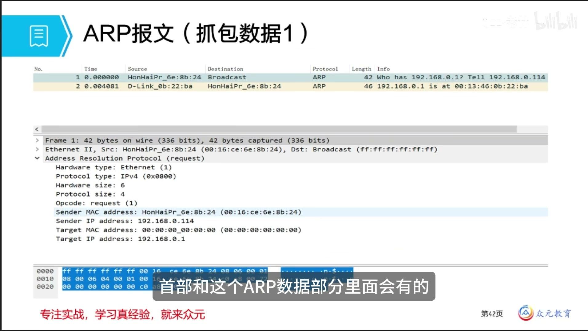

ARP 请求报文的结构为：MAC 首部 + ARP 数据 + 尾部。

| 部分 | 内容 |
| ---- | ---- |
| MAC 首部 | 源 MAC 为发送方自身 MAC；**目的 MAC 为广播地址 FF-FF-FF-FF-FF-FF** |
| ARP 数据 | 携带发送方自身的 IP 与 MAC，以及**目标 IP 与目标 MAC**；目标 MAC 未知时以 **0** 填充 |
| 尾部 | 帧校验序列 |

抓包数据（请求）：

| 项目 | 取值 |
| ---- | ---- |
| 源 | HonHaiPr_6e:8b:24 |
| 目的 | Broadcast |
| 摘要 | Who has 192.168.0.1? Tell 192.168.0.114 |
| 硬件类型 | Ethernet (1) |
| 协议类型 | IPv4 (0x0800) |
| 硬件地址长度 | 6 |
| 协议地址长度 | 4 |
| 操作码 Opcode | request (1) |
| 发送方 MAC | 0016.CE6E.8B24 |
| 发送方 IP | 192.168.0.114 |
| 目标 MAC | **00:00:00:00:00:00**（未知，填 0） |
| 目标 IP | 192.168.0.1 |

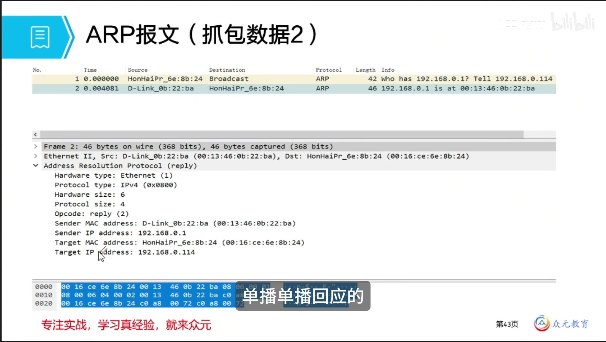

抓包数据（响应）：

| 项目 | 取值 |
| ---- | ---- |
| 源 | D-Link_0b:22:ba |
| 目的 | HonHaiPr_6e:8b:24（**单播**） |
| 摘要 | 192.168.0.1 is at 0013.460B.22BA |
| 操作码 Opcode | reply (2) |
| 发送方 MAC | 0013.460B.22BA |
| 发送方 IP | 192.168.0.1 |
| 目标 MAC | 0016.CE6E.8B24 |
| 目标 IP | 192.168.0.114 |

对比要点：

| 报文 | 发送方式 | 目的 MAC | 操作码 |
| ---- | -------- | -------- | ------ |
| ARP 请求 | **广播** | FF-FF-FF-FF-FF-FF | 1 |
| ARP 响应 | **单播** | 请求方的 MAC | 2 |

注意区分两个"目的 MAC"：

- **帧首部的目的 MAC**：请求帧为全 F（广播）；
- **ARP 数据中的目标 MAC 字段**：请求报文中为全 0（未知，待对方填写）。

这是选择题的高频陷阱。

### 5.3 地址解析工作过程

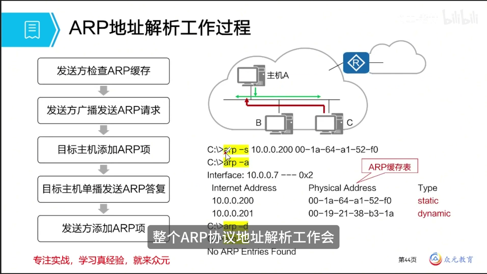

ARP 地址解析分为五步：

| 步骤 | 动作 | 说明 |
| ---- | ---- | ---- |
| 1 | 发送方检查 ARP 缓存 | 封装 IP 数据报前先查表，若已有目的 IP 对应的 MAC 项，直接使用，不再发送请求 |
| 2 | 发送方广播发送 ARP 请求 | 缓存中无对应项时，广播询问"谁拥有该 IP 地址，请告知你的 MAC" |
| 3 | 目标主机添加 ARP 项 | 网段内所有主机都能收到广播，但只有 IP 匹配的主机处理；该主机先把请求方的 IP 与 MAC 记入自己的缓存 |
| 4 | 目标主机单播发送 ARP 答复 | 以单播方式回应"该 IP 属于我，我的 MAC 是……" |
| 5 | 发送方添加 ARP 项 | 发送方收到答复后，将目的 IP 与 MAC 的映射写入自己的 ARP 缓存，随后正常封装并发送数据 |

要点：

- 整个过程除请求与应答之外，**ARP 缓存（查表）是核心环节**，它避免了每次通信都广播；
- 广播只在**当前广播域**内传播，不跨越路由器；
- 请求方与应答方都会把对方的映射写入缓存，双方均可受益。

### 5.4 ARP 缓存表

使用 `arp -a` 命令查看 ARP 缓存表，表项包含三列：

| 列 | 含义 |
| -- | ---- |
| Internet Address | IP 地址 |
| Physical Address | MAC 地址（物理地址） |
| Type | 类型：dynamic（动态）或 static（静态） |

| 类型 | 生成方式 | 特点 |
| ---- | -------- | ---- |
| 动态 dynamic | 由 ARP 请求与响应自动学习 | 有**老化时间**，超时后被删除或替换 |
| 静态 static | 手工绑定，命令为 `arp -s IP地址 物理地址` | 优先级高，**除非手工删除否则一直存在**；有助于防范 ARP 攻击（可预防，但非完全避免） |

常用命令：

| 命令 | 作用 |
| ---- | ---- |
| `arp -a` | 查看 ARP 缓存表 |
| `arp -s IP地址 物理地址` | 添加静态绑定项 |
| `arp -d` | 清除 ARP 缓存表（清空全部表项） |

示例：

```
C:\>arp -s 10.0.0.200 001A.64A1.52F0
C:\>arp -a
Interface: 10.0.0.7 --- 0x2
  Internet Address      Physical Address      Type
  10.0.0.200            001A.64A1.52F0        static
  10.0.0.201            0019.2138.B31A        dynamic
C:\>arp -d
No ARP Entries Found
```

清除后，表内所有内容消失；再次通信时会重新学习并添加。

### 5.5 代理 ARP

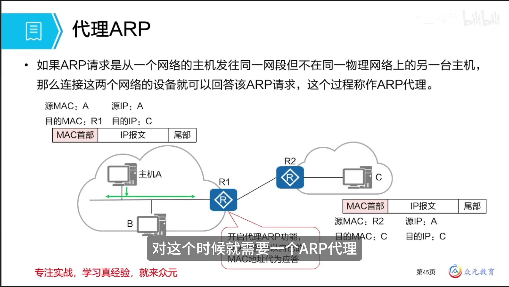

**定义**：如果 ARP 请求是从一个网络的主机发往同一网段但不在同一物理网络上的另一台主机，那么连接这两个网络的设备（路由器）可以代替目的主机回答该 ARP 请求，这一过程称为 **ARP 代理（Proxy ARP）**。

工作方式：

| 位置 | 源 MAC | 源 IP | 目的 MAC | 目的 IP |
| ---- | ------ | ----- | -------- | ------- |
| 主机 A 发出的帧 | A | A | **R1**（路由器以自身 MAC 代为应答） | C |
| 经 R2 转发到 C 的帧 | **R2** | A | C | C |

要点：

- 路由器开启代理 ARP 功能后，**用自己的 MAC 地址代为应答**，主机 A 因而把发往 C 的帧先交给路由器；
- 跨网段通信的基本规律是"**IP 不变，MAC 变**"，因为 MAC 地址只在当前网络内有效，每经过一个网段都要更换源、目的 MAC；
- 若中途配置了 **NAT**，则 IP 地址也会发生变化，此时"IP 不变"不再成立，需结合是否配置 NAT 判断。

### 5.6 免费 ARP

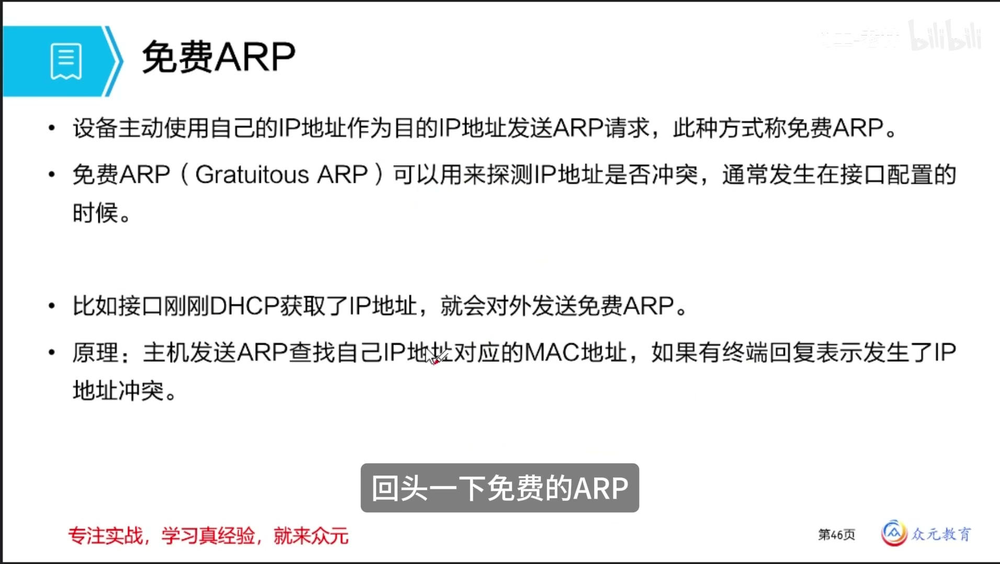

**定义**：设备主动使用**自己的 IP 地址作为目的 IP 地址**发送 ARP 请求，此种方式称为**免费 ARP（Gratuitous ARP）**。

| 项目 | 内容 |
| ---- | ---- |
| 主要作用 | **探测 IP 地址是否冲突**（重复地址检测） |
| 触发时机 | 通常发生在**接口配置**时；例如接口刚通过 DHCP 获取 IP 地址后，会对外发送免费 ARP |
| 原理 | 主机发送 ARP 查找自己 IP 地址对应的 MAC 地址；**若有终端回复，说明该 IP 已被占用，发生地址冲突**；若无回复，则可放心使用 |
| 附带作用 | 通告自身 IP 与 MAC 的映射，促使网段内其他主机更新 ARP 缓存 |

### 5.7 RARP 与 ARP 欺骗

**RARP（Reverse Address Resolution Protocol，反向地址解析协议）**：

| 项目 | 内容 |
| ---- | ---- |
| 解析方向 | **由 MAC 地址求 IP 地址**，与 ARP 方向相反 |
| 典型用途 | 无盘工作站等不知道自身 IP 的设备，向 RARP 服务器查询自己的 IP |
| 报文格式 | 与 ARP 相同，仅操作码不同，以太网类型不同 |
| 现状 | 已被 **BOOTP / DHCP** 取代，仅需认识概念 |

**ARP 欺骗**：

| 项目 | 内容 |
| ---- | ---- |
| 原理 | 攻击者伪造 ARP 响应（或免费 ARP），把错误的 IP 与 MAC 映射告知受害主机，篡改其 ARP 缓存，使流量被引向攻击者 |
| 危害 | 可实现中间人攻击、流量窃听与篡改，严重时导致断网 |
| 防范 | **静态绑定**（`arp -s`）可提高安全性；配合端口安全、ARP 防护等机制；静态绑定只能预防与缓解，不能完全杜绝 |
| 根源 | ARP 本身无认证机制，主机无条件信任收到的 ARP 响应 |

---

## 6.典型例题

### 6.1 IPv4报文格式

#### 例题1：填充字段的作用

IPv4 首部中填充字段的作用是（）

- A. 维持最小帧长
- B. 保持 IP 报文的长度为字节的倍数
- C. 确保首部为 32 比特的倍数
- D. 受 MTU 的限制

解答：**C**。可选项的长度不固定，填充字段用于补足，使首部长度为 32 比特（4 字节）的整数倍。

#### 例题2：首部长度字段的最小值与防环字段

IPv4 首部中首部长度字段（IHL）的值最小为（1）；为了防止 IP 数据报在网络中无限制转发，IPv4 首部中通过（2）字段加以控制。

（1）A. 2　B. 5　C. 10　D. 15

（2）A. URG　B. Offset　C. More　D. TTL

解答：

（1）**B. 5**。首部长度字段以 4 字节为单位，固定首部 20 字节对应取值 5，最大 60 字节对应取值 15。

（2）**D. TTL**。生存时间字段每经过一个路由器减 1，减至 0 即丢弃数据报，从而限制其在网络中的存活时间。URG、Offset、More 均非 IPv4 首部中承担该功能的字段。

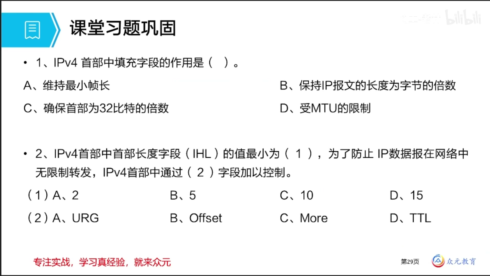

#### 例题3：分片与首部长度的计算

IP 数据报经过 MTU 较小的网络时需要分片。假设一个大小为 1500 的报文分为两个较小的报文，其中一个报文大小为 800，则另一个报文的大小为（）

- A. 700
- B. 720
- C. 740
- D. 800

解答：

```
原报文：1500 = 20（首部）+ 1480（数据）
分片一：800 = 20（首部）+ 780（数据）
剩余数据：1480 − 780 = 700
分片二：700 + 20 = 720 字节
```

答案为 **B. 720**。

要点：题干若未强调"数据部分长度"，则一律按"首部 + 数据"理解，每一片都必须重新添加 20 字节首部；若题干明确说明是数据部分长度，才不加首部。这是一个常考的陷阱。

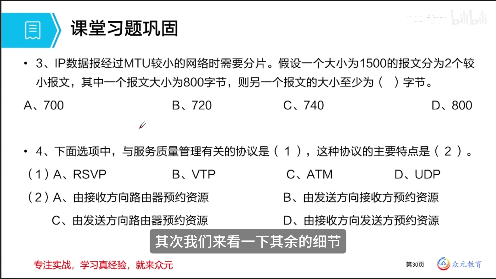

#### 例题4：与 QoS 相关的协议及其特点

下列选项中，与服务质量（QoS）管理有关的协议是（1），这种协议的主要特点是（2）。

（1）A. RSVP　B. VTP　C. ATM　D. UDP

（2）A. 由接收方向路由器预约资源
　　 B. 由发送方向接收方预约资源
　　 C. 由发送方向路由器预约资源
　　 D. 由接收方向发送方预约资源

解答：

（1）**A. RSVP**（资源预留协议），是综合服务模型用于提前申请网络资源的协议。

（2）**A**。资源预留由**接收方向网络中的路由器**提出申请，沿途各节点预留资源并提供保证服务与负载控制服务。若理解为"发送方直接向路由器预约"或"发送方与接收方之间预约"，均属方向性错误。

### 6.2 IPv6报文格式

#### 例题1：第一个扩展报头

IPv6 协议数据单元由一个固定首部和若干扩展首部以及上层协议提供的负载组成。如果有多个扩展首部，则第一个扩展首部为（）

- A. 逐跳选项首部
- B. 路由选择首部
- C. 分段首部
- D. 认证首部

解答：**A. 逐跳选项首部**。逐跳选项首部的下一头部编号为 0，且必须由路径上每个路由器读取处理，因此必须排在所有扩展报头之首。

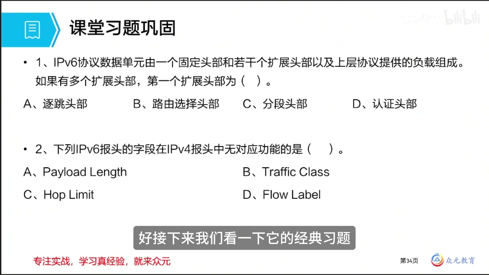

#### 例题2：IPv4 中没有对应功能的字段

下列 IPv6 报头的字段中，在 IPv4 报头中没有对应功能的是（）

- A. 负载长度
- B. 流量类型
- C. 流标签
- D. 跳数限制

解答：**C. 流标签**。负载长度对应 IPv4 的总长度，流量类型对应区分服务字段，跳数限制对应 TTL；唯独流标签与资源预留相关，IPv4 首部中不存在对应字段。

#### 例题3：IPv4 与 IPv6 报头区别的错误说法

以下关于 IPv6 与 IPv4 报文头区别的比较中，说法错误的一项是（）

- A. IPv4 首部长度可变，IPv6 首部长度固定
- B. IPv4 与 IPv6 均有校验和字段
- C. IPv4 有可选项，IPv6 改用扩展首部
- D. IPv4 首部含分片字段，IPv6 改用分段报头

解答：**B**。IPv4 首部有首部校验和字段，而 **IPv6 取消了首部校验和**，故 B 的说法错误。

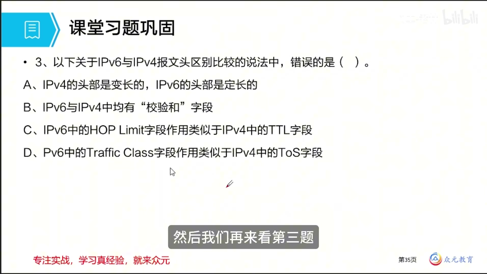

### 6.3 ICMP协议

#### 例题1：ICMP 的封装位置

ICMP 是 TCP/IP 分层模型中第三层的协议，其报文封装在（）中传送。

- A. 以太帧
- B. IP 数据报
- C. UDP 报文
- D. TCP 报文

解答：**B. IP 数据报**。ICMP 报文直接封装在 IP 数据报中传输，IP 首部的协议号字段取值为 1，不要误认为封装在 UDP 或 TCP 中。

#### 例题2：网络拥塞时发出的报文

当网络通信出现拥塞时，路由器会发出（）

- A. 回声请求
- B. 掩码请求
- C. 源点抑制
- D. 路由重定向

解答：**C. 源点抑制报文**，其类型为 **4**。该报文用于通知发送方降低发送速率。

#### 例题3：ping 使用的 ICMP 查询报文

Ping 使用了（）类型的 ICMP 查询报文。

- A. Echo Reply
- B. Host Unreachable
- C. Redirect for Host
- D. Source Quench

解答：**A. Echo Reply（回送应答，类型 0）**。ping 发送 Echo Request（类型 8），目的站返回 Echo Reply（类型 0），二者成对使用。B 为主机不可达，C 为基于主机的重定向，D 为源点抑制，均属差错报告类报文。

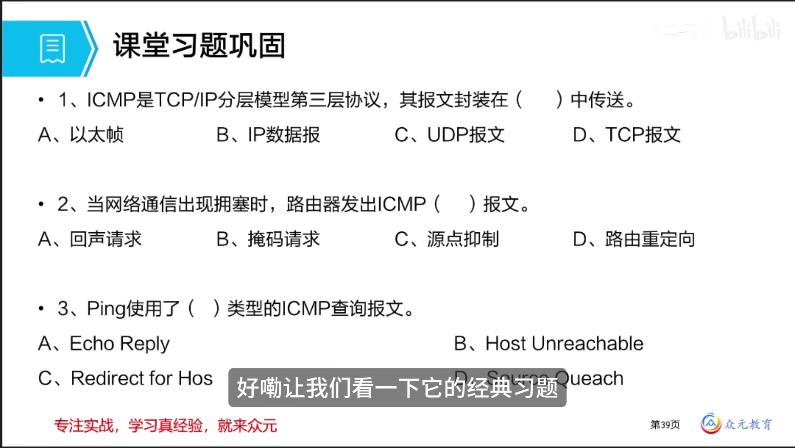

#### 例题4：tracert 返回的超时报文

使用 tracert 命令进行路由跟踪时，其返回的超时报文中的 type 与 code 分别是（）

- A. 3 与 0
- B. 8 与 0
- C. 11 与 0
- D. 12 与 0

解答：**C. 11 与 0**。超时报文的类型为 11，其中 code 0 表示 TTL 超时，code 1 表示分片重组超时。

#### 例题5：TTL 减为 0 时发出的报文

当 IP 报文在网络中传输时，生存时间 TTL 字段值减为 0，此时会发出的 ICMP 消息是（）

- A. destination unreachable
- B. TTL exceeded
- C. parameter problem
- D. [选项被遮挡]

解答：**B. TTL Exceeded**（超时报文，类型 11）。

相关英文单词需要识别：Source Quench 为源点抑制，Destination Unreachable 为目的（终点）不可达，Parameter Problem 为参数问题，Redirect 为重定向，Echo Request / Echo Reply 为回送请求与回送应答。

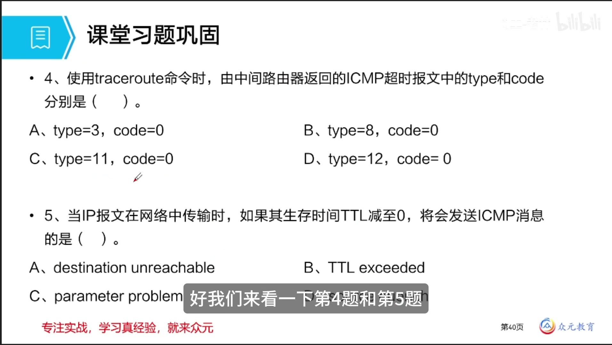

### 6.4 ARP协议

#### 例题1：ARP 的作用与工作方式

（1）ARP 协议的作用是（）；

（2）ARP 的协议数据单元封装在（）中传送；

（3）ARP 请求报文采用（）方式发送，响应报文采用（）方式发送。

（1）A. 由 MAC 地址求 IP 地址　B. 由 IP 地址求 MAC 地址　C. 由 IP 地址查域名　D. 由域名查 IP 地址

（2）A. IP 分组　B. 以太帧　C. TCP 段　D. UDP 报文

（3）A. 单播　B. 组播　C. 广播　D. 点播

解答：

| 小题 | 答案 |
| ---- | ---- |
| （1） | 由 **IP 地址求 MAC 地址**，建立 IP 地址与 MAC 地址的映射 |
| （2） | 封装在**以太网帧**中传送 |
| （3） | 请求为**广播**，响应为**单播** |

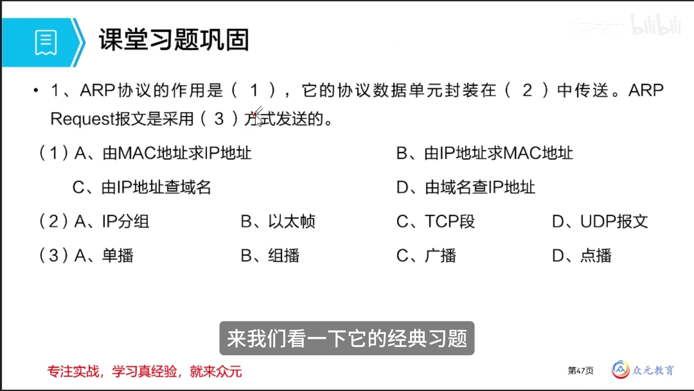

#### 例题2：ARP 报文中的目标 MAC

主机 A 的 MAC 地址为 aa.aa.aa.aa.aa.aa，主机 B 的 MAC 地址为 bb.bb.bb.bb.bb.bb。由主机 A 发出的查询主机 B 的 MAC 地址的帧格式为"目标 MAC 地址 + 源 MAC 地址 + 协议类型 + ARP 报文 + CRC"，则 ARP 报文中的目标 MAC 地址为（）

- A. aa.aa.aa.aa.aa.aa
- B. bb.bb.bb.bb.bb.bb
- C. 00.00.00.00.00.00
- D. FF.FF.FF.FF.FF.FF

解答：**C. 00.00.00.00.00.00**。

要点：必须区分两个层次的目标 MAC。

| 位置 | 请求报文中的取值 |
| ---- | ---------------- |
| 以太网帧首部的目的 MAC | **全 F**（广播） |
| ARP 报文数据中的目标 MAC 字段 | **全 0**（未知，待对方填写） |

题干问"ARP 报文中的目标 MAC"，指的是 ARP 报文内部的目标 MAC 字段，故为全 0。这是一个高频陷阱。

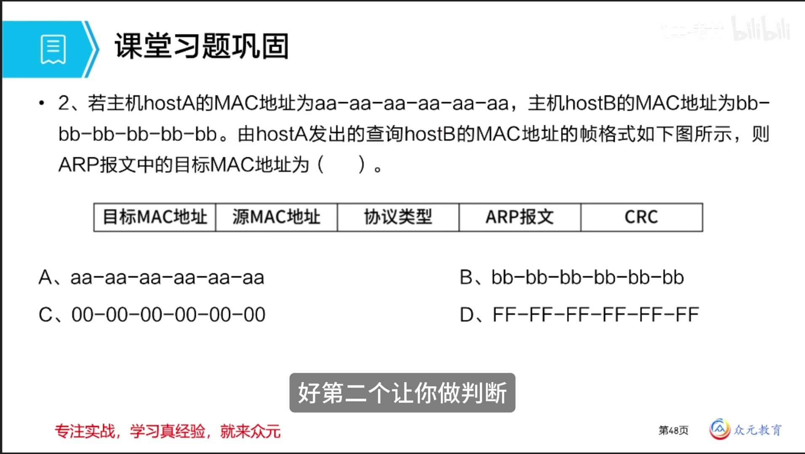

#### 例题3：ARP 表的作用

ARP 表用于缓存 ARP 响应报文中的地址映射，采用 ARP 表的好处是（）

- A. 便于测试网络连接数
- B. 减少网络维护工作量
- C. 限制网络广播数量
- D. 解决网络地址冲突

解答：**C**。有了 ARP 缓存表，通信时先查表即可获得 MAC 地址，无需每次都广播发送 ARP 请求，从而减少广播报文数量、限制广播。它与连接数、地址冲突均无关系。

#### 例题4：案例分析——VLAN 隔离后的二层通信

题干要点：使用 VLAN 在一条链路上逻辑划分成多个逻辑网络（广播域），以切割广播域。

问题：

| 问题 | 答案 |
| ---- | ---- |
| （1）将一个物理 LAN 在逻辑上划分成多个（）的通信技术 | **广播域**（即 VLAN） |
| （2）相同 VLAN 内进行二层隔离可采用交换机的（）功能 | **端口隔离** |
| （3）隔离后二层主机之间需要通信，则需要在主机网关上配置（）功能 | **ARP 代理（Proxy ARP）** |

解答：VLAN 把一个物理局域网在逻辑上划分为多个广播域，从而切割广播域；同一 VLAN 内需要二层隔离时采用端口隔离；二层被隔离后，主机之间无法直接通过广播完成地址解析，必须在主机网关上开启 ARP 代理，由网关以自身 MAC 代为应答，才能实现不同二层网络之间的转发。

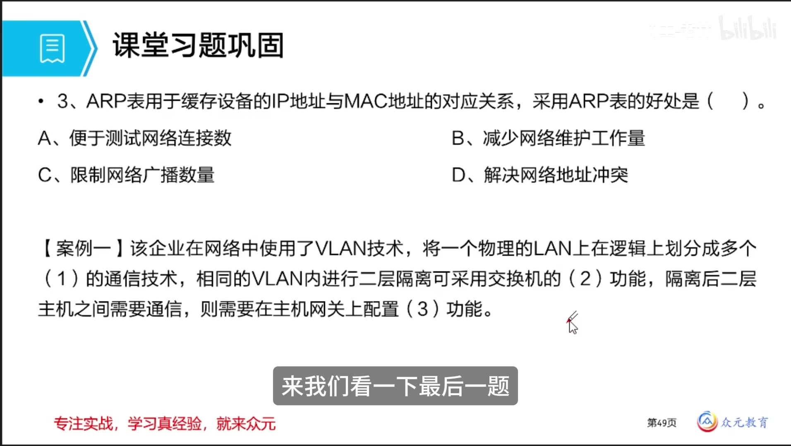

---

## 7.本章小结

| 知识点 | 核心内容 |
| ------ | -------- |
| 1. IPv4 首部结构 | 固定首部 20 字节 + 可选项 0 ~ 40 字节 + 填充；首部总长 20 ~ 60 字节，必须为 4 字节整数倍 |
| 2. 关键字段 | 版本（4）、首部长度（取值 5 ~ 15）、区分服务、总长度（最大 65535）、标识、标志（DF / MF）、片偏移、TTL、协议（TCP 6 / UDP 17 / ICMP 1）、首部校验和、源与目的 IP 地址 |
| 3. 分片计算 | 每片可装数据 = MTU − 20；片偏移 = 数据起始字节 ÷ 8；MF 仅末片为 0；DF 默认为 0 |
| 4. 分片与重组 | IPv4 在源主机与沿途路由器分片，**仅目的主机重组** |
| 5. QoS 度量 | 带宽、时延、抖动、丢包率 |
| 6. QoS 服务模型 | 尽力而为（默认，先来先服务）、综合服务（RSVP 预留资源，扩展性差）、区分服务（分类标记，不预留） |
| 7. IPv6 数据报结构 | 固定首部 **40 字节** + 扩展报头 + 数据 |
| 8. IPv6 固定首部字段 | 版本、通信类别、**流标签**、负载长度、下一头部、跳数限制、源与目的 IP（各 128 位） |
| 9. IPv6 扩展报头 | 逐跳选项 0（必为第一个）、TCP 6 / UDP 17、路由 43、分段 44、ESP 50（加密）、AH 51（仅认证）、目的选项 60 |
| 10. IPv4 与 IPv6 对比 | 首部 20~60 字节变长对 40 字节定长；IPv4 有首部校验和而 IPv6 无；IPv6 仅源节点分片 |
| 11. ICMP 概述 | 网络层协议，封装在 IP 报文中，协议号 1；报文含类型、代码、校验和 |
| 12. ICMP 差错报文 | 终点不可达 3、源点抑制 4、重定向 5、超时 11、参数问题 12 |
| 13. ICMP 询问报文 | 回送请求 8 与回送应答 0（成对）、时间戳请求 13 与应答 14 |
| 14. ICMP 应用 | ping 用 Echo 请求 / 应答；tracert 用超时报文 11 与终点不可达 3 |
| 15. ARP 作用 | 由 IP 地址求 MAC 地址；网络层协议，封装在以太网帧中 |
| 16. ARP 请求与响应 | 请求为**广播**（目的 MAC 全 F），响应为**单播**；ARP 数据中的目标 MAC 字段为**全 0** |
| 17. ARP 工作过程 | 查缓存 → 广播请求 → 目标主机添加缓存项 → 单播应答 → 发送方添加缓存项 |
| 18. ARP 缓存表 | 含 IP 地址、物理地址、类型三列；`arp -a` 查看、`arp -s` 静态绑定、`arp -d` 清除；动态项有老化时间，静态项优先级高 |
| 19. 代理 ARP | 跨网段时路由器以自身 MAC 代为应答；跨网段通信"**IP 不变，MAC 变**"，配 NAT 时 IP 也会变 |
| 20. 免费 ARP | 以自身 IP 为目的 IP 发送 ARP 请求，用于**探测 IP 地址冲突** |
| 21. RARP | 反向地址解析协议，由 MAC 求 IP，已被 BOOTP / DHCP 取代 |
| 22. ARP 欺骗 | 伪造 ARP 响应篡改他人 ARP 缓存，实现中间人攻击；可用静态绑定预防 |

考试重点：

1. **IPv4 首部长度的两个数字**：首部总长为 20 ~ 60 字节，而首部长度字段的取值为 5 ~ 15，二者是"字节数"与"单位数"的关系，极易设置陷阱。
2. **总长度包含首部**，最大 65535 字节；而 IPv6 的负载长度**不包含 40 字节固定首部**。
3. **片偏移以 8 字节为单位**，必须先按数据起始位置除以 8；若不能整除则向下取整，并用"商 × 8"反推实际切割长度。
4. **MF 与 DF 的默认取值**：MF 仅最后一片为 0，其余为 1；DF 默认为 0 允许分片，置 1 时超出 MTU 即被丢弃。
5. **分片的每一片都要加 20 字节首部**，计算"另一片长度"时不要漏掉首部。
6. **IPv6 固定首部 40 字节、无首部校验和、首部定长**，与 IPv4 的 20 ~ 60 字节变长形成固定考法；流标签是 IPv4 中不存在的字段。
7. **逐跳选项（0）必为第一个扩展报头**；ESP 能加密，AH 只认证；路由报头类似松散源路由，只由部分节点处理。
8. **IPv6 分片只在源节点进行**，源节点先通过路径 MTU 发现取得路径最小 MTU，一次分片到位。
9. **ICMP 类型与代码的对应**：3 终点不可达、4 源点抑制、5 重定向、8/0 Echo 请求与应答、11 超时、12 参数问题；相关英文单词要能识别。
10. **ping 与 tracert 的报文组合**：ping 用 8/0，tracert 依赖 11（超时）与 3（终点不可达）配合。
11. **ARP 请求广播、响应单播**；ARP 报文内部的目标 MAC 字段为全 0，而帧首部的目的 MAC 为全 F，二者不可混淆。
12. **跨网段通信"IP 不变，MAC 变"**；配置 NAT 后 IP 也会改变。
13. **ARP 相关命令**：`arp -a` 查看、`arp -s` 静态绑定（防攻击）、`arp -d` 清除；动态项有老化时间。
14. **RARP 由 MAC 求 IP，已被 BOOTP / DHCP 取代**；IPv6 中无 ARP，改由基于 ICMPv6 的 NDP 完成地址解析。


