# 路由技术概述与静态路由 · 完整笔记

---

## 1.路由技术概述

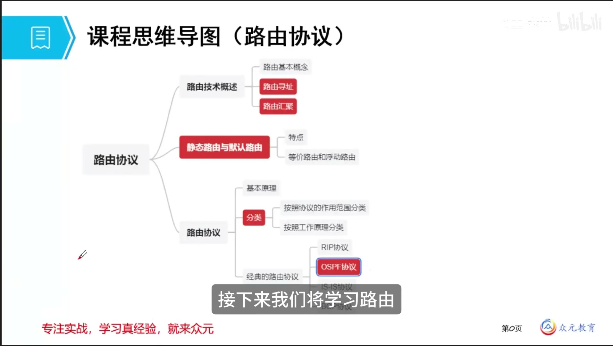

路由协议板块的学习主线可以概括为三条：

1. 什么叫路由寻址，它如何工作，路由条目中包含哪些指标；
2. 路由表项生成以后，路由条目如何产生，即静态路由与动态路由的区分；
3. 动态路由依赖各类路由协议，经典路由协议的工作原理、特点与常考项是什么。

### 1.1 路由技术与路由器

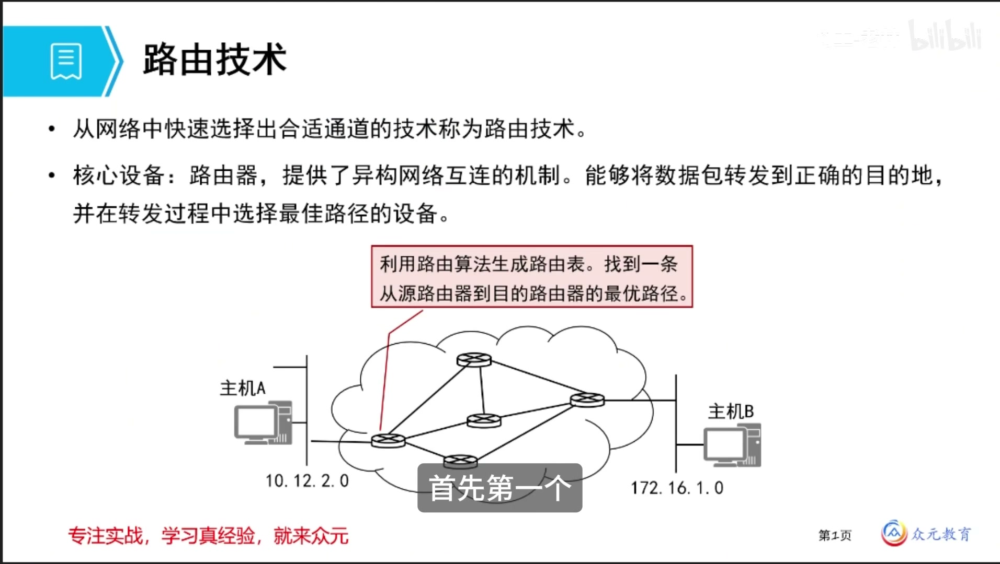

- **路由技术**：从网络中快速选择出合适通道的技术。网络节点不断增多后，源到目的的路径变得复杂而繁多，需要按一定规则选出最优路径，这就是路由选择。
- **核心设备**：路由器。路由器提供异构网络互连的机制，能够将数据包转发到正确的目的地，并在转发过程中选择最佳路径。
- 路由器利用路由算法生成路由表，找到一条从源路由器到目的路由器的最优路径。
- 直观理解：路由就像路牌，告诉你“要到某地，下一个路口往哪里走”；路由器是这些路牌的集中管理角色。

### 1.2 路由器、交换机与三层交换

| 设备 | 工作层次 | 核心功能 | 特点 |
| ---- | -------- | -------- | ---- |
| 二层交换机 | 数据链路层 | 依据 MAC 地址转发帧 | 转发速率高 |
| 路由器 | 网络层 | 路由寻址、异构网络互连、选择最佳路径 | 路由功能完整，是路由寻址的核心设备 |
| 三层交换机 | 网络层（具备二层交换能力） | 既带路由功能，又具备交换机的快速转发能力 | 常用于核心网络 |

要点：二层网络的核心设备是交换机，三层网络的核心设备是路由器；三层交换技术把两者的优点结合起来，用于核心网络。

---

## 2.路由寻址

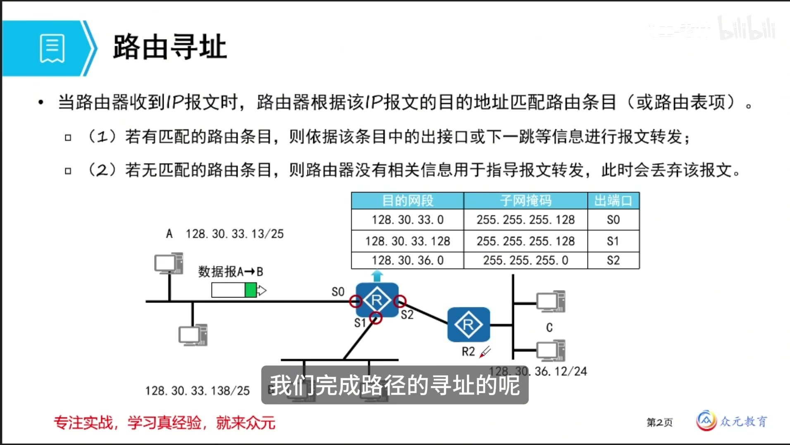

### 2.1 路由寻址的基本过程

当路由器收到 IP 报文时，会根据该 IP 报文的**目的地址**匹配路由条目（路由表项）：

1. 取出 IP 报文头部的目的 IP 地址；
2. 将目的 IP 地址与路由表项中的**子网掩码**逐位进行“与”运算，得到目的网段；
3. 将运算结果与该表项的**目的网段**比较，判断是否匹配；
4. 若有匹配的路由条目，则依据该条目中的**出接口**或**下一跳**等信息进行报文转发；
5. 若无匹配的路由条目，则路由器没有相关信息指导报文转发，此时会丢弃该报文。

匹配时从最高位开始，逐位寻找相同点，前缀相同的位数越多，匹配越精确。

### 2.2 匹配示例

路由表如下：

| 目的网段 | 子网掩码 | 出端口 |
| -------- | -------- | ------ |
| 128.30.33.0 | 255.255.255.128 | S0 |
| 128.30.33.128 | 255.255.255.128 | S1 |
| 128.30.36.0 | 255.255.255.0 | S2 |

主机 A 的地址为 128.30.33.13/25，主机 B 的地址为 128.30.33.138/25。A 向 B 发送报文，目的地址为 128.30.33.138。

逐条匹配：

- 第 1 条：128.30.33.138 与 255.255.255.128 相与，结果为 128.30.33.128，与表项目的网段 128.30.33.0 不符，不匹配；
- 第 2 条：相与结果仍为 128.30.33.128，与表项目的网段 128.30.33.128 相符，匹配成功，报文从 **S1** 转发。

若把第 1 条的子网掩码改为 255.255.255.0：

- 第 1 条：相与结果为 128.30.33.0，匹配；
- 第 2 条：掩码仍为 /25，相与结果为 128.30.33.128，也匹配；
- 两条都匹配时，按**最长匹配原则**选择前缀更长的第 2 条，报文仍从 **S1** 转发。

### 2.3 最长匹配原则

**最长匹配原则**：当多条路由条目都能匹配同一个目的地址时，选择前缀最长、匹配最精确的一条。

| 前缀长度 | 匹配精度 | 典型条目 |
| -------- | -------- | -------- |
| /32 | 精确匹配每一个比特，只对应单一主机地址 | 主机路由 |
| /24、/25 等 | 匹配一个网段 | 子网路由、网段路由 |
| /0 | 与任何目的地址都能匹配 | 默认路由 |

直观理解：去“长沙市岳麓区”与去“长沙市”都能到达，但岳麓区的指示更细，应当按岳麓区的路口走。匹配越细，越能准确到达目的地。

实际路由表条目数量多、结构复杂，设备通常按前缀长度组织查找，优先尝试更长的前缀，以保证最终选到最长匹配的路由。

### 2.4 出接口与下一跳

路由条目对“报文从哪里出去”有两种指示方式：

| 指示方式 | 含义 | 示例 | 路由表对应列 |
| -------- | ---- | ---- | ------------ |
| 下一跳 | 对端（相邻路由器）接口的 IP 地址，是本设备去往目的地的下一个入口 | 10.0.0.2 | NextHop |
| 出接口 | 本设备上报文离开的接口 | GigabitEthernet0/0/0、Serial0 | Interface |

两者的区别：

- **下一跳**站在“对端”的角度，指向下一个路由器的入口地址；
- **出接口**站在“本设备”的角度，指向本机报文离开的端口；
- 两者可以分别使用，也可以同时出现，作用是共同指导报文转发。

课程举例中曾用 S1 接口地址 128.30.33.129 作为地址形式的指示。严格来说，路由表的 Interface 列是本设备出接口，NextHop 列才是对端下一跳地址，二者不要混淆；配置静态路由时，可按链路类型选择只写出接口、只写下一跳，或两者同时写出。

---

## 3.路由表

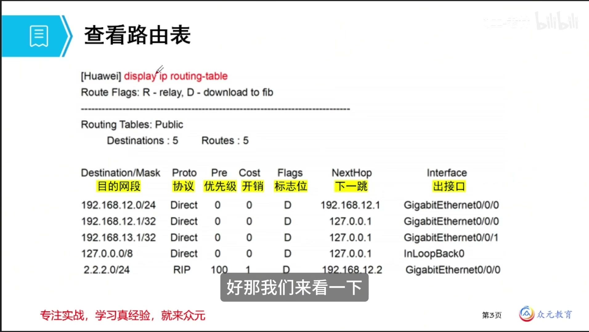

### 3.1 查看路由表

在华为设备上查看路由表的命令：

```
[Huawei] display ip routing-table
Route Flags: R - relay, D - download to fib
------------------------------------------------------------------------------
Routing Tables: Public
         Destinations : 5        Routes : 5
```

输出信息的含义：

| 输出项 | 含义 |
| ------ | ---- |
| Route Flags: R - relay | R 表示该路由是**迭代路由**（relay，可理解为需要中转） |
| Route Flags: D - download to fib | D 表示该路由已**下发到 FIB（转发信息库）** |
| Routing Tables: Public | 公网路由表 |
| Destinations | 目的网络或主机的总数 |
| Routes | 路由条目总数；同一目的存在多条路由时，Routes 可能大于 Destinations |

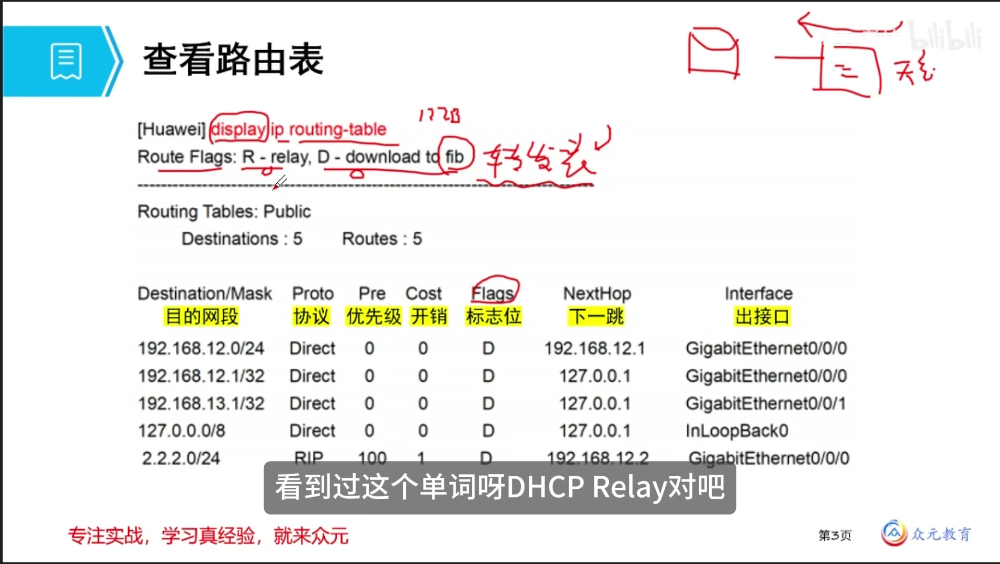

R 与 D 是路由表中最重要的两个标志位：R（relay）表示该路由是迭代路由，需要经过中转才能得到直连的下一跳；D（download to fib）表示该路由已经下发到转发表，可以用于指导报文转发。relay 与 DHCP relay 中的 relay 是同一个词，都带有“中继、中转”的含义。

### 3.2 路由表字段

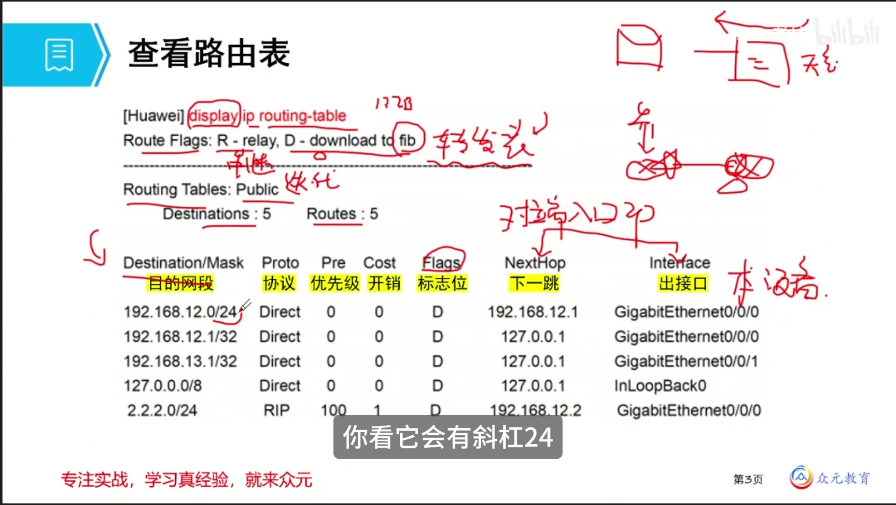

| 字段 | 中文含义 | 说明 |
| ---- | -------- | ---- |
| Destination/Mask | 目的网段/掩码 | 路由要到达的目的网络或主机；斜杠后的数字是掩码长度 |
| Proto | 协议 | 路由来源，如 Direct（直连）、Static（静态）、RIP、OSPF、IS-IS、BGP |
| Pre | 优先级 | 路由优先级（Preference），数值越小越优先 |
| Cost | 开销 | 路由度量值，同一协议内比较，数值越小越优 |
| Flags | 标志位 | R 表示迭代路由，D 表示已下发 FIB |
| NextHop | 下一跳 | 下一个路由器接口的 IP 地址 |
| Interface | 出接口 | 本设备上报文离开的接口 |

补充说明：

- **/24** 表示一个网段地址；**/32** 要求 32 位全部精确匹配，代表一个主机地址，称为**主机路由**。
- **Direct** 表示直连路由，即接口直接相连、路径可查的路由；**Static** 表示管理员手工指定的静态路由；RIP、OSPF 等表示由动态路由协议学习到的路由。
- **Pre** 用于在目的网络和掩码都相同时比较不同来源的路由；**Cost** 用于在同一协议内部比较不同路径。
- 不同厂商对优先级的取值定义不同，华为使用 Preference，思科使用 Administrative Distance（管理距离），数值都是越小越优先。

### 3.3 路由表实例

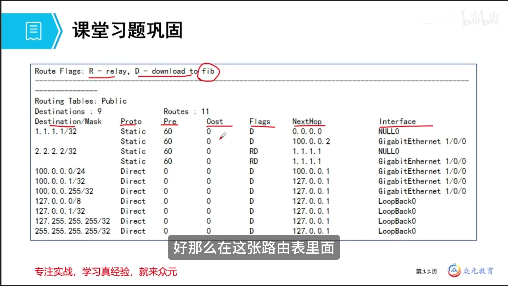

| Destination/Mask | Proto | Pre | Cost | Flags | NextHop | Interface |
| ---------------- | ----- | --- | ---- | ----- | ------- | --------- |
| 192.168.12.0/24 | Direct | 0 | 0 | D | 192.168.12.1 | GigabitEthernet0/0/0 |
| 192.168.12.1/32 | Direct | 0 | 0 | D | 127.0.0.1 | GigabitEthernet0/0/0 |
| 192.168.13.1/32 | Direct | 0 | 0 | D | 127.0.0.1 | GigabitEthernet0/0/1 |
| 127.0.0.0/8 | Direct | 0 | 0 | D | 127.0.0.1 | InLoopBack0 |
| 2.2.2.0/24 | RIP | 100 | 1 | D | 192.168.12.2 | GigabitEthernet0/0/0 |

逐行解读：

- 192.168.12.0/24 为直连网段，优先级 0，开销 0，已下发 FIB；
- 192.168.12.1/32、192.168.13.1/32 是接口地址对应的主机路由，下一跳为 127.0.0.1，表示目的就是本机；
- 127.0.0.0/8 为环回地址段，出接口为 InLoopBack0；127.0.0.1/32 为本机环回主机路由，常用于测试本机 TCP/IP 协议栈是否正常；
- 2.2.2.0/24 由 RIP 学习，优先级 100，开销（跳数）为 1，下一跳为 192.168.12.2。

注意：课件口述中把 127.0.0.1/32 与“路由黑洞”联系起来，这种说法不严谨。127.0.0.0/8 属于环回地址；真正用于丢弃报文、形成黑洞的是指向 NULL0 的路由。

### 3.4 路由表与转发表（FIB）

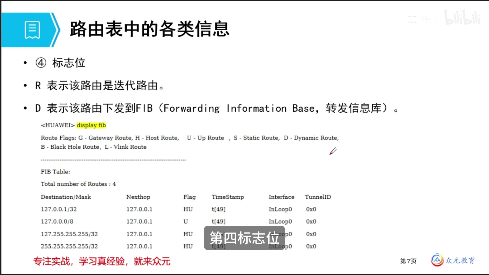

| 比较项 | 路由表 | 转发表 FIB |
| ------ | ------ | ---------- |
| 作用 | 存储并提供路由信息，参与路由选择 | 根据最优路由生成，指导 IP 报文的实际转发 |
| 内容 | 各类路由条目及其属性 | 最终用于转发的目的网络、下一跳、出接口等 |
| 关系 | 选出最优路由后，最优路由下发到 FIB | 转发时查 FIB，不直接查路由表 |

查看转发表的命令：

```
<HUAWEI> display fib
FIB Table:
Total number of Routes : 4

Destination/Mask    Nexthop      Flag    TimeStamp    Interface    TunnelID
127.0.0.1/32        127.0.0.1    HU      t[49]        InLoop0      0x0
127.0.0.0/8         127.0.0.1    U       t[49]        InLoop0      0x0
127.255.255.255/32  127.0.0.1    HU      t[49]        InLoop0      0x0
255.255.255.255/32  127.0.0.1    HU      t[49]        InLoop0      0x0
```

FIB 的标志位与路由表的 R/D 标志位不是同一套含义，FIB 图例为：

```
Route Flags: G - Gateway Route, H - Host Route, U - Up Route,
              S - Static Route, D - Dynamic Route, B - Black Hole Route,
              L - Vlink Route
```

| 标志 | 英文 | 含义 |
| ---- | ---- | ---- |
| G | Gateway Route | 网关路由，下一跳为网关 |
| H | Host Route | 主机路由 |
| U | Up Route | 路由状态为 Up（可用） |
| S | Static Route | 静态路由 |
| D | Dynamic Route | 动态路由 |
| B | Black Hole Route | 黑洞路由，下一跳为空接口 |
| L | Vlink Route | Vlink 路由 |

表中 TunnelID 为 0x0，表示未使用隧道或隧道未建立。要点：路由表负责“存路由、选路由”，转发表负责“按路由转发报文”；FIB 的细节考查较少，掌握两者的分工即可。

---

## 4.路由的分类

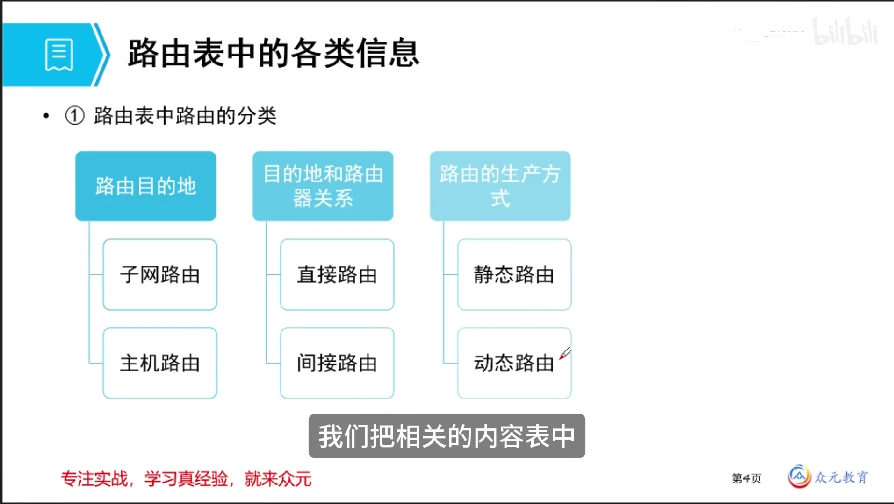

路由可以从三个角度分类：

| 分类依据 | 类别 | 说明 |
| -------- | ---- | ---- |
| 按路由目的地 | 子网路由 | 目的地址为一个网段 |
| 按路由目的地 | 主机路由 | 掩码为 /32，只匹配单一主机地址，遵循最长前缀匹配 |
| 按目的地址与路由器的关系 | 直接路由（Direct） | 目的网络与路由器接口直接相连，自动生成 |
| 按目的地址与路由器的关系 | 间接路由 | 目的网络不与路由器直接相连，需要通过静态或动态方式获取 |
| 按路由的生成方式 | 静态路由（Static） | 网络管理员手工配置 |
| 按路由的生成方式 | 动态路由 | 路由器之间通过路由协议交互，自动学习生成 |

### 4.1 直连路由

- 路由器接口配置 IP 地址并处于 Up 状态后，会自动生成直连路由；
- 直连路由的优先级为 **0**，开销为 **0**；
- 直连路由还包括接口地址对应的 /32 主机路由，以及接口所在网段的广播地址对应的 /32 主机路由（如 100.0.0.255/32）。

### 4.2 静态路由与动态路由的对比

| 比较项 | 静态路由 | 动态路由 |
| ------ | -------- | -------- |
| 生成方式 | 管理员逐条手工配置 | 路由协议自动交互、计算生成 |
| 适用网络 | 结构简单、规模较小的网络 | 规模大、结构复杂、变化较多的网络 |
| 配置与维护 | 配置简单、可控性高；网络扩大后工作量大，难以维护 | 自动适应拓扑变化，便于维护 |
| 带宽与资源 | 不需要路由器之间交互，节省网络带宽 | 需要协议报文交互，占用带宽和 CPU |
| 故障适应 | 不能自动感知拓扑变化，需人工修改 | 能自动收敛，具备冗余能力 |
| 常见问题 | 配置错误、环路、指路错误 | 计算开销、收敛时间、协议配置复杂 |
| 灵活性 | 较低，难以灵活适应网络结构变化 | 较高，可通过路由策略进一步完善 |

结论：小型简单拓扑适合静态路由；大型复杂网络应采用动态路由，并可配合路由策略提高灵活性。

---

## 5.路由优先级与度量值

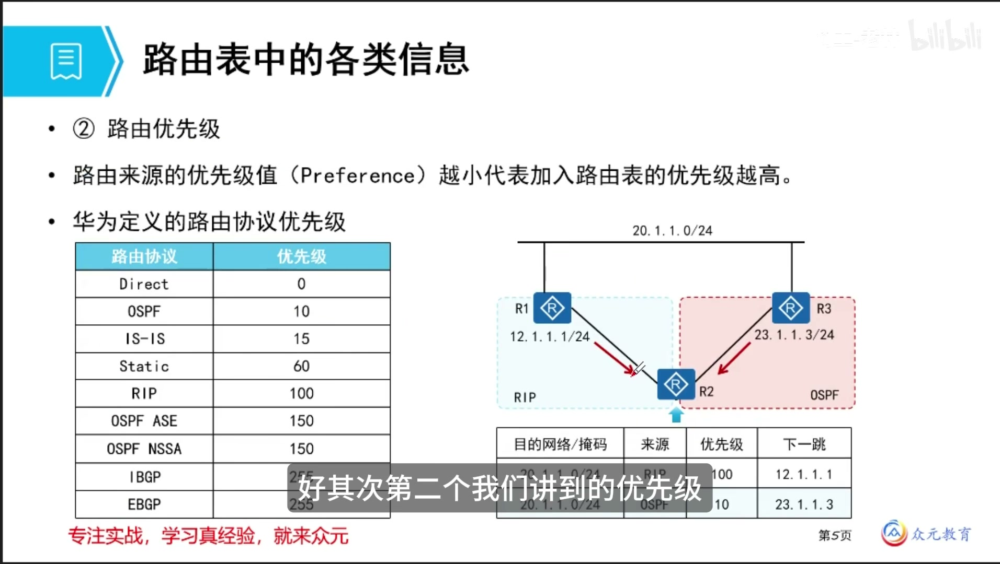

### 5.1 路由优先级（Preference）

- 当到达同一目的网络、且掩码长度一致的路由存在多条不同来源时，需要比较**路由优先级**；
- 优先级（Preference，常写作 Pre）**数值越小，优先级越高**；
- 不同厂商对优先级的取值定义不同，不能直接混用；
- 优先级是本地概念，只在本地路由器上有效，不会随路由协议传递。

### 5.2 华为定义的路由协议优先级

| 路由协议或路由类型 | 默认优先级 |
| ------------------ | ---------- |
| Direct（直连） | 0 |
| OSPF | 10 |
| IS-IS | 15 |
| Static（静态） | 60 |
| RIP | 100 |
| OSPF ASE（OSPF 自治系统外部路由） | 150 |
| OSPF NSSA（NSSA 区域外部路由） | 150 |
| IBGP | 255 |
| EBGP | 255 |

说明：

- 0 表示直连路由，优先级最高；255 表示来自不可靠来源的路由，优先级最低；
- 除直连路由外，其余路由协议的优先级均可手工修改；静态路由还可以为每一条路由单独指定优先级；
- 表中为**外部优先级**。当不同协议被配置为相同的外部优先级时，还会比较**内部优先级**，例如 IBGP 为 200、EBGP 为 20、OSPF 为 10、静态为 60。考试中通常只需记住上表的外部优先级。

### 5.3 优先级的应用示例

拓扑中 R1 通过 RIP 向 R2 通告 20.1.1.0/24，R3 通过 OSPF 向 R2 通告同一网段。R2 上的路由表如下：

| 目的网络/掩码 | 来源 | 优先级 | 下一跳 |
| ------------- | ---- | ------ | ------ |
| 20.1.1.0/24 | RIP | 100 | 12.1.1.1 |
| 20.1.1.0/24 | OSPF | 10 | 23.1.1.3 |

两条路由的目的网络和掩码完全相同，最长匹配原则无法区分；此时比较优先级，OSPF 的 10 小于 RIP 的 100，因此选择 OSPF 路由作为最优路径，下一跳为 23.1.1.3。

### 5.4 路由度量值（Metric / Cost）

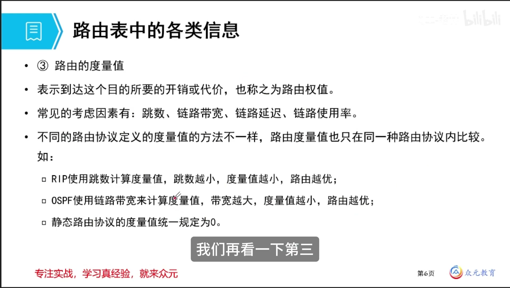

- **度量值**表示到达该目的所要的开销或代价，也称为路由权值；
- 常见考虑因素：**跳数、链路带宽、链路延迟、链路使用率**；
- 不同路由协议定义的度量值方法不同，度量值只应在**同一种路由协议内部**比较；
- 度量值越小，路由越优。

| 路由协议 | 度量值定义 | 比较规则 |
| -------- | ---------- | -------- |
| RIP | 跳数 | 跳数越小，度量值越小，路由越优 |
| OSPF | 链路带宽计算出的 Cost | 带宽越大，Cost 越小，路由越优 |
| 静态路由 | 统一规定为 0 | 静态路由之间通常不再比较度量值 |

直观理解：到同一目的地可以坐火车，也可以坐飞机，两者都能到达，但花费不同。度量值就是衡量“走这条路要花多少代价”的指标。

### 5.5 管理距离与度量值的区别

“管理距离”是思科的术语，华为对应“优先级（Preference）”。两者与度量值的区别如下：

| 比较项 | 管理距离 / 优先级 | 度量值 Metric |
| ------ | ----------------- | ------------- |
| 作用 | 比较不同路由来源的可信度，决定哪一条路由能进入路由表 | 比较同一路由协议内部不同路径的优劣 |
| 比较范围 | 不同协议、静态路由、直连路由之间 | 同一协议内部 |
| 取值规律 | 数值越小越优先 | 数值越小越优 |
| 是否传递 | 本地值，不随路由更新传递 | 由协议计算，可随协议报文传递 |
| 华为典型值 | 直连 0、OSPF 10、IS-IS 15、静态 60、RIP 100 | RIP 看跳数，OSPF 看带宽 Cost |
| 思科典型值 | 直连 0、静态 1、EIGRP 90、OSPF 110、IS-IS 115、RIP 120、eBGP 20、iBGP 200 | 各协议自行定义 |

记忆要点：

1. **先比管理距离/优先级**，在不同来源之间选出一个可信来源；
2. **再比度量值**，在同一来源的多条路径中选出最优路径；
3. 华为静态路由默认优先级为 **60**，思科静态路由默认管理距离为 **1**，两者不要混淆；
4. 管理距离/优先级和度量值都不参与报文转发阶段的最长匹配。

---

## 6.路由迭代

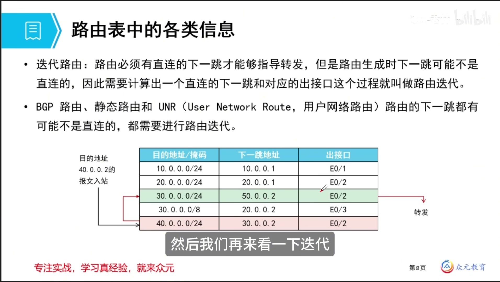

### 6.1 路由迭代的定义

路由必须有**直连的下一跳**才能够指导转发。但路由生成时，下一跳可能不是直连的，因此需要计算出一个直连的下一跳和对应的出接口，这个过程称为**路由迭代**。

- BGP 路由、静态路由和 UNR（User Network Route，用户网络路由）的下一跳都有可能不是直连的，都需要进行路由迭代；
- 迭代路由在路由表中以 **R** 标志表示；
- 迭代完成后，结果会下发到 FIB，用于指导报文转发。

### 6.2 路由迭代示例

| 目的地址/掩码 | 下一跳地址 | 出接口 |
| ------------- | ---------- | ------ |
| 10.0.0.0/24 | 10.0.0.1 | E0/1 |
| 20.0.0.0/24 | 20.0.0.1 | E0/2 |
| 30.0.0.0/24 | 50.0.0.2 | E0/2 |
| 30.0.0.0/8 | 20.0.0.2 | E0/3 |
| 40.0.0.0/24 | 30.0.0.2 | E0/2 |

目的地址为 40.0.0.2 的报文入站后，迭代过程如下：

1. 查路由表，40.0.0.2 最长匹配 40.0.0.0/24，下一跳为 30.0.0.2；
2. 30.0.0.2 不是直连下一跳，继续查路由表；
3. 30.0.0.2 同时匹配 30.0.0.0/24 和 30.0.0.0/8，按最长匹配选择 30.0.0.0/24，下一跳为 50.0.0.2，出接口为 E0/2；
4. 50.0.0.2 为直连下一跳，迭代结束；
5. 最终生成 FIB 表项：40.0.0.0/24，下一跳 50.0.0.2，出接口 E0/2，按此转发。

### 6.3 出接口与迭代深度的关系

| 静态路由写法 | 是否需要迭代 | 说明 |
| ------------ | -------------- | ---- |
| 只写下一跳地址 | 需要迭代 | 迭代成功后才能参与路由选择 |
| 同时写下一跳和出接口 | 不需要迭代，迭代深度为 0 | 可直接参与路由选择并下发 FIB |
| 只写出接口 | 视链路类型而定 | 点到点接口可由对端地址确定下一跳；以太网等广播型接口必须同时指定下一跳 |

要点：迭代的本质是“用下一跳去查路由表，直到找到直连的下一跳和出接口”。迭代可能进行多次；当多条路由都能到达同一目的时，迭代深度越小，越容易被优先选择。

---

## 7.路由匹配原则总结

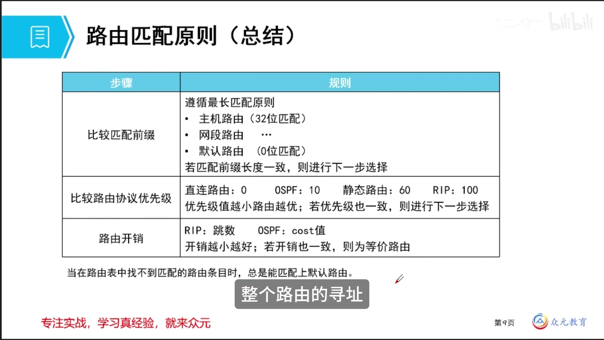

### 7.1 路由选择的三步判断

| 步骤 | 比较内容 | 规则 |
| ---- | -------- | ---- |
| 1 | 比较匹配前缀 | 遵循最长匹配原则：主机路由（/32）优于网段路由，网段路由优于默认路由（/0）；前缀长度一致时才进入下一步 |
| 2 | 比较路由协议优先级 | 优先级数值越小，路由越优；直连 0、OSPF 10、静态 60、RIP 100 |
| 3 | 比较路由开销 | 开销越小越好；RIP 比较跳数，OSPF 比较 Cost |
| 4 | 开销也一致 | 形成等价路由，多条路径均可转发，实现负载分担 |

补充规则：

- 当路由表中找不到匹配的路由条目时，若有默认路由，则总能匹配默认路由；
- 若连默认路由也没有，则报文被丢弃；
- 目的网络和掩码完全一致、优先级相同、开销也相同的多条路由，称为**等价路由**。

### 7.2 技术实质的补充说明

考试中常用的“最长匹配、优先级、开销”三步判断法，是为了快速得出答案。严格来说：

- 路由协议先在自己的候选路径中按**度量值**选出最优路径；
- 不同来源的同一前缀路由进入路由表时，按**优先级/管理距离**比较；
- 报文转发时查 FIB，按**最长前缀匹配**选择表项；
- 优先级和度量值已在路由安装阶段使用，转发阶段不再比较，也不能覆盖最长匹配。

两种理解在多数题目中结论一致：只要记住“越具体越优先，同具体看优先级，同优先级看开销，全相同则等价”即可。

---

## 8.路由汇聚

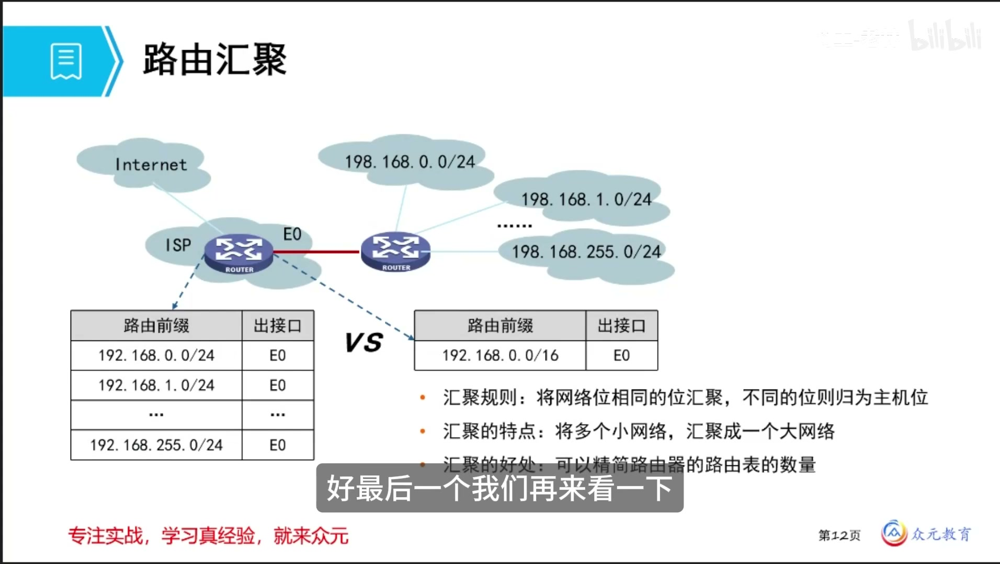

### 8.1 路由汇聚的概念

**路由汇聚**（路由汇总）是把多个小网络合并成一个大网络，以减少路由表条目。

典型场景：内部网络划分为 256 个 /24 子网，即 192.168.0.0/24 至 192.168.255.0/24。若外网路由器逐条记录，需要 256 条路由；但这些子网都从同一个出口 E0 出去，因此可以汇聚成一条 192.168.0.0/16。

| 汇聚前（路由前缀） | 出接口 | 汇聚后（路由前缀） | 出接口 |
| ------------------ | ------ | ------------------ | ------ |
| 192.168.0.0/24 | E0 | 192.168.0.0/16 | E0 |
| 192.168.1.0/24 | E0 |  |  |
| …… | …… |  |  |
| 192.168.255.0/24 | E0 |  |  |

- **汇聚的特点**：将多个小网络汇聚成一个大网络（超网）；
- **汇聚的好处**：精简路由器路由表的数量，降低设备资源消耗，提高查表效率；
- **汇聚的结果**：得到一个覆盖所有明细网段的超网网段。

### 8.2 路由汇聚的规则

- 将网络位相同的位汇聚，不同的位归为主机位；
- 即找出所有网段的**公共前缀**，保留公共前缀，其余位全部置 0；
- 汇聚后的掩码长度等于公共前缀的位数。

子网划分与路由汇聚的方向相反：子网划分把一个大网段切割成多个小网段，使匹配更灵活；路由汇聚把多个小网段合并成一个大网段，减少路由条目。

### 8.3 路由汇聚计算示例

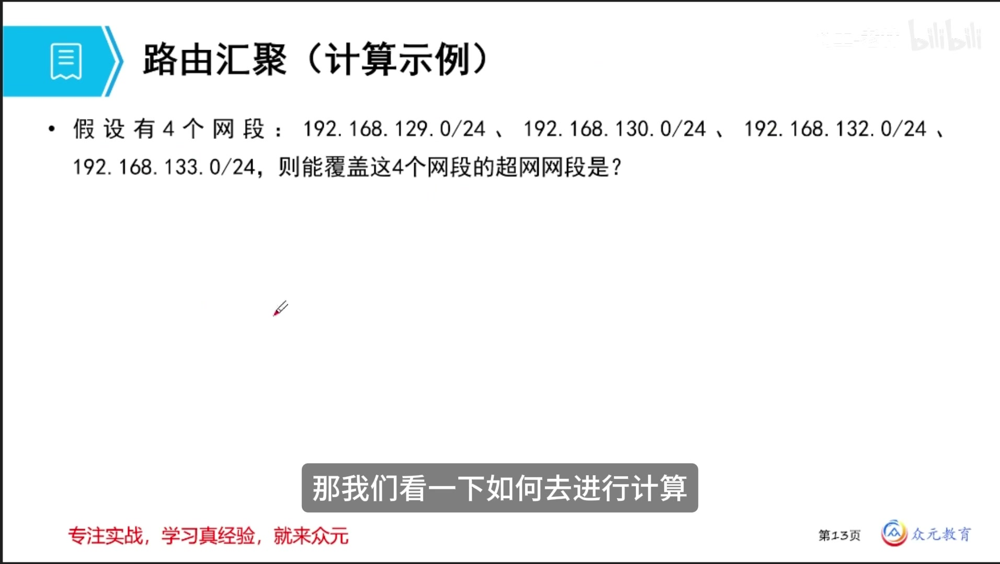

题目：假设有 4 个网段 192.168.129.0/24、192.168.130.0/24、192.168.132.0/24、192.168.133.0/24，则能覆盖这 4 个网段的超网网段是？

计算过程：

1. 前两段 192.168 完全相同，直接保留；
2. 将第三段转换为二进制：

| 第三字节 | 十进制 | 二进制 |
| -------- | ------ | ------ |
| 129 | 129 | 1000 0001 |
| 130 | 130 | 1000 0010 |
| 132 | 132 | 1000 0100 |
| 133 | 133 | 1000 0101 |

3. 从高位向下比较，前 5 位均为 **10000**，从第 6 位开始出现差异；
4. 保留相同的 5 位，其余位全部置 0，得到 10000 000，即十进制的 128；
5. 网络位长度为前两段 16 位加上第三段的 5 位，共 **21** 位；
6. 汇聚结果为 **192.168.128.0/21**。

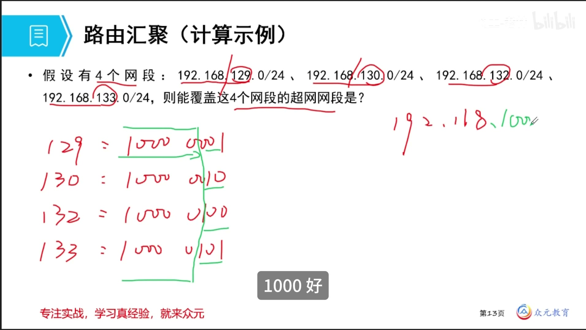

验证：192.168.128.0/21 的地址范围是 192.168.128.0 至 192.168.135.255，包含 129、130、132、133 四个网段。

注意：课件拓扑图中部分标签写作 198.168.x.x，而路由表与计算过程使用 192.168.x.x，应以后者为准，前者为课件笔误。

---

## 9.静态路由

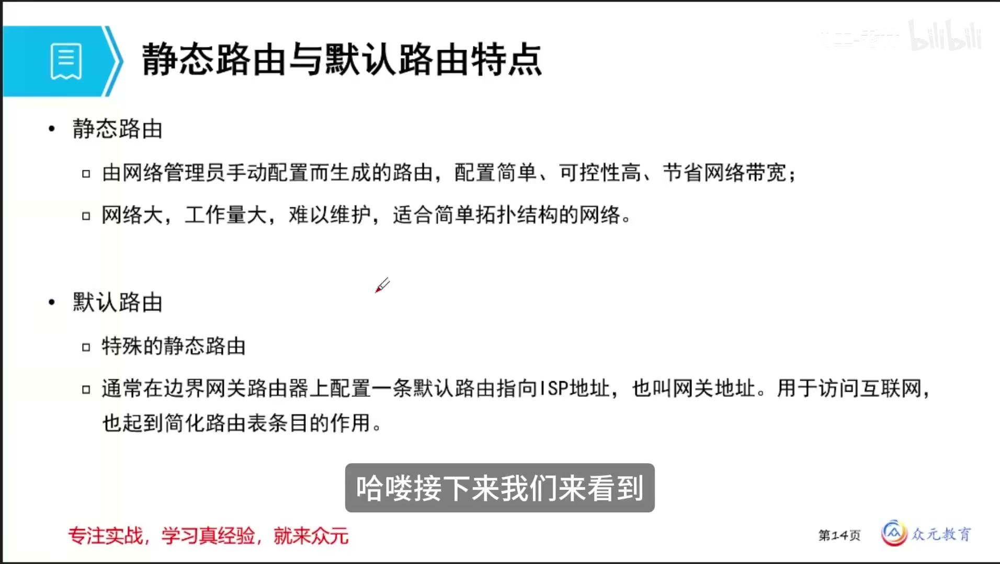

### 9.1 静态路由的定义与特点

**静态路由**是由网络管理员手动配置而生成的路由。

| 优点 | 缺点 |
| ---- | ---- |
| 配置简单 | 网络规模扩大后，配置工作量越来越大 |
| 可控性高 | 网络变更或管理操作时难以执行、难以维护 |
| 节省网络带宽，不需要路由器之间不断交互 | 不能自动适应网络结构变化 |
| 适合简单拓扑结构的网络 | 配置错误时容易产生环路或指路错误 |

要点：静态路由不进行协议交互，因此不占用协议报文带宽；但也正因如此，它没有自动收敛能力，拓扑变化后必须由管理员手工修改。

### 9.2 静态路由的配置

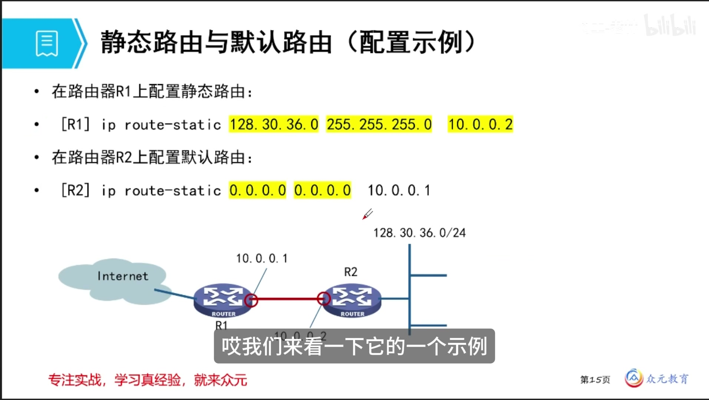

在路由器 R1 上配置通往 128.30.36.0/24 的静态路由：

```
[R1] ip route-static 128.30.36.0 255.255.255.0 10.0.0.2
```

命令结构：

```
ip route-static 目的网络地址 { 子网掩码 | 掩码长度 } { 下一跳地址 | 出接口 } [ preference 优先级 ]
```

各参数含义：

| 参数 | 含义 | 示例 |
| ---- | ---- | ---- |
| 目的网络地址 | 要到达的目的网段 | 128.30.36.0 |
| 子网掩码 | 点分十进制掩码 | 255.255.255.0 |
| 掩码长度 | 用斜杠后的位数表示掩码 | 24 |
| 下一跳地址 | 对端路由器接口的 IP 地址 | 10.0.0.2 |
| 出接口 | 本设备报文离开的接口 | Serial0 |
| preference | 静态路由优先级，默认 60 | preference 70 |

等价写法：

```
[R1] ip route-static 128.30.36.0 24 10.0.0.2
[R1] ip route-static 128.30.36.0 24 Serial0
```

拓扑说明：R1 与 R2 通过 10.0.0.1/24 与 10.0.0.2/24 相连，R2 侧连接 128.30.36.0/24 网段；R1 要去往该网段，下一跳就是 R2 的接口地址 10.0.0.2。

### 9.3 静态路由的书写形式与注意事项

| 写法 | 示例 | 适用场景与说明 |
| ---- | ---- | -------------- |
| 只写下一跳 | `ip route-static 128.30.36.0 24 10.0.0.2` | 最常用；下一跳需能迭代到直连路由 |
| 只写出接口 | `ip route-static 128.30.36.0 24 Serial0` | 适用于点到点接口，对端地址可由链路确定 |
| 下一跳 + 出接口 | `ip route-static 128.30.36.0 24 Serial0 10.0.0.2` | 迭代深度为 0，可直接参与选路 |
| 掩码长度代替掩码 | `ip route-static 128.30.36.0 24 10.0.0.2` | 与点分十进制掩码等价 |

注意：

- 以太网等广播型接口只写出接口时，无法确定唯一的下一跳，必须同时指定下一跳地址；
- 只写下一跳的静态路由，需要迭代成功后才能参与路由选择；
- 静态路由的度量值统一为 0，因此多条静态路由之间通常按优先级区分主备。

---

## 10.默认路由

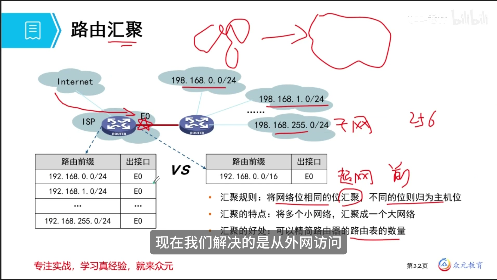

### 10.1 默认路由的定义

**默认路由**是一条特殊的静态路由，其目的地址和子网掩码全为 0，即 **0.0.0.0/0**。

- 前缀长度为 0，与任何目的地址进行“与”运算的结果都是 0.0.0.0，因此**必然匹配**；
- 只有在路由表中找不到更具体的匹配条目时，才会使用默认路由；
- 默认路由通常配置在边界网关路由器上，指向 ISP（运营商）的地址，该地址也称为网关地址；
- 作用：用于访问互联网，并简化路由表条目。

### 10.2 默认路由的配置

在路由器 R2 上配置默认路由，指向 R1 的 10.0.0.1：

```
[R2] ip route-static 0.0.0.0 0.0.0.0 10.0.0.1
```

也可以写成掩码长度形式：

```
[R2] ip route-static 0.0.0.0 0 10.0.0.1
```

要点：默认路由的命令与静态路由完全相同，只是目的网络和掩码都写成全 0；因此默认路由本质上是一条特殊的静态路由。

### 10.3 默认路由的应用

| 应用场景 | 配置思路 |
| -------- | -------- |
| 内网访问外网 | 内网路由器无法获知全部公网条目，配置一条 0.0.0.0/0 指向 ISP 网关，所有未知目的流量统一从边界出去 |
| 外网访问内网 | 内网出口路由器将内部多个子网进行路由汇聚，对外只发布一条汇总路由，减少外网路由表条目 |
| 企业边界 | 默认路由承担“兜底”，明细路由承担“精确指引”；有更具体匹配时按最长匹配走明细路由 |

注意：默认路由不能替代明细路由。默认路由的前缀长度为 0，优先级再高，也不会压过前缀更长的明细路由；它只负责在没有任何匹配时兜底，避免报文被直接丢弃。

---

## 11.等价路由与浮动路由

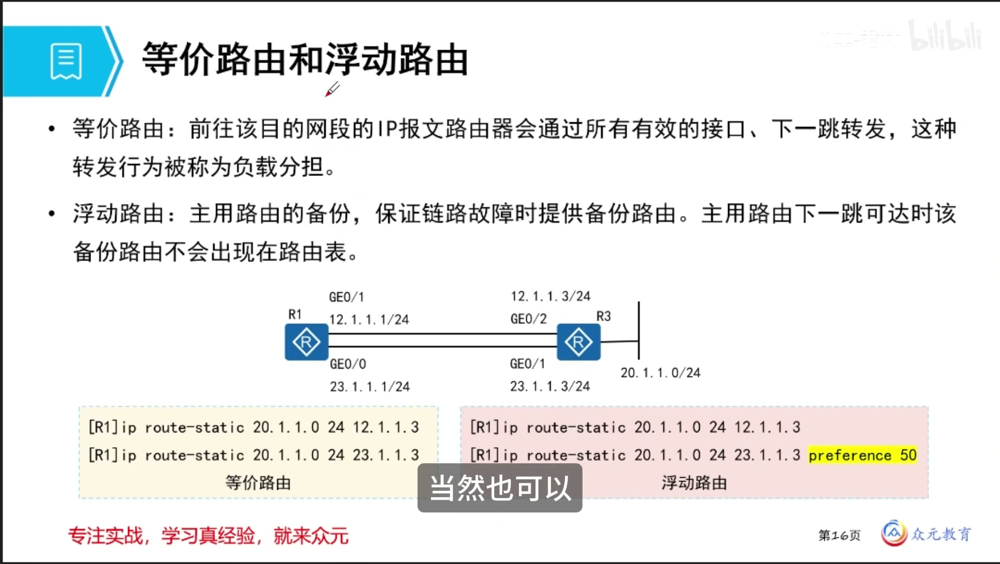

### 11.1 等价路由

**等价路由**：前往同一目的网段的多条路由，其目的网络/掩码、优先级、开销均相同，只有下一跳或出接口不同。此时路由器会通过所有有效的接口和下一跳转发报文，这种转发行为称为**负载分担**（负载均衡）。

配置示例：

```
[R1] ip route-static 20.1.1.0 24 12.1.1.3
[R1] ip route-static 20.1.1.0 24 23.1.1.3
```

两条静态路由的优先级均为默认的 60，开销均为 0，目的网络和掩码相同，因此形成等价路由。

- 作用：负载均衡、分流，避免一条链路压力过大；
- 多条路径同时参与转发，提高链路利用率；
- 具体分担比例可按配置调整，课程中提到按 50% 划分，实际比例取决于路径数量与负载分担方式。

### 11.2 浮动路由

**浮动路由**：主用路由的备份。主用路由的下一跳可达时，备份路由不会出现在路由表中（不会被选中）；当主用路由失败或下一跳不可达时，备份路由才“浮出”并接管转发。

浮动路由通过修改**优先级（Preference）**实现：备份路由的优先级值要大于主用路由，使其优先级更低。

配置示例：

```
[R1] ip route-static 20.1.1.0 24 12.1.1.3                  // 主用，默认优先级 60
[R1] ip route-static 20.1.1.0 24 23.1.1.3 preference 70   // 备份，优先级 70，低于主用
```

- 主用路由正常时，只有优先级 60 的路由被选中，优先级 70 的路由不活跃；
- 主用链路故障后，优先级 70 的路由被激活，接管报文转发；
- 作用：路由备份，提高网络可靠性与冗余能力。

课件示例中第二条命令写作 `preference 50`，并标注为浮动路由。按“数值越小越优先”的规则，50 优于默认的 60，第二条会成为主用，第一条反而成为备份。若要让 12.1.1.3 链路为主用、23.1.1.3 链路为备份，应把备份的优先级调大（如 70）。考试中掌握“通过修改优先级实现浮动路由”这一结论即可。

### 11.3 等价路由与浮动路由的对比

| 比较项 | 等价路由 | 浮动路由 |
| ------ | -------- | -------- |
| 主要目的 | 负载分担、带宽叠加 | 路由备份、提高可靠性 |
| 优先级 | 多条路由优先级相同 | 主用与备份优先级不同，备份优先级更低 |
| 下一跳状态 | 多条下一跳同时有效 | 仅主用下一跳有效，备份不激活 |
| 路由表表现 | 多条等价路由同时存在 | 主用故障时备份才出现在路由表 |
| 典型配置 | 两条静态路由均使用默认优先级 | 备份路由增加 `preference` 参数 |
| 流量走向 | 多条路径分担流量 | 单路径转发，故障时切换 |

---

## 12.典型例题

### 12.1 例题1：默认路由的使用场景

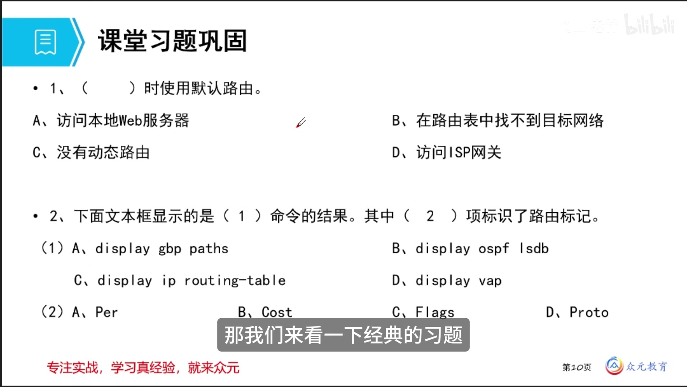

题目：

1、（ ）时使用默认路由。

- A、访问本地 Web 服务器
- B、在路由表中找不到目标网络 [正确]
- C、没有动态路由
- D、访问 ISP 网关

答案：**B**

解答：默认路由 0.0.0.0/0 的前缀长度为 0，只有在路由表中找不到更具体的目标网络匹配时，才使用默认路由兜底，避免报文被丢弃。访问本地 Web 服务器通常走直连路由；是否有动态路由与默认路由的使用条件无关；访问 ISP 网关是默认路由的典型应用场景，但不是“使用默认路由”的判断条件。

### 12.2 例题2：路由表命令与路由标记

题目：

2、下面文本框显示的是（1）命令的结果。其中（2）项标识了路由标记。

（1）

- A、display gbp paths
- B、display ospf lsdb
- C、display ip routing-table [正确]
- D、display vap

（2）

- A、Per
- B、Cost
- C、Flags [正确]
- D、Proto

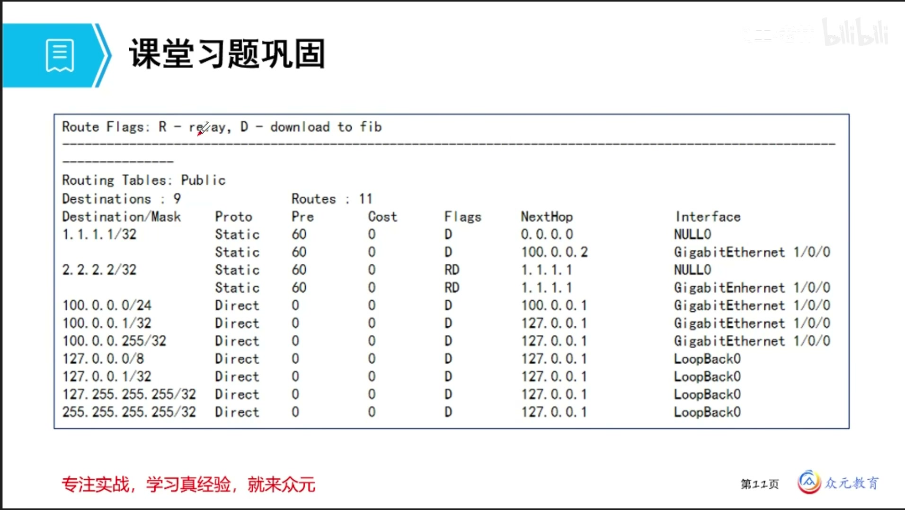

路由表输出：

```
Route Flags: R - relay, D - download to fib
------------------------------------------------------------------------------
Routing Tables: Public
         Destinations : 9        Routes : 11

Destination/Mask    Proto   Pre  Cost   Flags   NextHop         Interface
1.1.1.1/32          Static  60   0      D       0.0.0.0         NULL0
                    Static  60   0      D       100.0.0.2       GigabitEthernet1/0/0
2.2.2.2/32          Static  60   0      RD      1.1.1.1         NULL0
                    Static  60   0      RD      1.1.1.1         GigabitEthernet1/0/0
100.0.0.0/24        Direct  0    0      D       100.0.0.1       GigabitEthernet1/0/0
100.0.0.1/32        Direct  0    0      D       127.0.0.1       GigabitEthernet1/0/0
100.0.0.255/32      Direct  0    0      D       127.0.0.1       GigabitEthernet1/0/0
127.0.0.0/8         Direct  0    0      D       127.0.0.1       LoopBack0
127.0.0.1/32        Direct  0    0      D       127.0.0.1       LoopBack0
127.255.255.255/32  Direct  0    0      D       127.0.0.1       LoopBack0
255.255.255.255/32  Direct  0    0      D       127.0.0.1       LoopBack0
```

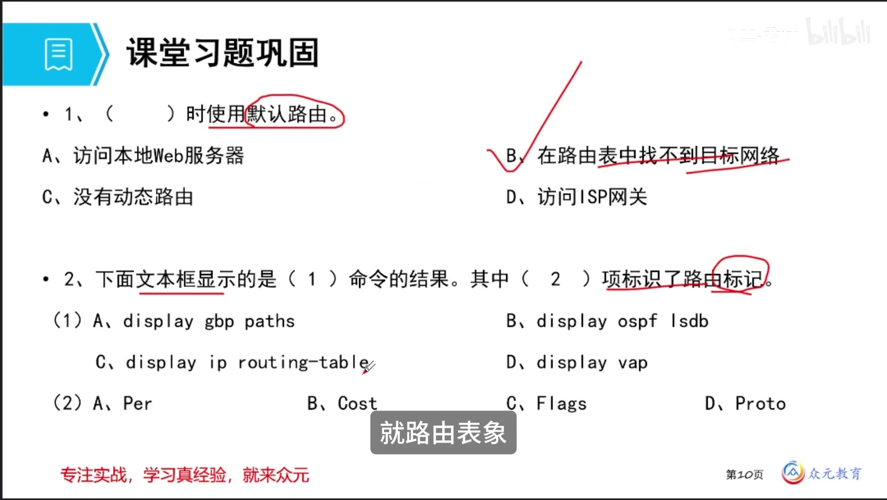

答案：（1）**C**；（2）**C**

解答：

- 输出首行为 `Route Flags: R - relay, D - download to fib`，随后是 `Destinations`、`Routes` 统计和 `Destination/Mask、Proto、Pre、Cost、Flags、NextHop、Interface` 七列，这是典型的 `display ip routing-table` 输出；`display ospf lsdb` 查看的是 OSPF 链路状态数据库，格式完全不同。
- 标识路由标记（标志位）的字段是 **Flags**；Pre 是优先级，Cost 是开销，Proto 是协议。选项中的 “Per” 应为 “Pre” 的笔误，按原题保留。
- 表中 `Destinations : 9` 与 `Routes : 11` 不相等，是因为同一目的地址可以存在多条路由，例如 1.1.1.1/32 和 2.2.2.2/32 各有两条静态路由。
- 1.1.1.1/32 的两条静态路由目的相同、优先级相同、开销相同，具备等价路由的特征；其中一条指向 NULL0，表示黑洞路由，另一条指向 100.0.0.2。
- 2.2.2.2/32 的 Flags 为 RD，表示该路由既是迭代路由（R），又已下发到 FIB（D）。

### 12.3 例题3：静态路由的缺点

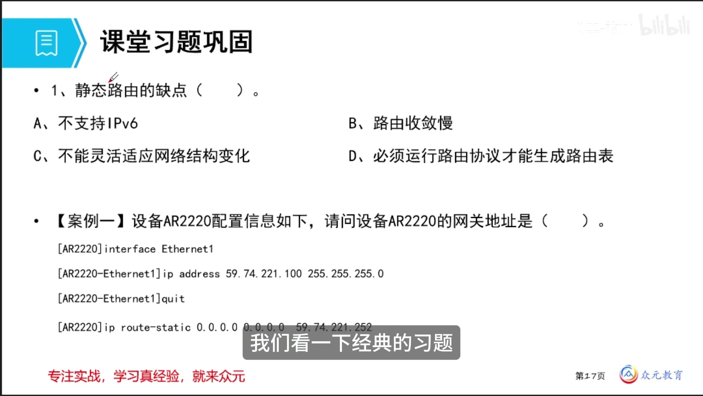

题目：

1、静态路由的缺点（ ）。

- A、不支持 IPv6
- B、路由收敛慢
- C、不能灵活适应网络结构变化 [正确]
- D、必须运行路由协议才能生成路由表

答案：**C**

解答：静态路由由管理员手工配置，网络结构变化后必须人工修改，不能灵活适应拓扑变化，这是其最主要的缺点。静态路由可以支持 IPv6（使用 `ipv6 route-static` 命令），A 错误；静态路由不运行路由协议，也不存在“收敛”过程，说“收敛慢”并不准确，B 不是其本质缺点；静态路由恰恰不需要运行路由协议，D 错误。静态路由的优点是配置简单、可控性高，适合小型简单网络。

### 12.4 例题4：从配置中提取网关地址

题目：

【案例一】设备 AR2220 配置信息如下，请问设备 AR2220 的网关地址是（ ）。

```
[AR2220] interface Ethernet1
[AR2220-Ethernet1] ip address 59.74.221.100 255.255.255.0
[AR2220-Ethernet1] quit
[AR2220] ip route-static 0.0.0.0 0.0.0.0 59.74.221.252
```

答案：**59.74.221.252**

解答：

- `ip address 59.74.221.100 255.255.255.0` 配置的是本机接口地址，不是网关地址；
- `ip route-static 0.0.0.0 0.0.0.0 59.74.221.252` 配置的是默认路由，目的地址和掩码全 0，下一跳 59.74.221.252 就是出网的网关地址；
- 因此，从默认路由的下一跳即可提取网关地址。考试中遇到大段配置时，直接定位 `0.0.0.0 0.0.0.0` 这一条默认路由即可。

### 12.5 例题5：链路扩容的两种方案

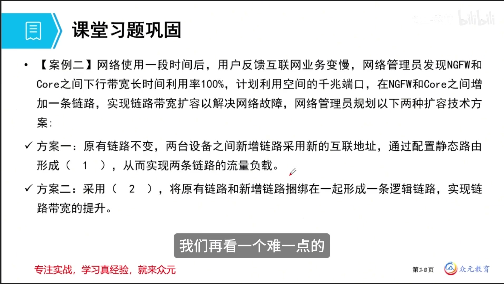

题目：

【案例二】网络使用一段时间后，用户反馈互联网业务变慢，网络管理员发现 NGFW 和 Core 之间下行带宽长时间利用率 100%，计划利用空闲的千兆端口，在 NGFW 和 Core 之间增加一条链路，实现链路带宽扩容以解决网络故障。网络管理员规划以下两种扩容技术方案：

方案一：原有链路不变，两台设备之间新增链路采用新的互联地址，通过配置静态路由形成（1），从而实现两条链路的流量负载。

方案二：采用（2），将原有链路和新增链路捆绑在一起形成一条逻辑链路，实现链路带宽的提升。

答案：

（1）**等价路由**

（2）**链路聚合（Eth-Trunk）**

解答：

- 方案一保留两条独立的物理链路，为新链路配置新的互联地址，再配置两条目的网络相同、优先级和开销也相同的静态路由，使两条链路同时参与转发，形成等价路由，实现负载分担。浮动路由用于主备备份，不能实现两条链路同时承载流量。
- 方案二将多条物理链路捆绑成一条逻辑链路，这是链路聚合技术，华为称为 Eth-Trunk。链路聚合可以提高带宽，并具备链路冗余能力；其负载分担可以基于包或基于流。
- 两者区别：等价路由是三层路由层面的多路径转发；链路聚合是二层链路层面的捆绑，对上层表现为一条逻辑链路。

---

## 13.本章小结

| 知识点 | 核心内容 |
| ------ | -------- |
| 1. 路由技术与路由器 | 路由技术是从网络中快速选择合适通道的技术；路由器是路由寻址的核心设备，负责异构网络互连、转发报文并选择最佳路径 |
| 2. 路由寻址 | 用目的 IP 与表项掩码相与，结果与目的网段比较；匹配则按下一跳或出接口转发，不匹配则查下一条或丢弃 |
| 3. 最长匹配原则 | 多条路由都能匹配时，选择前缀最长、最精确的一条；/32 主机路由最细，/0 默认路由最粗 |
| 4. 路由表字段 | Destination/Mask、Proto、Pre、Cost、Flags、NextHop、Interface |
| 5. 路由表与 FIB | 路由表负责存储路由、选择路由；最优路由下发 FIB，FIB 负责指导报文转发 |
| 6. 路由分类 | 按目的地分为子网路由、主机路由；按与路由器的关系分为直连路由、间接路由；按生成方式分为静态路由、动态路由 |
| 7. 路由优先级 | 数值越小越优先；华为默认值：直连 0、OSPF 10、IS-IS 15、静态 60、RIP 100、OSPF ASE/NSSA 150、IBGP/EBGP 255 |
| 8. 路由度量值 | 表示到达目的的开销；RIP 看跳数，OSPF 看带宽 Cost；只在同一协议内比较，静态路由度量值为 0 |
| 9. 管理距离与度量值 | 管理距离/优先级比较不同来源的可信度；度量值比较同一协议内的不同路径；两者都不参与转发阶段的最长匹配 |
| 10. 路由迭代 | 下一跳不是直连时，需要逐级查找直到得到直连下一跳和出接口；BGP、静态路由、UNR 均可能需要迭代；R 标志表示迭代路由 |
| 11. 路由汇聚 | 保留公共前缀、其余位归零，将多个小网络汇聚成一个超网，减少路由表条目 |
| 12. 静态路由 | 管理员手工配置，配置简单、可控性高、节省带宽；规模大时工作量大、难以维护、不能灵活适应结构变化 |
| 13. 默认路由 | 0.0.0.0/0，前缀长度 0，必然匹配；仅在无更具体匹配时兜底，通常指向 ISP 网关 |
| 14. 等价路由与浮动路由 | 等价路由用于负载分担，多条路径优先级和开销相同；浮动路由用于备份，通过调大备份路由的 preference 实现 |

考试重点：

1. 路由表七列的含义，尤其是 **Pre（优先级）与 Cost（开销）** 的区别：优先级比较不同来源，开销比较同一协议内部。
2. 华为默认优先级表：**直连 0、OSPF 10、IS-IS 15、静态 60、RIP 100**，数值越小越优先。
3. 最长匹配原则：主机路由 /32 优于网段路由，网段路由优于默认路由 /0。
4. 静态路由命令：`ip route-static 目的网络 掩码 下一跳`；默认路由写 `0.0.0.0 0.0.0.0`。
5. 浮动路由通过修改 **preference** 实现，备份路由的优先级值应大于主用路由；等价路由通过相同优先级、相同开销的多条静态路由实现。
6. 路由迭代的条件与 R 标志；只写下一跳需要迭代，同时写出接口和下一跳时迭代深度为 0。
