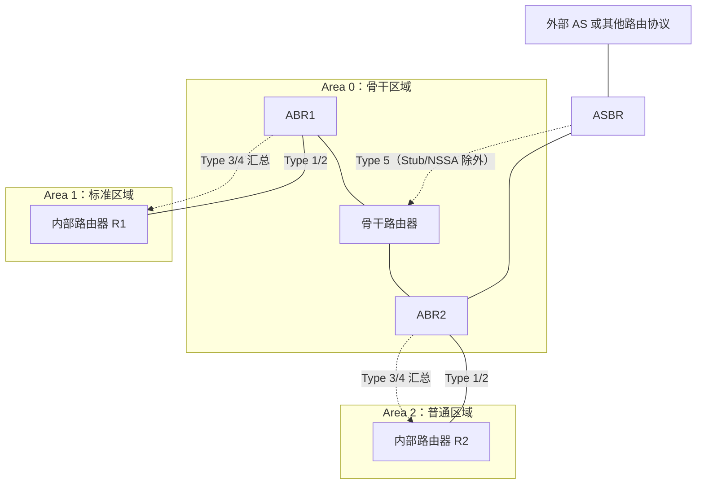

# 路由协议原理、RIP与OSPF协议 · 完整笔记

---

## 1.路由协议基本原理

### 1.1 路由协议的概念

路由协议是路由器之间交换路由信息、计算并维护路由表所遵循的规则、报文格式与算法。它通过特定算法产生路由条目，并依靠周期性更新或触发更新维护路由表；当网络拓扑发生变化时，路由协议还要完成路由修正，并通过防环机制避免错误路由扩散。

路由协议的本质是**路由器与路由器之间沟通的语言**。其通信对象是相邻路由器，而不是主机；主机之间的数据转发是路由协议完成路由表建立后的结果，不能据此把路由协议定义为“允许数据包在主机之间传送的协议”。

动态路由协议的工作过程可以归纳为四个基本阶段：

| 阶段 | 主要任务 | 典型实现 |
| ---- | -------- | -------- |
| 邻居发现 | 发现相邻路由器，建立并维持邻居关系 | RIP 周期广播/组播；OSPF 交互 Hello 报文 |
| 信息交换 | 交换各自掌握的路由信息或链路状态信息 | RIP 发送整张路由表；OSPF 泛洪 LSA |
| 路由计算与下发 | 按算法计算最优路径，生成并下发路由表 | RIP 距离矢量算法；OSPF SPF（Dijkstra）算法 |
| 路由维护 | 周期或触发更新，响应拓扑变化，执行防环 | 更新定时器、触发更新、水平分割、SPF 重算 |

不同动态路由协议的主要区别，通常体现在邻居发现的方式与周期、交换信息所携带的报文、路由计算的算法以及防环手段上。学习具体协议时，应重点比较这些差异。

### 1.2 路由协议的分类方式

路由协议有多种分类依据，常见的有：

| 分类依据 | 主要类别 |
| -------- | -------- |
| 按协议的作用范围 | 内部网关协议（IGP）、外部网关协议（EGP） |
| 按工作原理 | 距离矢量路由协议、链路状态路由协议、混合路由协议 |
| 按路由表更新方式 | 周期性更新、触发更新、增量更新 |
| 按支持的协议类型 | IPv4 路由协议、IPv6 路由协议 |

考试重点是**按作用范围分类**和**按工作原理分类**。

### 1.3 按作用范围分类：自治系统、IGP与EGP

自治系统（Autonomous System，AS）是由同一个技术管理机构管理、使用统一路由策略的一组路由器或网络。每个 AS 具有唯一的自治系统编号（ASN），用编号区分不同的 AS。传统 ASN 为 2 字节，4 字节 ASN 由 RFC 6793 定义。RFC 1930 将 AS 进一步表述为“由一个或多个网络运营者管理、具有单一且明确定义的路由策略的连通 IP 前缀集合”。

按协议作用范围，路由协议分为两类：

| 类型 | 英文及缩写 | 作用范围 | 典型协议 | 特点 |
| ---- | ---------- | -------- | -------- | ---- |
| 内部网关协议 | Interior Gateway Protocol，IGP | 同一个 AS 内部 | RIP、OSPF、IS-IS | 在本地 AS 内计算路由，优先级较高，部署最广泛 |
| 外部网关协议 | Exterior Gateway Protocol，EGP | 不同 AS 之间 | BGP | 在 AS 之间交换可达性信息，强调路由策略 |

相关术语：

- **域内路由选择**（intra-domain routing）：AS 内部的路由选择，由 IGP 完成。
- **域间路由选择**（inter-domain routing）：AS 之间的路由选择，由 EGP 完成。
- 这里的“域”指自治系统，不是地理区域。

BGP 的典型版本为 BGP-4，用于 IPv4；支持 IPv6 等多协议扩展的版本常称为 BGP-4+（MP-BGP）。BGP 通过 AS 路径等属性进行选路和防环，属于外部网关协议。

两个自治系统互联的模型是：AS 1000 内部运行 RIP，AS 2000 内部运行 OSPF，两个 AS 的边界路由器之间运行 BGP-4。IGP 负责 AS 内部路由，EGP 负责 AS 之间可达性，二者分工如下。


| 路由域 | 使用的协议 | 交换的信息 | 作用范围 |
| ------ | ---------- | ---------- | -------- |
| AS 1000 内部 | RIP（IGP） | 距离向量、整张路由表 | 本 AS 内 |
| AS 2000 内部 | OSPF（IGP） | LSA、链路状态 | 本 AS 内 |
| AS 1000 与 AS 2000 之间 | BGP-4（EGP） | NLRI、路径属性 | AS 之间 |

### 1.4 按工作原理分类：距离矢量与链路状态

#### 1.4.1 距离矢量路由协议

距离矢量路由协议（Distance-Vector，D-V）因路由器之间交换“距离向量”而得名，通常采用 Bellman-Ford 算法迭代计算。RIP 是典型的以跳数为度量的距离矢量协议，但距离矢量本身并不限定只能用跳数，度量值也可以是时延、带宽等综合代价。每个节点维护到达各目的节点所需的距离，并周期性地把本节点到所有目的节点的距离向量发送给相邻节点；相邻节点据此更新自己的距离向量，经过多轮迭代后趋于稳定。

其主要特点是：

- 路由器只掌握邻居和距离信息，不掌握全网完整拓扑。
- 交换的是“到所有目的地的距离向量”，即整张路由表。
- 采用 Bellman-Ford 算法进行距离迭代。
- 收敛较慢，可能出现“坏消息传得慢”和计数到无穷问题，需要防环机制。
- 适用于规模较小、结构相对简单的网络。

常见协议包括 RIP、IGRP 和 BGP。其中 IGRP 是 Cisco 私有的早期距离矢量协议，现已很少使用；BGP 严格来说属于**路径矢量协议**（Path-Vector），通过 AS_PATH 记录经过的 AS 序列，通常被归入距离矢量家族。

#### 1.4.2 链路状态路由协议

链路状态路由协议（Link-State）也被称为“基于状态的路由算法”。每个节点把自身的链路状态信息（接口、邻居、链路开销等）发送给相邻节点，相邻节点保存后再转发给其他相邻节点，最终通过泛洪使区域内所有路由器都获得完整的链路状态信息。各路由器据此建立链路状态数据库（LSDB），形成带权有向图，再用最短路径算法计算到各目的地的最优路径。

其主要特点是：

- 每台路由器掌握本区域的完整网络拓扑。
- 交换的是链路状态通告（LSA），不是整张路由表。
- 采用 Dijkstra 最短路径优先（SPF）算法，计算结果是一棵以自己为根的最短路径树。
- 收敛快，基于全局拓扑计算，区域内理论上不会形成持久路由环路。
- 需要更多的 CPU、内存和带宽，适合大型网络，并可通过分区降低开销。

常见协议包括 OSPF 和 IS-IS。

#### 1.4.3 混合路由协议

混合路由协议兼具距离矢量和链路状态的特点。典型代表是 EIGRP（Enhanced Interior Gateway Routing Protocol，增强型内部网关路由协议），由 Cisco 私有开发，用于提高收敛速度和网络可靠性。考试中了解其名称和“混合”定位即可。

#### 1.4.4 两类算法对比

| 比较项 | 距离矢量路由协议 | 链路状态路由协议 |
| ------ | ---------------- | ---------------- |
| 交换的信息 | 到所有目的地的距离向量 | 本节点直连链路的状态信息 |
| 交换范围 | 仅相邻路由器 | 泛洪到整个区域或路由域 |
| 拓扑视图 | 局部视图，只知道邻居 | 全局视图，掌握完整拓扑 |
| 核心算法 | Bellman-Ford | Dijkstra（SPF） |
| 收敛速度 | 慢，可能出现计数到无穷 | 快，拓扑变化后快速重算 |
| 路由环路 | 需要专门的防环机制 | 区域内基于 SPF 树，理论上无环路 |
| 适用规模 | 小型网络 | 大型网络 |
| 资源开销 | 较低 | 较高 |
| 典型协议 | RIP、IGRP、BGP（路径矢量） | OSPF、IS-IS |

### 1.5 其他分类方式

- **按更新方式**：周期性更新（如 RIP 每 30 秒发送整表）、触发更新（拓扑变化时立即发送）、增量更新（只发送变化部分，如 OSPF 的 LSA）。
- **按支持的协议类型**：IPv4 路由协议（RIPv1、RIPv2、OSPFv2）、IPv6 路由协议（RIPng、OSPFv3）。
- **按是否分层**：平面路由（RIP）与分层路由（OSPF 划分区域）。
- **按有类/无类**：有类路由协议（RIPv1）与无类路由协议（RIPv2、OSPF）。

### 1.6 典型例题

#### 例题1：路由协议的基本概念

以下关于路由协议的叙述中，错误的是（ ）。

- A、路由协议是通过执行一个算法来完成路由选择的一种协议
- B、动态路由协议可以分为距离向量路由协议和链路状态路由协议
- C、路由协议是一种允许数据包在主机之间传送信息的协议
- D、路由器之间可以通过路由协议学习网络的拓扑结构

答案：**C** [正确]

解答：

- A 项 [正确]。路由协议确实通过执行某种算法完成路由选择。
- B 项 [正确]。动态路由协议按工作原理主要分为距离向量和链路状态两类。
- C 项 [错误]。路由协议是路由器与路由器之间的通信规则，不是主机与主机之间的协议；主机之间能够传送数据，是路由器依据路由表转发的结果。该选项混淆了“路由协议”和“被路由协议（如 IP）”。
- D 项 [正确]。路由器通过路由协议交换信息，学习网络拓扑和可达性。

#### 例题2：基于跳数计算的路由协议

下列路由协议中，使用“基于跳数计算的路由算法”的是（ ）。

- A、OSPF
- B、IS-IS
- C、RIP
- D、OSPFv3

答案：**C** [正确]

解答：RIP 属于距离矢量路由协议，以跳数作为度量值。OSPF、IS-IS 属于链路状态路由协议，OSPFv3 是 OSPF 的 IPv6 版本，仍然是链路状态协议。

---

## 2.RIP协议

### 2.1 RIP概述

RIP（Routing Information Protocol，路由信息协议）是最经典的距离矢量内部网关协议。其规范由 RFC 1058（RIPv1）和 RFC 2453（RIPv2）定义，IPv6 版本为 RIPng（RFC 2080）。

RIP 的基本特征：

| 项目 | 内容 |
| ---- | ---- |
| 协议类型 | 距离矢量内部网关协议（IGP） |
| 传输层封装 | UDP，端口号 **520** |
| 更新周期 | **30 秒**（Update 定时器） |
| 更新内容 | 向邻居路由器发送**整个路由表** |
| 度量值 | **跳数**，且以跳数作为唯一度量值 |
| 最大跳数 | **15 跳**；**16 跳表示不可达** |
| 适用规模 | 小型网络 |
| 收敛特点 | 收敛慢，容易产生路由环路或路由错误 |

RIP 虽然运行在路由器上，但使用 UDP 520 端口，因此常被称为应用层程序或应用层协议。这里的“应用层”是就协议栈封装而言，不影响其作为路由协议的功能定位。

### 2.2 路由表的初始生成

以三个路由器 A、B、C 串联、连接四个网段的拓扑为例：

- A 的 E0 接口连接 10.1.0.0，S0 接口连接 10.2.0.0。
- B 的 S1 接口连接 10.2.0.0，S2 接口连接 10.3.0.0。
- C 的 S3 接口连接 10.3.0.0，E1 接口连接 10.4.0.0。

RIP 启动后，每台路由器先把**直连网段**写入路由表，直连网段的跳数记为 0：

| 路由器 | 目的网段 | 出接口 | 跳数 |
| ------ | -------- | ------ | ---- |
| A | 10.1.0.0 | E0 | 0 |
| A | 10.2.0.0 | S0 | 0 |
| B | 10.2.0.0 | S1 | 0 |
| B | 10.3.0.0 | S2 | 0 |
| C | 10.3.0.0 | S3 | 0 |
| C | 10.4.0.0 | E1 | 0 |

表中“出接口”指本机发出报文的接口；“下一跳”指对端路由器的接口地址。RIP 只关心“从哪个接口出去、交给谁”，因此后续更新表把出接口和下一跳分开列出，避免把对端接口误当成本机接口。

### 2.3 路由更新过程与收敛

RIP 每 30 秒向邻居发送整张路由表。邻居收到后，按以下规则处理每一条路由：

| 情况 | 处理方式 |
| ---- | -------- |
| 路由表中没有该目的网段 | 加入该路由，跳数加 1，下一跳为发送该信息的路由器 |
| 已有该目的网段，且下一跳相同 | 用收到的新路由更新原条目 |
| 已有该目的网段，下一跳不同，新跳数更小 | 用更优的新路由替换原路由 |
| 已有该目的网段，下一跳不同，新跳数更大或相等 | 保留原路由；等值路由可按规定进行负载分担 |

课件还强调要判断“是否与原条目来自同一源地址”：同一来源发来的更新直接覆盖原条目；不同来源则比较度量值，只有更优时才替换。

#### 2.3.1 第一次更新（第 30 秒）

相邻路由器交换初始路由表：

- A 从 B 学到 10.3.0.0，本机出接口 S0，下一跳为 B 的 S1 接口，跳数 1。
- B 从 A 学到 10.1.0.0，本机出接口 S1，下一跳为 A 的 S0 接口，跳数 1；从 C 学到 10.4.0.0，本机出接口 S2，下一跳为 C 的 S3 接口，跳数 1。
- C 从 B 学到 10.2.0.0，本机出接口 S3，下一跳为 B 的 S2 接口，跳数 1。

此时 A 还不知道 10.4.0.0，C 也还不知道 10.1.0.0，因为 B 在第一次发送时尚未完成对两侧信息的学习。

#### 2.3.2 第二次更新（第 60 秒）

B 把第一次更新后得到的新路由表发送给 A 和 C：

- A 从 B 学到 10.4.0.0，本机出接口 S0，下一跳为 B 的 S1 接口，跳数 2。
- C 从 B 学到 10.1.0.0，本机出接口 S3，下一跳为 B 的 S2 接口，跳数 2。
- B 从 A、C 收到的信息中没有更优条目，路由表保持不变。

#### 2.3.3 第三次更新与收敛

再等待 30 秒，第三次交换后所有路由表不再变化，网络达到稳定状态。本例中经过约三个 30 秒（约 90 秒）完成收敛。

**收敛**的定义：经过一系列路由更新，网络中的每台路由器都形成一张完整、稳定的路由表的过程。

收敛后的路由表如下：

| 路由器 | 目的网段 | 出接口（本机） | 下一跳（对端） | 跳数 |
| ------ | -------- | -------------- | -------------- | ---- |
| A | 10.1.0.0 | E0 | 直连 | 0 |
| A | 10.2.0.0 | S0 | 直连 | 0 |
| A | 10.3.0.0 | S0 | B 的 S1 | 1 |
| A | 10.4.0.0 | S0 | B 的 S1 | 2 |
| B | 10.1.0.0 | S1 | A 的 S0 | 1 |
| B | 10.2.0.0 | S1 | 直连 | 0 |
| B | 10.3.0.0 | S2 | 直连 | 0 |
| B | 10.4.0.0 | S2 | C 的 S3 | 1 |
| C | 10.1.0.0 | S3 | B 的 S2 | 2 |
| C | 10.2.0.0 | S3 | B 的 S2 | 1 |
| C | 10.3.0.0 | S3 | 直连 | 0 |
| C | 10.4.0.0 | E1 | 直连 | 0 |

RIP 的收敛时间与网络规模、更新周期和拓扑变化有关。路由器越多、路径越长，收敛越慢，这也是 RIP 不适合大型网络的重要原因。

### 2.4 路由环路与防环机制

#### 2.4.1 计数到无穷与路由环路

假设 C 直连的 10.4.0.0 网段发生故障：

1. C 检测到直连链路故障，立即从路由表中删除 10.4.0.0。
2. 在下一个更新周期，B 仍然认为 10.4.0.0 可达（原先从 C 学到，跳数 1），并把该路由通告给 C。
3. C 收到 B 的通告后，误以为可以经 B 到达 10.4.0.0，于是重新写入路由，跳数为 2。
4. B 再从 C 收到“10.4.0.0 可达、跳数 2”的通告，更新为跳数 3；C 又更新为 4……跳数不断增大，形成**计数到无穷**（count to infinity）和路由环路。

如果没有最大跳数限制，这种互相“欺骗”会持续下去。RIP 用最大度量值 15、16 表示不可达来兜底，但收敛过程仍然很慢。

#### 2.4.2 六种防环机制

| 机制 | 含义 | 作用与注意点 |
| ---- | ---- | ------------ |
| 最大度量值 | 定义最大跳数为 15，16 表示不可达 | 为计数到无穷设置上限，避免无限循环；代价是网络直径受限 |
| 水平分割 | 一条路由信息不再发送给该信息的来源 | 防止把从某邻居学到的路由又原样发回该邻居 |
| 路由毒化 | 链路故障时，把该网段路由的度量值直接设为 16（不可达），再通告给邻居 | 主动告诉邻居该路由已失效，加快失效信息传播 |
| 毒性逆转 | 把从邻居学到的路由回送给该邻居时，将度量值置为 16 | 也称为“反向下毒”，可立即打破互相指向的环路；会增加更新报文长度 |
| 保持时间 | 路由失效后将其置为 16，并在一段时间内不接受其他邻居的更新，只接受原邻居发来的、度量值小于最大值的更新 | 避免错误信息趁收敛期间进入；属于厂商实现（Cisco 常见 180 秒），不是 RFC 2453 的强制机制 |
| 触发更新 | 路由信息发生变化时立即发送更新，不等待 30 秒周期 | 加快坏消息传播；仍可能与周期更新发生竞争，需要与其他机制配合 |

需要特别区分：

- **水平分割**：不把路由发回来源。
- **毒性逆转**（poison reverse）：把路由发回来源，但度量值置为 16。
- **路由毒化**（route poisoning）：对失效路由置 16 后通告。
- 考试选项中的“垂直翻转”不是标准术语，通常是用来干扰“毒性逆转”的错项。

### 2.5 RIP定时器

RIP 为每条路由维护多个定时器，核心是以下三个：

| 定时器 | 默认时间 | 作用 |
| ------ | -------- | ---- |
| Update（更新定时器） | **30 秒** | 周期到达时向所有邻居发送完整路由表 |
| Age/Timeout（失效定时器） | **180 秒** | 超过 180 秒未收到该路由的更新，则认为路由失效，将其度量值置为 16 |
| Garbage-collect（垃圾回收定时器） | **120 秒** | 路由失效后仍保留在路由表中一段时间，用于向邻居通告失效信息；到期后真正删除 |

从最后一次收到有效更新，到路由被删除，通常经历 **180 秒 + 120 秒 = 300 秒**。考试中常见的混淆点是：

- 180 秒是“认为失效”的时间，不是“删除”的时间。
- 120 秒是失效后继续保留、等待删除的时间。
- 30 秒是正常更新周期，不是失效时间。

### 2.6 RIPv1与RIPv2的差异

IPv4 中有 RIPv1 和 RIPv2 两个版本。两者的主要差异如下：

| 比较项 | RIPv1 | RIPv2 |
| ------ | ----- | ----- |
| 地址类别 | 有类路由协议 | 无类路由协议 |
| 子网掩码 | 报文中不携带子网掩码 | 报文中携带子网掩码 |
| VLSM | 不支持 | 支持 |
| CIDR/路由汇聚 | 不支持 | 支持 |
| 认证 | 无 | 支持明文认证和 MD5 密文认证 |
| 发送方式 | 仅支持广播 | 支持广播和组播，缺省使用组播 |
| 组播地址 | 无 | **224.0.0.9** |
| 度量值 | 跳数 | 跳数 |
| 最大跳数 | 15，16 不可达 | 15，16 不可达 |
| 传输层端口 | UDP 520 | UDP 520 |

RIPv1 只识别 A、B、C 类自然网段，不能携带子网掩码，因此不支持可变长子网掩码（VLSM）和无类域间路由（CIDR），也不支持路由汇聚。RIPv2 通过携带子网掩码解决了这些问题，并增加了认证和组播发送能力。

RIPv2 缺省使用组播地址 224.0.0.9 发送更新，只有运行 RIP 的路由器会接收该组播报文，从而减少广播报文对无关主机的影响。

### 2.7 RIPng

RIPng（RIP next generation）是 RIP 的 IPv6 版本，由 RFC 2080 定义。其要点如下：

| 项目 | 内容 |
| ---- | ---- |
| 协议类型 | 距离矢量内部网关协议 |
| 支持网络 | IPv6 |
| 传输层 | UDP，端口号 **521** |
| 组播地址 | **FF02::9**（所有 RIP 路由器） |
| 度量值 | 跳数，1～15，16 表示不可达 |
| 更新周期 | 30 秒 |
| 认证 | RIPng 自身不定义认证机制，依赖 IPv6 IPsec 等机制 |
| 路由信息 | 携带 IPv6 前缀及前缀长度，使用专门的下一跳 RTE |

RIPng 不是简单地把 RIPv2 的地址字段换成 IPv6 地址，其报文格式、下一跳表示方式和认证处理都有变化。考试中看到“支持 IPv6 的 RIP”应能对应到 RIPng。

### 2.8 RIP的特点、优缺点与适用场景

RIP 的特点可以概括为：

- 实现原理简单的内部网关路由协议，属于距离矢量路由协议。
- 基于传输层 UDP 520 端口。
- 以跳数作为唯一度量值，最大跳数 15，16 跳为不可达，只适合小规模网络。
- 以 30 秒为周期向邻居发送整个路由表；超时时间 180 秒，删除路由信息前再等待 120 秒。
- 收敛时间慢，容易产生路由环路或路由错误，需要防环机制。

| 优点 | 缺点 |
| ---- | ---- |
| 协议简单，易于实现和配置 | 最大 15 跳，网络直径受限 |
| 对路由器 CPU、内存要求低 | 周期性发送整表，带宽开销随规模增大 |
| 适合小型、结构稳定的网络 | 收敛慢，存在计数到无穷问题 |
| 距离矢量算法直观，便于理解 | RIPv1 不支持 VLSM/CIDR，RIPv2 仍有规模限制 |
| 可与多种厂商设备互通 | 跳数不反映带宽、延迟，选路不一定最优 |

### 2.9 典型例题

#### 例题1：最大度量值与防环机制

在 RIP 协议中，默认的最大度量值是（1）跳，除了设置最大度量值外，还可以采用（2）防止路由环路。

（1）

- A、15
- B、16
- C、32
- D、64

（2）

- A、水平分割和垂直翻转
- B、水平分割和路由毒化
- C、垂直翻转和路由毒化
- D、垂直翻转和毒化逆转

答案：（1）**A** [正确]；（2）**B** [正确]

解答：

- RIP 的最大跳数为 15，16 跳表示不可达，因此最大度量值为 15。
- RIP 的防环机制包括最大度量值、水平分割、路由毒化、毒性逆转、保持时间、触发更新等。选项中“垂直翻转”不是标准术语，含有“垂直翻转”的 A、C、D 均应排除，故选 B。

#### 例题2：RIP更新周期

RIP 协议默认的路由更新周期是（ ）秒。

- A、30
- B、60
- C、90
- D、100

答案：**A** [正确]

解答：RIP 每 30 秒向邻居发送一次完整路由表。180 秒是失效定时器，120 秒是垃圾回收定时器，二者不能与更新周期混淆。

#### 例题3：RIP的度量与RIPv2组播地址

RIP 路由协议是一种基于（1）为度量的路由协议，其中 RIPv1 使用广播方式来进行路由更新，RIPv2 使用组播方式来进行路由更新，其组播地址是（2）。

（1）

- A、跳数
- B、带宽
- C、负载
- D、延迟

（2）

- A、224.0.0.5
- B、224.0.0.6
- C、224.0.0.9
- D、224.0.0.10

答案：（1）**A** [正确]；（2）**C** [正确]

解答：RIP 以跳数作为唯一度量值。RIPv2 缺省使用 224.0.0.9 发送组播更新；224.0.0.5 和 224.0.0.6 是 OSPF 使用的组播地址，不能混淆。

---

## 3.OSPF协议

### 3.1 OSPF的提出与RIP的局限

OSPF（Open Shortest Path First，开放最短路径优先）是目前应用最广泛的路由协议之一，属于链路状态内部网关协议。它的出现主要是为了克服 RIP 的不足：

| RIP的局限 | 具体表现 | OSPF的改进 |
| --------- | -------- | ---------- |
| 以跳数评估路径 | 跳数少不一定最优；例如一条 2 站但耗时 1 小时的路径，可能不如 5 站但耗时 30 分钟的路径 | 以链路带宽计算 Cost，选路更合理 |
| 网络范围小 | 最大 15 跳，不适合大型网络 | 通过分区支持大规模网络 |
| 收敛速度慢 | 需要多个 30 秒周期，计数到无穷 | 触发更新、增量更新、SPF 快速重算 |
| 重复数据多 | 每次发送整张路由表 | 只泛洪变化的 LSA，减少网络资源浪费 |
| 容易产生环路 | 距离矢量存在坏消息传得慢 | 基于全局拓扑计算 SPF 树，区域内理论上无环路 |

用公交线路作类比：一条线路只有 2 站，但行车 1 小时；另一条线路有 5 站，但行车 30 分钟。若只按站数（跳数）选路，会选中前者，显然不合理。OSPF 用带宽相关的 Cost 取代跳数，正是为了解决这类问题。

### 3.2 OSPF基本特征

| 项目 | 内容 |
| ---- | ---- |
| 协议类型 | 链路状态内部网关协议（IGP） |
| 标准 | OSPFv2：RFC 2328；OSPFv3：RFC 5340 |
| 网络层封装 | 直接封装在 IP 包中，**IP 协议号 89**，不经过 TCP/UDP |
| 组播地址 | **224.0.0.5**（AllSPFRouters）、**224.0.0.6**（AllDRouters） |
| 版本 | IPv4 使用 OSPFv2；IPv6 使用 OSPFv3 |
| 邻居发现 | 周期性发送 Hello 报文；广播/P2P 网络 10 秒一次，NBMA/P2MP 网络 30 秒一次 |
| 邻居失效 | 广播/P2P 网络 40 秒未收到 Hello；NBMA/P2MP 网络 120 秒 |
| 路由计算 | 建立 LSDB，运行 SPF（Dijkstra）算法 |
| 更新方式 | 触发更新、增量更新 |
| 网络规模 | 大、中型网络，支持分区 |
| 度量值 | Cost（开销），与接口带宽相关 |

OSPF 使用组播发送协议包，且协议包直接封装在 IP 包中，因此它既不是 TCP 应用，也不是 UDP 应用。这一点与 RIP 使用 UDP 520 形成鲜明对比。

OSPF 的特点可以进一步总结为：目前应用最广泛的内部网关协议和链路状态路由协议；使用组播发送协议包，直接封装在 IP 包中，协议号 89；周期性发送 Hello 包（广播/P2P 为 10 秒）发现邻居；广播型网络依据优先级和 Router ID 选举 DR/BDR 建立邻接关系；邻接路由器之间传递 LSA；所有 OSPF 路由器均维护完整的 LSDB；支持 VLSM，通过带宽计算 Cost，使用 SPF 算法计算最佳路由；支持触发更新，收敛速度快。

### 3.3 OSPF的工作原理

OSPF 的工作过程可以概括为四个步骤：

| 步骤 | 主要动作 | 关键报文/数据 |
| ---- | -------- | ------------- |
| 1. 寻找邻居 | 通过交互 Hello 报文发现邻居，形成邻居关系 | Hello |
| 2. 建立邻接关系 | 协商主从关系、交换数据库摘要，最终同步 LSDB | DD、LSR、LSU、LSAck |
| 3. 链路状态信息传递 | 泛洪 LSA，组建 LSDB，形成带权有向图 | LSA、LSDB |
| 4. 计算路由 | 以自己为根运行 SPF，生成最短路径树并下发路由表 | SPF/Dijkstra |

更具体地说：

1. 路由器周期性地从接口发送 Hello 报文，发现同一网段内的其他 OSPF 路由器，并维护邻居列表。
2. 邻居之间通过 DD 报文交换数据库摘要，通过 LSR 请求缺少的 LSA，通过 LSU 发送 LSA，通过 LSAck 确认，最终使双方的 LSDB 一致。
3. 每台路由器根据 LSDB 中的 LSA 构建整个区域的网络拓扑（带权有向图）。
4. 以本路由器为根，用 SPF 算法计算到各网段的最短路径树，再据此生成路由表。
5. 当拓扑变化时，只泛洪变化的 LSA，并触发 SPF 重算，实现增量更新和快速收敛。

### 3.4 邻居状态与邻居/邻接关系

OSPF 相邻设备之间通过不同的邻居状态切换，最终形成完全的邻接关系，完成 LSA 信息交互。

| 邻居状态 | 描述 |
| -------- | ---- |
| Down | 邻居会话的初始阶段，尚未收到对方的 Hello 报文 |
| Attempt | 仅适用于 NBMA 网络，表示正在尝试建立邻居关系 |
| Init | 已收到邻居的 Hello 报文，但尚未确认双向通信 |
| 2-Way | 互为邻居，双方都已在对方的 Hello 报文中看到自己的 Router ID |
| ExStart | 协商主从关系，准备交换 DD 报文 |
| Exchange | 交换 DD 报文，描述本地 LSDB 的摘要信息 |
| Loading | 正在同步 LSDB，发送 LSR、接收 LSU |
| Full | 建立邻接，双方 LSDB 已同步 |

**邻居关系与邻接关系的区别**是高频考点：

| 比较项 | 邻居关系 | 邻接关系 |
| ------ | -------- | -------- |
| 达成状态 | 达到 **2-Way** | 从 **ExStart** 开始，最终达到 **Full** |
| 是否交换 LSA | 不交换或尚未交换 | 在 Exchange/Loading 阶段交换 LSA，Full 时已同步 |
| 通信程度 | 双向 Hello，互相认识 | 完整的数据库同步和路由信息交互 |
| 典型场景 | 同一网段内所有 OSPF 路由器之间 | DR/BDR 与 DRother 之间；P2P 邻居之间 |

在广播网络中，DRother 之间只停留在 2-Way 邻居关系，不建立邻接；所有 DRother 只与 DR 和 BDR 建立邻接。这样可以减少邻接数量和 LSA 泛洪开销。

### 3.5 五种报文

OSPF 定义了五种协议报文，均直接封装在 IP 包中：

| 类型 | 报文名称 | 英文 | 主要功能 |
| ---- | -------- | ---- | -------- |
| 1 | Hello | Hello | 周期性发送，发现和维持邻居关系，选举 DR/BDR |
| 2 | DD | Database Description | 描述本地 LSDB 的摘要信息，用于数据库同步 |
| 3 | LSR | Link State Request | 向对方请求所需的 LSA；成功交换 DD 报文后才会发出 |
| 4 | LSU | Link State Update | 向对方发送其所需要的 LSA，也用于 LSA 泛洪 |
| 5 | LSAck | Link State Acknowledgment | 对收到的 LSA 进行确认，保证可靠传输 |

记忆要点：

- **Hello** 负责“认识邻居、维持邻居、选 DR/BDR”，不负责同步 LSDB。
- **DD** 负责“报菜名”，只交换数据库摘要，不传完整 LSA。
- **LSR** 负责“点菜”，请求自己缺少的 LSA。
- **LSU** 负责“上菜”，发送完整 LSA。
- **LSAck** 负责“确认收到”，实现可靠泛洪。

因此，若题目问“Hello 报文的作用不包括什么”，应选“同步 LSDB 数据库”一类的选项；同步数据库主要由 DD、LSR、LSU、LSAck 完成。

### 3.6 网络类型与定时器

OSPF 定义了四种网络类型：

| 网络类型 | 典型链路 | Hello/Dead 定时器 | 是否选举 DR/BDR | 特点 |
| -------- | -------- | ----------------- | --------------- | ---- |
| Broadcast（广播） | 以太网 | 10 秒 / 40 秒 | 是 | 支持组播和广播，最常见 |
| NBMA（非广播多路访问） | ATM、帧中继 | 30 秒 / 120 秒 | 是 | 不支持广播/组播，需要手工配置邻居；有 Attempt 状态 |
| P2P（点到点） | PPP、HDLC 专线 | 10 秒 / 40 秒 | 否 | 两台路由器直接相连 |
| P2MP（点到多点） | 由 NBMA 改造 | 30 秒 / 120 秒 | 否 | 当作多条 P2P 链路处理 |

考试重点是 Broadcast 和 P2P 的 **10 秒 / 40 秒**，以及 NBMA/P2MP 的 **30 秒 / 120 秒**。Dead 定时器通常为 Hello 间隔的 4 倍。

### 3.7 广播网络中的DR/BDR选举

#### 3.7.1 为什么需要DR/BDR

在广播网络中，若所有路由器两两建立邻接关系，n 台路由器需要建立：

```
n × (n - 1) ÷ 2
```

条邻接关系。路由器数量稍多，邻接关系数量就会急剧增加，LSA 泛洪和数据库同步的开销也会迅速上升。

例如 5 台路由器全互联需要 5 × 4 ÷ 2 = 10 条邻接关系；10 台路由器需要 45 条。为了简化管理，OSPF 在广播网络和 NBMA 网络中选举一个 DR（Designated Router，指定路由器）和一个 BDR（Backup Designated Router，备份指定路由器）：

- 其他路由器称为 DRother。
- 所有 DRother 只与 DR 和 BDR 建立邻接关系。
- DRother 之间只保持 2-Way 邻居关系，不建立邻接。
- DR 负责代表该网段生成 Type 2 LSA（Network LSA），集中进行 LSA 泛洪。
- BDR 监听 DR 的状态，作为备份；DR 失效时 BDR 立即接替。

采用 DR/BDR 后，邻接关系数量减少为约 **2n - 3**（n 台路由器时）。推导：DRother 有 n-2 台，每台与 DR、BDR 各建立 1 条邻接，共 2(n-2) 条；DR 与 BDR 之间还有 1 条，合计 2n-3 条。以 10 台为例，从 45 条降到 17 条。

#### 3.7.2 组播地址

| 角色 | 监听的组播地址 | 说明 |
| ---- | -------------- | ---- |
| 所有 OSPF 路由器 | **224.0.0.5** | AllSPFRouters，接收 DR/BDR 发来的 LSA |
| DR/BDR | **224.0.0.5** 和 **224.0.0.6** | 除 AllSPFRouters 外，还监听 AllDRouters，接收 DRother 发来的 LSA |
| DR/BDR 发送 | 224.0.0.5 | 向所有 OSPF 路由器发送 |
| DRother 发送 | 224.0.0.6 | 只向 DR/BDR 发送 |

#### 3.7.3 选举规则

DR/BDR 的选举通过 Hello 报文完成，规则如下：

1. **比较优先级**：接口优先级范围 0～255，默认值为 1，数值大者优先。
2. **优先级为 0**：不参与 DR 和 BDR 选举，只能成为 DRother。
3. **优先级相同**：比较 Router ID，数值大者优先。
4. **非抢占性**：DR 一旦选举产生，新加入的路由器即使优先级更高，也不会抢占现有 DR。
5. **继承性**：DR 失效时，BDR 成为新的 DR，再在其余优先级大于 0 的路由器中选举新的 BDR。
6. **选举时机**：路由器在广播网络上通常等待 Dead 定时器（默认 40 秒）超时后再确定 DR/BDR，避免多台路由器同时启动时反复选举。

选举结果的对应关系是：优先级最高（或 Router ID 最大）者为 DR，次高者为 BDR。

#### 3.7.4 选举示例

拓扑中有 5 台路由器，优先级（P）和 Router ID 如下：

| 路由器 | 优先级 P | Router ID |
| ------ | -------- | --------- |
| E | 3 | 1.1.1.1 |
| D | 1 | 2.2.2.2 |
| A | 1 | 3.3.3.3 |
| B | 1 | 4.4.4.4 |
| C | 0 | 5.5.5.5 |

判断 DR、BDR 并说明原因：

1. E 的优先级为 3，是所有人中最高的，因此 E 当选 DR。
2. C 的优先级为 0，不参与选举，直接排除。
3. D、A、B 的优先级都为 1，需要比较 Router ID。
4. B 的 Router ID 为 4.4.4.4，大于 A 的 3.3.3.3 和 D 的 2.2.2.2，因此 B 当选 BDR。

结论：**DR = E，BDR = B**。

若此时新加入一台路由器，优先级 P = 4，Router ID 为 6.6.6.6，网络状态不会改变。因为 DR 具有非抢占性，新路由器即使优先级更高，也不会抢占已有 DR；它只能作为 DRother 加入。

### 3.8 Router ID

Router ID 是 OSPF 中唯一标识一台路由器的 32 位数值，通常用点分十进制表示。它在一个 OSPF 域内应当唯一，作用是标识路由器身份，并不要求该地址一定可达。

Router ID 的选取顺序（从高到低）：

| 优先级 | 选取方式 | 说明 |
| ------ | -------- | ---- |
| 1 | 在 OSPF 进程中使用 `router id` 命令手工指定 | 优先级最高，最稳定 |
| 2 | 在全局模式下配置公用的 `router id` | 优先级仅次于 OSPF 进程内手工配置 |
| 3 | 选取 Loopback 接口上数值最高的 IP 地址 | 逻辑接口稳定，推荐使用 |
| 4 | 若没有 Loopback 接口，选取物理接口中 IP 地址最高者 | 物理接口可能变化，稳定性较差 |

注意事项：

- 接口的配置顺序会影响 Router ID 的选取。若先配置了某个物理接口地址，OSPF 可能先选用该地址作为 Router ID。
- 只有当被选举为 Router ID 的接口 IP 地址被删除或修改，或者 OSPF 进程重置后，才会重新选举 Router ID。
- 为保证稳定，工程上通常配置 Loopback 接口，并手工指定 Router ID。

### 3.9 Cost的计算

OSPF 使用 Cost（开销）作为路由度量值，Cost 与接口带宽相关：

```
接口 Cost = 参考带宽 ÷ 接口带宽
```

默认参考带宽为 **100 Mbps**。计算结果取整数，且最小为 1；当接口带宽大于参考带宽时，Cost 仍记为 1。

| 接口类型 | 接口带宽 | Cost（100 Mbps / 带宽） |
| -------- | -------- | ----------------------- |
| Fast Ethernet（快速以太网） | 100 Mbps | 1 |
| Ethernet（传统以太网） | 10 Mbps | 10 |
| 56K 串行链路 | 56 kbps | 1785 |

计算示例：

- 100 Mbps 接口：100 ÷ 100 = 1。
- 10 Mbps 接口：100 ÷ 10 = 10。
- 56 kbps 接口：100,000 kbps ÷ 56 kbps ≈ 1785.7，取整为 1785。

补充要点：

- 每一个激活 OSPF 的接口都有一个 Cost 值。
- 一条 OSPF 路由的 Cost，是沿途各段链路 Cost 的累加值；Cost 越小越优。
- 参考带宽可以修改。若网络中存在千兆、万兆等高速链路，默认 100 Mbps 参考带宽会使所有 100 Mbps 以上接口的 Cost 都为 1，无法区分优劣，此时应提高参考带宽。
- 接口 Cost 也可以手工配置，但同一区域内的参考带宽和 Cost 规划应保持一致。

### 3.10 区域划分与路由器角色

#### 3.10.1 为什么要划分区域

OSPF 可以部署在较大规模的网络中。如果所有路由器都属于同一个区域，每台路由器都要保存整个网络的 LSDB，并在拓扑变化时重新运行 SPF，计算量和内存占用都很大。

划分区域（Area）后：

- 每台路由器只需保存本区域的链路状态信息，区域内的拓扑变化局限在本区域。
- 区域边界路由器（ABR）可以在边界上进行路由聚合，减少通告到其他区域的 LSA。
- 有效减少路由条目对 CPU、内存的占用。
- 简化网络管理，提高稳定性。

区域用区域 ID（Area ID）标识。区域 ID 是 32 位数值，可以用十进制表示，也可以用点分十进制表示。

#### 3.10.2 骨干区域0

OSPF 采用两级分层结构：

- **骨干区域（Backbone Area）**：Area 0，是连接各个区域的传输网络，其他区域都通过骨干区域交换路由信息。
- **非骨干区域**：Area 1、Area 2 等，必须连接到 Area 0。
- 若某个区域因物理拓扑原因无法直接连接到 Area 0，可以使用**虚连接（Virtual Link）**穿过其他区域与 Area 0 建立逻辑连接。

多区域部署时，Area 0 必须存在，其他区域都要连接到它；单区域部署时通常也使用 Area 0，工程和考试中均以 Area 0 为准。



图中 ABR 同时连接骨干区域和非骨干区域，负责把区域内的 Type 1/2 LSA 汇总为 Type 3 LSA 通告到其他区域；ASBR 负责把 OSPF 域外的路由以 Type 5 LSA 引入。

#### 3.10.3 路由器角色

| 角色 | 英文/缩写 | 含义 |
| ---- | --------- | ---- |
| 内部路由器 | Internal Router | 所有接口都属于同一个区域，只保存本区域的链路状态信息 |
| 区域边界路由器 | Area Border Router，ABR | 同时连接 Area 0 和其他区域，负责区域间路由汇总与通告 |
| 自治系统边界路由器 | Autonomous System Boundary Router，ASBR | 连接 OSPF 自治系统与外部其他 AS 或其他路由协议，负责引入外部路由 |
| 骨干路由器 | Backbone Router | 至少有一个接口属于 Area 0 的路由器 |

一台路由器可以同时具有多种角色，例如既连接 Area 0 和 Area 1，又连接外部 AS，则它既是 ABR 又是 ASBR。

#### 3.10.4 区域类型

OSPF 定义了五种区域类型，不同类型的区域对自治系统外部传入的路由信息处理方式不同：

| 区域类型 | 特点 | 允许的主要LSA | 默认路由 |
| -------- | ---- | ------------- | -------- |
| 标准区域（Standard Area） | 可以接收任何链路更新信息和路由汇总信息 | 1、2、3、4、5 | 不需要强制默认路由 |
| 主干区域（Backbone Area） | Area 0，连接各个区域的传输网络，其他区域通过它交换路由信息 | 1、2、3、4、5 | 视配置而定 |
| 存根区域（Stub Area，末梢区域） | 不接受本地 AS 以外的路由信息，对 AS 以外的目标采用默认路由 0.0.0.0 | 1、2、3；不允许 4、5 | ABR 下发默认路由 |
| 完全存根区域（Totally Stub Area，完全末梢区域） | 不接受 AS 以外的路由信息，也不接受 AS 内其他区域的路由汇总信息，发送到本区域外的报文使用默认路由 0.0.0.0 | 1、2，以及 ABR 下发的默认 Type 3 LSA | ABR 下发默认路由 |
| 不完全存根区域（NSSA，Not-So-Stubby Area） | 类似存根区域，但允许接收以 Type 7 LSA 发送的外部路由信息 | 1、2、3、7；不允许 5 | ABR 下发默认路由，或按配置引入 |

理解要点：

- **存根区域**：不学习 AS 外部路由，去往外部统一走默认路由，默认路由指向 ABR。
- **完全存根区域**：连 AS 内其他区域的路由汇总也不学习，只保留本区域明细和一条默认路由，相当于“闭门锁国”，但仍向外通告本区域情况。
- **NSSA**：允许本区域内的 ASBR 引入外部路由，外部路由以 Type 7 LSA 在 NSSA 内传播；ABR 再将其转换为 Type 5 LSA 通告到其他区域。

以课件拓扑中的 R5 为例，不同区域的 LSDB 内容对比如下（* 表示 ABR 通告的缺省路由）：

| 区域类型 | R5 的 LSDB 主要内容 |
| -------- | ------------------- |
| 普通区域（标准区域） | 1、2 类 LSA；3 类 LSA；4 类 LSA；5 类 LSA |
| Stub 区域 | 1、2 类 LSA；3 类 LSA；*3 类 LSA（缺省路由） |
| Totally Stub 区域 | 1、2 类 LSA；*3 类 LSA（缺省路由） |

### 3.11 LSA类型

LSA（Link State Advertisement，链路状态通告）是 OSPF 传递链路状态信息的载体。LSA 需要描述邻接路由器信息、直连链路信息、跨区域信息等，因此定义了多种类型。OSPF 共有 11 类 LSA，考试主要讨论其中 6 类：

| 类型代码 | 名称 | 产生者 | 描述与用途 | 泛洪范围 |
| -------- | ---- | ------ | ---------- | -------- |
| Type 1 | Router LSA（路由器LSA） | 每台路由器 | 描述设备的链路状态和开销，包括接口、邻居等 | 本区域 |
| Type 2 | Network LSA（网络LSA） | DR | 描述 DR 所接入的 MA 网络中所有与之形成邻接关系的路由器，以及 DR 自己 | 本区域 |
| Type 3 | Summary LSA（网络汇总LSA） | ABR | 描述区域内某个网段的路由，用于区域间路由传递 | 其他相关区域 |
| Type 4 | ASBR Summary LSA（ASBR汇总LSA） | ABR | 描述到达 ASBR 的路由，通告给除 ASBR 所在区域外的其他相关区域 | 其他相关区域 |
| Type 5 | AS External LSA（AS外部LSA） | ASBR | 描述到达 OSPF 域外的路由 | 整个 OSPF 域（存根/NSSA除外） |
| Type 7 | NSSA External LSA（NSSA外部LSA） | NSSA 内的 ASBR | 描述 NSSA 区域的外部路由；到达 ABR 后转换为 Type 5 | 仅 NSSA 区域 |

补充说明：

- Type 6 为组播 LSA（Group Membership LSA），用于 MOSPF，一般不支持、不讨论。
- Type 8 为外部属性 LSA；Type 9、10、11 为不透明 LSA（Opaque LSA），分别具有链路本地、区域、AS 泛洪范围。
- Type 1、2 属于域内路由信息；Type 3、4 属于区域间路由信息；Type 5、7 属于域外路由信息。
- 在路由表中，OSPF 域内路由通常标记为 O，区域间路由标记为 O IA，外部路由标记为 O E1/O E2。

### 3.12 OSPF与RIP的对比

| 对比项 | RIP | OSPF |
| ------ | --- | ---- |
| 路由协议类型 | 距离矢量 | 链路状态 |
| 度量值 | 跳数 | 开销（Cost） |
| 报文封装 | UDP 520 | 直接封装在 IP 中，协议号 89 |
| 更新方式 | 每 30 秒发送整张路由表 | Hello 每 10 秒；LSA 触发更新、增量更新 |
| 收敛速度 | 慢，存在计数到无穷和环路问题 | 快，SPF 算法，区域内理论上无环路 |
| 支持 VLSM | RIPv1 不支持，RIPv2 支持 | 支持 |
| 网络规模 | 小 | 大 |
| 路由器性能要求 | 低 | 高（CPU、内存开销较大） |
| 层次结构 | 平面网络 | 支持区域划分，两级分层 |
| 防环手段 | 最大跳数、水平分割、路由毒化、毒性逆转、触发更新 | SPF 最短路径树、LSA 序列号、区域划分 |
| 组播地址 | RIPv2：224.0.0.9 | 224.0.0.5、224.0.0.6 |
| 认证 | RIPv2：明文、MD5 | OSPFv2：明文、MD5；OSPFv3 依赖 IPsec |

OSPF 相对 RIP 的优势可以归纳为：

1. **选路更合理**：以带宽相关的 Cost 取代跳数，避免“跳数少但链路慢”的劣质路径。
2. **收敛更快**：拓扑变化时只泛洪变化的 LSA，并触发 SPF 重算，不需要等待多个 30 秒周期。
3. **开销更低**：不周期发送整张路由表，减少重复数据和带宽浪费。
4. **支持大规模网络**：通过区域划分限制 LSDB 规模和拓扑变化范围，并支持路由聚合。
5. **支持 VLSM/CIDR**：适应无类编址和现代网络规划。
6. **环路控制更好**：区域内基于 SPF 树计算，避免距离矢量的计数到无穷问题。
7. **可靠性更高**：LSA 泛洪有确认机制，LSDB 同步完整。

OSPF 的代价是协议复杂、配置和排错难度较高，对路由器 CPU、内存要求也更高。因此，小型简单网络可以用 RIP，大型网络更适合 OSPF。

### 3.13 典型例题

#### 例题1：全互联沟通路径数量

10 个成员组成的开发小组，若任意两人之间都有沟通路径，则一共有（ ）条沟通路径。

- A、100
- B、90
- C、50
- D、45

答案：**D** [正确]

解答：任意两人之间都有一条路径，相当于从 10 人中任选 2 人组成一条路径，组合数为：

```
C(10, 2) = 10 × 9 ÷ 2 = 45
```

也可以类比广播网络全互联的邻接关系数量 n(n-1)/2。OSPF 选举 DR/BDR 后，邻接关系数量可降为约 2n-3。

#### 例题2：Hello报文周期与作用

运行 OSPF 协议的路由器每（1）秒向各个接口发送一次 Hello 报文，该报文的作用不包括（2）。

（1）

- A、10
- B、20
- C、30
- D、40

（2）

- A、发现并建立邻居关系
- B、选举 DR/BDR
- C、建立双向通讯关系
- D、同步 LSDB 数据库（原图选项被字幕遮挡，依据讲授内容补全）

答案：（1）**A** [正确]；（2）**D** [正确]

解答：

- 在广播网络和 P2P 网络中，OSPF 默认每 10 秒发送一次 Hello；NBMA/P2MP 网络为 30 秒。题目未特别说明，按默认的广播网络取 10 秒。
- Hello 报文用于发现和维持邻居、建立双向通信、选举 DR/BDR。同步 LSDB 由 DD、LSR、LSU、LSAck 完成，不是 Hello 的功能。

#### 例题3：OSPF协议说法辨析

下列关于 OSPF 协议的说法中，错误的是（ ）。

- A、OSPF 的每个区域（Area）运行路由选择算法的一个实例
- B、OSPF 采用 Dijkstra 算法计算最佳路由
- C、OSPF 路由器向各个活动端口组播 Hello 分组来发现邻居路由器
- D、OSPF 协议默认的路由更新周期为 30 秒

答案：**D** [正确]

解答：

- A 项 [正确]。OSPF 按区域运行 SPF 算法实例，每个区域维护独立的链路状态数据库。
- B 项 [正确]。OSPF 使用 Dijkstra 最短路径优先算法。
- C 项 [正确]。OSPF 通过组播 Hello 报文发现邻居。
- D 项 [错误]。30 秒是 RIP 的更新周期。OSPF 的 Hello 周期为 10 秒（广播/P2P），路由更新采用触发更新和增量更新，不是每 30 秒发送整表。

#### 例题4：DR的作用范围

OSPF 协议中 DR 的作用范围是（ ）。

- A、一个 area
- B、一个网段
- C、一台路由器
- D、运行 OSPF 协议的网络

答案：**B** [正确]

解答：DR 是在广播网络或 NBMA 网络的**一个网段（一个广播域）**内选举产生的，负责代表该网段生成 Type 2 LSA、集中交换 LSA。DR 不是整个区域唯一的，也不是整个 OSPF 网络唯一的；同一区域的不同网段可以各有自己的 DR。

#### 例题5：BDR选举

在 OSPF 的广播网络中，有 4 台路由器 Router A、Router B、Router C 和 Router D，其优先级分别为 2、1、1 和 0，Router ID 分别为 192.168.1.1、192.168.2.1、192.168.3.1 和 192.168.4.1。若在此 4 台路由器上同时启用 OSPF 协议，OSPF 选出的 BDR 为（ ）。

- A、Router A
- B、Router B
- C、Router C
- D、Router D

答案：**C** [正确]

解答：

1. 先比较优先级。Router A 的优先级为 2，最高，当选 DR。
2. Router D 的优先级为 0，不参与 DR/BDR 选举，排除。
3. Router B 和 Router C 的优先级都为 1，需要比较 Router ID。
4. Router C 的 Router ID 为 192.168.3.1，大于 Router B 的 192.168.2.1，因此 Router C 当选 BDR。

结论：DR = Router A，BDR = Router C。

注：课件中 Router B 处有勾选痕迹，但按选举规则推导，BDR 应为 Router C。考试作答应以规则为准。

#### 例题6：接口Cost计算

一台运行 OSPF 路由协议的路由器，转发接口为 100 Mbps，其 Cost 值应该是（ ）。

- A、1
- B、10
- C、100
- D、1000

答案：**A** [正确]

解答：OSPF 默认参考带宽为 100 Mbps，接口 Cost = 100 Mbps ÷ 100 Mbps = 1。

#### 例题7：RIP与OSPF的综合比较

【案例题一】请从算法原理、适用范围、功能特性三个方面简述 RIP 和 OSPF 的区别。

解答：

| 方面 | RIP | OSPF |
| ---- | --- | ---- |
| 算法原理 | 距离矢量协议，采用 Bellman-Ford 思想，以跳数为度量，周期性地向邻居发送整张路由表，逐跳迭代形成路由 | 链路状态协议，泛洪 LSA 建立 LSDB，以 Cost 为度量，运行 Dijkstra SPF 算法生成最短路径树 |
| 适用范围 | 小型、结构简单的网络；最大 15 跳，超过 15 跳视为不可达 | 大、中型网络；支持区域划分，可扩展到较大规模 |
| 功能特性 | 实现简单、资源开销低；收敛慢，存在计数到无穷和环路问题；RIPv1 不支持 VLSM，RIPv2 支持；RIPv2 支持认证和组播 | 收敛快，支持触发更新和增量更新；支持 VLSM/CIDR；支持区域划分和路由聚合；区域内理论上无环路；协议复杂，CPU/内存开销较大 |

进一步概括：

- **算法原理**：RIP 是“邻居告诉我到各地多远”，OSPF 是“大家都把链路状态告诉我，我自己画地图算最短路”。
- **适用范围**：RIP 适合小网络，OSPF 适合大型企业网和运营商网络。
- **功能特性**：RIP 简单但收敛慢、规模受限；OSPF 复杂但收敛快、可扩展、选路更合理。

#### 例题8：OSPF区域叙述辨析

以下关于 OSPF 的区域（Area）的叙述中，正确的是（ ）。

- A、各个 OSPF 区域都要连接到主干区域
- B、分层的 OSPF 网络不需要多个区域
- C、单个 OSPF 网络只有区域 1
- D、区域 ID 的取值范围是 1～32768

答案：**A** [正确]

解答：

- A 项 [正确]。OSPF 采用两级分层结构，所有非骨干区域都必须连接到骨干区域 Area 0；无法物理连接时可用虚连接。
- B 项 [错误]。分层的目的正是通过多个区域降低 LSDB 和 SPF 开销，大型 OSPF 网络需要多个区域。
- C 项 [错误]。单区域部署时通常使用 Area 0，而不是 Area 1；Area 0 是必须存在的骨干区域。
- D 项 [错误]。区域 ID 是 32 位数值，范围为 0～4294967295，也可以用点分十进制表示；1～32768 的说法不正确。

#### 例题9：标准区域的特点

OSPF 协议将其管理的网络划分为不同类型的若干区域（Area），其中标准区域的特点是（ ）。

- A、不接受本地 AS 之外的路由信息，也不接受其他区域的路由汇总信息
- B、不接受本地 AS 之外的路由信息，对本地 AS 之外的目标采用默认路由
- C、可以接收任何链路更新信息和路由汇总信息
- D、可以学习其它 AS 的路由信息

答案：**C** [正确]

解答：

- A 项描述的是完全存根区域（Totally Stub Area）。
- B 项描述的是存根区域（Stub Area）。
- C 项 [正确]。标准区域可以接收任何链路更新信息和路由汇总信息，是最普通的区域类型。
- D 项 [错误]。学习其他 AS 的路由信息需要 ASBR 引入外部路由，并不是标准区域的固有特点；标准区域可以接收 Type 5 外部 LSA，但“可以学习其它 AS 的路由信息”表述不严谨，且不是标准区域的定义特征。

---

## 4.本章小结

### 4.1 核心知识表

| 知识块 | 核心内容 |
| ------ | -------- |
| 路由协议概念 | 路由器之间交换路由信息、计算和维护路由表的规则与算法；工作过程包括邻居发现、信息交换、路由计算与下发、路由维护 |
| 按作用范围分类 | AS 内为 IGP（RIP、OSPF、IS-IS）；AS 间为 EGP（BGP） |
| 按工作原理分类 | 距离矢量（RIP、IGRP、BGP 路径矢量）；链路状态（OSPF、IS-IS）；混合（EIGRP） |
| RIP基本特征 | 距离矢量 IGP；UDP 520；30 秒发送整表；跳数度量；最大 15 跳，16 跳不可达；适合小网络 |
| RIP防环 | 最大度量值、水平分割、路由毒化、毒性逆转、保持时间、触发更新 |
| RIP定时器 | Update 30 秒；Age 180 秒；Garbage-collect 120 秒；从最后一次有效更新到删除约 300 秒 |
| RIPv1/v2 | v1 有类、无掩码、不支持 VLSM、仅广播；v2 无类、携带掩码、支持 VLSM/CIDR、支持认证、缺省组播 224.0.0.9 |
| RIPng | IPv6 版 RIP；UDP 521；组播 FF02::9；跳数 1～15；自身不定义认证 |
| OSPF基本特征 | 链路状态 IGP；IP 协议号 89；组播 224.0.0.5/224.0.0.6；OSPFv2 用于 IPv4，OSPFv3 用于 IPv6 |
| OSPF邻居与邻接 | 2-Way 为邻居；ExStart 开始建立邻接，Full 完成；DRother 之间只保持 2-Way |
| OSPF五种报文 | Hello、DD、LSR、LSU、LSAck |
| OSPF定时器 | 广播/P2P：Hello 10 秒、Dead 40 秒；NBMA/P2MP：Hello 30 秒、Dead 120 秒 |
| DR/BDR选举 | 优先级 0～255，默认 1，大者优先；优先级 0 不参选；优先级相同比 Router ID；非抢占；DR 失效由 BDR 接替 |
| Router ID | 手工 OSPF 进程 > 全局 router id > 最高 Loopback IP > 最高物理接口 IP；接口地址删除/修改或进程重置后重选 |
| OSPF Cost | 接口 Cost = 参考带宽 ÷ 接口带宽；默认参考带宽 100 Mbps；FE=1、Ethernet=10、56K=1785；沿途累加 |
| OSPF区域 | Area 0 为骨干区域，多区域时必须存在，其他区域必须连接 Area 0；ABR 连接区域，ASBR 连接外部 AS；可用虚连接 |
| 区域类型 | 标准、主干、存根、完全存根、NSSA；存根不接收 Type 5，完全存根不接收 Type 3/4/5（默认路由除外），NSSA 允许 Type 7 |
| LSA类型 | Type 1 路由器 LSA、Type 2 网络 LSA、Type 3 网络汇总 LSA、Type 4 ASBR 汇总 LSA、Type 5 AS 外部 LSA、Type 7 NSSA 外部 LSA |
| OSPF对比RIP | OSPF 收敛快、选路合理、支持 VLSM、可分区、适合大型网络；RIP 简单、开销低、适合小型网络 |

### 4.2 高频考点与易错点

1. **路由协议的作用对象**：路由协议运行在路由器之间，不是主机之间。路由协议负责“修路”，IP 等被路由协议负责“走路”。
2. **RIP 的最大跳数**：最大 15 跳，16 跳表示不可达；不要记成“最大 16 跳”。
3. **RIP 的三个时间**：30 秒更新、180 秒失效、120 秒删除；从最后一次有效更新到删除约 300 秒。
4. **RIPv1 与 RIPv2**：v1 有类、无掩码、仅广播；v2 无类、携带掩码、支持 VLSM/CIDR、支持认证、缺省组播 224.0.0.9。
5. **RIPng 的端口与组播**：UDP 521，组播 FF02::9；不要与 RIPv2 的 UDP 520、224.0.0.9 混淆。
6. **水平分割与毒性逆转**：水平分割是“不发给来源”；毒性逆转是“发给来源但度量值置 16”。考试中的“垂直翻转”不是标准术语。
7. **OSPF 的封装**：OSPF 直接封装在 IP 中，协议号 89，不经过 UDP/TCP；RIP 才使用 UDP 520。
8. **OSPF 的组播地址**：224.0.0.5 为 AllSPFRouters，224.0.0.6 为 AllDRouters；不要与 RIPv2 的 224.0.0.9 混淆。
9. **Hello 与 DD 的分工**：Hello 发现和维持邻居、选举 DR/BDR；DD 只交换 LSDB 摘要；LSR/LSU 传输具体 LSA；LSAck 确认。
10. **邻居与邻接**：2-Way 是邻居关系；从 ExStart 开始建立邻接，到 Full 完成；DRother 之间只保持 2-Way。
11. **DR 的作用范围**：一个网段（广播域），不是一个区域，也不是整个 OSPF 网络。
12. **DR/BDR 选举**：先比优先级，再比 Router ID；优先级 0 不参选；DR 非抢占；DR 失效由 BDR 接替。
13. **Router ID 选取顺序**：手工 OSPF 进程配置 > 全局 router id > 最高 Loopback IP > 最高物理接口 IP；配置顺序会影响结果。
14. **OSPF Cost**：默认参考带宽 100 Mbps，Cost = 100 Mbps ÷ 接口带宽；100 Mbps 接口 Cost 为 1；沿途累加，越小越优。
15. **区域 0 的地位**：Area 0 是骨干区域，多区域部署时必须存在；其他区域必须连接到 Area 0，否则需使用虚连接。
16. **LSA 类型**：Type 1/2 域内，Type 3/4 区域间，Type 5/7 域外；Type 2 由 DR 产生；Type 3/4 由 ABR 产生；Type 5/7 由 ASBR 产生。
17. **区域类型**：标准区域接收全部；存根区域拒绝 Type 5；完全存根区域拒绝 Type 3/4/5（默认路由除外）；NSSA 允许 Type 7，并在 ABR 处转换为 Type 5。
18. **OSPF 与 RIP 的更新方式**：RIP 每 30 秒发送整表；OSPF 使用 Hello 维持邻居，LSA 触发更新、增量更新。题目说“OSPF 默认更新周期 30 秒”通常是错误项。
19. **全互联邻接数量**：n 台路由器两两互联为 n(n-1)/2；OSPF 选举 DR/BDR 后约为 2n-3。
20. **BGP 的定位**：BGP 是外部网关协议，属于路径矢量协议；不要把它与 OSPF、RIP 等内部网关协议混为一类。

### 4.3 规范依据与核实说明

本笔记的关键参数已结合公开标准与厂商文档核对：

| 内容 | 核实依据 |
| ---- | -------- |
| AS 的定义与 IGP/EGP 的划分 | RFC 1930；RFC 2328 术语定义 |
| RIP 的 UDP 520、30 秒更新、180 秒失效、120 秒垃圾回收、水平分割与毒性逆转 | RFC 1058；RFC 2453 |
| RIPv2 的无类、认证、组播 224.0.0.9 | RFC 2453；RFC 2082 |
| RIPng 的 UDP 521、FF02::9、跳数 1～15 | RFC 2080 |
| OSPFv2 的 IP 协议号 89、五种报文、LSA 类型 | RFC 2328 |
| OSPF 的 Hello/Dead 定时器、DR 优先级默认值、非抢占 | Huawei 文档：OSPF 默认参数与 DR/BDR 选举 |
| OSPF Cost 的 100 Mbps 参考带宽及 56K 链路 1785 | Cisco/Huawei 文档与 RFC 2328 Cost 定义 |
| 区域类型与 LSA 泛洪范围 | RFC 2328；RFC 1587（NSSA） |

存疑与说明：

- 课件字幕中出现的“NASA”“NSAA”均为 **NSSA**（Not-So-Stubby Area）的误写，本笔记统一写作 NSSA。
- 课件把“保持时间”列为 RIP 防环机制，但未给出具体定时器值；不同厂商实现可能不同（例如 Cisco 常见保持时间为 180 秒），考试应以所用教材和课件为准。
- 例题“Hello 报文的作用不包括”中，原图选项 D 被字幕遮挡；本笔记依据讲授内容补为“同步 LSDB 数据库”，并据此作答。
- 例题“BDR 选举”中，课件截图在 Router B 处有勾选痕迹，但按“优先级相同比 Router ID，数值大者优先”的规则，BDR 应为 Router C；应以规则推导为准。
- 课件将 BGP 列入距离矢量路由协议；严格来说 BGP 是路径矢量协议。考试若按课件分类，选“距离矢量”；若题目强调路径矢量，则应选“路径矢量”。
