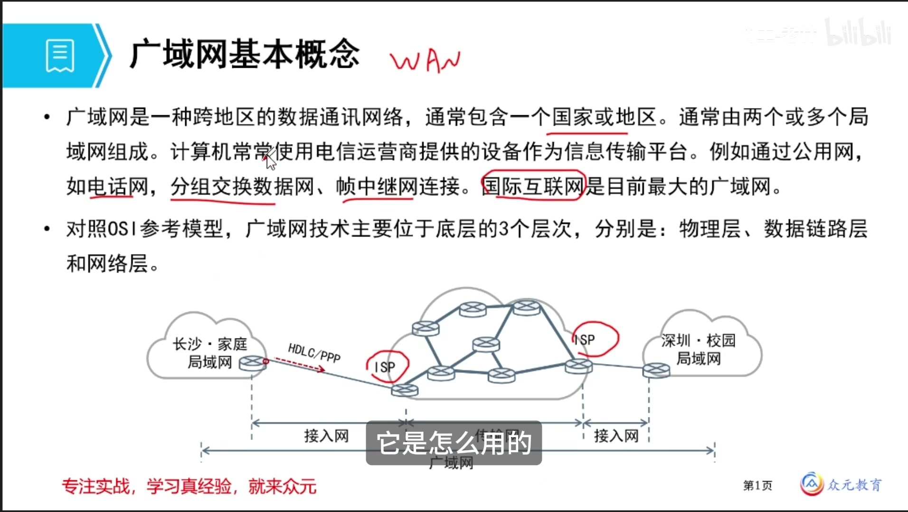
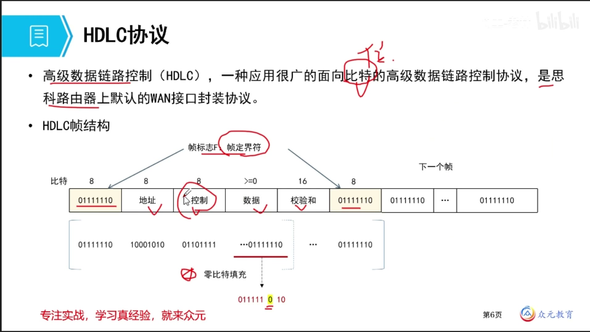
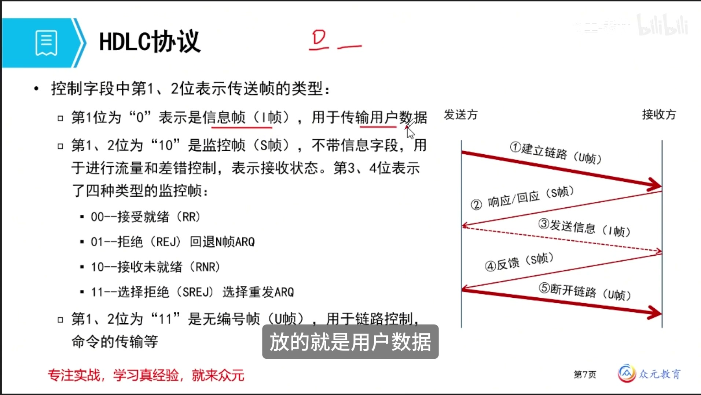
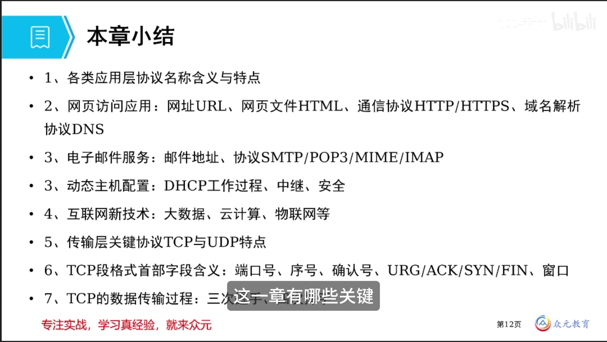
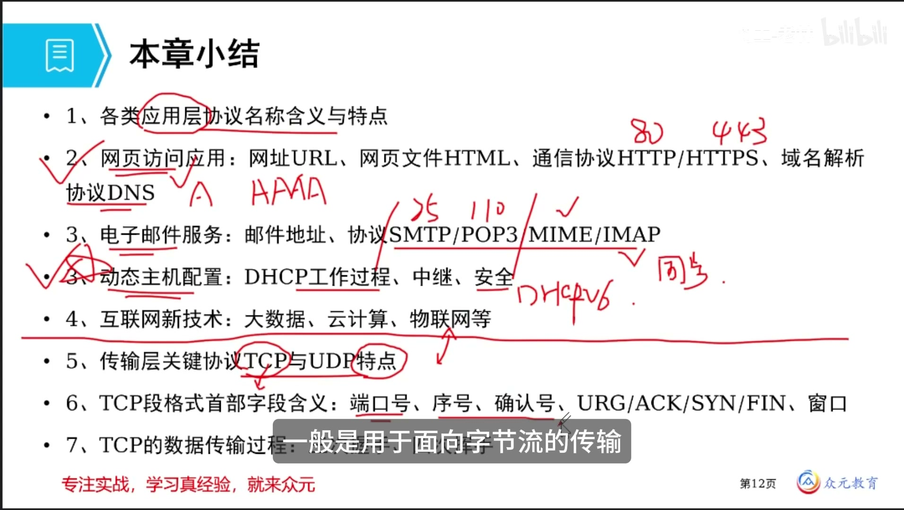
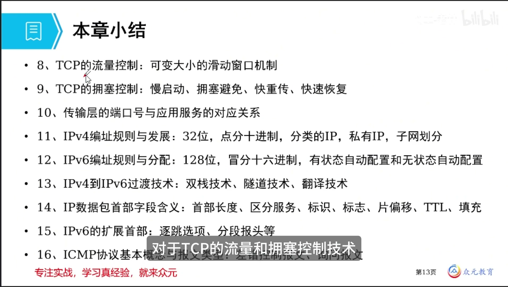

# IS-IS、BGP协议与广域网技术 · 完整笔记

---

## 1.IS-IS协议

### 1.1 IS-IS的协议定位


IS-IS（Intermediate System to Intermediate System，中间系统到中间系统）是**内部网关协议（IGP）**，也是电信运营商普遍采用的内部网关协议之一。它属于**分级的链路状态路由协议**，与 OSPF 同属链路状态类，但在区域划分方式上有本质区别。

| 特征 | 说明 |
| ---- | ---- |
| 协议类别 | 内部网关协议（IGP）、链路状态路由协议 |
| 典型应用 | 电信运营商骨干网、大型企业网 |
| 层次结构 | 分为 Level-1 与 Level-2 两个层次 |
| 邻居发现 | 使用 Hello 协议寻找毗邻节点 |
| 运行位置 | **直接运行于链路层之上**，不封装在 IP 报文中 |
| 路由计算 | L1 与 L2 运行相同的 SPF 算法 |
| 路由器层次 | 一台路由器可同时参与 L1 与 L2 |

IS-IS 直接运行于链路层之上，这是它与大多数路由协议最显著的差异之一。其 PDU 通过链路层帧直接承载（DSAP/SSAP 均为 0xFE），因此不依赖 IP 协议号，也不受 IP 地址配置的影响。

### 1.2 IS-IS的层次化区域结构


IS-IS 具有层次性，分为 **Level-1** 和 **Level-2** 两层：

- **Level-1（L1）**：普通区域（Area），负责区域内部的路由。
- **Level-2（L2）**：骨干区（Backbone），负责区域之间的路由。
- **骨干区**是连续的 Level-2 路由器的集合，由所有 L2 路由器（含 L1/L2 路由器）组成。
- L1 和 L2 运行相同的 SPF 算法，但分别维护 L1 LSDB 与 L2 LSDB。
- 一台路由器可能同时参与 L1 和 L2，称为 **L1/L2 路由器**，相当于 OSPF 中的区域边界路由器（ABR）。

| 路由器类型 | 所属层次 | 维护的 LSDB | 主要职责 |
| ---------- | -------- | ----------- | -------- |
| L1 路由器 | 仅 Level-1 | L1 LSDB | 只学习本区域内部路由，区域间流量交给 L1/L2 路由器 |
| L2 路由器 | 仅 Level-2 | L2 LSDB | 参与骨干区，学习区域间路由 |
| L1/L2 路由器 | Level-1 与 Level-2 | L1 LSDB 与 L2 LSDB | 连接普通区域与骨干区，向 L1 区域通告默认路由 |

**与 OSPF 区域概念的关键区别（考试高频）：**

- OSPF 的骨干区域是 **Area 0**，是一个逻辑区域编号；IS-IS 的骨干区**不是某个区域号**，而是由连续的 L2 路由器及 L1/L2 路由器构成的骨干拓扑。
- OSPF **按接口（端口）划分区域**，同一台路由器的不同接口可以属于不同区域；IS-IS **按路由器本身划分区域**，一台 IS-IS 路由器只能属于一个区域，其所有接口同属该区域。
- OSPF 路由器可以属于多个区域；IS-IS 路由器只能属于一个区域。

L1 路由器通过 L1/L2 路由器发出的 L1 LSP 中的 ATT（Attach）位置位，自动产生指向 L1/L2 路由器的默认路由，从而把区域间流量引向骨干。

图示拓扑说明：Area1 为骨干，包含 4 台 L2 路由器；Area2 由 L1 与 L1/L2 路由器组成；Area3、Area4、Area5 均通过各自的 L1/L2 路由器接入骨干。幻灯片以红笔在“一个 IS-IS 路由器只能属于一个区域”处作重点标注。

### 1.3 NET地址与区域标识

IS-IS 使用 **NET（Network Entity Title，网络实体标题）** 标识路由器与区域。NET 本质上是一个 **SEL 字段为 00 的 NSAP 地址**。

NET 由 **IDP（Initial Domain Part，初始域部分）** 与 **DSP（Domain Specific Part，域特定部分）** 两部分组成：

| 组成 | 子字段 | 长度 | 含义 |
| ---- | ------ | ---- | ---- |
| IDP | AFI（Authority and Format Identifier） | 1 字节 | 地址格式与授权机构标识，常用 49（本地管理） |
| IDP | IDI（Initial Domain Identifier） | 可变 | 域标识，与 AFI 共同构成区域地址 |
| DSP | System ID | **固定 6 字节** | 系统标识，通常由 MAC 地址或 Loopback 地址派生 |
| DSP | SEL（NSEL） | **固定 1 字节** | 服务选择符，路由器固定为 00 |

- **区域地址 = IDP**，长度为 **1～13 字节**。
- **System ID 固定 6 字节（48 位）**，常用 12 位十六进制表示。
- **SEL 固定 1 字节**，路由器取 00。
- NET 总长度为 **8～20 字节**。

示例：

```
49.0001.0000.0000.0001.00
```

| 部分 | 取值 | 说明 |
| ---- | ---- | ---- |
| 区域地址 | 49.0001 | AFI 为 49，区域号为 0001 |
| System ID | 0000.0000.0001 | 6 字节系统标识 |
| SEL | 00 | 表示这是一台路由器 |

配置示例（华为设备）：

```
isis 1
 network-entity 49.0001.0000.0000.0001.00
```

要点：**同一区域内的所有路由器必须配置相同的区域地址；System ID 在整个路由域内必须唯一。**

### 1.4 IS-IS与OSPF的对比

| 比较项 | OSPF | IS-IS |
| ------ | ---- | ----- |
| 协议类型 | 链路状态型 IGP | 链路状态型 IGP |
| 标准来源 | IETF，OSPFv2 为 RFC 2328 | ISO/IEC 10589 |
| 网络层封装 | 封装在 IP 报文中，协议号 89 | **直接封装在链路层**，DSAP/SSAP 为 0xFE |
| 区域划分依据 | **按接口划分** | **按路由器划分** |
| 一台路由器所属区域数 | 可属于多个区域 | **只能属于一个区域** |
| 骨干区域 | Area 0 | Level-2 骨干拓扑，无 Area 0 概念 |
| 区域边界设备 | ABR | L1/L2 路由器 |
| 路由器角色 | 内部路由器、ABR、ASBR、骨干路由器 | L1、L2、L1/L2 |
| 数据库 | LSDB，按区域划分 | L1 LSDB、L2 LSDB |
| 报文类型 | Hello、DD、LSR、LSU、LSAck | IIH、LSP、CSNP、PSNP |
| 广播网 DR | DR 与 BDR | DIS，**无备份 DIS** |
| 默认度量 | cost，与接口带宽相关 | narrow metric，默认 10/跳，可启用 wide metric |
| 组播地址 | 224.0.0.5、224.0.0.6 | 0180.c200.0014（L1）、0180.c200.0015（L2） |
| 扩展性 | 适合中大型网络 | 适合超大规模网络，运营商常用 |

考试中若出现“IS-IS 路由器的不同接口可以属于不同区域”的表述，应判断为 **[错误]**，这是 OSPF 的特征，不是 IS-IS 的特征。

### 1.5 IS-IS的报文与度量（补充）

| 报文类型 | 全称 | 作用 |
| -------- | ---- | ---- |
| IIH | IS-IS Hello PDU | 发现邻居、建立与维持邻接关系，分 L1 Hello 与 L2 Hello |
| LSP | Link State PDU | 携带链路状态信息，分 L1 LSP 与 L2 LSP |
| CSNP | Complete Sequence Number PDU | 描述 LSDB 中全部 LSP 的摘要，用于数据库同步 |
| PSNP | Partial Sequence Number PDU | 描述部分 LSP 的摘要，用于请求或确认缺失的 LSP |

- **DIS（Designated Intermediate System）**：广播网络上选举产生的指定中间系统，负责产生伪节点 LSP 并泛洪 CSNP；选举优先级高者优先，优先级相同则比较 MAC 地址，**没有备份 DIS**。
- **度量值**：narrow metric 默认每条链路 10，字段 6 位，最大 63；wide metric 为 24 位，最大 16777215，可支持更大规模的网络与流量工程。
- **ATT 位**：L1/L2 路由器在 L1 LSP 中置位，L1 路由器据此产生默认路由。

---

## 2.BGP协议

### 2.1 BGP的定位与基本特征


自治系统（Autonomous System，AS）内部使用 IGP（如 RIP、OSPF、IS-IS）完成路由。当网络规模不断扩大、AS 数量不断增长后，**不同自治系统之间的路由交换**需要由外部网关协议完成，其经典代表就是 BGP。

BGP（Border Gateway Protocol，边界网关协议）是基于 **TCP 179 端口**、用于在自治系统之间传递选路信息的**路径向量协议**，当前主流版本为 **BGP-4**；支持 IPv6、VPNv4 等扩展的版本称为 **BGP-4+（MP-BGP）**。

| 特征 | 说明 |
| ---- | ---- |
| 协议类别 | 外部网关协议（EGP），路径向量协议 |
| 传输层 | TCP，端口 **179** |
| 当前版本 | BGP-4；多协议扩展为 BGP-4+（MP-BGP） |
| 邻居关系 | 分为 EBGP 与 IBGP，周期性发送 Keepalive 报文保持与对等体的连接 |
| 防环 | 携带通路向量，即经过的 AS 列表（AS-Path） |
| 更新机制 | 触发更新（增量更新）：启动时交换一次完整信息，后续只通告网络变化 |
| 稳定性 | 提供路由聚合与路由衰减功能，防止路由振荡 |
| 策略能力 | 提供丰富的路由策略与选路属性 |
| 扩展能力 | MP-BGP 可承载 VPN、IPv6 等路由 |

幻灯片右上角另有手写标注：AS 1 与 AS 2 通过 BGP-4 互联，旁注 peer 与 BGP4+，分别表示对等体关系与支持 IPv6 的多协议扩展版本。

BGP 与 IGP 的根本差异：

- IGP 追求**最优路径**，度量简单（跳数或 cost）。
- BGP 运行在 AS 之间，需服从商业关系与策略，追求**可控的路径选择**，因此携带丰富的路径属性。
- BGP 不计算路由，只**传递与选择**路由；路由来源由 IGP 注入。

### 2.2 BGP的路由器角色与对等体关系


- 运行 BGP 的路由器称为 **BGP 发言者（BGP Speaker）** 或 BGP 路由器。
- 两个建立 BGP 会话的路由器互为 **对等体（Peer）**。由于对等体之间可能相隔多个路由器、并不要求直连，因此一般不称“邻居”而称“对等体”。
- BGP 对等体之间交换 BGP 路由表，并通过 Update 报文增量更新路由。

| 对等体类型 | 英文 | 所在范围 | 主要作用 | 建立条件 |
| ---------- | ---- | -------- | -------- | -------- |
| 外部对等体 | EBGP | 不同 AS 的 BGP 路由器之间 | 在 AS 之间传递路由 | AS 号必须不同；路由可达；能正确建立 TCP 连接；通常直连 |
| 内部对等体 | IBGP | 同一 AS 内部的 BGP 路由器之间 | 在 AS 内部同步外部路由，减少重复计算 | 同一 AS 号；通常使用 Loopback 地址建立 |

IBGP 的作用是让 AS 内部所有 BGP 路由器都掌握外部路由，避免路由黑洞；但 IBGP 路由器之间不会互相转发从 IBGP 学到的路由，因此需要**全互联**，或使用**路由反射器**、**联盟**来简化。

### 2.3 BGP的TCP连接


建立 BGP 对等体关系的两台路由器**并不要求必须直连**。默认情况下，BGP 使用报文出接口作为 TCP 连接的本地接口。

| 部署场景 | 源地址选择 | 原因 |
| -------- | ---------- | ---- |
| IBGP 对等体 | 建议使用 **Loopback 地址** | Loopback 始终处于 Up 状态，不随物理接口或直连链路故障而断开；配合冗余链路可提高稳定性与可靠性 |
| EBGP 对等体 | 通常使用**直连接口的 IP 地址** | 避免多跳问题，防止下一跳不可达；EBGP 默认 TTL 为 1，跨跳需额外配置多跳 |

图示中 R1 与 R3 之间建立 IBGP：若使用直连接口，R2 与 R3 之间链路故障会导致会话中断；改用 Loopback 地址后，即使中间链路切换，只要路由仍可达，IBGP 会话即可保持。

要点：

- BGP 会话建立在 TCP 之上，因此**先有 IP 可达性，后有 BGP 邻居关系**。
- IBGP 不要求直连；EBGP 默认要求直连，跨 AS 多跳需配置 `peer ebgp-max-hop`。
- IBGP 使用 Loopback 时，必须通过 IGP 或静态路由保证 Loopback 地址互通。

### 2.4 BGP的报文类型


BGP 共有五种报文，其中前四种为基本报文，Route-refresh 为可选能力报文。

| 报文 | 英文 | 作用 | 关键点 |
| ---- | ---- | ---- | ------ |
| 打开报文 | OPEN | 与相邻的另一个 BGP 发言者建立关系 | 携带版本号、本端 AS 号、Hold Time、BGP Identifier、可选参数与能力协商 |
| 更新报文 | UPDATE | 发送某一条路由的信息，以及列出要撤销的多条路由 | 携带 withdrawn routes、路径属性、NLRI；BGP 通过它增量发布路由 |
| 保活报文 | KEEPALIVE | 确认 OPEN 报文，并周期性地证实邻站关系 | 默认发送周期 **60 秒**，超时时间（Hold Time）**180 秒**；报文仅 19 字节 |
| 通知报文 | NOTIFICATION | 发送检测到的差错 | 携带错误码与错误子码，发送后关闭 BGP 连接 |
| 路由刷新报文 | ROUTE-REFRESH | 改变路由策略后请求对等体重新发送路由信息 | 只有支持 Route-refresh 能力的设备才发送和响应 |

BGP 报文公共首部为 **19 字节**：

| 字段 | 长度 | 说明 |
| ---- | ---- | ---- |
| Marker | 16 字节 | 全 1，用于消息边界与兼容性检测 |
| Length | 2 字节 | 报文总长度，最小 19，默认最大 4096 字节；协商扩展消息能力后可达到 65535 字节 |
| Type | 1 字节 | 1=OPEN，2=UPDATE，3=NOTIFICATION，4=KEEPALIVE，5=ROUTE-REFRESH |

**邻居建立过程中的报文配合（考试易错）：**

1. 本端发送 **OPEN** 报文发起邻居关系。
2. 对端收到 OPEN 后，若接受参数，回复 **KEEPALIVE** 报文确认。
3. 双方进入 Established 状态，之后周期性发送 KEEPALIVE 保活。
4. 出现差错时发送 **NOTIFICATION** 报文并断开连接。

因此，“发送什么报文建立邻居关系”应选 **OPEN**；“收到 OPEN 后采用什么报文响应”应选 **KEEPALIVE**。不能混淆为 OSPF 的 Hello 报文。

BGP 有限状态机（补充）：

| 状态 | 含义 |
| ---- | ---- |
| Idle | 空闲，等待启动事件 |
| Connect | 正在建立 TCP 连接 |
| Active | TCP 连接失败，尝试重新建立 |
| OpenSent | TCP 已建立，已发送 OPEN，等待对端 OPEN |
| OpenConfirm | 已收到对端 OPEN，等待 KEEPALIVE |
| Established | 邻居关系建立，可交换 UPDATE 路由 |

### 2.5 BGP的路径属性


每条 BGP 路由都携带多种**路径属性（Path Attribute）**。与 OSPF 仅使用 cost、RIP 仅使用跳数不同，BGP 可通过多种属性组合控制选路，因而具有丰富的可操作性。

按**是否必须携带**，路径属性分为四类：

| 类别 | 英文 | 含义 | 典型属性 |
| ---- | ---- | ---- | -------- |
| 公认强制 | Well-known Mandatory | 所有 BGP 路由器必须识别，且每条路由必须携带 | **ORIGIN、AS_PATH、NEXT_HOP** |
| 公认自选 | Well-known Discretionary | 所有 BGP 路由器必须识别，但不一定携带；携带则必须处理 | **LOCAL_PREF、ATOMIC_AGGREGATE** |
| 可选可传递 | Optional Transitive | 可以选择是否携带；即使路由器不识别，也要继续传递给下一个对等体 | **AGGREGATOR、COMMUNITY** |
| 可选不可传递 | Optional Non-transitive | 可以选择是否携带；若不识别，则不继续传递 | **MED、ORIGINATOR_ID、CLUSTER_LIST** |

重点属性说明：

| 属性 | 类别 | 作用 | 取值与比较规则 |
| ---- | ---- | ---- | -------------- |
| ORIGIN | 公认强制 | 标识路径信息的来源 | IGP（i，0）优于 EGP（e，1），EGP 优于 INCOMPLETE（?，2）；network 宣告为 IGP，import-route 引入通常为 INCOMPLETE |
| AS_PATH | 公认强制 | 记录路由经过的 AS 列表，用于选路与防环 | 长度越短越优；AS_SET 按 1 个 AS 计算；包含本 AS 号的路由将被丢弃 |
| NEXT_HOP | 公认强制 | 指示到达目的网络的下一跳 | 必须可达；EBGP 通告时通常改为本端接口地址，IBGP 通告时默认不改变 |
| LOCAL_PREF | 公认自选 | 判断流量离开本 AS 时的最佳路由 | 数值越大越优，默认 **100**；只在 IBGP 内传递，不传给 EBGP 对等体 |
| MED | 可选不可传递 | 判断流量进入本 AS 时的最佳路由，影响上游 AS 的入口选择 | 数值越小越优，默认 0；通常只比较来自同一相邻 AS 的路由，不向其他 AS 传播 |
| ATOMIC_AGGREGATE | 公认自选 | 标识一条聚合路由，提示下游该路由丢失了部分明细路径信息 | 防止下游还原出与聚合前不一致的路径，使用较少 |
| AGGREGATOR | 可选可传递 | 标识聚合路由的发起者 | 记录发起聚合的路由器与 AS 号 |
| COMMUNITY | 可选可传递 | 标识具有相同特征的 BGP 路由，便于批量策略管理 | 团体名，常用于路由标记与策略匹配 |
| ORIGINATOR_ID | 可选不可传递 | 路由反射器中标识路由的原始发起者 | 防止反射器环境产生环路 |
| CLUSTER_LIST | 可选不可传递 | 路由反射器中记录经过的集群 ID | 防止集群间环路 |

图示中黄色高亮部分即“公认强制”属性：**ORIGIN、AS_PATH、NEXT_HOP**。这三项是每条 BGP 路由必须携带的核心属性，应重点掌握。

### 2.6 AS_PATH的作用：选路与防环


AS_PATH（AS 列表）是 BGP 最重要的属性之一，具有两个作用：

1. **影响 BGP 路由的优选**：AS_PATH 越短，路由越优。
2. **防止路由环路的产生**：路由器收到包含本 AS 号的路由时，直接丢弃。

图示中 R5 学习 10.0.1.0/24 网段，存在两条路径：

| 路径 | AS_PATH | 经过的 AS 数 | 优选结果 |
| ---- | ------- | ------------ | -------- |
| 上方路径 | 200 100 | 2 | **优选** |
| 下方路径 | 400 300 100 | 3 | 落选 |

AS_PATH 从右向左阅读：最右侧的 100 是路由起源 AS，向左依次为经过的 AS。上方路径只经过 AS 200 与 AS 100，长度更短，因此被选中。

防环过程：若 R2 与 R4 之间存在额外通道，R2 可能从 R4 方向再次学到自身始发的路由；当 R2 检查到 AS_PATH 中已包含自己的 AS 号时，**不接收该路由**，从而避免路由在 AS 之间循环。

补充规则：

- AS_PATH 由 AS_SEQUENCE（有序序列）与 AS_SET（无序集合）组成。
- 进行长度比较时，**AS_SET 整体按 1 个 AS 计算**。
- 联盟（Confederation）内部的 AS_CONFED_SEQUENCE 不计入 AS_PATH 长度。
- EBGP 发送路由时，会把本端 AS 号添加到 AS_PATH 最左侧；IBGP 不添加。

### 2.7 BGP的选路原则

BGP 依据路径属性逐项比较，选出唯一最优路由。华为设备的标准比较顺序如下（序号越靠前优先级越高）：

| 顺序 | 比较项 | 优选规则 |
| ---- | ------ | -------- |
| 1 | Preferred-Value（私有属性） | 数值**越大**越优，仅本机有效 |
| 2 | LOCAL_PREF | 数值**越大**越优，默认 100 |
| 3 | 本地始发 | 本机通过 network、aggregate、import-route 产生的路由更优 |
| 4 | AS_PATH | 长度**越短**越优 |
| 5 | ORIGIN | IGP 优于 EGP，EGP 优于 INCOMPLETE |
| 6 | MED | 数值**越小**越优，通常只比较同一相邻 AS 的路由 |
| 7 | EBGP 与 IBGP | **EBGP 路由优于 IBGP 路由** |
| 8 | 到 NEXT_HOP 的 IGP 度量 | 数值**越小**越优 |
| 9 | CLUSTER_LIST | 长度**越短**越优 |
| 10 | Router ID | 数值**越小**越优；存在 ORIGINATOR_ID 时先比较 ORIGINATOR_ID |
| 11 | 对等体 IP 地址 | 数值**越小**越优 |

说明：

- 思科设备使用 **Weight** 代替 Preferred-Value，其余顺序基本一致，并在 Router ID 之前可能比较“ oldest path”。
- 上述顺序是“逐项比较、一旦分出胜负即停止”的过程，不是加权求和。
- BGP 默认只选一条最优路由，不自动负载分担；需要多路径负载分担时应配置 `maximum load-balancing`。

### 2.8 BGP路由的生成、同步与聚合


不同于 IGP，**BGP 自身不会发现并计算产生路由**。BGP 将 IGP 路由表中的路由注入 BGP 路由表，再通过 UPDATE 报文传递给 BGP 对等体。

BGP 注入路由的两种方式：

| 方式 | 命令示意 | 特点 | ORIGIN 取值 |
| ---- | -------- | ---- | ----------- |
| Network | `network 10.0.0.0 24` | 精确控制，只宣告指定网段，**更优** | IGP |
| import-route | `import-route ospf 1` | 批量引入，配置简单，但易引入不必要路由与环路风险 | INCOMPLETE |

路由聚合：

| 聚合方式 | IPv4 | IPv6 | 说明 |
| -------- | ---- | ---- | ---- |
| 自动聚合 | 支持 | **不支持** | 按自然网段（A/B/C 类主类网络）聚合 |
| 手动聚合 | 支持 | **支持** | 可自由控制聚合范围，并可通过属性调整聚合结果 |

**IBGP 同步与路由黑洞：**

- 将 BGP 路由引入 IGP 后，需要保证 IBGP 与 IGP 之间的同步。
- Internet 上 BGP 路由数量庞大，全部引入 IGP 会给路由器带来巨大的处理与存储负担。
- 若 IBGP 路由器未学到某条外部路由，却仍向 EBGP 邻居通告，转发时就会因查不到路由而丢包，形成**路由黑洞**。
- 解决办法：
  1. **IBGP 全互联**：AS 内所有运行 BGP 的路由器两两建立 IBGP 会话，确保都能学到通告的路由，同时保证 NEXT_HOP 在 IGP 中可达。
  2. **路由反射器（RR）**：由反射器在客户端与非客户端之间反射路由，减少会话数量。
  3. **联盟（Confederation）**：将大 AS 划分为多个子 AS，降低全互联规模。

IBGP 全互联的会话数量为 `n(n-1)/2`，其中 n 为 IBGP 路由器数量。

**路由衰减（Dampening）**：对频繁振荡的路由进行惩罚，抑制不稳定路由的反复通告，从而防止路由振荡扩散。

### 2.9 BGP防环措施汇总

| 防环层次 | 措施 | 原理 |
| -------- | ---- | ---- |
| AS 之间 | **AS_PATH** | 路由每经过一个 AS 就记录其 AS 号；收到含本 AS 号的路由即丢弃 |
| AS 内部 | **IBGP 水平分割** | 从 IBGP 邻居学到的路由，不再转发给其他 IBGP 邻居，避免 IBGP 环路 |
| 反射器环境 | **ORIGINATOR_ID** | 记录路由原始发起者，反射器收到 Originator ID 为本机的路由时丢弃 |
| 反射器环境 | **CLUSTER_LIST** | 记录经过的集群 ID，发现本集群 ID 即丢弃 |
| 联盟环境 | **AS_CONFED_SEQUENCE** | 记录联盟内部子 AS 路径，防止子 AS 间循环 |
| 稳定性 | **路由衰减** | 抑制频繁振荡的路由，减少路由抖动（非严格意义上的环路防止） |

考试中判断“从 IBGP 邻居收到的路由不会转发给另外一个 IBGP 邻居”属于 BGP 防环措施，应判断为 **[正确]**。

---

## 3.广域网基本概念

### 3.1 广域网的定义与组成




广域网是一种**跨地区的数据通信网络**，通常包含一个国家或地区，由两个或多个局域网组成。计算机通常使用电信运营商提供的设备作为信息传输平台，例如通过公用电话网、分组交换数据网、帧中继网连接。**国际互联网是目前最大的广域网。**

对照 OSI 参考模型，广域网技术主要位于底层的三个层次：

| 层次 | 广域网关注点 | 典型技术 |
| ---- | ------------ | -------- |
| 物理层 | 传输介质、接口电气特性、位传输 | 铜线、光纤、SDH、OTN、PON |
| 数据链路层 | 帧封装、差错检测、链路建立与维护 | HDLC、PPP、帧中继、ATM |
| 网络层 | 编址、路由与转发 | IP、X.25 分组层（MPLS 通常称为 2.5 层） |

广域网与局域网的主要区别：

| 比较项 | 局域网（LAN） | 广域网（WAN） |
| ------ | ------------- | ------------- |
| 覆盖范围 | 房间、楼宇、园区，通常几米到几公里 | 城市、国家、全球，跨地区 |
| 归属与运营 | 用户自行建设与维护 | 通常租用电信运营商线路与服务 |
| 典型技术 | 以太网、Wi-Fi | PSTN、X.25、帧中继、ATM、SDH、OTN、MPLS、PPP |
| 链路特性 | 共享介质、广播能力强 | 点到点为主，链路成本高、时延大 |
| 封装方式 | 以太网帧 | HDLC、PPP、帧中继等 WAN 封装 |

图中家庭局域网与校园局域网分别位于长沙与深圳，通过 ISP 的广域网互联；用户侧到 ISP 的一段称为**接入网**，两侧接入常使用 HDLC 或 PPP 封装。幻灯片以红笔圈注 ISP 与接入网两处，强调用户网络必须经由运营商接入网才能进入广域网。

### 3.2 电路交换、报文交换与分组交换

| 交换方式 | 工作原理 | 时延特点 | 带宽利用率 | 典型应用 |
| -------- | -------- | -------- | ---------- | -------- |
| 电路交换 | 通信前建立一条端到端的专用物理通路，通信结束后释放 | 建立连接时延较长，传输时延小且稳定 | 独占带宽，利用率低 | PSTN 电话网 |
| 报文交换 | 以整个报文为单位存储转发，逐节点传递 | 存储转发时延大，对节点存储要求高 | 统计复用，较电路交换高 | 早期电报、部分消息系统 |
| 分组交换 | 将报文分割为分组，以分组为单位存储转发 | 时延较小，可并行传输 | 统计复用，利用率高 | X.25、帧中继、IP 网络 |

**电路交换的三个阶段：**

1. **建立连接**：在主叫与被叫之间建立一条专用物理通路。
2. **数据传输**：双方独占该通路传输数据，中途不释放。
3. **释放连接**：通信结束后拆除通路，资源归还网络。

电路交换的特点：

- 传输时延小、时延抖动小，适合实时语音业务。
- 建立连接时间长，信道利用率低。
- 用户始终占用固定带宽，即使无数据传输也不释放。

补充：电话网采用 PCM 体制，E1 一次群速率为 **2.048 Mbit/s**，共 **32 个时隙**，其中 30 个时隙用于话音，2 个时隙用于同步与信令；每个话路 **64 kbit/s**。

### 3.3 广域网技术的演进


广域网技术经历了从模拟到数字、从电路交换到分组交换、从低速专线到高速光传输的演进：

| 阶段 | 代表技术 | 交换单位 | 连接方式 | 典型速率 | 现状 |
| ---- | -------- | -------- | -------- | -------- | ---- |
| 模拟语音时代 | PSTN | 64 kbit/s 话路 | 电路交换 | 话路 64 kbit/s；拨号 Modem 56 kbit/s | 已淘汰，仅保留语音与部分接入 |
| 早期分组网 | X.25 | 分组 | 虚电路 | 64 kbit/s 为主 | 已淘汰 |
| 简化分组网 | 帧中继 FR | 帧 | 虚电路 | 最高约 45 Mbit/s | 基本淘汰 |
| 综合业务数字网 | ISDN | 64 kbit/s B 信道 | 电路交换 | BRI 144 kbit/s、PRI 2.048 Mbit/s | 已淘汰 |
| 宽带综合业务 | ATM | 53 字节信元 | 虚电路 | 155 Mbit/s、622 Mbit/s | 被 IP 取代 |
| 数字专线 | DDN | 64 kbit/s 时隙 | 半永久连接 | N×64 kbit/s、E1 2.048 Mbit/s | 仍在部分专线场景使用 |
| 光传输 | SDH、OTN | 字节/光通道 | 时分复用、波分复用 | 155 Mbit/s～100 Gbit/s 以上 | 骨干传输主流 |
| 现代广域互联 | IP/MPLS、MPLS VPN | 分组/标签 | 无连接、标签交换 | 按需 | 当前主流 |

最终胜出的是**互联网（IP 网络）**：其无连接、尽力而为、成本低、扩展性强的特点，使其取代了绝大多数传统广域网技术。传统技术中仍有生命力的部分主要是 SDH/OTN 传输底座、MPLS VPN 专线以及 PPPoE 接入。

---

## 4.广域网网络类型

### 4.1 公共交换电话网PSTN


PSTN（Public Switched Telephone Network，公共交换电话网）最初是为**话音业务**建设的网络。20 世纪 60 年代起，PSTN 也被用于数据传输（如 56 kbit/s 的拨号 Modem），但目前已基本淘汰。

| 组成部分 | 传输介质 | 信号形式 | 说明 |
| -------- | -------- | -------- | ---- |
| 用户回路 | 一对铜双绞线 | **模拟信号** | 用户电话到最近端局，距离约 1～10 km |
| 长途干线 | 光纤 | **数字信号** | 端局、长途局、中继局之间的主干链路 |
| 局间高速干线 | 光纤 | 数字信号 | 长途局与中继局之间的高速通道 |

PSTN 的组成结构：

```
电话 — 用户回路 — 端局 — 长途干线 — 长途局 — 局间高速干线 — 中继局 — 长途干线 — 长途局 — 用户回路 — 电话
```

由于用户回路传输模拟信号、干线传输数字信号，发送端与接收端需要进行**模数转换与数模转换**，传统上由 **Modem（调制解调器）** 完成。

PSTN 属于**电路交换**网络，通话期间独占一条 64 kbit/s 的话路，适合语音，不适合突发性数据业务。

### 4.2 X.25


X.25 是由国际组织提出的、**面向计算机数据通信**的协议，主要描述了 **DTE（数据终端设备）** 与 **DCE（数据电路终端设备）** 之间的接口标准。

X.25 分为三个协议层，分别对应 OSI 参考模型的低三层：

| X.25 层次 | 对应 OSI 层次 | 主要功能 |
| --------- | ------------- | -------- |
| 物理层 | 物理层 | 定义 DTE 与 DCE 之间的物理接口与电气特性 |
| 链路层 | 数据链路层 | 使用 LAPB 提供**可靠的数据传输**，进行差错检测与重传 |
| 分组层 | 网络层 | 提供虚电路服务，完成分组复用、路由与流量控制 |

X.25 采用分组交换中的**虚电路**服务，将物理信道划分为多条逻辑信道，一条物理链路上可以建立多条逻辑电路。通信过程仍为三步：

1. **建立链路**（建立逻辑链路）。
2. **传输数据**（分组按序到达，底层确保可靠性）。
3. **拆除链路**。

虚电路分为两类：

| 类型 | 英文 | 特点 |
| ---- | ---- | ---- |
| 交换虚电路 | SVC，Switched Virtual Circuit | 基于呼叫建立，数据传输会话结束时拆除，每次通信都要建立与释放 |
| 永久虚电路 | PVC，Permanent Virtual Circuit | 由网络指定的固定虚电路，像专线一样无需建立和清除连接，可直接传送数据 |

X.25 在链路层完成差错检测与重传，可靠性高，但开销大、时延高、速率低。早期传输介质与终端性能较弱，需要在底层保障可靠性与安全性；随着光纤与终端性能提升，底层只需关注传输速率，可靠性交由高层协议处理，因此 X.25 的虚电路机制逐渐被无连接的 IP 分组交换取代。

### 4.3 帧中继FR


帧中继（Frame Relay，FR）是一种**高效、低成本的分组交换数据传输技术**，主要用于广域网数据通信，通过虚电路实现逻辑连接与带宽复用。它是 **X.25 协议的简化版本**，去掉了 X.25 的逐跳纠错功能，把可靠性交给高层协议处理。

技术特性：

| 特性 | 说明 |
| ---- | ---- |
| 数据传输单位 | 以**帧**为单位传送信息；网络对帧结构和传输差错进行检查，**出错帧直接丢弃**，不重传 |
| 虚电路标识 | 使用**数据链路连接标识符（DLCI）** 标识虚电路，DLCI **只在本地接口有效** |
| 带宽利用 | 支持**承诺信息速率（CIR）** 与**额外信息速率（EIR）**，允许动态分配带宽，提高物理资源利用率 |
| 协议简化 | 简化了 X.25 的复杂功能，降低设备成本与网络时延，提高传输速率 |
| 逻辑连接 | 传输链路是逻辑连接而非物理连接，一条物理链路可复用多条逻辑连接，实现带宽复用与动态分配 |
| 帧定界 | 帧首尾使用标志字段 **01111110** 定界，帧长可变 |
| 典型速率 | 可达约 **45 Mbit/s** |
| 应用时期 | 20 世纪 90 年代广域网建设的主流技术 |

帧中继只工作在**数据链路层**，不提供网络层功能；它基于虚电路，但只做拥塞与丢弃指示，不做端到端重传。当网络拥塞时，超出 CIR 的帧会被标记为可丢弃（DE 位），必要时直接丢弃。

随着 IP 网络与光传输的发展，帧中继逐渐被 MPLS VPN、SDH/OTN 专线与互联网 VPN 取代。

### 4.4 ISDN与ATM


**ISDN（Integrated Services Digital Network，综合数字业务网）** 的目的是以数字系统代替模拟电话系统，把音频、视频、数据业务放在一个网上统一传输。ISDN 分为窄带 ISDN（N-ISDN）与宽带 ISDN（B-ISDN）。

窄带 ISDN 提供两种用户接口：

| 接口 | 结构 | 速率 | 说明 |
| ---- | ---- | ---- | ---- |
| 基本速率接口 BRI | 2B+D | **144 kbit/s** | 2 个 64 kbit/s 的 B 信道 + 1 个 16 kbit/s 的 D 信道 |
| 基群速率接口 PRI | 30B+D | **2.048 Mbit/s** | 30 个 64 kbit/s 的 B 信道 + 1 个 64 kbit/s 的 D 信道（欧洲、中国标准） |

补充：北美与日本采用 23B+D 的 PRI，速率为 1.544 Mbit/s。

**宽带 ISDN 即 ATM（Asynchronous Transfer Mode，异步传输模式）。**

ATM 的核心特点：

| 特性 | 说明 |
| ---- | ---- |
| 交换单位 | **信元（Cell）**，固定长度 **53 字节** |
| 信元结构 | 首部 **5 字节** + 净荷 **48 字节** |
| 利用率 | 48 ÷ 53 ≈ **90.6%** |
| 交换方式 | 信元交换，基于虚电路提供面向连接的服务 |
| 复用方式 | **异步时分复用（ATDM）**，用户数据不固定占用时隙，可动态分配，提高效率 |
| 典型速率 | **155 Mbit/s**、622 Mbit/s 等（课程口述为 150 M 量级） |
| 标准化 | 1992 年被 ITU-T 定为宽带综合业务数字网（B-ISDN）的传输标准 |
| 应用时期 | 20 世纪 90 年代多媒体通信的主流方案，替代了帧中继 |

ATM 使用 **VPI/VCI** 标识虚电路，支持 PVC 与 SVC；通过 AAL（ATM 适配层）承载不同业务，并提供 CBR、VBR、ABR、UBR 等服务质量等级。

ATM 的固定长度信元便于硬件高速交换，兼顾实时业务与数据业务；但其信元开销、复杂性与 IP 的简单性相比不占优势，最终随着 IP over ATM、IP over SDH、IP over DWDM 的发展而退出主流。

### 4.5 DDN数字数据网（补充）

DDN（Digital Data Network，数字数据网）是利用数字信道提供数据通信的传输网，主要提供**点到点或点到多点的数字专线**。

| 特性 | 说明 |
| ---- | ---- |
| 连接方式 | 半永久性连接，无论用户是否传输数据，数字连接一直存在 |
| 传输单位 | 64 kbit/s 时隙，可按 N×64 kbit/s 分配 |
| 典型速率 | 64 kbit/s～2.048 Mbit/s（E1） |
| 交换方式 | 不进行分组交换，通过数字交叉连接设备（DXC）建立半永久通路 |
| 透明性 | 全透明传输，不受规程约束，可支持网络层及以上各种协议 |
| 优点 | 时延低、抖动小、传输质量高、安全可靠 |
| 缺点 | 带宽固定、价格较高、网络灵活性不足 |
| 适用场景 | 对时延与稳定性要求高的专线接入、金融与政务专网 |

DDN 与帧中继的区别：DDN 提供**物理层/数字电路级**的透明专线，带宽独享；帧中继在**数据链路层**通过虚电路复用物理链路，带宽共享、成本更低。

### 4.6 SDH与OTN（补充）

**SDH（Synchronous Digital Hierarchy，同步数字体系）** 是 ITU-T 制定的同步光传输体制，采用统一的帧结构与复用等级，具有强大的 OAM 与自愈保护能力。

| 等级 | 速率 | 常见承载 |
| ---- | ---- | -------- |
| STM-1 | **155.52 Mbit/s** | E1、E3、FE、GE（经映射） |
| STM-4 | **622.08 Mbit/s** | 多路 STM-1 |
| STM-16 | **2488.32 Mbit/s（约 2.5 Gbit/s）** | 10GE 以下业务 |
| STM-64 | **9953.28 Mbit/s（约 10 Gbit/s）** | 10GE |
| STM-256 | **39813.12 Mbit/s（约 40 Gbit/s）** | 40GE |

SDH 帧结构为 **9 行 × 270 列 = 2430 字节**，帧周期 **125 μs**，每秒 8000 帧；包含段开销（SOH）、管理单元指针（AU-PTR）与信息净荷（Payload）。SDH 通常组成**双纤双向复用段保护环**，实现 50 ms 级自愈。

**OTN（Optical Transport Network，光传送网）** 以 ITU-T **G.709** 为标准，在 SDH 的基础上引入更强的前向纠错（FEC）、多波长（DWDM）调度与端到端 OAM，是当前骨干光传输的主流。

| OTN 容器 | 速率 | 对应客户信号 |
| -------- | ---- | ------------ |
| OTU1 | **2.67 Gbit/s** | STM-16 |
| OTU2 | **10.71 Gbit/s** | STM-64、10GE |
| OTU3 | **43.02 Gbit/s** | STM-256、40GE |
| OTU4 | **111.81 Gbit/s** | 100GE |

SDH 与 OTN 的关系：SDH 侧重单波长时分复用与灵活支路调度；OTN 侧重多波长光层调度、超大容量与长距离传输。实际网络中常为 **IP over OTN** 或 **IP over SDH over OTN**。

### 4.7 MPLS VPN（补充）

MPLS（Multi-Protocol Label Switching，多协议标签交换）在数据链路层与网络层之间插入 **32 位标签栈**，以标签交换代替逐跳查表，实现高速转发与流量工程。

标签栈字段：

| 字段 | 长度 | 作用 |
| ---- | ---- | ---- |
| Label | 20 位 | 标签值，用于转发 |
| EXP | 3 位 | 服务等级与 QoS |
| S | 1 位 | 栈底标志，1 表示最后一层标签 |
| TTL | 8 位 | 生存时间，防止环路 |

MPLS L3 VPN 的基本组成：

| 角色 | 全称 | 作用 |
| ---- | ---- | ---- |
| CE | Customer Edge | 用户侧边缘设备，属于用户管理 |
| PE | Provider Edge | 运营商侧边缘设备，维护 VRF 与 VPN 路由 |
| P | Provider | 运营商骨干设备，只做标签转发，不感知 VPN |

关键概念：

- **VRF（Virtual Routing and Forwarding）**：PE 上为每个 VPN 建立独立的路由表，实现地址空间隔离。
- **RD（Route Distinguisher）**：8 字节，附加在 IPv4 前缀前形成 VPNv4 路由，保证不同 VPN 的相同私网地址不冲突。
- **RT（Route Target）**：BGP 扩展团体属性，控制 VPN 路由的导入与导出。
- **MP-BGP**：在 PE 之间传递 VPNv4 路由。
- **双层标签**：外层标签由 LDP/RSVP-TE 分配，用于骨干网转发到对端 PE；内层标签标识 VPN 或 VRF，用于 PE 将报文交付正确的 VPN。
- **L2 VPN**：包括 VPWS（点到点）与 VPLS（点到多点），在二层透明传输以太网帧。

MPLS VPN 的安全性来自**逻辑隔离**而非加密；若需加密，应叠加 IPsec 等机制。

### 4.8 光接入网与PON（补充）

光接入网（OAN）将光纤延伸至用户侧，典型结构为 **OLT—ODN—ONU/ONT**：

| 组成 | 全称 | 作用 |
| ---- | ---- | ---- |
| OLT | Optical Line Terminal | 局端光线路终端，汇聚用户业务并接入上层网络 |
| ODN | Optical Distribution Network | 光分配网，由光纤与分光器组成，实现点到多点连接 |
| ONU/ONT | Optical Network Unit/Terminal | 用户侧光网络单元/终端，提供宽带、语音、视频接口 |

PON（Passive Optical Network，无源光网络）采用无源分光器，下行采用广播方式（TDM），上行采用时分多址（TDMA）；GPON/EPON 的典型波长为下行 1490 nm、上行 1310 nm。

| 标准 | 名称 | 下行速率 | 上行速率 | 标准组织 |
| ---- | ---- | -------- | -------- | -------- |
| EPON | Ethernet PON | 1.25 Gbit/s | 1.25 Gbit/s | IEEE 802.3ah |
| GPON | Gigabit PON | **2.5 Gbit/s** | **1.25 Gbit/s** | ITU-T G.984 |
| XG-PON | 10G PON | 10 Gbit/s | 2.5 Gbit/s | ITU-T G.987 |
| XGS-PON | 10G 对称 PON | 10 Gbit/s | 10 Gbit/s | ITU-T G.9807 |
| 10G-EPON | 10G Ethernet PON | 10 Gbit/s | 10 Gbit/s | IEEE 802.3av |

光接入是当前宽带接入的主流方式，替代了 ADSL 等铜线接入；PPPoE 仍常作为光接入链路上的拨号与认证方式。

### 4.9 各种广域网技术对比

| 技术 | 工作层次 | 交换单位 | 连接方式 | 典型速率 | 主要特点 | 现状 |
| ---- | -------- | -------- | -------- | -------- | -------- | ---- |
| PSTN | 物理层/链路层 | 64 kbit/s 话路 | 电路交换 | 56 kbit/s（Modem） | 语音为主，独占带宽 | 淘汰 |
| X.25 | 低三层 | 分组 | 虚电路（SVC/PVC） | 64 kbit/s 为主 | 逐跳纠错，可靠但开销大 | 淘汰 |
| 帧中继 FR | 数据链路层 | 帧 | 虚电路（PVC 为主） | 最高约 45 Mbit/s | 简化 X.25，出错丢弃 | 基本淘汰 |
| ISDN | 物理层/链路层 | B 信道 | 电路交换 | BRI 144 kbit/s、PRI 2.048 Mbit/s | 数模一体化，支持语音与数据 | 淘汰 |
| ATM | 链路层/网络层 | 53 字节信元 | 虚电路 | 155 Mbit/s、622 Mbit/s | 固定信元，QoS 完善 | 被 IP 取代 |
| DDN | 物理层 | 64 kbit/s 时隙 | 半永久专线 | N×64 kbit/s、2.048 Mbit/s | 透明、低时延、带宽独享 | 部分专线在用 |
| SDH | 物理层 | STM-N 帧 | 时分复用 | 155 Mbit/s～40 Gbit/s | 同步复用、自愈保护 | 传输底座 |
| OTN | 物理层 | OTU 容器 | 波分复用 | 2.67～111.81 Gbit/s | 大容量、长距离、强 FEC | 骨干主流 |
| MPLS VPN | 2.5 层 | 标签 | 标签交换 | 按需 | 逻辑隔离、支持 QoS、扩展性强 | 主流专网方案 |
| PON | 物理层/链路层 | 光帧 | 点到多点 | 1.25～10 Gbit/s | 无源分光、成本低 | 主流接入 |
| PPPoE | 数据链路层 | PPP 帧 | 点到点会话 | 按需 | 以太网上的 PPP，拨号认证 | 主流宽带接入 |

---

## 5.广域网数据链路层协议

### 5.1 HDLC协议概述


HDLC（High-level Data Link Control，高级数据链路控制）是一种应用很广的**面向比特**的高级数据链路控制协议，也是**思科路由器上默认的 WAN 接口封装协议**。

| 特性 | 说明 |
| ---- | ---- |
| 协议类型 | 面向比特的同步链路控制协议 |
| 标准化 | ISO/IEC 13239 |
| 封装位置 | 数据链路层 |
| 默认应用 | 思科路由器 WAN 接口默认封装 |
| 帧定界 | 使用 **01111110** 作为帧标志（帧定界符） |
| 透明传输 | 零比特填充 |
| 差错检测 | FCS 校验（通常 16 位 CRC） |
| 帧类型 | 信息帧（I）、监控帧（S）、无编号帧（U） |

注意：思科的 HDLC 是**私有实现**，在标准 HDLC 基础上增加了类型字段，因此不能与标准 HDLC 设备直接互通；多厂商环境中通常改用 PPP。

### 5.2 HDLC帧结构




HDLC 帧由以下字段组成：

| 字段 | 长度 | 作用 |
| ---- | ---- | ---- |
| 帧标志 F | **8 位** | 帧定界符，固定为 **01111110**，同时作为前一帧的结束与后一帧的开始 |
| 地址 A | **8 位** | 标识从站地址或命令/响应地址 |
| 控制 C | **8 位** | 标识帧类型，承载序号、确认号与控制信息 |
| 数据 Info | **≥0 位（可变）** | 承载用户数据；I 帧有数据，S 帧无数据 |
| 校验和 FCS | **16 位** | 帧校验序列，通常为 CRC-16 |
| 帧标志 F | **8 位** | 下一帧的开始，固定为 01111110 |

帧结构示意：

```
01111110 | 地址(8) | 控制(8) | 数据(可变) | 校验和(16) | 01111110
    F          A         C         Info          FCS          F
```

**零比特填充：**

- 由于帧标志为 6 个连续的 1（01111110），若数据部分恰好出现相同的比特模式，接收方会误判为帧边界。
- 发送方在数据部分每出现**连续 5 个 1** 时，立即插入一个 **0**，避免出现连续 6 个 1。
- 接收方在数据部分每检测到**连续 5 个 1** 后，删除其后的一个 **0**，还原原始数据。
- 这一机制称为**零比特填充**，使 HDLC 具备透明传输能力。

示例：原始数据中出现 `011111`，发送时插入 0 变为 `0111110`；接收方删除该 0 后还原为 `011111`。

注意与以太网前导码区分：以太网前导码为 7 字节 `10101010` 加 1 字节 `10101011`（SFD），与 HDLC 的 `01111110` 不同，考试中容易混淆。

### 5.3 HDLC控制字段与帧类型




控制字段共 8 位，其第 1、2 位表示传送帧的类型：

| 第 1、2 位 | 帧类型 | 英文 | 作用 |
| ---------- | ------ | ---- | ---- |
| 第 1 位为 0 | 信息帧 | I 帧（Information） | 传输用户数据，可捎带确认 |
| 10 | 监控帧 | S 帧（Supervisory） | 不带信息字段，用于流量控制与差错控制，表示接收状态 |
| 11 | 无编号帧 | U 帧（Unnumbered） | 用于链路控制、命令传输，如建立与拆除链路 |

**S 帧的四种类型**（由控制字段第 3、4 位区分）：

| 第 3、4 位 | 名称 | 英文 | 含义 |
| ---------- | ---- | ---- | ---- |
| 00 | 接收就绪 | RR（Receive Ready） | 已准备好接收，可发送下一帧 |
| 01 | 拒绝 | REJ（Reject） | 回退 N 帧 ARQ，从出错帧开始及其后的帧全部重发 |
| 10 | 接收未就绪 | RNR（Receive Not Ready） | 忙，暂时不能接收，请求对方暂停发送 |
| 11 | 选择拒绝 | SREJ（Selective Reject） | 选择重发 ARQ，只重发出错的那一帧 |

**I 帧控制字段**还包含：

- **N(S)**：发送序号，3 位，按模 8 循环（0～7）。
- **N(R)**：接收序号，3 位，表示期望收到的下一帧序号，兼作确认。
- **P/F**：查询/终止位。

**U 帧**用于链路建立、拆除与异常报告，常见命令包括 SABM（置异步平衡模式）、UA（无编号确认）、DISC（拆除连接）、DM（断开模式）、FRMR（帧拒绝）。

### 5.4 HDLC链路工作过程

HDLC 的一次完整通信过程（对应 5.3 节幻灯片右侧的时序图）：

1. **建立链路**：主站发送 U 帧（如 SABM），请求建立链路。
2. **响应/回应**：从站回复 U 帧（如 UA），确认链路建立。
3. **发送信息**：主站发送 I 帧，携带用户数据与发送序号 N(S)。
4. **反馈**：从站发送 S 帧（RR/RNR/REJ/SREJ），确认接收或请求重发。
5. **断开链路**：通信结束后，主站发送 U 帧（DISC）拆除链路。

数据传送阶段，I 帧与 S 帧交替出现：I 帧承载数据，S 帧承载确认与流控信息。由于 I 帧的 N(R) 可以捎带确认，实际网络中不一定每帧都单独发送 RR。

### 5.5 PPP协议


PPP（Point-to-Point Protocol，点到点协议）是面向字符（字节）的链路控制协议，是目前应用最广泛的广域网封装协议之一。

| 特性 | 说明 |
| ---- | ---- |
| 协议类型 | 面向字符（字节）的点到点链路控制协议 |
| 标准化 | RFC 1661 |
| 差错检测 | 支持 FCS 错误检测 |
| 多协议支持 | 可承载 IP、IPv6、IPX 等多种网络层协议 |
| 地址协商 | 允许在连接时协商 IP 地址（IPCP） |
| 身份认证 | 支持 PAP 与 CHAP |
| 链路控制 | 通过 LCP 建立、配置、测试与拆除链路 |
| 典型应用 | PPPoE（以太网上的点对点协议），用于宽带拨号接入 |

PPP 的分层结构：

| 层次 | 协议 | 作用 |
| ---- | ---- | ---- |
| 网络层 | IP、IPv6、IPX 等 | 承载网络层数据 |
| 网络控制协议 | IPCP、IPCPv6 等 | 协商网络层参数与地址 |
| 链路控制协议 | LCP | 建立、配置、测试、拆除链路，协商认证方式与 MRU |
| 认证协议 | PAP、CHAP | 验证对端身份 |
| 数据链路层 | PPP 封装 | 帧定界、透明传输、差错检测 |

PPP 帧结构（补充）：

| 字段 | 长度 | 说明 |
| ---- | ---- | ---- |
| Flag | 1 字节 | 0x7E，帧定界 |
| Address | 1 字节 | 0xFF，广播地址 |
| Control | 1 字节 | 0x03，无编号信息 |
| Protocol | 2 字节 | 标识网络层协议，如 0x0021 为 IPv4、0x0057 为 IPv6 |
| Information | 可变 | 网络层数据，默认最大 1500 字节 |
| FCS | 2 或 4 字节 | 帧校验序列 |
| Flag | 1 字节 | 0x7E |

PPP 采用**字节填充**实现透明传输：当信息字段中出现 0x7E 或 0x7D 时，在其前插入转义字节 0x7D，并将原字节与 0x20 异或。

### 5.6 PPP认证：PAP与CHAP

| 比较项 | PAP | CHAP |
| ------ | --- | ---- |
| 全称 | Password Authentication Protocol | Challenge Handshake Authentication Protocol |
| 握手次数 | **两次握手** | **三次握手** |
| 口令传输 | 口令以**明文**传送 | **不发送口令**，只传输挑战值与哈希结果 |
| 发起方 | 被验证方首先发起验证请求 | **主验证方**首先发起验证请求 |
| 安全性 | 较低 | 较高 |
| 重认证 | 无 | 支持周期性重认证 |
| 典型算法 | 无 | MD5 哈希 |

PAP 过程：

1. 被验证方发送用户名与明文口令。
2. 验证方比对本地配置，返回接受或拒绝。

CHAP 过程：

1. 主验证方发送随机挑战值（Challenge）。
2. 被验证方用口令与挑战值计算哈希，返回响应值（Response）。
3. 主验证方用本地保存的口令做同样计算，比对结果并返回成功或失败。

### 5.7 PPPoE

PPPoE（PPP over Ethernet，以太网上的点对点协议）将 PPP 会话承载在以太网之上，广泛用于 ADSL、光纤宽带等拨号接入场景。

| 阶段 | 名称 | 主要交互 |
| ---- | ---- | -------- |
| 发现阶段 | Discovery | PADI（请求）、PADO（提供）、PADR（请求会话）、PADS（确认会话），获取对端 MAC 与 Session ID |
| 会话阶段 | Session | 按 PPP 流程进行 LCP 协商、认证（PAP/CHAP）、IPCP 地址协商，随后传输数据 |

特点：

- 复用以太网与 PPP 的成熟机制，支持用户认证、计费与动态地址分配。
- PPPoE 封装共增加 8 字节开销（6 字节 PPPoE 头 + 2 字节 PPP 协议字段），因此 **MTU 通常为 1492 字节**（1500 − 8）。
- 适用于用户数量大、需要集中认证与计费的宽带接入网络。

### 5.8 HDLC与PPP的对比

| 比较项 | HDLC | PPP |
| ------ | ---- | --- |
| 面向对象 | 面向比特 | 面向字符（字节） |
| 标准化 | ISO/IEC 13239；思科实现为私有 | RFC 1661，公开标准 |
| 多协议支持 | 较弱，思科私有实现通过类型字段区分 | 强，通过 Protocol 字段支持多种网络层协议 |
| 认证 | 不支持 | 支持 PAP、CHAP |
| 地址协商 | 不支持 | 支持 IPCP 地址协商 |
| 差错检测 | FCS | FCS |
| 透明传输 | 零比特填充 | 字节填充 |
| 互通性 | 多厂商互通差 | 多厂商互通好 |
| 典型应用 | 思科路由器默认 WAN 封装 | 宽带拨号（PPPoE）、点对点专线 |

---

## 6.典型例题

### 6.1 IS-IS协议例题


**例题1** 以下关于 IS-IS 路由选择协议的说法中，错误的是（ ）。

- A、IS-IS 路由协议是一种基于链路状态的 IGP 路由协议
- B、IS-IS 路由协议可将自治系统划分为骨干区域和非骨干区域
- C、IS-IS 路由协议中的路由器的不同接口可以属于不同的区域
- D、IS-IS 路由协议的地址结构由 IDP 和 DSP 两部分组成

**答案：C**

解析：

- A **[正确]**：IS-IS 是链路状态型内部网关协议。
- B **[正确]**：IS-IS 分为 Level-1 普通区域与 Level-2 骨干区，可理解为非骨干与骨干。
- C **[错误]**：IS-IS **按路由器划分区域**，一台路由器的所有接口同属一个区域；按接口划分区域是 OSPF 的特征。
- D **[正确]**：NET 地址由 IDP（初始域部分）与 DSP（域特定部分）组成，DSP 又包含 System ID 与 SEL。

### 6.2 BGP协议例题


**例题2** 关于 BGP 协议描述不正确的是（ ）。

- A、BGP 是一种距离矢量路由协议，在设计上就避免了环路
- B、BGP 协议是基于 TCP 的路由协议
- C、BGP 协议用于实现不同 AS 之间的路由可达
- D、BGP 协议计算路由的过程会暴露 AS 内部的网络拓扑

**答案：D**

解析：

- A：BGP 严格来说是**路径矢量协议**，可视为特殊的距离矢量协议；它通过 AS_PATH 等机制在设计上避免环路，该表述在考试口径下可视为正确。
- B **[正确]**：BGP 基于 TCP 179 端口。
- C **[正确]**：BGP 用于不同自治系统之间的路由交换。
- D **[错误]**：BGP 只传递网络前缀与路径属性，**不会暴露 AS 内部的网络拓扑**；拓扑信息由链路状态协议（OSPF、IS-IS）掌握。


**例题3** 边界网关协议 BGP 的报文（1）传送。一个外部路由器通过发送（2）报文与另一个外部路由器建立邻居关系，如果得到应答，才能周期性地交换路由信息。

（1）

- A、通过 TCP 连接
- B、封装在 UDP 数据报中
- C、通过局域网
- D、封装在 ICMP 包中

（2）

- A、Update
- B、Keepalive
- C、Open
- D、通告

**答案：（1）A；（2）C**

解析：BGP 使用 TCP 179 端口建立可靠连接，因此（1）选 A。建立邻居关系时由本端发送 **OPEN** 报文发起，对端以 KEEPALIVE 报文确认，因此（2）选 C。注意不要与 OSPF 的 Hello 报文混淆。

**例题4** 在 BGP4 协议中，当接收到对方 OPEN 报文后，路由器采用（ ）报文响应，从而建立两个路由器之间的邻居关系。

- A、hello
- B、update
- C、keepalive
- D、notification

**答案：C**

解析：收到 OPEN 后，若参数可接受，路由器回复 **KEEPALIVE** 报文确认，双方进入 Established 状态。Hello 是 OSPF 的报文；Update 用于发布路由；Notification 用于报告差错。


**例题5** 下列属于 BGP 路由协议防环措施的是（ ）。

- A、从 EBGP 邻居收到的路由不会转发给另外一个 EBGP 邻居
- B、从 IBGP 邻居收到的路由转发给 EBGP 邻居时，修改下一跳地址
- C、设置最大跳数不超过 15
- D、从 IBGP 邻居收到的路由不会转发给另外一个 IBGP 邻居

**答案：D**

解析：

- A **[错误]**：EBGP 路由可以转发给其他 EBGP 邻居，防环依靠 AS_PATH，而不是不转发。
- B **[错误]**：修改下一跳是转发行为，不是防环措施。
- C **[错误]**：最大跳数 15 是 RIP 的防环机制，BGP 不使用跳数作为度量。
- D **[正确]**：IBGP 水平分割规定，从 IBGP 邻居学到的路由不再转发给其他 IBGP 邻居，从而防止 AS 内部环路。

### 6.3 HDLC协议例题


**例题6** HDLC 协议是一种（1），采用（2）标志作为帧定界符。

（1）

- A、面向比特的同步链路控制协议
- B、面向字节计数的同步链路控制协议
- C、面向字符的同步链路控制协议
- D、异步链路控制协议

（2）

- A、10000001
- B、01111110
- C、10101010
- D、10101011

**答案：（1）A；（2）B**

解析：HDLC 是面向比特的同步链路控制协议，采用 **01111110** 作为帧定界符。选项 C 的“面向字符”是 PPP 的特征；选项 D 的 10101011 是以太网前导码的 SFD，容易混淆。

**例题7** 采用 HDLC 协议进行数据传输时，监控帧（S）的作用是（ ）。

- A、传输数据并对对端信息帧进行捎带应答
- B、进行链路设置、连接管理等链路控制
- C、采用后退 N 帧或选择性重传进行差错控制
- D、进行介质访问控制

**答案：C**

解析：S 帧不带信息字段，用于流量控制与差错控制，具体包括 RR、REJ（后退 N 帧）、RNR、SREJ（选择重传）。A 是 I 帧的作用；B 是 U 帧的作用；D 是 MAC 子层的功能。


**例题8** 采用 HDLC 协议进行数据传输，帧 0～7 循环编号，当发送站发送了编号为 0～4 的 5 帧时，收到了对方应答帧 REJ3，此时发送站应发送的后续 3 帧为（1）；若收到的对方应答帧为 SREJ3，则发送站应发送的后续 3 帧为（2）。

（1）

- A、2、3、4
- B、3、4、5
- C、3、5、6
- D、5、6、7

（2）

- A、2、3、4
- B、3、4、5
- C、3、5、6
- D、5、6、7

**答案：（1）B；（2）C**

解析：

- **REJ3（拒绝）** 表示从 3 号帧开始及其后的帧全部重发。已发送 0～4，因此重发 3、4，再发送新帧 5，后续 3 帧为 **3、4、5**。
- **SREJ3（选择拒绝）** 表示只重发 3 号帧，4 号帧已正确接收。因此后续 3 帧为 **3、5、6**。

### 6.4 PPP协议例题


**例题9** PPP 是连接广域网的一种封装协议，下面关于 PPP 的描述中错误的是（ ）。

- A、能够控制数据链路的建立
- B、能够分配和管理广域网的 IP 地址
- C、只能采用 IP 作为网络层协议
- D、能够有效地进行错误检测

**答案：C**

解析：PPP 通过 LCP 控制链路建立，通过 IPCP 协商与分配 IP 地址，通过 FCS 进行错误检测，因此 A、B、D 均正确。PPP 通过 Protocol 字段支持 IP、IPv6、IPX 等多种网络层协议，**并非只能采用 IP**，因此 C 错误。

---

## 7.本章小结

### 7.1 本讲知识框架

| 知识板块 | 核心内容 |
| -------- | -------- |
| IS-IS 定位 | 链路状态型 IGP，运营商常用，直接运行于链路层，使用 Hello 发现邻居 |
| IS-IS 层次 | Level-1 普通区域、Level-2 骨干区，L1/L2 路由器连接两者；骨干是连续 L2 路由器集合，不是 Area 0 |
| IS-IS 区域划分 | 按路由器划分，一台路由器只属于一个区域；OSPF 按接口划分，是核心区别 |
| NET 地址 | IDP + DSP；区域地址 1～13 字节，System ID 固定 6 字节，SEL 1 字节，总长 8～20 字节 |
| IS-IS 与 OSPF | 同为链路状态，但封装位置、区域划分、骨干定义、DR/DIS、报文类型不同 |
| BGP 定位 | 基于 TCP 179 的路径向量协议，用于 AS 之间传递路由，当前版本 BGP-4，扩展为 BGP-4+ |
| BGP 对等体 | EBGP 位于不同 AS，IBGP 位于同一 AS；IBGP 需全互联或使用 RR/联盟 |
| BGP 报文 | OPEN 建关系、UPDATE 更新路由、KEEPALIVE 保活（60 s/180 s）、NOTIFICATION 报错、ROUTE-REFRESH 刷新 |
| BGP 路径属性 | 公认强制：ORIGIN、AS_PATH、NEXT_HOP；LOCAL_PREF 越大越优；MED 越小越优 |
| BGP 选路 | Preferred-Value/Weight → LOCAL_PREF → 本地始发 → AS_PATH → ORIGIN → MED → EBGP 优于 IBGP → IGP 度量 → Cluster List → Router ID → 对等体 IP |
| BGP 防环 | AS_PATH、IBGP 水平分割、ORIGINATOR_ID、CLUSTER_LIST、联盟 |
| BGP 路由生成 | 自身不计算路由，通过 network 或 import-route 注入；IPv4 支持自动与手动聚合，IPv6 仅支持手动聚合 |
| 广域网概念 | 跨地区、由多个局域网组成、租用运营商线路，技术位于 OSI 低三层，互联网是最大广域网 |
| 广域网类型 | PSTN、X.25、帧中继、ISDN/ATM，以及补充的 DDN、SDH/OTN、MPLS VPN、PON |
| HDLC | 面向比特、思科默认 WAN 封装、01111110 定界、零比特填充、I/S/U 帧 |
| HDLC 监控帧 | RR 接收就绪、REJ 回退 N 帧、RNR 接收未就绪、SREJ 选择重发 |
| PPP | 面向字符、支持多协议、IP 地址协商、PAP/CHAP 认证、PPPoE 应用 |

### 7.2 考试重点

1. **IS-IS 与 OSPF 的区域划分差异**：IS-IS 按路由器划分，一台路由器只能属于一个区域；OSPF 按接口划分，一台路由器可属于多个区域。这是选择题的高频陷阱。
2. **IS-IS 的骨干区不是 Area 0**：IS-IS 骨干区是连续的 L2 路由器与 L1/L2 路由器的集合，没有 Area 0 的概念。
3. **NET 地址结构**：IDP + DSP；区域地址 1～13 字节，System ID 固定 6 字节，SEL 1 字节，总长 8～20 字节。
4. **BGP 基于 TCP 179 端口**，属于路径向量协议，不是链路状态协议。
5. **BGP 四种基本报文的作用**：OPEN 建立邻居、KEEPALIVE 确认与保活、UPDATE 发布/撤销路由、NOTIFICATION 报告差错；注意 KEEPALIVE 默认 60 秒、Hold Time 180 秒。
6. **BGP 路径属性分类**：ORIGIN、AS_PATH、NEXT_HOP 为公认强制；LOCAL_PREF 影响出 AS 流量，越大越优；MED 影响入 AS 流量，越小越优。
7. **BGP 选路顺序**：先比 LOCAL_PREF，再比 AS_PATH 长度，再比 ORIGIN、MED，最后 EBGP 优于 IBGP；不要与 RIP 的跳数、OSPF 的 cost 混淆。
8. **BGP 防环**：AS 之间靠 AS_PATH，AS 内部靠 IBGP 水平分割，反射器环境靠 ORIGINATOR_ID 与 CLUSTER_LIST。
9. **BGP 路由生成**：BGP 自身不发现路由，必须通过 network 或 import-route 注入；IPv4 支持自动聚合，IPv6 仅支持手动聚合。
10. **HDLC 帧定界符为 01111110**，采用零比特填充；以太网前导码为 10101010…10101011，二者不可混淆。
11. **HDLC 监控帧四种类型**：RR、REJ、RNR、SREJ；REJ 回退 N 帧，SREJ 只重发出错帧。
12. **PPP 的特点**：面向字符、支持多协议、可协商 IP 地址、支持 PAP/CHAP 认证；PPPoE 用于宽带拨号。
13. **广域网技术的工作层次与交换单位**：X.25 分组、帧中继帧、ATM 53 字节信元、SDH STM-N 帧、OTN OTU 容器、MPLS 标签。
14. **ATM 信元结构**：53 字节 = 5 字节首部 + 48 字节净荷，利用率约 90.6%。
15. **广域网技术的最终胜出者是以 IP 为基础的互联网**，传统技术多已淘汰，但 SDH/OTN、MPLS VPN、PON 仍在现网广泛使用。

### 7.3 原课片尾整章回顾（截图存档）








课程最后约 6 分钟为第 5 章（应用层至广域网）的整章回顾，并非本讲新增知识。为保持素材完整，按原片顺序存档如下：

| 序号 | 回顾条目 |
| ---- | -------- |
| 1 | 各类应用层协议名称、含义与特点 |
| 2 | 网页访问应用：网址 URL、网页文件 HTML、通信协议 HTTP/HTTPS、域名解析协议 DNS |
| 3 | 电子邮件服务：邮件地址、协议 SMTP/POP3/MIME/IMAP |
| 4 | 动态主机配置：DHCP 工作过程、中继、安全 |
| 5 | 互联网新技术：大数据、云计算、物联网等 |
| 6 | 传输层关键协议 TCP 与 UDP 的特点 |
| 7 | TCP 段格式首部字段含义：端口号、序号、确认号、URG/ACK/SYN/FIN、窗口 |
| 8 | TCP 的数据传输过程，一般适用于面向字节流的传输 |
| 9 | TCP 的流量控制：可变大小的滑动窗口机制 |
| 10 | TCP 的拥塞控制：慢启动、拥塞避免、快重传、快速恢复 |
| 11 | 传输层端口号与应用服务的对应关系 |
| 12 | IPv4 编址规则与发展：32 位、点分十进制、分类 IP、私有 IP、子网划分 |
| 13 | IPv6 编址规则与分配：128 位、冒分十六进制、有状态与无状态自动配置 |
| 14 | IPv4 到 IPv6 过渡技术：双栈技术、隧道技术、翻译技术 |
| 15 | IP 数据包首部字段含义：首部长度、区分服务、标识、标志、片偏移、TTL、填充 |
| 16 | IPv6 的扩展首部：逐跳选项、分段报头等 |
| 17 | ICMP 协议基本概念、报文类型、差错控制报文、时间报文 |
| 18 | ARP 协议工作过程：ARP 缓存表、广播请求、单播响应 |
| 19 | 路由寻址与路由表：目的地址、优先级、开销、下一跳；路由汇聚计算 |
| 20 | 静态路由：手工配置，可配置默认路由、等价路由、浮动路由 |
| 21 | 动态路由：按作用范围分为 IGP 与 EGP；按工作原理分为距离向量（RIP/BGP）与链路状态（OSPF/IS-IS） |
| 22 | 各类经典路由协议的工作过程与特点；广域网基本概念 |


